# Networking Fundamentals for Embedded Linux Engineers

The mental model you need to bring an embedded Linux device onto a network and debug it when it doesn't work: how frames and packets are addressed, switched and routed, what DHCP, DNS, TCP, TLS, NAT and firewalls do along the way, how Linux implements each piece, and how it all fits together in products where a Linux application processor shares a modem's cellular connection.

This note explains the concepts from the **device's side**. [Building a Home Gateway on Linux](../gateway/gateway.md) applies the same concepts from the **router's side** (VLANs, NAT, firewall rules, dnsmasq), and [Networking on OpenWrt](../openwrt/openwrt.md) does it with OpenWrt's components (netifd, UCI, firewall4, odhcpd), so this note links there instead of repeating the router configuration.

**Concept, Linux, vendor:** each section separates the protocol (what any implementation does), Linux's implementation (kernel subsystem, daemon, tool) and vendor-specific mechanisms, which are labeled as such.

**Assumptions:**
- Two example systems (section 2): a board on a wired LAN, and a cellular product with an application processor (AP) and a modem.
- Linux with `iproute2` (`ip`, `ss`, `bridge`, `tc`) and nftables. BusyBox equivalents are mentioned where they differ. Interface names are examples: what your system calls them depends on drivers and udev (section 18).
- Modems differ by vendor, module and firmware. Qualcomm-specific mechanisms (QMI, QMAP/MAP, rmnet, IPA) are named as such and are not generic Linux behavior.

**How to read it:**
- **To learn:** Part 1 (sections 1 to 14) in order. Section 14 follows one request through everything.
- **Linux implementation:** Part 2 (sections 15 to 18).
- **Cellular and multi-interface products:** Part 3 (sections 19 to 21).
- **To debug:** section 22 first, then the section of the layer that fails.

## Table of contents

**Part 1: How networks work**

- [1. The mental model: layers and encapsulation](#1-the-mental-model-layers-and-encapsulation)
- [2. Example networks](#2-example-networks)
- [3. Ethernet, MAC addresses, switches and bridges](#3-ethernet-mac-addresses-switches-and-bridges)
- [4. IP addressing and subnetting](#4-ip-addressing-and-subnetting)
- [5. Neighbor resolution: ARP and IPv6 Neighbor Discovery](#5-neighbor-resolution-arp-and-ipv6-neighbor-discovery)
- [6. Unicast, broadcast and multicast](#6-unicast-broadcast-and-multicast)
- [7. Routing](#7-routing)
- [8. Getting an address: DHCP, SLAAC, static](#8-getting-an-address-dhcp-slaac-static)
- [9. DNS: from name to IP address](#9-dns-from-name-to-ip-address)
- [10. TCP and UDP](#10-tcp-and-udp)
- [11. ICMP, MTU and fragmentation](#11-icmp-mtu-and-fragmentation)
- [12. HTTP and HTTPS](#12-http-and-https)
- [13. NAT and address translation](#13-nat-and-address-translation)
- [14. Putting it together: one HTTPS request, end to end](#14-putting-it-together-one-https-request-end-to-end)

**Part 2: How Linux implements it**

- [15. The Linux packet path, firewall and counters](#15-the-linux-packet-path-firewall-and-counters)
- [16. Traffic control and queueing](#16-traffic-control-and-queueing)
- [17. Network namespaces, veth and virtual interfaces](#17-network-namespaces-veth-and-virtual-interfaces)
- [18. Networking on an embedded board](#18-networking-on-an-embedded-board)

**Part 3: Embedded products**

- [19. Multiple interfaces and policy routing](#19-multiple-interfaces-and-policy-routing)
- [20. Modem-based devices: the AP and the modem](#20-modem-based-devices-the-ap-and-the-modem)
- [21. Sharing the cellular connection with a PC over USB](#21-sharing-the-cellular-connection-with-a-pc-over-usb)

**Debugging and reference**

- [22. Troubleshooting](#22-troubleshooting)
- [23. Not covered here](#23-not-covered-here)
- [References](#references)

---

## 1. The mental model: layers and encapsulation

Networking is split into layers. Each layer solves one problem and relies on the layer below. The TCP/IP model merges the physical and link layers; the table keeps them apart, and the numbers come from the older OSI model, which is still how people talk ("a layer 2 problem").

| Layer | Problem it solves | Address | Examples | Where it lives in Linux |
|---|---|---|---|---|
| 1 Physical | Bits on a wire or radio | - | Ethernet PHY, cable, USB, radio | PHY and MAC hardware, NIC driver |
| 2 Link | Deliver a frame to a device **on the same link** | MAC address | Ethernet, Wi-Fi, VLANs, ARP | NIC driver, bridge, kernel |
| 3 Network | Deliver a packet **across networks** | IP address | IPv4, IPv6, ICMP | Kernel: IP stack, routing, netfilter |
| 4 Transport | Deliver data to the right **program**, reliably or not | Port | TCP, UDP | Kernel: sockets |
| 7 Application | What the programs say to each other | Names, URLs | DHCP, DNS, HTTP, TLS, MQTT, SSH | User space |

**Encapsulation:** each layer wraps the data from the layer above in its own header. A board sending an HTTPS request puts this on the wire:

```
┌────────────────┬──────────────┬──────────────┬──────────────────────────┬─────┐
│ Ethernet hdr   │ IPv4 header  │ TCP header   │ Payload                  │ FCS │
│ 14 bytes       │ 20+ bytes    │ 20+ bytes    │ TLS record carrying HTTP │ 4 B │
│ dst MAC        │ src IP       │ src port     │                          │     │
│ src MAC        │ dst IP       │ dst port     │                          │     │
│ EtherType=IPv4 │ TTL, proto=6 │ seq, flags   │                          │     │
└────────────────┴──────────────┴──────────────┴──────────────────────────┴─────┘
                 └──────── IP packet: at most the MTU (1500 bytes) ───────┘
```

The sizes are the usual ones, not fixed: an 802.1Q VLAN tag adds 4 bytes to the Ethernet header, IPv4 and TCP options make those headers longer (TCP timestamps add 12 bytes on most Linux connections), and an IPv6 header is 40 bytes. The MTU of 1500 is the Ethernet default; other links have other values (section 11). Not every link has an Ethernet header at all: a cellular data interface usually carries bare IP packets (section 20).

Each device on the path only looks at the layers it needs: a switch reads the Ethernet header, a router reads up to the IP header (a NAT router also rewrites ports), and only the two end hosts read everything. Keep this picture in mind for section 14.

---

## 2. Example networks

### Network A: a board on a wired LAN

Most examples in Part 1 use this network. It's the trusted LAN of the [gateway note](../gateway/gateway.md#networks), seen from a board plugged into it.

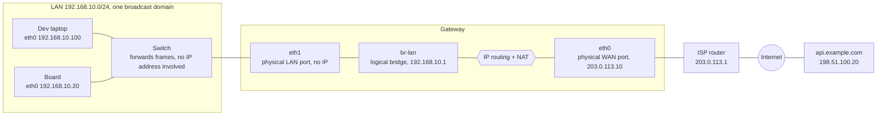

| Device | Interface | MAC | IPv4 | Role |
|---|---|---|---|---|
| Board | `eth0` | `00:00:5e:00:53:14` | `192.168.10.20/24` (static DHCP lease) | The embedded device |
| Dev laptop | `eth0` | `00:00:5e:00:53:64` | `192.168.10.100/24` (DHCP) | SSH, TFTP/NFS server |
| Gateway, LAN side | `br-lan` (bridge over the physical port `eth1`) | `00:00:5e:00:53:01` | `192.168.10.1/24` | Default gateway, DHCP and DNS server |
| Gateway, WAN side | `eth0` | `00:00:5e:00:53:02` | `203.0.113.10/24` | Example WAN address standing in for the ISP-assigned public IP. NAT happens here |
| ISP router | | `00:00:5e:00:53:fe` | `203.0.113.1` | Gateway's next hop |
| Server | | | `198.51.100.20` | Example server address for `api.example.com`, HTTPS on port 443 |

`203.0.113.0/24` and `198.51.100.0/24` are **reserved for documentation** (RFC 5737): they play the role of public addresses here, but they're never assigned to real hosts. The MACs come from the documentation block `00:00:5e:00:53:xx` (RFC 7042). Replace both with your own values.

**Physical and logical interfaces:** `eth0` on the board and `eth0`/`eth1` on the gateway are **physical** interfaces, each backed by a NIC and its driver. `br-lan` is a **logical** interface created in software (a bridge, section 3); other logical interfaces are VLAN interfaces (`vlan10`), tunnels (`wg0`), veth pairs (section 17) and loopback (`lo`). IP addresses belong to an interface, not to a device: the gateway's LAN address sits on `br-lan`, while `eth1` carries frames but has no address. In the [gateway note](../gateway/gateway.md#networks) there's one more layer: `eth1` carries tagged VLANs, and `br-lan` bridges the VLAN interface `vlan10`.

### Network B: a cellular product with an AP and a modem

Part 3 uses this one: a product whose Linux application processor (AP) gets internet access through a separate modem, and shares it with a PC plugged into its USB port.

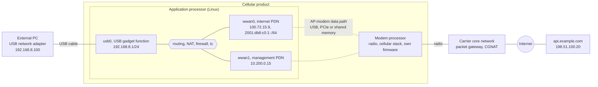

| Element | Interface | Address | Notes |
|---|---|---|---|
| External PC | Its USB network adapter | `192.168.8.100/24` (DHCP from the AP) | Section 21 |
| AP, downstream | `usb0` (USB gadget function) | `192.168.8.1/24` | The AP is the PC's gateway, DHCP and DNS server |
| AP, internet PDN | `wwan0` | `100.72.15.9` (carrier-assigned), `2001:db8:c0:1::/64` (from RAs) | Raw-IP, point-to-point: no MAC, no ARP |
| AP, management PDN | `wwan1` | `10.200.0.15` | Private APN that only reaches the operator's device-management servers in `10.250.0.0/16` |
| Server | | `198.51.100.20` | Same as network A |

- A **PDN connection** (packet data network connection; "PDP context" in 2G/3G, "PDU session" in 5G) is the cellular equivalent of an uplink: each one has its own addresses, DNS servers and MTU, and appears in Linux as its own interface. Which network it reaches is chosen by its APN (access point name).
- `wwan0`/`wwan1` are placeholders. Real names depend on the driver: `wwan0`, `qmimux0`, `rmnet_data0`, `mhi_hwip0`... (section 20).
- `100.72.15.9` is in the shared address space for carrier-grade NAT (`100.64.0.0/10`, RFC 6598), the usual shape of a cellular IPv4 address. `2001:db8::/32` is the IPv6 documentation range (RFC 3849).

---

## 3. Ethernet, MAC addresses, switches and bridges

Ethernet moves **frames** between devices on the same link. A frame carries a destination MAC, a source MAC, an **EtherType** saying what's inside (`0x0800` IPv4, `0x86dd` IPv6, `0x0806` ARP, `0x8100` VLAN tag), a payload of up to 1500 bytes (the **MTU**), and a checksum (FCS).

A **MAC address** is 48 bits, written `00:00:5e:00:53:14`. Two bits of the first byte matter:

| Bit (first byte) | Meaning when set | Example |
|---|---|---|
| `0x01` | Multicast / group address | `01:00:5e:...` (IPv4 multicast), `33:33:...` (IPv6 multicast), `ff:ff:ff:ff:ff:ff` (broadcast) |
| `0x02` | Locally administered: set by software, not burned in by a vendor | `02:...`, `x6:...`, `xa:...`, `xe:...` |

A vendor-assigned MAC starts with the vendor's 24-bit OUI. A locally administered one is what you use when a board has none (below).

### MAC addresses on embedded boards

Unlike a PC NIC, many SoC Ethernet controllers have **no MAC address of their own**. Someone has to provide one at boot:

| Source | How it reaches Linux |
|---|---|
| EEPROM, OTP fuses, SoC unique ID | Read by U-Boot (or by the driver directly) |
| U-Boot environment `ethaddr` / `eth1addr` | U-Boot writes it into the device tree (`local-mac-address` of the `ethernetN` alias node) before starting the kernel |
| Device tree, hardcoded | `local-mac-address = [00 00 5e 00 53 14];` in the Ethernet node |
| Nothing | The driver picks a **random** locally administered MAC, different at every boot |

```bash
ip link show eth0                          # link/ether 00:00:5e:00:53:14
cat /sys/class/net/eth0/addr_assign_type   # 0 = permanent, 1 = random, 3 = set from user space
# In U-Boot: printenv ethaddr

# Set one from user space (needs the interface down on most drivers)
ip link set dev eth0 down
ip link set dev eth0 address 02:00:00:00:53:14
ip link set dev eth0 up
```

A random MAC at every boot is a classic bring-up bug: the board gets a **new DHCP lease and a different IP** every reboot, static DHCP leases (keyed by MAC) never match, and other hosts keep a stale ARP entry for the old MAC for a while. Fix it in U-Boot or the device tree, not with a script that runs late. USB gadget network functions have the same issue on both ends of the cable (`dev_addr` and `host_addr`, section 21).

### Switches and bridges

A **switch** forwards frames between its ports at layer 2. It **learns** which MAC lives behind which port from the source address of every frame it sees, and keeps that in its forwarding table (FDB):

- **Known unicast** destination: sent out of one port only.
- **Broadcast**, **unknown unicast**, and multicast (unless the switch does IGMP/MLD snooping, section 6): **flooded** out of every port except the one it came in on.

Three related ideas that are easy to mix up:

- **Broadcast domain** (layer 2): every device a broadcast frame reaches. Switches and bridges extend it; routers stop it.
- **IP subnet** (layer 3): an address range such as `192.168.10.0/24`. It decides which destinations a host treats as on-link (section 4). It says nothing about cabling.
- **VLAN** (layer 2): a way to split one switched network into several separate broadcast domains. Ports are assigned to VLANs, and links shared by several VLANs (trunks) mark each frame with an 802.1Q tag.

The usual design maps **one subnet to one VLAN**, as in this note and the gateway note, but it's a convention, not a rule. Two subnets can share one broadcast domain: their hosts receive each other's broadcasts, yet each treats the other subnet as off-link and goes through a router. That's sometimes done on purpose (migrations, a second address range), and sometimes by accident (a board with a wrong static address still "sees" the LAN's ARP traffic but can't talk to anything). The [gateway note](../gateway/gateway.md#networks) puts VLAN, bridge and subnet side by side. Section 7 compares bridging with routing.

A Linux **bridge** is a software switch: same learning and flooding, between network interfaces of one machine. On embedded devices you meet it when:

- A Wi-Fi access point joins the wired LAN (`wlan0` and `eth0` in one bridge, like the gateway's `br-lan`).
- A board has two Ethernet ports and must pass traffic through (daisy-chained industrial devices).
- A switch chip sits behind the SoC (most routers, some industrial boards): with the kernel's **DSA** (Distributed Switch Architecture) driver, each front port shows up as its own interface (`lan1`, `lan2`...), and you group them with a bridge. Most current OpenWrt routers work this way (the [OpenWrt note](../openwrt/openwrt.md#bridges-routed-interfaces-and-vlans) covers bridges and VLANs there).

```bash
ip link add name br0 type bridge
ip link set eth0 master br0
ip link set eth1 master br0
ip link set br0 up               # the IP address now goes on br0, not on eth0/eth1
bridge link                      # member ports
bridge fdb show br br0           # learned MACs
```

A bridge port must be an Ethernet-like interface: the kernel refuses to add a raw-IP cellular interface or a PPP link to a bridge (section 21 explains why that matters for tethering).

### Checking the link

Before anything at layer 3, check that layer 1 and 2 are up:

```bash
$ ip -br link
lo     UNKNOWN  00:00:00:00:00:00 <LOOPBACK,UP,LOWER_UP>
eth0   UP       00:00:5e:00:53:14 <BROADCAST,MULTICAST,UP,LOWER_UP>
# Cable unplugged or PHY not working:
eth0   DOWN     00:00:5e:00:53:14 <NO-CARRIER,BROADCAST,MULTICAST,UP>

$ ethtool eth0 | grep -E 'Speed|Duplex|Link detected'
    Speed: 1000Mb/s
    Duplex: Full
    Link detected: yes

ip -s link show eth0     # RX/TX packets, errors and drops: growing errors point to cabling, PHY or clock issues
ethtool -S eth0          # driver-specific counters (ring overruns, FIFO errors...), names vary by driver
```

`UP` in the flags means the interface is administratively up (`ip link set eth0 up`). `LOWER_UP` means the PHY (or the USB function, or the modem link) reports a link. You need both.

---

## 4. IP addressing and subnetting

An IPv4 address is 32 bits, written as four bytes: `192.168.10.20`. The **prefix length** (`/24`) says how many leading bits identify the **network**; the rest identify the **host** inside it.

```
192.168.10.20   = 11000000.10101000.00001010.00010100
/24 (netmask)   = 11111111.11111111.11111111.00000000   = 255.255.255.0
AND             = 11000000.10101000.00001010.00000000   = 192.168.10.0   (network)
```

For `192.168.10.20/24`:

| | Value |
|---|---|
| Network address | `192.168.10.0` |
| Netmask | `255.255.255.0` |
| Broadcast address | `192.168.10.255` |
| Usable host addresses | `192.168.10.1` to `192.168.10.254` (254 hosts) |

**Why the prefix matters:** when you add `192.168.10.20/24` to `eth0`, the kernel creates the route `192.168.10.0/24 dev eth0`. That route is what tells the board "these 254 addresses are **on-link**: reach them directly with ARP". Anything else goes to a router (section 7). A wrong prefix breaks things quietly:

- Board set to `192.168.10.20/16`: it believes all of `192.168.0.0/16` is on-link, so traffic to `192.168.20.5` (the gateway note's IoT VLAN) is sent directly via ARP instead of to the gateway. Nobody answers.
- Board set to `192.168.10.20/32`: nothing is on-link, not even the gateway, so a default route via `192.168.10.1` can't be installed.

On point-to-point links (cellular raw-IP, PPP) the prefix matters less: there's only one possible next hop, so routes point at the interface (`default dev wwan0`) instead of a gateway address, and the netmask a modem reports is often meaningless.

Common prefix lengths:

| Prefix | Netmask | Addresses | Usable hosts | Typical use |
|---|---|---|---|---|
| `/16` | `255.255.0.0` | 65,536 | 65,534 | Large flat networks, address plans |
| `/24` | `255.255.255.0` | 256 | 254 | A LAN or VLAN |
| `/25` | `255.255.255.128` | 128 | 126 | Half a /24: `.0/25` = `.1-.126`, `.128/25` = `.129-.254` |
| `/26` | `255.255.255.192` | 64 | 62 | Small segments |
| `/30` | `255.255.255.252` | 4 | 2 | Point-to-point link (classic) |
| `/31` | `255.255.255.254` | 2 | 2 | Point-to-point link, no network/broadcast address (RFC 3021) |
| `/32` | `255.255.255.255` | 1 | 1 | A single host (host route, loopback-style addresses) |

`ipcalc 192.168.10.20/24` computes all of this (Debian package `ipcalc`; BusyBox has `ipcalc -bn`).

### Special ranges

| Range | What it is | Where you meet it |
|---|---|---|
| `10.0.0.0/8`, `172.16.0.0/12`, `192.168.0.0/16` | Private (RFC 1918), not routed on the internet | Every LAN, behind NAT (section 13) |
| `127.0.0.0/8` | Loopback (`lo`) | Services reachable only from the device itself |
| `169.254.0.0/16` | IPv4 link-local (RFC 3927), self-assigned when there's no DHCP | Laptop cabled directly to a board. On Windows and macOS (and Linux hosts running a link-local client), it means "DHCP failed" |
| `100.64.0.0/10` | Shared address space for carrier-grade NAT (RFC 6598) | Cellular modems, Starlink: you are behind someone else's NAT |
| `192.0.0.0/29` | IPv4 service continuity prefix (RFC 7335) | The IPv4 address of a 464XLAT CLAT (section 13) |
| `192.0.2.0/24`, `198.51.100.0/24`, `203.0.113.0/24` | Documentation (RFC 5737) | Examples, like this note |
| `224.0.0.0/4` | Multicast | mDNS (`224.0.0.251`), streaming, discovery protocols (section 6) |
| `255.255.255.255` | Limited broadcast | DHCP before the client has an address |

IPv6 equivalents: `::1` loopback, `fe80::/10` link-local, `fc00::/7` unique local addresses (ULA, the IPv6 "private" range), `ff00::/8` multicast, `2001:db8::/32` documentation, `64:ff9b::/96` the well-known NAT64 prefix (section 13).

### IPv6 in short

IPv6 uses the same layers with different mechanisms. What changes for a device:

| | IPv4 | IPv6 |
|---|---|---|
| Address size | 32 bits | 128 bits, written `2001:db8:c0:1::20` |
| LAN prefix | Anything, `/24` is common | `/64` on ordinary LANs, because SLAAC needs it. Other lengths exist for other designs (e.g. `/127` on router-to-router links, RFC 6164) |
| Link-local address | Optional (`169.254/16`) | Created automatically (`fe80::/10`) on every interface where IPv6 is enabled. Can be turned off (`disable_ipv6`, `addr_gen_mode`) |
| IP to MAC | ARP | Neighbor Discovery (NDP), carried by ICMPv6 (section 5) |
| Getting an address | DHCP or static | SLAAC from Router Advertisements, and/or DHCPv6, or static (section 8) |
| Default gateway | DHCP option 3, or static | **Router Advertisements**. DHCPv6 has no default-router option |
| Addresses per interface | Usually one | Several at once: link-local, one or more global (SLAAC, temporary privacy addresses, DHCPv6), ULA |
| Broadcast | Yes | No, multicast instead (`ff02::1` = all nodes on the link) |
| Fragmentation by routers | Allowed unless DF is set | Never: only the sender fragments (section 11) |
| NAT | Almost always at home | Normally none: the firewall does the protection |

**Link-local as a rescue path:** with IPv6 enabled, a board whose IPv4 config is broken still has a link-local address, and you can reach it from a laptop on the same link:

```bash
ping -c 2 fe80::200:5eff:fe00:5314%eth0        # targeted test of a known peer. %eth0: which link (link-local is only unique per link)
ssh root@fe80::200:5eff:fe00:5314%eth0
ip -6 neigh show dev eth0                      # IPv6 neighbors the laptop has seen recently
ping -6 -c 2 ff02::1%eth0                      # discovery attempt: echo request to all nodes on the link
```

- The board's link-local address above is derived from its MAC (EUI-64, the kernel default). With stable-privacy addressing (`addr_gen_mode` 2 or 3, chosen by some network managers) it can't be guessed: read it once with `ip -6 addr` on the serial console.
- `ff02::1` is a **discovery attempt, not a census**. Only hosts that answer multicast echo requests reply (Linux does by default, `net.ipv6.icmp.echo_ignore_multicast=0`; many other systems and firewalls don't). Silence from a host proves nothing: test it directly by address.

---

## 5. Neighbor resolution: ARP and IPv6 Neighbor Discovery

To send a packet to an **on-link** IP address over Ethernet, the kernel needs that host's MAC address, because the frame is addressed by MAC. **ARP** (Address Resolution Protocol) asks for it with a broadcast:

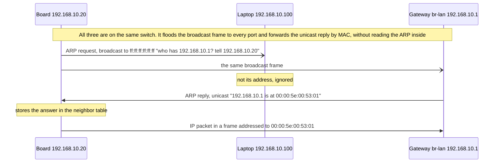

The rule that makes routing work: **a host only resolves on-link addresses**. To reach `198.51.100.20`, the board never ARPs for the server; it ARPs for its **gateway**, and sends the frame to the gateway's MAC with the server's IP inside (section 7).

```bash
$ ip neigh show dev eth0
192.168.10.1 lladdr 00:00:5e:00:53:01 REACHABLE
192.168.10.100 lladdr 00:00:5e:00:53:64 STALE
192.168.10.77 FAILED

ip neigh flush dev eth0                 # forget everything, force new ARP requests
arping -I eth0 -c 3 192.168.10.1        # ARP-level ping: usually answers even when the host's IP firewall drops ICMP
arping -D -I eth0 -c 3 192.168.10.20    # duplicate address detection: any reply means another device already uses this IP
```

| State | Meaning |
|---|---|
| `REACHABLE` | Confirmed recently |
| `STALE` | Not confirmed recently, still used. Re-checked on next use |
| `INCOMPLETE` | Request sent, no answer yet |
| `FAILED` | Resolution failed: no reply to repeated requests (see below) |

`FAILED` says that neighbor resolution didn't succeed, not why. The usual suspects, roughly in order:

- **Layer 2 path:** target off or unplugged, wrong switch port, wrong VLAN on either side, a bridge port that isn't forwarding.
- **Addressing:** a wrong IP or prefix on either end, so the target doesn't consider the request for itself, or replies to a different address.
- **Filtering:** ARP isn't seen by the IP firewall (`inet` tables), but it can be dropped by `arp`- or `bridge`-family nftables rules, `arptables`, Wi-Fi client isolation, or switch port security.

To narrow it down, capture on both ends: `tcpdump -eni eth0 arp`. Requests leaving the board but never arriving on the target point to the path; requests arriving with no reply point to the target's addressing or filtering.

A **gratuitous ARP** is a host announcing its own IP/MAC pair unprompted (after boot, IP change, or failover), so other hosts update their tables.

### IPv6 Neighbor Discovery

IPv6 does the same job with ICMPv6 messages, and no broadcast:

- **Neighbor Solicitation** (NS) is sent to the target's **solicited-node multicast** group, `ff02::1:ff` + the last 24 bits of its address. For the board's `fe80::200:5eff:fe00:5314`, that's `ff02::1:ff00:5314`, carried in a frame to `33:33:ff:00:53:14`. Only hosts whose addresses end the same way receive it.
- **Neighbor Advertisement** (NA) answers with the MAC.
- **Duplicate Address Detection** (DAD): before using a new address, a host sends an NS for it; an answer means it's taken. Until DAD completes the address is `tentative`, and a conflict leaves it `dadfailed` (`ip -6 addr` shows both).

The neighbor table and its states are the same (`ip -6 neigh`). Because NS relies on multicast, a switch with broken MLD snooping can break IPv6 neighbor resolution while IPv4 works (section 6).

**Point-to-point interfaces have no neighbor resolution.** A raw-IP cellular interface or a PPP link is flagged `NOARP`: there's only one possible receiver, so packets go straight to the driver without any MAC lookup. `ip neigh` shows nothing for them, and an ARP problem can't exist there.

---

## 6. Unicast, broadcast and multicast

| Delivery | Sent to | Received by | IPv4 examples | IPv6 examples |
|---|---|---|---|---|
| **Unicast** | One interface | That host | `198.51.100.20` | `2001:db8:c0:1::20` |
| **Broadcast** | Every host on the link | Everyone in the broadcast domain. Routers don't forward it | `255.255.255.255`, `192.168.10.255` | Doesn't exist |
| **Multicast** | A group | Hosts that joined the group. Routers forward it only with multicast routing | `224.0.0.251` (mDNS), `239.x.y.z` (local applications) | `ff02::1` (all nodes), `ff02::fb` (mDNS), `ff02::1:ffXX:XXXX` (solicited-node) |

(Anycast, one address announced from several places with routing picking the nearest, is how public DNS resolvers like `1.1.1.1` work. To a device it looks like unicast.)

At layer 2, multicast IP addresses map to multicast MACs, so the NIC can filter them in hardware: IPv4 uses `01:00:5e` plus the low 23 bits of the group (`224.0.0.251` → `01:00:5e:00:00:fb`), IPv6 uses `33:33` plus the low 32 bits (`ff02::fb` → `33:33:00:00:00:fb`).

**Group membership** is signaled with **IGMP** (IPv4) and **MLD** (IPv6, carried in ICMPv6). When a socket joins a group, the host sends a membership report; a querier (usually the router) periodically asks who is still listening. **Snooping** switches, and the Linux bridge, listen to these reports and forward each group's traffic only to the ports with members. Link-local groups (`224.0.0.0/24`, `ff02::1`) are flooded anyway.

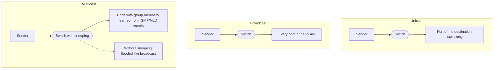

Linux view:

```bash
ip maddr show dev eth0                               # groups this host has joined, with their multicast MACs
cat /sys/class/net/br0/bridge/multicast_snooping     # 1 = the bridge snoops IGMP/MLD (the default)
bridge mdb show                                      # groups the bridge has learned, per port
tcpdump -ni eth0 igmp                                # IGMP reports and queries
tcpdump -vni eth0 icmp6 | grep -i 'multicast listener'   # MLD reports and queries
```

Where it bites on embedded systems:

- **IPv6 and snooping:** switches that snoop MLD forward solicited-node groups only to ports that reported them. With no MLD querier on the segment, or buggy snooping, memberships time out on some switches and IPv6 neighbor resolution fails intermittently while IPv4 works.
- **mDNS stays on its link:** `board.local` (section 9) doesn't cross routers or VLANs. Reaching it from another subnet needs an mDNS reflector (Avahi's `enable-reflector=yes`) or plain DNS.
- **Cellular links carry no broadcast**, and carriers generally don't deliver multicast to devices. Discovery protocols that rely on them only work on the local side of the device.
- Forwarding multicast between subnets (`igmpproxy`, `smcroute`, PIM) is multicast routing, out of scope here.

---

## 7. Routing

### Bridging versus routing

A **bridge** (or switch) forwards frames inside one broadcast domain and doesn't touch the IP packet. A **router** forwards packets between subnets: it consumes the incoming frame, decides where the packet goes, and builds a new frame for the next link.

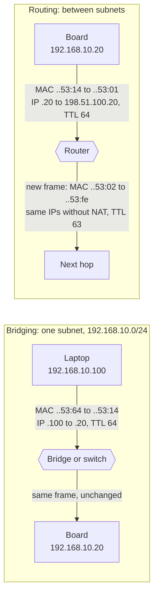

| | Bridge / switch (layer 2) | Router (layer 3) |
|---|---|---|
| Forwards by | Destination MAC (FDB) | Destination IP (routing table, policy rules) |
| Ethernet header | Unchanged | Replaced: source = router's outgoing interface, destination = next hop's MAC (found by ARP/ND) |
| IP header | Untouched | TTL (IPv4) or Hop Limit (IPv6) minus 1; at 0 the packet is dropped and an ICMP "time exceeded" goes back. IPv4 header checksum recomputed. Addresses unchanged unless NAT |
| Broadcasts | Forwarded within the domain | Stopped |
| Subnets | One subnet across all ports | One subnet per interface |
| Different MTUs on each side | Can't adapt: oversized frames are dropped | Fragments IPv4 without DF, otherwise sends ICMP "too big" (section 11) |
| Non-Ethernet links | Can't bridge them (raw IP, PPP) | Routes between any interface types |
| Linux | `type bridge` interface, `bridge fdb` | `net.ipv4.ip_forward=1` / `net.ipv6.conf.all.forwarding=1`, routing table |
| Filtering | `bridge`-family nftables (or `br_netfilter`) | `inet`/`ip`/`ip6` forward chain |

Choose a bridge when devices on several ports must share one subnet (LAN ports plus Wi-Fi). Choose routing when the networks are different (LAN and cellular, a PC behind a USB link), when you want to filter or translate between them, or when one side isn't Ethernet.

### The route lookup

**Concept:** a routing table maps destination prefixes to a next step: "deliver directly on this interface" or "hand to this router". Every host has one, not only routers.

**Behavior:** every IP packet leaving the board goes through a **route lookup**. The kernel picks the route with the **longest matching prefix**; among routes with the same prefix, the **lowest metric** wins.

**Linux view:** strictly, Linux first walks its **policy rules** (`ip rule`), and each rule points to a routing table. On a plain device the only rules lead to the `local` table (the device's own addresses), then `main` (what `ip route` shows), then `default` (empty), so the main table is what matters. Extra rules and tables appear when something sets up policy routing (multiple uplinks, VPNs, containers: below and section 19).

```bash
$ ip route
default via 192.168.10.1 dev eth0 proto dhcp src 192.168.10.20 metric 100
192.168.10.0/24 dev eth0 proto kernel scope link src 192.168.10.20

$ ip route get 198.51.100.20        # off-link: goes to the gateway
198.51.100.20 via 192.168.10.1 dev eth0 src 192.168.10.20 uid 0

$ ip route get 192.168.10.100       # on-link: delivered directly
192.168.10.100 dev eth0 src 192.168.10.20 uid 0
```

- `192.168.10.0/24 ... scope link`: the connected route created by the address (section 4).
- `default` = `0.0.0.0/0`, the shortest possible prefix: it matches everything, so it's used only when nothing more specific does. Its `via` address is the **default gateway**.

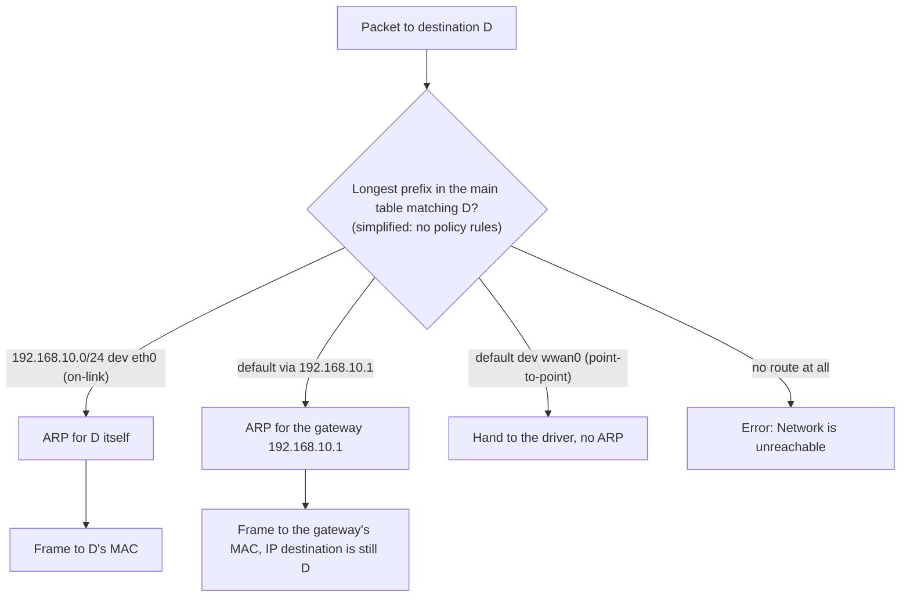

The gateway must itself be on-link: `ip route add default via 10.0.0.1` on this board fails with `Nexthop has invalid gateway`, because nothing says how to reach `10.0.0.1`.

### Source address selection

When an application doesn't bind to a specific address, the kernel chooses the **source address** during the route lookup:

- **IPv4:** the route's `src` attribute if it has one (`ip route add ... src 192.168.10.20`); otherwise the primary address of the outgoing interface, preferring one in the same subnet as the next hop.
- **IPv6:** the rules of RFC 6724: same scope as the destination (a link-local destination gets a link-local source), prefer non-deprecated addresses, prefer addresses on the outgoing interface, longest matching prefix, and so on.
- **Applications can override it** by binding to an address, or to an interface (`SO_BINDTODEVICE`; `ping -I`, `curl --interface` on the command line).

```bash
ip route get 198.51.100.20                      # the "src" field is the chosen source
ip route get 198.51.100.20 from 10.200.0.15     # lookup as if the source were 10.200.0.15 (policy rules can depend on it)
ip -6 route get 2001:db8::20
ss -tnp                                         # the local address each connection actually uses
```

It matters as soon as a device has more than one address: a packet that leaves `wwan0` with `eth0`'s source address is dropped by the carrier's anti-spoofing filter, or its reply comes back on the wrong interface. This happens when an application binds to one address while the routing table sends the traffic out another interface. Section 19 fixes it with source-based policy rules. (Ordering the *destination* addresses returned by DNS is a separate step, done by `getaddrinfo()`, section 9.)

### Static routes

**Static routes** send one network through a router other than the default gateway, e.g. a lab subnet behind a VPN box:

```bash
ip route add 10.8.0.0/24 via 192.168.10.5
ip route del 10.8.0.0/24
```

### Policy rules and multiple tables

A device can have several routing tables, and **policy rules** choose which one to consult:

```bash
$ ip rule
0:      from all lookup local
32766:  from all lookup main
32767:  from all lookup default
```

Rules are tried in priority order. They can match the source or destination prefix, the incoming interface (`iif`), the outgoing interface a socket is bound to (`oif`), a firewall mark set by nftables (`fwmark`), the user (`uidrange`), and more, and point to a table by number (names live in `/etc/iproute2/rt_tables`). A destination-only choice ("send `10.250.0.0/16` through `wwan1`") needs only a specific route in the main table; rules are needed when the choice depends on something else, typically the **source address**. Section 19 has the full multi-interface example.

### Host or router

A device only forwards packets that aren't addressed to it if forwarding is enabled (`net.ipv4.ip_forward=1`, `net.ipv6.conf.all.forwarding=1`). By default it's a host and drops them. A product that shares its connection (section 21) is a router, with everything that implies: forward chain policy, NAT, MTU handling. Turning a Linux box into a full router is what the gateway note does.

---

## 8. Getting an address: DHCP, SLAAC, static

| Method | How | Use it for |
|---|---|---|
| **DHCP** (IPv4) | A server hands out address, prefix, gateway, DNS, lease time | Default for devices on a LAN. Pair it with a **static lease** on the server if the device needs a fixed address |
| **SLAAC / DHCPv6** (IPv6) | Router Advertisements, optionally DHCPv6 | IPv6 on any LAN (below) |
| **Static** | Configured on the device | Point-to-point links, isolated test benches, the DHCP server itself |
| **Link-local** | Self-assigned `169.254.x.y` (IPv4), or `fe80::` (IPv6, automatic wherever IPv6 is enabled) | Direct cable to a laptop with no DHCP server |
| **Modem control plane** | The modem reports the carrier-assigned address, DNS and MTU over QMI/MBIM/AT; a connection manager applies them | Cellular data interfaces (section 20). Some modems also answer DHCP on the data interface as a convenience |
| **Kernel `ip=`** | Kernel command line, configured before user space starts | NFS root (section 18) |

### DHCP

DHCP runs over UDP: client port **68**, server port **67**. The client has no address yet, so it starts with broadcasts:

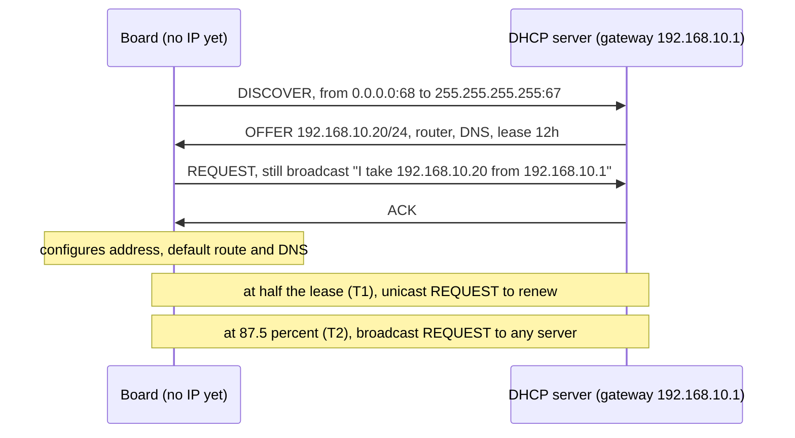

If the lease expires without renewal, the client must stop using the address.

**Linux view:** because the client has no IP address at first, Linux DHCP clients use a **packet socket** (`AF_PACKET`) at least for the initial exchange, so the kernel needs `CONFIG_PACKET`. Packet sockets get their copy of incoming frames before the IP firewall's input hook (section 15), so the first lease can work even when the firewall would drop the replies. **Renewals** are unicast UDP between the server and the client's new address, and some clients receive them on an ordinary UDP socket, which the firewall does filter. That's why a board can get its first lease and then lose its address at renewal time.

On embedded systems, check **who** runs DHCP, because they don't behave the same. Which client is present depends on the image configuration, not on Buildroot or Yocto as such; these are common cases:

| Client | Commonly found in | Note |
|---|---|---|
| BusyBox `udhcpc` | Buildroot images using ifupdown (the default unless systemd-networkd or netifrc is selected) with `BR2_SYSTEM_DHCP` set, minimal images, OpenWrt (driven by netifd) | Doesn't configure anything itself: it calls a script (`/usr/share/udhcpc/default.script`) with `deconfig`/`bound`/`renew`, and the **script** sets the IP, routes and `resolv.conf`. No script, no configuration |
| `dhcpcd` | Buildroot package option, many distros | Full client, configures the interface itself |
| systemd-networkd | Images built with systemd and networkd enabled (Buildroot, Yocto, Debian) | `DHCP=yes` in a `.network` file |
| NetworkManager, ConnMan | Desktop-like images, Yocto images that include them (Poky's `core-image-sato` uses ConnMan) | Full managers, also handle Wi-Fi and cellular |

```bash
udhcpc -i eth0 -f -q                       # BusyBox: get a lease in the foreground, then exit
tcpdump -ni eth0 -e port 67 or port 68     # watch DORA on the wire
```

### Leases and failure modes

A server identifies a client by its **client identifier** (DHCP option 61) when one is sent, otherwise by its MAC. systemd-networkd sends a DUID-based identifier by default, derived from `/etc/machine-id`: on a read-only root filesystem that regenerates the machine ID at every boot, the board looks like a new client each time, even with a fixed MAC.

| Symptom | Likely causes |
|---|---|
| DISCOVER repeated, no OFFER | No server on that segment or VLAN, server not listening on that interface, no DHCP relay between subnets |
| OFFER visible in `tcpdump`, no lease | Client rejects the offer or listens on another interface; a firewall drops the reply for clients that use UDP sockets |
| Lease obtained, then lost after half the lease | Renewals filtered (section 15) or the server unreachable by unicast |
| Different address after every boot | Random MAC (section 3), changing client ID or DUID (machine ID) |
| `DECLINE` or address conflict in logs | Another host already uses the address: a static IP inside the server's pool |
| Two different servers answer | A rogue DHCP server: another router, or a dev board with its own dnsmasq enabled on the lab LAN |
| Address but no default route or DNS | `udhcpc` script missing or not applying the router/DNS options |

### Static configuration

By hand (lost at reboot):

```bash
ip addr add 192.168.10.20/24 dev eth0
ip link set eth0 up
ip route add default via 192.168.10.1
echo "nameserver 192.168.10.1" > /etc/resolv.conf
```

Persistent, BusyBox/Debian `ifupdown` (`/etc/network/interfaces`, which Buildroot generates unless systemd-networkd or netifrc is selected). BusyBox `ifup` doesn't manage DNS, so `resolv.conf` stays separate:

```
auto eth0
iface eth0 inet static
    address 192.168.10.20
    netmask 255.255.255.0
    gateway 192.168.10.1
```

Persistent, systemd-networkd (`/etc/systemd/network/20-eth0.network`):

```ini
[Match]
Name=eth0

[Network]
Address=192.168.10.20/24
Gateway=192.168.10.1
DNS=192.168.10.1
# For DHCP instead: replace the three lines above with DHCP=yes
```

### IPv6 address configuration

Three mechanisms configure an IPv6 host. They complement each other rather than compete:

| Mechanism | Provides |
|---|---|
| **RA** (Router Advertisement, ICMPv6, sent by routers from their `fe80::` address) | The **default router** (the RA's source address, with a lifetime), on-link prefixes, flags telling hosts whether to use SLAAC and/or DHCPv6, the link MTU, optionally DNS servers (RDNSS, RFC 8106) |
| **SLAAC** | The host builds its own global address from an RA prefix (a `/64`), then runs DAD (section 5) |
| **DHCPv6** | Addresses (stateful mode) and/or other settings such as DNS servers. Never the default route. Routers also use it to request whole prefixes (**prefix delegation**, DHCPv6-PD) |

```bash
$ ip -6 route show default
default via fe80::200:5eff:fe00:5301 dev eth0 proto ra metric 1024 expires 1795sec pref medium
ip -6 addr show dev eth0       # fe80:: (scope link) and, with SLAAC, a global address (scope global)
```

A missing IPv6 default route therefore means "no RA received or accepted", not a DHCPv6 problem. On a Linux host either the kernel processes RAs (`accept_ra=1`, and only while `forwarding=0`; `accept_ra=2` accepts them even on a router) or the network manager does it in user space (systemd-networkd, for example). On a cellular PDN the carrier sends RAs with a `/64` dedicated to the device (section 21 uses that to give the PC IPv6). The gateway note covers [IPv6 on the router side](../gateway/gateway.md#ipv6-in-short) (prefix delegation, sending RAs), the OpenWrt note [does it with odhcpd](../openwrt/openwrt.md#7-ipv6). Blocking ICMPv6 breaks IPv6 entirely, because RAs and Neighbor Discovery both use it.

### Dual stack

On a dual-stack device, IPv4 and IPv6 are **configured independently**: separate addresses, separate default gateways (DHCP option 3 versus RAs), separate DNS servers (DHCP option 6 versus RDNSS/DHCPv6), separate firewall rules (`ip` and `ip6` tables; an `inet` table covers both) and possibly different MTUs. Any of these can work for one family and fail for the other, so test both explicitly:

```bash
ip -4 route get 198.51.100.20; ip -6 route get 2001:db8::20
curl -4 -sv https://api.example.com/v1/status -o /dev/null
curl -6 -sv https://api.example.com/v1/status -o /dev/null
```

Typical split failures: a global IPv6 address but no default route (RAs filtered or expired), an IPv6 DNS server that doesn't answer, ICMPv6 filtered (neighbor discovery, "packet too big"), and IPv6-only cellular networks where IPv4 reaches the internet only through translation (section 13). How applications choose between the two families is in section 9.

---

## 9. DNS: from name to IP address

Programs connect to names (`api.example.com`); packets need addresses. The application asks the **C library** (`getaddrinfo()`), which reads the local files and then asks a DNS server:

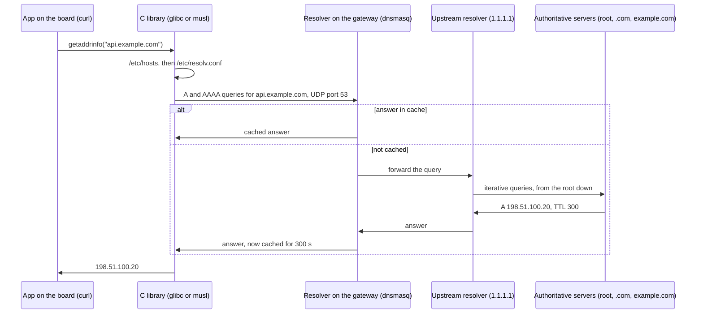

The board only ever talks to the resolver in `resolv.conf`: it sends a **recursive** query ("give me the final answer") and never contacts the authoritative servers itself. The resolvers do the iterative work, and each one caches the answer, so most lookups end at the first hop.

| Record | Maps | Example |
|---|---|---|
| `A` | Name to IPv4 | `api.example.com A 198.51.100.20` |
| `AAAA` | Name to IPv6 | `api.example.com AAAA 2001:db8::20` |
| `CNAME` | Name to another name (alias) | `www.example.com CNAME example.com` |
| `PTR` | IP to name (reverse lookup) | `20.100.51.198.in-addr.arpa PTR api.example.com` |

Queries go over UDP port 53, falling back to TCP port 53 for large answers. Every answer has a **TTL**: resolvers cache it that long, which is why a DNS change takes time to show up.

Files on the device:

| File | Role |
|---|---|
| `/etc/resolv.conf` | `nameserver` lines (up to 3), `search` domains. Written by the DHCP client, network manager or modem connection manager |
| `/etc/hosts` | Static names, checked before DNS |
| `/etc/nsswitch.conf` | Lookup order (`hosts: files dns`). **glibc only**: musl ignores it and always uses hosts, then DNS |
| `/etc/gai.conf` | glibc only: how `getaddrinfo()` orders IPv6 and IPv4 results |

Embedded specifics:

- **Read-only root filesystem:** `/etc/resolv.conf` is usually a symlink to a writable location. Buildroot links it to `/run/resolv.conf`, systemd-resolved to `/run/systemd/resolve/stub-resolv.conf` (nameserver `127.0.0.53`, a local stub that forwards to the real servers). If `resolv.conf` points to `127.0.0.53` and systemd-resolved isn't running, nothing resolves.
- **mDNS** (`board.local`): multicast DNS on UDP port 5353 to `224.0.0.251` (RFC 6762) lets hosts on one link find each other without a DNS server. Run `avahi-daemon` (or systemd-resolved with `MulticastDNS=yes`) on the board and most desktops can `ssh root@board.local`, whatever its DHCP address. It only works on the local link (section 6).
- **DNS servers belong to an uplink.** A cellular PDN's DNS servers are often reachable only through that PDN, and a management APN's resolver only through the management PDN. A single global `resolv.conf` sends every query to the same servers through whatever route the kernel picks; per-interface DNS (systemd-resolved, dnsmasq with per-domain `server=` lines) avoids that (section 19).

### Caching and dual-stack lookups

- **The C library doesn't cache:** each `getaddrinfo()` call sends queries (unless glibc's optional `nscd` runs). Caches live in systemd-resolved, dnsmasq, the gateway and the carrier's resolvers.
- **Negative answers are cached too** (RFC 2308): a name looked up before it existed, or during an outage that returned NXDOMAIN, stays "not found" until that negative TTL expires.
- **A and AAAA:** `getaddrinfo()` asks for both and returns a list sorted by the destination rules of RFC 6724 (adjustable in `/etc/gai.conf` on glibc), usually IPv6 first. An application that only tries the first address hangs until a TCP timeout when IPv6 is broken but AAAA records exist. **Happy Eyeballs** (RFC 8305) races the families, starting IPv4 after a short delay if IPv6 hasn't connected; curl and browsers implement it, many embedded applications don't.
- On IPv6-only cellular networks, the carrier's resolver may **synthesize** AAAA records for IPv4-only names (DNS64, section 13).

### When names don't resolve

"Ping by IP works, by name doesn't" points to **name resolution**, which is broader than DNS. The cause can be a stale `/etc/hosts` entry, the NSS lookup order (glibc), a missing or wrong `nameserver`, a `search` domain appended to a short name, or a DNS server that isn't reachable. Follow the path the application uses, from the device outward:

```bash
getent hosts api.example.com            # same path as the application (glibc: NSS order, /etc/hosts, DNS)
grep '^hosts' /etc/nsswitch.conf        # glibc lookup order, e.g. "files dns" or "files resolve dns"
grep api.example.com /etc/hosts         # an entry here wins over DNS
cat /etc/resolv.conf                    # nameserver, search, options (ndots decides when search domains apply)
nslookup api.example.com 192.168.10.1   # ask the DNS server directly, bypassing /etc/hosts and NSS
```

- `getent` fails but `nslookup` works: the problem is local (`/etc/hosts`, NSS, `resolv.conf`, search domains).
- Both fail: check that the server answers at all (route, firewall, UDP and TCP port 53, the right uplink), then the upstream resolvers.
- `getent` isn't available on musl or minimal BusyBox images. There, `ping api.example.com` or the application's own error message is the closest test of the real path.
- A successful lookup only proves resolution. The application still has to reach the address it got, which might be an IPv6 address on a board without IPv6 connectivity, or a stale address from a cache.

---

## 10. TCP and UDP

IP delivers packets to a **host**. Ports deliver them to a **program**. A connection is identified by five values: protocol, source IP, source port, destination IP, destination port. Servers listen on a fixed port (443 for HTTPS); clients get a temporary **ephemeral port** from the kernel (`32768-60999` by default on Linux, see `/proc/sys/net/ipv4/ip_local_port_range`).

| | TCP | UDP |
|---|---|---|
| Connection | Handshake first, state kept on both ends | None: each datagram stands alone |
| Delivery | Reliable, in order, retransmits lost data | May be lost, duplicated, reordered |
| Flow and congestion control | Yes | No, the application's job |
| Message boundaries | **No**: a byte stream, the application must frame its messages | Yes, one datagram = one message |
| Header | 20+ bytes | 8 bytes |
| Used by | SSH, HTTP/1.1 and HTTP/2, TLS, MQTT | DNS, DHCP, NTP, TFTP, CoAP, mDNS, QUIC (HTTP/3) |

A TCP connection's life:

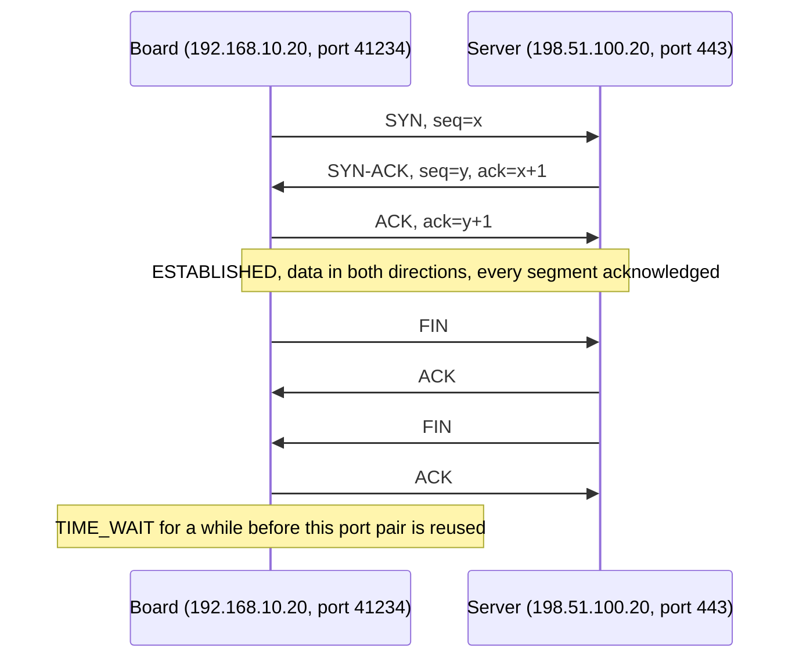

The handshake costs one round trip before any data flows (plus more for TLS, section 12). Over a cellular or satellite link with 100+ ms latency, reusing connections matters.

**How a failed connection looks** tells you where to look:

| Symptom | Meaning |
|---|---|
| `Connection refused` (immediate) | The host answered with a TCP **RST**: it's reachable, but nothing listens on that port |
| `Connection timed out` (after seconds) | No answer at all: firewall dropping, host down, or routing problem (including a broken return path) |
| `No route to host` | The board (for an on-link host) or the last router couldn't resolve the destination, or a firewall rejects with an ICMP error |
| `Network is unreachable` | No route at all on the board: no default route (yet) |

### Connection states and timeouts

`ss` shows each socket's state. Many sockets stuck in one state point to a specific problem:

| State | Meaning | Many of them suggests |
|---|---|---|
| `SYN-SENT` | SYN sent, no SYN-ACK yet | Destination unreachable or filtered |
| `SYN-RECV` | (Server side) SYN-ACK sent, waiting for the final ACK | SYN flood, or replies not reaching the clients (return path, NAT) |
| `ESTABLISHED` | Data can flow | Normal |
| `FIN-WAIT-1/2` | This side closed, waiting for the peer | A peer slow to close |
| `CLOSE-WAIT` | The peer closed, this application hasn't | An **application bug**: a socket never closed (leak) |
| `TIME-WAIT` | This side closed first; kept 60 s on Linux | Normal with many short connections |

**Retransmissions and timeouts (Linux defaults):** a lost segment is retransmitted after the retransmission timeout (RTO, at least 200 ms, doubling at each retry).

| Situation | What happens | Knob |
|---|---|---|
| Connecting to a host that never answers | SYN retransmitted, `connect()` fails after about 2 minutes (131 s on current kernels) | `net.ipv4.tcp_syn_retries` (6) |
| Peer disappears during a transfer | Retransmissions with backoff, error after at least ~15 minutes (924.6 s lower bound) | `net.ipv4.tcp_retries2` (15) |
| Idle connection, peer gone | **Never detected** unless keepalive is enabled on the socket; then probes after 2 hours idle, every 75 s, 9 probes | `tcp_keepalive_time`/`_intvl`/`_probes`, or per socket (`TCP_KEEPIDLE`...) |

On cellular links, coverage gaps and handovers show up as retransmissions and pauses, not resets, and NAT mappings that expire while idle (section 13) kill connections silently. Applications that must notice a dead path quickly need their own heartbeats or short keepalives (MQTT `keepalive` does this).

```bash
ss -tan                                          # all TCP sockets with states (BusyBox: netstat -tan)
ss -tan state established '( dport = :443 )'     # filter by state and port
ss -ti dst 198.51.100.20                         # per connection: rtt, cwnd, retransmissions, mss
nstat -az TcpRetransSegs TcpExtTCPTimeouts       # kernel-wide retransmission counters
```

**UDP has no states**, but connection tracking still follows UDP "flows" for the firewall and NAT, with idle timeouts (`/proc/sys/net/netfilter/nf_conntrack_udp_timeout*`). A UDP service that is silent longer than the timeout loses its NAT mapping.

### Listening sockets and ports

**What the board is listening on**, and on which address:

```bash
$ ss -tulpn          # TCP + UDP, listening, with process (columns trimmed)
Netid State   Local Address:Port   Process
tcp   LISTEN  0.0.0.0:22           users:(("dropbear",pid=201,fd=3))
tcp   LISTEN  127.0.0.1:1883       users:(("mosquitto",pid=230,fd=5))
tcp   LISTEN  *:8080               users:(("app",pid=250,fd=7))
```

- `0.0.0.0` / `*`: every interface, reachable from the network, including the cellular interface and a tethered PC.
- `127.0.0.1`: loopback only, reachable from the board itself. Debug servers and local brokers belong here.
- BusyBox: `netstat -tulpn`. Test a remote port with `nc -vz 192.168.10.20 22` (depends on how BusyBox `nc` was built).

Ports worth knowing on embedded systems:

| Port | Protocol | Use |
|---|---|---|
| 22/tcp | SSH (OpenSSH, Dropbear) | Shell, `scp` |
| 53/udp+tcp | DNS | Name resolution |
| 67, 68/udp | DHCP | Address configuration |
| 69/udp | TFTP | U-Boot network boot |
| 123/udp | NTP | Time sync, needed by TLS |
| 80, 443/tcp | HTTP, HTTPS | Web UI, REST APIs, OTA updates |
| 1883, 8883/tcp | MQTT, MQTT over TLS | IoT telemetry |
| 5683/udp | CoAP | Constrained devices |
| 5353/udp | mDNS | `.local` names, service discovery |
| 2049/tcp | NFS | NFS root filesystem |

---

## 11. ICMP, MTU and fragmentation

ICMP carries control and error messages for IP. It has no ports, and the kernel answers it itself.

| Type | Meaning | You see it in |
|---|---|---|
| Echo request / reply (8 / 0) | "Are you there?" | `ping` |
| Destination unreachable (3) | Code 1 host unreachable, code 3 **port unreachable** (UDP to a closed port), code 4 **fragmentation needed** | Failed connections, path MTU discovery |
| Time exceeded (11) | A router dropped the packet because its TTL reached 0 | `traceroute` |
| Redirect (5) | "Use this other router instead" | Usually disabled on routers |

ICMPv6 has the same roles (echo, destination unreachable, **packet too big**, time exceeded) plus Neighbor Discovery, Router Advertisements and MLD, which is why it can't be blocked wholesale.

```bash
ping -c 3 192.168.10.1                      # gateway reachable? (layer 3 on the LAN)
ping -c 3 -I eth0 1.1.1.1                   # internet reachable from a given interface?
traceroute -n 198.51.100.20                 # which routers the path goes through (BusyBox has traceroute too)
tracepath -n 198.51.100.20                  # same, also reports the path MTU
ping -M do -s 1472 -c 3 198.51.100.20       # 1472 + 8 (ICMP) + 20 (IPv4) = 1500: does a full-size packet pass unfragmented?
ping -6 -M do -s 1452 -c 3 2001:db8::20     # 1452 + 8 + 40 (IPv6) = 1500
```

A failed `ping` doesn't prove a host is down: many hosts drop ICMP echo. Cross-check with `arping` on the LAN or a TCP connection to an open port.

### MTU, fragmentation and path MTU discovery

The **MTU** is the largest IP packet a link carries. It shrinks wherever something adds headers or the link is limited:

| Link | Typical IP MTU |
|---|---|
| Ethernet | 1500 (jumbo frames: larger, on networks configured for them) |
| VLAN-tagged Ethernet | 1500: the tag enlarges the frame, not the IP packet, on switches that support it |
| PPPoE | 1492 |
| WireGuard tunnel | 1420 by default |
| Cellular PDN | Set by the network for each session, often below 1500. The connection manager reports it (`mmcli -b <N>` shows it, see the [gateway note](../gateway/gateway.md#method-2-cellular-modem-quectel-ec25)) and should apply it to the interface |
| IPv6 minimum | 1280: every IPv6 link must carry at least this |

**Fragmentation:** when a packet is larger than the next link's MTU:

- **IPv4:** a router may split it into fragments, unless the sender set the **DF** (don't fragment) bit; then it drops the packet and returns ICMP "fragmentation needed" with the next-hop MTU. Linux sets DF on TCP so that path MTU discovery works.
- **IPv6:** routers **never** fragment. They drop the packet and return ICMPv6 "packet too big"; only the sender may fragment, using an extension header.
- Fragments are fragile: losing one loses the whole packet, middleboxes must reassemble them to apply NAT or stateful rules (Linux conntrack does), and some networks drop fragments outright, which breaks large UDP messages (big DNS answers, some VPNs).

**Path MTU discovery (PMTUD):** the sender learns the smallest MTU on the path from those ICMP messages and caches it per destination (`ip route get` shows a cached `mtu`). If a firewall drops the ICMP, the sender never learns: the handshake works (small packets), bulk transfers stall. That **PMTUD black hole** is behind the classic "SSH logs in, then freezes on `ls`" and "some websites never load". Linux can fall back to probing (`net.ipv4.tcp_mtu_probing=1`, packetization-layer PMTUD, RFC 4821), off by default.

**MSS clamping:** a TCP SYN announces the MSS, the largest segment the sender accepts (MTU minus 40 bytes for IPv4 + TCP, so 1460; minus 60 for IPv6, so 1440). A router can rewrite the MSS in forwarded SYNs to fit its outgoing link, so both ends send small enough segments from the start. It's essential whenever a device forwards traffic from a 1500-byte link into a smaller one: PPPoE, tunnels, and a PC tethered to a cellular product (section 21). In nftables: `tcp flags syn tcp option maxseg size set rt mtu` (the gateway note's [forward chain](../gateway/gateway.md#method-1-nftables-recommended)). MSS clamping only helps TCP: for UDP, clients must know the real MTU, which a router can advertise with DHCP option 26 (interface MTU) and the RA MTU option.

---

## 12. HTTP and HTTPS

**HTTP** is a text request/response protocol over TCP. Plain HTTP/1.1 on the wire:

```
GET /v1/status HTTP/1.1
Host: api.example.com
User-Agent: curl/8.5.0
Accept: */*

HTTP/1.1 200 OK
Content-Type: application/json
Content-Length: 15

{"status":"ok"}
```

The `Host` header is what lets one server IP host many sites. HTTP/2 keeps the same requests in a binary, multiplexed form over one TCP connection; HTTP/3 moves to QUIC over UDP.

**HTTPS** is HTTP inside **TLS**, on port 443. TLS gives encryption, integrity, and **authentication of the server** through its certificate. The TLS handshake is a separate step that starts only once the TCP handshake (section 10) has completed, so TCP can succeed and TLS still fail. TLS 1.3 adds one round trip:

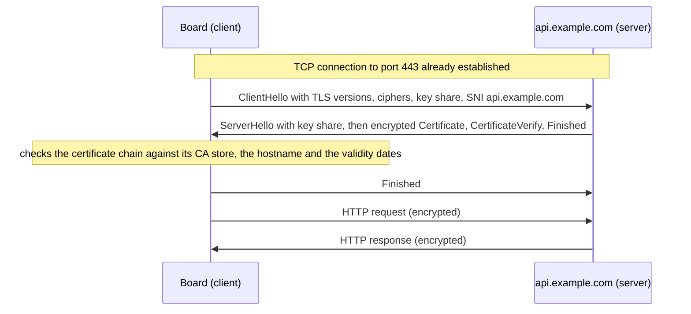

The certificate check is where embedded devices fail most, and the reason is rarely the network:

| Error (curl / OpenSSL wording) | Cause on a board | Fix |
|---|---|---|
| `certificate is not yet valid` | **Clock** at 1970 or at the build date: no RTC battery, NTP not synced yet | Sync time before the first TLS connection (`chrony`, `systemd-timesyncd`, BusyBox `ntpd`). Without an RTC, keep a saved timestamp as a lower bound |
| `unable to get local issuer certificate` | No CA bundle in the root filesystem | Install `ca-certificates` (Buildroot and Yocto both package it), or ship the specific CA your server uses |
| `certificate subject name does not match` / `no alternative certificate subject name matches` | Connecting by IP, or with a different name than the certificate's | Use the hostname the certificate was issued for |

```bash
date                                                    # first thing to check
curl -v https://api.example.com/v1/status               # shows DNS, TCP connect, TLS handshake, HTTP exchange
openssl s_client -connect api.example.com:443 -servername api.example.com </dev/null   # certificate chain details
```

TLS libraries you'll find on devices: OpenSSL, mbedTLS, wolfSSL. They differ in size, not in these basics. A TLS handshake that hangs after `ClientHello` (rather than failing) is often an MTU problem: the server's certificate is the first large packet of the connection (section 11).

---

## 13. NAT and address translation

### NAT44: private addresses behind one public address

The board's `192.168.10.20` is private: internet routers don't know where it is. The gateway does **source NAT**: it rewrites the source address of outgoing packets to its own WAN address (`203.0.113.10`, standing in for the ISP-assigned public IP), and remembers the mapping in its **connection tracking** table so it can rewrite replies back:

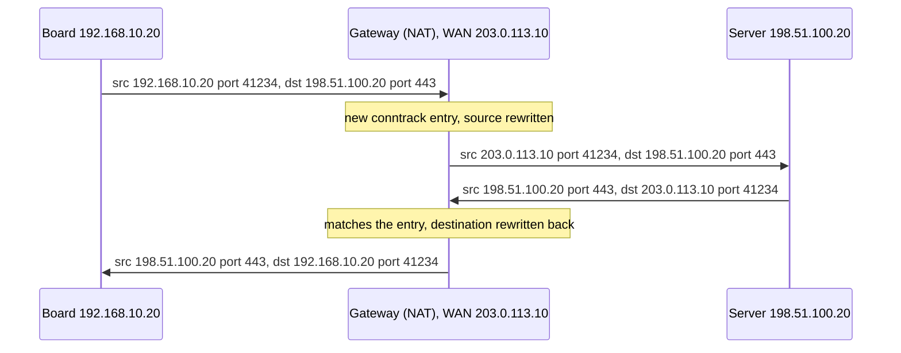

The entry, as `conntrack -L` shows it on the gateway (original direction, then expected reply):

```
tcp 6 431999 ESTABLISHED src=192.168.10.20 dst=198.51.100.20 sport=41234 dport=443 src=198.51.100.20 dst=203.0.113.10 sport=443 dport=41234 [ASSURED] mark=0 use=1
```

Terminology and Linux mechanisms:

| Term | Meaning | Linux (nftables) |
|---|---|---|
| NAPT / PAT / "NAT" at home | Many private hosts share one address, distinguished by port (RFC 3022). The source port is usually kept; NAT only changes it when two hosts would collide | `snat` or `masquerade` in a `postrouting` NAT chain |
| SNAT | Source rewritten to a fixed address | `snat to 203.0.113.10` |
| Masquerade | Source rewritten to the outgoing interface's current address, and connections are **forgotten when the interface goes down or loses that address** | `masquerade`: the right choice for DHCP, PPP and cellular uplinks, whose address changes |
| DNAT / port forward | Destination rewritten: a public port reaches a LAN host | `dnat to 192.168.10.10:443` in a `prerouting` NAT chain |
| CGNAT / NAT444 | The carrier NATs again: the device's "WAN" address is itself private (`100.64.0.0/10`) | Not on the device: in the carrier network |

NAT rules only see the **first packet** of each connection; conntrack translates the rest, both directions. Configuration is in the [gateway note, section 7](../gateway/gateway.md#7-firewall-and-nat).

What NAT means for a device:

- **Nobody on the internet can open a connection to it** unless someone configures a port forward on the gateway, which you can't do on a customer's network or behind **carrier-grade NAT** (cellular, Starlink). This is why devices **connect out** to a cloud service (MQTT, HTTPS, WebSocket) and receive commands over that connection, or use a VPN such as WireGuard for remote access.
- **Idle mappings expire.** If no packet crosses for a while (sometimes only tens of seconds for UDP on carrier NAT), the mapping is dropped and the server's next message is lost. Long-lived connections need keepalives: MQTT `keepalive`, TCP keepalive, WireGuard `PersistentKeepalive = 25`.
- **A product that shares its cellular connection adds a layer:** PC → device NAT → carrier CGNAT → internet (section 21).

### IPv6 and NAT

IPv6 is normally **not** NATed: the device has a global address, and a stateful firewall is what blocks unsolicited inbound traffic. Linux can still do NAT66 (masquerade in an `ip6` NAT table) and prefix translation (NPTv6, RFC 6296), but both break end-to-end addressing; they're a last resort, for example to give a downstream network IPv6 when the upstream provides only one address (section 21 lists better options).

### IPv6-only networks: NAT64, DNS64 and 464XLAT

Some mobile networks give devices **only IPv6**. IPv4-only servers stay reachable through translation:

- **NAT64** (RFC 6146): a stateful translator in the carrier network. IPv6 packets sent to a special prefix, by default the well-known `64:ff9b::/96` (RFC 6052), come out as IPv4 packets from a shared IPv4 pool. `198.51.100.20` is reached as `64:ff9b::c633:6414` (the IPv4 address in hex in the last 32 bits).
- **DNS64** (RFC 6147): the carrier's resolver **synthesizes** AAAA records with that prefix for names that only have A records, so IPv6-only applications use NAT64 without knowing.
- **What breaks:** anything that bypasses DNS64: IPv4 literals in configuration or code, IPv4-only sockets, protocols that carry IPv4 addresses inside, and applications with their own resolvers (hardcoded `8.8.8.8`, DNS over HTTPS).
- **464XLAT** (RFC 6877) fixes those: a **CLAT** (customer-side translator) on the device translates its IPv4 traffic statelessly into IPv6 towards the NAT64 prefix (SIIT, RFC 7915), and the **PLAT** (provider-side translator) is the carrier's NAT64. Applications see an ordinary IPv4 interface and default route, typically with an address from `192.0.0.0/29` (RFC 7335).
- **Prefix discovery:** a CLAT learns the NAT64 prefix by resolving `ipv4only.arpa` (RFC 7050) or from the PREF64 option in RAs (RFC 8781).

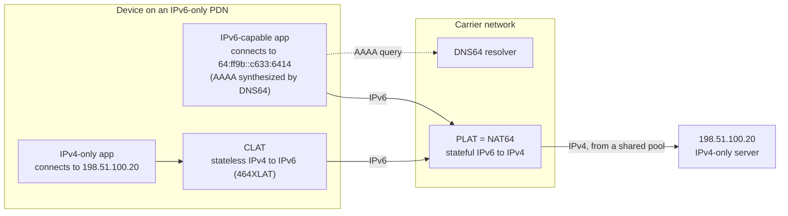

**Linux view:** the mainline kernel has no CLAT of its own. It comes from user space or out-of-tree code (`clatd` with TAYGA over a tun interface, Jool), from Android's own clatd on Android-based products, or, on some modem platforms, from the modem or its accelerator. Which one applies is a platform decision: check before assuming IPv4 works on an IPv6-only APN.

```bash
dig AAAA ipv4only.arpa       # DNS64 present: answers 64:ff9b::c000:aa and 64:ff9b::c000:ab (192.0.0.170/171)
ip -4 route; ip -6 route     # IPv6-only PDN: no IPv4 default route unless a CLAT provides one
```

---

## 14. Putting it together: one HTTPS request, end to end

The board runs `curl https://api.example.com/v1/status` with empty caches. Everything above happens in order:

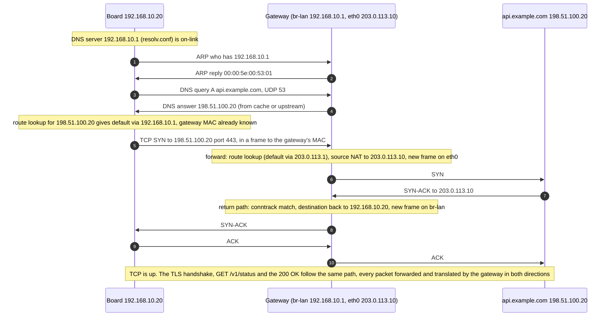

What the headers look like on each link (the ISP router and internet routers are left out of the diagram, but they forward packets the same way, minus NAT):

| Link | Src MAC | Dst MAC | Src IP : port | Dst IP : port | TTL |
|---|---|---|---|---|---|
| SYN, board → gateway (LAN) | `00:00:5e:00:53:14` board | `00:00:5e:00:53:01` gateway `br-lan` | `192.168.10.20:41234` | `198.51.100.20:443` | 64 |
| SYN, gateway → ISP router (WAN) | `00:00:5e:00:53:02` gateway `eth0` | `00:00:5e:00:53:fe` ISP router | `203.0.113.10:41234` | `198.51.100.20:443` | 63 |
| SYN, last router → server | that router | the server | `203.0.113.10:41234` | `198.51.100.20:443` | 64 minus hop count |
| SYN-ACK, gateway → board (LAN) | `00:00:5e:00:53:01` gateway `br-lan` | `00:00:5e:00:53:14` board | `198.51.100.20:443` | `192.168.10.20:41234` | server's initial TTL minus hops |

The same packet, as it crosses the gateway:

```
 LAN link (br-lan)                                   WAN link (eth0)
┌──────────────────────────────────┐   gateway   ┌──────────────────────────────────┐
│ MAC 00:00:5e:00:53:14 → ...53:01 │  new frame  │ MAC 00:00:5e:00:53:02 → ...53:fe │  MACs: replaced
│ IP  192.168.10.20 → 198.51.100.20│ ──────────► │ IP  203.0.113.10 → 198.51.100.20 │  IP src: NAT
│ TCP 41234 → 443, TTL 64          │             │ TCP 41234 → 443, TTL 63          │  TTL: minus 1
└──────────────────────────────────┘             └──────────────────────────────────┘
```

Three things to take away:

1. **MAC addresses are per link.** Every router builds a new Ethernet frame for the next link, after its own route lookup and ARP. On a link with no Ethernet at all (cellular raw-IP), the packet travels with no MAC header.
2. **IP addresses normally stay the same end to end.** Here NAT changes the source once, at the gateway. Other mechanisms (proxies, tunnels, NAT64, load balancers) can change them too; plain routers don't.
3. **The TTL goes down by one at every router.** That's how `traceroute` works, and why a routing loop eventually dies out.

And the debugging consequence: if this request fails, it fails at one of these numbered steps, and each one can be checked separately (section 22).

---

## 15. The Linux packet path, firewall and counters

Part 1 described what protocols do. This section shows where Linux does it: the stages a packet crosses inside the kernel, which differ for packets **delivered locally** (to a socket on this device), **forwarded** (routed to another interface) and **sent locally**.

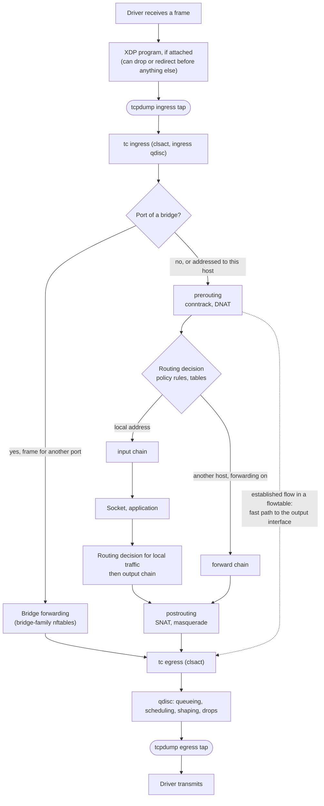

What the picture means in practice:

- **`tcpdump` sees incoming packets before** tc ingress, the firewall and `rp_filter`: a captured packet may still be dropped afterwards. It sees **outgoing packets after** the firewall, tc and the qdisc: a packet dropped by the output chain or a full queue never appears. A packet dropped by an XDP program isn't seen at all.
- **Locally delivered** packets cross prerouting and input; **forwarded** packets cross prerouting, forward and postrouting; **locally sent** packets cross output and postrouting. A rule in the wrong chain silently does nothing.
- **Conntrack** runs in prerouting and output, so the firewall can match connection state, and NAT happens on the first packet of each connection only.
- **Bridged** frames take the bridge path and don't cross the IP chains, unless `br_netfilter` is loaded (Docker loads it), which sends them through the IP hooks too (see the [gateway note's remarks](../gateway/gateway.md#notes-on-the-rules)).
- **Flowtables and hardware offload** let established flows skip most of this path, and with it the firewall chains and sometimes the taps (section 20).

**Where packets are counted and dropped**, which tells you which tool to check:

| Stage | What it counts or drops | Look with |
|---|---|---|
| NIC and driver | RX/TX packets and bytes, errors, missed packets (ring full), driver drops | `ip -s link show eth0`, `ethtool -S eth0` |
| tc and qdisc | Packets sent, dropped by the queue, overlimits, current backlog | `tc -s qdisc show dev eth0`, `tc -s filter show dev eth0 ingress` |
| netfilter | Per-rule counters (rules with `counter`), conntrack table statistics | `nft list ruleset`, `conntrack -S`, `conntrack -L` |
| IP layer | No route, reverse-path filter drops, reassembly failures | `nstat -az IpOutNoRoutes TcpExtIPReversePathFilter IpReasmFails` |
| Sockets | UDP receive buffer overflows, full TCP accept queues | `nstat -az UdpRcvbufErrors TcpExtListenOverflows`, `ss -lnt` (Recv-Q) |

### A firewall for the device

Linux filters packets with **netfilter**, configured with `nftables` (or the older `iptables`). A firewall is **stateful** when it tracks connections: allow what the device starts and the replies to it (`established,related`), drop unsolicited packets.

On a gateway the interesting chain is `forward` (traffic passing through). On a **device** that doesn't route, it's `input` (traffic to the device's own services). A product that shares its connection is both (section 21).

A minimal policy for a board: drop everything inbound except replies, ICMP, DHCP, mDNS, and SSH from the development LAN.

`/etc/nftables.conf`

```nft
#!/usr/sbin/nft -f
flush ruleset

table inet filter {
    chain input {
        type filter hook input priority filter; policy drop;

        ct state established,related accept
        ct state invalid drop
        iif "lo" accept

        # ICMP and ICMPv6: ping, errors, path MTU, IPv6 neighbor discovery
        meta l4proto { icmp, ipv6-icmp } accept

        # DHCPv4 client: server replies, needed at least for renewals (see below)
        udp sport 67 udp dport 68 accept

        # mDNS, so the board answers as board.local
        udp dport 5353 accept

        # SSH from the development LAN (IPv4) and from link-local IPv6
        ip saddr 192.168.10.0/24 tcp dport 22 accept
        ip6 saddr fe80::/10 tcp dport 22 accept
    }

    chain forward {
        type filter hook forward priority filter; policy drop;
    }
}
```

```bash
nft -c -f /etc/nftables.conf    # syntax check
nft -f /etc/nftables.conf       # apply (from the console the first time: a mistake can cut SSH)
nft list ruleset
```

**About the DHCP rule:** it's an example for this board (one DHCPv4 client on `eth0`), not a universal DHCP policy. What a firewall must allow depends on the exchange and the client:

- The first lease usually arrives through the client's packet socket, which sees frames before the input hook (section 8), so it can work with no rule at all. Renewals are unicast replies to the board's address, and clients that receive them on a UDP socket need this rule. Without it, the board works for half a lease, then loses its address.
- The rule doesn't match the server's address, because it can change (another DHCP server, a failover pair). Restrict it with `iifname "eth0"` if the board has other interfaces.
- DHCPv6 is different: replies from `fe80::/10`, UDP 547 → 546 (see the [gateway note's input chain](../gateway/gateway.md#method-1-nftables-recommended)). RAs and SLAAC are covered by the ICMPv6 rule.
- Test with the firewall active: get a lease, then force a renewal (BusyBox `udhcpc` renews on `SIGUSR1`, or shorten the lease on the server) and check the address is still there.

Embedded caveats:

- The kernel must have nftables built in or as modules (`CONFIG_NF_TABLES`, `CONFIG_NF_TABLES_INET`, `CONFIG_NFT_CT`). Check with `zcat /proc/config.gz | grep NF_TABLES` (needs `CONFIG_IKCONFIG_PROC`). Older BSPs may only have legacy iptables.
- Rules that match interfaces by name (`iifname "wwan0"`) keep working when an interface is destroyed and recreated, for example after a modem reset; rules that match by index (`iif`) don't, and can't even be loaded while the interface is absent.
- A firewall is the second line of defense. The first is **not listening**: bind local-only services to `127.0.0.1`, and remove debug servers (`gdbserver`, open `telnetd`, unauthenticated web UIs) from production images.

### Firewall versus traffic control

Both can drop packets, which is why they get confused. They answer different questions:

| | Firewall (netfilter) | Traffic control (tc) |
|---|---|---|
| Question | Is this packet allowed? Should its addresses be translated? | When, in what order and at what rate does it leave (or enter)? |
| Decides on | Policy: addresses, ports, interfaces, connection state | Queue state, classes, configured rates, congestion |
| Drops when | The policy says so | The queue is full, a rate is exceeded (policing), or an AQM signals congestion |
| Counters | `nft` rule counters | `tc -s` statistics |
| Typical use on a device | Block inbound services, NAT for a tethered PC | Keep latency low on a slow uplink, prioritize control traffic, emulate a bad link |

They cooperate: nftables can set a mark or priority (`meta mark set`, `meta priority set`, `ip dscp set`) that tc classifiers and qdiscs use.

---

## 16. Traffic control and queueing

**Concept:** every link drains at some rate. When packets arrive faster than that, they wait in a **queue**; when the queue is full, packets are dropped. A queue that is too large doesn't lose packets but adds latency to everything behind it (**bufferbloat**); a well-managed queue stays short and drops or marks early to tell TCP senders to slow down.

**Linux view:** each interface's transmit queue is managed by a **qdisc** (queueing discipline), configured with `tc`.

| Term | Meaning |
|---|---|
| qdisc | The algorithm managing an interface's egress queue. Classless (`pfifo_fast`, `fq_codel`, `cake`, `tbf`) or classful (`htb`, `prio`) with classes and filters |
| Scheduling | The order packets leave: FIFO, priority bands, fair queuing between flows |
| Shaping | Holding packets back to keep an output rate: adds delay, no loss until the buffer fills. Egress only |
| Policing | Dropping (or marking) packets above a rate, without buffering. Typical on ingress, where nothing can be queued |
| Backlog | Bytes and packets currently queued |
| AQM | Active queue management: CoDel (in `fq_codel` and `cake`) drops or ECN-marks when queueing delay stays above a target |

**Defaults:** the kernel's default qdisc is `pfifo_fast`, unless `net.core.default_qdisc` says otherwise; systemd ships a sysctl setting it to `fq_codel`. Multiqueue NICs get an `mq` root with one default qdisc per hardware queue.

**Where the queue really is:** a packet waits in the socket buffer, then the qdisc, then the driver's TX ring (limited by BQL on drivers that support it), then the hardware, and on a cellular product, the modem's own buffers. Linux only manages the queues it owns.

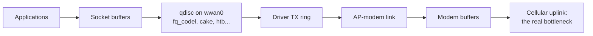

When the bottleneck is the cellular uplink, packets pile up in the modem (or the carrier), the qdisc on `wwan0` stays empty, and latency under upload climbs to seconds: an OTA log upload makes MQTT control messages late. **Shaping slightly below the bottleneck rate** moves the queue back into Linux, where `fq_codel` or `cake` keep it short and fair. The cost is some throughput, and cellular rates vary, so the setting is a compromise.

```bash
tc qdisc show                                    # qdiscs on all interfaces
tc -s qdisc show dev wwan0                       # sent, dropped, overlimits, backlog, requeues

# Shape the uplink just below its rate, with per-flow fairness and AQM
tc qdisc replace dev wwan0 root cake bandwidth 8mbit

# Without cake: a token bucket shaper with fq_codel inside it
tc qdisc replace dev wwan0 root handle 1: tbf rate 8mbit burst 32kbit latency 50ms
tc qdisc add dev wwan0 parent 1:1 fq_codel

# Police what a tethered PC may send in (ingress: drop above the rate)
tc qdisc add dev usb0 clsact
tc filter add dev usb0 ingress matchall action police rate 5mbit burst 64k conform-exceed drop

tc qdisc del dev wwan0 root                      # back to the default qdisc
tc qdisc del dev usb0 clsact
```

Reading the statistics:

```
$ tc -s qdisc show dev wwan0          # abridged
qdisc fq_codel 0: root refcnt 2 limit 10240p flows 1024 quantum 1514 target 5ms interval 100ms
 Sent 81234567 bytes 61234 pkt (dropped 12, overlimits 0 requeues 3)
 backlog 0b 0p requeues 3
```

- **Drops in `tc -s` aren't errors:** an AQM dropping a few packets is doing its job. Large, growing drops with a large backlog mean the link is saturated.
- **Prioritization** (control traffic before bulk) uses classes (`htb`, `prio`) or `cake`'s DSCP-based tins, fed by marks from nftables. That's QoS design, beyond this note.
- Shaping costs CPU: `cake` at high rates can saturate a small SoC.
- To make a link *worse* on purpose (delay, jitter, loss, reordering), use `netem` (section 17).

---

## 17. Network namespaces, veth and virtual interfaces

A **network namespace** is a separate instance of the network stack: its own interfaces, addresses, routing tables and rules, neighbor tables, firewall, sockets and sysctls. A **veth pair** is a virtual cable: two interfaces where whatever enters one comes out of the other. Put the two ends in different namespaces and they're connected. Containers (Docker, Podman, LXC, systemd-nspawn) are built exactly this way, usually with the host end of each veth in a bridge.

Virtual interface types you'll meet:

| Type | What it is | Typical use |
|---|---|---|
| `bridge` | Software switch | LAN ports + Wi-Fi AP, container networks |
| `vlan` | 802.1Q tagged sub-interface | Segmentation |
| `veth` | Pair of connected interfaces | Namespaces, containers |
| `macvlan`, `ipvlan` | Extra interfaces sharing a parent's link | Containers with their own LAN addresses |
| `tun`, `tap` | Interface fed by a user-space program (L3 / L2) | VPNs, user-space translators (TAYGA for a CLAT), emulators |
| `wireguard` | Encrypted L3 tunnel | Remote access to devices behind NAT |
| `dummy` | Interface that discards what it sends | Stable service addresses, tests |
| `ifb` | Intermediate functional block | Shaping ingress traffic by redirecting it to an egress queue |
| `vrf` | A separate routing domain inside one namespace | Isolating management traffic (section 19) |
| USB gadget, `wwan`, `rmnet`, `ppp` | Interfaces backed by USB functions, modem links or a serial line | Sections 20 and 21 |

```bash
ip -d link show                  # -d shows the type and its parameters (bridge, vlan id, veth peer, rmnet mux_id...)
ip netns list                    # named namespaces (containers often use unnamed ones)
ip -n <ns> addr                  # any ip command inside a namespace (same as ip netns exec <ns> ip ...)
ip netns identify <pid>          # which named namespace a process lives in
nsenter -t <pid> -n ip addr      # enter the network namespace of a process (e.g. a container)
```

### A lab on one machine

Namespaces make it possible to reproduce network A on a laptop, with a WAN that behaves like a cellular link, and test an application against it before a board exists. As root:

```bash
# Three namespaces: the board, the gateway, and "the internet"
ip netns add board; ip netns add gw; ip netns add inet
ip link add veth-b type veth peer name veth-gl        # board <-> gateway LAN
ip link add veth-gw type veth peer name veth-i        # gateway WAN <-> internet
ip link set veth-b netns board; ip link set veth-gl netns gw
ip link set veth-gw netns gw;   ip link set veth-i netns inet

ip -n board addr add 192.168.10.20/24 dev veth-b
ip -n gw    addr add 192.168.10.1/24  dev veth-gl
ip -n gw    addr add 203.0.113.10/24  dev veth-gw
ip -n inet  addr add 203.0.113.1/24   dev veth-i
ip -n inet  addr add 198.51.100.20/32 dev lo           # the "server"
for ns in board gw inet; do ip -n $ns link set lo up; done
ip -n board link set veth-b up; ip -n gw link set veth-gl up
ip -n gw link set veth-gw up;   ip -n inet link set veth-i up

# Routing and NAT on the gateway
ip -n board route add default via 192.168.10.1
ip -n gw route add default via 203.0.113.1
ip netns exec gw sysctl -w net.ipv4.ip_forward=1
ip netns exec gw nft add table ip nat
ip netns exec gw nft 'add chain ip nat post { type nat hook postrouting priority srcnat; }'
ip netns exec gw nft add rule ip nat post oifname "veth-gw" masquerade

# Make the WAN behave like a cellular link: delay with jitter, 1 % loss, smaller MTU on both ends
ip netns exec gw tc qdisc add dev veth-gw root netem delay 60ms 20ms loss 1%
ip -n gw link set veth-gw mtu 1400; ip -n inet link set veth-i mtu 1400

# Try it
ip netns exec board ping -c 3 198.51.100.20
ip netns exec board tracepath -n 198.51.100.20       # shows the 1400-byte path MTU
ip netns exec gw conntrack -L                        # the NAT entries

ip netns del board; ip netns del gw; ip netns del inet   # clean up (the veth pairs go with them)
```

The same building blocks test policy routing (section 19) or a tethering setup (section 21) without hardware, and `ip netns exec board <your application>` runs real code against the emulated network. On a device, namespaces also give strong isolation, for example a service that may only use the management PDN.

---

## 18. Networking on an embedded board

### Kernel configuration

A minimal kernel config may lack things a desktop distribution kernel normally has:

| Option | Needed for |
|---|---|
| `CONFIG_INET`, `CONFIG_IPV6` | IPv4 and IPv6 |
| NIC driver + PHY driver, Ethernet node `status = "okay"` in the device tree (`phy-mode`, `phy-handle`) | The interface to exist and get a link. Probe errors show in `dmesg` |
| `CONFIG_PACKET` | DHCP clients, `tcpdump` |
| `CONFIG_BRIDGE`, `CONFIG_VLAN_8021Q` | Bridges, VLAN interfaces |
| `CONFIG_NETFILTER`, `CONFIG_NF_TABLES` (+ `CONFIG_NF_CONNTRACK`, NAT expressions) | Firewall, NAT |
| `CONFIG_NET_SCHED`, `CONFIG_NET_SCH_FQ_CODEL`, `CONFIG_NET_SCH_CAKE`, `CONFIG_NET_SCH_NETEM`, `CONFIG_NET_ACT_POLICE` | Traffic control (sections 16, 17) |
| `CONFIG_NET_NS`, `CONFIG_VETH` | Namespaces, containers, labs |
| `CONFIG_USB_NET_QMI_WWAN`, `CONFIG_USB_NET_CDC_MBIM`, `CONFIG_USB_NET_CDC_NCM`, `CONFIG_USB_NET_CDCETHER`, `CONFIG_USB_NET_RNDIS_HOST` | USB modems and USB network adapters, host side (section 20) |
| `CONFIG_USB_SERIAL_OPTION`, `CONFIG_USB_ACM` | Modem AT/diagnostic ports as `ttyUSBn` / `ttyACMn` |
| `CONFIG_MHI_NET`, `CONFIG_WWAN`, `CONFIG_MHI_WWAN_CTRL`, `CONFIG_MHI_WWAN_MBIM` | PCIe (MHI) modems |
| `CONFIG_RMNET` | Qualcomm MAP multiplexing (section 20) |
| `CONFIG_USB_CONFIGFS_NCM`, `_ECM`, `_RNDIS`, `_ACM` | USB gadget functions offered to a PC (section 21) |
| `CONFIG_PPP`, `CONFIG_PPP_ASYNC` | PPP over serial |
| `CONFIG_IP_PNP`, `CONFIG_ROOT_NFS` | `ip=` on the kernel command line, NFS root |

### Who configures the network

Exactly **one** tool should own each interface (same rule as on the [gateway](../gateway/gateway.md#who-does-what-on-the-gateway)). Buildroot and Yocto install whatever the configuration selects, so there's no single default. These are common combinations, each with its assumption:

| Image (assumption) | Network manager | Config |
|---|---|---|
| Buildroot, default skeleton without systemd-networkd or netifrc | BusyBox (or standalone) `ifupdown` + `udhcpc` | `/etc/network/interfaces` |
| Buildroot or Yocto, systemd with networkd enabled | systemd-networkd | `/etc/systemd/network/*.network` |
| Yocto, sysvinit image with `init-ifupdown` | `ifupdown` | `/etc/network/interfaces` |
| Yocto image that includes ConnMan (e.g. Poky's `core-image-sato`) | ConnMan | `connmanctl` |
| Debian-based images (Raspberry Pi OS since Bookworm...) | NetworkManager | `nmcli` |
| OpenWrt | netifd | `/etc/config/network` (UCI), see the [OpenWrt note](../openwrt/openwrt.md#3-linux-networking-the-openwrt-way) |

Cellular data interfaces add a second kind of owner: a **connection manager** that talks to the modem (ModemManager, often paired with NetworkManager; a vendor daemon; OpenWrt's protocol handlers) and must hand the session's address, routes, DNS and MTU to whatever configures interfaces (section 20).

Check what actually runs on the board before changing anything:

```bash
ps | grep -E 'udhcpc|dhcpcd|networkd|NetworkManager|connman|netifd|ModemManager' | grep -v grep
ls -d /etc/network/interfaces /etc/systemd/network /etc/NetworkManager /etc/config/network 2>/dev/null
```

### Interface names

The kernel names interfaces by type and probe order; on systemd images, udev renames many of them to stable names. Scripts that hardcode `eth0` break when an image switches to systemd.

| Name | Created by | Notes |
|---|---|---|
| `eth0`, `end0`, `enp1s0` | NIC drivers; renamed by systemd-udevd | `end0`: device-tree based controller (naming scheme v252 and later). `enp1s0`: PCIe NIC |
| `wlan0` | Wi-Fi driver | Out of scope here |
| `wwan0` | `qmi_wwan`, `cdc_mbim` (USB modems), or links of the kernel's WWAN framework | Cellular data, often raw-IP |
| `qmimux0` | `qmi_wwan` with QMAP multiplexing enabled | One per multiplexed data session |
| `rmnet_data0` (name chosen at creation; a Qualcomm convention) | `rmnet` on top of `qmi_wwan`, MHI or IPA | Qualcomm MAP sessions |
| `mhi_hwip0`, `mhi_swip0` | `mhi_net` (PCIe modems) | |
| `usb0` | A USB gadget network function (device side); host-side USB network adapters on hosts get names like `enp0s20f0u1` or `enx<MAC>`, depending on udev policy | Section 21 |
| `ppp0` | `pppd` | PPP over serial |
| `br0`, `vlan10`, `wg0`, `veth*`, `docker0` | Virtual (section 17) | |
| `can0` | CAN controller | A network interface, but CAN carries no IP |

### Startup order

On a board, the application often starts within a second of the network stack. At that moment the interface may have no carrier or lease yet, `resolv.conf` may still be empty, and the clock may still read 1970 until NTP syncs. Typical symptoms: the first connection fails with `Network is unreachable`, `Temporary failure in name resolution` or a TLS `certificate is not yet valid`, then works on retry or after a restart.

A cellular product adds slower, independent steps: the modem enumerates on USB or PCIe seconds after boot, registers on the network later, and the data session comes up later still. It can also drop and return at any time, or reset and recreate its interfaces (section 20).

Handle it in two places:

- **In the application:** retry with backoff. It's needed anyway, because links come and go at runtime (cellular, Wi-Fi, a cable pulled).
- **In the init system:** order the service after what it needs. With systemd: `network-online.target` (backed by `systemd-networkd-wait-online` or `NetworkManager-wait-online`) and `time-sync.target` (with `systemd-time-wait-sync` enabled). "Online" means only what the wait-online service checks (usually: some interface configured), not "the cloud server is reachable", and it can't cover a link that comes up after boot. BusyBox and SysV init scripts have no such targets and need explicit waits.

The details belong in a boot and init note.

### Development setups

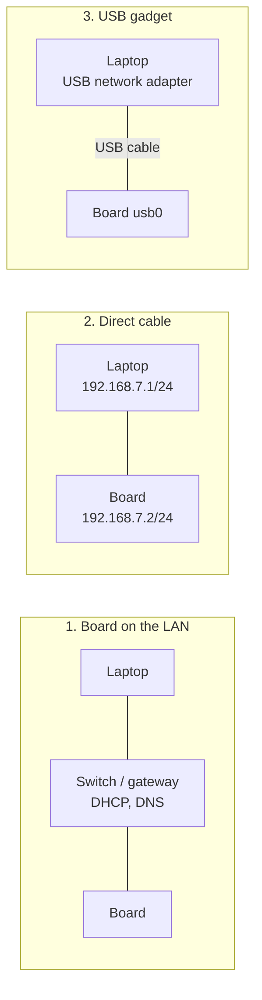

| Setup | Addressing | Notes |
|---|---|---|
| **1. On the LAN** | DHCP from the gateway, static lease for a stable IP | Easiest. Find the board with `board.local` (mDNS), the gateway's lease list, or `ping -6 ff02::1%eth0` |
| **2. Direct cable** | Static pair on both ends, or link-local | No DHCP server, no internet. To give the board internet, share the laptop's connection: NetworkManager's "Shared to other computers" runs DHCP and NAT on `10.42.0.0/24` |
| **3. USB gadget Ethernet** | Static pair, e.g. `192.168.7.2` (board) / `192.168.7.1` (laptop) as on BeagleBone images | The board's USB device port acts as a network adapter (NCM or ECM function, RNDIS for older Windows hosts; section 21). Point-to-point: no default route through it unless you mean to |

**Network boot** (kernel over TFTP, root filesystem over NFS) uses all of the above, but U-Boot has its own small network stack, configured separately (`ipaddr`, `serverip`, `ethaddr`), and the kernel then configures its interface again from `ip=`. With an NFS root, the user-space network manager must **leave that interface alone**: re-running DHCP or taking the link down removes the root filesystem from under the system. Buildroot's generated `interfaces` file has a `pre-up /etc/network/nfs_check` line for exactly that reason. Network boot gets its own note.

---

## 19. Multiple interfaces and policy routing

Embedded products often have several interfaces at once. The examples below combine both example networks: the cellular product of network B also has an Ethernet uplink, `eth0` (`192.168.10.20`) on network A's LAN.

| Role | Examples | Questions to answer |
|---|---|---|
| **Upstream** (towards servers and the internet) | `eth0` to a site LAN, `wwan0` internet PDN, `wwan1` management PDN | Which one is preferred? For which traffic? What happens when it fails? |
| **Downstream** (networks the device serves) | `usb0` to a PC, `eth1` to local sensors | Routed or bridged? Translated? Through which upstream? |
| **Local only** | A USB debug link, `can0` | Must never receive a default route |

### Route selection between uplinks

Each interface's DHCP client or connection manager may install its own default route:

```bash
$ ip route show default
default via 192.168.10.1 dev eth0 proto dhcp src 192.168.10.20 metric 100
default dev wwan0 proto static scope link metric 700

ip route get 198.51.100.20             # the route the kernel actually picks: eth0 (metric 100)
ip route get 198.51.100.20 oif wwan0   # what would happen if the traffic were forced out of wwan0
ip rule                                # any policy rules besides local/main/default?
```

- **Metrics decide, not installation order.** For routes with the same prefix in the same table, the lowest metric wins. Each network manager picks its own defaults (NetworkManager uses 100 for Ethernet, 600 for Wi-Fi and 700 for modems; systemd-networkd uses 1024 for DHCP routes unless `RouteMetric=` is set; a BusyBox `udhcpc` script uses whatever it was written to use). If two default routes end up with the same metric, the outcome depends on how they were installed, so don't rely on it: give each uplink a distinct metric and check with `ip route get`.
- **A metric only orders routes that exist.** When `eth0` loses carrier, most network managers remove its routes and the backup takes over. The kernel alone keeps the route, marked `linkdown`, unless `net.ipv4.conf.all.ignore_routes_with_linkdown=1`. If `eth0` keeps its link but the upstream is dead, nothing changes and traffic is lost: detecting that needs an explicit failover mechanism (the gateway note's [failover section](../gateway/gateway.md#failover) shows the principle and its limits).
- A point-to-point link to a laptop must not install a default route at all, or internet traffic goes to the laptop.

### Policy routing: choosing by source, interface or mark

Metrics give one global preference order. Policy routing handles everything else. In network B, the management APN only reaches `10.250.0.0/16`, and only accepts packets whose source is the management address `10.200.0.15`:

```bash
# Table 100 holds the management PDN's routes
ip route add default dev wwan1 table 100
# Use it for traffic to the management servers, and for anything already using the management address
ip rule add to 10.250.0.0/16 lookup 100 priority 1000
ip rule add from 10.200.0.15 lookup 100 priority 1001

$ ip rule
0:      from all lookup local
1000:   from all to 10.250.0.0/16 lookup 100
1001:   from 10.200.0.15 lookup 100
32766:  from all lookup main
32767:  from all lookup default

ip route get 10.250.1.10              # dev wwan1 table 100 src 10.200.0.15
ip route get 198.51.100.20            # dev eth0 (main table)
```

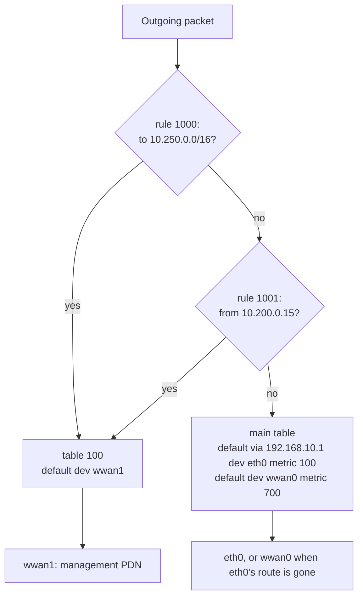

The destination rule alone could have been a plain route in the main table (`ip route add 10.250.0.0/16 dev wwan1`). The **source rule** is what a single table can't express, and it's the general fix for multi-homed hosts:

- **Replies must leave through the interface their connection came in on.** An SSH session to `192.168.10.20` over `eth0` must not have its replies sent out `wwan0` because cellular happens to be the preferred default: they'd leave with the wrong source address for that link and be dropped. One table per uplink plus a `from <address> lookup <table>` rule per address fixes it.
- **Marks** select traffic by anything nftables can match (`meta mark set 0x1` in a `route`-type output chain, then `ip rule add fwmark 0x1 lookup 100`); **`uidrange`** selects by user (`ip rule add uidrange 1001-1001 lookup 100`), handy to confine one service to one PDN.
- **Reverse-path filtering** in strict mode (`rp_filter=1`) drops packets arriving on an interface that isn't the best route back to their source, which is normal with several uplinks. Use loose mode (`2`) there (the gateway note explains it in [kernel settings](../gateway/gateway.md#6-kernel-settings)).

### NAT and DNS with several uplinks

When the device also routes for a downstream network, each upstream needs its own translation: `oifname { "eth0", "wwan0" } masquerade` gives each connection the address of the interface it leaves by. Conntrack keeps that translation for the connection's lifetime, so **when the route changes, existing connections keep the old translation** and their packets leave the new interface with the old source address, where they die. Masquerade forgets entries when an interface goes down or loses its address; for other cases (the preferred uplink returns while the backup is still up), flush the stale entries yourself:

```bash
conntrack -L --reply-dst 100.72.15.9        # connections translated to wwan0's address
conntrack -D --reply-dst 100.72.15.9        # drop them: clients reconnect through the new uplink
```

DNS servers also belong to their uplink (section 9): the management APN's resolver answers only on `wwan1`, the carrier's internet resolvers only on `wwan0`. A per-link resolver (systemd-resolved) or per-domain forwarding (dnsmasq `server=/mgmt.example/10.250.0.53`) keeps queries on the right path.

### IPv6 with several uplinks

IPv6 has no NAT to hide mismatches. Each upstream provides its own prefix, the carrier only accepts packets from the prefix it assigned, and the source address must match the interface the packet leaves by. RFC 6724 source selection prefers addresses of the outgoing interface, which works for the device's own traffic; anything else (forced interfaces, downstream hosts with addresses from one uplink's prefix) needs source-based rules (`ip -6 rule add from 2001:db8:c0:1::/64 lookup 100`). When an uplink reconnects with a new prefix, downstream hosts keep the old addresses until their lifetimes expire, unless the router announces the old prefix with a zero lifetime.

### Failover and reconnection checklist

| Change | Consequences to handle |
|---|---|
| Uplink lost (carrier gone) | Routes removed by the manager (or `linkdown`), masquerade forgets that interface's connections, applications must reconnect |
| Uplink alive but upstream dead | Nothing changes by itself: needs probing and a failover mechanism |
| Switch to another uplink | New source address: existing TCP connections die, conntrack entries for the old address must go, DNS servers and MTU change (MSS clamping and PMTUD handle the MTU for TCP) |
| Preferred uplink returns | Same as a switch, in the other direction; avoid flapping with hysteresis |
| New IPv6 prefix | Device addresses change; downstream hosts need fresh RAs |

### Separate routing domains

| Mechanism | What it isolates | Use it for |
|---|---|---|
| Policy rules + tables | Routing only; one firewall, one socket space | Choosing an uplink per traffic type |
| VRF (`ip link add mgmt type vrf table 100`, `ip vrf exec mgmt <cmd>`) | A routing domain per set of interfaces; applications opt in | Management traffic that must never use the internet PDN |
| Network namespace (section 17) | The whole stack: interfaces, routes, firewall, sockets | Strong isolation, containers, a service bound to one PDN |

---

## 20. Modem-based devices: the AP and the modem

In a cellular product, two processors run separate software. The **application processor** (AP) runs Linux and the product's applications. The **modem** (baseband processor) runs vendor firmware, often an RTOS, sometimes its own Linux, that handles the radio, the cellular protocol stack and the data sessions with the carrier. To Linux, the modem is a peripheral that offers two kinds of interfaces: one to **control** it, one to carry **data**.

This section covers the networking architecture and packet paths, not the radio. Hands-on modem commands for one module (a Quectel EC25 over QMI) are in the [gateway note](../gateway/gateway.md#method-2-cellular-modem-quectel-ec25); deeper modem integration (USB compositions, QMI/MBIM details, firmware) belongs in a dedicated note.

### Who does what

| Function | Modem | AP (Linux) |
|---|---|---|
| Radio, network registration, SIM, mobility (handover) | Yes | Requests and observes, through the control interface |
| Data session (PDN) setup with the carrier: address, DNS servers, MTU | Negotiates it | Requests it, then must **configure Linux** with the result |
| IP configuration of the data interface (address, routes, DNS, firewall) | No (except in router mode, below) | Yes |
| Forwarding and NAT for downstream devices (a tethered PC) | Only in router mode, or with hardware offload | Usually |
| Applications | Rarely (some modules can run customer code) | Yes |

### Control plane and data plane

- **Control plane:** messages that manage the modem: SIM state, registration, signal, "start a data session on this APN". Protocols: **QMI** (Qualcomm), **MBIM** (USB-IF standard, vendor-neutral, native on Windows), **AT commands** (3GPP TS 27.007 plus vendor extensions), and other vendor protocols. Carried on character devices: `/dev/cdc-wdm0` (QMI or MBIM over USB), `/dev/wwan0qmi0` / `/dev/wwan0mbim0` / `/dev/wwan0at0` (WWAN framework, PCIe), `/dev/ttyUSB2` or `/dev/ttyACM0` (AT). Tools: ModemManager (`mmcli`), libqmi (`qmicli`), libmbim (`mbimcli`), vendor connection managers.
- **Data plane:** a network interface carrying the IP packets of one or more sessions.

**Opening a session doesn't configure Linux.** The modem reports the address, DNS and MTU over the control plane; a connection manager (or you, by hand) must apply them to the data interface, add routes and update DNS. A session that is "connected" in `mmcli` while `ip addr` shows no address is the most common integration bug.

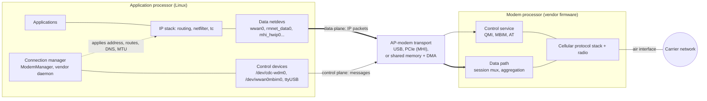

### How the modem's data path appears in Linux

| Transport | Control | Data interface | Linux drivers | Notes |
|---|---|---|---|---|
| USB, QMI | `/dev/cdc-wdmN` | `wwanN` | `qmi_wwan` | Qualcomm-based modules. Raw-IP or emulated Ethernet framing (`/sys/class/net/wwan0/qmi/raw_ip`). Multiplexing via `qmimux` links or `rmnet` (below) |
| USB, MBIM | `/dev/cdc-wdmN` | `wwanN` (Ethernet-like, `NOARP`); extra sessions as VLAN sub-interfaces | `cdc_mbim` | Standard class, works with any vendor's MBIM modem |
| USB, ECM / NCM / RNDIS | AT on a tty, sometimes a web UI | `usbN`, `ethN`, `enx...`: a normal Ethernet link | `cdc_ether`, `cdc_ncm`, `rndis_host` | **Router mode**: the modem runs DHCP and NAT inside; Linux is a LAN client (section 21) |
| USB or UART, PPP | AT dial on a tty | `ppp0` | `option` or `cdc-acm` + `pppd` | Legacy, one session, limited throughput |
| PCIe (MHI), Qualcomm | `/dev/wwan0qmi0`, `/dev/wwan0mbim0`, `/dev/wwan0at0` | `mhi_hwip0`, or WWAN links | `mhi_net`, `mhi_wwan_ctrl`, `mhi_wwan_mbim` | M.2 4G/5G modules |
| PCIe, other vendors | `/dev/wwan0mbim0`... | WWAN links (`wwanN`) | `iosm` (Intel), `mtk_t7xx` (MediaTek) | WWAN framework |
| Shared memory, same SoC | QMI over shared memory or RPMsg | `rmnet_data*` over IPA or BAM-DMUX | `ipa`, `qcom_bam_dmux`, `rmnet` | AP and modem on one Qualcomm SoC (phones, modem SoCs) |

Which row applies depends on the module, its firmware and its configured **USB composition** (which functions it exposes), often selectable with vendor AT commands.

### Framing: raw IP or Ethernet-like

There is no Ethernet on a cellular bearer: it carries IP packets of one session, point to point. Drivers present that in one of two ways:

- **Raw-IP interface:** `link/none`, flags `POINTOPOINT,NOARP`. No MAC address, no ARP or Neighbor Discovery, routes point at the interface (`default dev wwan0`), and `tcpdump -ni wwan0` shows bare IP packets (`-e` has nothing to show).
- **Ethernet-like interface:** synthetic MAC headers added and stripped by the driver or the modem, still carrying only this device's session. Some modems answer DHCP on such an interface as a convenience.

```bash
ip -d link show wwan0                     # raw-IP: "link/none" and POINTOPOINT,NOARP
cat /sys/class/net/wwan0/qmi/raw_ip       # qmi_wwan: Y = raw-IP mode (must match what the modem uses)
```

Either way, the interface only ever carries the device's own addresses, which is why it can't simply be bridged to a downstream network (section 21).

### Multiple sessions: multiplexing and aggregation

A product may open several PDNs at once: internet, a management APN, IMS for voice, MMS. Each has its own addresses and policy, and appears as its own interface. Over one AP-modem link they're **multiplexed**: each packet carries a session (mux) ID, and the driver demultiplexes them into one netdev per session. High data rates also need **aggregation**: many IP packets packed into one USB transfer or PCIe buffer, to cut per-packet overhead.

| Mechanism | What it is | In Linux |
|---|---|---|
| QMAP / MAP (Qualcomm) | A small header per packet with the mux ID and padding (plus checksum offload in later versions), and aggregation of many such packets per transfer | `rmnet` links on top of `qmi_wwan` (in pass-through mode), MHI or IPA: `ip link add link wwan0 name rmnet_data0 type rmnet mux_id 1`. `qmi_wwan` also has its own simpler mux (`qmimux0` via `/sys/class/net/wwan0/qmi/add_mux`) |
| MBIM sessions | Session IDs in MBIM's NCM-based framing | `cdc_mbim` maps VLAN IDs to session IDs (untagged = session 0) |
| WWAN framework links | Generic kernel API for modem data channels | `ip link add parentdev wwan0 name wwan0-1 type wwan linkid 1` |

The control plane binds each session to a mux ID; the netdev configuration must use the same ID. A mismatch gives a session that is "connected" but carries no traffic. Recent ModemManager versions can create these links themselves.

### Forwarding and offload

When the device routes traffic between `usb0` and `wwan0`, the default path is **software forwarding**: every packet crosses the AP's stack (section 15) on the CPU, visible to the firewall, conntrack, tc and `tcpdump`. At high rates that costs CPU, so platforms add faster paths:

| Path | Who forwards | Visible to the AP's netfilter and `tcpdump`? |
|---|---|---|
| Software forwarding | AP CPU, full stack | Yes |
| nftables flowtable (software fast path) | AP CPU, after the first packets of each flow | Only the first packets; then the flow bypasses the chains (`conntrack -L` shows `[OFFLOAD]`) |
| Flowtable hardware offload (`flags offload`) | Network hardware that supports it (common on router SoCs) | First packets only (`[HW_OFFLOAD]`); counters may not include offloaded traffic |
| Vendor accelerator between USB/Ethernet and the modem (e.g. Qualcomm IPA in vendor BSPs) | Dedicated hardware, configured by vendor daemons | No: the AP's CPU may never see the packets |
| Modem router mode | The modem itself | No: the AP sees only its LAN side |

In mainline Linux, the `ipa` driver provides the AP-modem data path; the tethering-offload features of such accelerators come from vendor BSP kernels and daemons. The [OpenWrt note](../openwrt/openwrt.md#connection-tracking-nat-and-offloading) covers flowtable offload on routers.

**Effect on debugging:** offloaded packets don't hit firewall rules or taps, interface counters may not count them, and throughput can exceed what the CPU could forward. To see a flow, disable the offload temporarily. NIC segmentation offloads have a similar effect on captures: with TSO/GRO, `tcpdump` shows "packets" much larger than the MTU, because it sees them before the NIC splits them or after the stack merged them (`ethtool -K eth0 gro off tso off` while capturing).

### Connection lifecycle

A cellular data path changes far more often than an Ethernet link. What each event changes on the Linux side:

| Event | Data interface | Addresses and routes | NAT / conntrack | What must react |
|---|---|---|---|---|
| Session established | Gets an address from the manager, link up | Default route added with the manager's metric | Nothing yet | Manager applies config; firewall, DNS forwarder and applications notice |
| Session lost (coverage, network detach) | May stay up with no traffic, or go down, depending on driver and manager | Should be removed; if not, traffic disappears into the modem | Masquerade forgets entries only when the address or interface goes | The manager, from session status indications |
| Session re-established | Same interface | Usually a **new address**, maybe a new IPv6 prefix and MTU | Old entries are stale | Re-apply config, applications reconnect, DNS servers may change |
| Modem reset, firmware crash, USB re-enumeration | **Destroyed and recreated**: new ifindex, possibly a new name | All gone | Flushed with the interface | Stable naming (udev rules), name-based firewall rules, daemons that follow interfaces (`bind-dynamic`), manager re-init |
| Upstream change (cellular ↔ Ethernet) | Unchanged | Default route changes | Old translations linger | Section 19 |

```bash
ip monitor link address route        # watch interfaces, addresses and routes change live
udevadm monitor --subsystem-match=net # interfaces removed and re-added (modem reset)
mmcli -m 0                           # modem state, registration, bearers
mmcli -b <N>                         # a bearer's address, DNS, MTU: compare with ip addr / resolv.conf
journalctl -u ModemManager -f        # session and modem events (systemd images)
```

---

## 21. Sharing the cellular connection with a PC over USB

**"USB tethering" is a feature, not a mechanism.** It means "a PC plugged into the device reaches the internet through it". It can be built with routing and NAT, with IP passthrough, by letting the PC drive the modem, or with PPP, and these differ in who owns the PC's IP address, who routes, who translates, and what the device can see and control.

### USB host and USB device

USB is asymmetric: one **host** controls the bus, **devices** offer **functions**. Linux can play both roles, often in the same product:

- **AP as USB host:** it consumes a modem's functions with host drivers (`qmi_wwan`, `cdc_mbim`, `cdc_ether`, `cdc_ncm`, `rndis_host`, `option`, `cdc-acm`). That's section 20.
- **AP as USB device ("gadget"):** it exposes functions to a PC, assembled through configfs from function drivers (NCM, ECM, RNDIS, ACM...). It needs a USB device controller (UDC) capable of device mode (dwc2, dwc3, ChipIdea... in peripheral or OTG mode) and a port wired for it.
- A USB device has exactly **one host** at a time: the PC and the AP can't both own the modem's USB functions.

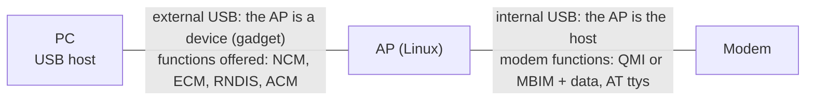

### What the interface names stand for

These names appear together in datasheets and driver lists, but they're not alternatives to each other, and none of them is NAT:

| Name | What it is | Where it's used |
|---|---|---|
| **CDC-ECM** | USB-IF class: Ethernet frames over USB, one per transfer | Gadget towards Linux and macOS hosts; simple, lower throughput |
| **CDC-NCM** | USB-IF class: Ethernet frames, several per transfer | Gadget towards Linux, macOS and Windows 11 hosts (inbox driver; Windows 10 support is inconsistent). Also the transport underneath MBIM |
| **RNDIS** | Microsoft's proprietary Ethernet over USB | Gadget towards Windows hosts (inbox driver); legacy, still added for older Windows |
| **MBIM** | USB-IF class for mobile broadband: modem control messages plus IP sessions | A modem towards its host. Not a generic Ethernet link: the host drives the modem |
| **QMI** | Qualcomm's modem control protocol | Qualcomm-based modems towards their host |
| **rmnet / MAP** | Qualcomm's multiplexing and aggregation of IP sessions, and its Linux driver | Inside the product, AP ↔ modem. Never visible to the PC |
| **ACM** | USB-IF serial port class | AT commands, PPP, consoles: carries bytes, not packets |
| **PPP** | Link protocol carrying IP over a byte stream, with its own address negotiation (IPCP) | Dial-up over ACM or a UART |

ECM, NCM and RNDIS give the PC an **Ethernet link to the device**. MBIM and QMI give a host **control of a modem**. rmnet/MAP is **internal plumbing**. PPP carries **IP over serial**. The sharing architectures below combine them differently.

### A. Routed sharing with NAT

The common design. The PC gets a private address on the USB link; the AP routes and masquerades its traffic out of the cellular interface.

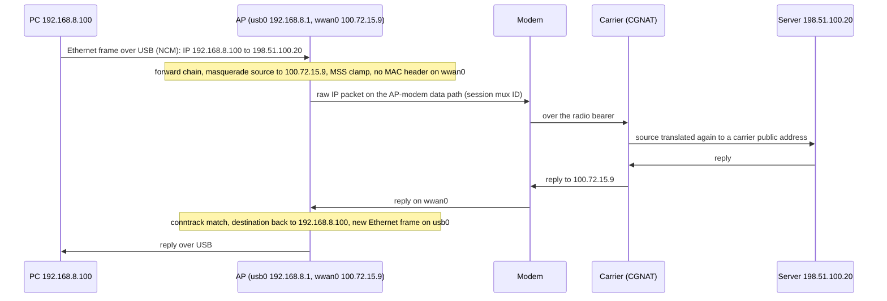

**Responsibilities:** the AP runs DHCP and a DNS forwarder on `usb0`, forwards, translates, filters and clamps the MSS; the modem only carries the AP's own session. A sketch of the Linux side:

```bash
# 1. A USB gadget with one NCM function (configfs). 0x1d6b:0x0104 is the Linux Foundation's
#    multifunction gadget ID: fine for tests, products need their own vendor and product IDs
cd /sys/kernel/config/usb_gadget && mkdir g1 && cd g1
echo 0x1d6b > idVendor; echo 0x0104 > idProduct
mkdir -p strings/0x409 configs/c.1 functions/ncm.usb0
echo "Example device" > strings/0x409/product
ln -s functions/ncm.usb0 configs/c.1/
ls /sys/class/udc > UDC                     # bind to the device controller (assumes exactly one)
cat functions/ncm.usb0/ifname               # usb0

# 2. Downstream address, DHCP and DNS for the PC (dnsmasq forwards to resolv.conf's servers)
ip addr add 192.168.8.1/24 dev usb0
ip link set usb0 up
dnsmasq --interface=usb0 --bind-dynamic --dhcp-range=192.168.8.100,192.168.8.150,1h

# 3. Forwarding, MSS clamping and NAT towards the cellular interface
sysctl -w net.ipv4.ip_forward=1
nft -f - <<'EOF'
table ip tether {
    chain forward {
        type filter hook forward priority filter; policy drop;
        tcp flags syn tcp option maxseg size set rt mtu
        ct state established,related accept
        iifname "usb0" oifname "wwan0" accept
    }
    chain postrouting {
        type nat hook postrouting priority srcnat;
        oifname "wwan0" masquerade
    }
}
EOF
```

The device's own input policy (section 15) must also accept DHCP (UDP 67) and DNS (port 53) from `usb0`. Properties of this design:

- **Double NAT** (AP, then carrier CGNAT): fine for outbound connections, no inbound connections to the PC.
- The AP sees all of the PC's traffic: it can filter it, shape it (section 16) and log it.
- **MTU:** the PC assumes 1500 on its USB adapter while the PDN is usually smaller. MSS clamping covers TCP; for UDP, advertise the real MTU in DHCP (`--dhcp-option=option:mtu,<mtu>` in dnsmasq).
- The AP keeps its own connectivity on the same PDN.

### G. Variant: the modem in router mode

Some modules expose ECM, NCM or RNDIS and run DHCP and NAT internally ("router mode"); the AP gets a private address from the modem (Quectel modules, for example, commonly use `192.168.225.1` as their LAN gateway; the details are vendor- and firmware-specific). The AP is then a LAN client, and sharing with the PC means either a second NAT on the AP (A, on top of the modem's NAT and the carrier's) or **bridging** `usb0` with the modem's Ethernet interface. Bridging works here because the modem's side really is an Ethernet LAN with a DHCP server: the PC becomes another client of the modem's router. The AP can't filter or shape traffic it only bridges unless bridge-family rules are added.

### B. IP passthrough

The carrier-assigned IPv4 address (`100.72.15.9`) is given **to the PC**, and the device forwards packets without translating them. A typical construction:

- A DHCP server on `usb0` offers the PC `100.72.15.9`, with a small made-up subnet and gateway (for example `100.72.15.9/30`, gateway `100.72.15.10`).
- The device answers ARP for that made-up gateway (proxy ARP), routes `100.72.15.9/32` to `usb0`, and sends everything else from the PC to the cellular interface unchanged.
- It's implemented either in the modem firmware (vendor "IP passthrough" modes, configured with vendor AT commands whose syntax varies by module and firmware) or on the AP.

```mermaid
flowchart LR
    pc["PC<br/>100.72.15.9/30 (the carrier address)<br/>gateway 100.72.15.10 (made up)"] -->|"Ethernet over USB"| ap["AP<br/>proxy ARP for .10<br/>route 100.72.15.9/32 dev usb0<br/>no NAT, no IPv4 of its own on this PDN"]
    ap -->|"raw IP, addresses unchanged"| m["Modem, PDN"] --> c["Carrier"]
```

A sketch of the AP side, to show the moving parts:

```bash
ip addr flush dev wwan0                       # the AP must not keep 100.72.15.9, or its local table would swallow the PC's traffic
ip link set wwan0 up
ip route add default dev wwan0
ip route add 100.72.15.9/32 dev usb0          # the PC's address lives behind usb0
sysctl -w net.ipv4.conf.usb0.proxy_arp=1      # answer ARP for the made-up gateway (routed via wwan0)
sysctl -w net.ipv4.ip_forward=1
# DHCP on usb0: offer 100.72.15.9/30 with router 100.72.15.10, short lease: it must follow the carrier address
```

Consequences:

- **The AP has no IPv4 address of its own on that PDN.** Its own traffic needs a second PDN (the management APN, in network B), a reserved exception, or nothing.
- **The address changes at reconnect**, and the PC must follow: short leases, or bounce the USB link to force a new DHCP exchange.
- No NAT on the device (the carrier's CGNAT, if any, remains), which helps VPN clients and NAT-sensitive protocols. The PC is as exposed as the carrier allows: firewall it in the forward chain when passthrough runs on the AP; when it runs in the modem, the AP can't.
- The PC's MTU must still match the PDN (DHCP option 26).

### C. Layer 2 bridging, and why it fails on a cellular session

Bridging `usb0` with the cellular interface would put the PC "directly" on the carrier network. It doesn't work:

1. **The kernel refuses.** A bridge port must be Ethernet-like; adding a raw-IP interface (`ip link set wwan0 master br0`) fails with `Invalid argument`. The same goes for `ppp0`.
2. **There's no Ethernet behind an Ethernet-like modem interface.** The synthetic MAC headers exist only for the device's own session; the PC's frames, with their own MAC and IP, aren't carried.
3. **The carrier assigns one IPv4 address (and one `/64`) per session**, to the device. A second host behind a bridge has no address of its own to use.

Bridging is the right tool only when the upstream really is an Ethernet LAN: an Ethernet uplink, or a modem in router mode (G).

### D. The PC drives the modem itself

The PC talks to the modem's own USB functions (MBIM or QMI plus data), runs the connection with its own software (Windows mobile broadband, ModemManager on Linux), and gets the carrier address on its own interface. The AP isn't in the data path. This needs the modem's USB to reach the external connector: a USB switch or hub in the hardware design, sometimes switchable at runtime, or a vendor-specific function passthrough on the AP.

```mermaid
flowchart LR
    pc["PC<br/>MBIM driver + connection manager<br/>its own wwan interface, 100.72.15.9"] ---|"USB, switched to the modem"| m["Modem<br/>MBIM / QMI functions"]
    ap["AP (Linux)"] -.-|"disconnected from the modem's USB<br/>(at most a UART for AT commands)"| m
    m ---|"radio"| c["Carrier"]
```

Consequences: the PC gets native cellular support with standard drivers, but the AP loses the modem (one host per USB device), the product's own connectivity, policies and filtering are bypassed, and support depends on the PC's drivers for that modem.

### E. PPP over a serial link

PPP carries IP over a byte stream: LCP sets up the link, **IPCP** negotiates the IPv4 address and DNS servers (IPv6CP only negotiates interface identifiers; global IPv6 addresses still come from RAs). It appears in two ways:

- **Dialing the modem:** the AP (or a PC with direct access) sends AT commands on a tty (define the APN, then `ATD*99#`) and `pppd` brings up `ppp0`. It works with almost any cellular modem, but with one session, more CPU per byte, and throughput well below the native data interfaces on modern modems.
- **The device as a PPP server:** the AP offers a serial function (ACM gadget or UART) and runs `pppd` as a server for a PC that expects a dial-up modem, then routes and translates like A. Niche: legacy industrial software.

`ppp0` is a point-to-point L3 interface, like raw IP: no MAC, not bridgeable.

### F. IPv6 for the PC

NAT is the IPv4 answer. For IPv6 the PC needs a prefix of its own or a share of the device's:

| Option | How | Notes |
|---|---|---|
| **/64 sharing** (RFC 7278) | The device keeps a `/128` on the cellular interface and advertises the session's `/64` on `usb0` with RAs; the PC builds its address by SLAAC and the device routes the `/64` towards `usb0` | Fits cellular well: the carrier routes the whole `/64` to the device over a point-to-point link, so no ND proxy is needed upstream |
| **DHCPv6 prefix delegation** | The device requests a shorter prefix and routes a `/64` to `usb0` | The clean routed design, but many mobile networks don't delegate prefixes to devices |
| **ND proxy** | The device answers Neighbor Discovery on the upstream for the PC's addresses (`proxy_ndp`, `ip -6 neigh add proxy`, or a daemon such as ndppd) | Needed when the upstream is a shared Ethernet segment, not a cellular point-to-point link |
| **NAT66 / NPTv6** | Translate the PC's ULA addresses | Works, breaks end-to-end addressing: last resort |
| **No IPv6 downstream** | The PC uses IPv4 only (A) | Simplest; the PC loses IPv6-only services |

### Comparison

| Architecture | PC's IPv4 address | Translation on the device | DHCP/DNS for the PC | AP's own connectivity | AP sees and filters PC traffic |
|---|---|---|---|---|---|
| A. Routed + NAT | Private, from the AP | AP masquerade (then carrier CGNAT) | AP | Yes, same PDN | Yes |
| G. Modem router mode | Private, from the AP (NAT) or the modem (bridged) | Modem NAT (+ AP NAT if routed) | AP or modem | Yes | If routed through the AP |
| B. IP passthrough | The carrier address | None | AP or modem, with the carrier address | Not on that PDN | If done on the AP; not if done in the modem |
| C. Bridging to cellular | Not possible | | | | |
| D. PC drives the modem | The carrier address | None | The modem, via the PC's connection manager | No, the AP loses the modem | No |
| E. PPP | Via IPCP | None if the PC dials; AP NAT if the AP serves PPP | IPCP | If the AP serves PPP | If the AP serves PPP |

### When the connection changes

- **Cellular session drops:** `usb0` stays up and the PC keeps its lease and default route. If the manager removes `wwan0`'s route, the AP answers the PC's packets with ICMP "network unreachable" at once; if a stale route remains, packets vanish into the modem and the PC sees timeouts.
- **New carrier address after reconnect:** in A, masquerade forgets the old connections when the address goes, and new ones use the new address. In B, the PC must be given the new address.
- **Modem reset:** `wwan0` disappears and returns. Rules matching `oifname "wwan0"` keep working if the name is stable (pin it with udev rules or the manager); addresses and routes must be re-applied.
- **Upstream changes** (Ethernet ↔ cellular): A survives if masquerade covers every upstream (`oifname { "eth0", "wwan0" }`), with existing connections restarting (section 19). B is tied to one cellular address and has to fall back or stop.
- **USB unplugged on the PC side:** `usb0` loses its link; dnsmasq keeps the lease; on replug the PC sends DHCP again. The gadget's `host_addr`/`dev_addr` should be fixed, or the PC sees a new network adapter (and a new lease) every boot.

---

## 22. Troubleshooting

### Method

1. **Identify the interfaces** involved, on the way in and out, and their type: Ethernet, bridge port, raw-IP cellular, USB gadget, tunnel.
2. **Write down the expected path:** route lookup (`ip route get`, with `from` and `iif` for forwarded traffic), translations, firewall chains, queues, the next component (switch, PC, modem, carrier).
3. **Inspect configuration and counters** at each step: link state, addresses, routes and rules, firewall counters, conntrack, qdisc statistics, modem session state.
4. **Capture at boundaries**, on both sides of each component, and compare request and reply. A packet seen leaving one point proves nothing about the next one.

```bash
ip route get 198.51.100.20 from 192.168.8.100 iif usb0     # the routing decision for a tethered PC's packet
```

Work **bottom-up**: a DNS error means nothing if the cable is unplugged. Each step assumes the previous one passed.

```mermaid
flowchart TD
    L1["ip -br link<br/>interface UP and LOWER_UP?"] -->|no| L1x["Likely: cable, switch port, PHY, driver, device tree,<br/>USB enumeration, modem not present<br/>ethtool, dmesg, lsusb"]
    L1 -->|yes| L3["ip -br addr<br/>expected IP and prefix?"]
    L3 -->|no| L3x["Likely: DHCP client missing or filtered,<br/>modem session down or not applied (mmcli -b)"]
    L3 -->|yes| GW["ping the gateway, or check<br/>the default route on point-to-point links"]
    GW -->|no| GWx["Likely: ip neigh FAILED, wrong subnet or VLAN,<br/>duplicate IP, ICMP filtered (try arping)"]
    GW -->|yes| NET["ping 1.1.1.1<br/>internet by IP?"]
    NET -->|no| NETx["Likely: no default route, wrong metric or rule,<br/>forwarding or NAT upstream, ICMP filtered"]
    NET -->|yes| DNS["getent hosts api.example.com<br/>name resolves?"]
    DNS -->|no| DNSx["Likely: hosts, NSS, resolv.conf, search domain,<br/>DNS server unreachable on this uplink (section 9)"]
    DNS -->|yes| APP["curl -v https://api.example.com"]
    APP -->|fails| APPx["Likely: refused or timeout (port, firewall),<br/>MTU, TLS (date, CA bundle, hostname), HTTP error"]
```

The branches list **likely** causes, not certain ones: a check that fails at one layer can be caused by something at another (a firewall dropping ICMP makes a working gateway look unreachable). Each passing check, likewise, proves only its own step:

| Passing check | Proves | Doesn't prove |
|---|---|---|
| `ping 198.51.100.20` | IP path works both ways, for ICMP | That TCP to the service port is allowed |
| `nc -vz 198.51.100.20 443` | The TCP handshake completes | That TLS succeeds: clock, CA bundle, hostname, MTU for large packets |
| `openssl s_client -connect api.example.com:443 -servername api.example.com` | TLS handshake and certificate verification (check `Verify return code: 0 (ok)`) | That the HTTP request is accepted |
| `curl -v https://api.example.com/v1/status` returns `200` | The HTTP exchange works | That the payload is what the application expects (API version, authentication, content) |

So "the network works" isn't one fact: a board can ping the server and still fail at TCP, TLS, HTTP or in the application itself.

### Commands by layer

| Layer | Question | Command | BusyBox |
|---|---|---|---|
| 1 Link | Cable, speed, errors? USB enumerated? | `ip -br link`, `ethtool eth0`, `ip -s link`, `lsusb`, `dmesg` | `ip` applet; `ethtool` is a separate package |
| 2 Neighbor | Can I reach the MAC? | `ip neigh`, `arping` | `arping` |
| 3 IP | Address, route, reachability? | `ip -br addr`, `ip route get <ip>`, `ping` | same |
| Policy routing | Which table, which source? | `ip rule`, `ip route show table <n>`, `ip route get <ip> from <src> iif <if>` | same |
| Firewall, NAT | Allowed? Translated? | `nft list ruleset` (counters), `conntrack -L`, `conntrack -E` (live events) | Install `nftables`, `conntrack-tools` |
| Queues | Dropped by tc? | `tc -s qdisc show dev <if>` | Install `iproute2` `tc` |
| DNS | Does the name resolve? | `getent hosts <name>`, `dig` | `nslookup` |
| 4 Transport | Listening? Port open? Retransmitting? | `ss -tulpn`, `ss -ti`, `nc -vz <ip> <port>` | `netstat -tulpn`, `nc` |
| Application | Does the protocol work? | `curl -v`, `openssl s_client` | `wget` |
| Modem | Registered? Session up? Config applied? | `mmcli -m 0`, `mmcli -b <N>`, `ip -d link show wwan0` | Vendor tools |
| Any | What is actually on the wire? | `tcpdump -ni <if> host 198.51.100.20` | Install `tcpdump` |

To see which firewall rule handles a packet, trace it: add `meta nftrace set 1` to a narrow rule early in a chain (e.g. `ip saddr 192.168.8.100`), then run `nft monitor trace`.

### Symptoms

| Symptom | Where to look first |
|---|---|
| No link: `NO-CARRIER`, `usb0` or `wwan0` missing | Ethernet: `ethtool`, `dmesg`. USB gadget: is the UDC bound (`cat /sys/kernel/config/usb_gadget/g1/UDC`), port in device mode, PC driver (NCM/RNDIS). USB modem: `lsusb`, `dmesg` enumeration, driver bound (`ls -l /sys/class/net/*/device/driver`) |
| Interface up, no IP | DHCP client running and applying (udhcpc script); for cellular: session connected but config not applied (compare `mmcli -b <N>` with `ip addr`) |
| Wrong uplink or gateway used | `ip route get`, `ip rule`, metrics, `linkdown` routes, applications bound to an address (`ss -tnp`) |
| ARP or ND failure | `ip neigh` (`FAILED`, `INCOMPLETE`), capture ARP/NS on both ends, VLAN, MLD snooping (section 6) |
| DNS failure | Section 9 path; resolver reachable only through another uplink; `127.0.0.53` without systemd-resolved |
| Ping works, TCP fails | Port filtered on the path, service listening on `127.0.0.1` only, RST versus timeout (section 10), MTU |
| Packets dropped by a firewall | Rule counters, a rate-limited `log` rule, `nft monitor trace` |
| Replies never come back (NAT or return path) | `conntrack -E`: entry created? reply seen? masquerade on the right `oifname`? `rp_filter` drops (`nstat -az TcpExtIPReversePathFilter`), asymmetric routing (section 19) |
| IPv4 works, IPv6 doesn't (or the reverse) | Per family: address, default route (RAs), DNS servers, ICMPv6 filtering, `curl -4` / `curl -6`, IPv6-only PDN needing 464XLAT (section 13) |
| Small packets work, large ones hang | MTU and PMTUD (section 11): `ping -M do -s`, `tracepath`, MSS clamping, the PDN MTU from the connection manager, DHCP option 26 for tethered PCs |
| Packet visible on one interface, missing on the next | The stages between them (section 15): routing, forward chain, NAT, qdisc drops, offload |
| Modem data session fails | Control plane first: SIM, registration, APN, `mmcli -m 0`, ModemManager logs, carrier rejection reasons |
| Session up, no traffic on the data interface | Address and route applied? Raw-IP setting matches the modem? Mux ID of the netdev matches the session? `ip -s link show wwan0` counters moving in both directions? |
| Tethered PC gets no IP | Gadget bound, PC driver loaded, DHCP server on `usb0`, input rule for UDP 67 on `usb0` |
| Tethered PC has an IP but no internet | `ip_forward`, forward chain, masquerade `oifname`, DNS forwarding, MSS clamping |
| Broken after a modem reset | Interface recreated (name, index), manager re-applied config, index-based firewall rules, daemons bound to the old interface |
| Captures and counters don't add up | Flowtable or hardware offload (`conntrack -L` shows `[OFFLOAD]`), TSO/GRO (captured packets larger than the MTU), where `tcpdump` taps (below) |

### Isolating a fault with packet captures

A capture shows what one interface sent and received, nothing more. Seeing the request leave `eth0` with no reply doesn't clear the board: the frame may carry a wrong destination MAC or source address, the gateway may drop it, or the reply may come back and be dropped on the board itself. On Linux, `tcpdump` sees incoming packets **before** the input firewall and `rp_filter`, so a reply visible in the capture can still be discarded before it reaches the application. Outgoing packets dropped by the board's own output rules or by a full queue never appear (section 15).

Capture at several points along the path, at the same time, and compare:

| Capture point | Command | If the packet is missing here (but seen at the previous point) |
|---|---|---|
| 1. Board `eth0` | `tcpdump -eni eth0 host 198.51.100.20` | Never left: application, local routing, output filtering |
| 2. Gateway LAN `br-lan` | `tcpdump -eni br-lan host 192.168.10.20` | Lost on the LAN: cable, switch, VLAN, wrong destination MAC |
| 3. Gateway WAN `eth0` | `tcpdump -ni eth0 host 198.51.100.20` | Dropped by the gateway: forward rules, NAT, routing |
| 4. Server, if you control it | `tcpdump -ni any port 443` | Lost upstream |

For a tethered PC on a cellular product, the boundaries are different:

| Capture point | Command | What it proves |
|---|---|---|
| 1. PC's USB adapter | Wireshark or `tcpdump` on the PC | The PC sent it, with which addresses and size |
| 2. AP `usb0` | `tcpdump -eni usb0 host 198.51.100.20` | It crossed the USB link and reached the AP |
| 3. AP `wwan0` | `tcpdump -ni wwan0 host 198.51.100.20` | It was forwarded, translated (source `100.72.15.9`) and handed to the modem driver |
| 4. Modem and carrier | The modem vendor's diagnostic logging, or a server you control | Whether it left over the radio and came back |

Then follow the **reply** back the same way. The first point where a packet stops appearing brackets the fault between two captures. Captures on raw-IP interfaces have no Ethernet header (`-e` shows nothing), and `tcpdump -i any` uses a Linux "cooked" header for every interface. With offload active, captures on the AP may show only the first packets of a flow (section 20).

The gateway note gives the [router-side debug order](../gateway/gateway.md#how-a-packet-crosses-the-gateway) and a [symptom table](../gateway/gateway.md#14-troubleshooting); the OpenWrt note has [playbooks](../openwrt/openwrt.md#playbooks) for the same steps on OpenWrt.

---

## 23. Not covered here

Topics for separate, more advanced notes:

- **Modem integration**: QMI, MBIM and AT in depth, ModemManager and vendor connection managers, USB compositions, multiplexed bearers, modem firmware and diagnostics.
- **USB gadget in depth**: composite gadgets, Windows driver binding (OS descriptors), fixed MAC addresses, gadget and OTG controllers.
- **Socket programming**: the `socket()` API, blocking vs non-blocking I/O, framing TCP streams, `epoll` ([linux-systems-programming/](../../linux-systems-programming/)).
- **Kernel network stack internals**: `sk_buff`, NAPI, GRO/GSO, XDP and eBPF, socket buffers and their sysctls.
- **Network driver development**: MAC drivers, PHY and MDIO, `phylink`, DSA switch drivers, WWAN drivers ([linux-kernel-device-driver-development/](../../linux-kernel-device-driver-development/)).
- **Network boot**: U-Boot networking, TFTP, NFS root, `ip=` in detail.
- **Wireless links**: Wi-Fi, cellular radio protocols, GNSS ([wireless-protocols-and-connectivity/](../../wireless-protocols-and-connectivity/)).
- **IPv6 in depth**: privacy addresses, DHCPv6 details, MLD, multicast routing.
- **QoS design**: HTB hierarchies, DSCP marking, `cake` tuning for variable-rate links.
- **Device security**: TLS client certificates and provisioning, WireGuard, hardening network services.
- **Time**: NTP in depth, PTP (IEEE 1588) for industrial timing.
- **Boot and init ordering**: `network-online.target`, wait-online services, time-sync ordering, BusyBox init scripts.
- **Performance**: `iperf3`, offloads (`ethtool -k`), interrupt coalescing, throughput on small SoCs.
- **Industrial and IoT protocols**: MQTT and CoAP in depth, Modbus TCP, time-sensitive networking.

---

## References

Standards (all on <https://www.rfc-editor.org>):

| Topic | RFC |
|---|---|
| IPv4, ICMP | [RFC 791](https://www.rfc-editor.org/rfc/rfc791), [RFC 792](https://www.rfc-editor.org/rfc/rfc792) |
| ARP | [RFC 826](https://www.rfc-editor.org/rfc/rfc826) |
| UDP, TCP | [RFC 768](https://www.rfc-editor.org/rfc/rfc768), [RFC 9293](https://www.rfc-editor.org/rfc/rfc9293) |
| CIDR, private ranges, /31 links | [RFC 4632](https://www.rfc-editor.org/rfc/rfc4632), [RFC 1918](https://www.rfc-editor.org/rfc/rfc1918), [RFC 3021](https://www.rfc-editor.org/rfc/rfc3021) |
| Link-local IPv4, CGNAT range, documentation ranges | [RFC 3927](https://www.rfc-editor.org/rfc/rfc3927), [RFC 6598](https://www.rfc-editor.org/rfc/rfc6598), [RFC 5737](https://www.rfc-editor.org/rfc/rfc5737), [RFC 3849](https://www.rfc-editor.org/rfc/rfc3849) |
| Documentation MAC addresses | [RFC 7042](https://www.rfc-editor.org/rfc/rfc7042) |
| IPv6, addressing, /127 links | [RFC 8200](https://www.rfc-editor.org/rfc/rfc8200), [RFC 4291](https://www.rfc-editor.org/rfc/rfc4291), [RFC 6164](https://www.rfc-editor.org/rfc/rfc6164) |
| IPv6 neighbor discovery and RAs, SLAAC, ICMPv6, DNS in RAs | [RFC 4861](https://www.rfc-editor.org/rfc/rfc4861), [RFC 4862](https://www.rfc-editor.org/rfc/rfc4862), [RFC 4443](https://www.rfc-editor.org/rfc/rfc4443), [RFC 8106](https://www.rfc-editor.org/rfc/rfc8106) |
| Address selection, Happy Eyeballs | [RFC 6724](https://www.rfc-editor.org/rfc/rfc6724), [RFC 8305](https://www.rfc-editor.org/rfc/rfc8305) |
| DHCP, DHCPv6 | [RFC 2131](https://www.rfc-editor.org/rfc/rfc2131), [RFC 8415](https://www.rfc-editor.org/rfc/rfc8415) |
| DNS, negative caching, mDNS | [RFC 1034](https://www.rfc-editor.org/rfc/rfc1034), [RFC 1035](https://www.rfc-editor.org/rfc/rfc1035), [RFC 2308](https://www.rfc-editor.org/rfc/rfc2308), [RFC 6762](https://www.rfc-editor.org/rfc/rfc6762) |
| Multicast: IGMPv3, MLDv2, snooping | [RFC 3376](https://www.rfc-editor.org/rfc/rfc3376), [RFC 3810](https://www.rfc-editor.org/rfc/rfc3810), [RFC 4541](https://www.rfc-editor.org/rfc/rfc4541) |
| Path MTU discovery (IPv4, IPv6, probing) | [RFC 1191](https://www.rfc-editor.org/rfc/rfc1191), [RFC 8201](https://www.rfc-editor.org/rfc/rfc8201), [RFC 4821](https://www.rfc-editor.org/rfc/rfc4821) |
| HTTP, TLS 1.3 | [RFC 9110](https://www.rfc-editor.org/rfc/rfc9110), [RFC 9112](https://www.rfc-editor.org/rfc/rfc9112), [RFC 8446](https://www.rfc-editor.org/rfc/rfc8446) |
| NAT behavior, NPTv6 | [RFC 3022](https://www.rfc-editor.org/rfc/rfc3022), [RFC 4787](https://www.rfc-editor.org/rfc/rfc4787), [RFC 6296](https://www.rfc-editor.org/rfc/rfc6296) |
| NAT64, DNS64, prefix, discovery | [RFC 6146](https://www.rfc-editor.org/rfc/rfc6146), [RFC 6147](https://www.rfc-editor.org/rfc/rfc6147), [RFC 6052](https://www.rfc-editor.org/rfc/rfc6052), [RFC 7050](https://www.rfc-editor.org/rfc/rfc7050), [RFC 8781](https://www.rfc-editor.org/rfc/rfc8781) |
| 464XLAT, SIIT, CLAT address range | [RFC 6877](https://www.rfc-editor.org/rfc/rfc6877), [RFC 7915](https://www.rfc-editor.org/rfc/rfc7915), [RFC 7335](https://www.rfc-editor.org/rfc/rfc7335) |
| Sharing a 3GPP /64 on a LAN | [RFC 7278](https://www.rfc-editor.org/rfc/rfc7278) |
| PPP, IPCP, IPv6CP | [RFC 1661](https://www.rfc-editor.org/rfc/rfc1661), [RFC 1332](https://www.rfc-editor.org/rfc/rfc1332), [RFC 5072](https://www.rfc-editor.org/rfc/rfc5072) |
| FQ-CoDel | [RFC 8290](https://www.rfc-editor.org/rfc/rfc8290) |

Other specifications: USB-IF Communications Device Class (ECM, NCM) and Mobile Broadband Interface Model (MBIM) specifications; 3GPP TS 27.007 (AT command set for cellular devices).

Linux documentation:

- `man ip-address`, `man ip-route`, `man ip-rule`, `man ip-neighbour`, `man ip-netns`, `man ss`, `man tcpdump`, `man resolv.conf`, `man conntrack`
- `man tc`, `man tc-fq_codel`, `man tc-cake`, `man tc-netem`, `man tc-police`
- Kernel IP sysctls: <https://docs.kernel.org/networking/ip-sysctl.html>
- Kernel `net.core` sysctls (`default_qdisc`): <https://docs.kernel.org/admin-guide/sysctl/net.html>
- Netfilter flowtable and offload: <https://docs.kernel.org/networking/nf_flowtable.html>
- VRF: <https://docs.kernel.org/networking/vrf.html>
- rmnet and MAP: <https://docs.kernel.org/networking/device_drivers/cellular/qualcomm/rmnet.html>
- `qmi_wwan` sysfs (raw IP, multiplexing): <https://www.kernel.org/doc/Documentation/ABI/testing/sysfs-class-net-qmi>
- USB gadget configfs: <https://docs.kernel.org/usb/gadget_configfs.html>, function attributes: <https://docs.kernel.org/usb/gadget-testing.html>
- Kernel `ip=` and NFS root: <https://docs.kernel.org/admin-guide/nfs/nfsroot.html>
- Interface naming: <https://www.freedesktop.org/software/systemd/man/latest/systemd.net-naming-scheme.html>
- systemd-networkd: `man systemd.network`
- nftables wiki: <https://wiki.nftables.org>
- ModemManager, libqmi, libmbim: <https://modemmanager.org/docs/>
- BusyBox commands (`udhcpc`, `ifup`, `nslookup`...): <https://busybox.net/downloads/BusyBox.html>
- Buildroot manual: <https://buildroot.org/downloads/manual/manual.html>

Book: W. Richard Stevens and Kevin R. Fall, *TCP/IP Illustrated, Volume 1: The Protocols* (2nd edition): the reference for how these protocols behave on the wire.
