# Networking Fundamentals for Embedded Linux Engineers

The mental model you need to bring a board onto a network and debug it when it doesn't work: how devices find each other, how packets are addressed and routed, and what DHCP, DNS, TCP, TLS, NAT and firewalls actually do along the way.

This note explains the concepts from the **device's side**. [Building a Home Gateway on Linux](../gateway/gateway.md) applies the same concepts from the **router's side** (VLANs, NAT, firewall rules, dnsmasq), so this note links there instead of repeating the configuration.

**Assumptions:** a Linux board with one Ethernet port (`eth0`, or `end0` on systemd-based images), `iproute2` commands (`ip`, `ss`), BusyBox equivalents mentioned where they differ. All addresses come from the example network in section 2.

**How to read it:**
- **To learn:** sections 1 to 13 in order, then section 14, which follows one request through everything.
- **To bring up a board:** sections 7 (addressing), 15 (board specifics), 16 (troubleshooting).
- **To debug:** section 16 first, then the section of the layer that fails.

## Table of contents

- [1. The mental model: layers and encapsulation](#1-the-mental-model-layers-and-encapsulation)
- [2. Example network](#2-example-network)
- [3. Ethernet, MAC addresses, switches and bridges](#3-ethernet-mac-addresses-switches-and-bridges)
   - [MAC addresses on embedded boards](#mac-addresses-on-embedded-boards)
   - [Switches and bridges](#switches-and-bridges)
   - [Checking the link](#checking-the-link)
- [4. IP addressing and subnetting](#4-ip-addressing-and-subnetting)
   - [Special ranges](#special-ranges)
   - [IPv6 in short](#ipv6-in-short)
- [5. ARP: from IP address to MAC address](#5-arp-from-ip-address-to-mac-address)
- [6. Routing and the default gateway](#6-routing-and-the-default-gateway)
- [7. Getting an address: static, DHCP, link-local](#7-getting-an-address-static-dhcp-link-local)
- [8. DNS: from name to IP address](#8-dns-from-name-to-ip-address)
- [9. TCP and UDP](#9-tcp-and-udp)
- [10. ICMP: ping, traceroute and MTU](#10-icmp-ping-traceroute-and-mtu)
- [11. HTTP and HTTPS](#11-http-and-https)
- [12. NAT](#12-nat)
- [13. Firewalls on the device](#13-firewalls-on-the-device)
- [14. Putting it together: one HTTPS request, end to end](#14-putting-it-together-one-https-request-end-to-end)
- [15. Networking on an embedded board](#15-networking-on-an-embedded-board)
- [16. Troubleshooting by layer](#16-troubleshooting-by-layer)
- [17. Not covered here](#17-not-covered-here)
- [References](#references)

---

## 1. The mental model: layers and encapsulation

Networking is split into layers. Each layer solves one problem and relies on the layer below. The TCP/IP model merges the physical and link layers; the table keeps them apart, and the numbers come from the older OSI model, which is still how people talk ("a layer 2 problem").

| Layer | Problem it solves | Address | Examples | Where it lives in Linux |
|---|---|---|---|---|
| 1 Physical | Bits on a wire or radio | - | Ethernet PHY, cable, Wi-Fi radio | PHY + MAC hardware, NIC driver |
| 2 Link | Deliver a frame to a device **on the same link** | MAC address | Ethernet, Wi-Fi, VLANs, ARP | NIC driver, bridge, kernel |
| 3 Network | Deliver a packet **across networks** | IP address | IPv4, IPv6, ICMP | Kernel: IP stack, routing table, netfilter |
| 4 Transport | Deliver data to the right **program**, reliably or not | Port | TCP, UDP | Kernel: sockets |
| 7 Application | What the programs say to each other | Names, URLs | DHCP, DNS, HTTP, TLS, MQTT, SSH | User space |

**Encapsulation:** each layer wraps the data from the layer above in its own header. A board sending an HTTPS request puts this on the wire:

```
┌────────────────┬──────────────┬──────────────┬──────────────────────────┬─────┐
│ Ethernet hdr   │ IPv4 header  │ TCP header   │ Payload                  │ FCS │
│ 14 bytes       │ 20+ bytes    │ 20+ bytes    │ TLS record carrying HTTP │ 4 B │
│ dst MAC        │ src IP       │ src port     │                          │     │
│ src MAC        │ dst IP       │ dst port     │                          │     │
│ EtherType=IPv4 │ TTL, proto=6 │ seq, flags   │                          │     │
└────────────────┴──────────────┴──────────────┴──────────────────────────┴─────┘
                 └──────── IP packet: at most the MTU (1500 bytes) ───────┘
```

Each device on the path only looks at the layers it needs: a switch reads the Ethernet header, a router reads up to the IP header (a NAT router also rewrites ports), and only the two end hosts read everything. Keep this picture in mind for section 14.

---

## 2. Example network

Every example in this note uses this network. It's the trusted LAN of the [gateway note](../gateway/gateway.md#networks), seen from a board plugged into it.

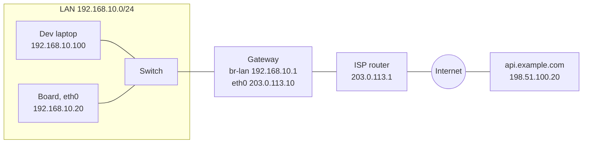

| Device | Interface | MAC | IPv4 | Role |
|---|---|---|---|---|
| Board | `eth0` | `00:00:5e:00:53:14` | `192.168.10.20/24` (static DHCP lease) | The embedded device |
| Dev laptop | `eth0` | `00:00:5e:00:53:64` | `192.168.10.100/24` (DHCP) | SSH, TFTP/NFS server |
| Gateway, LAN side | `br-lan` | `00:00:5e:00:53:01` | `192.168.10.1/24` | Default gateway, DHCP and DNS server |
| Gateway, WAN side | `eth0` | `00:00:5e:00:53:02` | `203.0.113.10/24` | Public address, NAT |
| ISP router | | `00:00:5e:00:53:fe` | `203.0.113.1` | Gateway's next hop |
| Server | | | `198.51.100.20` | `api.example.com`, HTTPS on port 443 |

The public addresses are documentation ranges (RFC 5737) and the MACs come from the documentation block `00:00:5e:00:53:xx` (RFC 7042), so none of them exist on a real network.

---

## 3. Ethernet, MAC addresses, switches and bridges

Ethernet moves **frames** between devices on the same link. A frame carries a destination MAC, a source MAC, an **EtherType** saying what's inside (`0x0800` IPv4, `0x86dd` IPv6, `0x0806` ARP, `0x8100` VLAN tag), a payload of up to 1500 bytes (the **MTU**), and a checksum (FCS).

A **MAC address** is 48 bits, written `00:00:5e:00:53:14`. Two bits of the first byte matter:

| Bit (first byte) | Meaning when set | Example |
|---|---|---|
| `0x01` | Multicast / group address | `01:00:5e:...` (IPv4 multicast), `ff:ff:ff:ff:ff:ff` (broadcast: every device on the link) |
| `0x02` | Locally administered: set by software, not burned in by a vendor | `02:...`, `x6:...`, `xa:...`, `xe:...` |

A vendor-assigned MAC starts with the vendor's 24-bit OUI. A locally administered one is what you use when a board has none (below).

### MAC addresses on embedded boards

Unlike a PC NIC, many SoC Ethernet controllers have **no MAC address of their own**. Someone has to provide one at boot:

| Source | How it reaches Linux |
|---|---|
| EEPROM, OTP fuses, SoC unique ID | Read by U-Boot (or by the driver directly) |
| U-Boot environment `ethaddr` / `eth1addr` | U-Boot writes it into the device tree (`local-mac-address` of the `ethernetN` alias node) before starting the kernel |
| Device tree, hardcoded | `local-mac-address = [00 00 5e 00 53 14];` in the Ethernet node |
| Nothing | The driver picks a **random** locally administered MAC, different at every boot |

```bash
ip link show eth0                          # link/ether 00:00:5e:00:53:14
cat /sys/class/net/eth0/addr_assign_type   # 0 = permanent, 1 = random, 3 = set from user space
# In U-Boot: printenv ethaddr

# Set one from user space (needs the interface down on most drivers)
ip link set dev eth0 down
ip link set dev eth0 address 02:00:00:00:53:14
ip link set dev eth0 up
```

A random MAC at every boot is a classic bring-up bug: the board gets a **new DHCP lease and a different IP** every reboot, static DHCP leases (keyed by MAC) never match, and other hosts keep a stale ARP entry for the old MAC for a while. Fix it in U-Boot or the device tree, not with a script that runs late.

### Switches and bridges

A **switch** forwards frames between its ports at layer 2. It **learns** which MAC lives behind which port from the source address of every frame it sees, and keeps that in its forwarding table (FDB):

- **Known unicast** destination: sent out of one port only.
- **Broadcast**, **unknown unicast**, and multicast (unless the switch does IGMP snooping): **flooded** out of every port except the one it came in on.

Everything a broadcast reaches is one **broadcast domain**, which is also one IP subnet in practice. Routers separate broadcast domains; VLANs split one physical switch into several of them (see the [gateway note](../gateway/gateway.md#networks) for VLAN, bridge and subnet side by side).

A Linux **bridge** is a software switch: same learning and flooding, between network interfaces of one machine. On embedded devices you meet it when:

- A Wi-Fi access point joins the wired LAN (`wlan0` and `eth0` in one bridge, like the gateway's `br-lan`).
- A board has two Ethernet ports and must pass traffic through (daisy-chained industrial devices).
- A switch chip sits behind the SoC (most routers, some industrial boards): with the kernel's **DSA** (Distributed Switch Architecture) driver, each front port shows up as its own interface (`lan1`, `lan2`...), and you group them with a bridge. OpenWrt routers work this way.

```bash
ip link add name br0 type bridge
ip link set eth0 master br0
ip link set eth1 master br0
ip link set br0 up               # the IP address now goes on br0, not on eth0/eth1
bridge link                      # member ports
bridge fdb show br br0           # learned MACs
```

### Checking the link

Before anything at layer 3, check that layer 1 and 2 are up:

```bash
$ ip -br link
lo     UNKNOWN  00:00:00:00:00:00 <LOOPBACK,UP,LOWER_UP>
eth0   UP       00:00:5e:00:53:14 <BROADCAST,MULTICAST,UP,LOWER_UP>
# Cable unplugged or PHY not working:
eth0   DOWN     00:00:5e:00:53:14 <NO-CARRIER,BROADCAST,MULTICAST,UP>

$ ethtool eth0 | grep -E 'Speed|Duplex|Link detected'
    Speed: 1000Mb/s
    Duplex: Full
    Link detected: yes

ip -s link show eth0     # RX/TX packets, errors and drops: growing errors point to cabling, PHY or clock issues
```

`UP` in the flags means the interface is administratively up (`ip link set eth0 up`). `LOWER_UP` means the PHY reports a link. You need both.

---

## 4. IP addressing and subnetting

An IPv4 address is 32 bits, written as four bytes: `192.168.10.20`. The **prefix length** (`/24`) says how many leading bits identify the **network**; the rest identify the **host** inside it.

```
192.168.10.20   = 11000000.10101000.00001010.00010100
/24 (netmask)   = 11111111.11111111.11111111.00000000   = 255.255.255.0
AND             = 11000000.10101000.00001010.00000000   = 192.168.10.0   (network)
```

For `192.168.10.20/24`:

| | Value |
|---|---|
| Network address | `192.168.10.0` |
| Netmask | `255.255.255.0` |
| Broadcast address | `192.168.10.255` |
| Usable host addresses | `192.168.10.1` to `192.168.10.254` (254 hosts) |

**Why the prefix matters:** when you add `192.168.10.20/24` to `eth0`, the kernel creates the route `192.168.10.0/24 dev eth0`. That route is what tells the board "these 254 addresses are **on-link**: reach them directly with ARP". Anything else goes to a router (section 6). A wrong prefix breaks things quietly:

- Board set to `192.168.10.20/16`: it believes all of `192.168.0.0/16` is on-link, so traffic to `192.168.20.5` (the gateway note's IoT VLAN) is sent directly via ARP instead of to the gateway. Nobody answers.
- Board set to `192.168.10.20/32`: nothing is on-link, not even the gateway, so the default route can't be installed.

Common prefix lengths:

| Prefix | Netmask | Addresses | Usable hosts | Typical use |
|---|---|---|---|---|
| `/16` | `255.255.0.0` | 65,536 | 65,534 | Large flat networks, address plans |
| `/24` | `255.255.255.0` | 256 | 254 | A LAN or VLAN |
| `/25` | `255.255.255.128` | 128 | 126 | Half a /24: `.0/25` = `.1-.126`, `.128/25` = `.129-.254` |
| `/26` | `255.255.255.192` | 64 | 62 | Small segments |
| `/30` | `255.255.255.252` | 4 | 2 | Point-to-point link (classic) |
| `/31` | `255.255.255.254` | 2 | 2 | Point-to-point link, no network/broadcast address (RFC 3021) |
| `/32` | `255.255.255.255` | 1 | 1 | A single host (host route, loopback-style addresses) |

`ipcalc 192.168.10.20/24` computes all of this (Debian package `ipcalc`; BusyBox has `ipcalc -bn`).

### Special ranges

| Range | What it is | Where you meet it |
|---|---|---|
| `10.0.0.0/8`, `172.16.0.0/12`, `192.168.0.0/16` | Private (RFC 1918), not routed on the internet | Every LAN, behind NAT (section 12) |
| `127.0.0.0/8` | Loopback (`lo`) | Services reachable only from the device itself |
| `169.254.0.0/16` | IPv4 link-local (RFC 3927), self-assigned when there's no DHCP | Laptop cabled directly to a board. Means "DHCP failed" on most hosts |
| `100.64.0.0/10` | Shared address space for carrier-grade NAT (RFC 6598) | Cellular modems, Starlink: you are behind someone else's NAT |
| `192.0.2.0/24`, `198.51.100.0/24`, `203.0.113.0/24` | Documentation (RFC 5737) | Examples, like this note |
| `224.0.0.0/4` | Multicast | mDNS (`224.0.0.251`), streaming, discovery protocols |
| `255.255.255.255` | Limited broadcast | DHCP before the client has an address |

### IPv6 in short

IPv6 uses the same layers with different mechanisms. What changes for a device:

| | IPv4 | IPv6 |
|---|---|---|
| Address size | 32 bits | 128 bits, written `2001:db8:10::20` |
| LAN prefix | Anything, `/24` is common | Always `/64` |
| Link-local address | Optional (`169.254/16`) | **Always present** on every interface (`fe80::/10`) |
| IP to MAC | ARP | Neighbor Discovery (NDP), carried by ICMPv6 |
| Getting an address | DHCP or static | SLAAC from router advertisements, and/or DHCPv6 |
| Broadcast | Yes | No, multicast instead (`ff02::1` = all nodes on the link) |
| NAT | Almost always at home | Normally none: the firewall does the protection |

Because link-local addresses always exist, IPv6 is a handy rescue path to a board whose IPv4 config is broken:

```bash
ping -6 -c 2 ff02::1%eth0          # from the laptop: every IPv6 host on that link answers with its fe80:: address
ssh root@fe80::200:5eff:fe00:5314%eth0   # %eth0 says which link: link-local addresses are only unique per link
```

Blocking ICMPv6 breaks IPv6 entirely. The gateway note covers [IPv6 on the router side](../gateway/gateway.md#ipv6-in-short) (prefix delegation, RAs).

---

## 5. ARP: from IP address to MAC address

To send a packet to an **on-link** IP address, the kernel needs that host's MAC address, because the Ethernet frame is addressed by MAC. **ARP** (Address Resolution Protocol) asks for it with a broadcast:

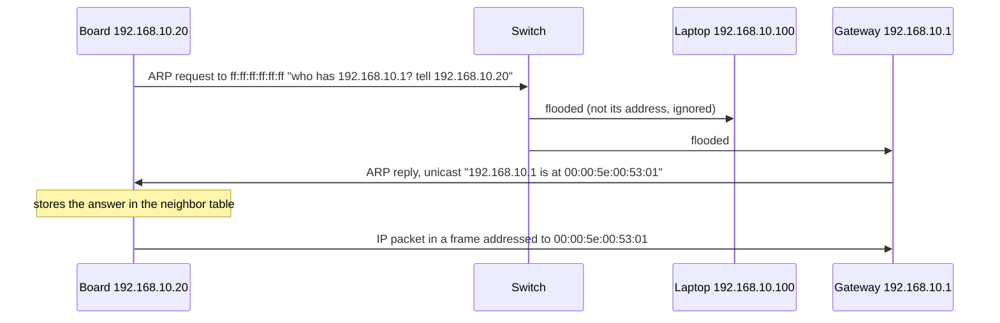

The rule that makes routing work: **a host only ARPs for on-link addresses**. To reach `198.51.100.20`, the board never ARPs for the server; it ARPs for its **gateway**, and sends the frame to the gateway's MAC with the server's IP inside (section 6).

```bash
$ ip neigh show dev eth0
192.168.10.1 lladdr 00:00:5e:00:53:01 REACHABLE
192.168.10.100 lladdr 00:00:5e:00:53:64 STALE
192.168.10.77 FAILED

ip neigh flush dev eth0                 # forget everything, force new ARP requests
arping -I eth0 -c 3 192.168.10.1        # ARP-level ping: answers even if the host firewalls ICMP
arping -D -I eth0 -c 3 192.168.10.20    # duplicate address detection: any reply means another device already uses this IP
```

| State | Meaning |
|---|---|
| `REACHABLE` | Confirmed recently |
| `STALE` | Not confirmed recently, still used. Re-checked on next use |
| `INCOMPLETE` | Request sent, no answer yet |
| `FAILED` | No answer: host off, wrong subnet, wrong VLAN, cabling. A layer 2 problem, not a firewall one |

A **gratuitous ARP** is a host announcing its own IP/MAC pair unprompted (after boot, IP change, or failover), so other hosts update their tables. IPv6 does the same job with Neighbor Solicitation/Advertisement messages (`ip -6 neigh`).

---

## 6. Routing and the default gateway

Every IP packet leaving the board goes through a **route lookup**. The kernel picks the route with the **longest matching prefix**; when two routes match equally, the **lowest metric** wins.

```bash
$ ip route
default via 192.168.10.1 dev eth0 proto dhcp src 192.168.10.20 metric 100
192.168.10.0/24 dev eth0 proto kernel scope link src 192.168.10.20

$ ip route get 198.51.100.20        # off-link: goes to the gateway
198.51.100.20 via 192.168.10.1 dev eth0 src 192.168.10.20 uid 0

$ ip route get 192.168.10.100       # on-link: delivered directly
192.168.10.100 dev eth0 src 192.168.10.20 uid 0
```

- `192.168.10.0/24 ... scope link`: the connected route created by the address (section 4).
- `default` = `0.0.0.0/0`, the shortest possible prefix: it matches everything, so it's used only when nothing more specific does. Its `via` address is the **default gateway**.

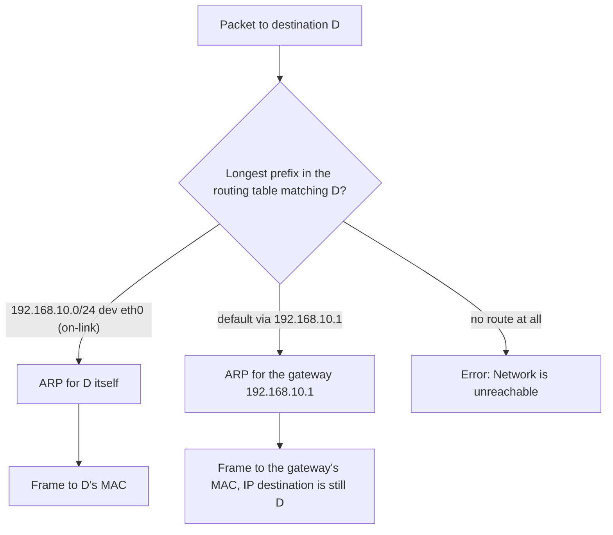

The gateway must itself be on-link: `ip route add default via 10.0.0.1` on this board fails with `Nexthop has invalid gateway`, because nothing says how to reach `10.0.0.1`.

**Static routes** send one network through a router other than the default gateway, e.g. a lab subnet behind a VPN box:

```bash
ip route add 10.8.0.0/24 via 192.168.10.5
ip route del 10.8.0.0/24
```

**Several interfaces** (Ethernet + cellular `wwan0`, or Ethernet + USB gadget `usb0`) is where embedded routing usually goes wrong:

- Two DHCP clients each install a default route. Without different metrics, the result depends on which one came up last. Give the preferred uplink the lower metric (the gateway note's [failover section](../gateway/gateway.md#failover) shows the pattern).
- A point-to-point link to the laptop (`usb0`, section 15) must not install a default route at all, or internet traffic goes to the laptop.

**Host or router:** a board only forwards packets that aren't addressed to it if `net.ipv4.ip_forward=1`. By default it's a host and drops them. Turning a board into a router is what the gateway note does.

---

## 7. Getting an address: static, DHCP, link-local

| Method | How | Use it for |
|---|---|---|
| **DHCP** | A server hands out address, prefix, gateway, DNS, lease time | Default for devices. Pair it with a **static lease** on the server (by MAC) if the device needs a fixed address |
| **Static** | Configured on the device | Point-to-point links, isolated test benches, the DHCP server itself |
| **Link-local** | Self-assigned `169.254.x.y` (IPv4) or `fe80::` (IPv6, always) | Direct cable to a laptop with no DHCP server |
| **Kernel `ip=`** | Kernel command line, configured before user space starts | NFS root (section 15) |

### DHCP

DHCP runs over UDP: client port **68**, server port **67**. The client has no address yet, so it starts with broadcasts:

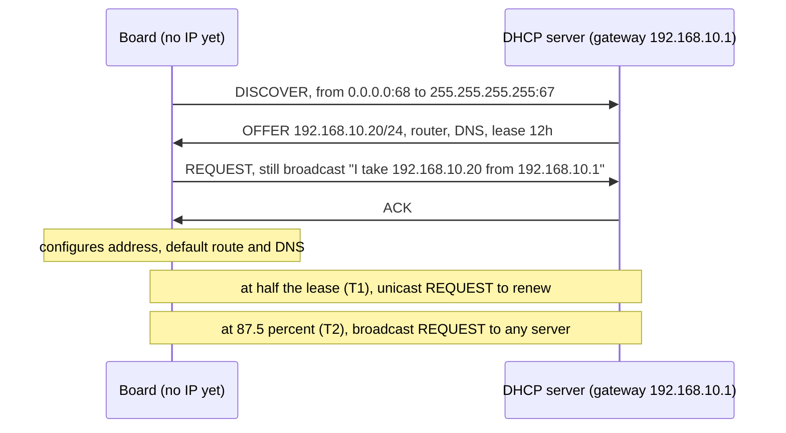

If the lease expires without renewal, the client must stop using the address. Because the client has no IP when it starts, DHCP clients send and receive through raw packet sockets: the kernel needs `CONFIG_PACKET`.

On embedded systems, check **who** runs DHCP, because they don't behave the same:

| Client | Found in | Note |
|---|---|---|
| BusyBox `udhcpc` | Buildroot default, minimal images, OpenWrt (driven by netifd) | Doesn't configure anything itself: it calls a script (`/usr/share/udhcpc/default.script`) with `deconfig`/`bound`/`renew`, and the **script** sets the IP, routes and `resolv.conf`. No script, no configuration |
| `dhcpcd` | Buildroot option, many distros | Full client, configures the interface itself |
| systemd-networkd | Yocto/Debian images with systemd | `DHCP=yes` in a `.network` file |
| NetworkManager, ConnMan | Desktop-like and Yocto images (`core-image-sato` uses ConnMan) | Full managers, also handle Wi-Fi and cellular |

```bash
udhcpc -i eth0 -f -q                       # BusyBox: get a lease in the foreground, then exit
tcpdump -ni eth0 -e port 67 or port 68     # watch DORA on the wire
```

### Static configuration

By hand (lost at reboot):

```bash
ip addr add 192.168.10.20/24 dev eth0
ip link set eth0 up
ip route add default via 192.168.10.1
echo "nameserver 192.168.10.1" > /etc/resolv.conf
```

Persistent, BusyBox/Debian `ifupdown` (`/etc/network/interfaces`, the Buildroot default). BusyBox `ifup` doesn't manage DNS, so `resolv.conf` stays separate:

```
auto eth0
iface eth0 inet static
    address 192.168.10.20
    netmask 255.255.255.0
    gateway 192.168.10.1
```

Persistent, systemd-networkd (`/etc/systemd/network/20-eth0.network`):

```ini
[Match]
Name=eth0

[Network]
Address=192.168.10.20/24
Gateway=192.168.10.1
DNS=192.168.10.1
# For DHCP instead: replace the three lines above with DHCP=yes
```

---

## 8. DNS: from name to IP address

Programs connect to names (`api.example.com`); packets need addresses. The application asks the **C library** (`getaddrinfo()`), which reads the local files and then asks a DNS server:

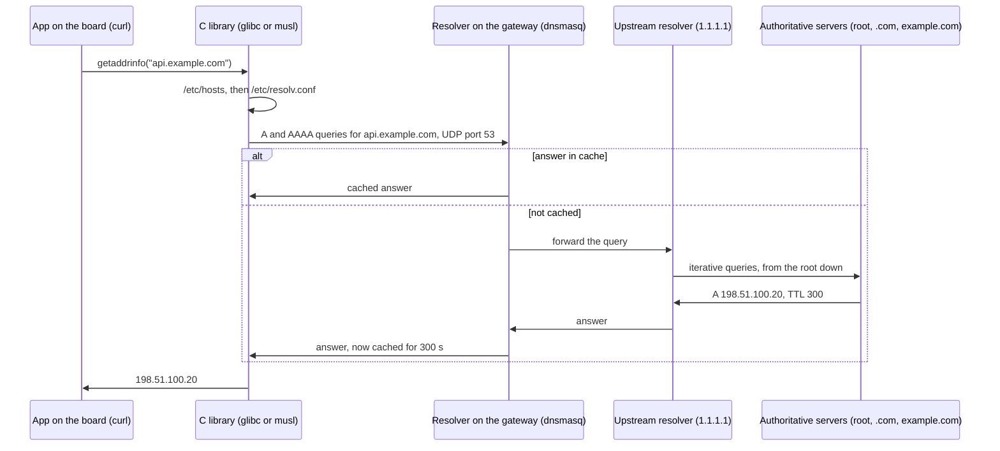

| Record | Maps | Example |
|---|---|---|
| `A` | Name to IPv4 | `api.example.com A 198.51.100.20` |
| `AAAA` | Name to IPv6 | `api.example.com AAAA 2001:db8::20` |
| `CNAME` | Name to another name (alias) | `www.example.com CNAME example.com` |
| `PTR` | IP to name (reverse lookup) | `20.100.51.198.in-addr.arpa PTR api.example.com` |

Queries go over UDP port 53, falling back to TCP port 53 for large answers. Every answer has a **TTL**: resolvers cache it that long, which is why a DNS change takes time to show up.

Files on the device:

| File | Role |
|---|---|
| `/etc/resolv.conf` | `nameserver` lines (up to 3), `search` domains. Written by the DHCP client or network manager |
| `/etc/hosts` | Static names, checked before DNS |
| `/etc/nsswitch.conf` | Lookup order (`hosts: files dns`). **glibc only**: musl ignores it and always uses hosts, then DNS |

Embedded specifics:

- **Read-only root filesystem:** `/etc/resolv.conf` is usually a symlink to a writable location. Buildroot links it to `/run/resolv.conf`, systemd-resolved to `/run/systemd/resolve/stub-resolv.conf` (nameserver `127.0.0.53`, a local stub that forwards to the real servers).
- **"Ping by IP works, by name doesn't"** is always DNS: check `resolv.conf` first.
- **Test with the same path the application uses.** `getent hosts api.example.com` goes through the C library (glibc systems). `nslookup` (BusyBox) and `dig` talk to the DNS server directly and skip `/etc/hosts` and NSS.
- **mDNS** (`board.local`): multicast DNS on UDP port 5353 to `224.0.0.251` (RFC 6762) lets hosts on one link find each other without a DNS server. Run `avahi-daemon` (or systemd-resolved with `MulticastDNS=yes`) on the board and most desktops can `ssh root@board.local`, whatever its DHCP address.

---

## 9. TCP and UDP

IP delivers packets to a **host**. Ports deliver them to a **program**. A connection is identified by five values: protocol, source IP, source port, destination IP, destination port. Servers listen on a fixed port (443 for HTTPS); clients get a temporary **ephemeral port** from the kernel (`32768-60999` by default on Linux, see `/proc/sys/net/ipv4/ip_local_port_range`).

| | TCP | UDP |
|---|---|---|
| Connection | Handshake first, state kept on both ends | None: each datagram stands alone |
| Delivery | Reliable, in order, retransmits lost data | May be lost, duplicated, reordered |
| Flow and congestion control | Yes | No, the application's job |
| Message boundaries | **No**: a byte stream, the application must frame its messages | Yes, one datagram = one message |
| Header | 20+ bytes | 8 bytes |
| Used by | SSH, HTTP/1.1 and HTTP/2, TLS, MQTT | DNS, DHCP, NTP, TFTP, CoAP, mDNS, QUIC (HTTP/3) |

A TCP connection's life:

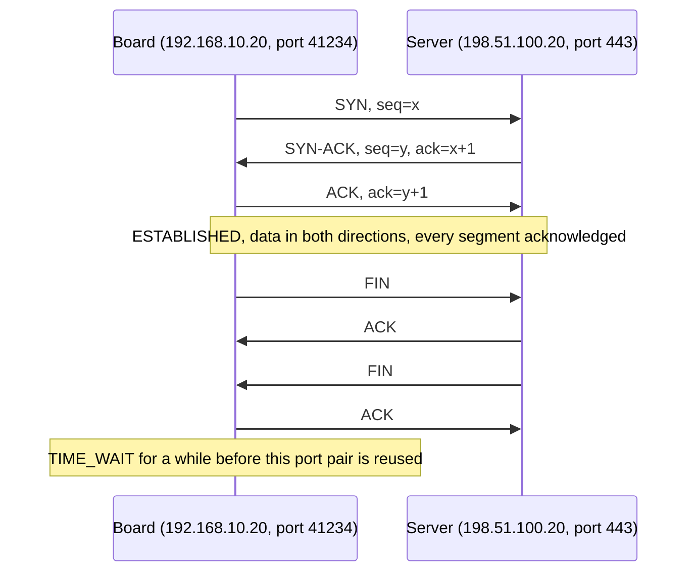

The handshake costs one round trip before any data flows (plus more for TLS, section 11). Over a cellular or satellite link with 100+ ms latency, reusing connections matters.

**How a failed connection looks** tells you where to look:

| Symptom | Meaning |
|---|---|
| `Connection refused` (immediate) | The host answered with a TCP **RST**: it's reachable, but nothing listens on that port |
| `Connection timed out` (after seconds) | No answer at all: firewall dropping, host down, or routing problem |
| `No route to host` | The board (for an on-link host) or the last router couldn't ARP the destination, or a firewall rejects with an ICMP error |

**What the board is listening on**, and on which address:

```bash
$ ss -tulpn          # TCP + UDP, listening, with process (columns trimmed)
Netid State   Local Address:Port   Process
tcp   LISTEN  0.0.0.0:22           users:(("dropbear",pid=201,fd=3))
tcp   LISTEN  127.0.0.1:1883       users:(("mosquitto",pid=230,fd=5))
tcp   LISTEN  *:8080               users:(("app",pid=250,fd=7))
```

- `0.0.0.0` / `*`: every interface, reachable from the network.
- `127.0.0.1`: loopback only, reachable from the board itself. Debug servers and local brokers belong here.
- BusyBox: `netstat -tulpn`. Test a remote port with `nc -vz 192.168.10.20 22` (depends on how BusyBox `nc` was built).

Ports worth knowing on embedded systems:

| Port | Protocol | Use |
|---|---|---|
| 22/tcp | SSH (OpenSSH, Dropbear) | Shell, `scp` |
| 53/udp+tcp | DNS | Name resolution |
| 67, 68/udp | DHCP | Address configuration |
| 69/udp | TFTP | U-Boot network boot |
| 123/udp | NTP | Time sync, needed by TLS |
| 80, 443/tcp | HTTP, HTTPS | Web UI, REST APIs, OTA updates |
| 1883, 8883/tcp | MQTT, MQTT over TLS | IoT telemetry |
| 5683/udp | CoAP | Constrained devices |
| 5353/udp | mDNS | `.local` names, service discovery |
| 2049/tcp | NFS | NFS root filesystem |

---

## 10. ICMP: ping, traceroute and MTU

ICMP carries control and error messages for IP. It has no ports, and the kernel answers it itself.

| Type | Meaning | You see it in |
|---|---|---|
| Echo request / reply (8 / 0) | "Are you there?" | `ping` |
| Destination unreachable (3) | Code 1 host unreachable, code 3 **port unreachable** (UDP to a closed port), code 4 **fragmentation needed** | Failed connections, path MTU discovery |
| Time exceeded (11) | A router dropped the packet because its TTL reached 0 | `traceroute` |
| Redirect (5) | "Use this other router instead" | Usually disabled on routers |

```bash
ping -c 3 192.168.10.1                  # gateway reachable? (layer 3 on the LAN)
ping -c 3 -I eth0 1.1.1.1               # internet reachable from a given interface?
traceroute -n 198.51.100.20             # which routers the path goes through (BusyBox has traceroute too)
tracepath -n 198.51.100.20              # same, also reports the path MTU
ping -M do -s 1472 -c 3 198.51.100.20   # 1472 + 8 (ICMP) + 20 (IP) = 1500: does a full-size packet pass unfragmented?
```

**MTU and path MTU:** every link has an MTU (1500 on Ethernet, less on PPPoE, VPN tunnels and many cellular links). TCP announces an **MSS** (MTU minus 40 bytes of IPv4 + TCP headers, so 1460) so segments fit. When a smaller link sits in the middle, the router there replies "fragmentation needed" (IPv6: "packet too big"), and the sender lowers its packet size. If a firewall drops that ICMP, small requests work but large transfers hang: the classic "SSH logs in, then freezes on `ls`" or "some websites never load". The [gateway note's rules](../gateway/gateway.md#how-a-packet-crosses-the-gateway) keep these messages and clamp the MSS.

A failed `ping` doesn't prove a host is down: many hosts drop ICMP echo. Cross-check with `arping` on the LAN or a TCP connection to an open port.

---

## 11. HTTP and HTTPS

**HTTP** is a text request/response protocol over TCP. Plain HTTP/1.1 on the wire:

```
GET /v1/status HTTP/1.1
Host: api.example.com
User-Agent: curl/8.5.0
Accept: */*

HTTP/1.1 200 OK
Content-Type: application/json
Content-Length: 15

{"status":"ok"}
```

The `Host` header is what lets one server IP host many sites. HTTP/2 keeps the same requests in a binary, multiplexed form over one TCP connection; HTTP/3 moves to QUIC over UDP.

**HTTPS** is HTTP inside **TLS**, on port 443. TLS gives encryption, integrity, and **authentication of the server** through its certificate. TLS 1.3 adds one round trip after the TCP handshake:

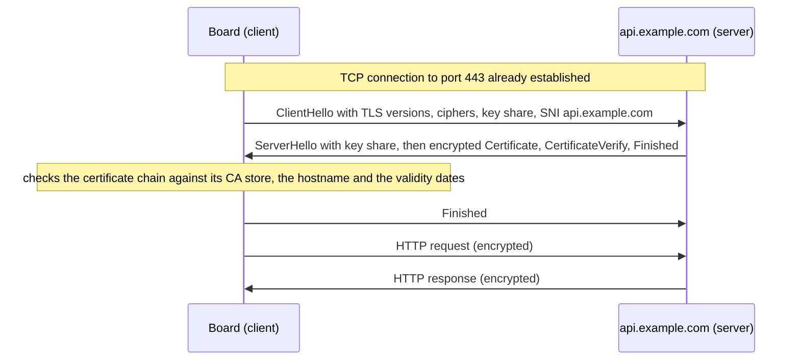

The certificate check is where embedded devices fail most, and the reason is rarely the network:

| Error (curl / OpenSSL wording) | Cause on a board | Fix |
|---|---|---|
| `certificate is not yet valid` | **Clock** at 1970 or at the build date: no RTC battery, NTP not synced yet | Sync time before the first TLS connection (`chrony`, `systemd-timesyncd`, BusyBox `ntpd`). Without an RTC, keep a saved timestamp as a lower bound |
| `unable to get local issuer certificate` | No CA bundle in the root filesystem | Install `ca-certificates` (Buildroot and Yocto both package it), or ship the specific CA your server uses |
| `certificate subject name does not match` / `no alternative certificate subject name matches` | Connecting by IP, or with a different name than the certificate's | Use the hostname the certificate was issued for |

```bash
date                                                    # first thing to check
curl -v https://api.example.com/v1/status               # shows DNS, TCP connect, TLS handshake, HTTP exchange
openssl s_client -connect api.example.com:443 -servername api.example.com </dev/null   # certificate chain details
```

TLS libraries you'll find on devices: OpenSSL, mbedTLS, wolfSSL. They differ in size, not in these basics.

---

## 12. NAT

The board's `192.168.10.20` is private: internet routers don't know where it is. The gateway does **source NAT** (masquerade on Linux): it rewrites the source address of outgoing packets to its own public address, and remembers the mapping in its **connection tracking** table so it can rewrite replies back:

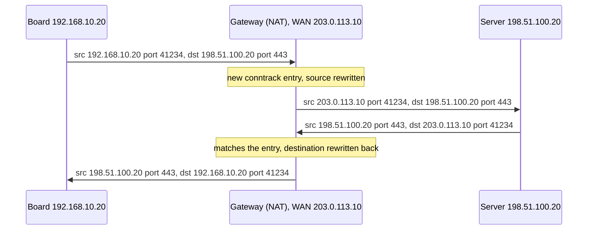

The entry, as `conntrack -L` shows it on the gateway (original direction, then expected reply):

```
tcp 6 431999 ESTABLISHED src=192.168.10.20 dst=198.51.100.20 sport=41234 dport=443 src=198.51.100.20 dst=203.0.113.10 sport=443 dport=41234 [ASSURED] mark=0 use=1
```

The source port is usually kept; NAT only changes it when two LAN hosts would collide. **Destination NAT** (a port forward) is the reverse: rewrite incoming packets on a public port to a LAN host. Configuration is in the [gateway note, section 7](../gateway/gateway.md#7-firewall-and-nat).

What NAT means for a device:

- **Nobody on the internet can open a connection to it** unless someone configures a port forward on the gateway, which you can't do on a customer's network or behind **carrier-grade NAT** (cellular, Starlink: `100.64.0.0/10`, section 4). This is why devices **connect out** to a cloud service (MQTT, HTTPS, WebSocket) and receive commands over that connection, or use a VPN such as WireGuard for remote access.
- **Idle mappings expire.** If no packet crosses for a while (sometimes only tens of seconds for UDP on carrier NAT), the mapping is dropped and the server's next message is lost. Long-lived connections need keepalives: MQTT `keepalive`, TCP keepalive, WireGuard `PersistentKeepalive = 25`.
- **IPv6 is normally not NATed**: the device has a global address, and the gateway's firewall is what blocks unsolicited inbound traffic.

---

## 13. Firewalls on the device

Linux filters packets with **netfilter**, configured with `nftables` (or the older `iptables`). A firewall is **stateful** when it tracks connections: allow what the device starts and the replies to it (`established,related`), drop unsolicited packets.

On a gateway the interesting chain is `forward` (traffic passing through). On a **device** that doesn't route, it's `input` (traffic to the device's own services). The full packet path through the hooks is drawn in the [gateway note](../gateway/gateway.md#how-a-packet-crosses-the-gateway).

A minimal policy for a board: drop everything inbound except replies, ICMP, DHCP, mDNS, and SSH from the development LAN.

`/etc/nftables.conf`

```nft
#!/usr/sbin/nft -f
flush ruleset

table inet filter {
    chain input {
        type filter hook input priority filter; policy drop;

        ct state established,related accept
        ct state invalid drop
        iif "lo" accept

        # ICMP and ICMPv6: ping, errors, path MTU, IPv6 neighbor discovery
        meta l4proto { icmp, ipv6-icmp } accept

        # DHCP client: server replies (renewals can arrive as broadcast)
        udp sport 67 udp dport 68 accept

        # mDNS, so the board answers as board.local
        udp dport 5353 accept

        # SSH from the development LAN (IPv4) and from link-local IPv6
        ip saddr 192.168.10.0/24 tcp dport 22 accept
        ip6 saddr fe80::/10 tcp dport 22 accept
    }

    chain forward {
        type filter hook forward priority filter; policy drop;
    }
}
```

```bash
nft -c -f /etc/nftables.conf    # syntax check
nft -f /etc/nftables.conf       # apply (from the console the first time: a mistake can cut SSH)
nft list ruleset
```

Embedded caveats:

- The kernel must have nftables built in or as modules (`CONFIG_NF_TABLES`, `CONFIG_NF_TABLES_INET`, `CONFIG_NFT_CT`). Check with `zcat /proc/config.gz | grep NF_TABLES` (needs `CONFIG_IKCONFIG_PROC`). Older BSPs may only have legacy iptables.
- A firewall is the second line of defense. The first is **not listening**: bind local-only services to `127.0.0.1`, and remove debug servers (`gdbserver`, open `telnetd`, unauthenticated web UIs) from production images.

---

## 14. Putting it together: one HTTPS request, end to end

The board runs `curl https://api.example.com/v1/status` with empty caches. Everything above happens in order:

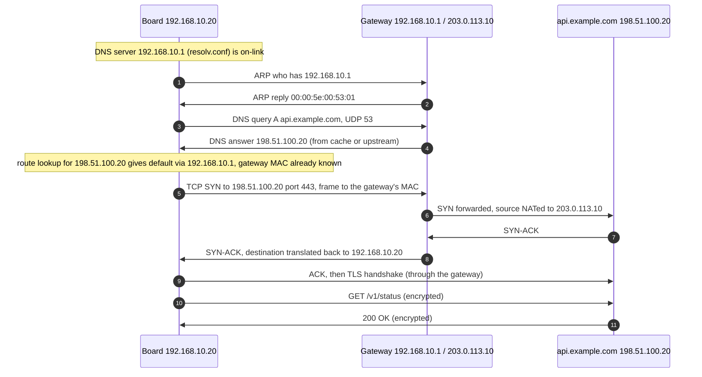

What the headers look like on each link for the SYN (the ISP router and internet routers are left out of the diagram, but they forward it the same way):

| Link | Src MAC | Dst MAC | Src IP : port | Dst IP : port | TTL |
|---|---|---|---|---|---|
| Board → gateway (LAN) | `00:00:5e:00:53:14` board | `00:00:5e:00:53:01` gateway `br-lan` | `192.168.10.20:41234` | `198.51.100.20:443` | 64 |
| Gateway → ISP router (WAN) | `00:00:5e:00:53:02` gateway `eth0` | `00:00:5e:00:53:fe` ISP router | `203.0.113.10:41234` | `198.51.100.20:443` | 63 |
| Last router → server | that router | the server | `203.0.113.10:41234` | `198.51.100.20:443` | 64 minus hop count |

Three things to take away:

1. **MAC addresses are per link.** Every router builds a new Ethernet frame for the next link, after its own route lookup and ARP.
2. **IP addresses are end to end.** Only NAT changes them, here once, at the gateway.
3. **The TTL goes down by one at every router.** That's how `traceroute` works, and why a routing loop eventually dies out.

And the debugging consequence: if this request fails, it fails at one of these numbered steps, and each one can be checked separately (section 16).

---

## 15. Networking on an embedded board

### Kernel configuration

A minimal kernel config may lack things a desktop kernel always has:

| Option | Needed for |
|---|---|
| `CONFIG_INET`, `CONFIG_IPV6` | IPv4 and IPv6 |
| NIC driver + PHY driver, Ethernet node `status = "okay"` in the device tree (`phy-mode`, `phy-handle`) | The interface to exist and get a link. Probe errors show in `dmesg` |
| `CONFIG_PACKET` | DHCP clients, `tcpdump` |
| `CONFIG_BRIDGE`, `CONFIG_VLAN_8021Q` | Bridges, VLAN interfaces |
| `CONFIG_NETFILTER`, `CONFIG_NF_TABLES` (+ `CONFIG_NF_CONNTRACK`) | Firewall, NAT |
| `CONFIG_IP_PNP`, `CONFIG_ROOT_NFS` | `ip=` on the kernel command line, NFS root |

### Who configures the network

Exactly **one** tool should own each interface (same rule as on the [gateway](../gateway/gateway.md#who-does-what-on-the-gateway)). Find out which one your image uses before changing anything:

| Image | Usual network manager | Config |
|---|---|---|
| Buildroot (default) | BusyBox `ifupdown` + `udhcpc` | `/etc/network/interfaces` |
| Buildroot / Yocto with systemd | systemd-networkd | `/etc/systemd/network/*.network` |
| Yocto, sysvinit images | `ifupdown` (`init-ifupdown` recipe) | `/etc/network/interfaces` |
| Yocto, `core-image-sato` and similar | ConnMan | `connmanctl` |
| Debian-based images (Raspberry Pi OS...) | NetworkManager | `nmcli` |
| OpenWrt | netifd | `/etc/config/network` (UCI) |

### Interface names

The kernel names Ethernet interfaces `eth0`, `eth1`... in probe order. With systemd-udevd, they're renamed to stable names: `end0` for a device-tree based controller (naming scheme v252 and later), `enp1s0` for a PCIe NIC. Scripts that hardcode `eth0` break when an image switches to systemd. Other names you'll meet: `wlan0` (Wi-Fi), `wwan0` (cellular), `usb0` (USB gadget), `lo`. (`can0` is a network interface too, but CAN carries no IP.)

### Development setups

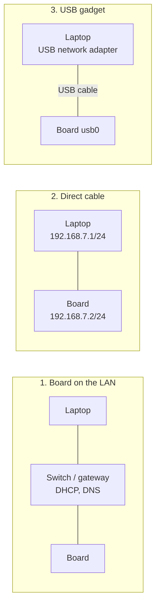

| Setup | Addressing | Notes |
|---|---|---|
| **1. On the LAN** | DHCP from the gateway, static lease for a stable IP | Easiest. Find the board with `board.local` (mDNS), the gateway's lease list, or `ping -6 ff02::1%eth0` |
| **2. Direct cable** | Static pair on both ends, or link-local | No DHCP server, no internet. To give the board internet, share the laptop's connection: NetworkManager's "Shared to other computers" runs DHCP and NAT on `10.42.0.0/24` |
| **3. USB gadget Ethernet** | Static pair, e.g. `192.168.7.2` (board) / `192.168.7.1` (laptop) as on BeagleBone images | The board's USB device port acts as a network adapter (ECM or NCM function, RNDIS for older Windows hosts). Point-to-point: no default route through it unless you mean to |

**Network boot** (kernel over TFTP, root filesystem over NFS) uses all of the above, but U-Boot has its own small network stack, configured separately (`ipaddr`, `serverip`, `ethaddr`), and the kernel then configures its interface again from `ip=`. With an NFS root, the user-space network manager must **leave that interface alone**: re-running DHCP or taking the link down removes the root filesystem from under the system. Buildroot's generated `interfaces` file has a `pre-up /etc/network/nfs_check` line for exactly that reason. Network boot gets its own note.

---

## 16. Troubleshooting by layer

Work **bottom-up**: a DNS error means nothing if the cable is unplugged. Each step assumes the previous one passed.

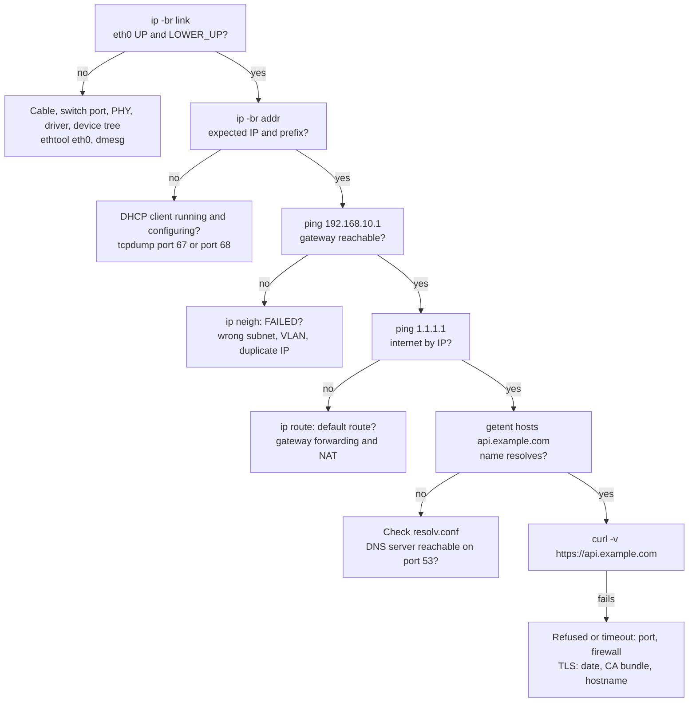

| Layer | Question | Command | BusyBox |
|---|---|---|---|
| 1 Link | Cable, speed, errors? | `ip -br link`, `ethtool eth0`, `ip -s link` | `ip` applet; `ethtool` is a separate package |
| 2 Neighbor | Can I reach the MAC? | `ip neigh`, `arping` | `arping` |
| 3 IP | Address, route, reachability? | `ip -br addr`, `ip route get <ip>`, `ping` | same |
| DNS | Does the name resolve? | `getent hosts <name>`, `dig` | `nslookup` |
| 4 Transport | Is it listening? Is the port open? | `ss -tulpn`, `nc -vz <ip> <port>` | `netstat -tulpn`, `nc` |
| Application | Does the protocol work? | `curl -v`, `openssl s_client` | `wget` |
| Any | What is actually on the wire? | `tcpdump -ni eth0 -e host 198.51.100.20` | Install `tcpdump` |

`tcpdump` settles arguments: if the request leaves the board and no answer comes back, the problem is not on the board. The gateway note has the [router-side debug order](../gateway/gateway.md#how-a-packet-crosses-the-gateway) and a [symptom table](../gateway/gateway.md#14-troubleshooting).

---

## 17. Not covered here

Topics for separate, more advanced notes:

- **Socket programming**: the `socket()` API, blocking vs non-blocking I/O, framing TCP streams, `epoll` ([linux-systems-programming/](../../linux-systems-programming/)).
- **Kernel network stack internals**: `sk_buff`, NAPI, queueing disciplines, socket buffers and their sysctls.
- **Network driver development**: MAC drivers, PHY and MDIO, `phylink`, DSA switch drivers ([linux-kernel-device-driver-development/](../../linux-kernel-device-driver-development/)).
- **Network boot**: U-Boot networking, TFTP, NFS root, `ip=` in detail.
- **Wi-Fi and cellular links**: association, WPA, modems ([wireless-protocols-and-connectivity/](../../wireless-protocols-and-connectivity/)).
- **IPv6 in depth**: SLAAC, DHCPv6, privacy addresses, multicast and MLD.
- **Device security**: TLS client certificates and provisioning, WireGuard, hardening network services.
- **Time**: NTP in depth, PTP (IEEE 1588) for industrial timing.
- **Performance**: `iperf3`, offloads (`ethtool -k`), interrupt coalescing, throughput on small SoCs.
- **Industrial and IoT protocols**: MQTT and CoAP in depth, Modbus TCP, time-sensitive networking.

---

## References

Standards (all on <https://www.rfc-editor.org>):

| Topic | RFC |
|---|---|
| IPv4, ICMP | [RFC 791](https://www.rfc-editor.org/rfc/rfc791), [RFC 792](https://www.rfc-editor.org/rfc/rfc792) |
| ARP | [RFC 826](https://www.rfc-editor.org/rfc/rfc826) |
| UDP, TCP | [RFC 768](https://www.rfc-editor.org/rfc/rfc768), [RFC 9293](https://www.rfc-editor.org/rfc/rfc9293) |
| CIDR, private ranges, /31 links | [RFC 4632](https://www.rfc-editor.org/rfc/rfc4632), [RFC 1918](https://www.rfc-editor.org/rfc/rfc1918), [RFC 3021](https://www.rfc-editor.org/rfc/rfc3021) |
| Link-local IPv4, CGNAT range, documentation ranges | [RFC 3927](https://www.rfc-editor.org/rfc/rfc3927), [RFC 6598](https://www.rfc-editor.org/rfc/rfc6598), [RFC 5737](https://www.rfc-editor.org/rfc/rfc5737) |
| Documentation MAC addresses | [RFC 7042](https://www.rfc-editor.org/rfc/rfc7042) |
| DHCP | [RFC 2131](https://www.rfc-editor.org/rfc/rfc2131) |
| DNS, mDNS | [RFC 1034](https://www.rfc-editor.org/rfc/rfc1034), [RFC 1035](https://www.rfc-editor.org/rfc/rfc1035), [RFC 6762](https://www.rfc-editor.org/rfc/rfc6762) |
| Path MTU discovery | [RFC 1191](https://www.rfc-editor.org/rfc/rfc1191) |
| IPv6 neighbor discovery, SLAAC, ICMPv6 | [RFC 4861](https://www.rfc-editor.org/rfc/rfc4861), [RFC 4862](https://www.rfc-editor.org/rfc/rfc4862), [RFC 4443](https://www.rfc-editor.org/rfc/rfc4443) |
| HTTP, TLS 1.3 | [RFC 9110](https://www.rfc-editor.org/rfc/rfc9110), [RFC 9112](https://www.rfc-editor.org/rfc/rfc9112), [RFC 8446](https://www.rfc-editor.org/rfc/rfc8446) |
| NAT behavior | [RFC 3022](https://www.rfc-editor.org/rfc/rfc3022), [RFC 4787](https://www.rfc-editor.org/rfc/rfc4787) |

Linux documentation:

- `man ip-address`, `man ip-route`, `man ip-neighbour`, `man ss`, `man tcpdump`, `man resolv.conf`
- Kernel IP sysctls: <https://docs.kernel.org/networking/ip-sysctl.html>
- Kernel `ip=` and NFS root: <https://docs.kernel.org/admin-guide/nfs/nfsroot.html>
- Interface naming: <https://www.freedesktop.org/software/systemd/man/latest/systemd.net-naming-scheme.html>
- systemd-networkd: `man systemd.network`
- nftables wiki: <https://wiki.nftables.org>
- BusyBox commands (`udhcpc`, `ifup`, `nslookup`...): <https://busybox.net/downloads/BusyBox.html>
- Buildroot manual: <https://buildroot.org/downloads/manual/manual.html>

Book: W. Richard Stevens and Kevin R. Fall, *TCP/IP Illustrated, Volume 1: The Protocols* (2nd edition): the reference for how these protocols behave on the wire.
