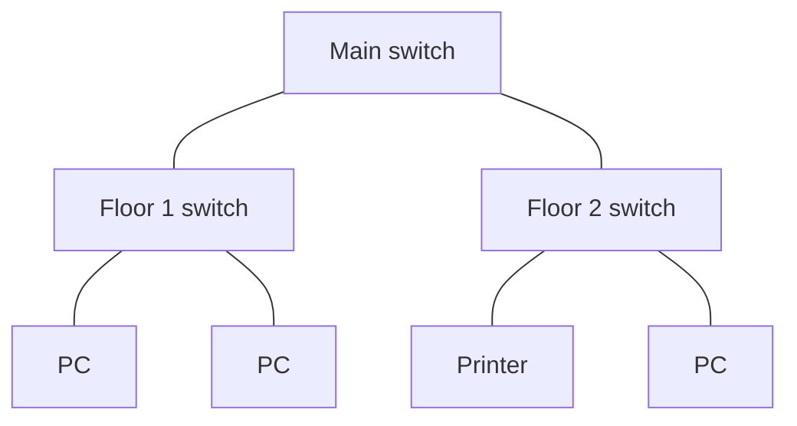
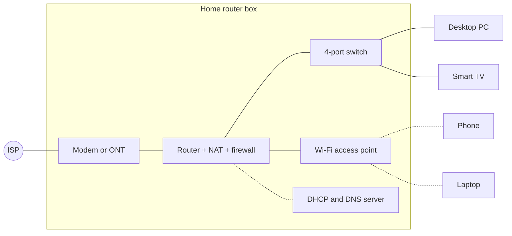
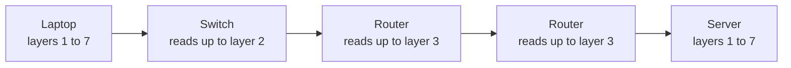

# Networking Basics: How Networks Work

The networking concepts every engineer meets sooner or later, explained from scratch: what a network is, the OSI and TCP/IP models, MAC and IP addresses, subnetting, switching and routing, TCP and UDP, DHCP, DNS, NAT, HTTPS, firewalls and VPNs, and how real networks are built, from a home LAN to a data center and a cloud VPC.

This note is **vendor- and OS-neutral**. It explains what the protocols do, not how one operating system implements them. Once the concepts are clear, [Linux Networking Fundamentals for Embedded Engineers](../linux-networking-fundamentals/linux-networking-fundamentals_v1_2026-10-29.md) shows how Linux implements each piece on an embedded device, with the commands to inspect and debug it.

**Assumptions:**
- No prior networking knowledge. Knowing what binary numbers are helps for subnetting (section 11).
- Addresses are examples from the ranges reserved for documentation (`192.0.2.0/24`, `198.51.100.0/24`, `203.0.113.0/24`, `2001:db8::/32`) and from private ranges. Replace them with your own.

**How to read it:**
- **To learn:** in order. Each section is short and builds on the previous ones.
- **To look something up:** use the table of contents or the glossary (section 39).
- **To see everything work together:** section 37 follows one web request from start to finish.

## Table of contents

**Part 1: The big picture**

- [1. What a network is](#1-what-a-network-is)
- [2. Network types: PAN, LAN, WAN and the internet](#2-network-types-pan-lan-wan-and-the-internet)
- [3. Topologies](#3-topologies)
- [4. Network devices](#4-network-devices)
- [5. Cables, fiber and radio](#5-cables-fiber-and-radio)

**Part 2: Layer models**

- [6. The OSI model](#6-the-osi-model)
- [7. The TCP/IP model](#7-the-tcpip-model)
- [8. Encapsulation: how the layers wrap data](#8-encapsulation-how-the-layers-wrap-data)

**Part 3: Addressing**

- [9. MAC addresses](#9-mac-addresses)
- [10. IPv4 addresses](#10-ipv4-addresses)
- [11. Subnetting](#11-subnetting)
- [12. Public, private and special addresses](#12-public-private-and-special-addresses)
- [13. IPv6](#13-ipv6)
- [14. Ports and sockets](#14-ports-and-sockets)
- [15. ARP: from IP address to MAC address](#15-arp-from-ip-address-to-mac-address)
- [16. Unicast, broadcast, multicast and anycast](#16-unicast-broadcast-multicast-and-anycast)

**Part 4: Moving data**

- [17. Switching and VLANs](#17-switching-and-vlans)
- [18. Routing](#18-routing)
- [19. TCP](#19-tcp)
- [20. UDP, and choosing between TCP and UDP](#20-udp-and-choosing-between-tcp-and-udp)
- [21. ICMP, ping, traceroute and MTU](#21-icmp-ping-traceroute-and-mtu)

**Part 5: Core services**

- [22. DHCP: getting an address automatically](#22-dhcp-getting-an-address-automatically)
- [23. DNS: from names to addresses](#23-dns-from-names-to-addresses)
- [24. NAT: sharing one public address](#24-nat-sharing-one-public-address)
- [25. HTTP, HTTPS and TLS](#25-http-https-and-tls)
- [26. Other common protocols](#26-other-common-protocols)

**Part 6: Security and wireless**

- [27. Firewalls](#27-firewalls)
- [28. VPNs and tunnels](#28-vpns-and-tunnels)
- [29. Wi-Fi in short](#29-wi-fi-in-short)

**Part 7: Network architectures**

- [30. Client-server and peer-to-peer](#30-client-server-and-peer-to-peer)
- [31. A home network](#31-a-home-network)
- [32. A small office network](#32-a-small-office-network)
- [33. An enterprise campus: the three-tier design](#33-an-enterprise-campus-the-three-tier-design)
- [34. A data center: spine and leaf](#34-a-data-center-spine-and-leaf)
- [35. A cloud network: VPCs and subnets](#35-a-cloud-network-vpcs-and-subnets)
- [36. An IoT product network](#36-an-iot-product-network)

**Part 8: Putting it together**

- [37. What happens when you open a web page](#37-what-happens-when-you-open-a-web-page)
- [38. Troubleshooting by layer](#38-troubleshooting-by-layer)
- [39. Glossary](#39-glossary)
- [40. Where to go next](#40-where-to-go-next)
- [References](#references)

---

## Part 1: The big picture

## 1. What a network is

A **network** is a set of devices connected so they can exchange data. The devices that send and receive data are **hosts** (laptops, phones, servers, sensors). The devices in between that pass data along are **network devices** (switches, routers, access points).

Data doesn't travel as one long stream. It's cut into small pieces called **packets**, each carrying a destination address, like an envelope. Each network device reads the address and passes the packet one step closer to its destination.

```
Laptop ──► Switch ──► Router ──► Internet ──► Router ──► Server
  "to 198.51.100.20"   reads the address, forwards, repeat
```

This is **packet switching**. Packets from many conversations share the same links, so no link sits idle while someone is silent. The old telephone network used **circuit switching** instead: a call reserved a path for its whole duration.

Three ideas carry through the rest of this note:

- **Addressing:** every host needs an address so others can reach it (Part 3).
- **Forwarding:** each device on the path decides where to send the packet next (Part 4).
- **Protocols:** both ends follow agreed rules for what the bytes mean (Parts 2 and 5).

A **protocol** is such a set of rules. HTTP, DNS, TCP and Ethernet are all protocols. Most are published as **RFCs** (Requests for Comments) by the IETF, or as IEEE standards for Ethernet and Wi-Fi.

---

## 2. Network types: PAN, LAN, WAN and the internet

Networks are often named by the area they cover.

| Type | Stands for | Covers | Example |
|---|---|---|---|
| PAN | Personal Area Network | A few meters around a person | A phone and Bluetooth earbuds |
| LAN | Local Area Network | A home, an office floor, a building | The devices on your home Wi-Fi and Ethernet |
| WLAN | Wireless LAN | Same as a LAN, over radio | A Wi-Fi network |
| CAN | Campus Area Network | Several buildings of one organization | A university or factory site |
| MAN | Metropolitan Area Network | A city | A city-wide fiber ring run by an operator |
| WAN | Wide Area Network | Countries and continents | The links between a company's offices |
| Internet | | The whole world | Thousands of independent networks connected together |

The **internet** is not one network. It's a network of networks: home networks, company networks, ISPs, cloud providers and universities, all agreeing to exchange traffic using the same protocols (IP above all).

Two related terms:

- An **intranet** is a private network that uses internet technologies (web servers, DNS) but is only reachable from inside an organization.
- An **extranet** opens part of an intranet to selected partners, for example a supplier portal.

---

## 3. Topologies

A **topology** is the shape of a network: how devices are connected to each other.

**Bus:** every device taps one shared cable. Cheap, but one break takes everyone down and only one device can talk at a time. Early Ethernet (coaxial cable) worked like this. Today it survives in buses like CAN in cars.

```
 [A]     [B]     [C]     [D]
  │       │       │       │
══╧═══════╧═══════╧═══════╧══  one shared cable
```

**Star:** every device has its own cable to a central device, usually a switch. One broken cable only affects one device. This is how almost every wired LAN is built today.

```
        [A]   [B]
          \   /
   [F]──[Switch]──[C]
          /   \
        [E]   [D]
```

**Ring:** each device connects to two neighbors, forming a loop. Data travels around the ring. Some metro and industrial networks use rings because traffic can go the other way if one link breaks.

```
   [A]────[B]
    │       │
   [D]────[C]
```

**Mesh:** devices connect to many others. In a **full mesh** every device connects to every other one. It's very resilient but needs n × (n − 1) / 2 links: 10 devices need 45. A **partial mesh** adds only the links that matter. The internet core and Wi-Fi mesh systems are partial meshes.

```
   [A]────[B]
    │ \  / │
    │  \/  │
    │  /\  │
    │ /  \ │
   [D]────[C]
```

**Tree (hierarchical star):** stars connected to other stars. A building has one switch per floor, and all floor switches connect to a main switch. Most real networks are trees or mixes of these shapes (**hybrid**).



**Physical versus logical topology:** the physical topology is how the cables run. The logical topology is how data actually flows. A Wi-Fi network looks like a star (everyone talks to the access point), but all devices share the same radio channel, like a bus.

---

## 4. Network devices

### Network interface card (NIC)

The **NIC** connects a host to the network: an Ethernet port, a Wi-Fi chip, a cellular modem. Each NIC has its own hardware address (the MAC address, section 9). A host with two NICs, for example Wi-Fi and Ethernet, is on two links at once.

### Hub (layer 1, obsolete)

A **hub** repeats every bit it receives to every other port. All devices share the bandwidth and only one can send at a time. Switches replaced hubs in the 2000s. They still matter because they explain what a switch improves.

### Switch (layer 2)

A **switch** connects devices **within one LAN**. It reads the destination MAC address of each frame and sends it only out the port where that device is. Each port gets the full bandwidth, and many pairs of devices can talk at once (section 17).

### Router (layer 3)

A **router** connects **different networks** together. It reads the destination IP address of each packet and chooses the next hop toward it (section 18). Your home router connects your LAN to your ISP's network. Internet routers connect ISPs to each other.

**Switch versus router**, the most important distinction in this section:

| | Switch | Router |
|---|---|---|
| Connects | Devices in the same network | Different networks |
| Reads | MAC addresses (layer 2) | IP addresses (layer 3) |
| Table it uses | MAC address table | Routing table |
| Broadcasts | Forwards them to all ports | Stops them |

### Access point (AP)

An **access point** is a bridge between Wi-Fi and Ethernet. Wireless devices connect to it, and it passes their frames to the wired LAN. An AP by itself doesn't route.

### Modem, ONT and the ISP link

A **modem** (modulator-demodulator) converts digital data into the signal the ISP's line carries: DSL over a phone line, DOCSIS over cable TV coax, or a cellular radio signal. On fiber, the same job is done by an **ONT** (optical network terminal).

### Firewall

A **firewall** inspects traffic and allows or blocks it according to rules (section 27). It can be a dedicated appliance or software on a router or host.

### Load balancer

A **load balancer** spreads incoming requests over several servers so no single one is overloaded, and stops sending to servers that fail health checks. Websites and cloud services sit behind them.

### The home "router" is five devices in one box

The box your ISP gives you usually combines all of the above:



When this note says "router", "switch" or "access point", it means the function, wherever it runs.

---

## 5. Cables, fiber and radio

The physical **medium** carries the bits. Each has its own speed, distance and cost.

### Copper twisted pair (Ethernet cables)

The usual Ethernet cable has four twisted pairs of copper wires and an **RJ45** connector. Twisting the pairs cancels interference. The maximum length is **100 meters** for the common categories.

| Category | Typical use |
|---|---|
| Cat 5e | Up to 1 Gbit/s at 100 m. Still the most common |
| Cat 6 | 1 Gbit/s at 100 m, 10 Gbit/s up to about 55 m |
| Cat 6A | 10 Gbit/s at 100 m |
| Cat 8 | 25 to 40 Gbit/s over short runs, inside data centers |

**PoE** (Power over Ethernet) sends power over the same cable. It's how many access points, IP cameras and desk phones get both data and power from one cable.

### Fiber optic

Fiber carries light through glass. It goes much further than copper and isn't affected by electrical interference.

- **Multimode fiber** carries light on many paths. It's cheaper and used inside buildings, up to a few hundred meters at 10 Gbit/s.
- **Single-mode fiber** carries one path of light over a very thin core. It reaches tens of kilometers and more, and is used by ISPs and between buildings.

Switches and routers often take fiber through pluggable modules called **SFP** (and SFP+, QSFP for higher speeds).

### Radio (wireless)

Wi-Fi, Bluetooth, cellular (LTE, 5G) and satellite links send data over radio. Wireless is convenient but shares the air with neighbors, loses strength through walls, and is slower and less predictable than a cable. Section 29 covers Wi-Fi.

### Speed, bandwidth, throughput and latency

These words get mixed up:

- **Bandwidth** (link speed): the maximum rate of a link, such as 1 Gbit/s.
- **Throughput:** the rate you actually get, always lower because of overhead, sharing and losses.
- **Latency:** how long one packet takes to arrive, in milliseconds. A link can be fast but far away (high latency), like a satellite link.
- **Jitter:** how much the latency varies. It matters for voice and video calls.

Speeds are in **bits** per second (Mbit/s, Gbit/s). File sizes are in **bytes**. 1 byte = 8 bits, so a 100 Mbit/s link downloads at most about 12.5 MB/s.

### Duplex

- **Full duplex:** both sides send and receive at the same time. Normal for switched Ethernet.
- **Half duplex:** only one side at a time, like a walkie-talkie. Hubs and Wi-Fi radios work this way.

A **duplex mismatch** (one side full, the other half) causes a slow, lossy link that still looks "up".

---

## Part 2: Layer models

## 6. The OSI model

Networking is split into **layers**. Each layer solves one problem and uses the layer below without caring how it works. A web browser doesn't care whether the page arrives over Wi-Fi or fiber, and Wi-Fi doesn't care whether it carries a web page or a video call.

The **OSI model** (Open Systems Interconnection) has seven layers. Real protocols don't follow it exactly, but everyone uses its numbers to talk about problems: "a layer 2 issue" means a switching or MAC problem, "a layer 7 load balancer" means one that reads HTTP.

```
 ┌─────────────────┐
 │ 7 Application   │  What the user's program says: HTTP, DNS, SMTP
 ├─────────────────┤
 │ 6 Presentation  │  Data format, encoding, encryption
 ├─────────────────┤
 │ 5 Session       │  Opening, managing and closing conversations
 ├─────────────────┤
 │ 4 Transport     │  End-to-end delivery between programs: TCP, UDP
 ├─────────────────┤
 │ 3 Network       │  Delivery across networks: IP, routing
 ├─────────────────┤
 │ 2 Data link     │  Delivery on one link: Ethernet, Wi-Fi, MAC addresses
 ├─────────────────┤
 │ 1 Physical      │  Bits as electrical, light or radio signals
 └─────────────────┘
```

A common way to remember them from layer 1 up: **P**lease **D**o **N**ot **T**hrow **S**ausage **P**izza **A**way (Physical, Data link, Network, Transport, Session, Presentation, Application).

### The layers one by one

**Layer 1, Physical:** turns bits into signals and back. Cables, connectors, voltages, light pulses, radio frequencies. A broken cable or a dead port is a layer 1 problem.

**Layer 2, Data link:** moves **frames** between devices on the **same link**, using **MAC addresses**. It detects corrupted frames. Ethernet, Wi-Fi and switches live here.

**Layer 3, Network:** moves **packets** between **different networks**, using **IP addresses**. Routers live here, and so do IP and ICMP.

**Layer 4, Transport:** delivers data to the right **program** on a host, using **port numbers**. TCP adds reliability (nothing lost, everything in order). UDP is the simpler, faster option without guarantees.

**Layer 5, Session:** keeps track of a conversation between two programs: starting it, keeping it alive, resuming it. Few protocols are purely session layer. In practice this job is done by the application or by TLS.

**Layer 6, Presentation:** makes data understandable to both sides: character encoding (UTF-8), compression, encryption. TLS is often placed here, although it doesn't fit neatly into one layer.

**Layer 7, Application:** the protocols programs use directly: HTTP for the web, DNS for names, SMTP for mail, SSH for remote shells. "Application" means the protocol, not the program: a browser is a program that speaks HTTP.

### Data units at each layer

Each layer has its own name for the piece of data it handles. This is called the **PDU** (protocol data unit).

| Layer | PDU | Address used |
|---|---|---|
| 7, 6, 5 | Data, message | Names, URLs |
| 4 Transport | **Segment** (TCP) or **datagram** (UDP) | Port |
| 3 Network | **Packet** | IP address |
| 2 Data link | **Frame** | MAC address |
| 1 Physical | **Bits** | None |

In everyday speech people say "packet" for all of them. The precise names help when reading documentation or capture tools.

---

## 7. The TCP/IP model

The internet doesn't run on OSI protocols. It runs on the **TCP/IP** protocol suite, which has its own, simpler model with four layers. Layers 5, 6 and 7 of OSI become one application layer, and layers 1 and 2 become one link layer.

```
        OSI model                    TCP/IP model           Examples
 ┌─────────────────┐            ┌──────────────────┐
 │ 7 Application   │            │                  │
 ├─────────────────┤            │                  │
 │ 6 Presentation  │  ───────►  │   Application    │  HTTP, DNS, DHCP, TLS, SSH, MQTT
 ├─────────────────┤            │                  │
 │ 5 Session       │            │                  │
 ├─────────────────┤            ├──────────────────┤
 │ 4 Transport     │  ───────►  │   Transport      │  TCP, UDP, QUIC
 ├─────────────────┤            ├──────────────────┤
 │ 3 Network       │  ───────►  │   Internet       │  IPv4, IPv6, ICMP
 ├─────────────────┤            ├──────────────────┤
 │ 2 Data link     │            │                  │
 ├─────────────────┤  ───────►  │   Link           │  Ethernet, Wi-Fi, ARP
 │ 1 Physical      │            │                  │
 └─────────────────┘            └──────────────────┘
```

Some books split the link layer into two and count five layers (physical, data link, network, transport, application). That five-layer view is the one most engineers use day to day, with the OSI numbers.

**IP is the narrow waist:** dozens of link technologies sit below IP, and thousands of applications sit above it. Everything only has to agree on IP in the middle. That's why a new application works over any network, and a new kind of link carries every application.

```
   HTTP   DNS   SSH   MQTT   video   games ...
     \      \    |     |      /      /
          TCP            UDP
              \          /
                   IP              ◄── everyone agrees on this
              /    |     \
      Ethernet   Wi-Fi   LTE/5G   fiber ...
```

---

## 8. Encapsulation: how the layers wrap data

When a program sends data, each layer adds its own **header** in front, like putting a letter in an envelope, then that envelope in a bigger one. This is **encapsulation**.

```
Application                                   [  HTTP request  ]
Transport                          [TCP hdr]  [  HTTP request  ]          = segment
Network                  [IP hdr]  [TCP hdr]  [  HTTP request  ]          = packet
Link         [Eth hdr]   [IP hdr]  [TCP hdr]  [  HTTP request  ] [FCS]    = frame
Physical     0101100101110010101011101010010110101001010110101...         = bits
```

- The **TCP header** holds the source and destination ports, so the receiving host knows which program gets the data.
- The **IP header** holds the source and destination IP addresses, so routers know where to send the packet.
- The **Ethernet header** holds the source and destination MAC addresses for this one link. The trailer (**FCS**, frame check sequence) detects corruption.

The receiver does the reverse, **decapsulation**: each layer reads and removes its header, then hands the rest to the layer above.

### What each device reads

Each device on the path only opens as many envelopes as it needs:



| Device | Reads up to | Changes |
|---|---|---|
| Hub, repeater | Layer 1 | Nothing, only repeats bits |
| Switch, access point | Layer 2 | Nothing in the frame (it only chooses the port) |
| Router | Layer 3 | Builds a **new** Ethernet header for the next link, decrements the TTL |
| NAT router, firewall | Layer 4 | NAT rewrites addresses and ports |
| Proxy, layer 7 load balancer | Layer 7 | Can read and change the HTTP request itself |
| End hosts | All layers | Create and consume the data |

**Key point:** the IP addresses stay the same from end to end (except where NAT rewrites them, section 24). The MAC addresses change at every router, because each link is a separate Ethernet segment. Section 37 shows this hop by hop.

---

Version 1 · 2026-11-20
