# Networking Basics: How Networks Work

The networking concepts every engineer meets sooner or later, explained from scratch: what a network is, the OSI and TCP/IP models, MAC and IP addresses, subnetting, switching and routing, TCP and UDP, DHCP, DNS, NAT, HTTPS, firewalls and VPNs, and how real networks are built, from a home LAN to a data center and a cloud VPC.

This note is **vendor- and OS-neutral**. It explains what the protocols do, not how one operating system implements them. Once the concepts are clear, [Linux Networking Fundamentals for Embedded Engineers](../linux-networking-fundamentals/linux-networking-fundamentals_v1_2026-10-29.md) shows how Linux implements each piece on an embedded device, with the commands to inspect and debug it.

**Assumptions:**
- No prior networking knowledge. Knowing what binary numbers are helps for subnetting (section 11).
- Addresses are examples from the ranges reserved for documentation (`192.0.2.0/24`, `198.51.100.0/24`, `203.0.113.0/24`, `2001:db8::/32`) and from private ranges. Replace them with your own.

**How to read it:**
- **To learn:** in order. Each section is short and builds on the previous ones.
- **To look something up:** use the table of contents or the glossary (section 39).
- **To see everything work together:** section 37 follows one web request from start to finish.

## Table of contents

**Part 1: The big picture**

- [1. What a network is](#1-what-a-network-is)
- [2. Network types: PAN, LAN, WAN and the internet](#2-network-types-pan-lan-wan-and-the-internet)
- [3. Topologies](#3-topologies)
- [4. Network devices](#4-network-devices)
- [5. Cables, fiber and radio](#5-cables-fiber-and-radio)

**Part 2: Layer models**

- [6. The OSI model](#6-the-osi-model)
- [7. The TCP/IP model](#7-the-tcpip-model)
- [8. Encapsulation: how the layers wrap data](#8-encapsulation-how-the-layers-wrap-data)

**Part 3: Addressing**

- [9. MAC addresses](#9-mac-addresses)
- [10. IPv4 addresses](#10-ipv4-addresses)
- [11. Subnetting](#11-subnetting)
- [12. Public, private and special addresses](#12-public-private-and-special-addresses)
- [13. IPv6](#13-ipv6)
- [14. Ports and sockets](#14-ports-and-sockets)
- [15. ARP: from IP address to MAC address](#15-arp-from-ip-address-to-mac-address)
- [16. Unicast, broadcast, multicast and anycast](#16-unicast-broadcast-multicast-and-anycast)

**Part 4: Moving data**

- [17. Switching and VLANs](#17-switching-and-vlans)
- [18. Routing](#18-routing)
- [19. TCP](#19-tcp)
- [20. UDP, and choosing between TCP and UDP](#20-udp-and-choosing-between-tcp-and-udp)
- [21. ICMP, ping, traceroute and MTU](#21-icmp-ping-traceroute-and-mtu)

**Part 5: Core services**

- [22. DHCP: getting an address automatically](#22-dhcp-getting-an-address-automatically)
- [23. DNS: from names to addresses](#23-dns-from-names-to-addresses)
- [24. NAT: sharing one public address](#24-nat-sharing-one-public-address)
- [25. HTTP, HTTPS and TLS](#25-http-https-and-tls)
- [26. Other common protocols](#26-other-common-protocols)

**Part 6: Security and wireless**

- [27. Firewalls](#27-firewalls)
- [28. VPNs and tunnels](#28-vpns-and-tunnels)
- [29. Wi-Fi in short](#29-wi-fi-in-short)

**Part 7: Network architectures**

- [30. Client-server and peer-to-peer](#30-client-server-and-peer-to-peer)
- [31. A home network](#31-a-home-network)
- [32. A small office network](#32-a-small-office-network)
- [33. An enterprise campus: the three-tier design](#33-an-enterprise-campus-the-three-tier-design)
- [34. A data center: spine and leaf](#34-a-data-center-spine-and-leaf)
- [35. A cloud network: VPCs and subnets](#35-a-cloud-network-vpcs-and-subnets)
- [36. An IoT product network](#36-an-iot-product-network)

**Part 8: Putting it together**

- [37. What happens when you open a web page](#37-what-happens-when-you-open-a-web-page)
- [38. Troubleshooting by layer](#38-troubleshooting-by-layer)
- [39. Glossary](#39-glossary)
- [40. Where to go next](#40-where-to-go-next)
- [References](#references)

---

## Part 1: The big picture

## 1. What a network is

A **network** is a set of devices connected so they can exchange data. The devices that send and receive data are **hosts** (laptops, phones, servers, sensors). The devices in between that pass data along are **network devices** (switches, routers, access points).

Data doesn't travel as one long stream. It's cut into small pieces called **packets**, each carrying a destination address, like an envelope. Each network device reads the address and passes the packet one step closer to its destination.

```
Laptop ──► Switch ──► Router ──► Internet ──► Router ──► Server
  "to 198.51.100.20"   reads the address, forwards, repeat
```

This is **packet switching**. Packets from many conversations share the same links, so no link sits idle while someone is silent. The old telephone network used **circuit switching** instead: a call reserved a path for its whole duration.

Three ideas carry through the rest of this note:

- **Addressing:** every host needs an address so others can reach it (Part 3).
- **Forwarding:** each device on the path decides where to send the packet next (Part 4).
- **Protocols:** both ends follow agreed rules for what the bytes mean (Parts 2 and 5).

A **protocol** is such a set of rules. HTTP, DNS, TCP and Ethernet are all protocols. Most are published as **RFCs** (Requests for Comments) by the IETF, or as IEEE standards for Ethernet and Wi-Fi.

---

## 2. Network types: PAN, LAN, WAN and the internet

Networks are often named by the area they cover.

| Type | Stands for | Covers | Example |
|---|---|---|---|
| PAN | Personal Area Network | A few meters around a person | A phone and Bluetooth earbuds |
| LAN | Local Area Network | A home, an office floor, a building | The devices on your home Wi-Fi and Ethernet |
| WLAN | Wireless LAN | Same as a LAN, over radio | A Wi-Fi network |
| CAN | Campus Area Network | Several buildings of one organization | A university or factory site |
| MAN | Metropolitan Area Network | A city | A city-wide fiber ring run by an operator |
| WAN | Wide Area Network | Countries and continents | The links between a company's offices |
| Internet | | The whole world | Thousands of independent networks connected together |

The **internet** is not one network. It's a network of networks: home networks, company networks, ISPs, cloud providers and universities, all agreeing to exchange traffic using the same protocols (IP above all).

Two related terms:

- An **intranet** is a private network that uses internet technologies (web servers, DNS) but is only reachable from inside an organization.
- An **extranet** opens part of an intranet to selected partners, for example a supplier portal.

---

## 3. Topologies

A **topology** is the shape of a network: how devices are connected to each other.

**Bus:** every device taps one shared cable. Cheap, but one break takes everyone down and only one device can talk at a time. Early Ethernet (coaxial cable) worked like this. Today it survives in buses like CAN in cars.

```
 [A]     [B]     [C]     [D]
  │       │       │       │
══╧═══════╧═══════╧═══════╧══  one shared cable
```

**Star:** every device has its own cable to a central device, usually a switch. One broken cable only affects one device. This is how almost every wired LAN is built today.

```
        [A]   [B]
          \   /
   [F]──[Switch]──[C]
          /   \
        [E]   [D]
```

**Ring:** each device connects to two neighbors, forming a loop. Data travels around the ring. Some metro and industrial networks use rings because traffic can go the other way if one link breaks.

```
   [A]────[B]
    │       │
   [D]────[C]
```

**Mesh:** devices connect to many others. In a **full mesh** every device connects to every other one. It's very resilient but needs n × (n − 1) / 2 links: 10 devices need 45. A **partial mesh** adds only the links that matter. The internet core and Wi-Fi mesh systems are partial meshes.

```
   [A]────[B]
    │ \  / │
    │  \/  │
    │  /\  │
    │ /  \ │
   [D]────[C]
```

**Tree (hierarchical star):** stars connected to other stars. A building has one switch per floor, and all floor switches connect to a main switch. Most real networks are trees or mixes of these shapes (**hybrid**).

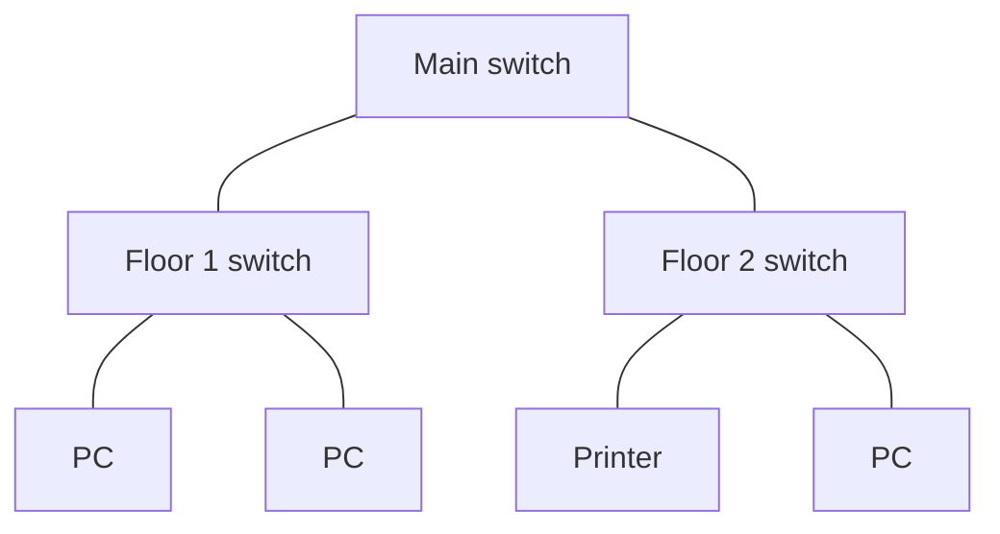

**Physical versus logical topology:** the physical topology is how the cables run. The logical topology is how data actually flows. A Wi-Fi network looks like a star (everyone talks to the access point), but all devices share the same radio channel, like a bus.

---

## 4. Network devices

### Network interface card (NIC)

The **NIC** connects a host to the network: an Ethernet port, a Wi-Fi chip, a cellular modem. Each NIC has its own hardware address (the MAC address, section 9). A host with two NICs, for example Wi-Fi and Ethernet, is on two links at once.

### Hub (layer 1, obsolete)

A **hub** repeats every bit it receives to every other port. All devices share the bandwidth and only one can send at a time. Switches replaced hubs in the 2000s. They still matter because they explain what a switch improves.

### Switch (layer 2)

A **switch** connects devices **within one LAN**. It reads the destination MAC address of each frame and sends it only out the port where that device is. Each port gets the full bandwidth, and many pairs of devices can talk at once (section 17).

### Router (layer 3)

A **router** connects **different networks** together. It reads the destination IP address of each packet and chooses the next hop toward it (section 18). Your home router connects your LAN to your ISP's network. Internet routers connect ISPs to each other.

**Switch versus router**, the most important distinction in this section:

| | Switch | Router |
|---|---|---|
| Connects | Devices in the same network | Different networks |
| Reads | MAC addresses (layer 2) | IP addresses (layer 3) |
| Table it uses | MAC address table | Routing table |
| Broadcasts | Forwards them to all ports | Stops them |

### Access point (AP)

An **access point** is a bridge between Wi-Fi and Ethernet. Wireless devices connect to it, and it passes their frames to the wired LAN. An AP by itself doesn't route.

### Modem, ONT and the ISP link

A **modem** (modulator-demodulator) converts digital data into the signal the ISP's line carries: DSL over a phone line, DOCSIS over cable TV coax, or a cellular radio signal. On fiber, the same job is done by an **ONT** (optical network terminal).

### Firewall

A **firewall** inspects traffic and allows or blocks it according to rules (section 27). It can be a dedicated appliance or software on a router or host.

### Load balancer

A **load balancer** spreads incoming requests over several servers so no single one is overloaded, and stops sending to servers that fail health checks. Websites and cloud services sit behind them.

### The home "router" is five devices in one box

The box your ISP gives you usually combines all of the above:

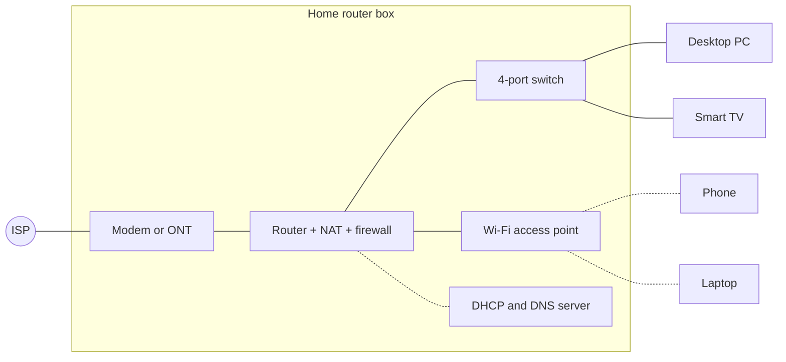

When this note says "router", "switch" or "access point", it means the function, wherever it runs.

---

## 5. Cables, fiber and radio

The physical **medium** carries the bits. Each has its own speed, distance and cost.

### Copper twisted pair (Ethernet cables)

The usual Ethernet cable has four twisted pairs of copper wires and an **RJ45** connector. Twisting the pairs cancels interference. The maximum length is **100 meters** for the common categories.

| Category | Typical use |
|---|---|
| Cat 5e | Up to 1 Gbit/s at 100 m. Still the most common |
| Cat 6 | 1 Gbit/s at 100 m, 10 Gbit/s up to about 55 m |
| Cat 6A | 10 Gbit/s at 100 m |
| Cat 8 | 25 to 40 Gbit/s over short runs, inside data centers |

**PoE** (Power over Ethernet) sends power over the same cable. It's how many access points, IP cameras and desk phones get both data and power from one cable.

### Fiber optic

Fiber carries light through glass. It goes much further than copper and isn't affected by electrical interference.

- **Multimode fiber** carries light on many paths. It's cheaper and used inside buildings, up to a few hundred meters at 10 Gbit/s.
- **Single-mode fiber** carries one path of light over a very thin core. It reaches tens of kilometers and more, and is used by ISPs and between buildings.

Switches and routers often take fiber through pluggable modules called **SFP** (and SFP+, QSFP for higher speeds).

### Radio (wireless)

Wi-Fi, Bluetooth, cellular (LTE, 5G) and satellite links send data over radio. Wireless is convenient but shares the air with neighbors, loses strength through walls, and is slower and less predictable than a cable. Section 29 covers Wi-Fi.

### Speed, bandwidth, throughput and latency

These words get mixed up:

- **Bandwidth** (link speed): the maximum rate of a link, such as 1 Gbit/s.
- **Throughput:** the rate you actually get, always lower because of overhead, sharing and losses.
- **Latency:** how long one packet takes to arrive, in milliseconds. A link can be fast but far away (high latency), like a satellite link.
- **Jitter:** how much the latency varies. It matters for voice and video calls.

Speeds are in **bits** per second (Mbit/s, Gbit/s). File sizes are in **bytes**. 1 byte = 8 bits, so a 100 Mbit/s link downloads at most about 12.5 MB/s.

### Duplex

- **Full duplex:** both sides send and receive at the same time. Normal for switched Ethernet.
- **Half duplex:** only one side at a time, like a walkie-talkie. Hubs and Wi-Fi radios work this way.

A **duplex mismatch** (one side full, the other half) causes a slow, lossy link that still looks "up".

---

## Part 2: Layer models

## 6. The OSI model

Networking is split into **layers**. Each layer solves one problem and uses the layer below without caring how it works. A web browser doesn't care whether the page arrives over Wi-Fi or fiber, and Wi-Fi doesn't care whether it carries a web page or a video call.

The **OSI model** (Open Systems Interconnection) has seven layers. Real protocols don't follow it exactly, but everyone uses its numbers to talk about problems: "a layer 2 issue" means a switching or MAC problem, "a layer 7 load balancer" means one that reads HTTP.

```
 ┌─────────────────┐
 │ 7 Application   │  What the user's program says: HTTP, DNS, SMTP
 ├─────────────────┤
 │ 6 Presentation  │  Data format, encoding, encryption
 ├─────────────────┤
 │ 5 Session       │  Opening, managing and closing conversations
 ├─────────────────┤
 │ 4 Transport     │  End-to-end delivery between programs: TCP, UDP
 ├─────────────────┤
 │ 3 Network       │  Delivery across networks: IP, routing
 ├─────────────────┤
 │ 2 Data link     │  Delivery on one link: Ethernet, Wi-Fi, MAC addresses
 ├─────────────────┤
 │ 1 Physical      │  Bits as electrical, light or radio signals
 └─────────────────┘
```

A common way to remember them from layer 1 up: **P**lease **D**o **N**ot **T**hrow **S**ausage **P**izza **A**way (Physical, Data link, Network, Transport, Session, Presentation, Application).

### The layers one by one

**Layer 1, Physical:** turns bits into signals and back. Cables, connectors, voltages, light pulses, radio frequencies. A broken cable or a dead port is a layer 1 problem.

**Layer 2, Data link:** moves **frames** between devices on the **same link**, using **MAC addresses**. It detects corrupted frames. Ethernet, Wi-Fi and switches live here.

**Layer 3, Network:** moves **packets** between **different networks**, using **IP addresses**. Routers live here, and so do IP and ICMP.

**Layer 4, Transport:** delivers data to the right **program** on a host, using **port numbers**. TCP adds reliability (nothing lost, everything in order). UDP is the simpler, faster option without guarantees.

**Layer 5, Session:** keeps track of a conversation between two programs: starting it, keeping it alive, resuming it. Few protocols are purely session layer. In practice this job is done by the application or by TLS.

**Layer 6, Presentation:** makes data understandable to both sides: character encoding (UTF-8), compression, encryption. TLS is often placed here, although it doesn't fit neatly into one layer.

**Layer 7, Application:** the protocols programs use directly: HTTP for the web, DNS for names, SMTP for mail, SSH for remote shells. "Application" means the protocol, not the program: a browser is a program that speaks HTTP.

### Data units at each layer

Each layer has its own name for the piece of data it handles. This is called the **PDU** (protocol data unit).

| Layer | PDU | Address used |
|---|---|---|
| 7, 6, 5 | Data, message | Names, URLs |
| 4 Transport | **Segment** (TCP) or **datagram** (UDP) | Port |
| 3 Network | **Packet** | IP address |
| 2 Data link | **Frame** | MAC address |
| 1 Physical | **Bits** | None |

In everyday speech people say "packet" for all of them. The precise names help when reading documentation or capture tools.

---

## 7. The TCP/IP model

The internet doesn't run on OSI protocols. It runs on the **TCP/IP** protocol suite, which has its own, simpler model with four layers. Layers 5, 6 and 7 of OSI become one application layer, and layers 1 and 2 become one link layer.

```
        OSI model                    TCP/IP model           Examples
 ┌─────────────────┐            ┌──────────────────┐
 │ 7 Application   │            │                  │
 ├─────────────────┤            │                  │
 │ 6 Presentation  │  ───────►  │   Application    │  HTTP, DNS, DHCP, TLS, SSH, MQTT
 ├─────────────────┤            │                  │
 │ 5 Session       │            │                  │
 ├─────────────────┤            ├──────────────────┤
 │ 4 Transport     │  ───────►  │   Transport      │  TCP, UDP, QUIC
 ├─────────────────┤            ├──────────────────┤
 │ 3 Network       │  ───────►  │   Internet       │  IPv4, IPv6, ICMP
 ├─────────────────┤            ├──────────────────┤
 │ 2 Data link     │            │                  │
 ├─────────────────┤  ───────►  │   Link           │  Ethernet, Wi-Fi, ARP
 │ 1 Physical      │            │                  │
 └─────────────────┘            └──────────────────┘
```

Some books split the link layer into two and count five layers (physical, data link, network, transport, application). That five-layer view is the one most engineers use day to day, with the OSI numbers.

**IP is the narrow waist:** dozens of link technologies sit below IP, and thousands of applications sit above it. Everything only has to agree on IP in the middle. That's why a new application works over any network, and a new kind of link carries every application.

```
   HTTP   DNS   SSH   MQTT   video   games ...
     \      \    |     |      /      /
          TCP            UDP
              \          /
                   IP              ◄── everyone agrees on this
              /    |     \
      Ethernet   Wi-Fi   LTE/5G   fiber ...
```

---

## 8. Encapsulation: how the layers wrap data

When a program sends data, each layer adds its own **header** in front, like putting a letter in an envelope, then that envelope in a bigger one. This is **encapsulation**.

```
Application                                   [  HTTP request  ]
Transport                          [TCP hdr]  [  HTTP request  ]          = segment
Network                  [IP hdr]  [TCP hdr]  [  HTTP request  ]          = packet
Link         [Eth hdr]   [IP hdr]  [TCP hdr]  [  HTTP request  ] [FCS]    = frame
Physical     0101100101110010101011101010010110101001010110101...         = bits
```

- The **TCP header** holds the source and destination ports, so the receiving host knows which program gets the data.
- The **IP header** holds the source and destination IP addresses, so routers know where to send the packet.
- The **Ethernet header** holds the source and destination MAC addresses for this one link. The trailer (**FCS**, frame check sequence) detects corruption.

The receiver does the reverse, **decapsulation**: each layer reads and removes its header, then hands the rest to the layer above.

### What each device reads

Each device on the path only opens as many envelopes as it needs:

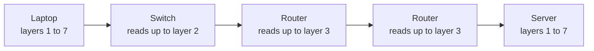

| Device | Reads up to | Changes |
|---|---|---|
| Hub, repeater | Layer 1 | Nothing, only repeats bits |
| Switch, access point | Layer 2 | Nothing in the frame (it only chooses the port) |
| Router | Layer 3 | Builds a **new** Ethernet header for the next link, decrements the TTL |
| NAT router, firewall | Layer 4 | NAT rewrites addresses and ports |
| Proxy, layer 7 load balancer | Layer 7 | Can read and change the HTTP request itself |
| End hosts | All layers | Create and consume the data |

**Key point:** the IP addresses stay the same from end to end (except where NAT rewrites them, section 24). The MAC addresses change at every router, because each link is a separate Ethernet segment. Section 37 shows this hop by hop.

---

## Part 3: Addressing

## 9. MAC addresses

A **MAC address** (Media Access Control) identifies a network interface on its local link. It's 48 bits, written as six bytes in hexadecimal:

```
00:1a:2b:3c:4d:5e        Linux, macOS
00-1A-2B-3C-4D-5E        Windows
001a.2b3c.4d5e           some switch vendors
└──┬───┘└──┬───┘
  OUI    device part
```

- The first three bytes are the **OUI** (Organizationally Unique Identifier), assigned by the IEEE to the manufacturer. Lookup tools tell you the vendor from it.
- The last three bytes are chosen by the manufacturer, so every NIC leaves the factory with a unique address.

Special MAC addresses:

| Address | Meaning |
|---|---|
| `ff:ff:ff:ff:ff:ff` | **Broadcast:** every device on the link receives it |
| First byte odd (lowest bit 1), e.g. `01:00:5e:...` | **Multicast:** a group of devices |
| Second-lowest bit of the first byte set: for unicast, the second hex digit is `2`, `6`, `A` or `E` (e.g. `02:...`, `da:...`) | **Locally administered:** set by software, not the factory |

Phones and laptops now often use a **random MAC** per Wi-Fi network for privacy, which is why such addresses are locally administered.

**MAC addresses only matter on the local link.** A router throws away the Ethernet header and builds a new one for the next link. A server on the internet never sees your laptop's MAC address.

---

## 10. IPv4 addresses

An **IPv4 address** identifies a host interface across networks. It's 32 bits, written as four decimal numbers from 0 to 255 separated by dots (**dotted decimal**):

```
192    .168     .10      .20
11000000.10101000.00001010.00010100
```

Every IP address has two parts:

- The **network part** says which network the host is on. All hosts of one LAN share it.
- The **host part** identifies the host inside that network.

Where the split happens is given by the **subnet mask** or, more commonly today, the **prefix length** in **CIDR notation** (Classless Inter-Domain Routing):

```
Address:   192.168.10.20
Mask:      255.255.255.0       = 24 bits set to 1
CIDR:      192.168.10.20/24

           11000000.10101000.00001010 . 00010100
           └──────── network ───────┘   └ host ┘
                 24 bits                  8 bits
```

To find the **network address**, AND the address with the mask bit by bit. Everything in the host part becomes 0:

```
  11000000.10101000.00001010.00010100   192.168.10.20
& 11111111.11111111.11111111.00000000   255.255.255.0
= 11000000.10101000.00001010.00000000   192.168.10.0   ← network address
```

**Why it matters:** a host uses the mask to decide whether a destination is **local** (same network: send it directly) or **remote** (another network: send it to the router). Section 18 explains this decision.

### Address classes (history only)

Before 1993, the first bits of an address fixed its mask: class A (`/8`), class B (`/16`), class C (`/24`). CIDR replaced classes so networks can have any size. You'll still hear "a class C" to mean a `/24`.

---

## 11. Subnetting

**Subnetting** splits one network into smaller ones. You do it to keep departments, guests or device types apart, to limit broadcast traffic, and to avoid wasting addresses.

### How many hosts fit

With a prefix of `/n`, there are 32 − n host bits, so 2^(32 − n) addresses. Two of them are reserved in each subnet:

- The **network address** (host bits all 0) names the subnet itself.
- The **broadcast address** (host bits all 1) reaches every host in it.

So the number of usable hosts is **2^(32 − n) − 2**.

| Prefix | Mask | Addresses | Usable hosts | Typical use |
|---|---|---|---|---|
| `/8` | `255.0.0.0` | 16,777,216 | 16,777,214 | Very large private network (`10.0.0.0/8`) |
| `/16` | `255.255.0.0` | 65,536 | 65,534 | Large site |
| `/24` | `255.255.255.0` | 256 | 254 | A home or office LAN |
| `/25` | `255.255.255.128` | 128 | 126 | |
| `/26` | `255.255.255.192` | 64 | 62 | A small department |
| `/27` | `255.255.255.224` | 32 | 30 | |
| `/28` | `255.255.255.240` | 16 | 14 | A small server group |
| `/29` | `255.255.255.248` | 8 | 6 | A block of public IPs from an ISP |
| `/30` | `255.255.255.252` | 4 | 2 | A link between two routers |
| `/31` | `255.255.255.254` | 2 | 2 | A point-to-point link (RFC 3021, no network or broadcast address) |
| `/32` | `255.255.255.255` | 1 | 1 | One single host, used in routes and firewall rules |

Each extra bit of prefix halves the subnet. Each bit less doubles it.

### Example: split a /24 into four /26

An office has `192.168.10.0/24` and wants four separate networks. Four subnets need 2 more bits (2² = 4), so the prefix becomes `/26`, with 64 addresses each:

| Subnet | Network address | Usable hosts | Broadcast | Use |
|---|---|---|---|---|
| 1 | `192.168.10.0/26` | `.1` to `.62` | `.63` | Staff |
| 2 | `192.168.10.64/26` | `.65` to `.126` | `.127` | Servers |
| 3 | `192.168.10.128/26` | `.129` to `.190` | `.191` | Guests |
| 4 | `192.168.10.192/26` | `.193` to `.254` | `.255` | Printers and devices |

### Example: which subnet is a host in?

Host `192.168.10.70/26`. The mask `/26` is `255.255.255.192`. Only the last byte matters here:

```
   70  = 01000110
& 192  = 11000000
=  64  = 01000000   → network 192.168.10.64/26
```

So the host is in subnet 2: network `.64`, broadcast `.127`, and hosts `.65` to `.126` are its neighbors. A quick shortcut: the subnet size is 256 − 192 = 64, so subnets start at multiples of 64 (0, 64, 128, 192), and 70 falls in the one starting at 64.

### Supernetting and route summarization

The reverse also works: four `/26` subnets together are one `/24`, and `192.168.0.0/24` plus `192.168.1.0/24` are `192.168.0.0/23`. Routers use this to advertise one short route instead of many long ones.

---

## 12. Public, private and special addresses

**Public addresses** are unique on the whole internet. Regional registries (RIPE NCC, ARIN, APNIC...) give them to ISPs and organizations. IPv4 has only about 4.3 billion addresses, and they ran out in the 2010s.

**Private addresses** (RFC 1918) can be used by anyone inside their own network. They're never routed on the internet, so millions of homes all use `192.168.1.0/24` without conflict. NAT (section 24) lets these hosts reach the internet through a public address.

| Range | CIDR | Used for |
|---|---|---|
| `10.0.0.0` to `10.255.255.255` | `10.0.0.0/8` | Private: companies, cloud networks |
| `172.16.0.0` to `172.31.255.255` | `172.16.0.0/12` | Private: companies, Docker's default networks |
| `192.168.0.0` to `192.168.255.255` | `192.168.0.0/16` | Private: home routers |
| `127.0.0.0` to `127.255.255.255` | `127.0.0.0/8` | **Loopback:** the host itself (`127.0.0.1` = "localhost") |
| `169.254.0.0` to `169.254.255.255` | `169.254.0.0/16` | **Link-local:** self-assigned when DHCP fails |
| `100.64.0.0` to `100.127.255.255` | `100.64.0.0/10` | **Shared address space** for carrier-grade NAT (CGNAT) |
| `224.0.0.0` to `239.255.255.255` | `224.0.0.0/4` | **Multicast** (section 16) |
| `0.0.0.0` | | "This host" or "any address", depending on context |
| `255.255.255.255` | | Broadcast on the local link |
| `192.0.2.0/24`, `198.51.100.0/24`, `203.0.113.0/24` | | **Documentation:** for examples like the ones in this note |

**A `169.254.x.x` address is a symptom:** the host asked for an address with DHCP, got no answer, and gave itself one. It can only talk to the local link.

---

## 13. IPv6

**IPv6** was designed to replace IPv4 because IPv4 addresses ran out. An IPv6 address is **128 bits**, written as eight groups of four hexadecimal digits:

```
2001:0db8:0000:0000:0000:ff00:0042:8329
```

Two rules shorten it:

1. Drop the leading zeros in each group: `0db8` → `db8`, `0042` → `42`, `0000` → `0`.
2. Replace **one** run of consecutive all-zero groups with `::`.

```
2001:0db8:0000:0000:0000:ff00:0042:8329
2001:db8:0:0:0:ff00:42:8329
2001:db8::ff00:42:8329
```

`::` can appear only once, otherwise you couldn't tell how many zeros each one stands for.

### Structure

A typical IPv6 address on a LAN splits in two halves:

```
2001:db8:abcd:0012 : 0000:0000:0000:0001
└──── prefix /64 ┘   └─ interface ID ──┘
 network (from the router)   host
```

Almost every LAN is a **/64**. That's 2^64 addresses per LAN, so you never run out of hosts, and subnetting is done in the prefix part. An ISP typically gives a home a /56 or /48, which is 256 or 65,536 LANs.

### Address types

| Prefix | Type | Meaning |
|---|---|---|
| `2000::/3` | **Global unicast** | Public, routable on the internet. Most start with `2` or `3` |
| `fe80::/10` | **Link-local** | Every IPv6 interface has one. Only valid on its link, never routed |
| `fc00::/7` (in practice `fd00::/8`) | **Unique local (ULA)** | Private addresses, like RFC 1918 for IPv4 |
| `ff00::/8` | **Multicast** | Groups of hosts. IPv6 has **no broadcast** |
| `::1/128` | **Loopback** | The host itself, like `127.0.0.1` |
| `::/128` | Unspecified | "No address yet" |
| `2001:db8::/32` | Documentation | For examples |

### How hosts get an IPv6 address

- **SLAAC** (stateless address autoconfiguration): the router announces the /64 prefix in **router advertisements**, and the host builds its own address from it. No server needed.
- **DHCPv6:** a server hands out addresses, like DHCP for IPv4.
- **Static:** configured by hand, usually for servers and routers.

A host usually has **several IPv6 addresses at once**: a link-local one, one or more global ones, often a temporary one that changes for privacy.

### IPv4 and IPv6 together

The two protocols aren't compatible on the wire. Most networks run both side by side (**dual stack**): hosts have an IPv4 and an IPv6 address, and applications try IPv6 first. Some mobile networks are IPv6-only and translate to IPv4 at the edge (NAT64).

| | IPv4 | IPv6 |
|---|---|---|
| Address size | 32 bits | 128 bits |
| Notation | `192.168.10.20` | `2001:db8::14` |
| Typical LAN | `/24` | `/64` |
| Address configuration | DHCP or static | SLAAC, DHCPv6 or static |
| Address to MAC resolution | ARP | Neighbor Discovery (ICMPv6) |
| Broadcast | Yes | No, multicast instead |
| NAT | Everywhere | Rare: addresses are plentiful |

---

## 14. Ports and sockets

An IP address gets a packet to the right **host**. A **port number** gets it to the right **program** on that host. A server runs many services at once (web, SSH, mail), each listening on its own port.

Ports are 16-bit numbers, 0 to 65535, and are separate for TCP and UDP.

| Range | Name | Used by |
|---|---|---|
| 0 to 1023 | Well-known ports | Standard services (HTTP 80, HTTPS 443, SSH 22) |
| 1024 to 49151 | Registered ports | Other applications (MQTT 1883, databases) |
| 49152 to 65535 | Dynamic or ephemeral ports | Picked at random by clients for their side of a connection |

The ephemeral range is IANA's recommendation. Operating systems use their own: Linux defaults to 32768 to 60999.

**Socket and 5-tuple:** one connection is identified by five values. This is how a server tells apart thousands of clients all connected to port 443:

```
Protocol   Source IP        Source port   Destination IP     Destination port
TCP        192.168.10.100   51514         198.51.100.20      443
TCP        192.168.10.100   51515         198.51.100.20      443    ← second browser tab
TCP        192.0.2.77       40122         198.51.100.20      443    ← another client
```

A **socket** is one end of such a connection, an IP address plus a port: `198.51.100.20:443`. IPv6 addresses go in brackets: `[2001:db8::14]:443`.

Common ports worth knowing are listed in section 26.

---

## 15. ARP: from IP address to MAC address

To send a packet on an Ethernet or Wi-Fi link, a host needs the **MAC address** of the next device. It usually only knows the IP address. **ARP** (Address Resolution Protocol) finds the MAC address for an IPv4 address on the local link.

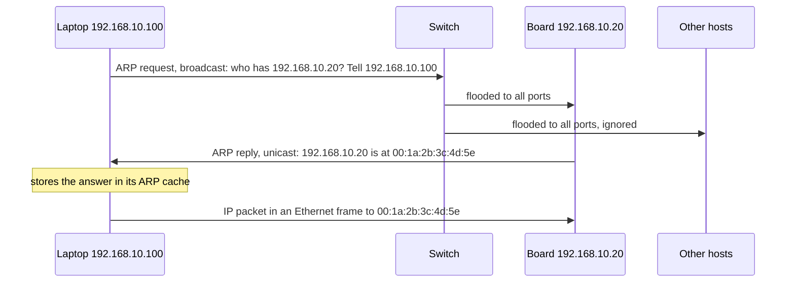

1. The laptop broadcasts a request (destination MAC `ff:ff:ff:ff:ff:ff`): "who has 192.168.10.20?".
2. Every host on the LAN receives it. Only the owner of that address answers.
3. The reply comes back directly to the laptop with the MAC address.
4. The laptop keeps the answer in its **ARP cache** for a few minutes, so it doesn't ask before every packet.

**For a destination on another network, the host ARPs for the router, not the destination.** A laptop sending to a server on the internet only needs the MAC address of its default gateway (section 18).

Related terms:

- **Gratuitous ARP:** a host announces its own IP and MAC address without being asked, for example after boot or when a backup router takes over an address.
- **ARP spoofing:** an attacker answers ARP requests with its own MAC address to intercept traffic. It only works from inside the LAN, which is one reason to keep untrusted devices on a separate network.
- **IPv6** doesn't use ARP. It does the same job with **Neighbor Discovery** (NDP), using ICMPv6 multicast messages instead of broadcasts.

---

## 16. Unicast, broadcast, multicast and anycast

There are four ways to address a packet, depending on how many receivers it has.

```
Unicast        one to one          A ──────► B

Broadcast      one to all          A ──┬──► B
               on the local link       ├──► C
                                       └──► D

Multicast      one to a group      A ──┬──► B   (joined the group)
               that asked for it       └──► D   (joined the group)
                                            C   (didn't join, receives nothing)

Anycast        one to the nearest  A ──────► nearest of several servers
               of several              sharing one address
```

- **Unicast:** the normal case. Web browsing, SSH, file transfers.
- **Broadcast:** sent to every host on the local network. ARP and DHCP rely on it because the sender doesn't know who to ask yet. IPv4 only.
- **Multicast:** sent to the hosts that joined a group. Used for IPTV, service discovery (mDNS, section 26), routing protocols and IPv6 neighbor discovery.
- **Anycast:** many servers in different places share the same address, and routing delivers each packet to the nearest one. Public DNS resolvers like `1.1.1.1` and `8.8.8.8`, and content delivery networks, use anycast.

### Broadcast domains and collision domains

- A **broadcast domain** is the set of devices that receive each other's broadcasts. One LAN or one VLAN is one broadcast domain. **Routers stop broadcasts**, so they separate broadcast domains.
- A **collision domain** is the set of devices whose transmissions can collide. On a hub, all ports share one. On a switch, each port is its own, and with full duplex collisions don't happen at all.

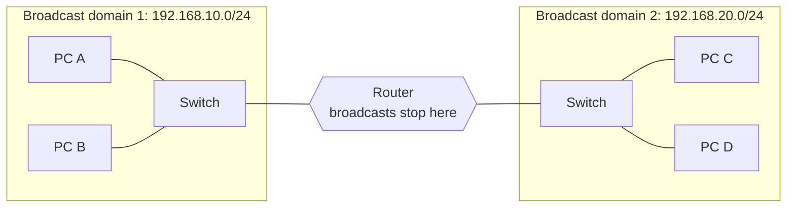

Too many hosts in one broadcast domain means a lot of broadcast traffic that every host must process. That's one reason large networks are split into subnets and VLANs.

---

## Part 4: Moving data

## 17. Switching and VLANs

### How a switch learns

A switch keeps a **MAC address table**: which MAC address was last seen on which port. It fills it by itself, by reading the **source** MAC of every frame it receives.

```
MAC address table
Port   MAC address           Learned from
1      00:1a:2b:00:00:aa     a frame sent by PC A
2      00:1a:2b:00:00:bb     a frame sent by PC B
5      00:1a:2b:00:00:01     a frame sent by the router
```

For each frame, the switch looks up the **destination** MAC:

- **Known:** send the frame out that one port only.
- **Unknown, broadcast or multicast:** send it out every port except the one it came in on. This is **flooding**.

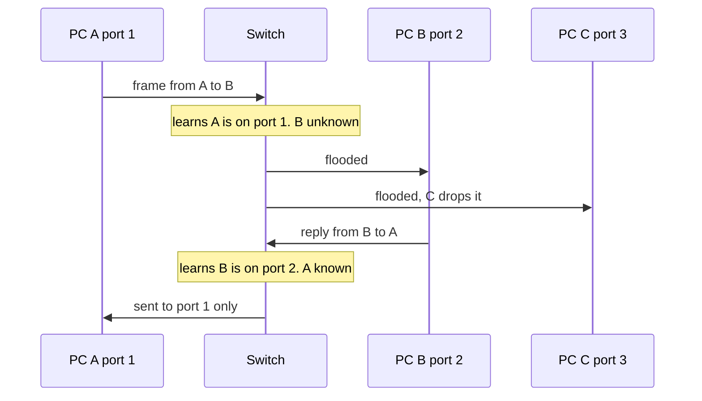

Entries expire after a few minutes without traffic (5 minutes is a common default), so the table follows devices that move.

### Switching loops and the Spanning Tree Protocol

Redundant links between switches are good for reliability but create **loops**. Ethernet frames have no TTL, so a broadcast caught in a loop circles forever and multiplies, a **broadcast storm** that can take a whole network down in seconds.

The **Spanning Tree Protocol** (STP, IEEE 802.1D, and the faster **RSTP**, 802.1w) prevents this. Switches agree on a loop-free tree and **block** the redundant ports. If an active link fails, a blocked port takes over.

```
   [Switch A]═══════[Switch B]
        ║               ║
        ║               ║            ═══ forwarding
        ╚═══[Switch C]──╳            ─╳─ blocked by STP
```

### Link aggregation

**Link aggregation** (LACP, IEEE 802.1AX) bundles several cables between two devices into one logical link: two 1 Gbit/s links act as one 2 Gbit/s link, and the bundle keeps working if one cable fails. Each single connection still uses only one of the cables.

### VLANs

A **VLAN** (virtual LAN) splits one physical switch into several separate LANs. Devices in different VLANs can't talk at layer 2, as if they were plugged into different switches. Each VLAN is its own broadcast domain and usually its own IP subnet.

Typical use: staff, guests, IP phones and cameras share the same switches but stay apart.

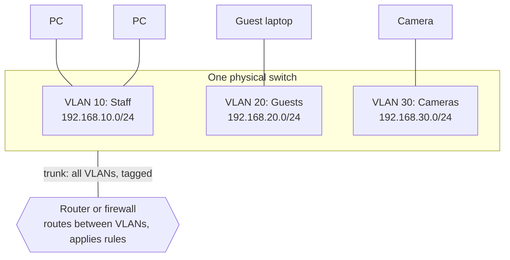

Switch ports come in two kinds:

- An **access port** belongs to one VLAN. The device plugged in (a PC, a printer) doesn't know VLANs exist.
- A **trunk port** carries several VLANs over one cable, usually between switches or to a router. Each frame carries a **802.1Q tag**: 4 extra bytes in the Ethernet header holding the VLAN ID (a 12-bit number, usable values 1 to 4094).

```
Untagged frame:  [dst MAC][src MAC][type][payload][FCS]
Tagged frame:    [dst MAC][src MAC][802.1Q tag: VLAN 20][type][payload][FCS]
```

To go from one VLAN to another, traffic must pass through a **router** (or a **layer 3 switch**, a switch that can also route). That's where firewall rules decide, for example, that guests may reach the internet but not the staff VLAN.

---

## 18. Routing

**Routing** moves packets between networks. Every host and every router makes the same decision for each packet: "where do I send this next?".

### The host's decision: local or remote

A host compares the destination address with its own network (address and mask, section 10):

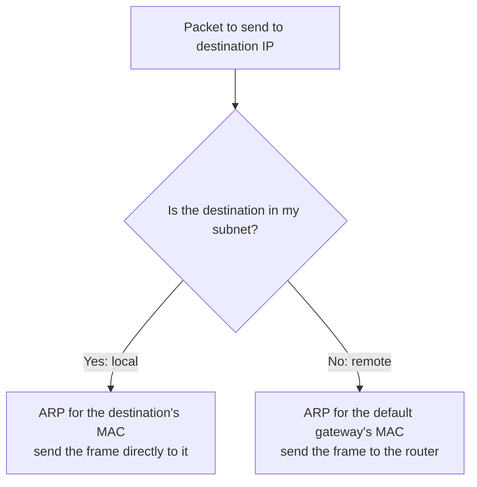

Example, laptop `192.168.10.100/24`:

- To `192.168.10.20`: same `/24`, so send it directly.
- To `198.51.100.20`: different network, so send it to the **default gateway** `192.168.10.1`.

The **default gateway** is the router a host sends everything that isn't local to. A wrong or missing gateway gives the classic symptom: the LAN works, but nothing beyond it does.

### The routing table

Each router (and each host) has a **routing table**: a list of destination networks and where to send packets for them.

```
Destination        Next hop         Interface   Meaning
192.168.10.0/24    (directly)       LAN         My own LAN
192.168.20.0/24    (directly)       Guest       My guest network
10.50.0.0/16       192.168.10.254   LAN         Office network, behind another router
0.0.0.0/0          203.0.113.1      WAN         Everything else: the default route, to the ISP
```

- `0.0.0.0/0` matches every address. It's the **default route**, "if nothing else matches, go this way".
- When several routes match, the **longest prefix** wins, because it's the most specific. A packet to `10.50.3.4` matches both `10.50.0.0/16` and `0.0.0.0/0`, and the `/16` wins.

### Hop by hop

No router knows the whole path. Each one only knows the **next hop**, and each one decides again. A packet from a laptop to a server crosses maybe 10 to 20 routers this way.

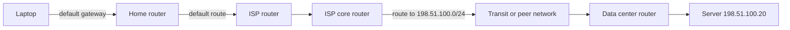

Each router decrements the packet's **TTL** (time to live, called hop limit in IPv6) by 1 and drops the packet when it reaches 0. A packet caught in a routing loop dies after at most 255 hops instead of circling forever.

### Static and dynamic routing

- **Static routes** are entered by hand. Fine for a home or a small office with one way out.
- **Dynamic routing protocols** let routers tell each other which networks they can reach, and react when a link fails.

| Protocol | Kind | Where it's used |
|---|---|---|
| RIP | Distance vector: counts hops | Old and small networks |
| OSPF | Link state: each router builds a map of the network | Inside companies and ISPs |
| IS-IS | Link state | Inside large ISPs |
| BGP | Path vector, between organizations | The internet itself |

### How the internet is routed: autonomous systems and BGP

The internet is made of tens of thousands of **autonomous systems** (AS): networks run by one organization with one routing policy, each with an AS number. ISPs, cloud providers, big companies and universities each have one or more.

- **Inside** an AS, routers use an **interior** protocol (OSPF, IS-IS).
- **Between** ASes, routers use **BGP** (Border Gateway Protocol) to announce "I can reach these prefixes". BGP choices are driven by business relationships as much as by distance.

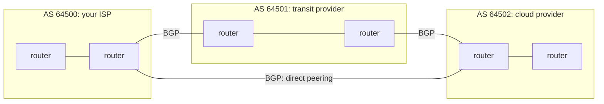

(AS numbers 64496 to 64511 are reserved for documentation.)

---

## 19. TCP

**TCP** (Transmission Control Protocol) gives programs a **reliable byte stream**: everything sent arrives, in order, without duplicates, or the connection reports an error. It's used by the web, email, SSH, file transfers and most other applications.

### The three-way handshake

Before sending data, the two sides open a **connection**:

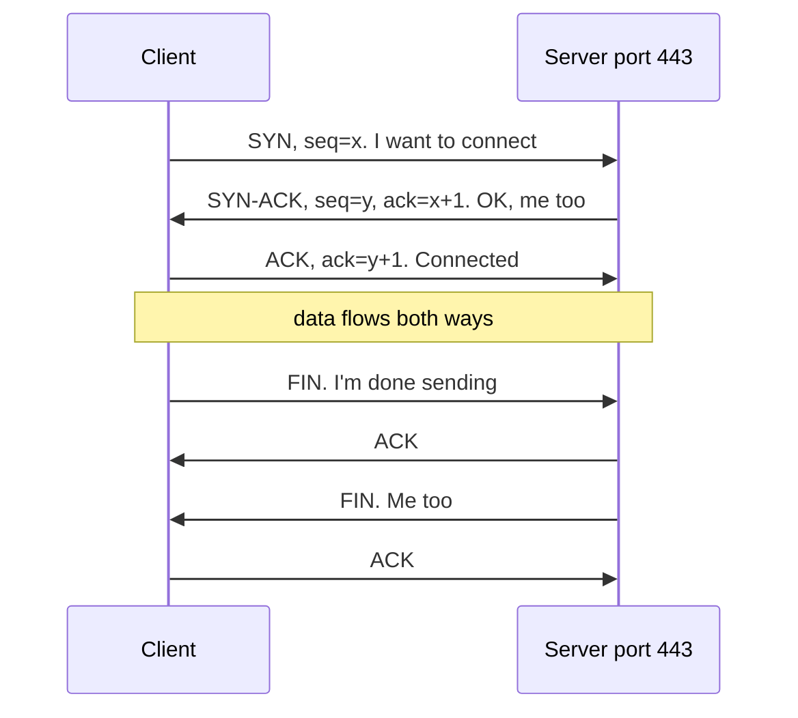

- **SYN** (synchronize) opens a connection and picks a starting sequence number.
- **ACK** (acknowledge) confirms what was received.
- **FIN** (finish) closes one direction. Each side closes its own, so a normal close takes four messages.
- **RST** (reset) aborts a connection at once, for example when a client connects to a port where nothing listens.

### How TCP stays reliable

- **Sequence numbers:** every byte has a number, so the receiver can put segments back in order and spot gaps.
- **Acknowledgments:** the receiver says which bytes it has received.
- **Retransmission:** if no acknowledgment comes back in time, the sender sends the data again.
- **Checksum:** corrupted segments are detected and dropped, then retransmitted.

### Flow control and congestion control

- **Flow control:** the receiver announces a **window**, how much data it can accept right now. The sender never sends more, so a slow receiver isn't overwhelmed.
- **Congestion control:** the sender starts slowly (**slow start**) and speeds up until packets get lost or delayed, then backs off. This is how millions of connections share the internet without collapsing it.

**Consequence:** a new TCP connection is slow for its first round trips, and a lossy link (bad Wi-Fi, weak cellular) makes TCP slow down a lot, because it reads loss as congestion.

### Connection states

A connection goes through states such as `LISTEN` (a server waiting for clients), `SYN-SENT`, `ESTABLISHED` (open), `FIN-WAIT`, `TIME-WAIT` (closed, waiting for stray packets) and `CLOSE-WAIT` (the other side closed, our program hasn't yet). Tools like `netstat` and `ss` show them. Many `CLOSE-WAIT` sockets usually mean a program that forgets to close its connections.

---

## 20. UDP, and choosing between TCP and UDP

**UDP** (User Datagram Protocol) just sends **datagrams**: no connection, no acknowledgments, no retransmission, no ordering. Each datagram may arrive, arrive twice, arrive out of order, or not arrive at all. The application deals with that if it cares.

The upside: no handshake, no waiting for lost data, very little overhead (an 8-byte header against TCP's 20 or more).

| | TCP | UDP |
|---|---|---|
| Connection | Yes, handshake first | No |
| Reliability | Lost data is resent | Lost data stays lost |
| Order | Guaranteed | Not guaranteed |
| Speed to first byte | One round trip for the handshake | Immediate |
| Header | 20 to 60 bytes | 8 bytes |
| Broadcast and multicast | No | Yes |
| Typical uses | Web, email, SSH, file transfer, databases | DNS, DHCP, voice and video calls, games, streaming, NTP, QUIC |

**Why voice and games use UDP:** a voice packet that arrives late is useless. It's better to skip it than to pause the call waiting for a retransmission.

**QUIC** is a newer transport built on top of UDP. It adds reliability, encryption and multiple streams in user space, and carries **HTTP/3**. It avoids some of TCP's delays, especially on mobile networks.

---

## 21. ICMP, ping, traceroute and MTU

**ICMP** (Internet Control Message Protocol) carries error and diagnostic messages for IP. It has no ports. Routers and hosts send ICMP messages when something goes wrong.

| ICMP message | Meaning |
|---|---|
| Echo request / echo reply | "Are you there?" / "Yes". Used by `ping` |
| Destination unreachable | No route, host down, port closed, or "packet too big, fragmentation needed" |
| Time exceeded | The TTL reached 0. Used by `traceroute` |
| Redirect | "Use this other router for that destination" |

IPv6 has its own version, **ICMPv6**, which also does neighbor discovery and router advertisements. Blocking ICMPv6 breaks IPv6.

### ping

`ping` sends echo requests and measures the round-trip time:

```
$ ping -c 3 198.51.100.20
64 bytes from 198.51.100.20: icmp_seq=1 ttl=54 time=12.3 ms
64 bytes from 198.51.100.20: icmp_seq=2 ttl=54 time=11.9 ms
64 bytes from 198.51.100.20: icmp_seq=3 ttl=54 time=12.1 ms
```

A reply proves that IP works both ways. No reply doesn't prove the host is down: many firewalls block ping.

### traceroute

`traceroute` (`tracert` on Windows) shows the routers on the path. It sends packets with TTL 1, then 2, then 3, and so on. Each router that drops a packet because its TTL ran out sends back a "time exceeded" message, which reveals its address.

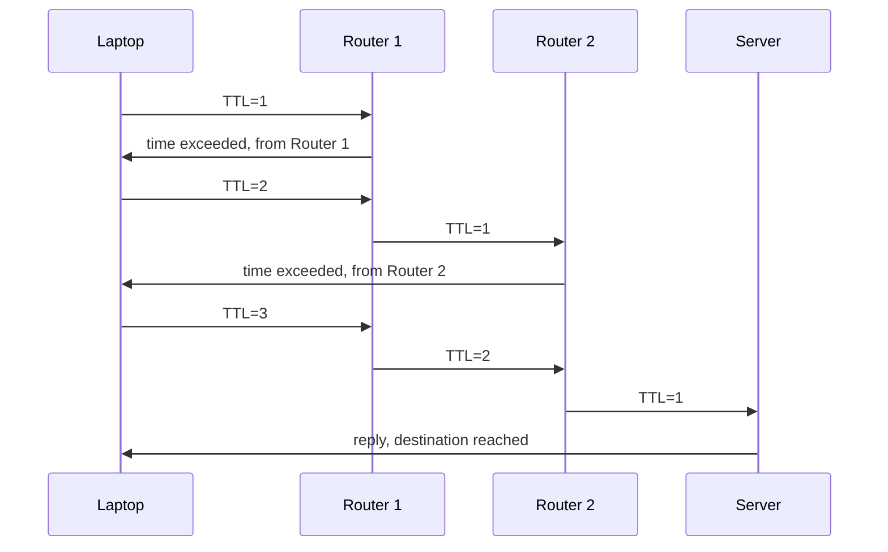

A line of `* * *` means that router didn't answer, which is often just a router configured not to reply, not a failure.

### MTU and fragmentation

The **MTU** (maximum transmission unit) is the largest packet a link can carry. Ethernet's is **1500 bytes**. Tunnels and VPNs add headers, so the usable MTU inside them is smaller (for example about 1420 for WireGuard).

When a packet is bigger than the next link's MTU:

- **IPv4** routers can **fragment** it into smaller pieces, unless the sender set the **Don't Fragment** bit. Modern hosts set it and use **Path MTU Discovery**: the router drops the packet and sends back "fragmentation needed", and the sender sends smaller packets.
- **IPv6** routers never fragment. They always send "packet too big", and only the sender can fragment.

TCP avoids the problem with the **MSS** (maximum segment size): each side announces how much data fits in one segment. On Ethernet with IPv4, MSS = 1500 − 20 (IP) − 20 (TCP) = **1460 bytes**.

**Classic symptom of an MTU problem:** small things work (ping, SSH login, small web pages), but large transfers hang. Usually a firewall blocks the ICMP "too big" messages, so the sender never learns to send smaller packets. This is called a **PMTU black hole**.

---

## Part 5: Core services

## 22. DHCP: getting an address automatically

A host needs four things to use an IP network: an **IP address**, a **subnet mask**, a **default gateway** and **DNS servers**. Typing them on every device would be painful. **DHCP** (Dynamic Host Configuration Protocol) hands them out automatically.

### The DORA exchange

The new host has no address yet, so it starts with a broadcast. DHCP runs over UDP: clients use port 68, servers port 67.

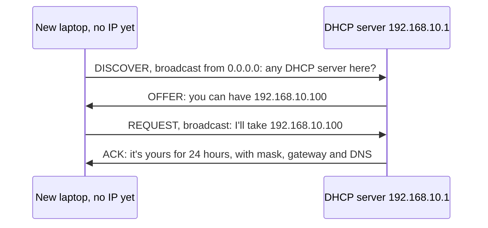

**D**iscover, **O**ffer, **R**equest, **A**cknowledge: **DORA**. The request is broadcast too, so that any other DHCP server that made an offer knows it wasn't chosen.

### What the server hands out

| Setting | Example |
|---|---|
| IP address | `192.168.10.100` |
| Subnet mask | `255.255.255.0` |
| Default gateway | `192.168.10.1` |
| DNS servers | `192.168.10.1` |
| Lease time | 24 hours |
| Optional extras | Domain name, NTP servers, boot server for network boot |

### Leases

The address is **leased**, not given forever. The client renews it halfway through the lease (at 50 %, then tries any server at 87.5 %). A device that leaves the network stops renewing, and its address goes back to the pool.

### Reservations, scopes and relays

- **Scope or pool:** the range the server hands out, such as `.100` to `.199`. Keep fixed addresses (routers, servers, printers) outside it.
- **Reservation (static lease):** the server always gives the same address to one MAC address. Handy for printers and servers without configuring them by hand.
- **DHCP relay:** broadcasts don't cross routers. In a network with many VLANs, routers forward DHCP requests to one central server. This is the "DHCP helper" or "IP helper" setting on routers.

### When DHCP goes wrong

- **No server answers:** the host gives itself a `169.254.x.x` address (section 12). Check the cable, the Wi-Fi association, the VLAN, the server.
- **Pool exhausted:** new devices get no address, while old ones still work. Shorten the lease or enlarge the pool.
- **Rogue DHCP server:** a second device (often a home router plugged into an office network) hands out wrong addresses. Managed switches block it with **DHCP snooping**.

---

## 23. DNS: from names to addresses

People use names like `www.example.com`. Packets need IP addresses. **DNS** (Domain Name System) translates one into the other. It's often called the phone book of the internet.

### The DNS hierarchy

Names are read from right to left, from the most general to the most specific. Each level is managed by someone different.

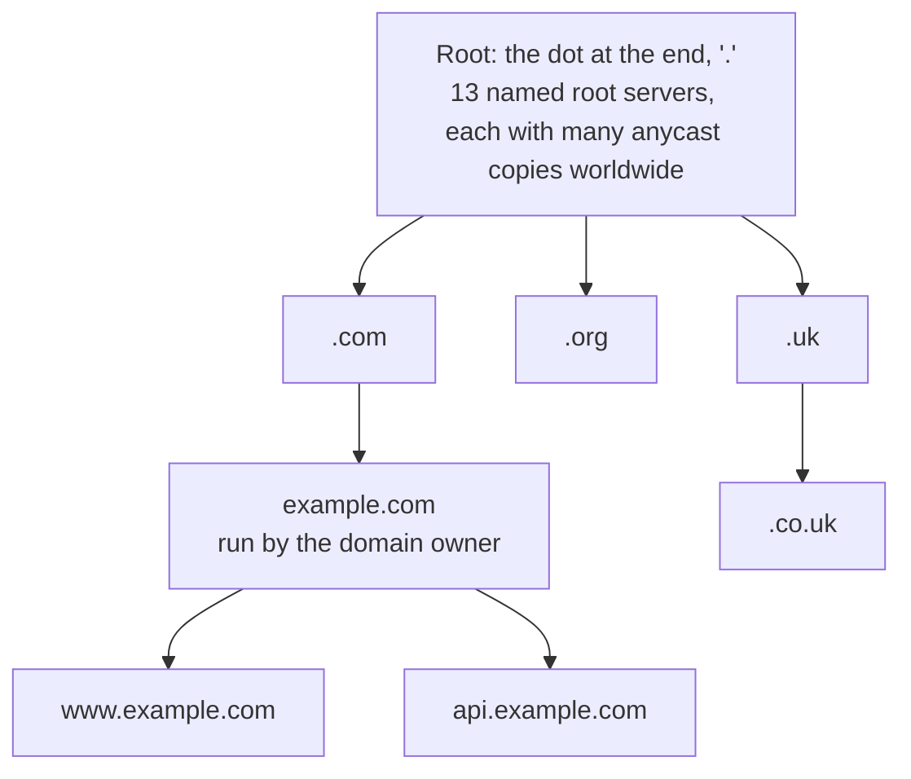

- The **root servers** know where the servers for each top-level domain are.
- The **TLD servers** (`.com`, `.org`, `.uk`...) know where each domain's servers are.
- The **authoritative servers** of a domain hold its actual records.

### How a lookup works

Your device asks one **recursive resolver** (from your router, your ISP or a public service), which does all the work and caches the answers.

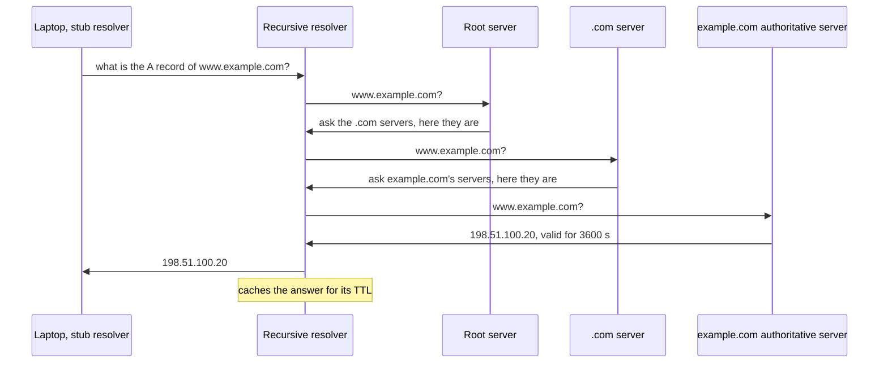

The next lookup for the same name, from any client of that resolver, is answered straight from the cache. That's why DNS is fast in practice, and why a DNS change can take time to reach everyone: old answers live until their **TTL** (time to live) expires.

Before asking DNS, most systems check a local **hosts file** (`/etc/hosts` on Linux and macOS, `C:\Windows\System32\drivers\etc\hosts` on Windows).

DNS mostly uses **UDP port 53**. It falls back to **TCP port 53** for large answers. Encrypted variants exist: DNS over TLS (port 853) and DNS over HTTPS (port 443).

### Record types

| Record | Maps | Example |
|---|---|---|
| **A** | Name to IPv4 address | `www.example.com → 198.51.100.20` |
| **AAAA** | Name to IPv6 address | `www.example.com → 2001:db8::20` |
| **CNAME** | Name to another name (an alias) | `shop.example.com → example.shops.example.net` |
| **MX** | Domain to its mail servers, with priorities | `example.com → 10 mail.example.com` |
| **NS** | Domain to its authoritative name servers | `example.com → ns1.example.net` |
| **TXT** | Domain to free text | Domain ownership proofs, email anti-spoofing (SPF, DKIM, DMARC) |
| **PTR** | IP address back to a name (reverse DNS) | `20.100.51.198.in-addr.arpa → www.example.com` |
| **SRV** | Service to host and port | `_sip._tcp.example.com → 10 60 5060 sip.example.com` |
| **SOA** | Administrative data about the zone | Primary server, serial number, timers |

### Local name resolution

On a LAN without a DNS server, devices find each other with **mDNS** (multicast DNS, the `.local` names used by Apple Bonjour, printers and many embedded devices) or Windows' LLMNR and NetBIOS. Home routers often also register DHCP clients' names in their own DNS.

**"It's always DNS":** when a website "doesn't work" but `ping` to an IP address does, the problem is very often name resolution. Section 38 shows how to check.

---

## 24. NAT: sharing one public address

A home has many devices with private addresses (section 12) and usually one public IPv4 address from the ISP. **NAT** (Network Address Translation) lets them all share it. The router rewrites the source address of outgoing packets to its own public address, and remembers the translation to send replies back.

### How it works

The common form, used by every home router, also rewrites ports. It's called **PAT** (Port Address Translation), **NAPT** or "masquerading", although most people just say NAT.

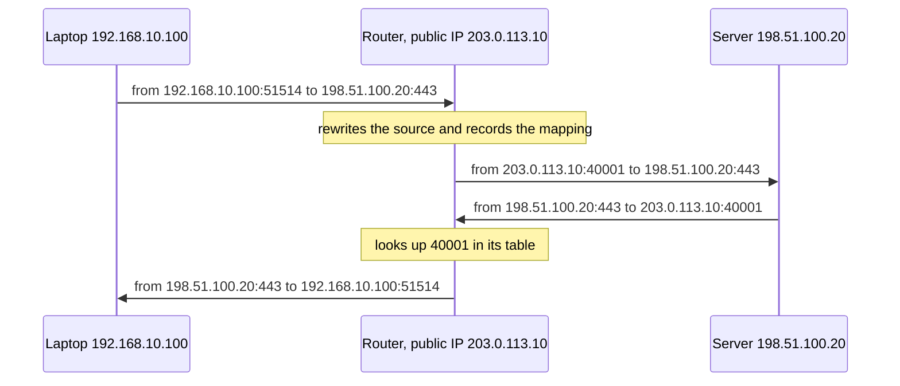

The router's **translation table**:

| Inside address:port | Public address:port | Destination | Protocol |
|---|---|---|---|
| `192.168.10.100:51514` | `203.0.113.10:40001` | `198.51.100.20:443` | TCP |
| `192.168.10.100:51515` | `203.0.113.10:40002` | `198.51.100.20:443` | TCP |
| `192.168.10.42:3478` | `203.0.113.10:40003` | `192.0.2.50:3478` | UDP |

The router keeps the original port when it's free and picks another one when two devices collide. Entries expire after some idle time, which is why long-lived idle connections sometimes drop.

### Consequences

- **Outbound connections just work.** Inbound ones don't: a packet arriving from the internet has no table entry, so the router doesn't know which device it's for. As a side effect, NAT hides the inside network, but it's **not a firewall** and shouldn't be relied on as one.
- **Port forwarding** (or **DNAT**, destination NAT) fixes inbound access by hand: "send everything arriving on public port 8443 to `192.168.10.20:443`".
- **Peer-to-peer apps** (video calls, games) use tricks like STUN and hole punching to get through NAT, or relay their traffic through a server.

### NAT types

| Type | What is rewritten | Use |
|---|---|---|
| Source NAT, PAT, masquerade | Source address and port of outgoing traffic | Sharing one public address |
| Destination NAT, port forwarding | Destination of incoming traffic | Publishing a server behind a router |
| Static 1:1 NAT | One inside address to one public address | Servers with their own public IP |
| CGNAT (carrier-grade NAT) | The ISP does PAT again for many customers, using `100.64.0.0/10` inside | ISPs and mobile networks that lack IPv4 addresses |

With **CGNAT**, your router's "public" address is itself private, and port forwarding on your router can't work: the ISP's NAT is in the way. **Double NAT** (two NAT routers in a row at home) causes similar problems.

**IPv6 doesn't need NAT:** there are enough addresses for every device to have a public one. A stateful firewall on the router gives the same "outbound only" protection without rewriting addresses.

---

## 25. HTTP, HTTPS and TLS

### HTTP

**HTTP** (Hypertext Transfer Protocol) is how browsers, apps and APIs talk to web servers. The client sends a **request**, the server sends back a **response**.

```
GET /index.html HTTP/1.1                     ← method, path, version
Host: www.example.com                        ← which site (one server can host many)
User-Agent: Mozilla/5.0 ...
Accept: text/html

HTTP/1.1 200 OK                              ← version, status code
Content-Type: text/html; charset=utf-8
Content-Length: 1256

<!doctype html> ...                          ← the body: the page itself
```

Common **methods**:

| Method | Does |
|---|---|
| `GET` | Fetch a resource |
| `POST` | Send data to be processed (a form, an API call) |
| `PUT` | Create or replace a resource |
| `PATCH` | Change part of a resource |
| `DELETE` | Remove a resource |
| `HEAD` | Like `GET` but only the headers |

**Status codes** group by their first digit:

| Range | Meaning | Common ones |
|---|---|---|
| 1xx | Informational | `101 Switching Protocols` (WebSockets) |
| 2xx | Success | `200 OK`, `201 Created`, `204 No Content` |
| 3xx | Redirect | `301 Moved Permanently`, `302 Found`, `304 Not Modified` |
| 4xx | Client error | `400 Bad Request`, `401 Unauthorized`, `403 Forbidden`, `404 Not Found`, `429 Too Many Requests` |
| 5xx | Server error | `500 Internal Server Error`, `502 Bad Gateway`, `503 Service Unavailable`, `504 Gateway Timeout` |

HTTP is **stateless**: each request stands alone. Logins and shopping carts work through **cookies** or tokens the client sends with every request.

**HTTP versions:**

- **HTTP/1.1:** text, one request at a time per TCP connection.
- **HTTP/2:** binary, many requests at once over one TCP connection.
- **HTTP/3:** like HTTP/2, but over QUIC on UDP (section 20). Faster to start and better on lossy links.

### HTTPS and TLS

**HTTPS** is HTTP inside **TLS** (Transport Layer Security), on port **443** instead of 80. TLS gives three guarantees:

- **Confidentiality:** nobody on the path can read the data.
- **Integrity:** nobody can change it without being detected.
- **Authentication:** you're really talking to `www.example.com`, not an impostor.

### The TLS handshake

TLS 1.3, after the TCP handshake:

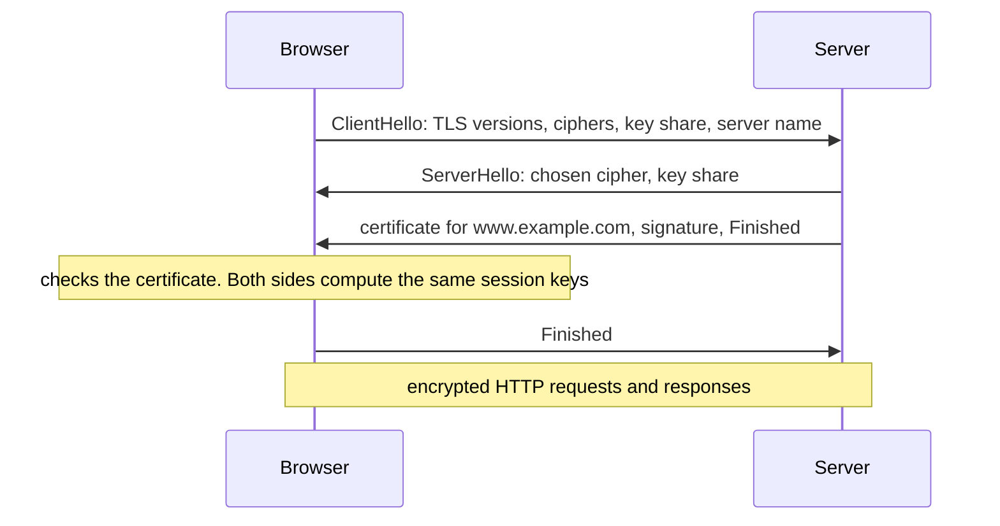

The **server name** in the ClientHello (SNI, Server Name Indication) lets one server host many HTTPS sites on the same address. It's one of the few things an observer can still see.

### Certificates and the chain of trust

A **certificate** binds a domain name to a public key and is signed by a **certificate authority** (CA). The browser trusts a short list of root CAs built into the operating system or browser. It checks:

- the certificate is for the name in the URL,
- it hasn't expired,
- it chains up to a trusted root:

```
Root CA (built into your OS or browser)
  └── signs ─► Intermediate CA
                 └── signs ─► Certificate for www.example.com
```

Free automated CAs like Let's Encrypt made HTTPS the default. Common failures: an expired certificate, a name mismatch (`example.com` vs `www.example.com`), a missing intermediate certificate, or a wrong clock on the client. That last one is common on embedded devices that boot without a real-time clock.

---

## 26. Other common protocols

| Protocol | Port | Transport | What it does |
|---|---|---|---|
| FTP | 20, 21 | TCP | File transfer, unencrypted. Prefer SFTP |
| SSH, SFTP, SCP | 22 | TCP | Encrypted remote shell and file transfer |
| Telnet | 23 | TCP | Unencrypted remote shell. Still found on old network gear |
| SMTP | 25, 587, 465 | TCP | Sending email: 25 between servers, 587 or 465 from mail clients |
| DNS | 53 | UDP, TCP | Name resolution |
| DHCP | 67, 68 | UDP | Automatic address configuration |
| TFTP | 69 | UDP | Trivial file transfer, used for network boot and firmware updates |
| HTTP | 80 | TCP | Web, unencrypted |
| POP3 | 110 (995 with TLS) | TCP | Downloading email |
| NTP | 123 | UDP | Clock synchronization |
| IMAP | 143 (993 with TLS) | TCP | Reading email on the server |
| SNMP | 161, 162 | UDP | Monitoring and managing network devices |
| LDAP | 389 (636 with TLS) | TCP | Directory services, user accounts |
| HTTPS | 443 | TCP, UDP (HTTP/3) | Web, encrypted |
| SMB | 445 | TCP | Windows file and printer sharing |
| Syslog | 514 | UDP | Sending logs to a central server |
| DNS over TLS | 853 | TCP | Encrypted DNS |
| MQTT | 1883 (8883 with TLS) | TCP | Lightweight publish/subscribe messaging for IoT |
| RDP | 3389 | TCP, UDP | Windows remote desktop |
| CoAP | 5683 (5684 with DTLS) | UDP | Lightweight REST for constrained devices |
| mDNS | 5353 | UDP | Local name and service discovery (`.local`) |

**Rule of thumb:** prefer the encrypted variant of every protocol. Telnet, FTP, plain HTTP, POP3 and IMAP without TLS send passwords in clear text.

---

Version 1 · 2026-11-20
