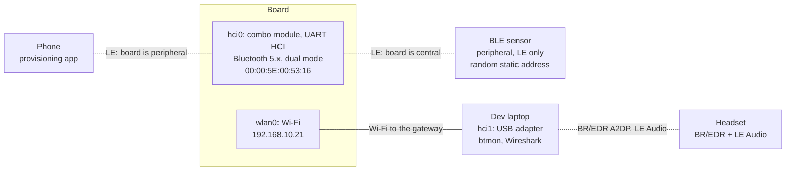

# Bluetooth for Embedded Linux Engineers

How Bluetooth works from the radio up to GATT and the profiles, how Linux implements it (the kernel's HCI core and drivers, BlueZ's `bluetoothd`, D-Bus), and what it takes to put a Bluetooth controller in a product and debug it when a device isn't found, won't pair, disconnects or is slow.

This note covers both halves of Bluetooth: **Classic** (BR/EDR: audio, serial links, HID) and **Low Energy** (LE: sensors, provisioning, beacons, LE Audio). The board and network are the ones of [Wi-Fi for Embedded Linux Engineers](../wifi/wifi_v1_2026-11-01.md): the board's Wi-Fi and Bluetooth share one combo module. Wi-Fi itself, and what happens once the device has an IP address, are in the Wi-Fi note and in [Linux Networking Fundamentals for Embedded Engineers](../../os-and-firmware/networking/linux-networking-fundamentals/linux-networking-fundamentals_v1_2026-10-29.md). This note links to them instead of repeating them.

**Assumptions:**
- One example setup (section 2) is used throughout: the board with its combo module, a BLE temperature sensor, a phone, a headset and the dev laptop with a USB Bluetooth adapter.
- Linux 6.x with BlueZ 5.66 or later (Debian 12 ships 5.66, Debian 13 ships 5.8x). Features that need a newer kernel or BlueZ say so. Tools that BlueZ deprecated (`hciconfig`, `hcitool`, `gatttool`, `hciattach`) are mentioned only to say what replaces them.
- Specification values are from the Bluetooth Core Specification 5.x and 6.x. Versions and what they added are in section 3.
- Addresses, names, passkeys and UUIDs that aren't standard are placeholders.

**Conventions:**
- `$` is a shell on the dev laptop, `#` a root shell on the board.
- **Normative** values come from the Bluetooth Core Specification, a profile specification or the SIG's Assigned Numbers.
- **Rule of thumb** marks empirical values that depend on the environment, the chips and the application.
- **Controller-dependent** or **stack-dependent** marks behavior that the specification leaves open: support varies between chips, firmware, kernel and BlueZ versions, and phone operating systems.
- **Illustrative** marks a file, script or output that shows the shape of a solution and needs adapting.

**Verification status:** nothing in this note was run for it. No source was downloaded, nothing was built, no board or phone was used. Commands, configuration keys and D-Bus interfaces follow the BlueZ documentation and manual pages, protocol values follow the Core Specification and Assigned Numbers, and kernel behavior follows the kernel documentation, as known in November 2026. Command outputs are illustrative and abridged.

**How to read it:**
- **To learn:** Part 1 (sections 1 to 12) in order.
- **To use Bluetooth from Linux:** Part 2 (sections 13 to 17).
- **To integrate a controller in a product:** Part 3 (sections 18 to 20).
- **To debug:** section 21 first, then the section of the step that fails.

## Table of contents

**Part 1: How Bluetooth works**

- [1. The mental model: two radios under one name](#1-the-mental-model-two-radios-under-one-name)
- [2. Example setup](#2-example-setup)
- [3. Versions, specifications and the SIG](#3-versions-specifications-and-the-sig)
- [4. The radio: band, channels, PHYs, power and range](#4-the-radio-band-channels-phys-power-and-range)
- [5. LE advertising and scanning](#5-le-advertising-and-scanning)
- [6. LE connections: parameters, data length and throughput](#6-le-connections-parameters-data-length-and-throughput)
- [7. Addresses and privacy](#7-addresses-and-privacy)
- [8. Classic (BR/EDR): inquiry, paging, piconets and links](#8-classic-bredr-inquiry-paging-piconets-and-links)
- [9. The host stack: HCI and L2CAP](#9-the-host-stack-hci-and-l2cap)
- [10. ATT and GATT](#10-att-and-gatt)
- [11. Pairing, bonding and security](#11-pairing-bonding-and-security)
- [12. Profiles: Classic, LE, LE Audio, mesh and positioning](#12-profiles-classic-le-le-audio-mesh-and-positioning)

**Part 2: Bluetooth on Linux**

- [13. The Linux Bluetooth stack](#13-the-linux-bluetooth-stack)
- [14. Tools: bluetoothctl, btmgmt, btmon and friends](#14-tools-bluetoothctl-btmgmt-btmon-and-friends)
- [15. The board as a central: scan, pair, connect, read a sensor](#15-the-board-as-a-central-scan-pair-connect-read-a-sensor)
- [16. The board as a peripheral: advertising and a GATT server](#16-the-board-as-a-peripheral-advertising-and-a-gatt-server)
- [17. Classic on Linux: audio, serial and networking](#17-classic-on-linux-audio-serial-and-networking)

**Part 3: Embedded products**

- [18. Integrating a Bluetooth controller on a board](#18-integrating-a-bluetooth-controller-on-a-board)
- [19. Coexistence, power and performance](#19-coexistence-power-and-performance)
- [20. Production: configuration, hardening, RF tests and qualification](#20-production-configuration-hardening-rf-tests-and-qualification)

**Debugging and reference**

- [21. Troubleshooting](#21-troubleshooting)
- [22. Not covered here](#22-not-covered-here)
- [References](#references)

---

## 1. The mental model: two radios under one name

"Bluetooth" is two different technologies that share a band, a name, a security model and a host interface:

| | Classic (BR/EDR) | Low Energy (LE) |
|---|---|---|
| Since | 1.0 (1999), EDR in 2.0 | 4.0 (2010) |
| Made for | Continuous streams: audio, serial cables, keyboards and mice | Small, infrequent data; years on a coin cell. LE Audio (section 12) now also carries audio |
| Channels | 79 × 1 MHz, frequency hopping 1600 times per second | 40 × 2 MHz: 3 primary advertising channels, 37 data channels |
| Finding devices | Inquiry: the searcher asks, devices in inquiry scan answer (section 8) | Advertising: devices broadcast, scanners listen (section 5) |
| Connecting | Paging, then the link stays up, often for hours | Connection events at a negotiated interval, the radio sleeps in between (section 6) |
| Data model | Profiles over RFCOMM and L2CAP channels (serial port, A2DP, HFP...) | Mostly GATT: a table of attributes the peer reads, writes and subscribes to (section 10) |
| Typical peak current | Tens of mA while streaming | A few mA for a few ms, a few µA asleep |
| Typical users | Headsets, car kits, game controllers | Sensors, wearables, smart locks, beacons, provisioning a device's Wi-Fi |

A **dual-mode** controller (every phone, laptop and combo module) does both. A **single-mode** LE device (most sensors and nRF/ESP32-class chips used as peripherals) does only LE. A Classic-only device can't talk to an LE-only one: being "Bluetooth" isn't enough, the two need a common transport.

**Controller and host.** Every Bluetooth stack is split in two, with a standard interface between them:

```
 ┌──────────── Host (Linux: kernel + bluetoothd) ─────────────┐
 │ Profiles and apps:  A2DP  HFP  HID  SPP   GATT services     │
 │ GAP (roles, discovery, connection, security policy)         │
 │ RFCOMM  SDP  AVDTP ...        ATT/GATT     SMP              │
 │ L2CAP: channels, segmentation, flow control                 │
 └──────────────────────────────┬──────────────────────────────┘
                                │ HCI: commands, events, data
                                │ (UART, USB, SDIO, or in-chip)
 ┌──────────────────────────────┴──────────────────────────────┐
 │ Controller (the chip's firmware)                             │
 │ Link Manager (BR/EDR, LMP)   Link Layer (LE)                 │
 │ Baseband: hopping, timing, packets, encryption, retries      │
 │ Radio: 2.4 GHz PHY                                           │
 └──────────────────────────────────────────────────────────────┘
```

- The **controller** handles everything time-critical: hopping, timing, acknowledgments and retransmissions, encryption of packets. Its firmware comes from the chip vendor and you don't change it, beyond loading a patch at boot (section 18).
- The **host** decides what to do: whom to connect to, which profile to run, which keys to store. On Linux, the kernel implements HCI, L2CAP, SMP and the socket interfaces; `bluetoothd` implements GAP policy, GATT, the profiles and the D-Bus API (section 13).
- **HCI** (host controller interface) is the standard protocol between them (section 9). Because it's standard, any host can drive any controller, and `btmon` can show everything that crosses it. It's the single most useful debugging point.
- On a microcontroller (nRF52, ESP32), host and controller often run on the same chip and HCI is a function call. Such a chip can also run controller-only firmware and be used by Linux over a UART (section 18).

**Vocabulary:**

| Term | Meaning |
|---|---|
| Adapter, `hci0` | Linux's name for a local controller |
| BD_ADDR | Bluetooth device address, 48 bits, written `00:00:5E:00:53:16`. LE devices often use random addresses (section 7) |
| Central / peripheral | LE connection roles: the central initiates and runs the connection's timing (the phone, the board reading a sensor), the peripheral advertises and accepts (the sensor). Before 5.3 the spec said master/slave; old tools and logs still do |
| Broadcaster / observer | LE roles without connections: advertise only (a beacon), scan only |
| Client / server | GATT roles, independent of the connection role: the server holds the data (usually the peripheral), the client reads it |
| Pairing / bonding | Pairing creates keys for one connection; bonding stores them for later reconnections (section 11) |
| Profile | A specification of how to use the protocols for one use case: A2DP (stereo audio), HFP (calls), HOGP (keyboards over LE)... |
| Service, characteristic | GATT building blocks: a service groups characteristics; a characteristic is a value with properties (read, write, notify) (section 10) |
| UUID | Identifier of a service or characteristic: 16-bit for SIG-defined ones (`0x180F` Battery), 128-bit for your own |
| SIG | Bluetooth Special Interest Group: writes the specifications, runs qualification, owns the trademark (section 3) |

**Bluetooth is a short-range, low-rate link that must be designed for disconnection.** Devices move out of range, phones kill background apps, the link drops on interference. Products that work well reconnect quickly and keep state on both ends; products that work badly assume the link is always there.

---

## 2. Example setup

The board is the one of the [Wi-Fi note](../wifi/wifi_v1_2026-11-01.md#2-example-network): its combo module has Wi-Fi on SDIO and Bluetooth on a UART. The product use cases:

- **Provisioning:** a phone app sends the Wi-Fi credentials to the board over BLE before it has a network ([Wi-Fi note, provisioning](../wifi/wifi_v1_2026-11-01.md#provisioning-a-headless-device)). The board is a **peripheral** and **GATT server** (section 16).
- **Sensor gateway:** the board reads a BLE temperature sensor and forwards the values over Wi-Fi. The board is a **central** and **GATT client** (section 15).
- **Audio:** the dev laptop streams to a headset, to show Classic audio and LE Audio on Linux (section 17).



| Device | Adapter | Address | Role in the examples |
|---|---|---|---|
| Board | `hci0` on `/dev/ttymxc1` (UART with RTS/CTS) | `00:00:5E:00:53:16` (public) | Dual-mode Bluetooth 5.x controller in the Wi-Fi + Bluetooth combo module. Central for the sensor, peripheral for the phone |
| BLE sensor | | `F0:00:00:00:53:01` (random static) | LE-only, advertises as `TempSensor-01`, Environmental Sensing service (`0x181A`) with a Temperature characteristic (`0x2A6E`) and Battery service (`0x180F`) |
| Phone | | Resolvable private addresses, changing (section 7) | Runs the provisioning app |
| Headset | | `00:00:5E:00:53:70` | Dual-mode: A2DP/HFP over BR/EDR, LE Audio when both sides support it |
| Dev laptop | `hci1`: USB adapter (`btusb`) | `00:00:5E:00:53:64` | Runs `btmon`, Wireshark, `bluetoothctl`, PipeWire |

The public addresses use the documentation block `00:00:5E:00:53:xx` (RFC 7042) as placeholders; the sensor's random static address is a placeholder of the right form (two top bits set, section 7). The UUIDs of the provisioning service (section 16) are placeholders too: generate your own with `uuidgen`.

---

## 3. Versions, specifications and the SIG

The **Bluetooth SIG** writes the **Core Specification** (radio, link layer, HCI, L2CAP, ATT/GATT, SMP, GAP), the **profile and service specifications** (A2DP, HFP, Heart Rate, LE Audio...) and the **Assigned Numbers** document (UUIDs, company identifiers, AD types, appearance values, codec IDs). Since 2023 the core version numbers follow a regular release train; the SIG publishes a feature summary with each release.

| Version | Year | What it brought (main points) |
|---|---|---|
| 1.1, 1.2 | 2001, 2003 | First widely deployed Classic; 1.2 added adaptive frequency hopping (AFH) and eSCO |
| 2.0 + EDR | 2004 | Enhanced Data Rate: 2 and 3 Mb/s |
| 2.1 + EDR | 2007 | Secure Simple Pairing (SSP): numeric comparison, passkey, Just Works. Sniff subrating |
| 3.0 + HS | 2009 | Bulk data over a Wi-Fi link (AMP). Hardly used, later removed |
| 4.0 | 2010 | **Low Energy**: advertising, connections, ATT/GATT, SMP. "Bluetooth Smart" |
| 4.1 | 2013 | LE devices in several roles at once, LE credit-based L2CAP channels, coexistence signaling with LTE |
| 4.2 | 2014 | **LE Secure Connections** (ECDH P-256), **Data Length Extension** (251-byte packets), link-layer privacy |
| 5.0 | 2016 | **LE 2M** and **LE Coded** PHYs (speed, range), **extended advertising**, periodic advertising, channel selection algorithm #2, up to +20 dBm |
| 5.1 | 2019 | Direction finding (angle of arrival and departure), GATT caching |
| 5.2 | 2019 | **Isochronous channels** (base of LE Audio), Enhanced ATT (EATT), LE power control |
| 5.3 | 2021 | Connection subrating, channel classification by the peripheral, periodic advertising enhancements. Inclusive terminology (central/peripheral) |
| 5.4 | 2023 | Periodic advertising with responses (PAwR, for electronic shelf labels), encrypted advertising data, advertising coding selection |
| 6.0 | 2024 | **Channel Sounding** (secure distance measurement), decision-based advertising filtering, monitoring advertisers, frame space update |
| 6.1 | 2025 | Resolvable private address updates at randomized times, controller power-saving improvements |
| 6.2 | 2025 | Shorter connection intervals (below 7.5 ms), isochronous data over USB HCI, Channel Sounding hardening |

Newer releases and in-progress work (higher data throughput for LE, operation above 2.4 GHz) are listed on the SIG's specifications page: check it rather than this table for anything after 6.2.

**What a version number means.** Almost everything after 4.0 is **optional**. A "Bluetooth 5.3" controller is a controller qualified against Core 5.3: it may support 2M but not Coded, or no extended advertising at all. The version tells you which features *can* be present; the controller's feature bits tell you which *are* (`btmgmt info`, `bluetoothctl show`, or the HCI LE Read Local Supported Features command in `btmon`, section 14). And a feature works only if the **controller, the host stack and the peer** all support it: a phone that doesn't do LE Coded can't connect to your sensor over Coded, whatever your chip does.

**Qualification.** Selling a product with Bluetooth, or using the name and logo, requires the product to be listed through the SIG's **Qualification Program** (membership, a declaration, a listing fee). Products built on an already qualified module or controller and host stack mostly reference the existing qualifications (section 20). This is separate from radio regulation (FCC, CE/RED), which is required whatever the trademark.

---

## 4. The radio: band, channels, PHYs, power and range

Both halves use the 2400 to 2483.5 MHz ISM band, the same as 2.4 GHz Wi-Fi, Zigbee/Thread and microwave ovens. In this band, a device must cope with interference: Classic by hopping, LE by spreading over channels and retrying.

### Channels

| | BR/EDR | LE |
|---|---|---|
| Channels | 79 × 1 MHz, center 2402 + *k* MHz, *k* = 0..78 | 40 × 2 MHz, center 2402 + 2*k* MHz, *k* = 0..39 |
| Hopping | 1600 hops/s along a pseudo-random sequence derived from the central's address and clock | One channel per connection event (or per isochronous subevent), chosen by a channel selection algorithm |
| Avoiding busy channels | AFH: the central marks bad channels and excludes them from the hop set (at least 20 must remain) | Channel map: the central excludes bad data channels (at least 2 must remain); 5.3 lets the peripheral report bad channels |
| Discovery channels | 32 inquiry/page channels, hopped quickly | 3 primary advertising channels |

The three LE primary advertising channels are placed between the usual 2.4 GHz Wi-Fi channels:

| LE channel index | RF channel | Center (MHz) | Position |
|---|---|---|---|
| 37 | 0 | 2402 | Below Wi-Fi channel 1 (2412) |
| 38 | 12 | 2426 | Between Wi-Fi channels 1 and 6 (2437) |
| 39 | 39 | 2480 | Above Wi-Fi channel 11 (2462) and 13 (2472) |

Data channels 0 to 36 fill the rest. Logs and HCI commands use the **channel index** (0 to 39), not the RF channel number: index 37 is 2402 MHz, at the bottom of the band.

### PHYs and modulation

| PHY | Modulation | Symbol rate | Raw data rate | Notes |
|---|---|---|---|---|
| BR (Basic Rate) | GFSK | 1 Msym/s | 1 Mb/s | Classic baseline |
| EDR 2 Mb/s | π/4-DQPSK | 1 Msym/s | 2 Mb/s | Packet header still in GFSK |
| EDR 3 Mb/s | 8DPSK | 1 Msym/s | 3 Mb/s | Shortest range of the Classic rates |
| LE 1M | GFSK | 1 Msym/s | 1 Mb/s | Mandatory for LE; all legacy advertising |
| LE 2M | GFSK | 2 Msym/s | 2 Mb/s | 5.0, optional. Faster, shorter airtime, slightly less range |
| LE Coded S=2 | GFSK + FEC | 1 Msym/s | 500 kb/s | 5.0, optional. About 2× the range of 1M (rule of thumb) |
| LE Coded S=8 | GFSK + FEC | 1 Msym/s | 125 kb/s | About 4× the range of 1M in open space (rule of thumb), 8× the airtime |

Coded PHY trades airtime (energy, latency, channel occupancy) for range. It is mostly used between devices you control: phone support for Coded PHY is partial and varies by model.

### Transmit power and power classes

| Class | Max power | Typical use |
|---|---|---|
| 1 | 100 mW (+20 dBm) | Laptops and USB adapters with an amplifier, industrial modules |
| 1.5 (LE) | 10 mW (+10 dBm) | Many LE modules |
| 2 | 2.5 mW (+4 dBm) | Phones, headsets, most combo modules |
| 3 | 1 mW (0 dBm) | Small LE devices |

The class is a **maximum**; the controller and regulation can set less. In the EU, ETSI EN 300 328 limits the band to 20 dBm EIRP, and non-hopping (wideband) modulations such as LE also to 10 dBm EIRP per MHz. The antenna gain counts in EIRP: a +20 dBm chip with a 3 dBi antenna exceeds 20 dBm EIRP. Since 5.2, LE power control lets two connected devices ask each other to lower or raise their power.

### Range and link budget

Receiver sensitivity (rule of thumb, from datasheets): about -95 dBm for LE 1M, -92 dBm for LE 2M, -100 to -105 dBm for LE Coded S=8, -90 dBm for BR and a few dB worse for EDR 3 Mb/s. The specification only requires -70 dBm for LE 1M; real chips are far better.

The **link budget** is TX power plus antenna gains minus sensitivity. With 0 dBm TX, -95 dBm sensitivity and 0 dBi antennas, 95 dB of path loss is allowed. At 2.44 GHz, free-space loss is about 40 dB at 1 m and adds 20 dB per decade of distance (60 dB at 10 m, 80 dB at 100 m). In free space that's several hundred meters; indoors it's typically 10 to 30 m (rule of thumb), because:

- every wall costs 3 to 15 dB, concrete and metal far more;
- the human body absorbs 2.4 GHz: a phone in a back pocket or a wearable on the far side of the body loses 10 to 20 dB;
- small devices have poor antennas (-5 to -10 dBi is common for chip antennas in a plastic case near a battery);
- multipath fading makes the signal drop by 10 to 20 dB at some positions and frequencies: hopping and channel diversity exist because of it.

**RSSI** (received signal strength indication) is reported in advertising reports and per connection. Use it to compare positions, not as a distance meter: the same distance gives values 10 to 20 dB apart depending on orientation, bodies and channel. For distance, Channel Sounding (section 12) or several samples with a calibrated model are needed.

---

## 5. LE advertising and scanning

An LE device that wants to be found **advertises**: it sends short packets on the advertising channels, at an interval, whether anyone listens or not. A device that wants to find others **scans**. Nothing is "paired" or "connected" at this stage, and anyone in range can read the advertisements.

### Advertising events

In legacy advertising, one **advertising event** sends the same PDU on channels 37, 38 and 39, one after the other within about a millisecond, listening briefly after each for a scan or connection request. Events repeat every `advInterval + advDelay`:

- `advInterval`: 20 ms to 10.24 s in steps of 0.625 ms (**normative**). Shorter means faster discovery and more energy.
- `advDelay`: a random 0 to 10 ms added to every event, so two devices with the same interval don't collide forever.

**Legacy advertising PDU types** (LE 1M only):

| PDU | Connectable | Scannable | Use |
|---|---|---|---|
| `ADV_IND` | Yes | Yes | The usual peripheral: "here I am, connect to me" |
| `ADV_DIRECT_IND` | Yes, by one named central | No | Fast reconnection to a known central. High duty cycle mode lasts at most 1.28 s |
| `ADV_SCAN_IND` | No | Yes | Broadcasts data, more in the scan response |
| `ADV_NONCONN_IND` | No | No | Beacons |
| `SCAN_REQ` / `SCAN_RSP` | | | An active scanner asks for 31 more bytes of data |
| `CONNECT_IND` | | | A central starts a connection (section 6). Called `CONNECT_REQ` before 5.0 |

### Advertising data

The payload is up to **31 bytes** of **AD structures** (plus 31 in the scan response), each made of a length byte, a type byte and data. The sensor's advertisement (**Illustrative**):

```
02 01 06                                     len 2, Flags: LE General Discoverable, BR/EDR not supported
03 03 1A 18                                  len 3, Complete list of 16-bit service UUIDs: 0x181A (little endian)
0E 09 54 65 6D 70 53 65 6E 73 6F 72 2D 30 31 len 14, Complete local name: "TempSensor-01"
```

| AD type | Name | Notes |
|---|---|---|
| `0x01` | Flags | Discoverable mode (limited `0x01`, general `0x02`), "BR/EDR not supported" `0x04`. Required in connectable advertising |
| `0x02` / `0x03` | Incomplete / complete list of 16-bit service UUIDs | Lets scanners filter by service without connecting. `0x06`/`0x07` for 128-bit UUIDs, which take 18 of the 31 bytes |
| `0x08` / `0x09` | Shortened / complete local name | Put a short name; the full name can be read over GATT |
| `0x0A` | TX power level | Lets the scanner estimate path loss |
| `0x16` | Service data, 16-bit UUID | A UUID followed by data: the way to broadcast sensor values without connections |
| `0x19` | Appearance | Icon category (thermometer, keyboard...) from Assigned Numbers |
| `0xFF` | Manufacturer specific data | Starts with the 16-bit **company identifier** from Assigned Numbers. Don't use another company's ID |

Beacons are just advertising formats: Apple's iBeacon is manufacturer data with Apple's company ID (`0x004C`), Google's Eddystone is service data with UUID `0xFEAA`. Item trackers use their own formats on the same mechanism.

**Advertising is public.** Never put credentials, static identifiers you don't want tracked, or anything the device's owner wouldn't want broadcast. 5.4 added **encrypted advertising data** (key shared beforehand over GATT), still rarely supported.

### Scanning

| Parameter | Meaning |
|---|---|
| Scan interval | How often the scanner starts listening on the next advertising channel |
| Scan window | How long it listens each time. Window = interval means listening continuously |
| Passive / active | Passive only listens. Active also sends `SCAN_REQ` to scannable devices to get their scan response (and reveals the scanner) |
| Duplicate filtering | The controller reports each address once (until scanning restarts) instead of every packet. Turn it off to track RSSI or changing data |
| Filter policy | Report everyone, or only the devices in the filter accept list (formerly white list) |

**Discovery time** depends on both sides. A peripheral advertising every 100 ms, seen by a scanner listening continuously, is found within a few hundred ms. Phones scan at a low duty cycle in the background and when the screen is off, so a device advertising every 1 to 2 s can take several seconds to appear (**rule of thumb**). The usual compromise: advertise fast (20 to 100 ms) for 30 s after power-up or a button press, then slow down. Apple's Accessory Design Guidelines list recommended intervals (20 ms for the first 30 s, then values such as 152.5, 211.25, 318.75 ms or 1022.5, 1285 ms) because iOS scans in a pattern that catches those reliably.

### Extended and periodic advertising (5.0)

Legacy advertising has three limits: 31 bytes, LE 1M only, and everything on three crowded channels. Extended advertising moves the payload off the primary channels:

1. A short `ADV_EXT_IND` on channels 37, 38 and 39 says "the data is on data channel *n* at time *t*, on PHY *p*" (an AuxPtr).
2. `AUX_ADV_IND` on that data channel carries up to 254 bytes, and can chain more PDUs (`AUX_CHAIN_IND`) for up to **1650 bytes** of advertising data.

The secondary PHY can be 1M, 2M or Coded (and Coded is also allowed on the primary channels, for long-range discovery). A controller can run several **advertising sets** at once, each with its own data, interval and address.

**Older scanners don't see extended advertising.** A device that phones must find should keep a legacy advertising set, or check that every target phone handles extended advertising.

**Periodic advertising** sends data at a fixed interval that scanners synchronize to, so they wake only when a packet is due: the base of LE Audio broadcast (Auracast, section 12). **PAwR** (5.4) adds response slots, so one gateway can talk to thousands of devices (electronic shelf labels) without connections.

---

## 6. LE connections: parameters, data length and throughput

### Establishing a connection

A central that wants to connect scans for a connectable advertisement from the target, then answers it with `CONNECT_IND` (or `AUX_CONNECT_REQ` for extended advertising). That PDU carries everything the link needs: a random 32-bit **access address** that identifies the connection's packets, the CRC seed, the timing of the first event, the connection parameters, the channel map and the hop parameters. The peripheral stops advertising and the two are connected: there's no handshake beyond it, and the first data exchange confirms the link. If it fails, the central's host sees "connection failed to be established" (HCI reason `0x3E`, section 9).

### Connection events

Once connected, the two devices meet at **connection events**, one per connection interval, on a new data channel each time:

```
 connection interval (e.g. 30 ms)
 |<------------------------------->|
 [C→P][P→C][C→P][P→C]               [C→P][P→C]                 ...
 ^anchor point     radio off         ^next anchor, next channel
```

- The central transmits first at the **anchor point**; the peripheral answers 150 µs (T_IFS) later. Every packet acknowledges the previous one, and a packet that isn't acknowledged is sent again at the next opportunity: the link layer is reliable.
- While either side has more data (the **MD**, more data, bit), the event continues; otherwise both turn the radio off until the next anchor.
- With nothing to send, the central still sends an empty packet each event so both stay in sync.

### Connection parameters

| Parameter | Range (normative) | Effect |
|---|---|---|
| Connection interval | 7.5 ms to 4 s, in 1.25 ms units (6.2 adds shorter intervals for controllers that support them) | Latency and throughput vs power |
| Peripheral latency | 0 to 499 events | The peripheral may skip that many events when it has nothing to send, to save power. The central still listens at every event, so data from the peripheral isn't delayed; data *to* the peripheral may be |
| Supervision timeout | 100 ms to 32 s, in 10 ms units. Must be larger than `(1 + latency) × interval × 2` | Time without a valid packet before the link is declared lost (HCI reason `0x08`, connection timeout) |

The **central decides**. The peripheral can ask for other values (L2CAP Connection Parameter Update Request, or the link-layer Connection Parameters Request procedure); the central can accept, reject or pick something else. Phones impose their own limits:

- **iOS** (Apple's Accessory Design Guidelines): roughly, interval at least 15 ms, latency at most 30, supervision timeout 2 to 6 s, and `interval × (latency + 1)` at most 2 s. Requests outside the rules are rejected. Check the current guidelines.
- **Android**: apps choose a priority (`CONNECTION_PRIORITY_HIGH`, `BALANCED`, `LOW_POWER`), which maps to intervals of very roughly 11 to 15 ms, 30 to 50 ms and 100 to 125 ms; exact values vary by Android version and vendor (**stack-dependent**).
- **Linux** as a central: the kernel's defaults are 30 to 50 ms, latency 0, supervision timeout 420 ms. They can be changed in `/etc/bluetooth/main.conf` (section 13) or per adapter in debugfs.

A short supervision timeout detects lost peripherals quickly but drops connections on short fades; a long one keeps the link through fades but takes long to notice a device that's gone. 2 to 6 s suits most products.

**Connection subrating** (5.3) lets a link alternate between a slow "idle" rate and a fast one without the renegotiation delay, useful for LE Audio and HID devices.

### Packet sizes: data length and MTU

Three sizes stack up, and all three matter for throughput:

| Size | Default | Max | Negotiated by |
|---|---|---|---|
| Link-layer payload (data length) | 27 bytes | 251 bytes (4.2 Data Length Extension) | `LL_LENGTH_REQ`, by the controllers when the host asks |
| ATT MTU | 23 bytes | 517 bytes (stack limit; the spec allows up to 65535 on L2CAP) | ATT Exchange MTU, by the GATT client |
| Usable data per notification or write | MTU - 3 = 20 bytes | 514 bytes | |

L2CAP adds 4 bytes, ATT 3 bytes of header. A 247-byte MTU fits exactly in one 251-byte link-layer packet (247 + 4), which is why stacks often negotiate 247.

### Throughput

The ceiling is how many packets fit in a connection event and how big they are. An encrypted 251-byte packet on LE 1M takes 2.1 ms on air, plus the acknowledgment and two 150 µs gaps: about 2.5 ms per 244 bytes of ATT data.

| Configuration | Theoretical application throughput, one direction | Typical in practice (rule of thumb) |
|---|---|---|
| LE 1M, 27-byte packets, MTU 23 | About 230 kb/s | 30 to 100 kb/s with a phone |
| LE 1M, 251-byte packets, MTU 247 | About 780 kb/s | 300 to 700 kb/s |
| LE 2M, 251-byte packets, MTU 247 | About 1.4 Mb/s | 0.7 to 1.3 Mb/s |
| BR/EDR, 3 Mb/s EDR | About 2.1 Mb/s | 1 to 2 Mb/s |

Real values are lower because controllers limit how many packets they send per connection event (**controller-dependent**), the event shares airtime with Wi-Fi on a combo chip (section 19), and retransmissions grow with distance and interference.

**What the application can do:**
- Use **notifications** and **write without response**: they stream. Reads, writes with response and indications wait for a reply, at most one per connection event or two.
- Negotiate the MTU and data length early (Linux and phones do both automatically on recent versions).
- Ask for a short interval during transfers (firmware updates, logs) and a long one otherwise.
- Use LE 2M when both sides support it (`bluetoothctl` and the kernel switch automatically only if configured to: section 15).
- For bulk data, consider an **L2CAP connection-oriented channel** (LE CoC, section 9) instead of GATT: less overhead, flow control built in.

---

## 7. Addresses and privacy

A Bluetooth address is 48 bits. LE adds address **types**, because a fixed address that every advertisement repeats lets anyone track the device (and its owner).

| Type | Form | Lifetime | Used by |
|---|---|---|---|
| Public | IEEE-assigned: vendor OUI + serial, like an Ethernet MAC | Fixed | Classic always; LE devices that bought an OUI |
| Random static | Two top bits `11` (first byte `C0` to `FF`) | Fixed for the device's life, or new at each power cycle | Most LE-only devices (no OUI needed). The sensor's `F0:00:00:00:53:01` |
| Resolvable private address (RPA) | Two top bits `01` (first byte `40` to `7F`); 24 random bits + 24-bit hash computed with an **IRK** | Changes periodically (typically every 15 min) | Phones, laptops, the board when privacy is on |
| Non-resolvable private | Two top bits `00` | Changes often, can't be linked to the device | Non-connectable broadcasts |

`btmon` and BlueZ show the type next to the address: `(Public)`, `(Random)` plus `(Static)` or `(Resolvable)` or `(Non-Resolvable)`. In `bluetoothctl` and D-Bus, `AddressType` is `public` or `random`.

**How a bonded peer recognizes a changing address.** During bonding (section 11), each side sends its **identity address** (public or random static) and its **identity resolving key** (IRK). When an RPA shows up later, the peer computes the hash part with each stored IRK; a match means "that's my bonded phone". The controller can do it in hardware (**LL privacy**, 4.2, with a resolving list), which is needed to use filter accept lists and directed advertising with peers that use RPAs. Linux can use controller-based resolution when the controller supports it; on older kernels it sits behind an experimental switch, and otherwise the host resolves addresses itself (**stack-dependent**).

**Consequences for products:**
- Before bonding, a phone's address means nothing: it changes, and the next scan shows "a new device". Identify unbonded phones by what they do (the GATT exchange), not by their address.
- After bonding, BlueZ stores the peer under its **identity address** (`/var/lib/bluetooth/<adapter>/<identity>/`), whatever address it uses on air.
- Advertising content can defeat address rotation: a fixed name with a serial number, or manufacturer data with a constant ID, tracks the device just as well. Rotate or omit such fields if privacy matters.
- **Classic doesn't rotate addresses.** A discoverable Classic device broadcasts its public address to anyone who inquires. Stay non-discoverable except during pairing (section 20).

The board's own LE privacy is controlled by BlueZ's `Privacy` setting (section 13): `off` uses the public address in advertising and connections, `device` or `network` use RPAs.

---

## 8. Classic (BR/EDR): inquiry, paging, piconets and links

### Finding and connecting

Classic separates two states that LE merges in advertising:

| State | What the device does | Linux setting |
|---|---|---|
| **Discoverable** (inquiry scan) | Answers inquiries: anyone searching sees it, its address and name | `bluetoothctl discoverable on`, `DiscoverableTimeout` |
| **Connectable** (page scan) | Answers pages addressed to it: only devices that already know its address can connect | `btmgmt connectable on`; `bluetoothd` normally manages it |

- **Inquiry:** the searcher hops quickly over 32 inquiry channels sending ID packets. Discoverable devices answer with their address, clock and **Class of Device** (a 24-bit field: major class such as Audio/Video or Phone, minor class, service bits), followed by an **Extended Inquiry Response** (EIR) with the name, service UUIDs and TX power. An inquiry lasts several seconds (often 10.24 s), because both sides hop independently until they meet.
- **Paging:** to connect, the initiator pages the target's address on a hopping sequence derived from it. The target listens briefly every 1.28 s by default, so a page usually succeeds in well under 2 s; the page timeout is 5.12 s by default. A device that is connectable but not discoverable can still be connected to by peers that already know its address: a car kit reconnects to its paired phone that way.
- Once connected, the hosts use **SDP** (service discovery protocol, L2CAP PSM `0x0001`) to learn which profiles the peer offers and on which channel (an RFCOMM channel number or an L2CAP PSM).

### Piconets and roles

A **piconet** is one central and up to **7 active** peripherals sharing the central's hopping sequence and clock. Time is divided into **625 µs slots**; the central transmits in even slots, the addressed peripheral answers in the next. A device can be in several piconets (a **scatternet**), dividing its time between them. Either side can ask for a **role switch** after connecting: a phone that is a peripheral in one link often wants to be the central of all its links, to schedule them together.

### Logical links and packets

| Link | What it carries | Properties |
|---|---|---|
| **ACL** | All data: L2CAP, signaling, profiles including A2DP audio | Packet-based, acknowledged and retransmitted, best effort timing |
| **SCO** | Voice, 64 kb/s | Reserved slots at a fixed interval, never retransmitted. Narrowband CVSD voice |
| **eSCO** | Voice with a retransmission window | Reserved slots plus room for retries. Needed for wideband (mSBC) and super-wideband (LC3) speech in HFP |

ACL packets last 1, 3 or 5 slots. The 5-slot packets carry the most: 339 bytes in `DH5` (1 Mb/s), 679 in `2-DH5`, 1021 in `3-DH5`. With 5-slot packets one way and 1-slot packets back, EDR 3 Mb/s reaches about 2.1 Mb/s of payload; in practice A2DP uses a few hundred kb/s (SBC at 328 kb/s, AAC at 256 kb/s, LDAC up to 990 kb/s).

### Low-power modes

| Mode | What happens | Typical use |
|---|---|---|
| Active | The peripheral listens in every central-to-peripheral slot | Streaming |
| **Sniff** | The peripheral wakes only every sniff interval (for example every 50 to 500 ms) for a few slots | Idle keyboards and mice, connected headsets between calls |
| Sniff subrating | Longer intervals when idle, without renegotiating | Same, with less power |
| Hold | Both agree to pause for a set time | Rare |

The link manager (LMP, controller to controller) negotiates these modes, features, encryption and role switches. Hosts ask for them through HCI, and `btmon` shows the "Mode Change" events.

### The Linux view

Classic links show up in `btmon` as `Connection Complete` events with a link type (`ACL`, `SCO`, `eSCO`), a handle and the peer address. Profiles are run by `bluetoothd` (section 17): you rarely open Classic sockets yourself, except RFCOMM for serial links.

---

## 9. The host stack: HCI and L2CAP

### HCI packets

HCI carries five kinds of packets. On a UART with the **H4** transport, each starts with an indicator byte:

| Indicator | Packet | Direction | Contents |
|---|---|---|---|
| `0x01` | Command | Host → controller | 16-bit opcode, parameter length, parameters |
| `0x02` | ACL data | Both | Connection handle and flags, length, L2CAP data |
| `0x03` | Synchronous (SCO) data | Both | Voice samples, when routed over HCI rather than a PCM bus |
| `0x04` | Event | Controller → host | Event code, length, parameters |
| `0x05` | ISO data | Both | Isochronous data for LE Audio (5.2) |

**Opcodes** are a 6-bit OGF (group) and a 10-bit OCF (command), sent little-endian. `HCI_Reset` is OGF `0x03` (controller and baseband), OCF `0x003`, opcode `0x0C03`. On the wire, the reset and its answer (**Illustrative**):

```
host → controller:   01  03 0C  00              Command, opcode 0x0C03, no parameters
controller → host:   04  0E  04  01  03 0C  00  Event 0x0E (Command Complete), 4 bytes:
                                                1 command credit, opcode 0x0C03, status 0x00 (success)
```

| OGF | Group | Examples |
|---|---|---|
| `0x01` | Link control | Inquiry, Create Connection, Disconnect, Accept Connection Request |
| `0x02` | Link policy | Sniff Mode, Role Discovery, Switch Role |
| `0x03` | Controller and baseband | Reset, Set Event Mask, Write Scan Enable, Write Local Name |
| `0x04` | Informational | Read Local Version Information, Read BD_ADDR, Read Local Supported Features |
| `0x05` | Status | Read RSSI, Read Encryption Key Size |
| `0x08` | LE | LE Set Advertising Parameters, LE Set Scan Enable, LE Create Connection, LE Set PHY, LE Set Data Length |
| `0x3F` | Vendor-specific | Firmware download, baud rate change, BD address write, RF tests. Different for every vendor |

**Flow control.** The controller grants **command credits** in each Command Complete or Command Status event; the host sends no more commands than it has credits. For data, the host reads the controller's buffer count at init (Read Buffer Size, LE Read Buffer Size) and sends no more ACL packets than there are free buffers; the controller returns buffers with **Number Of Completed Packets** events. A controller that stops returning credits stalls the stack: commands time out, data stops.

**Events you'll read most:**

| Code | Event | Meaning |
|---|---|---|
| `0x0E` | Command Complete | The command finished, with its status and results |
| `0x0F` | Command Status | The command started (connections, inquiry); a later event gives the result |
| `0x03` | Connection Complete | A BR/EDR ACL or SCO link is up (or failed, with a status) |
| `0x05` | Disconnection Complete | A link went down, with a **reason** |
| `0x08` | Encryption Change | Encryption on or off |
| `0x13` | Number Of Completed Packets | Buffer credits back |
| `0x3E` | LE Meta | All LE events: Advertising Report, (Enhanced) Connection Complete, Connection Update Complete, PHY Update Complete, Data Length Change, Long Term Key Request... |
| `0xFF` | Vendor-specific | Firmware debug, crash reports |

### Status and reason codes

The same table of error codes is used for command statuses and disconnection reasons (**normative**, Core Specification Vol 1 Part F):

| Code | Name | What it usually means in practice |
|---|---|---|
| `0x05` | Authentication Failure | Pairing or key verification failed: wrong passkey, or the peer lost its keys |
| `0x06` | PIN or Key Missing | One side has a bond, the other doesn't (one side was reset or "forgotten"): remove and pair again |
| `0x08` | Connection Timeout | Supervision timeout: out of range, interference, the peer crashed or reset |
| `0x0C` | Command Disallowed | Command not valid in the current state (scanning while scanning, advertising with an invalid set) |
| `0x12` | Invalid HCI Command Parameters | A parameter outside its range: check the values against the command's definition |
| `0x13` | Remote User Terminated Connection | The peer disconnected on purpose: the normal end of a link |
| `0x15` | Remote Device Terminated due to Power Off | The peer is shutting down |
| `0x16` | Connection Terminated By Local Host | This side disconnected (`bluetoothctl disconnect`, idle timeout, or `bluetoothd` after a failure: look just before) |
| `0x1A` | Unsupported Remote Feature | The peer lacks a feature that was requested (a PHY, data length, encryption mode) |
| `0x22` | LMP / LL Response Timeout | A link-control procedure didn't complete in time: often a firmware bug on one side or heavy interference |
| `0x28` | Instant Passed | A parameter or channel map change arrived too late: radio trouble or a slow peripheral |
| `0x3B` | Unacceptable Connection Parameters | The peer refused the requested parameters (section 6) |
| `0x3D` | Connection Terminated due to MIC Failure | Packet integrity check failed: keys out of sync, or a buggy controller |
| `0x3E` | Connection Failed to be Established | The peripheral never answered after `CONNECT_IND`: it moved, stopped advertising, or the channel is noisy |

### Transports

| Transport | Used by | Linux driver |
|---|---|---|
| UART H4 | Most embedded modules, combo chips | `hci_uart` with a vendor protocol (`bcm`, `qca`, `ll` for TI, `intel`, `mrvl`, `nxp`...). Needs RTS/CTS flow control at 1 to 4 Mbaud |
| UART H5 (three-wire) | UARTs without flow control, some Realtek chips | `hci_uart` `3wire`: adds sequence numbers, acknowledgments and SLIP framing |
| USB | Adapters, laptop modules, Intel/Realtek/MediaTek combo cards | `btusb`: commands on the control endpoint, events on interrupt, ACL on bulk, SCO on isochronous |
| SDIO | Some Marvell/NXP and MediaTek chips | `btmrvl_sdio`, `btmtksdio` |
| In SoC | Phones and some SoCs with an integrated controller | Shared memory or a vendor IPC driver; virtio for virtual machines |

### L2CAP

L2CAP multiplexes logical channels over one link, segments large packets and, depending on the mode, adds flow control. A channel is identified by a **CID** on each side.

**Fixed channels** exist on every link without setup:

| CID | Transport | Protocol |
|---|---|---|
| `0x0001` | BR/EDR | L2CAP signaling |
| `0x0004` | LE | ATT (GATT) |
| `0x0005` | LE | LE L2CAP signaling (connection parameter update requests, credit-based channels) |
| `0x0006` | LE | SMP (pairing) |
| `0x0007` | BR/EDR | SMP over BR/EDR (cross-transport key derivation, section 11) |

**Dynamic channels** are opened by **PSM** (protocol/service multiplexer), the L2CAP equivalent of a port:

| PSM | Protocol |
|---|---|
| `0x0001` | SDP |
| `0x0003` | RFCOMM (serial port emulation; profiles such as HFP and SPP run on RFCOMM channels 1 to 30) |
| `0x000F` | BNEP (PAN networking) |
| `0x0011`, `0x0013` | HID control, HID interrupt |
| `0x0017`, `0x0019` | AVCTP (remote control, AVRCP), AVDTP (audio streaming, A2DP) |
| `0x0027` | EATT (Enhanced ATT, LE) |
| `0x0080`-`0x00FF` | LE dynamic PSMs, for your own LE connection-oriented channels |

**Modes:** basic (no flow control, BR/EDR), enhanced retransmission and streaming (BR/EDR), **LE credit-based** (LE CoC, 4.1) and **enhanced credit-based** (5.2, several channels at once; used by EATT). In credit-based modes the receiver grants credits, one per segment it can accept, so a slow receiver can't be flooded.

An **LE CoC** is a reliable, flow-controlled byte-message pipe with an MTU up to 65535 bytes: the right tool for bulk transfers (logs, firmware images) between devices you control. Linux exposes it as a `SOCK_SEQPACKET` socket with `BTPROTO_L2CAP` and an LE address type; iOS and Android offer it too.

---

## 10. ATT and GATT

### ATT: a table of attributes

The **Attribute Protocol** (ATT) is a tiny client-server protocol. The server holds a table of **attributes**, each with:

| Field | Meaning |
|---|---|
| Handle | 16-bit index in the table (`0x0001` to `0xFFFF`), assigned by the server. The client addresses attributes by handle |
| Type | A UUID saying what the attribute is |
| Value | Up to 512 bytes |
| Permissions | Readable, writable, and whether encryption, authentication or authorization is needed. Not visible to the client: it learns them by getting an error |

The main ATT operations:

| Operation | Acknowledged | Use |
|---|---|---|
| Exchange MTU | Yes | Negotiate the MTU (section 6), once per connection |
| Find Information, Find By Type Value, Read By Type, Read By Group Type | Yes | Discovery: walk the table |
| Read, Read Blob, Read Multiple | Yes | Read a value; Read Blob continues past the MTU |
| Write Request | Yes (Write Response) | Write a value and get a confirmation or an error |
| Write Command | No | "Write without response": streams, no confirmation |
| Prepare Write / Execute Write | Yes | Long or atomic writes (reliable writes) |
| Handle Value Notification | No | Server pushes a value change |
| Handle Value Indication | Yes (Confirmation) | Server pushes a value change and waits for the client's confirmation |

ATT allows **one outstanding request per direction** per ATT bearer: a client can't send a second read before the first response. Requests time out after **30 s** without response, after which ATT can't be used on that link until it reconnects. EATT (5.2) opens several ATT bearers over credit-based L2CAP channels so that parallel requests (from different apps on a phone) don't wait for each other.

**ATT error codes** (**normative**):

| Code | Name | Usual cause |
|---|---|---|
| `0x01` | Invalid Handle | The client uses a stale handle: the server's database changed (see GATT caching below) |
| `0x02` / `0x03` | Read / Write Not Permitted | The attribute doesn't allow that operation |
| `0x05` | Insufficient Authentication | The attribute needs an authenticated (MITM-protected) bond. The client should pair, then retry |
| `0x06` | Request Not Supported | The server doesn't implement that request |
| `0x07` | Invalid Offset | Read Blob or Prepare Write past the value's end |
| `0x08` | Insufficient Authorization | Application-level permission refused |
| `0x0A` | Attribute Not Found | Discovery reached the end of the range: normal during discovery |
| `0x0C` | Insufficient Encryption Key Size | Encrypted with a key shorter than the attribute requires |
| `0x0D` | Invalid Attribute Value Length | Wrong size written |
| `0x0E` | Unlikely Error | Catch-all server failure |
| `0x0F` | Insufficient Encryption | The link must be encrypted first: the client starts encryption (or pairing) and retries |
| `0x11` | Insufficient Resources | Server out of memory or queue space |
| `0x12` | Database Out Of Sync | The client's cache is stale (GATT caching, 5.1) |
| `0x80`-`0x9F` | Application errors | Defined by the service or by you |
| `0xFD`, `0xFE`, `0xFF` | CCCD improperly configured, procedure already in progress, out of range | Common profile errors |

Errors `0x05`, `0x0F` and `0x0C` are how **security is triggered** in LE: an iPhone or Android phone that gets them on a read starts pairing automatically and retries. That's the usual way to make an app pair: protect a characteristic, and the OS shows the pairing dialog on first access.

### GATT: services and characteristics on top of ATT

The **Generic Attribute Profile** (GATT) organizes the attribute table into services and characteristics using attributes of special types:

```
Handle  Type (UUID)                         Value
0x0001  Primary Service (0x2800)            0x1800 (Generic Access)
0x0002  Characteristic (0x2803)             props=read, value handle 0x0003, UUID 0x2A00
0x0003  Device Name (0x2A00)                "TempSensor-01"
  ...
0x0010  Primary Service (0x2800)            0x181A (Environmental Sensing)
0x0011  Characteristic (0x2803)             props=read|notify, value handle 0x0012, UUID 0x2A6E
0x0012  Temperature (0x2A6E)                0x0898 (sint16, 0.01 °C → 21.68 °C)
0x0013  Client Characteristic Config (0x2902)  0x0000 (notifications off)
0x0014  Characteristic User Description (0x2901)  "Indoor temperature"
0x0020  Primary Service (0x2800)            0x180F (Battery)
0x0021  Characteristic (0x2803)             props=read|notify, value handle 0x0022, UUID 0x2A19
0x0022  Battery Level (0x2A19)              0x5A (90 %)
0x0023  Client Characteristic Config (0x2902)  0x0000
```

(**Illustrative**: the sensor's table. Handles are the server's choice.)

- A **service** starts with a service declaration (`0x2800` primary, `0x2801` secondary) and runs until the next one. It can include other services (`0x2802`).
- A **characteristic** is a declaration (`0x2803`: properties, value handle, UUID), the value attribute, then **descriptors**.
- The **CCCD** (Client Characteristic Configuration Descriptor, `0x2902`) is how a client subscribes: it writes `0x0001` for notifications, `0x0002` for indications. The server keeps one CCCD value **per client**, and for bonded clients across reconnections. "My notifications don't arrive" usually means nobody wrote the CCCD.

**Characteristic properties** (bits of the declaration): broadcast `0x01`, read `0x02`, write without response `0x04`, write `0x08`, notify `0x10`, indicate `0x20`, authenticated signed writes `0x40`, extended properties `0x80`.

**UUIDs.** SIG-defined attributes use 16-bit UUIDs, which are short for 128-bit UUIDs built on the Bluetooth base UUID `0000xxxx-0000-1000-8000-00805F9B34FB`. Your own services and characteristics use random 128-bit UUIDs (`uuidgen`); never invent 16-bit ones, and don't reuse another vendor's.

**Standard services worth using** instead of inventing your own (Assigned Numbers, GATT Specification Supplement for the formats):

| Service | UUID | Characteristics |
|---|---|---|
| Generic Access (GAP) | `0x1800` | Device Name `0x2A00`, Appearance `0x2A01`, preferred connection parameters |
| Generic Attribute (GATT) | `0x1801` | Service Changed `0x2A05`, Database Hash `0x2B2A`, Client Supported Features `0x2B29` |
| Device Information | `0x180A` | Manufacturer Name `0x2A29`, Model Number `0x2A24`, Serial Number `0x2A25`, Firmware Revision `0x2A26` |
| Battery | `0x180F` | Battery Level `0x2A19` (0 to 100) |
| Environmental Sensing | `0x181A` | Temperature `0x2A6E` (sint16, 0.01 °C), Humidity `0x2A6F` (uint16, 0.01 %) |
| Heart Rate | `0x180D` | Heart Rate Measurement `0x2A37` |
| Human Interface Device | `0x1812` | Used by HID over GATT (HOGP) keyboards, mice and remotes |

Phones and Linux handle `0x1800` and `0x1801` themselves; BlueZ also reads Battery (`0x180F`) and shows it as `org.bluez.Battery1` (section 13).

### Discovery and caching

On first connection, a client discovers the whole table: services, then characteristics in each, then descriptors. With a 23-byte MTU and dozens of characteristics that's dozens of round trips, a second or more. Clients therefore **cache** the table of bonded servers. When the server's firmware update changes the table:

- The server must indicate **Service Changed** (`0x2A05`) to bonded clients with the affected handle range, so they rediscover.
- With **GATT caching** (5.1), the client compares the **Database Hash** (`0x2B2A`) on reconnection and rediscovers only if it changed; a server answers Database Out Of Sync (`0x12`) to a client that hasn't caught up.
- Unbonded clients shouldn't cache, but some do. If a phone shows stale services after a firmware update, toggling Bluetooth or forgetting the device clears its cache.

BlueZ caches remote databases in `/var/lib/bluetooth/<adapter>/cache/<peer>` and is controlled by `Cache` in the `[GATT]` section of `main.conf` (section 13).

### Designing a GATT interface

- **Reuse standard services** where they fit (battery, device information, sensors): phones and tools understand them.
- **Notify, don't poll.** A client subscribing once costs less than reading every second.
- **Keep values small and fixed-size** where possible; use a version characteristic or field so the app can handle several firmware versions.
- **Put protection on the characteristics, not in the app:** require encryption or authentication on what matters (section 11), so a random phone can't read or write it.
- **Use a request/response pattern for commands**: write a command to one characteristic, receive the result as a notification on another. It avoids blocking the single ATT request slot during long operations.
- **Plan for disconnections mid-operation:** make commands idempotent or resumable (firmware updates especially).

---

## 11. Pairing, bonding and security

**Pairing** authenticates two devices and creates encryption keys. **Bonding** stores those keys so later connections encrypt immediately without pairing again. Classic and LE pair differently but have converged on the same cryptography.

### LE pairing (SMP)

The **Security Manager Protocol** runs on L2CAP CID `0x0006` in three phases:

1. **Feature exchange.** Each side sends its **IO capabilities**, whether it has out-of-band (OOB) data, and its requirements: bonding, MITM protection, **Secure Connections**, maximum key size.
2. **Key generation.** With **LE Secure Connections** (4.2), both sides do an ECDH exchange on P-256 and derive a **Long Term Key** (LTK), authenticated by the chosen association model. With **LE legacy pairing** (4.0, 4.1), a 128-bit temporary key derived from a 6-digit passkey or zero (Just Works) protects a short-term key; a passive listener who captures the pairing can brute-force it in seconds. Avoid legacy pairing in new products.
3. **Key distribution** over the now-encrypted link: the LTK (legacy only; with Secure Connections both sides already have it), the **IRK** and identity address (section 7), and optionally a **CSRK** for signed writes.

**Association models**, chosen from both sides' IO capabilities:

| Responder ↓ / Initiator → | DisplayOnly | DisplayYesNo | KeyboardOnly | NoInputNoOutput | KeyboardDisplay |
|---|---|---|---|---|---|
| **DisplayOnly** | Just Works | Just Works | Passkey (responder shows) | Just Works | Passkey (responder shows) |
| **DisplayYesNo** | Just Works | Numeric Comparison (SC), Just Works (legacy) | Passkey (responder shows) | Just Works | Numeric Comparison (SC), Passkey (legacy) |
| **KeyboardOnly** | Passkey (initiator shows) | Passkey (initiator shows) | Passkey (both type) | Just Works | Passkey (initiator shows) |
| **NoInputNoOutput** | Just Works | Just Works | Just Works | Just Works | Just Works |
| **KeyboardDisplay** | Passkey (initiator shows) | Numeric Comparison (SC), Passkey (legacy) | Passkey (responder shows) | Just Works | Numeric Comparison (SC), Passkey (legacy) |

(**Normative**, Core Specification Vol 3 Part H, simplified: when neither side requests MITM protection, Just Works is used whatever the capabilities.)

| Model | User action | Protects against a man in the middle |
|---|---|---|
| **Just Works** | None (sometimes a "pair?" prompt) | No. Encrypted against passive listeners (with Secure Connections), but anyone can pair |
| **Passkey Entry** | Type a 6-digit number shown on the other device | Yes. A passkey printed on a label or fixed in firmware is much weaker: don't |
| **Numeric Comparison** | Confirm that both screens show the same 6 digits (Secure Connections only) | Yes |
| **Out of band** | Keys exchanged through NFC, a QR code or another channel | Yes, as strong as the OOB channel |

A headless board is typically **NoInputNoOutput**, which means Just Works: encrypted, but not authenticated. Section 20 lists ways to do better (OOB through a QR code, a pairing window opened by a physical button, application-level authentication).

**Security levels** (LE security mode 1, **normative**):

| Level | Requirement | Linux socket level | BlueZ GATT flag (section 16) |
|---|---|---|---|
| 1 | No security | `BT_SECURITY_LOW` | `read`, `write` |
| 2 | Encryption, unauthenticated pairing (Just Works) | `BT_SECURITY_MEDIUM` | `encrypt-read`, `encrypt-write` |
| 3 | Encryption, authenticated pairing (MITM) | `BT_SECURITY_HIGH` | `encrypt-authenticated-read`, `encrypt-authenticated-write` |
| 4 | Authenticated LE Secure Connections with a 128-bit key | `BT_SECURITY_FIPS` | `secure-read`, `secure-write` |

A characteristic requiring level 3 or 4 can't be reached after Just Works pairing: the server answers Insufficient Authentication. "Secure Connections Only" mode refuses legacy pairing entirely.

### Classic pairing

- **Legacy PIN pairing** (before 2.1): a PIN (`0000`, `1234` for headsets) feeds a weak key derivation; capturable and crackable. Still accepted by stacks for old devices.
- **Secure Simple Pairing** (SSP, 2.1): ECDH (P-192, then P-256 with **Secure Connections** in 4.1) with the same association models as LE: Just Works, Numeric Comparison, Passkey Entry, OOB.
- The result is a **link key** stored by both sides (BlueZ: `[LinkKey]` in the peer's `info` file).

**Cross-transport key derivation** (CTKD): a dual-mode device pairing with Secure Connections over one transport can derive the key for the other, so a headset paired over BR/EDR is also bonded over LE. Convenient, and the root of the BLURtooth attack below: stacks now refuse to overwrite a stronger key with a weaker one.

### Bonding storage and its failure modes

Bonds are stored on **both** sides. If one side loses them (factory reset, "forget device" on the phone, a reflashed board with a new `/var/lib/bluetooth`), the other still thinks it's bonded:

- The side with keys starts encryption; the other has no key: the link fails with PIN or Key Missing (`0x06`) or Authentication Failure (`0x05`), or the phone shows "pairing rejected".
- Fix: remove the bond on **both** sides and pair again. A product needs a way to clear its bonds (button, menu, API).
- Phones and BlueZ refuse to silently re-pair a bonded device by default, because that's what an attacker impersonating it would do. BlueZ's `JustWorksRepairing` option controls whether it accepts a Just Works re-pairing from a known device.

### Encryption

Links are encrypted with **AES-CCM** (LE, and Classic with Secure Connections) or the older **E0** cipher (Classic legacy). The **encryption key size** is negotiated between 7 and 16 bytes; anything below 16 is a weakness, and the KNOB attack showed it could be forced down to 1 byte. Linux enforces a minimum of 7 bytes for Classic and lets you require 16 (`KeySize` in the `[GATT]` section of `main.conf` for LE attributes).

### Known attacks

| Attack | Year | What it does | Mitigation |
|---|---|---|---|
| Legacy pairing cracking (Crackle) | 2013 | Captures LE legacy pairing, brute-forces the key, decrypts the traffic | LE Secure Connections |
| BlueBorne | 2017 | Remote code execution in several stacks including Linux's L2CAP, no pairing needed | Updated kernels and stacks |
| Invalid curve (CVE-2018-5383) | 2018 | ECDH public keys not validated: a MITM learns the key | Validate peer keys (fixed in controllers and hosts) |
| KNOB | 2019 | Forces the encryption key size down to 1 byte, then brute-forces it | Minimum key size (7 bytes in the spec now; prefer 16) |
| BIAS | 2020 | Impersonates a previously bonded device without its key, using role switch and legacy authentication | Secure Connections, mutual authentication |
| BLURtooth | 2020 | CTKD overwrites a strong key with a weak one | Don't overwrite authenticated keys with unauthenticated ones |
| SweynTooth | 2020 | Crashes or bypasses security in several LE controllers' firmware with malformed packets | Vendor firmware updates |
| BleedingTooth | 2020 | Remote code execution in the Linux kernel's Bluetooth stack (A2MP, extended advertising parsing) | Kernel updates; A2MP since removed |
| BrakTooth | 2021 | Crashes or code execution in many Classic controllers' firmware (LMP) | Vendor firmware updates |
| BLUFFS | 2023 | Forces reuse of weak session keys across sessions in Classic | Spec and stack updates; Secure Connections Only |

The pattern: most attacks target **legacy modes** kept for compatibility, or **implementation bugs** in controller firmware and host stacks. Keep the controller firmware and kernel updatable, disable what you don't use, and prefer Secure Connections Only where every peer supports it (section 20).

---

## 12. Profiles: Classic, LE, LE Audio, mesh and positioning

A **profile** says which protocols, roles, parameters and procedures to use for one use case, so that a headset from one vendor works with a phone from another. Both sides must implement the same profile in complementary roles (the phone is the A2DP *source*, the headset the *sink*).

### Classic profiles

| Profile | Roles | What it does | Built on |
|---|---|---|---|
| **A2DP** (Advanced Audio Distribution) | Source, sink | Stereo music streaming. Codecs: **SBC** (mandatory), AAC, aptX family, LDAC (optional, vendor) | AVDTP over L2CAP, ACL |
| **AVRCP** (A/V Remote Control) | Controller, target | Play/pause, track info, absolute volume | AVCTP over L2CAP |
| **HFP** (Hands-Free) | Audio gateway (phone), hands-free (car kit, headset) | Calls: AT commands over RFCOMM for control, SCO/eSCO for voice. Codecs: CVSD (narrowband, 8 kHz), mSBC (wideband, 16 kHz), LC3-SWB (super-wideband, 32 kHz, HFP 1.9) | RFCOMM, SCO/eSCO |
| HSP (Headset) | Audio gateway, headset | Older, minimal version of HFP | RFCOMM, SCO |
| **HID** | Host, device | Keyboards, mice, game controllers | L2CAP (PSMs `0x11`, `0x13`) |
| **SPP** (Serial Port) | | A virtual serial cable | RFCOMM |
| PAN (Personal Area Networking) | PANU, NAP, GN | Ethernet over Bluetooth: tethering | BNEP over L2CAP |
| OBEX profiles: OPP, FTP, PBAP, MAP | | File push, file transfer, phone book access (car kits), messages | OBEX over RFCOMM or L2CAP |

The **audio problem of Classic:** A2DP is one-way, high quality; HFP is two-way, low quality. A headset whose microphone is in use switches from A2DP to HFP, and the music suddenly sounds like a phone call. LE Audio fixes this.

### LE profiles and services

LE profiles are mostly GATT services plus rules: **HOGP** (HID over GATT: LE keyboards, mice and remotes), health and fitness profiles (Heart Rate, Cycling Speed and Cadence, Glucose, Blood Pressure...), Find Me and Proximity, Object Transfer, Electronic Shelf Labels (on PAwR). Most products define their own **custom GATT service** (section 16) and use standard ones (Device Information, Battery) next to it.

### LE Audio

LE Audio (Core 5.2 plus a family of profiles finished in 2022) carries audio over LE **isochronous channels**: streams with guaranteed timing, synchronized across several receivers.

| Concept | Meaning |
|---|---|
| **CIS / CIG** | Connected isochronous stream: audio over a connection, with acknowledgments. A group (CIG) keeps the two earbuds of a pair in sync, each with its own stream |
| **BIS / BIG** | Broadcast isochronous stream: audio broadcast to any number of receivers, no connection. The base of **Auracast** |
| **LC3** | Low Complexity Communication Codec, mandatory. Better quality than SBC at the same bit rate, used for both music and calls |
| BAP | Basic Audio Profile: how streams are configured and started (with PACS and ASCS services on the sink) |
| CAP, CSIP | Common Audio Profile, and Coordinated Set Identification: two earbuds discovered and handled as one device |
| VCP, MCP, CCP | Volume, media control, call control |
| TMAP, HAP, PBP | Profiles for telephony and media, hearing aids, and public broadcast (Auracast) |
| BASS | Broadcast Audio Scan Service: a phone (the "assistant") helps earbuds find and join a broadcast |

| | Classic audio | LE Audio |
|---|---|---|
| Music and calls at once | No: A2DP or HFP | Yes: bidirectional streams with good quality |
| Two earbuds | One gets the stream and relays it to the other (vendor-specific) | Each gets its own synchronized stream (CIS) |
| Broadcast | No | Auracast: one source, any number of listeners, optionally encrypted with a Broadcast Code |
| Hearing aids | Vendor-specific | Standard (HAP) |
| Availability | Everywhere | Recent phones, earbuds and hearing aids; laptops and Linux catching up |

**Linux status (stack-dependent):** BlueZ implements the LE Audio services (BAP, PACS, ASCS, BASS, CSIP, VCP, MCP and others) and PipeWire routes the audio, but it moves fast: use the newest kernel, BlueZ and PipeWire you can, and a controller with isochronous channel support. Section 17 shows what to check.

### Mesh

**Bluetooth Mesh** (2017, Mesh Protocol 1.1 in 2023) is a many-to-many network for lighting, building automation and sensors, built on LE advertising rather than connections:

- Messages are **flooded**: every relay node rebroadcasts what it hears, with a TTL and a message cache to stop loops. No routing tables (1.1 adds optional directed forwarding).
- A **provisioner** (often a phone or gateway) adds devices to the network and gives them keys: a network key (all nodes), application keys (per application), a device key (per node).
- Devices expose **models** (Generic OnOff, Light Lightness, Sensor...) and talk by **publish/subscribe** to group addresses.
- **Proxy** nodes let a phone, which can't flood advertising, join over a GATT connection. **Friend** nodes buffer messages for battery-powered **low-power nodes**.
- 1.1 adds remote provisioning, certificate-based provisioning and firmware updates over the mesh.

On Linux, BlueZ provides `bluetooth-meshd` and the `mesh-cfgclient` tool. `bluetooth-meshd` needs the controller for itself: it can't share it with `bluetoothd` (**stack-dependent**), so a gateway that does both usually has two controllers. Mesh is its own topic: section 22.

### Direction finding and Channel Sounding

- **Direction finding** (5.1) adds a **constant tone extension** (CTE) to LE packets. A receiver with an antenna array switches antennas during the tone and samples I/Q, from which software computes the **angle of arrival** (AoA); or the transmitter has the array and the receiver computes the **angle of departure** (AoD). Used for indoor positioning (asset tracking with fixed locators). The controller delivers I/Q samples; the angle computation is your software or a vendor's.
- **Channel Sounding** (6.0) measures the **distance** between two connected devices by phase-based ranging (tones on many channels) and round-trip timing, with protection against relay attacks. Aimed at digital car keys and "find my" precision. Needs 6.0 controllers on both sides; host support is recent everywhere (**stack-dependent**).

Neither is an RSSI estimate (section 4): both need specific controller hardware and support.

---

## 13. The Linux Bluetooth stack

```
 bluetoothctl   PipeWire (audio)   your app (Python, C)   NetworkManager
       │               │                   │                    │
 ──────┴───────────────┴──── D-Bus (system bus): org.bluez ─────┴──────
                                   │
 bluetoothd ── GAP policy, GATT client and server, profiles (A2DP, HFP via
               PipeWire, HID, PAN...), agents, storage in /var/lib/bluetooth
                                   │ mgmt socket (HCI control channel)
 ─────────────────────────────── kernel ──────────────────────────────────
 net/bluetooth:  mgmt API · HCI core · L2CAP · SMP · RFCOMM · SCO · ISO
                 sockets (AF_BLUETOOTH)          monitor channel → btmon
 drivers/bluetooth:  hci_uart (+ btbcm, btrtl, btqca, btnxpuart...) · btusb
                                   │ HCI
                         controller (firmware)
```

### The kernel

- **`net/bluetooth`** (module `bluetooth`) implements the HCI core (command queue, connection handles, flow control), L2CAP, SMP, the **management API** (mgmt), and the sockets: `BTPROTO_HCI`, `BTPROTO_L2CAP`, `BTPROTO_RFCOMM`, `BTPROTO_SCO`, `BTPROTO_ISO`. Separate modules: `rfcomm`, `bnep` (PAN), `hidp` (Classic HID).
- **`drivers/bluetooth`** moves HCI packets to and from the controller and loads its firmware: `btusb` for USB, `hci_uart` for UARTs with a protocol per vendor, plus vendor helpers (`btbcm`, `btrtl`, `btintel`, `btqca`, `btmtk`, `btnxpuart`) that download the firmware patch and apply quirks. Section 18 covers the board side.
- **The mgmt API** is how `bluetoothd` drives the kernel: power, discoverable, connectable, pairing, keys, advertising, scanning. The kernel runs the time-sensitive parts (SMP, connection setup, auto-connect lists) itself. Older tools (`hciconfig`, `hcitool`) sent raw HCI commands behind the kernel's back, which is why they're deprecated: the kernel's state and the controller's got out of sync.
- **HCI channels** on an HCI socket: *control* (mgmt, `bluetoothd`, `btmgmt`), *monitor* (read-only copy of all traffic, `btmon`), *user* (exclusive raw access, takes the controller away from the kernel: used by other stacks and test tools), *raw* (legacy).

### bluetoothd

`bluetoothd` (systemd unit `bluetooth.service`) owns policy and profiles and publishes everything on D-Bus. Its configuration is `/etc/bluetooth/main.conf`; defaults are commented in the file. A board configuration (**Illustrative**):

```ini
[General]
Name = Board-0053
# dual, bredr or le: le-only saves the Classic attack surface if nothing needs it
ControllerMode = dual
DiscoverableTimeout = 180
PairableTimeout = 180
# off, device or network (RPAs, section 7)
Privacy = off
# never, confirm or always: re-pairing a known device with Just Works
JustWorksRepairing = never

[Policy]
# power the adapter on at startup
AutoEnable = true
ReconnectAttempts = 7
ReconnectIntervals = 1,2,4,8,16,32,64

[LE]
# connection parameters as a central, in 1.25 ms units (24 = 30 ms) and 10 ms units
MinConnectionInterval = 24
MaxConnectionInterval = 40
ConnectionLatency = 0
ConnectionSupervisionTimeout = 400

[GATT]
# always, yes (bonded devices only) or no
Cache = always
# minimum encryption key size for protected attributes, 7 to 16
KeySize = 16
ExchangeMTU = 517
```

- **Storage:** `/var/lib/bluetooth/<adapter address>/` holds the adapter settings, one directory per known device (`info`: name, keys, services; `attributes`), and `cache/` with remote GATT databases. Bonds live here: keep this directory on persistent storage, include it in backups of a device's identity, and **wipe it on factory reset**.
- **Experimental features:** `bluetoothd -E` (or `Experimental = true`) enables D-Bus interfaces and features marked experimental, and `KernelExperimental` the kernel-side ones. Some LE Audio and advertisement-monitor features needed them on older versions.
- **Debug logging:** run `bluetoothd -d` through a systemd drop-in; the path of the binary varies (`/usr/libexec/bluetooth/bluetoothd` on Debian 12 and later):

```ini
# /etc/systemd/system/bluetooth.service.d/debug.conf
[Service]
ExecStart=
ExecStart=/usr/libexec/bluetooth/bluetoothd -d
```

### The D-Bus API

Everything `bluetoothctl` does goes through D-Bus, so your application can do the same. The objects:

| Interface | Object path | What it does |
|---|---|---|
| `org.bluez.Adapter1` | `/org/bluez/hci0` | `Powered`, `Discoverable`, `Pairable`, `Alias`; `StartDiscovery`, `SetDiscoveryFilter`, `RemoveDevice` |
| `org.bluez.Device1` | `/org/bluez/hci0/dev_F0_00_00_00_53_01` | `Connect`, `Disconnect`, `Pair`; `Connected`, `Paired`, `Bonded`, `Trusted`, `Blocked`, `ServicesResolved`, `RSSI`, `UUIDs`, `ManufacturerData`, `ServiceData` |
| `org.bluez.GattService1`, `GattCharacteristic1`, `GattDescriptor1` | `.../service0010/char0011/desc0013` | Remote GATT database: `ReadValue`, `WriteValue`, `StartNotify`, `AcquireNotify`, `AcquireWrite`; the `Value` property changes on notifications |
| `org.bluez.GattManager1` | `/org/bluez/hci0` | `RegisterApplication`: publish your own GATT server (section 16) |
| `org.bluez.LEAdvertisingManager1` | `/org/bluez/hci0` | `RegisterAdvertisement`: advertise your data (section 16) |
| `org.bluez.AgentManager1`, `Agent1` | `/org/bluez` | Pairing UI: your agent answers passkey and confirmation requests |
| `org.bluez.Battery1` | device path | Battery level of a peer (from its Battery service or HFP) |
| `org.bluez.ProfileManager1`, `Profile1` | `/org/bluez` | Register a Classic profile (an RFCOMM server, section 17) |
| `org.bluez.Media1`, `MediaEndpoint1`, `MediaTransport1` | | Audio: used by PipeWire |
| `org.bluez.AdvertisementMonitorManager1` | `/org/bluez/hci0` | Let the controller filter advertisements and wake you on matches |

Explore them with `busctl tree org.bluez` and `busctl introspect org.bluez /org/bluez/hci0`, and watch them with `busctl monitor org.bluez`. Interface documentation ships with BlueZ (`doc/org.bluez.*.rst` in recent versions, `doc/*-api.txt` before).

Objects appear when BlueZ learns about them and disappear when it forgets them: a device found by a scan shows up as `Device1` with `Paired = false` and is removed some time after the scan stops unless it's paired or connected. Code that keeps object paths must handle `InterfacesRemoved`.

---

## 14. Tools: bluetoothctl, btmgmt, btmon and friends

### Deprecated tools and their replacements

| Old (deprecated in BlueZ 5) | Replacement |
|---|---|
| `hciconfig hci0 up`, `hciconfig -a` | `bluetoothctl power on`, `bluetoothctl show`, `btmgmt info` |
| `hcitool scan`, `hcitool lescan` | `bluetoothctl scan on`, `bluetoothctl scan le` |
| `hcitool con`, `hcitool rssi` | `bluetoothctl info <addr>`, `btmon` |
| `gatttool` | `bluetoothctl` `menu gatt`, `btgatt-client` |
| `sdptool browse` | `bluetoothctl info <addr>` (UUIDs), `btmon` during connection |
| `hciattach` | `btattach`, or better a serdev device tree node (section 18) |
| `hcidump` | `btmon` |
| `rfcomm bind` | A `Profile1` registration, or RFCOMM sockets (section 17) |

Distributions may still ship some of them, but they bypass the kernel's management layer and give confusing results with a running `bluetoothd`.

### bluetoothctl

Interactive (`bluetoothctl`) or one command at a time (`bluetoothctl show`). It acts as a pairing agent while it runs.

| Command | Does |
|---|---|
| `list`, `show`, `select <addr>` | Adapters, the current one's state and features |
| `power on`, `discoverable on`, `pairable on` | Adapter states |
| `scan on`, `scan le`, `scan bredr`, `scan off` | Discovery, both or one transport |
| `devices`, `devices Paired`, `info <addr>` | Known devices; one device's properties and UUIDs |
| `pair`, `trust`, `connect`, `disconnect`, `remove <addr>` | Pairing, trusting (allow connections without asking the agent), connecting, forgetting |
| `agent on`, `default-agent`, `agent NoInputNoOutput` | Register the built-in agent with an IO capability |
| `menu gatt`: `list-attributes`, `select-attribute`, `read`, `write`, `notify on` | GATT client on the connected device |
| `menu gatt`: `register-service`, `register-characteristic`, `register-application` | Quick GATT server tests |
| `menu advertise`: `uuids`, `manufacturer`, `name`, `back`; then `advertise on` | Quick advertising tests |
| `menu scan`: `uuids`, `rssi`, `transport`, `duplicate-data` | Discovery filter |

### btmgmt

`btmgmt` talks to the kernel's mgmt API directly: what the controller and kernel are set to, without `bluetoothd`'s interpretation.

```
# btmgmt info                         # supported and current settings, address, version
# btmgmt --index 0 le on              # LE on, also: bredr, ssp, sc on|only|off, privacy
# btmgmt --index 0 phy                # supported and selected PHYs
# btmgmt --index 0 phy LE1MTX LE1MRX LE2MTX LE2MRX   # allow LE 2M
# btmgmt --index 0 public-addr 00:00:5E:00:53:16     # for controllers without a valid address
# btmgmt find -l                      # LE discovery from the kernel
```

Changes made with `btmgmt` while `bluetoothd` runs can be overridden by it; for persistent settings, use `main.conf`.

### btmon: the first tool to reach for

`btmon` shows every HCI packet and mgmt command, decoded, plus `bluetoothd`'s log messages, with timestamps. It sees what both kernel and controller do, so it settles most "who's at fault" questions.

```
# btmon -t                                 # live, with timestamps
# btmon -w /tmp/pairing.btsnoop            # save (open in Wireshark or btmon -r)
# btmon -r /tmp/pairing.btsnoop            # replay a capture
# btmon -i hci0                            # one adapter only
```

A connection to the sensor, abridged (**Illustrative**):

```
< HCI Command: LE Extended Create Connection (0x08|0x0043) plen 26
        Own address type: Public (0x00)
        Peer address: F0:00:00:00:53:01 (Static)
        Initiating PHYs: LE 1M
          Min connection interval: 30.00 msec (0x0018)
          Max connection interval: 50.00 msec (0x0028)
          Supervision timeout: 420 msec (0x002a)
> HCI Event: Command Status (0x0f) plen 4
        Status: Success (0x00)
> HCI Event: LE Meta Event (0x3e) plen 31
      LE Enhanced Connection Complete (0x0a)
        Status: Success (0x00)
        Handle: 64
        Role: Central (0x00)
        Connection interval: 48.75 msec (0x0027)
> HCI Event: LE Meta Event (0x3e) plen 11
      LE Data Length Change (0x07)
        Max TX octets: 251
< ACL Data TX: Handle 64 flags 0x00 dlen 7
      ATT: Exchange MTU Request (0x02) len 2
        Client RX MTU: 517
> ACL Data RX: Handle 64 flags 0x02 dlen 7
      ATT: Exchange MTU Response (0x03) len 2
        Server RX MTU: 247
...
> HCI Event: Disconnect Complete (0x05) plen 4
        Status: Success (0x00)
        Handle: 64
        Reason: Connection Timeout (0x08)
```

`<` is host to controller, `>` controller to host, `@` mgmt traffic, `=` log messages. Search a capture for `Reason:`, `Status:` values other than Success, and `Error:` in ATT.

### Other views

| Tool | When |
|---|---|
| `journalctl -u bluetooth` | `bluetoothd` messages; add `-d` for debug (section 13) |
| `busctl monitor org.bluez` | What applications ask BlueZ, and what it answers |
| `rfkill list` | Soft or hard blocked adapter (`rfkill unblock bluetooth`) |
| `/sys/kernel/debug/bluetooth/hci0/` | Kernel parameters and state: `conn_min_interval`, `conn_max_interval`, `supervision_timeout`, `adv_min_interval`, `rpa_timeout`, identity, features |
| `dmesg | grep -i bluetooth` | Driver, firmware loading, HCI command timeouts |
| `l2ping <addr>`, `l2test`, `rctest` | Classic link checks and L2CAP/RFCOMM throughput tests (BlueZ test tools) |
| `btgatt-client`, `btgatt-server` | Standalone GATT tools from BlueZ's sources, without `bluetoothd` |

**The phone's side.** Android writes an HCI capture when *Enable Bluetooth HCI snoop log* is on in developer options (retrieve it with a bug report, `adb bugreport`); Apple provides a Bluetooth logging profile for iOS and PacketLogger on macOS. A capture from the phone often shows a refusal the board only sees as a disconnection.

**Over the air.** HCI captures only show what reaches the host. To see advertising and link-layer packets, use a sniffer: an nRF52840 dongle with Nordic's nRF Sniffer for Bluetooth LE (Wireshark plugin) for LE, commercial analyzers for Classic and for reliable capture of hopping links. An LE sniffer must see the `CONNECT_IND` to follow a connection, and needs the LTK (from BlueZ's `info` file) to decrypt a bonded link.

---

## 15. The board as a central: scan, pair, connect, read a sensor

### With bluetoothctl

```
# bluetoothctl
[bluetooth]# power on
[bluetooth]# scan le
[NEW] Device F0:00:00:00:53:01 TempSensor-01
[bluetooth]# scan off
[bluetooth]# connect F0:00:00:00:53:01
Attempting to connect to F0:00:00:00:53:01
[CHG] Device F0:00:00:00:53:01 Connected: yes
Connection successful
[CHG] Device F0:00:00:00:53:01 ServicesResolved: yes
[TempSensor-01]# menu gatt
[TempSensor-01]# list-attributes
Primary Service (Handle 0x0010)
        /org/bluez/hci0/dev_F0_00_00_00_53_01/service0010
        0000181a-0000-1000-8000-00805f9b34fb
        Environmental Sensing
Characteristic (Handle 0x0011)
        /org/bluez/hci0/dev_F0_00_00_00_53_01/service0010/char0011
        00002a6e-0000-1000-8000-00805f9b34fb
        Temperature
...
[TempSensor-01]# select-attribute 00002a6e-0000-1000-8000-00805f9b34fb
[TempSensor-01:/service0010/char0011]# read
        98 08                                            ..
[TempSensor-01:/service0010/char0011]# notify on
[CHG] Attribute /org/bluez/hci0/dev_F0_00_00_00_53_01/service0010/char0011 Value:
        a2 08                                            ..
```

(**Illustrative**: `0x0898` = 2200 → 22.00 °C... read little-endian: bytes `98 08` are `0x0898` = 2200, so 22.00 °C; `a2 08` is 22.10 °C.)

- **Pair only if the sensor needs it.** Many sensors expose values without encryption. If a read returns Insufficient Authentication or Encryption, `pair F0:00:00:00:53:01` (with an agent registered) and read again; `trust` it so reconnections aren't refused.
- **Reconnection is the application's job** for a custom GATT device. `bluetoothd` reconnects automatically only for some profiles (HID, audio); for a sensor, the application calls `Connect` again when the device reappears or after a disconnection, with a backoff.
- **Faster links:** allow LE 2M with `btmgmt phy` (section 14); the kernel then lets the controller switch PHYs when the peer supports it. Data length and MTU are negotiated automatically (the MTU from `ExchangeMTU` in `main.conf`).

### From an application

BlueZ's D-Bus API from Python is most easily used through **Bleak**, a cross-platform BLE client library that uses BlueZ on Linux. A small gateway that connects, subscribes and reconnects (**Illustrative**):

```python
#!/usr/bin/env python3
"""Read the TempSensor-01 temperature notifications, reconnecting forever."""
import asyncio
from bleak import BleakClient, BleakScanner

NAME = "TempSensor-01"
TEMPERATURE = "00002a6e-0000-1000-8000-00805f9b34fb"   # sint16, 0.01 degC


def on_temperature(_char, data: bytearray) -> None:
    celsius = int.from_bytes(data[:2], "little", signed=True) / 100
    print(f"temperature {celsius:.2f} C", flush=True)


async def run_once() -> None:
    device = await BleakScanner.find_device_by_name(NAME, timeout=20.0)
    if device is None:
        raise RuntimeError("sensor not found")
    disconnected = asyncio.Event()
    async with BleakClient(device, disconnected_callback=lambda _c: disconnected.set()) as client:
        on_temperature(None, await client.read_gatt_char(TEMPERATURE))
        await client.start_notify(TEMPERATURE, on_temperature)
        await disconnected.wait()


async def main() -> None:
    delay = 1
    while True:
        try:
            await run_once()
            delay = 1
        except Exception as exc:          # scan timeout, connection failure, BlueZ error
            print(f"retrying in {delay}s: {exc}", flush=True)
            await asyncio.sleep(delay)
            delay = min(delay * 2, 60)


asyncio.run(main())
```

- Run it as a systemd service ordered `After=bluetooth.service`.
- Bleak's BlueZ backend needs `bluetoothd` running and the D-Bus system bus; the user needs D-Bus permission for `org.bluez` (root, or a policy file).
- In C, use the same D-Bus API through GDBus or sd-bus. Raw HCI or L2CAP sockets are only worth it when `bluetoothd` can't be used (a minimal image, a custom stack).

### Reading advertisements without connecting

Sensors that broadcast their values in **service data** or **manufacturer data** (section 5) need no connection: start discovery with duplicates reported, and read `ServiceData` / `ManufacturerData` from the `Device1` property changes (`SetDiscoveryFilter` with `DuplicateData: true`, or Bleak's `BleakScanner` with a detection callback). It scales to many sensors, costs the sensors less, and doesn't hit the controller's connection limit. The price: no acknowledgment, no encryption (unless 5.4 encrypted advertising data), and continuous scanning on the board.

---
