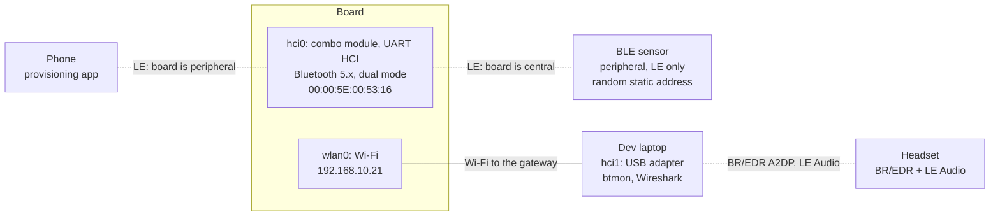

# Bluetooth for Embedded Linux Engineers

How Bluetooth works from the radio up to GATT and the profiles, how Linux implements it (the kernel's HCI core and drivers, BlueZ's `bluetoothd`, D-Bus), and what it takes to put a Bluetooth controller in a product and debug it when a device isn't found, won't pair, disconnects or is slow.

This note covers both halves of Bluetooth: **Classic** (BR/EDR: audio, serial links, HID) and **Low Energy** (LE: sensors, provisioning, beacons, LE Audio). The board and network are the ones of [Wi-Fi for Embedded Linux Engineers](../wifi/wifi_v1_2026-11-01.md): the board's Wi-Fi and Bluetooth share one combo module. Wi-Fi itself, and what happens once the device has an IP address, are in the Wi-Fi note and in [Linux Networking Fundamentals for Embedded Engineers](../../os-and-firmware/networking/linux-networking-fundamentals/linux-networking-fundamentals_v1_2026-10-29.md). This note links to them instead of repeating them.

**Assumptions:**
- One example setup (section 2) is used throughout: the board with its combo module, a BLE temperature sensor, a phone, a headset and the dev laptop with a USB Bluetooth adapter.
- Linux 6.x with BlueZ 5.66 or later (Debian 12 ships 5.66, Debian 13 ships 5.8x). Features that need a newer kernel or BlueZ say so. Tools that BlueZ deprecated (`hciconfig`, `hcitool`, `gatttool`, `hciattach`) are mentioned only to say what replaces them.
- Specification values are from the Bluetooth Core Specification 5.x and 6.x. Versions and what they added are in section 3.
- Addresses, names, passkeys and UUIDs that aren't standard are placeholders.

**Conventions:**
- `$` is a shell on the dev laptop, `#` a root shell on the board.
- **Normative** values come from the Bluetooth Core Specification, a profile specification or the SIG's Assigned Numbers.
- **Rule of thumb** marks empirical values that depend on the environment, the chips and the application.
- **Controller-dependent** or **stack-dependent** marks behavior that the specification leaves open: support varies between chips, firmware, kernel and BlueZ versions, and phone operating systems.
- **Illustrative** marks a file, script or output that shows the shape of a solution and needs adapting.

**Verification status:** nothing in this note was run for it. No source was downloaded, nothing was built, no board or phone was used. Commands, configuration keys and D-Bus interfaces follow the BlueZ documentation and manual pages, protocol values follow the Core Specification and Assigned Numbers, and kernel behavior follows the kernel documentation, as known in November 2026. Command outputs are illustrative and abridged.

**How to read it:**
- **To learn:** Part 1 (sections 1 to 12) in order.
- **To use Bluetooth from Linux:** Part 2 (sections 13 to 17).
- **To integrate a controller in a product:** Part 3 (sections 18 to 20).
- **To debug:** section 21 first, then the section of the step that fails.

## Table of contents

**Part 1: How Bluetooth works**

- [1. The mental model: two radios under one name](#1-the-mental-model-two-radios-under-one-name)
- [2. Example setup](#2-example-setup)
- [3. Versions, specifications and the SIG](#3-versions-specifications-and-the-sig)
- [4. The radio: band, channels, PHYs, power and range](#4-the-radio-band-channels-phys-power-and-range)
- [5. LE advertising and scanning](#5-le-advertising-and-scanning)
- [6. LE connections: parameters, data length and throughput](#6-le-connections-parameters-data-length-and-throughput)
- [7. Addresses and privacy](#7-addresses-and-privacy)
- [8. Classic (BR/EDR): inquiry, paging, piconets and links](#8-classic-bredr-inquiry-paging-piconets-and-links)
- [9. The host stack: HCI and L2CAP](#9-the-host-stack-hci-and-l2cap)
- [10. ATT and GATT](#10-att-and-gatt)
- [11. Pairing, bonding and security](#11-pairing-bonding-and-security)
- [12. Profiles: Classic, LE, LE Audio, mesh and positioning](#12-profiles-classic-le-le-audio-mesh-and-positioning)

**Part 2: Bluetooth on Linux**

- [13. The Linux Bluetooth stack](#13-the-linux-bluetooth-stack)
- [14. Tools: bluetoothctl, btmgmt, btmon and friends](#14-tools-bluetoothctl-btmgmt-btmon-and-friends)
- [15. The board as a central: scan, pair, connect, read a sensor](#15-the-board-as-a-central-scan-pair-connect-read-a-sensor)
- [16. The board as a peripheral: advertising and a GATT server](#16-the-board-as-a-peripheral-advertising-and-a-gatt-server)
- [17. Classic on Linux: audio, serial and networking](#17-classic-on-linux-audio-serial-and-networking)

**Part 3: Embedded products**

- [18. Integrating a Bluetooth controller on a board](#18-integrating-a-bluetooth-controller-on-a-board)
- [19. Coexistence, power and performance](#19-coexistence-power-and-performance)
- [20. Production: configuration, hardening, RF tests and qualification](#20-production-configuration-hardening-rf-tests-and-qualification)

**Debugging and reference**

- [21. Troubleshooting](#21-troubleshooting)
- [22. Not covered here](#22-not-covered-here)
- [References](#references)

---

## 1. The mental model: two radios under one name

"Bluetooth" is two different technologies that share a band, a name, a security model and a host interface:

| | Classic (BR/EDR) | Low Energy (LE) |
|---|---|---|
| Since | 1.0 (1999), EDR in 2.0 | 4.0 (2010) |
| Made for | Continuous streams: audio, serial cables, keyboards and mice | Small, infrequent data; years on a coin cell. LE Audio (section 12) now also carries audio |
| Channels | 79 × 1 MHz, frequency hopping 1600 times per second | 40 × 2 MHz: 3 primary advertising channels, 37 data channels |
| Finding devices | Inquiry: the searcher asks, devices in inquiry scan answer (section 8) | Advertising: devices broadcast, scanners listen (section 5) |
| Connecting | Paging, then the link stays up, often for hours | Connection events at a negotiated interval, the radio sleeps in between (section 6) |
| Data model | Profiles over RFCOMM and L2CAP channels (serial port, A2DP, HFP...) | Mostly GATT: a table of attributes the peer reads, writes and subscribes to (section 10) |
| Typical peak current | Tens of mA while streaming | A few mA for a few ms, a few µA asleep |
| Typical users | Headsets, car kits, game controllers | Sensors, wearables, smart locks, beacons, provisioning a device's Wi-Fi |

A **dual-mode** controller (every phone, laptop and combo module) does both. A **single-mode** LE device (most sensors and nRF/ESP32-class chips used as peripherals) does only LE. A Classic-only device can't talk to an LE-only one: being "Bluetooth" isn't enough, the two need a common transport.

**Controller and host.** Every Bluetooth stack is split in two, with a standard interface between them:

```
 ┌──────────── Host (Linux: kernel + bluetoothd) ─────────────┐
 │ Profiles and apps:  A2DP  HFP  HID  SPP   GATT services     │
 │ GAP (roles, discovery, connection, security policy)         │
 │ RFCOMM  SDP  AVDTP ...        ATT/GATT     SMP              │
 │ L2CAP: channels, segmentation, flow control                 │
 └──────────────────────────────┬──────────────────────────────┘
                                │ HCI: commands, events, data
                                │ (UART, USB, SDIO, or in-chip)
 ┌──────────────────────────────┴──────────────────────────────┐
 │ Controller (the chip's firmware)                             │
 │ Link Manager (BR/EDR, LMP)   Link Layer (LE)                 │
 │ Baseband: hopping, timing, packets, encryption, retries      │
 │ Radio: 2.4 GHz PHY                                           │
 └──────────────────────────────────────────────────────────────┘
```

- The **controller** handles everything time-critical: hopping, timing, acknowledgments and retransmissions, encryption of packets. Its firmware comes from the chip vendor and you don't change it, beyond loading a patch at boot (section 18).
- The **host** decides what to do: whom to connect to, which profile to run, which keys to store. On Linux, the kernel implements HCI, L2CAP, SMP and the socket interfaces; `bluetoothd` implements GAP policy, GATT, the profiles and the D-Bus API (section 13).
- **HCI** (host controller interface) is the standard protocol between them (section 9). Because it's standard, any host can drive any controller, and `btmon` can show everything that crosses it. It's the single most useful debugging point.
- On a microcontroller (nRF52, ESP32), host and controller often run on the same chip and HCI is a function call. Such a chip can also run controller-only firmware and be used by Linux over a UART (section 18).

**Vocabulary:**

| Term | Meaning |
|---|---|
| Adapter, `hci0` | Linux's name for a local controller |
| BD_ADDR | Bluetooth device address, 48 bits, written `00:00:5E:00:53:16`. LE devices often use random addresses (section 7) |
| Central / peripheral | LE connection roles: the central initiates and runs the connection's timing (the phone, the board reading a sensor), the peripheral advertises and accepts (the sensor). Before 5.3 the spec said master/slave; old tools and logs still do |
| Broadcaster / observer | LE roles without connections: advertise only (a beacon), scan only |
| Client / server | GATT roles, independent of the connection role: the server holds the data (usually the peripheral), the client reads it |
| Pairing / bonding | Pairing creates keys for one connection; bonding stores them for later reconnections (section 11) |
| Profile | A specification of how to use the protocols for one use case: A2DP (stereo audio), HFP (calls), HOGP (keyboards over LE)... |
| Service, characteristic | GATT building blocks: a service groups characteristics; a characteristic is a value with properties (read, write, notify) (section 10) |
| UUID | Identifier of a service or characteristic: 16-bit for SIG-defined ones (`0x180F` Battery), 128-bit for your own |
| SIG | Bluetooth Special Interest Group: writes the specifications, runs qualification, owns the trademark (section 3) |

**Bluetooth is a short-range, low-rate link that must be designed for disconnection.** Devices move out of range, phones kill background apps, the link drops on interference. Products that work well reconnect quickly and keep state on both ends; products that work badly assume the link is always there.

---

## 2. Example setup

The board is the one of the [Wi-Fi note](../wifi/wifi_v1_2026-11-01.md#2-example-network): its combo module has Wi-Fi on SDIO and Bluetooth on a UART. The product use cases:

- **Provisioning:** a phone app sends the Wi-Fi credentials to the board over BLE before it has a network ([Wi-Fi note, provisioning](../wifi/wifi_v1_2026-11-01.md#provisioning-a-headless-device)). The board is a **peripheral** and **GATT server** (section 16).
- **Sensor gateway:** the board reads a BLE temperature sensor and forwards the values over Wi-Fi. The board is a **central** and **GATT client** (section 15).
- **Audio:** the dev laptop streams to a headset, to show Classic audio and LE Audio on Linux (section 17).



| Device | Adapter | Address | Role in the examples |
|---|---|---|---|
| Board | `hci0` on `/dev/ttymxc1` (UART with RTS/CTS) | `00:00:5E:00:53:16` (public) | Dual-mode Bluetooth 5.x controller in the Wi-Fi + Bluetooth combo module. Central for the sensor, peripheral for the phone |
| BLE sensor | | `F0:00:00:00:53:01` (random static) | LE-only, advertises as `TempSensor-01`, Environmental Sensing service (`0x181A`) with a Temperature characteristic (`0x2A6E`) and Battery service (`0x180F`) |
| Phone | | Resolvable private addresses, changing (section 7) | Runs the provisioning app |
| Headset | | `00:00:5E:00:53:70` | Dual-mode: A2DP/HFP over BR/EDR, LE Audio when both sides support it |
| Dev laptop | `hci1`: USB adapter (`btusb`) | `00:00:5E:00:53:64` | Runs `btmon`, Wireshark, `bluetoothctl`, PipeWire |

The public addresses use the documentation block `00:00:5E:00:53:xx` (RFC 7042) as placeholders; the sensor's random static address is a placeholder of the right form (two top bits set, section 7). The UUIDs of the provisioning service (section 16) are placeholders too: generate your own with `uuidgen`.

---

## 3. Versions, specifications and the SIG

The **Bluetooth SIG** writes the **Core Specification** (radio, link layer, HCI, L2CAP, ATT/GATT, SMP, GAP), the **profile and service specifications** (A2DP, HFP, Heart Rate, LE Audio...) and the **Assigned Numbers** document (UUIDs, company identifiers, AD types, appearance values, codec IDs). Since 2023 the core version numbers follow a regular release train; the SIG publishes a feature summary with each release.

| Version | Year | What it brought (main points) |
|---|---|---|
| 1.1, 1.2 | 2001, 2003 | First widely deployed Classic; 1.2 added adaptive frequency hopping (AFH) and eSCO |
| 2.0 + EDR | 2004 | Enhanced Data Rate: 2 and 3 Mb/s |
| 2.1 + EDR | 2007 | Secure Simple Pairing (SSP): numeric comparison, passkey, Just Works. Sniff subrating |
| 3.0 + HS | 2009 | Bulk data over a Wi-Fi link (AMP). Hardly used, later removed |
| 4.0 | 2010 | **Low Energy**: advertising, connections, ATT/GATT, SMP. "Bluetooth Smart" |
| 4.1 | 2013 | LE devices in several roles at once, LE credit-based L2CAP channels, coexistence signaling with LTE |
| 4.2 | 2014 | **LE Secure Connections** (ECDH P-256), **Data Length Extension** (251-byte packets), link-layer privacy |
| 5.0 | 2016 | **LE 2M** and **LE Coded** PHYs (speed, range), **extended advertising**, periodic advertising, channel selection algorithm #2, up to +20 dBm |
| 5.1 | 2019 | Direction finding (angle of arrival and departure), GATT caching |
| 5.2 | 2019 | **Isochronous channels** (base of LE Audio), Enhanced ATT (EATT), LE power control |
| 5.3 | 2021 | Connection subrating, channel classification by the peripheral, periodic advertising enhancements. Inclusive terminology (central/peripheral) |
| 5.4 | 2023 | Periodic advertising with responses (PAwR, for electronic shelf labels), encrypted advertising data, advertising coding selection |
| 6.0 | 2024 | **Channel Sounding** (secure distance measurement), decision-based advertising filtering, monitoring advertisers, frame space update |
| 6.1 | 2025 | Resolvable private address updates at randomized times, controller power-saving improvements |
| 6.2 | 2025 | Shorter connection intervals (below 7.5 ms), isochronous data over USB HCI, Channel Sounding hardening |

Newer releases and in-progress work (higher data throughput for LE, operation above 2.4 GHz) are listed on the SIG's specifications page: check it rather than this table for anything after 6.2.

**What a version number means.** Almost everything after 4.0 is **optional**. A "Bluetooth 5.3" controller is a controller qualified against Core 5.3: it may support 2M but not Coded, or no extended advertising at all. The version tells you which features *can* be present; the controller's feature bits tell you which *are* (`btmgmt info`, `bluetoothctl show`, or the HCI LE Read Local Supported Features command in `btmon`, section 14). And a feature works only if the **controller, the host stack and the peer** all support it: a phone that doesn't do LE Coded can't connect to your sensor over Coded, whatever your chip does.

**Qualification.** Selling a product with Bluetooth, or using the name and logo, requires the product to be listed through the SIG's **Qualification Program** (membership, a declaration, a listing fee). Products built on an already qualified module or controller and host stack mostly reference the existing qualifications (section 20). This is separate from radio regulation (FCC, CE/RED), which is required whatever the trademark.

---

## 4. The radio: band, channels, PHYs, power and range

Both halves use the 2400 to 2483.5 MHz ISM band, the same as 2.4 GHz Wi-Fi, Zigbee/Thread and microwave ovens. In this band, a device must cope with interference: Classic by hopping, LE by spreading over channels and retrying.

### Channels

| | BR/EDR | LE |
|---|---|---|
| Channels | 79 × 1 MHz, center 2402 + *k* MHz, *k* = 0..78 | 40 × 2 MHz, center 2402 + 2*k* MHz, *k* = 0..39 |
| Hopping | 1600 hops/s along a pseudo-random sequence derived from the central's address and clock | One channel per connection event (or per isochronous subevent), chosen by a channel selection algorithm |
| Avoiding busy channels | AFH: the central marks bad channels and excludes them from the hop set (at least 20 must remain) | Channel map: the central excludes bad data channels (at least 2 must remain); 5.3 lets the peripheral report bad channels |
| Discovery channels | 32 inquiry/page channels, hopped quickly | 3 primary advertising channels |

The three LE primary advertising channels are placed between the usual 2.4 GHz Wi-Fi channels:

| LE channel index | RF channel | Center (MHz) | Position |
|---|---|---|---|
| 37 | 0 | 2402 | Below Wi-Fi channel 1 (2412) |
| 38 | 12 | 2426 | Between Wi-Fi channels 1 and 6 (2437) |
| 39 | 39 | 2480 | Above Wi-Fi channel 11 (2462) and 13 (2472) |

Data channels 0 to 36 fill the rest. Logs and HCI commands use the **channel index** (0 to 39), not the RF channel number: index 37 is 2402 MHz, at the bottom of the band.

### PHYs and modulation

| PHY | Modulation | Symbol rate | Raw data rate | Notes |
|---|---|---|---|---|
| BR (Basic Rate) | GFSK | 1 Msym/s | 1 Mb/s | Classic baseline |
| EDR 2 Mb/s | π/4-DQPSK | 1 Msym/s | 2 Mb/s | Packet header still in GFSK |
| EDR 3 Mb/s | 8DPSK | 1 Msym/s | 3 Mb/s | Shortest range of the Classic rates |
| LE 1M | GFSK | 1 Msym/s | 1 Mb/s | Mandatory for LE; all legacy advertising |
| LE 2M | GFSK | 2 Msym/s | 2 Mb/s | 5.0, optional. Faster, shorter airtime, slightly less range |
| LE Coded S=2 | GFSK + FEC | 1 Msym/s | 500 kb/s | 5.0, optional. About 2× the range of 1M (rule of thumb) |
| LE Coded S=8 | GFSK + FEC | 1 Msym/s | 125 kb/s | About 4× the range of 1M in open space (rule of thumb), 8× the airtime |

Coded PHY trades airtime (energy, latency, channel occupancy) for range. It is mostly used between devices you control: phone support for Coded PHY is partial and varies by model.

### Transmit power and power classes

| Class | Max power | Typical use |
|---|---|---|
| 1 | 100 mW (+20 dBm) | Laptops and USB adapters with an amplifier, industrial modules |
| 1.5 (LE) | 10 mW (+10 dBm) | Many LE modules |
| 2 | 2.5 mW (+4 dBm) | Phones, headsets, most combo modules |
| 3 | 1 mW (0 dBm) | Small LE devices |

The class is a **maximum**; the controller and regulation can set less. In the EU, ETSI EN 300 328 limits the band to 20 dBm EIRP, and non-hopping (wideband) modulations such as LE also to 10 dBm EIRP per MHz. The antenna gain counts in EIRP: a +20 dBm chip with a 3 dBi antenna exceeds 20 dBm EIRP. Since 5.2, LE power control lets two connected devices ask each other to lower or raise their power.

### Range and link budget

Receiver sensitivity (rule of thumb, from datasheets): about -95 dBm for LE 1M, -92 dBm for LE 2M, -100 to -105 dBm for LE Coded S=8, -90 dBm for BR and a few dB worse for EDR 3 Mb/s. The specification only requires -70 dBm for LE 1M; real chips are far better.

The **link budget** is TX power plus antenna gains minus sensitivity. With 0 dBm TX, -95 dBm sensitivity and 0 dBi antennas, 95 dB of path loss is allowed. At 2.44 GHz, free-space loss is about 40 dB at 1 m and adds 20 dB per decade of distance (60 dB at 10 m, 80 dB at 100 m). In free space that's several hundred meters; indoors it's typically 10 to 30 m (rule of thumb), because:

- every wall costs 3 to 15 dB, concrete and metal far more;
- the human body absorbs 2.4 GHz: a phone in a back pocket or a wearable on the far side of the body loses 10 to 20 dB;
- small devices have poor antennas (-5 to -10 dBi is common for chip antennas in a plastic case near a battery);
- multipath fading makes the signal drop by 10 to 20 dB at some positions and frequencies: hopping and channel diversity exist because of it.

**RSSI** (received signal strength indication) is reported in advertising reports and per connection. Use it to compare positions, not as a distance meter: the same distance gives values 10 to 20 dB apart depending on orientation, bodies and channel. For distance, Channel Sounding (section 12) or several samples with a calibrated model are needed.

---

## 5. LE advertising and scanning

An LE device that wants to be found **advertises**: it sends short packets on the advertising channels, at an interval, whether anyone listens or not. A device that wants to find others **scans**. Nothing is "paired" or "connected" at this stage, and anyone in range can read the advertisements.

### Advertising events

In legacy advertising, one **advertising event** sends the same PDU on channels 37, 38 and 39, one after the other within about a millisecond, listening briefly after each for a scan or connection request. Events repeat every `advInterval + advDelay`:

- `advInterval`: 20 ms to 10.24 s in steps of 0.625 ms (**normative**). Shorter means faster discovery and more energy.
- `advDelay`: a random 0 to 10 ms added to every event, so two devices with the same interval don't collide forever.

**Legacy advertising PDU types** (LE 1M only):

| PDU | Connectable | Scannable | Use |
|---|---|---|---|
| `ADV_IND` | Yes | Yes | The usual peripheral: "here I am, connect to me" |
| `ADV_DIRECT_IND` | Yes, by one named central | No | Fast reconnection to a known central. High duty cycle mode lasts at most 1.28 s |
| `ADV_SCAN_IND` | No | Yes | Broadcasts data, more in the scan response |
| `ADV_NONCONN_IND` | No | No | Beacons |
| `SCAN_REQ` / `SCAN_RSP` | | | An active scanner asks for 31 more bytes of data |
| `CONNECT_IND` | | | A central starts a connection (section 6). Called `CONNECT_REQ` before 5.0 |

### Advertising data

The payload is up to **31 bytes** of **AD structures** (plus 31 in the scan response), each made of a length byte, a type byte and data. The sensor's advertisement (**Illustrative**):

```
02 01 06                                     len 2, Flags: LE General Discoverable, BR/EDR not supported
03 03 1A 18                                  len 3, Complete list of 16-bit service UUIDs: 0x181A (little endian)
0E 09 54 65 6D 70 53 65 6E 73 6F 72 2D 30 31 len 14, Complete local name: "TempSensor-01"
```

| AD type | Name | Notes |
|---|---|---|
| `0x01` | Flags | Discoverable mode (limited `0x01`, general `0x02`), "BR/EDR not supported" `0x04`. Required in connectable advertising |
| `0x02` / `0x03` | Incomplete / complete list of 16-bit service UUIDs | Lets scanners filter by service without connecting. `0x06`/`0x07` for 128-bit UUIDs, which take 18 of the 31 bytes |
| `0x08` / `0x09` | Shortened / complete local name | Put a short name; the full name can be read over GATT |
| `0x0A` | TX power level | Lets the scanner estimate path loss |
| `0x16` | Service data, 16-bit UUID | A UUID followed by data: the way to broadcast sensor values without connections |
| `0x19` | Appearance | Icon category (thermometer, keyboard...) from Assigned Numbers |
| `0xFF` | Manufacturer specific data | Starts with the 16-bit **company identifier** from Assigned Numbers. Don't use another company's ID |

Beacons are just advertising formats: Apple's iBeacon is manufacturer data with Apple's company ID (`0x004C`), Google's Eddystone is service data with UUID `0xFEAA`. Item trackers use their own formats on the same mechanism.

**Advertising is public.** Never put credentials, static identifiers you don't want tracked, or anything the device's owner wouldn't want broadcast. 5.4 added **encrypted advertising data** (key shared beforehand over GATT), still rarely supported.

### Scanning

| Parameter | Meaning |
|---|---|
| Scan interval | How often the scanner starts listening on the next advertising channel |
| Scan window | How long it listens each time. Window = interval means listening continuously |
| Passive / active | Passive only listens. Active also sends `SCAN_REQ` to scannable devices to get their scan response (and reveals the scanner) |
| Duplicate filtering | The controller reports each address once (until scanning restarts) instead of every packet. Turn it off to track RSSI or changing data |
| Filter policy | Report everyone, or only the devices in the filter accept list (formerly white list) |

**Discovery time** depends on both sides. A peripheral advertising every 100 ms, seen by a scanner listening continuously, is found within a few hundred ms. Phones scan at a low duty cycle in the background and when the screen is off, so a device advertising every 1 to 2 s can take several seconds to appear (**rule of thumb**). The usual compromise: advertise fast (20 to 100 ms) for 30 s after power-up or a button press, then slow down. Apple's Accessory Design Guidelines list recommended intervals (20 ms for the first 30 s, then values such as 152.5, 211.25, 318.75 ms or 1022.5, 1285 ms) because iOS scans in a pattern that catches those reliably.

### Extended and periodic advertising (5.0)

Legacy advertising has three limits: 31 bytes, LE 1M only, and everything on three crowded channels. Extended advertising moves the payload off the primary channels:

1. A short `ADV_EXT_IND` on channels 37, 38 and 39 says "the data is on data channel *n* at time *t*, on PHY *p*" (an AuxPtr).
2. `AUX_ADV_IND` on that data channel carries up to 254 bytes, and can chain more PDUs (`AUX_CHAIN_IND`) for up to **1650 bytes** of advertising data.

The secondary PHY can be 1M, 2M or Coded (and Coded is also allowed on the primary channels, for long-range discovery). A controller can run several **advertising sets** at once, each with its own data, interval and address.

**Older scanners don't see extended advertising.** A device that phones must find should keep a legacy advertising set, or check that every target phone handles extended advertising.

**Periodic advertising** sends data at a fixed interval that scanners synchronize to, so they wake only when a packet is due: the base of LE Audio broadcast (Auracast, section 12). **PAwR** (5.4) adds response slots, so one gateway can talk to thousands of devices (electronic shelf labels) without connections.

---

## 6. LE connections: parameters, data length and throughput

### Establishing a connection

A central that wants to connect scans for a connectable advertisement from the target, then answers it with `CONNECT_IND` (or `AUX_CONNECT_REQ` for extended advertising). That PDU carries everything the link needs: a random 32-bit **access address** that identifies the connection's packets, the CRC seed, the timing of the first event, the connection parameters, the channel map and the hop parameters. The peripheral stops advertising and the two are connected: there's no handshake beyond it, and the first data exchange confirms the link. If it fails, the central's host sees "connection failed to be established" (HCI reason `0x3E`, section 9).

### Connection events

Once connected, the two devices meet at **connection events**, one per connection interval, on a new data channel each time:

```
 connection interval (e.g. 30 ms)
 |<------------------------------->|
 [C→P][P→C][C→P][P→C]               [C→P][P→C]                 ...
 ^anchor point     radio off         ^next anchor, next channel
```

- The central transmits first at the **anchor point**; the peripheral answers 150 µs (T_IFS) later. Every packet acknowledges the previous one, and a packet that isn't acknowledged is sent again at the next opportunity: the link layer is reliable.
- While either side has more data (the **MD**, more data, bit), the event continues; otherwise both turn the radio off until the next anchor.
- With nothing to send, the central still sends an empty packet each event so both stay in sync.

### Connection parameters

| Parameter | Range (normative) | Effect |
|---|---|---|
| Connection interval | 7.5 ms to 4 s, in 1.25 ms units (6.2 adds shorter intervals for controllers that support them) | Latency and throughput vs power |
| Peripheral latency | 0 to 499 events | The peripheral may skip that many events when it has nothing to send, to save power. The central still listens at every event, so data from the peripheral isn't delayed; data *to* the peripheral may be |
| Supervision timeout | 100 ms to 32 s, in 10 ms units. Must be larger than `(1 + latency) × interval × 2` | Time without a valid packet before the link is declared lost (HCI reason `0x08`, connection timeout) |

The **central decides**. The peripheral can ask for other values (L2CAP Connection Parameter Update Request, or the link-layer Connection Parameters Request procedure); the central can accept, reject or pick something else. Phones impose their own limits:

- **iOS** (Apple's Accessory Design Guidelines): roughly, interval at least 15 ms, latency at most 30, supervision timeout 2 to 6 s, and `interval × (latency + 1)` at most 2 s. Requests outside the rules are rejected. Check the current guidelines.
- **Android**: apps choose a priority (`CONNECTION_PRIORITY_HIGH`, `BALANCED`, `LOW_POWER`), which maps to intervals of very roughly 11 to 15 ms, 30 to 50 ms and 100 to 125 ms; exact values vary by Android version and vendor (**stack-dependent**).
- **Linux** as a central: the kernel's defaults are 30 to 50 ms, latency 0, supervision timeout 420 ms. They can be changed in `/etc/bluetooth/main.conf` (section 13) or per adapter in debugfs.

A short supervision timeout detects lost peripherals quickly but drops connections on short fades; a long one keeps the link through fades but takes long to notice a device that's gone. 2 to 6 s suits most products.

**Connection subrating** (5.3) lets a link alternate between a slow "idle" rate and a fast one without the renegotiation delay, useful for LE Audio and HID devices.

### Packet sizes: data length and MTU

Three sizes stack up, and all three matter for throughput:

| Size | Default | Max | Negotiated by |
|---|---|---|---|
| Link-layer payload (data length) | 27 bytes | 251 bytes (4.2 Data Length Extension) | `LL_LENGTH_REQ`, by the controllers when the host asks |
| ATT MTU | 23 bytes | 517 bytes (stack limit; the spec allows up to 65535 on L2CAP) | ATT Exchange MTU, by the GATT client |
| Usable data per notification or write | MTU - 3 = 20 bytes | 514 bytes | |

L2CAP adds 4 bytes, ATT 3 bytes of header. A 247-byte MTU fits exactly in one 251-byte link-layer packet (247 + 4), which is why stacks often negotiate 247.

### Throughput

The ceiling is how many packets fit in a connection event and how big they are. An encrypted 251-byte packet on LE 1M takes 2.1 ms on air, plus the acknowledgment and two 150 µs gaps: about 2.5 ms per 244 bytes of ATT data.

| Configuration | Theoretical application throughput, one direction | Typical in practice (rule of thumb) |
|---|---|---|
| LE 1M, 27-byte packets, MTU 23 | About 230 kb/s | 30 to 100 kb/s with a phone |
| LE 1M, 251-byte packets, MTU 247 | About 780 kb/s | 300 to 700 kb/s |
| LE 2M, 251-byte packets, MTU 247 | About 1.4 Mb/s | 0.7 to 1.3 Mb/s |
| BR/EDR, 3 Mb/s EDR | About 2.1 Mb/s | 1 to 2 Mb/s |

Real values are lower because controllers limit how many packets they send per connection event (**controller-dependent**), the event shares airtime with Wi-Fi on a combo chip (section 19), and retransmissions grow with distance and interference.

**What the application can do:**
- Use **notifications** and **write without response**: they stream. Reads, writes with response and indications wait for a reply, at most one per connection event or two.
- Negotiate the MTU and data length early (Linux and phones do both automatically on recent versions).
- Ask for a short interval during transfers (firmware updates, logs) and a long one otherwise.
- Use LE 2M when both sides support it (`bluetoothctl` and the kernel switch automatically only if configured to: section 15).
- For bulk data, consider an **L2CAP connection-oriented channel** (LE CoC, section 9) instead of GATT: less overhead, flow control built in.

---

## 7. Addresses and privacy

A Bluetooth address is 48 bits. LE adds address **types**, because a fixed address that every advertisement repeats lets anyone track the device (and its owner).

| Type | Form | Lifetime | Used by |
|---|---|---|---|
| Public | IEEE-assigned: vendor OUI + serial, like an Ethernet MAC | Fixed | Classic always; LE devices that bought an OUI |
| Random static | Two top bits `11` (first byte `C0` to `FF`) | Fixed for the device's life, or new at each power cycle | Most LE-only devices (no OUI needed). The sensor's `F0:00:00:00:53:01` |
| Resolvable private address (RPA) | Two top bits `01` (first byte `40` to `7F`); 24 random bits + 24-bit hash computed with an **IRK** | Changes periodically (typically every 15 min) | Phones, laptops, the board when privacy is on |
| Non-resolvable private | Two top bits `00` | Changes often, can't be linked to the device | Non-connectable broadcasts |

`btmon` and BlueZ show the type next to the address: `(Public)`, `(Random)` plus `(Static)` or `(Resolvable)` or `(Non-Resolvable)`. In `bluetoothctl` and D-Bus, `AddressType` is `public` or `random`.

**How a bonded peer recognizes a changing address.** During bonding (section 11), each side sends its **identity address** (public or random static) and its **identity resolving key** (IRK). When an RPA shows up later, the peer computes the hash part with each stored IRK; a match means "that's my bonded phone". The controller can do it in hardware (**LL privacy**, 4.2, with a resolving list), which is needed to use filter accept lists and directed advertising with peers that use RPAs. Linux supports controller-based resolution (enabled by default on recent kernels when the controller supports it, **stack-dependent**).

**Consequences for products:**
- Before bonding, a phone's address means nothing: it changes, and the next scan shows "a new device". Identify unbonded phones by what they do (the GATT exchange), not by their address.
- After bonding, BlueZ stores the peer under its **identity address** (`/var/lib/bluetooth/<adapter>/<identity>/`), whatever address it uses on air.
- Advertising content can defeat address rotation: a fixed name with a serial number, or manufacturer data with a constant ID, tracks the device just as well. Rotate or omit such fields if privacy matters.
- **Classic doesn't rotate addresses.** A discoverable Classic device broadcasts its public address to anyone who inquires. Stay non-discoverable except during pairing (section 20).

The board's own LE privacy is controlled by BlueZ's `Privacy` setting (section 13): `off` uses the public address in advertising and connections, `device` or `network` use RPAs.

---
