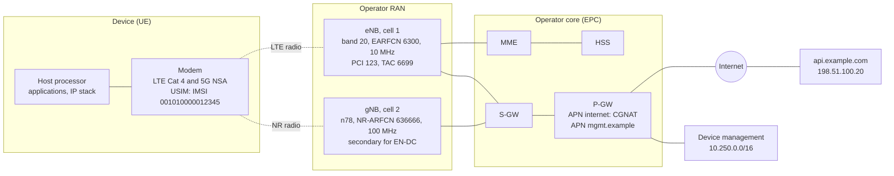

# Cellular Protocols: LTE, 5G NR and Cellular IoT

How a cellular network works from the radio up to the IP session: spectrum and the physical layer, how the base station schedules every transmission, how a device finds a cell, registers, authenticates and gets an IP address, how it moves and saves power, and what LTE-M, NB-IoT and RedCap change for IoT devices.

This note covers the **protocols**, as 3GPP specifies them and as a device engineer meets them in modem logs and AT command answers. Driving a modem from Linux (ModemManager, QMI, MBIM, drivers, board integration) belongs in a separate note. Until it exists, the networking side is in [Networking Fundamentals for Embedded Linux Engineers](../../networking/fundamentals/fundamentals.md#20-modem-based-devices-the-ap-and-the-modem) (the AP-modem split, data path, sharing the connection) and a hands-on modem bring-up is in [Building a Home Gateway on Linux](../../networking/gateway/gateway.md#method-2-cellular-modem-quectel-ec25).

**Assumptions:**
- One example network (section 2) is used throughout: a device with an LTE/5G module, an operator's LTE and 5G cells, and its core network.
- LTE means 3GPP E-UTRA from Release 8 on; 5G means NR and the 5G core (5GC) from Release 15 on. 2G and 3G appear only where they still matter: fallback, sunsets and security downgrades.
- Spectrum values are given for the EU and the US. They change, and other regions differ.

**Conventions:**
- **Normative** values come from a 3GPP specification (cited by its TS number) or a regulation.
- **Rule of thumb** marks empirical values that depend on the network, the device and the environment.
- **Operator-dependent** or **vendor-dependent** marks behavior that 3GPP leaves to the network operator or to the modem vendor.

**How to read it:**
- **To learn:** Parts 1 to 3 in order.
- **To understand the radio:** Part 2 (sections 5 to 8).
- **To understand registration, sessions and power saving:** Part 3 (sections 9 to 16).
- **To debug:** section 18 first, then the section of the step that fails.

## Table of contents

**Part 1: Foundations**

- [1. The mental model: what cellular changes compared to Wi-Fi](#1-the-mental-model-what-cellular-changes-compared-to-wi-fi)
- [2. Example network](#2-example-network)
- [3. Generations, 3GPP releases and device categories](#3-generations-3gpp-releases-and-device-categories)
- [4. Spectrum: bands, duplexing and channel numbers](#4-spectrum-bands-duplexing-and-channel-numbers)

**Part 2: The radio interface**

- [5. The physical layer: OFDM, numerology, resource grid, MCS and MIMO](#5-the-physical-layer-ofdm-numerology-resource-grid-mcs-and-mimo)
- [6. Physical channels, cell search and system information](#6-physical-channels-cell-search-and-system-information)
- [7. Scheduling, HARQ and layer 2](#7-scheduling-harq-and-layer-2)
- [8. Signal measurements and link budget](#8-signal-measurements-and-link-budget)

**Part 3: The network and its procedures**

- [9. Network architecture: RAN, EPC, 5GC, NSA and SA](#9-network-architecture-ran-epc-5gc-nsa-and-sa)
- [10. Identities and the SIM](#10-identities-and-the-sim)
- [11. Getting service: PLMN selection, RRC connection, attach and registration](#11-getting-service-plmn-selection-rrc-connection-attach-and-registration)
- [12. Data sessions: APNs, bearers, PDU sessions, QoS and IP](#12-data-sessions-apns-bearers-pdu-sessions-qos-and-ip)
- [13. Security: authentication, keys, ciphering and known attacks](#13-security-authentication-keys-ciphering-and-known-attacks)
- [14. Mobility and power saving: RRC states, paging, handover, DRX, PSM](#14-mobility-and-power-saving-rrc-states-paging-handover-drx-psm)
- [15. Cellular IoT: LTE-M, NB-IoT and RedCap](#15-cellular-iot-lte-m-nb-iot-and-redcap)
- [16. Beyond data: SMS, voice, positioning, slicing, NTN](#16-beyond-data-sms-voice-positioning-slicing-ntn)

**Part 4: Observing and debugging**

- [17. Observing the protocol: AT commands, modem logs and captures](#17-observing-the-protocol-at-commands-modem-logs-and-captures)
- [18. Troubleshooting by layer](#18-troubleshooting-by-layer)
- [19. Not covered here](#19-not-covered-here)
- [References](#references)

---

## 1. The mental model: what cellular changes compared to Wi-Fi

Wi-Fi and cellular both carry IP over a radio, but they are built on opposite assumptions. Wi-Fi is a LAN that anyone can set up on free spectrum; cellular is a service that an operator runs on spectrum it paid for, and every device is a subscriber the network knows by name.

| | Wi-Fi | Cellular (LTE, 5G NR) |
|---|---|---|
| Spectrum | Unlicensed: shared with neighbors and other technologies | Licensed to the operator: no one else transmits there |
| Who transmits when | Each station contends for the medium (CSMA/CA) | The **base station schedules** every transmission, both directions, every millisecond or less (section 7) |
| Duplex | Half duplex on one channel | FDD (separate uplink and downlink frequencies) or TDD (scheduled time split), section 4 |
| Range | Tens of meters | Hundreds of meters to tens of kilometers per cell |
| Identity | A MAC address; the network knows a passphrase | A subscription in a SIM (IMSI), authenticated by the operator's core (sections 10 and 13) |
| Joining | Scan, authenticate, associate, handshake, DHCP | Cell search, random access, RRC connection, attach or registration, authentication, data session (section 11) |
| What you get | A port on a LAN: broadcast, ARP, neighbors | A point-to-point **IP session** to the operator's gateway: no LAN, no broadcast, no neighbors (section 12) |
| Mobility | The client decides when to roam; a new AP may mean a new handshake | The **network** decides handovers; the IP address survives across the whole network (section 14) |
| Power saving | The client tells the AP it sleeps | The network sets the sleep cycles and timers; the device requests values (section 14) |
| Who you debug with | Your own AP's logs | The operator's network, which you usually can't see: the device's logs and reject causes are most of your evidence (sections 17 and 18) |

**Vocabulary:**

| Term | Meaning |
|---|---|
| UE (user equipment) | The device: in 3GPP terms, the mobile equipment (ME, the modem and its host) plus the USIM |
| eNB, gNB | The LTE base station (eNodeB) and the 5G NR base station (gNodeB). One base station serves several cells |
| Cell | One carrier frequency, from one base station, in one direction (sector). Identified on the air by its PCI and globally by its cell identity (section 6) |
| RAN | Radio access network: the base stations (E-UTRAN for LTE, NG-RAN for 5G) |
| Core network | The operator's control and gateway functions: EPC for LTE, 5GC for 5G (section 9) |
| PLMN | Public land mobile network: one operator's network in one country, identified by MCC + MNC (`001-01` in the examples) |
| Attach, registration | Becoming known to the core network: "attach" in LTE, "registration" in 5G (section 11) |
| APN, DNN | The name of the packet data network a session connects to: access point name (LTE), data network name (5G) (section 12) |
| Bearer, PDU session | The data session and its QoS: a PDN connection made of EPS bearers in LTE, a PDU session with QoS flows in 5G (section 12) |
| NAS, AS | Non-access stratum: messages between the UE and the core (registration, sessions, security). Access stratum: everything between the UE and the base station (RRC, the radio layers) |
| RRC | Radio resource control: the protocol between the UE and the base station that sets up, configures and releases the radio connection (sections 6, 11 and 14) |
| Modem | The processor and firmware that implement all of the above in the device. The host (an application processor running Linux, for instance) only asks it for a session and gets IP packets |

**The base station is in charge.** A UE never transmits data on its own initiative: it asks for resources and sends exactly what it is granted, on the frequencies, at the times and with the modulation the base station chose. The only exception is the random access preamble, the "knock on the door" (section 6). Most of what makes cellular feel different from Wi-Fi follows from that: predictable latency under load, no collisions between users of the same cell, and a device that can do nothing about a busy cell except wait for its share.

**Your IP session is a tunnel.** The address a device gets belongs to a gateway in the operator's core, often hundreds of kilometers away (in another country when roaming). Every packet travels from the device to that gateway through tunnels, and only there enters an IP network (section 9). The radio part is one hop of that path; the rest is the operator's.

---

## 2. Example network

The examples reuse network B of the [fundamentals note](../../networking/fundamentals/fundamentals.md#network-b-a-cellular-product-with-an-ap-and-a-modem): a product with an LTE/5G module, an internet session and a private management session. This note adds the radio side and the operator's network behind it.

| Element | Value | Notes |
|---|---|---|
| PLMN | MCC `001`, MNC `01` | The 3GPP test network code: the role a documentation range plays for IP |
| IMSI | `001010000012345` | MCC + MNC + MSIN (section 10) |
| IMEI | `490154203237518` | Identifies the modem hardware, not the subscriber (section 10) |
| LTE cell | Band 20 (800 MHz, FDD), EARFCN 6300 = 806 MHz downlink, 10 MHz, PCI 123, TAC 6699 | The anchor cell: coverage and control |
| NR cell | n78 (3.5 GHz, TDD), NR-ARFCN 636666 = 3549.99 MHz, 100 MHz, 30 kHz subcarrier spacing | Added as a secondary cell in non-standalone mode (section 9) |
| Internet session | APN `internet`, IPv4v6: `100.72.15.9`, prefix `2001:db8:c0:1::/64`, DNS `192.0.2.53`, MTU 1430 | `wwan0` in the fundamentals note. `100.72.15.9` is in the CGNAT range (RFC 6598) |
| Management session | APN `mgmt.example`, IPv4 `10.200.0.15` | A private APN that only reaches the operator's device-management servers. `wwan1` in the fundamentals note |
| Server | `api.example.com`, `198.51.100.20` | Reached through the P-GW's CGNAT |

`198.51.100.0/24` and `192.0.2.0/24` are IPv4 documentation ranges (RFC 5737), `2001:db8::/32` the IPv6 one (RFC 3849). The IMSI, IMEI, cell identities and APNs are placeholders.

---

## 3. Generations, 3GPP releases and device categories

**3GPP** (3rd Generation Partnership Project) writes the specifications for GSM, UMTS, LTE and 5G, in numbered **releases**. Each release is a frozen set of specifications; vendors implement a subset of a release's features, and operators enable a subset of those. Specifications are numbered by series: `TS 36.xxx` for LTE radio, `TS 38.xxx` for NR radio, `TS 23.xxx` for architecture and procedures, `TS 24.xxx` for NAS protocols, `TS 33.xxx` for security (references at the end). "4G" and "5G" are ITU and marketing names; specifications and modem logs say E-UTRA/LTE and NR.

| Generation | Technology | 3GPP release | Access | Peak rates (spec) | Status |
|---|---|---|---|---|---|
| 2G | GSM, GPRS, EDGE | Phase 1 and 2, R97, R99 | TDMA, 200 kHz carriers | Up to a few hundred kb/s (EDGE) | Switched off in many countries, kept in others for IoT and voice fallback |
| 3G | UMTS (WCDMA), HSPA, HSPA+ | R99, Rel-5 to Rel-8 | CDMA, 5 MHz carriers | 42 Mb/s (HSPA+ dual carrier) | Mostly switched off in the US and much of Europe |
| 4G | LTE | Rel-8, Rel-9 | OFDMA down, SC-FDMA up, 1.4 to 20 MHz | 300 Mb/s (4 layers, 20 MHz) | The coverage layer everywhere |
| 4G | LTE-Advanced | Rel-10 to Rel-12 | + carrier aggregation, 8 layers down | 3 Gb/s (spec maximum) | Common: aggregation of 2 to 5 carriers |
| 4G | LTE-Advanced Pro | Rel-13, Rel-14 | + LTE-M, NB-IoT, LAA (unlicensed), V2X | | LTE-M and NB-IoT are the IoT workhorses |
| 5G | NR, phase 1 | Rel-15 (2018) | OFDMA both ways, flexible numerology, up to 100 MHz (FR1) and 400 MHz (FR2) | About 20 Gb/s (ITU target) | NSA first, SA since |
| 5G | NR, phase 2 | Rel-16 (2020) | + URLLC, industrial IoT, NR-U, NR V2X, positioning | | |
| 5G | NR | Rel-17 (2022) | + RedCap, NTN (satellite), bands up to 71 GHz | | |
| 5G-Advanced | NR | Rel-18 (2024), Rel-19 | + eRedCap, AI/ML studies, more NTN, energy saving | | Deployment starting |
| 6G | | Studies from Rel-20 | | | First specifications expected around the end of the decade |

**What each step changed for a device engineer:**
- **2G to 3G:** packet data became usable; the network authenticated itself to the SIM (2G only authenticates the device, section 13).
- **3G to LTE:** all-IP, no circuit-switched domain: voice became VoIP (VoLTE over IMS, section 16). An LTE device gets an IP address as part of attaching (section 11). Latency dropped to tens of ms.
- **LTE to 5G NR:** flexible numerology and wide channels, beams, a new service-based core, network slicing, a third RRC state (inactive). Early 5G (NSA) still runs its control plane on LTE (section 9).

### Device categories and capabilities

An LTE device declares a **UE category** (TS 36.306): the peak rates and features its modem supports. Since Rel-12, downlink and uplink categories are separate. 5G NR has no categories: the UE reports individual capabilities (bands, combinations, layers, modulation).

| Category | Downlink / uplink peak (Mb/s) | Receive antennas | Typical use |
|---|---|---|---|
| Cat NB1 / NB2 (NB-IoT) | About 0.03 / 0.06 (NB1), 0.13 / 0.16 (NB2) | 1 | Meters, sensors: small, rare messages, deep indoor |
| Cat M1 / M2 (LTE-M) | About 1 / 1 (M1), 4 / 7 (M2) | 1 | Trackers, wearables, alarms: mobility and voice possible |
| Cat 1 | 10 / 5 | 2 | Telematics, payment terminals, alarm panels |
| Cat 1bis | 10 / 5 | 1 | Same, with one antenna (Rel-13): smaller devices |
| Cat 4 | 150 / 50 | 2 | Routers, gateways, the example device |
| Cat 6 | 300 / 50 | 2 | Carrier aggregation of 2 carriers |
| Cat 12 (+ uplink Cat 13) | 600 / 150 | 2 to 4 | Aggregation of 3+ carriers, 256-QAM |
| NR RedCap (Rel-17) | About 150 / 50 (2 RX, 20 MHz) | 1 or 2 | 5G for wearables, cameras, industrial sensors: replaces Cat 4 class |
| NR eRedCap (Rel-18) | About 10 (5 MHz baseband) | 1 | 5G for the Cat 1 class |
| NR eMBB | Hundreds of Mb/s to several Gb/s | 2 to 4 | Phones, fixed wireless access, high-end routers |

Peak rates assume the best signal and an empty cell: real throughput is a fraction of them (sections 7 and 8). LTE-M and NB-IoT trade throughput for coverage, cost and battery life (section 15).

### Sunsets

Operators switch off old generations to reuse their spectrum, on their own schedules:

- **3G** is gone in the US and most of Europe; **2G** is gone in the US, Australia and several European countries, and kept elsewhere for older IoT devices and voice fallback. Dates differ per operator: check the target operators' plans before choosing a fallback technology.
- Consequences: a device that needed 2G/3G for voice (circuit-switched fallback), SMS, or simply for coverage must work on LTE alone, or on LTE-M/NB-IoT. Voice requires VoLTE (section 16), and emergency call systems built on circuit-switched calls, such as the EU's in-vehicle eCall, move to IMS-based versions.
- LTE-M and NB-IoT are expected to outlive the LTE broadband generation, since they share LTE carriers and are also specified to run inside NR carriers.

---

## 4. Spectrum: bands, duplexing and channel numbers

### Duplexing

| Mode | How | Bands |
|---|---|---|
| FDD (frequency division duplex) | Uplink and downlink on two separate frequency ranges at the same time, a fixed **duplex spacing** apart | Most bands below 2.7 GHz (B1, B3, B7, B8, B20, B28...) |
| TDD (time division duplex) | One frequency range, shared in time according to a slot pattern | 2.3, 2.6 and 3.3-4.2 GHz, mmWave (B38, B40, B41, n41, n77, n78, n257-n261) |
| SDL (supplemental downlink) | Downlink only, aggregated with an FDD carrier | B32 (1.5 GHz, EU), B29 (700 MHz, US) |

All TDD cells of an area use the **same** uplink/downlink pattern, synchronized to GNSS time: a base station transmitting while its neighbor receives would jam it. The pattern fixes the uplink share (a typical n78 pattern gives the uplink about a fifth of the time), which is why TDD uplink rates are lower than downlink rates.

In most FDD bands the uplink is the lower frequency range. **Reverse duplex** bands (B13, B14, B20) put the uplink above the downlink.

### Band numbers

3GPP numbers LTE bands `B<n>` (TS 36.101) and NR bands `n<n>` (TS 38.101-1, -2). An NR band reusing an LTE band's range usually keeps its number (B3 → n3, B28 → n28). NR splits its spectrum in two **frequency ranges**:

- **FR1:** 410 MHz to 7.125 GHz ("sub-6 GHz", including mid-band 3.3-4.2 GHz).
- **FR2:** 24.25 to 71 GHz (mmWave), split since Rel-17 into FR2-1 (to 52.6 GHz) and FR2-2 (52.6 to 71 GHz).

| Band | Uplink (MHz) | Downlink (MHz) | Duplex | Where it's used |
|---|---|---|---|---|
| B1 / n1 | 1920-1980 | 2110-2170 | FDD | EU, Asia ("2100") |
| B2 / n2 | 1850-1910 | 1930-1990 | FDD | Americas (PCS "1900") |
| B3 / n3 | 1710-1785 | 1805-1880 | FDD | EU, Asia ("1800"): the main LTE capacity band in Europe |
| B4 | 1710-1755 | 2110-2155 | FDD | Americas (AWS-1) |
| B5 / n5 | 824-849 | 869-894 | FDD | Americas, Asia ("850") |
| B7 / n7 | 2500-2570 | 2620-2690 | FDD | EU, Asia ("2600") |
| B8 / n8 | 880-915 | 925-960 | FDD | EU, Asia ("900"): former GSM, used by LTE-M and NB-IoT |
| B12 | 699-716 | 729-746 | FDD | US (700 lower A/B/C) |
| B13 | 777-787 | 746-756 | FDD, reverse | US (700 upper C) |
| B14 | 788-798 | 758-768 | FDD, reverse | US (FirstNet public safety) |
| B20 / n20 | 832-862 | 791-821 | FDD, reverse | EU ("800"): the main coverage band in Europe |
| B25 | 1850-1915 | 1930-1995 | FDD | US (extended PCS) |
| B28 / n28 | 703-748 | 758-803 | FDD | EU (703-733 / 758-788), Asia-Pacific, Latin America ("700") |
| B66 | 1710-1780 | 2110-2200 | FDD | Americas (AWS-1 and AWS-3) |
| B71 / n71 | 663-698 | 617-652 | FDD, reverse | US ("600") |
| B38 | 2570-2620 | | TDD | EU, Asia |
| B40 | 2300-2400 | | TDD | Asia, some EU |
| B41 / n41 | 2496-2690 | | TDD | US, China, Japan |
| n77 | 3300-4200 | | TDD | US C-band (3.7-3.98 GHz), Japan |
| n78 | 3300-3800 | | TDD | EU ("3.5 GHz"): the main 5G band in Europe |
| n258 | 24250-27500 | | TDD | EU ("26 GHz"), Asia |
| n260, n261 | 37000-40000, 27500-28350 | | TDD | US mmWave |

**Low bands carry coverage, high bands carry capacity.** Below 1 GHz (B8, B12, B13, B20, B28, B71) signals travel far and enter buildings; 1.7-2.7 GHz carries most LTE traffic; 3.5 GHz gives wide channels with less range; mmWave gives very wide channels over a few hundred meters with line of sight. An IoT device in a basement lives on the low bands.

### Regulation

Unlike Wi-Fi, a cellular device never chooses its frequencies: it only transmits on a carrier where the operator's cell invited it, at the power the cell allows (up to its **power class**: 23 dBm, class 3, for most devices; 26 dBm, class 2, on some TDD bands; 20 dBm, class 5, for many LTE-M modules). Regulation therefore applies to the device's conformity, not to its configuration:

| Region | Rules |
|---|---|
| EU | Radio Equipment Directive (RED), with harmonized standards ETSI EN 301 908-1 (common), -13 (LTE UE), -25 (NR UE) |
| US | FCC Part 22 (850 MHz), Part 24 (PCS), Part 27 (AWS, 600/700 MHz, 2.5 GHz, 3.7 GHz), Part 90 (B14), Part 96 (CBRS, B48/n48) |

On top of regulation, operators require **industry certification** (GCF in Europe, PTCRB in North America) and often their own acceptance tests before a device may use their network.

### Channel numbers: EARFCN and NR-ARFCN

Cells are configured and reported by channel number, not frequency.

**LTE EARFCN** (TS 36.101 section 5.7.3): each band has a downlink offset. FDL = FDL_low + 0.1 × (NDL - NOffs-DL) MHz.

| Band | FDL_low (MHz) | NOffs-DL | Downlink EARFCN range | Example |
|---|---|---|---|---|
| B1 | 2110 | 0 | 0-599 | 300 = 2140 MHz |
| B3 | 1805 | 1200 | 1200-1949 | 1300 = 1815 MHz |
| B7 | 2620 | 2750 | 2750-3449 | 3100 = 2655 MHz |
| B8 | 925 | 3450 | 3450-3799 | 3600 = 940 MHz |
| B20 | 791 | 6150 | 6150-6449 | 6300 = 806 MHz (the example cell) |
| B28 | 758 | 9210 | 9210-9659 | 9410 = 778 MHz |

Uplink EARFCNs have their own ranges (B20 uplink: 24150-24449); one EARFCN is enough to identify an FDD carrier, since the duplex spacing is fixed per band.

**NR-ARFCN** (TS 38.104 section 5.4.2) is one global raster for all bands:

| Range | Step | Formula | Example |
|---|---|---|---|
| 0-3000 MHz | 5 kHz | F = 0.005 × N MHz | 158200 = 791 MHz (n28, n20 region) |
| 3000-24250 MHz | 15 kHz | F = 3000 + 0.015 × (N - 600000) MHz | 636666 = 3549.99 MHz (the example n78 cell) |
| 24250-100000 MHz | 60 kHz | F = 24250.08 + 0.06 × (N - 2016667) MHz | |

NR also has a coarser **synchronization raster** (GSCN) where the UE looks for the SSB during cell search (section 6), so it doesn't have to try every NR-ARFCN.

### Combinations and regional variants

- **Carrier aggregation** (CA, section 7) and **EN-DC** (LTE + NR dual connectivity, section 9) only work for the band combinations the UE declares and the operator configured: `CA_3A-20A` is a 20 MHz class A carrier on B3 plus one on B20; `DC_20A_n78A` is LTE B20 anchoring NR n78. The list of supported combinations in a module's datasheet matters as much as its band list.
- **Modules come in regional variants** (an `-E` for Europe, an `-A` for North America...) because RF front ends (filters, duplexers, power amplifiers) cover a limited set of bands, and because certification is per region and per operator. A "global" module covers more bands with more compromises (size, cost, sensitivity). Check every target country's and operator's bands, including low bands for coverage and LTE-M/NB-IoT bands if the device uses them.

---

## 5. The physical layer: OFDM, numerology, resource grid, MCS and MIMO

Planned: OFDMA and SC-FDMA, NR numerologies, frames, slots and resource blocks, modulation and coding, peak rate formula, MIMO layers and beamforming, TDD patterns.

---

## 6. Physical channels, cell search and system information

Planned: synchronization signals, PCI, MIB and SIBs, reference signals, control and shared channels, random access, NR SSB beams and BWPs.

---

## 7. Scheduling, HARQ and layer 2

Planned: downlink and uplink scheduling, SR and BSR, grants, CQI and link adaptation, HARQ, MAC, RLC modes, PDCP, SDAP, carrier aggregation and dual connectivity, latency budget.

---

## 8. Signal measurements and link budget

Planned: RSRP, RSRQ, RSSI, SINR, SS-RSRP, CQI, how modems and AT commands report them, thresholds, noise floor, uplink vs downlink budget, coupling loss.

---

## 9. Network architecture: RAN, EPC, 5GC, NSA and SA

Planned: eNB and gNB, MME, S-GW, P-GW, HSS, AMF, SMF, UPF, UDM, control and user plane stacks, GTP tunnels, NSA option 3x vs SA, where the IP packets actually go.

---

## 10. Identities and the SIM

Planned: IMSI/SUPI/SUCI, IMEI, ICCID, MSISDN, GUTI and TMSI, the USIM and its files, PIN and PUK, form factors, eUICC and remote provisioning.

---

## 11. Getting service: PLMN selection, RRC connection, attach and registration

Planned: PLMN and cell selection, random access, RRC connection setup, LTE attach and 5G registration, tracking areas, EMM/5GMM reject causes.

---

## 12. Data sessions: APNs, bearers, PDU sessions, QoS and IP

Planned: APN and DNN, PDN types, default and dedicated bearers, QCI and 5QI, PDU sessions and QoS flows, IPv4, IPv6 and DNS delivery, MTU, roaming, ESM/5GSM causes.

---

## 13. Security: authentication, keys, ciphering and known attacks

Planned: AKA, the key hierarchy, NAS and AS security, algorithms, SUCI, what is and isn't protected, fake base stations, 2G downgrades, practical consequences for devices.

---

## 14. Mobility and power saving: RRC states, paging, handover, DRX, PSM

Planned: RRC idle, inactive and connected, inactivity timers, paging, cell reselection and handover, DRX, eDRX, PSM and their timers, the cost of keepalives behind CGNAT.

---

## 15. Cellular IoT: LTE-M, NB-IoT and RedCap

Planned: what each one removes, coverage enhancement and repetitions, CIoT optimizations, release assistance, availability and roaming, choosing between them.

---

## 16. Beyond data: SMS, voice, positioning, slicing, NTN

Planned: SMS over NAS and IMS, VoLTE and VoNR, emergency calls, cell-based positioning and GNSS assistance, network slicing, satellite access.

---

## 17. Observing the protocol: AT commands, modem logs and captures

Planned: standard AT commands for registration, signal, sessions and power saving, modem diagnostic logs, GSMTAP and Wireshark, test networks.

---

## 18. Troubleshooting by layer

Planned: a method from SIM to IP, symptoms, reject causes and what they mean, a useful bug report.

---

## 19. Not covered here

Planned: topics for separate notes.

---

## References

Planned: 3GPP specifications, GSMA documents, regulation, books.
