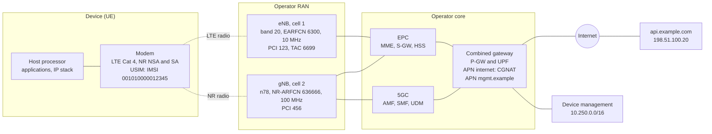
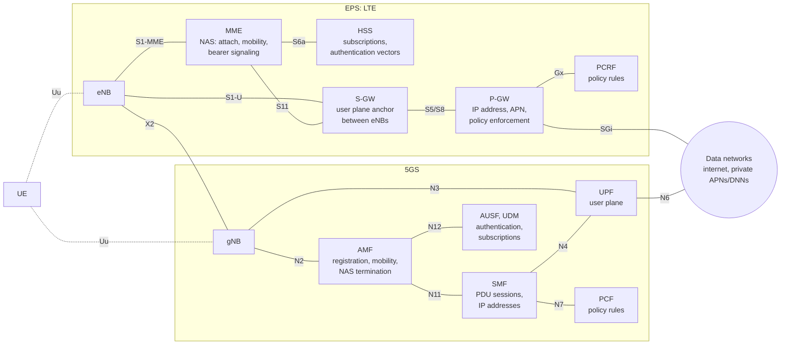
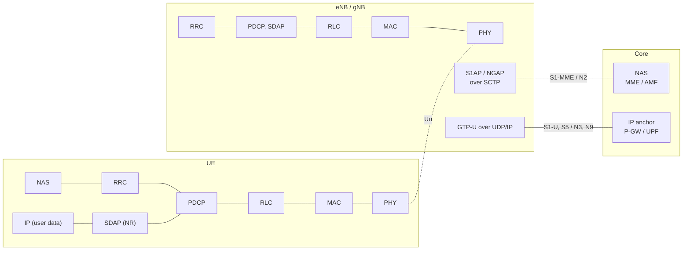
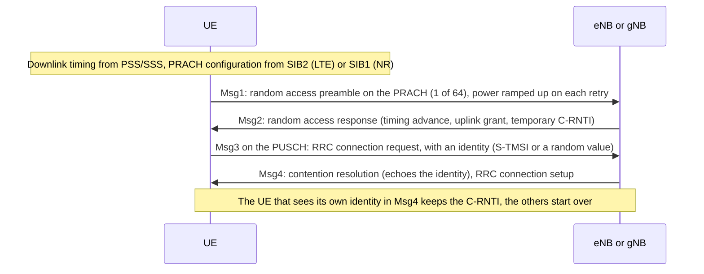
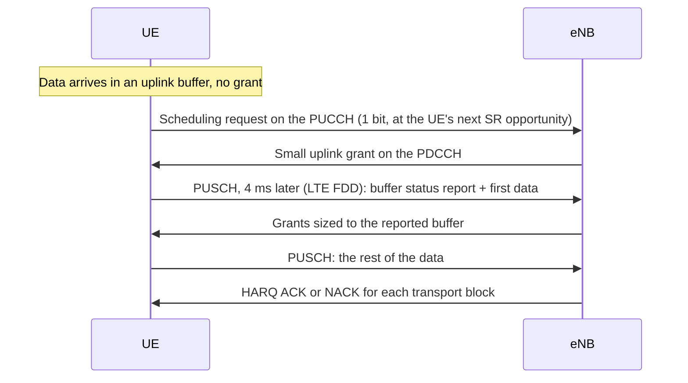
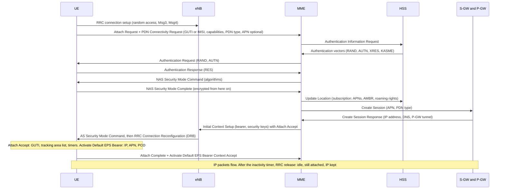
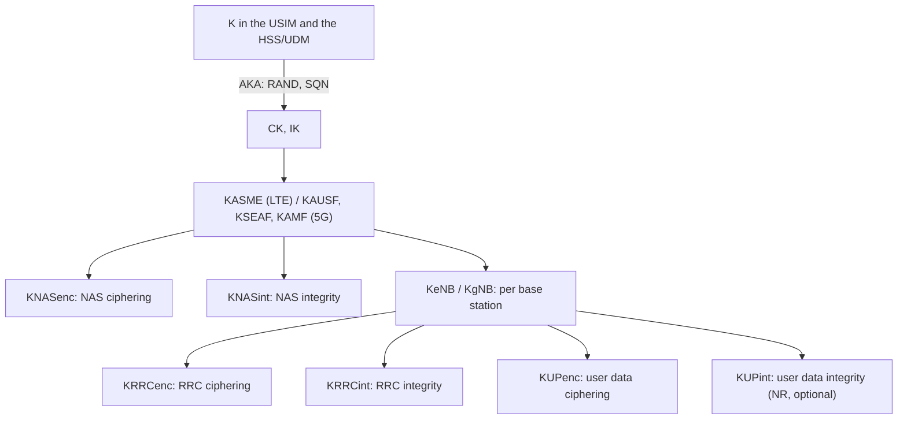
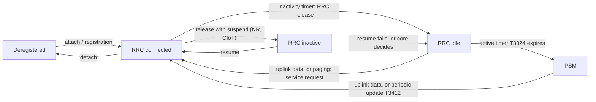
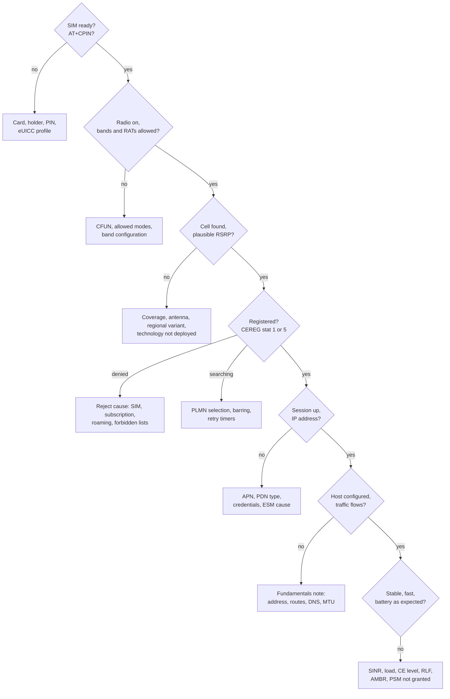

# Cellular Protocols: LTE, 5G NR and Cellular IoT

How a cellular network works from the radio up to the IP session: how the system is split between the device, the radio access network and the core, how the physical layer and the base station's scheduler share the spectrum, how a device finds a cell, registers, authenticates and gets an IP session with a given QoS, how it moves and sleeps, and what LTE-M, NB-IoT and RedCap change for IoT devices.

This note covers the **protocols**, as 3GPP specifies them and as an engineer meets them in modem logs, signaling traces and network behavior. Driving a modem from Linux (drivers, ModemManager, QMI, MBIM, board integration) belongs in a separate note. Until it exists, the device-side networking is in [Networking Fundamentals for Embedded Linux Engineers](../../networking/fundamentals/fundamentals.md#20-modem-based-devices-the-ap-and-the-modem) (the AP-modem split, data path, sharing the connection) and a hands-on modem bring-up is in [Building a Home Gateway on Linux](../../networking/gateway/gateway.md#method-2-cellular-modem-quectel-ec25). The [Wi-Fi note](../wifi/wifi.md) is the reference for the comparisons with 802.11.

**Assumptions:**
- One example network (section 2) is used throughout: a device with an LTE/5G module, an operator's LTE and NR cells, and its core network.
- LTE means 3GPP E-UTRA and the EPC from Release 8 on; 5G means NR and the 5G core (5GC) from Release 15 on. 2G and 3G appear only where they still matter: fallback, sunsets and security downgrades.
- Spectrum and regulation are given for the EU and the US. They change, and other regions differ.

**Conventions:**
- **Normative** values come from a 3GPP specification (the TS or TR number is given) or a regulation.
- **Rule of thumb** marks empirical values that depend on the network, the device and the environment.
- **Operator-dependent** marks what 3GPP leaves to the network's configuration; **vendor-dependent** what it leaves to the modem or base station implementation. A feature can be specified, supported by a modem, supported by the network equipment and still not enabled by a given operator: the four are different questions.
- LTE and NR names are given side by side when they differ (`RRCConnectionSetup` / `RRCSetup`). Message and information element names follow TS 36.331, TS 38.331, TS 24.301 and TS 24.501.

**Verification status:** procedures, timers, cause values and numerical parameters follow the 3GPP specifications cited in each section. The less common values (AT result code fields, timer encodings, IoT and RedCap capabilities, eDRX limits, the Rel-19 256-bit algorithms) were checked against specification text or vendor references in November 2026. Peak rates of the IoT categories differ slightly between sources and are given as approximations. Nothing was measured on a live network: example outputs are illustrative.

**How to read it:**
- **To learn:** in order. Part 1 sets up the vocabulary and the architecture that the rest relies on.
- **To understand the radio:** Part 2 (sections 6 to 9).
- **To understand registration, sessions, mobility and power saving:** Part 3 (sections 10 to 17).
- **To read logs or debug:** sections 18 and 19, then the section of the procedure that fails.

## Table of contents

**Part 1: Foundations**

- [1. The mental model: what cellular changes compared to Wi-Fi](#1-the-mental-model-what-cellular-changes-compared-to-wi-fi)
- [2. Example network](#2-example-network)
- [3. Generations, 3GPP releases and device capabilities](#3-generations-3gpp-releases-and-device-capabilities)
- [4. Architecture and protocol stacks: EPS, 5GS, NSA and SA](#4-architecture-and-protocol-stacks-eps-5gs-nsa-and-sa)
- [5. Spectrum: bands, duplexing and channel numbers](#5-spectrum-bands-duplexing-and-channel-numbers)

**Part 2: The radio interface**

- [6. The physical layer: OFDM, numerology, resource grid, MCS and MIMO](#6-the-physical-layer-ofdm-numerology-resource-grid-mcs-and-mimo)
- [7. Physical channels, cell search, system information and random access](#7-physical-channels-cell-search-system-information-and-random-access)
- [8. Scheduling, HARQ and layer 2](#8-scheduling-harq-and-layer-2)
- [9. Signal measurements and link budget](#9-signal-measurements-and-link-budget)

**Part 3: Procedures**

- [10. Identities and the SIM](#10-identities-and-the-sim)
- [11. Getting service: network selection, RRC connection, attach and registration](#11-getting-service-network-selection-rrc-connection-attach-and-registration)
- [12. Data sessions: APNs, bearers, PDU sessions, QoS and IP](#12-data-sessions-apns-bearers-pdu-sessions-qos-and-ip)
- [13. Security: authentication, keys, ciphering and known attacks](#13-security-authentication-keys-ciphering-and-known-attacks)
- [14. RRC states and mobility: paging, reselection, handover, 4G-5G interworking](#14-rrc-states-and-mobility-paging-reselection-handover-4g-5g-interworking)
- [15. Power saving: DRX, eDRX and PSM](#15-power-saving-drx-edrx-and-psm)
- [16. Cellular IoT: LTE-M, NB-IoT and RedCap](#16-cellular-iot-lte-m-nb-iot-and-redcap)
- [17. Beyond best-effort data: voice, SMS, positioning, slicing, URLLC, NTN](#17-beyond-best-effort-data-voice-sms-positioning-slicing-urllc-ntn)

**Part 4: Observing and debugging**

- [18. Observing the signaling: modem reports and logs](#18-observing-the-signaling-modem-reports-and-logs)
- [19. Troubleshooting by layer](#19-troubleshooting-by-layer)
- [20. Not covered here](#20-not-covered-here)
- [References](#references)

---

## 1. The mental model: what cellular changes compared to Wi-Fi

Wi-Fi and cellular both carry IP over OFDM radios, but they are built on opposite assumptions. Wi-Fi is a LAN that anyone can set up on shared spectrum; cellular is a service that an operator runs on spectrum it holds a license for, and every device is a subscriber the network authenticates by name before giving it anything.

| | Wi-Fi | Cellular (LTE, 5G NR) |
|---|---|---|
| Spectrum | Unlicensed: shared with neighbors and other technologies | Licensed to the operator: no uncoordinated transmitter on the carrier |
| Who transmits when | Each station contends for the medium (CSMA/CA) | The **base station schedules** every transmission in both directions, every 1 ms (LTE) or every slot (NR) (section 8) |
| Duplex | Half duplex on one channel | FDD (separate uplink and downlink frequencies) or TDD (time split on a synchronized pattern) (section 5) |
| Range | Tens of meters | Hundreds of meters to tens of kilometers per cell |
| Identity | A MAC address; the network knows a passphrase or a RADIUS account | A subscription in a USIM (IMSI/SUPI), authenticated by the operator's core (sections 10 and 13) |
| Joining | Scan, authenticate, associate, 4-way handshake, DHCP | Cell search, system information, random access, RRC connection, attach or registration with authentication, data session (sections 7 and 11) |
| What you get | A port on a LAN: broadcast, ARP, neighbors | A point-to-point **IP session** to a gateway in the operator's core: no LAN, no broadcast, no neighbors (section 12) |
| QoS | Four access categories, decided per frame by the sender | Per-session and per-flow QoS classes enforced by the network, with guaranteed bit rates for voice (section 12) |
| Mobility | The client decides when to roam; a new AP may mean a new handshake | The **network** commands handovers in connected mode; the IP address survives across the whole network (section 14) |
| Power saving | The client tells the AP it sleeps | The network configures the sleep cycles and timers; the device requests values (section 15) |
| Who you debug with | Your own AP's logs | The operator's network, which you usually can't see: the device's signaling logs and cause values are most of your evidence (sections 18 and 19) |

**The base station is in charge of the air.** A UE never transmits data on its own initiative: it asks for resources and sends exactly what it is granted, at the time, on the resource blocks and with the modulation the base station chose. The exceptions are the random access preamble (the "knock on the door", section 7) and resources the network configured in advance. Most of what makes cellular feel different from Wi-Fi follows: predictable latency under load, no collisions between users of a cell, and a device that can do nothing about a busy cell except wait for its share.

**The network is in charge of the state.** Whether the device is connected or idle, which cell it uses in connected mode, how often it may sleep and for how long, which QoS each flow gets: all are decided by the network, using parameters it broadcasts or sends in RRC and NAS messages. A device influences them only through requests and capability reports. Reading what the network actually configured (rather than what the device asked for) is the core skill of cellular debugging.

**Your IP session is a tunnel.** The address a device gets belongs to a gateway in the operator's core, often hundreds of kilometers away, or in another country when roaming. Every packet travels from the device to that gateway through GTP tunnels and only there enters an IP network (section 4). The radio is one hop of that path.

**Vocabulary** (more in the sections that introduce each concept):

| Term | Meaning |
|---|---|
| UE (user equipment) | The device: the mobile equipment (ME: the modem and its host) plus the USIM |
| eNB, gNB | The LTE base station (eNodeB) and the NR base station (gNodeB). One base station serves several cells |
| Cell | One carrier, from one base station, in one direction (sector). Identified on the air by its PCI and globally by its cell identity (section 7) |
| RAN | Radio access network: the base stations. E-UTRAN for LTE, NG-RAN for 5G (gNBs and ng-eNBs) |
| Core network | The operator's control and gateway functions: EPC for LTE, 5GC for 5G (section 4) |
| PLMN | Public land mobile network: one operator's network in one country, identified by MCC + MNC |
| AS, NAS | Access stratum: the protocols between the UE and the base station (RRC and the radio layers). Non-access stratum: the protocols between the UE and the core (registration, mobility, sessions), carried transparently through the base station |
| RRC | Radio resource control: the AS control protocol that sets up, configures and releases the radio connection |
| Attach, registration | Becoming known to the core: "attach" in LTE, "registration" in 5G (section 11) |
| APN, DNN | The name of the packet data network a session connects to: access point name (LTE), data network name (5G) (section 12) |
| Bearer, PDU session | A data session and its QoS: a PDN connection made of EPS bearers in LTE, a PDU session made of QoS flows in 5G (section 12) |
| Modem | The processor and firmware that implement the UE side of all of the above. The host only asks it for sessions and exchanges IP packets with it |

---

## 2. Example network

The examples reuse network B of the [fundamentals note](../../networking/fundamentals/fundamentals.md#network-b-a-cellular-product-with-an-ap-and-a-modem): a product with an LTE/5G module, an internet session and a private management session. This note adds the radio side and the operator's network behind it.



| Element | Value | Notes |
|---|---|---|
| PLMN | MCC `001`, MNC `01` | The 3GPP test network code: the role a documentation range plays for IP |
| IMSI | `001010000012345` | MCC + MNC + MSIN (section 10) |
| IMEI | `490154203237518` | Identifies the modem hardware, not the subscriber (section 10) |
| LTE cell | Band 20 (800 MHz, FDD), EARFCN 6300 = 806 MHz downlink, 10 MHz, PCI 123, TAC 6699 (0x1A2B) | The coverage layer, and the anchor in NSA mode |
| NR cell | n78 (3.5 GHz, TDD), NR-ARFCN 636666 = 3549.99 MHz, 100 MHz, 30 kHz subcarrier spacing, PCI 456 | A secondary cell in NSA (EN-DC with the LTE cell), or a standalone cell connected to the 5GC (section 4) |
| Internet session | APN/DNN `internet`, IPv4v6: `100.72.15.9`, prefix `2001:db8:c0:1::/64`, DNS `192.0.2.53`, MTU 1430 | `wwan0` in the fundamentals note. `100.72.15.9` is in the CGNAT range (RFC 6598) |
| Management session | APN/DNN `mgmt.example`, IPv4 `10.200.0.15` | A private APN that only reaches the operator's device-management servers. `wwan1` in the fundamentals note |
| Server | `api.example.com`, `198.51.100.20` | Reached through the gateway's CGNAT |

The operator runs both cores with a combined gateway (P-GW + UPF, with a combined SMF/P-GW-C), so the device keeps its sessions when it moves between LTE and 5G SA (section 14). `198.51.100.0/24` and `192.0.2.0/24` are IPv4 documentation ranges (RFC 5737), `2001:db8::/32` the IPv6 one (RFC 3849). The IMSI, IMEI, cell identities and APNs are placeholders.

---

## 3. Generations, 3GPP releases and device capabilities

**3GPP** (3rd Generation Partnership Project) writes the specifications for GSM, UMTS, LTE and 5G, in numbered **releases**. A release is a frozen set of specifications; later releases add features while keeping older devices working. Vendors implement a subset of a release's optional features, and operators enable a subset of those. Specifications are numbered by series: `TS 36.xxx` for LTE radio, `TS 38.xxx` for NR radio, `TS 23.xxx` for architecture and procedures, `TS 24.xxx` for NAS protocols, `TS 33.xxx` for security, `TS 27.xxx` and `TS 31.xxx` for the terminal and the USIM (references at the end). "4G" and "5G" are ITU and marketing names; specifications and modem logs say E-UTRA/LTE and NR.

| Generation | Technology | 3GPP release | Radio access | Peak rates (spec) | Status |
|---|---|---|---|---|---|
| 2G | GSM, GPRS, EDGE | Phase 1/2, R97, R99 | TDMA, 200 kHz carriers | A few hundred kb/s (EDGE) | Switched off in the US, Australia and several European countries; kept elsewhere for IoT and voice fallback |
| 3G | UMTS (WCDMA), HSPA, HSPA+ | R99, Rel-5 to Rel-8 | WCDMA, 5 MHz carriers | 42 Mb/s (dual-carrier HSPA+) | Mostly switched off in the US and Europe |
| 4G | LTE | Rel-8, Rel-9 | OFDMA down, SC-FDMA up, 1.4 to 20 MHz | 300 Mb/s (4 layers, 20 MHz) | The coverage layer almost everywhere |
| 4G | LTE-Advanced | Rel-10 to Rel-12 | + carrier aggregation, 8 layers down, relays, eICIC | 3 Gb/s (Cat 8, spec maximum) | Aggregation of 2 to 5 carriers is common |
| 4G | LTE-Advanced Pro | Rel-13, Rel-14 | + LTE-M, NB-IoT, LAA (unlicensed), C-V2X sidelink | | LTE-M and NB-IoT are the IoT workhorses |
| 5G | NR, phase 1 | Rel-15 (2018) | OFDM both ways, flexible numerology, up to 100 MHz (FR1) and 400 MHz (FR2) carriers | About 20 Gb/s (IMT-2020 target) | NSA first, SA since |
| 5G | NR, phase 2 | Rel-16 (2020) | + URLLC, industrial IoT and TSN, NR-U, NR sidelink, IAB, positioning | | |
| 5G | NR | Rel-17 (2022) | + RedCap, NTN, 52.6-71 GHz, multicast and broadcast, small data in RRC_INACTIVE | | |
| 5G-Advanced | NR | Rel-18 (2024), Rel-19 (2025) | + eRedCap, network energy saving, L1/L2-triggered mobility, AI/ML for the air interface, XR, ambient IoT studies, 256-bit algorithms | | Deployment starting |
| 6G | | Studies in Rel-20, first specifications expected in Rel-21 | | | Around the end of the decade |

**What each step changed for a device engineer:**
- **2G to 3G:** usable packet data; the network authenticates itself to the SIM (2G only authenticates the device, section 13).
- **3G to LTE:** all-IP with no circuit-switched domain: voice became VoIP over IMS (section 17). Attaching to LTE always creates an IP session (section 11). Latency dropped to tens of ms, and the base station took over functions of the 3G radio network controller (RNC), which no longer exists.
- **LTE to NR:** flexible numerology and wide carriers, beam-based operation, no always-on reference signals, a third RRC state (inactive), a service-based core with network slicing and finer QoS. Early 5G (NSA) still runs its control plane on LTE and the EPC (section 4).

### 5G feature map

The features most likely to show up in a device's capabilities or an operator's announcements:

| Release | Features |
|---|---|
| Rel-15 | eMBB: NSA (EN-DC) and SA, FR1 and FR2, bandwidth parts, beam management, LDPC and polar codes, 5GC with slicing and QoS flows, RRC_INACTIVE |
| Rel-16 | URLLC (mini-slots, configured grants, PDCP duplication, high-reliability MCS/CQI tables), industrial IoT and time-sensitive networking, NR-U (unlicensed), NR sidelink (V2X), integrated access and backhaul (IAB), 2-step random access, conditional handover and DAPS, UE power saving (wake-up signal on PDCCH), positioning (multi-RTT, angles), non-public networks, LTE-M/NB-IoT connected to the 5GC |
| Rel-17 | RedCap, NTN (NR and IoT), up to 71 GHz, small data transmission (SDT) in RRC_INACTIVE, multicast/broadcast services, paging early indication, coverage enhancements, sidelink relays, multi-SIM support |
| Rel-18 | eRedCap, network energy saving, L1/L2-triggered mobility (LTM), XR traffic, uplink enhancements, NTN in more bands, AI/ML studies, low-power wake-up receiver study |
| Rel-19 | AI/ML for the air interface (beam management, positioning), ambient IoT, 256-bit security algorithms, NTN and RedCap enhancements |

### Device categories and capabilities

An LTE device declares a **UE category** (TS 36.306): its peak rates, buffer sizes and number of layers. Since Rel-12, downlink and uplink categories are declared separately. NR has no categories: the UE sends a detailed **capability** report (bands, band combinations, feature sets per combination, layers, modulation, optional features), and only RedCap is a defined device type.

| Category | Downlink / uplink peak (Mb/s) | Receive antennas | Typical use |
|---|---|---|---|
| NB-IoT Cat NB1 / NB2 | About 0.026 / 0.06 (NB1), 0.13 / 0.16 (NB2) | 1 | Meters, sensors: small, rare messages, deep indoor |
| LTE-M Cat M1 / M2 | About 1 / 1 (M1), 4 / 7 (M2) | 1 | Trackers, wearables, alarms: mobility and voice possible |
| Cat 1 | 10 / 5 | 2 | Telematics, payment terminals, alarm panels |
| Cat 1bis | 10 / 5 | 1 | Same with one antenna (Rel-13): smaller devices |
| Cat 4 | 150 / 50 | 2 | Routers and gateways, the example device |
| Cat 6 | 300 / 50 | 2 | Carrier aggregation of 2 carriers |
| Cat 12 (+ uplink Cat 13) | 600 / 150 | 2 to 4 | Aggregation of 3 or more carriers, 256-QAM |
| NR RedCap (Rel-17) | About 100-200 / 50-100, depending on antennas, layers and modulation (20 MHz FR1) | 1 or 2 | Wearables, cameras, industrial sensors: the 5G successor of Cat 4 |
| NR eRedCap (Rel-18) | About 10 / 10 (5 MHz data baseband) | 1 or 2 | The 5G successor of Cat 1 |
| NR eMBB | Hundreds of Mb/s to several Gb/s | 2 to 4 | Phones, fixed wireless access, high-end routers |

Peak rates assume the best signal and an empty cell; real throughput is a fraction of them (sections 8 and 9). LTE-M and NB-IoT trade throughput for coverage, cost and battery life (section 16).

**Capability, support and configuration are different things.** A feature works only if it is (1) specified in a release, (2) implemented and declared by the UE in its capability report, (3) implemented by the network vendor, and (4) enabled by the operator for that cell, that subscription and that band combination. "The module supports 5G SA" can still mean NSA-only on a given network, or SA without the band combinations the operator uses. The UE's capability report (section 11) and the network's RRC configuration (section 18) are the evidence for (2) and (4).

### Sunsets

Operators switch off old generations to reuse their spectrum, each on its own schedule:

- **3G** is gone in the US and most of Europe. **2G** is gone in the US and Australia and in several European countries, and kept elsewhere, sometimes for years, for older IoT devices and voice fallback. Check each target operator's published plans before relying on a fallback technology.
- A device that used 2G/3G for voice (circuit-switched fallback), SMS or coverage must work on LTE alone, or on LTE-M/NB-IoT. Voice then requires IMS (VoLTE, section 17), and emergency systems built on circuit-switched calls, such as the EU's in-vehicle eCall, move to IMS-based versions.
- LTE-M and NB-IoT are expected to outlive LTE broadband: they can run inside an LTE carrier and, since Rel-16, coexist inside an NR carrier.

---

## 4. Architecture and protocol stacks: EPS, 5GS, NSA and SA

### The two systems

The **EPS** (evolved packet system) is LTE's E-UTRAN plus the **EPC** core; the **5GS** is NG-RAN plus the **5GC**. Both separate the radio network from the core and the control plane from the user plane.



| Role | EPC (LTE) | 5GC |
|---|---|---|
| Base station | eNB | gNB; ng-eNB for LTE cells connected to the 5GC |
| NAS termination, registration, mobility, paging | MME | AMF |
| Session management (create, modify, release sessions; IP allocation) | MME (signaling) + P-GW control | SMF |
| User plane: tunnels, forwarding, the IP anchor | S-GW (mobility anchor) + P-GW (IP anchor) | UPF, possibly several in a chain (an anchor UPF and intermediate UPFs) |
| Subscriber data, authentication | HSS | UDM/UDR + AUSF |
| Policy and charging rules | PCRF | PCF |
| Exposure to applications, non-IP data | SCEF | NEF |
| Slice selection, function discovery | | NSSF, NRF |

| Interface | EPS | 5GS | Carries |
|---|---|---|---|
| Radio | Uu | Uu | RRC, user data |
| Base station to control plane | S1-MME (S1AP over SCTP) | N2 (NGAP over SCTP) | UE context setup, NAS transport, paging, handover signaling |
| Base station to user plane | S1-U (GTP-U) | N3 (GTP-U) | User data tunnels |
| Between base stations | X2 (X2AP, GTP-U) | Xn (XnAP, GTP-U) | Handover preparation, data forwarding, dual connectivity |
| Gateway to gateway | S5 (home), S8 (roaming) | N9 | User data, and GTP-C control in LTE |
| Control to user plane | S11 (GTP-C); Sx (PFCP) with CUPS | N4 (PFCP) | Tunnel and forwarding rules |
| To the data network | SGi | N6 | Plain IP |

- **5GC is service-based:** its control functions expose HTTP/2 APIs to each other (the N11, N12, N7 links above are service interactions), which makes slicing and distributed user planes easier to build. The radio side and the UE see none of it.
- **CUPS** (control and user plane separation, Rel-14) split the EPC gateways the same way, so LTE user planes can also be distributed. Most operators now run combined EPC/5GC functions (SMF+P-GW-C, UPF+P-GW-U, HSS+UDM).

### Protocol stacks



| Plane | UE | Base station | Core |
|---|---|---|---|
| Control plane | NAS / RRC / PDCP / RLC / MAC / PHY | Terminates RRC and the radio layers. Relays NAS messages, unread, inside RRC on one side and S1AP/NGAP on the other | NAS ends at the MME or AMF |
| User plane | IP / SDAP (NR) / PDCP / RLC / MAC / PHY | Terminates the radio layers; puts each packet in a GTP-U tunnel (GTP-U / UDP / IP) | GTP-U ends at the P-GW or anchor UPF, which routes the inner IP packet |

- **NAS** carries mobility management (EMM in LTE, 5GMM in 5G: attach or registration, tracking area updates, authentication, security mode) and session management (ESM / 5GSM: bearers, PDU sessions). In LTE, ESM messages travel inside EMM messages during the attach; in 5G, 5GSM messages travel in 5GMM transport messages.
- **RRC** carries system information, connection setup and release, security activation for the radio, measurement configuration and reports, handover commands, and the configuration of every lower layer. Most of what a modem log shows about the radio is RRC.
- The layers below are covered in sections 6 to 8: PDCP (ciphering, integrity, header compression, reordering), RLC (segmentation, retransmissions), MAC (multiplexing, HARQ, scheduling requests), PHY.

**Radio bearers** are the RRC-level pipes. **Signaling radio bearers** carry RRC and NAS: SRB0 (before a connection exists), SRB1 (RRC, and NAS piggybacked), SRB2 (NAS, lower priority), SRB3 (direct NR RRC in EN-DC), SRB4 (application layer measurement reports, Rel-17). **Data radio bearers** (DRB) carry user data: one per EPS bearer in LTE; in NR, the base station maps the QoS flows of a PDU session onto DRBs as it sees fit (section 12).

**Channel hierarchy:** the layers talk through three kinds of channels, which appear by name in logs:

| Level | Channels | Meaning |
|---|---|---|
| Logical (RLC to MAC): what is carried | BCCH (system information), PCCH (paging), CCCH (before a connection: SRB0), DCCH (dedicated signaling: SRB1-3), DTCH (user data) | Type of information |
| Transport (MAC to PHY): how it is carried | BCH, PCH, DL-SCH, UL-SCH, RACH | Format, coding, HARQ |
| Physical: where on the air | PBCH, PDSCH, PDCCH, PUSCH, PUCCH, PRACH (section 7) | Resources and modulation |

The MIB travels BCCH → BCH → PBCH; the SIBs, paging and all dedicated data travel on the shared channels (DL-SCH → PDSCH, UL-SCH → PUSCH).

### State machines at a glance

A UE runs several state machines at once, one per layer, and logs report them separately:

| Layer | LTE | 5G | What it means |
|---|---|---|---|
| Registration (NAS) | EMM-DEREGISTERED / EMM-REGISTERED | RM-DEREGISTERED / RM-REGISTERED | Whether the core knows the UE (section 11) |
| Signaling connection (NAS) | ECM-IDLE / ECM-CONNECTED | CM-IDLE / CM-CONNECTED | Whether a NAS signaling connection (RRC + S1/N2) exists |
| Radio (AS) | RRC_IDLE / RRC_CONNECTED | RRC_IDLE / RRC_INACTIVE / RRC_CONNECTED | Whether the base station holds a context (section 14) |
| Sessions (NAS) | PDN connections and their EPS bearers | PDU sessions and their QoS flows | Whether the UE has IP connectivity (section 12) |

In LTE, a registered UE always has at least one PDN connection, and RRC_IDLE always coincides with ECM-IDLE. In 5G, a UE can be registered without any PDU session, and RRC_INACTIVE is a **CM-CONNECTED** state: the core still considers the UE connected, while the radio connection is suspended (section 14). "Idle" in a log means nothing until you know which layer reports it.

### Where your packets actually go

```
 Device ──radio──► eNB/gNB ══GTP-U══► S-GW ══GTP-U══► P-GW  ──► CGNAT, firewall ──► internet
 100.72.15.9                (operator transport)        or UPF                           198.51.100.20
                                                      "default gateway"
```

- The **P-GW or anchor UPF is the first IP hop**. Everything before it is a tunnel from the IP point of view. A traceroute from the device shows the gateway (or nothing, if it doesn't answer) and then the operator's network.
- Each bearer or QoS-flow aggregate has its own tunnel, identified by a tunnel endpoint ID (TEID). The UE's packets travel inside with 36 bytes of outer IPv4 + UDP + GTP-U headers (56 with an IPv6 transport, plus 8 for the 5G PDU session container extension header), one reason operators advertise a device MTU below 1500 (section 12).
- The gateway allocates the device's address, applies per-APN policy (firewall, NAT, rate limits, zero-rating, content filtering) and is where a private APN connects to a customer's network (VPN or leased line).
- **Location matters:** operators run few anchor gateways, sometimes one or two per country, and roaming devices are usually home-routed to their home country (section 12). The server should be near the gateway, not near the device. 5G user planes can be placed closer to the edge (local UPFs), but only if the operator does so.
- Inbound connections usually fail: CGNAT for IPv4 and often a stateful firewall for IPv6 (see the [fundamentals note](../../networking/fundamentals/fundamentals.md#13-nat-and-address-translation)). Private APNs with routable addresses avoid both.

### NSA and SA

3GPP defined several ways to combine LTE, NR, the EPC and the 5GC ("options"). Two are deployed widely:

| | NSA, option 3x (EN-DC) | SA, option 2 |
|---|---|---|
| Core | EPC | 5GC |
| Control plane | LTE: LTE RRC on the LTE cell (master node), LTE NAS (EMM/ESM) | NR RRC, 5G NAS (5GMM/5GSM) |
| NR's role | Secondary node: adds NR carriers to an LTE connection for capacity | The only radio |
| Idle mode | Camps on LTE. The NR leg is added again at every connection, after measurements | Camps on NR |
| User data | Split bearer: PDCP in the gNB, data sent over NR, LTE or both (section 8) | NR only |
| Features | Higher downlink rates, and uplink on NR | Lower latency, RRC_INACTIVE, slicing, 5G QoS, RedCap, VoNR, 5G security (SUCI) |
| Device needs | LTE and NR bands, and the operator's EN-DC band combinations | NR bands; SA enabled in the modem and allowed for the subscription |

- **Option 4** (NR master, LTE secondary, 5GC) and **option 7** (LTE master connected to the 5GC, NR secondary) exist but are rare. **Option 5** (ng-eNB: LTE cells connected to the 5GC) is used mainly for LTE-M/NB-IoT and private networks. In multi-radio dual connectivity terms, EN-DC is LTE master + NR secondary on the EPC; NGEN-DC and NE-DC are the 5GC variants; NR-DC pairs two NR nodes (FR1 + FR2).
- A "5G" indicator on a device may only mean that NR is available nearby (`upperLayerIndication` in LTE SIB2), not that data flows over NR. The modem's serving cell report or the RRC configuration tells the truth (section 18).
- **DSS** (dynamic spectrum sharing) runs LTE and NR on the same carrier, sharing resources dynamically (NR rate-matches around LTE's reference signals). An operator's "5G on 700 MHz" may be an LTE carrier shared with NR.
- **Interworking between EPS and 5GS:** with the **N26** interface between MME and AMF and combined gateways, a UE moves between LTE and SA 5G in idle and connected mode and keeps its IP sessions (section 14).

### Circuit-switched remnants

2G and 3G had a separate circuit-switched core (MSC) for voice and SMS. LTE can still reach it for **CS fallback** (moving to 2G/3G for a call) and **SMS over SGs** (SMS relayed by the MME to the MSC over the SGs interface). Both disappear with the 2G/3G sunsets, replaced by IMS voice and SMS over IMS or NAS (section 17).

### Private networks

Enterprises run their own LTE or 5G networks on dedicated spectrum (local licenses such as 3.7-3.8 GHz in Germany, CBRS in the US) with their own core and SIMs. 5G calls them **non-public networks** (NPN): standalone (SNPN, identified by a PLMN ID plus a network identifier, NID, and possibly using credentials other than a USIM) or integrated with a public network (PNI-NPN, typically through a dedicated slice or DNN with a closed access group). For a device, they are the same protocols with different identities and credentials.

---

## 5. Spectrum: bands, duplexing and channel numbers

### Duplexing

| Mode | How | Bands |
|---|---|---|
| FDD (frequency division duplex) | Uplink and downlink on two separate frequency ranges at the same time, a fixed **duplex spacing** apart | Most bands below 2.7 GHz (B1, B3, B7, B8, B20, B28...) |
| TDD (time division duplex) | One frequency range, shared in time according to a slot pattern | 2.3, 2.6 and 3.3-4.2 GHz, mmWave (B38, B40, B41, n41, n77, n78, n257-n261) |
| SDL (supplemental downlink) | Downlink only, aggregated with another carrier | B29 (700 MHz, US), B32 / n75 (1.5 GHz, EU) |
| SUL (supplemental uplink, NR) | Uplink only, paired with an NR TDD cell to extend its uplink coverage on a lower frequency | n80 to n86 (the uplink parts of B3, B8, B20, B28...) |
| Half-duplex FDD | FDD bands, but the UE doesn't transmit and receive at the same time | LTE-M and NB-IoT devices, RedCap optionally: saves the duplexer |

All TDD cells of an area use the **same** uplink/downlink pattern, synchronized to GNSS time: a base station transmitting while its neighbor receives would jam it. The pattern fixes the uplink share (a common n78 pattern gives the uplink about a fifth of the time, section 6), which is why TDD uplink rates are much lower than downlink rates.

In most FDD bands the uplink is the lower frequency range. **Reverse duplex** bands (B13, B14, B20, B71) put the uplink above the downlink.

### Band numbers and frequency ranges

3GPP numbers LTE bands `B<n>` (TS 36.101) and NR bands `n<n>` (TS 38.101-1 for FR1, TS 38.101-2 for FR2). An NR band reusing an LTE band's range usually keeps its number (B3 → n3, B28 → n28). NR splits its spectrum in two **frequency ranges**:

- **FR1:** 410 MHz to 7.125 GHz ("sub-6 GHz", including the 3.3-4.2 GHz mid-band and, for NR-U, 5 and 6 GHz unlicensed bands).
- **FR2:** 24.25 to 71 GHz (mmWave), split since Rel-17 into FR2-1 (to 52.6 GHz) and FR2-2 (52.6 to 71 GHz).

| Band | Uplink (MHz) | Downlink (MHz) | Duplex | Where it's used |
|---|---|---|---|---|
| B1 / n1 | 1920-1980 | 2110-2170 | FDD | EU, Asia ("2100") |
| B2 / n2 | 1850-1910 | 1930-1990 | FDD | Americas (PCS "1900") |
| B3 / n3 | 1710-1785 | 1805-1880 | FDD | EU, Asia ("1800"): the main LTE capacity band in Europe |
| B4 | 1710-1755 | 2110-2155 | FDD | Americas (AWS-1) |
| B5 / n5 | 824-849 | 869-894 | FDD | Americas, Asia ("850") |
| B7 / n7 | 2500-2570 | 2620-2690 | FDD | EU, Asia ("2600") |
| B8 / n8 | 880-915 | 925-960 | FDD | EU, Asia ("900"): former GSM, widely used by LTE-M and NB-IoT |
| B12 | 699-716 | 729-746 | FDD | US (700 lower A/B/C) |
| B13 | 777-787 | 746-756 | FDD, reverse | US (700 upper C) |
| B14 | 788-798 | 758-768 | FDD, reverse | US (FirstNet public safety) |
| B20 / n20 | 832-862 | 791-821 | FDD, reverse | EU ("800"): the main coverage band in Europe |
| B25 | 1850-1915 | 1930-1995 | FDD | US (extended PCS) |
| B28 / n28 | 703-748 | 758-803 | FDD | EU (703-733 / 758-788), Asia-Pacific, Latin America ("700") |
| B66 | 1710-1780 | 2110-2200 | FDD | Americas (AWS-1 and AWS-3) |
| B71 / n71 | 663-698 | 617-652 | FDD, reverse | US ("600") |
| B38 | 2570-2620 | | TDD | EU, Asia |
| B40 | 2300-2400 | | TDD | Asia, some EU |
| B41 / n41 | 2496-2690 | | TDD | US, China, Japan |
| n77 | 3300-4200 | | TDD | US C-band (3.7-3.98 GHz), Japan |
| n78 | 3300-3800 | | TDD | EU ("3.5 GHz"): the main 5G band in Europe |
| n258 | 24250-27500 | | TDD | EU ("26 GHz"), Asia |
| n260, n261 | 37000-40000, 27500-28350 | | TDD | US mmWave |

**Low bands carry coverage, high bands carry capacity.** Below 1 GHz (B8, B12, B13, B20, B28, B71) signals travel far and enter buildings; 1.7-2.7 GHz carries most LTE traffic; 3.5 GHz gives 100 MHz carriers with less range; mmWave gives very wide carriers over a few hundred meters with line of sight. An IoT device in a basement lives on the low bands (section 9).

### Regulation and power classes

Unlike Wi-Fi, a cellular device never chooses its frequencies or power on its own: it only transmits on a carrier where a cell allowed it, at a power set by power control (section 8) and capped by the cell (`p-Max`) and by its **power class**:

| Power class | Maximum output | Typical use |
|---|---|---|
| 3 | 23 dBm | Most LTE and NR devices |
| 2 | 26 dBm | "HPUE", mainly NR and LTE TDD bands (n41, n77, n78, B41) where the uplink duty cycle is low |
| 1.5, 1 | 29 dBm, 31 dBm | Fixed wireless access and special devices, some bands only |
| 5 | 20 dBm | Many LTE-M and NB-IoT modules |
| 6 | 14 dBm | NB-IoT for very small batteries (Rel-14), later LTE-M too |

FR2 has its own power classes by device type (fixed, handheld, vehicle), specified as EIRP because the antenna is an array. Regulation applies to the device's conformity, not to user configuration:

| Region | Rules |
|---|---|
| EU | Radio Equipment Directive (RED), with harmonized standards ETSI EN 301 908-1 (common), -13 (LTE UE), -25 (NR UE) |
| US | FCC Part 22 (850 MHz), Part 24 (PCS), Part 27 (AWS, 600/700 MHz, 2.5 GHz, 3.7 GHz C-band), Part 30 (mmWave: 24, 28, 37, 39, 47 GHz), Part 90 (B14), Part 96 (CBRS, B48/n48) |

Operators also require **industry certification** (GCF in Europe, PTCRB in North America) and often their own acceptance tests before a device may use their network.

### Channel numbers: EARFCN and NR-ARFCN

Cells are configured and reported by channel number, not frequency.

**LTE EARFCN** (TS 36.101 section 5.7.3): each band has a downlink offset. F<sub>DL</sub> = F<sub>DL_low</sub> + 0.1 × (N<sub>DL</sub> - N<sub>Offs-DL</sub>) MHz; the carrier center is on a 100 kHz raster.

| Band | F<sub>DL_low</sub> (MHz) | N<sub>Offs-DL</sub> | Downlink EARFCN range | Example |
|---|---|---|---|---|
| B1 | 2110 | 0 | 0-599 | 300 = 2140 MHz |
| B3 | 1805 | 1200 | 1200-1949 | 1300 = 1815 MHz |
| B7 | 2620 | 2750 | 2750-3449 | 3100 = 2655 MHz |
| B8 | 925 | 3450 | 3450-3799 | 3600 = 940 MHz |
| B20 | 791 | 6150 | 6150-6449 | 6300 = 806 MHz (the example cell) |
| B28 | 758 | 9210 | 9210-9659 | 9410 = 778 MHz |

Uplink EARFCNs have their own ranges (B20 uplink: 24150-24449). One downlink EARFCN identifies an FDD carrier, since the duplex spacing is fixed per band.

**NR-ARFCN** (TS 38.104 section 5.4.2) is one global raster for all bands:

| Range | Step | Formula | Example |
|---|---|---|---|
| 0-3000 MHz | 5 kHz | F = 0.005 × N MHz | 158200 = 791 MHz (n20, n28) |
| 3000-24250 MHz | 15 kHz | F = 3000 + 0.015 × (N - 600000) MHz | 636666 = 3549.99 MHz (the example n78 cell) |
| 24250-100000 MHz | 60 kHz | F = 24250.08 + 0.06 × (N - 2016667) MHz | |

Each band allows only a subset of NR-ARFCNs (its channel raster, every 15 or 30 kHz in n78, for instance). NR also has a coarser **synchronization raster** (GSCN numbers) on which the SSB is placed, so the UE doesn't try every NR-ARFCN during cell search (section 7). The SSB doesn't have to be at the carrier center, unlike LTE's synchronization signals.

### Combinations and regional variants

- **Carrier aggregation** and **dual connectivity** (section 8) only work for the band combinations the UE declares and the network configured: `CA_3A-20A` is one carrier on B3 plus one on B20 (class A = one carrier of up to 20 MHz in that band); `CA_7C` is two contiguous carriers in B7; `DC_20A_n78A` is EN-DC with an LTE B20 anchor and an NR n78 secondary. The supported combinations in a module's capability report matter as much as its band list.
- **Modules come in regional variants** (a European and a North American version of the same module, for instance) because RF front ends (filters, duplexers, power amplifiers) cover a limited set of bands, and because certification is per region and per operator. A "global" module covers more bands with compromises in size, cost and sensitivity. Check every target country's and operator's bands, including low bands for coverage and the LTE-M/NB-IoT bands if the device uses them.
- **Unlicensed and shared spectrum:** LTE-LAA (B46, 5 GHz, downlink with listen-before-talk) and NR-U (n46 at 5 GHz, n96 at 6 GHz) use unlicensed spectrum alongside Wi-Fi, with listen-before-talk; CBRS (B48/n48, US) is shared spectrum managed by a spectrum access system.

---

## 6. The physical layer: OFDM, numerology, resource grid, MCS and MIMO

### OFDMA down, SC-FDMA up

Like Wi-Fi since 802.11a, LTE and NR split a carrier into many narrow **subcarriers** and send one modulated symbol per subcarrier per OFDM symbol, with a **cyclic prefix** (CP) that absorbs multipath echoes. The difference is who uses them: the base station allocates subcarriers and symbols to different UEs in the same OFDM symbols (**OFDMA**), every scheduling interval, and nobody contends.

- **Downlink:** OFDMA (CP-OFDM) in both systems.
- **LTE uplink:** **SC-FDMA** (DFT-spread OFDM): each UE's symbols are spread over its contiguous subcarriers by a DFT before the OFDM modulator, which gives a low peak-to-average power ratio. The UE's power amplifier then runs closer to its maximum with less back-off: more uplink range for the same battery.
- **NR uplink:** CP-OFDM (better for MIMO and high rates, allows non-contiguous allocations) or DFT-s-OFDM (single layer, better at the cell edge), switched by RRC configuration.

### LTE frame structure

| Parameter | LTE value |
|---|---|
| Subcarrier spacing | 15 kHz (plus 7.5 and 3.75 kHz for special cases such as MBSFN and NB-IoT uplink) |
| OFDM symbol (without CP) | 66.7 µs |
| Cyclic prefix | Normal: 5.2 µs on the first symbol of a slot, 4.7 µs on the others. Extended: 16.7 µs |
| Resource element | One subcarrier during one symbol: the unit of the resource grid |
| Resource block (RB) | 12 subcarriers = 180 kHz during one slot. The scheduler allocates pairs of RBs over a subframe |
| Slot | 0.5 ms, 7 symbols (normal CP) |
| Subframe, TTI | 1 ms, 2 slots, 14 symbols: the scheduling interval |
| Radio frame | 10 ms, 10 subframes, numbered by the system frame number (SFN, 0-1023: a 10.24 s cycle) |
| Frame types | Type 1 for FDD; type 2 for TDD (7 uplink-downlink configurations with special subframes) |

| Channel bandwidth (MHz) | 1.4 | 3 | 5 | 10 | 15 | 20 |
|---|---|---|---|---|---|---|
| Resource blocks | 6 | 15 | 25 | 50 | 75 | 100 |
| Occupied (MHz) | 1.08 | 2.7 | 4.5 | 9 | 13.5 | 18 |

The rest of the channel is guard band. The example cell (10 MHz on B20) has 50 RBs, 600 subcarriers. Each downlink subframe starts with a **control region** of 1 to 3 symbols (PDCCH, size signaled by PCFICH) followed by the data region, and LTE's cell-specific reference signals (CRS) are spread over every RB of every subframe, whether or not data is sent.

### NR numerologies

NR keeps the structure but scales it: subcarrier spacing is 15 × 2<sup>µ</sup> kHz, where µ is the **numerology**. A slot is always 14 symbols (12 with extended CP), so wider spacing means shorter slots: lower latency and more tolerance to phase noise and Doppler at high frequencies, but a shorter CP (less tolerance to delay spread, hence smaller cells).

| µ | Spacing | Slot | Slots per 1 ms subframe | Normal CP | Used for |
|---|---|---|---|---|---|
| 0 | 15 kHz | 1 ms | 1 | 4.7 µs | FR1: narrow carriers, low bands, DSS with LTE |
| 1 | 30 kHz | 0.5 ms | 2 | 2.3 µs | FR1 mid-band: the usual n77/n78 choice |
| 2 | 60 kHz | 0.25 ms | 4 | 1.2 µs (extended CP 4.2 µs possible) | FR1 (rare) or FR2 |
| 3 | 120 kHz | 0.125 ms | 8 | 0.59 µs | FR2 data and SSB |
| 4 | 240 kHz | 62.5 µs | 16 | 0.29 µs | FR2-1 SSB only |
| 5, 6 | 480, 960 kHz | 31.25, 15.6 µs | 32, 64 | | FR2-2 (52.6-71 GHz), Rel-17 |

| Maximum carrier | 15 kHz | 30 kHz | 60 kHz | 120 kHz |
|---|---|---|---|---|
| FR1 | 50 MHz (270 RBs) | 100 MHz (273 RBs) | 100 MHz (135 RBs) | |
| FR2-1 | | | 200 MHz (264 RBs) | 400 MHz (264 RBs) |

The 10 ms frame and 1 ms subframe are kept in every numerology, so timing across numerologies stays aligned.

**Where NR's structure differs from LTE's:**
- **Resource blocks** are 12 subcarriers in frequency only. An allocation is a set of RBs over a number of symbols in a slot (from 2 symbols, "mini-slots", up to the full slot), so short transmissions don't wait for a slot boundary.
- **Slot formats:** in TDD, each symbol is downlink, uplink or flexible, configured semi-statically by RRC (a common pattern for the cell plus per-UE adjustments) and possibly changed dynamically by a slot format indication.
- **No CRS.** NR transmits reference signals only where and when needed: DMRS with the data, CSI-RS for measurements, the SSB for synchronization. This "lean carrier" saves energy and interference and makes forward compatibility possible, but means the UE has fewer always-present signals to track.
- **Bandwidth parts** (BWP): a UE works in a contiguous part of the carrier with its own numerology (up to 4 configured per direction, one active). The network switches the active BWP by DCI or a timer: a narrow BWP when idle saves power, a wide one for bursts. Initial access uses the **initial BWP** defined by the cell's CORESET 0 (section 7). A RedCap device's 20 MHz BWP lives inside a 100 MHz carrier.
- **Point A and carrier offsets:** all grids are positioned relative to a common reference frequency ("point A"), so carriers of different numerologies and UEs with different BWPs share one frame of reference.

### Modulation, coding and MCS

| Modulation | Bits per symbol | LTE | NR |
|---|---|---|---|
| π/2-BPSK | 1 | | Uplink with DFT-s-OFDM (coverage) |
| QPSK | 2 | Yes | Yes |
| 16-QAM | 4 | Yes | Yes |
| 64-QAM | 6 | Yes | Yes |
| 256-QAM | 8 | Downlink Rel-12, uplink Rel-14 | Rel-15, both directions |
| 1024-QAM | 10 | Downlink, Rel-15 | Downlink FR1, Rel-17 |

| | LTE | NR |
|---|---|---|
| Data channel coding | Turbo code | LDPC (two base graphs: large blocks and high rates, small blocks and low rates) |
| Control channel coding | Tail-biting convolutional code (PDCCH, PBCH) | Polar code (DCI, PBCH, larger UCI); Reed-Muller and repetition for small UCI |

The **MCS index** sent with each grant selects a modulation and a code rate from an MCS table (several are defined: a default table, a 256-QAM table, a low-spectral-efficiency table for URLLC). With the number of allocated RBs and layers, it gives the **transport block size** (TBS): a lookup in TS 36.213 for LTE, a formula plus a table in TS 38.214 for NR. The base station picks the MCS from the UE's channel reports and its own error statistics (link adaptation, section 8). The highest code rate is about 0.93 (948/1024 in NR).

### Peak data rate

TS 38.306 gives the approximate NR peak rate per carrier:

```
rate (Mb/s) = 10^-6 × layers × Qm × f × Rmax × (N_PRB × 12) / Ts × (1 - OH)
  Qm   = bits per symbol (8 for 256-QAM)       Rmax = 948/1024
  f    = scaling factor (1, or 0.8, 0.75, 0.4 for UEs that declare less)
  Ts   = average symbol duration = 10^-3 / (14 × 2^µ) s
  OH   = overhead: 0.14 downlink FR1, 0.18 downlink FR2, 0.08 uplink FR1, 0.10 uplink FR2
```

| Carrier | Layers | Modulation | Peak |
|---|---|---|---|
| NR 100 MHz, 30 kHz (273 RBs), downlink | 4 | 256-QAM | 2337 Mb/s |
| Same, 2 layers (a typical IoT router) | 2 | 256-QAM | 1169 Mb/s |
| Same, uplink | 1 | 256-QAM | 625 Mb/s, before applying the TDD uplink share |
| NR 20 MHz, 15 kHz (106 RBs), downlink | 2 | 64-QAM | 170 Mb/s |

For an FDD carrier, the formula gives the rate per direction; for TDD it must be multiplied by the share of symbols in each direction. For LTE, a 20 MHz carrier carries 100 RBs × 12 subcarriers × 14 symbols per ms = 16.8 million resource elements per second. With 64-QAM and 2 layers that's 201.6 Mb/s raw; the control region and reference signals take about a quarter, which leaves the 150 Mb/s of Cat 4. These are peak rates for one UE with perfect signal and the whole cell to itself.

### MIMO and beamforming

- **Layers** (rank): independent data streams sent on the same resources from several antennas. The UE reports the rank it can receive (**RI**) and a preferred precoder (**PMI**) from a codebook; the base station decides. 2 layers is the norm for 2-antenna devices, 4 for phones on mid-band. Uplink MIMO (2 or 4 layers) exists but most IoT devices transmit one layer.
- **LTE transmission modes** (TM1 to TM10) select transmit diversity, open-loop or closed-loop spatial multiplexing, or beamforming with UE-specific reference signals; they are configured by RRC. NR has no transmission modes: everything is DMRS-based, and the precoding is transparent to the UE.
- **TDD reciprocity:** in TDD, uplink and downlink share a frequency, so the base station can estimate the downlink channel from the UE's uplink **sounding reference signals** (SRS) instead of relying on codebook reports. That's what makes massive MIMO efficient on n78.
- **Massive MIMO:** mid-band NR base stations commonly have 32 or 64 transmit/receive chains, forming narrow beams per UE (gain at the cell edge) and serving several UEs on the same resources (multi-user MIMO).
- **Beam management** (NR): the SSB and CSI-RS are sent in a sweep of beams; the UE measures them and reports the best (section 8). In FR2, both sides steer beams with antenna arrays, and the network tells the UE which receive beam to use through **TCI states** (transmission configuration indicators). When the serving beam fades (a hand over a mmWave module), the UE runs **beam failure recovery**: it detects the failure on reference signals and asks for a new beam through random access, without dropping the connection.

### TDD patterns and timing advance

- **TDD pattern:** a sequence of downlink (D), uplink (U) and special or flexible (S) slots, repeated. The special slot contains a **guard period** that covers the round trip to the farthest UE, which bounds the cell radius. LTE TDD has 7 fixed configurations (configuration 2 is `DSUDD DSUDD`); NR configures patterns freely: `DDDSU` (2.5 ms at 30 kHz) is common on n78 in Europe, with operator-dependent variants such as `DDDSUDDSUU`. Neighbor operators in adjacent blocks of the same band must align their patterns to avoid interference.
- **Timing advance (TA):** a UE far from the base station receives late and would transmit late. The base station measures the delay during random access and tells the UE to transmit earlier by the round trip, then keeps correcting it with TA commands, so all uplink transmissions arrive aligned within the CP. One LTE TA step is 16 T<sub>s</sub> ≈ 0.52 µs, about 78 m of distance; the maximum (0.67 ms) allows cells of about 100 km. NR uses steps scaled by the numerology.
- **Uplink synchronization is a state:** when the **time alignment timer** expires without TA commands (after a quiet period, set by RRC), the UE considers itself out of uplink sync and must do random access again before sending anything. The TA value is also a rough distance to the base station, used by positioning (section 17).

---

## 7. Physical channels, cell search and system information

### Channels and signals

Physical channels carry bits from higher layers; physical signals exist for the physical layer itself (synchronization, channel estimation, measurements).

| Direction | LTE | NR | Carries |
|---|---|---|---|
| Downlink | PSS, SSS | PSS, SSS (in the SSB) | Synchronization and physical cell identity |
| Downlink | PBCH | PBCH (in the SSB) | MIB: the minimum to read the rest of the cell |
| Downlink | PDCCH (+ PCFICH, PHICH) | PDCCH in CORESETs | DCI: downlink assignments, uplink grants, power control, slot formats |
| Downlink | PDSCH | PDSCH | User data, system information (SIBs), paging, RRC messages |
| Downlink | CRS (always on), CSI-RS, DMRS, PRS | CSI-RS, DMRS, PT-RS, PRS, TRS | Channel estimation, measurements, positioning |
| Uplink | PRACH | PRACH | Random access preambles |
| Uplink | PUCCH | PUCCH | HARQ acknowledgments, scheduling requests, channel state reports |
| Uplink | PUSCH | PUSCH | User data, RRC and NAS messages, reports when scheduled |
| Uplink | SRS, DMRS | SRS, DMRS, PT-RS | Uplink channel sounding, demodulation |

UEs are told apart by an **RNTI** (radio network temporary identifier) that scrambles the PDCCH: the **C-RNTI** identifies one UE in one cell while it is connected; fixed values mark broadcast content (SI-RNTI for system information, P-RNTI for paging, RA-RNTI for random access responses). A UE decodes every PDCCH candidate in its search space and keeps those whose check matches one of its RNTIs ("blind decoding").

### Cell search

A UE that powers up, or loses coverage, looks for cells on the bands it supports, starting with the frequencies it last used (stored in the modem or the SIM), then scanning.

**LTE:**
1. **PSS** (primary synchronization signal), every 5 ms in the central 6 RBs: gives slot timing and N<sub>ID</sub><sup>(2)</sup> (0-2).
2. **SSS** (secondary synchronization signal): gives frame timing and N<sub>ID</sub><sup>(1)</sup> (0-167). The **physical cell identity** is PCI = 3 × N<sub>ID</sub><sup>(1)</sup> + N<sub>ID</sub><sup>(2)</sup>: 504 values (0-503).
3. **CRS** at known positions derived from the PCI: the UE can now measure the cell (RSRP, RSRQ, section 8).
4. **MIB** on the PBCH, every 40 ms: channel bandwidth, PHICH configuration, SFN.
5. **SIB1** on the PDSCH, every 80 ms: PLMN identities, tracking area code, cell identity, cell barring, minimum signal level to camp (q-RxLevMin), scheduling of the other SIBs.

**NR:** the PSS, SSS and PBCH travel together in a **synchronization signal block** (SSB, 4 symbols × 20 RBs), placed on the synchronization raster (GSCN) rather than at the carrier center. PCI = 3 × N<sub>ID</sub><sup>(1)</sup> + N<sub>ID</sub><sup>(2)</sup> with N<sub>ID</sub><sup>(1)</sup> 0-335: 1008 values. The SSB is sent in a **burst** of up to 4 or 8 beams in FR1 and 64 in FR2, typically every 20 ms; the UE picks the strongest beam, and its later random access uses the occasion associated with that beam. In NSA mode, the UE gets the NR cell's configuration from LTE RRC and only needs the SSB for timing and measurements.

**PCI vs cell identity:** the PCI is a short local label reused across the network, like a Wi-Fi channel number. The global identity is in SIB1: the **ECGI** (PLMN + 28-bit E-UTRAN cell identity, made of a 20-bit eNB ID and an 8-bit cell ID) in LTE, the **NCGI** (PLMN + 36-bit NR cell identity) in NR. Two neighbors with the same PCI ("PCI confusion") break measurements and handovers, so operators plan PCIs like Wi-Fi channels.

### System information

| SIB (LTE) | Content |
|---|---|
| MIB | Bandwidth, SFN |
| SIB1 | PLMNs, TAC, cell identity, barring, selection thresholds, SIB schedule |
| SIB2 | Common radio configuration: random access, paging cycle, uplink power control, access barring, timers (T300...) |
| SIB3 to SIB8 | Cell reselection: same frequency, other frequencies, other technologies (UTRA, GERAN, CDMA2000, NR in SIB24) |
| SIB10 to SIB12 | Public warning: ETWS, CMAS (EU-Alert, Wireless Emergency Alerts) |
| SIB16 | GPS time and UTC |
| SIB20 and later | MBMS, sidelink, NB-IoT and LTE-M specific blocks |

NR broadcasts the MIB and SIB1 (also called RMSI, remaining minimum system information); the other SIBs are broadcast or sent **on demand** when a UE asks, which saves airtime. LTE-M and NB-IoT have their own reduced versions (`SIB1-BR`, `SIB1-NB`).

**Cell barring and access control:** SIB1 can bar a cell entirely or reserve it for the operator; SIB2 (LTE) and SIB1 (NR, unified access control) can bar classes of access for a while, to protect a congested network. Every SIM carries an **access class** (0-9 at random, 11-15 for special users); IoT devices are often configured for **extended access barring** (EAB), so that the network can hold them back first. A barred device keeps camping and retries later: it looks like "registered, but nothing happens".

### Random access

The only transmission a UE makes without a grant. It is used to connect from idle, to regain uplink timing, to request system information on demand, and for handovers.



- **Contention:** two UEs can pick the same preamble in the same occasion; Msg4 resolves it. **Contention-free** random access uses a dedicated preamble assigned by the network (handover, beam recovery).
- **Power ramping:** each unanswered preamble is resent with more power, up to a maximum number of attempts set in system information. Repeated random access failures in a log mean the base station doesn't hear the UE: uplink coverage (section 8) or a timing problem.
- **2-step random access** (NR Rel-16): Msg1 and Msg3 are sent together (MsgA), and the network answers with MsgB, which saves a round trip.

---

## 8. Scheduling, HARQ and layer 2

### The scheduler

Every TTI (1 ms in LTE) or slot (NR), the base station's **scheduler** decides which UEs transmit and receive, on which resource blocks, with which MCS and how many layers. Its inputs: channel reports from each UE, buffer sizes, QoS of each bearer (section 12), retransmissions pending, and fairness. The algorithm is the vendor's (proportional fair variants are common): two networks with the same spectrum can perform very differently.

**Downlink:** the PDCCH carries a downlink assignment (DCI) pointing at the UE's data on the PDSCH, in the same subframe in LTE, or a configured number of slots later in NR.

**Uplink:** the UE can't send data until it's granted resources:



- **SR period** (configured per UE, often 5 to 20 ms in LTE) and the grant delay add up to the uplink access latency: an idle uplink is slower than a busy one.
- **Semi-persistent scheduling** (LTE) and **configured grants** (NR) give a periodic allocation without asking: used for VoLTE and low-latency traffic.
- **Uplink power control:** the UE sets its power from the downlink path loss it measures (open loop), corrected by the base station's TPC commands (closed loop). It reports its **power headroom** (PHR): at the cell edge it runs out of power, the base station gives it fewer resource blocks, and the uplink rate drops long before the downlink rate does.

### Channel reports and link adaptation

The UE reports **channel state information** (CSI), periodically on the PUCCH or on request on the PUSCH:

| Report | Meaning |
|---|---|
| CQI (0-15) | The highest modulation and code rate the UE expects to decode with at most 10% block error rate. Not a signal level: a summary of SINR and receiver quality |
| RI | Rank: how many layers the UE can receive |
| PMI | Preferred precoding matrix (closed-loop MIMO) |
| CRI, SSBRI, L1-RSRP | NR beam reports: best CSI-RS or SSB beam and its power |

The base station starts from the CQI, then adjusts the MCS with its own HARQ statistics to target about 10% **initial block error rate**: errors are cheap because HARQ fixes them quickly, and a lower error target would waste capacity.

### HARQ

Each transport block is acknowledged at the physical layer, quickly:

- **LTE FDD:** 8 parallel stop-and-wait HARQ processes. ACK/NACK 4 ms after the data, retransmission 8 ms after the original. TDD timings depend on the pattern.
- **NR:** up to 16 processes, with timing set per transmission (K1: data to acknowledgment), as short as a slot or two. Large blocks are split into code block groups that can be retransmitted separately.
- **Soft combining:** the receiver keeps the failed transmission and combines it with the retransmission, usually sent with different redundancy bits (incremental redundancy). A retransmission is cheaper than starting over.

A block that fails all its HARQ attempts (typically 4 to 5 transmissions) is left to RLC.

### Layer 2: MAC, RLC, PDCP, SDAP

```
       IP packet (from the host)
            │
 SDAP       │  NR only: maps QoS flows to radio bearers, marks the QFI
 PDCP       │  sequence numbers, header compression (ROHC), ciphering, integrity,
            │  reordering and duplicate removal (handover, dual connectivity)
 RLC        │  segmentation and reassembly; ARQ retransmissions in AM
 MAC        │  multiplexes logical channels into transport blocks, priorities,
            │  HARQ, SR, BSR, PHR, timing advance, DRX
 PHY        ▼  coding, modulation, MIMO, resource mapping
```

| RLC mode | Behavior | Used for |
|---|---|---|
| TM (transparent) | Nothing added | Broadcast, paging, RRC before a connection exists (SRB0) |
| UM (unacknowledged) | Segmentation and reassembly, no retransmissions | VoLTE voice, delay-sensitive traffic |
| AM (acknowledged) | Retransmits missing segments from status reports | Signaling (SRB1, SRB2), most data bearers |

**Two levels of retransmission:** HARQ (MAC/PHY) recovers most errors within milliseconds; RLC AM catches what HARQ misses, in tens of ms. TCP above sees an almost lossless but variable-delay link: on cellular, packet loss at the IP layer is rare; delay variation and the time to recover from coverage gaps are what hurt. When RLC reaches its maximum number of retransmissions, the UE declares a **radio link failure** (section 14).

**Radio bearers:** signaling radio bearers carry RRC and NAS (SRB0 before the connection, SRB1 for RRC and NAS, SRB2 for lower-priority NAS, SRB3 for direct NR signaling in EN-DC); data radio bearers (DRB) carry user data, one per EPS bearer in LTE, one or more per PDU session in NR (section 12).

### Carrier aggregation and dual connectivity

- **Carrier aggregation** (CA, Rel-10): one UE uses several **component carriers** of one base station at once. The **PCell** (primary cell) carries the RRC connection and the PUCCH; **SCells** (secondary cells) add capacity and are activated or deactivated by MAC commands within milliseconds, as traffic demands. Downlink CA is common (2 to 5 carriers); uplink CA is rarer.
- **Dual connectivity:** a UE connected to two base stations, a master node and a secondary node, with a split of traffic at PDCP. **EN-DC** (LTE master, NR secondary) is how non-standalone 5G works (section 9); **NR-DC** pairs two NR nodes (FR1 + FR2).

A UE can only aggregate the band combinations it declares (section 4); the network chooses among them.

### Latency

Rule of thumb, connected UE, good signal, server near the operator's gateway:

| | LTE | NR SA (FR1) |
|---|---|---|
| Radio one-way, downlink | 2-5 ms | 1-3 ms |
| Radio one-way, uplink, no grant (SR, grant, data) | 10-20 ms | 3-8 ms |
| Ping round trip to a nearby server | 25-50 ms | 10-25 ms |
| First packet after idle (RRC connection setup, section 14) | + 50-100 ms | + 20-50 ms (or less from RRC inactive) |
| LTE-M, NB-IoT | | 50 ms to seconds (section 15) |

Real values depend on the network's configuration (SR periods, TDD pattern, core location) and, when roaming with home routing, on the distance to the home network's gateway (section 12).

---

## 9. Signal measurements and link budget

### What the UE measures

| Measurement | Definition | Range | Depends on load? |
|---|---|---|---|
| **RSRP** | Average power of one resource element of the cell's reference signal (LTE CRS; NR SSB: **SS-RSRP**) | -140 to -44 dBm | No: it measures the cell, not the traffic |
| **RSSI** | Total power received over the measurement bandwidth: serving cell, neighbors, noise | | Yes |
| **RSRQ** | N × RSRP / RSSI, with N the number of resource blocks measured | -19.5 to -3 dB (extended ranges in later releases) | Yes: a busy neighbor degrades it |
| **SINR** | Reference signal power over interference plus noise. Vendor-measured in LTE; standardized as **SS-SINR** in NR | About -20 to +30 dB | Yes |
| **CQI** | The UE's own estimate of what it can decode (section 7) | 0-15 | Yes |

RSRP tells you **how strong** the cell is (coverage), SINR or RSRQ **how clean** it is (quality). A strong but noisy cell (high RSRP, low SINR) is an interference problem, typically at the border of two cells; a weak but clean cell (low RSRP, decent SINR) is a coverage problem, typical in basements and rural areas.

### Why RSRP looks so low

RSRP is the power of **one** 15 kHz subcarrier. The whole carrier is much stronger: at full load, RSSI ≈ RSRP + 10 log10(12 × N<sub>RB</sub>), which is +27.8 dB for 50 RBs (10 MHz) and +30.8 dB for 100 RBs (20 MHz). An RSRP of -91 dBm on the example cell corresponds to an RSSI of about -63 dBm when the cell is busy. Never compare an LTE RSRP with a Wi-Fi RSSI or a GSM level.

**Noise floor:** thermal noise in 15 kHz is -174 + 10 log10(15000) = -132.2 dBm; with a receiver noise figure of 5 to 9 dB, about -125 dBm per resource element. An RSRP of -110 dBm would give 15 dB of SNR in an empty network; in practice, LTE and NR reuse every frequency in every cell, so **interference from neighbor cells**, not noise, limits SINR in most places. SINR above 20-25 dB is rare outside the immediate vicinity of a site.

### Thresholds

Rule of thumb for LTE data (NR SS-RSRP is similar on the same band; the edge of usability depends on the device class and the network's settings):

| RSRP | RSRQ | SINR | What to expect |
|---|---|---|---|
| > -80 dBm | > -10 dB | > 20 dB | Excellent: top MCS, several layers |
| -80 to -90 dBm | -10 to -15 dB | 13 to 20 dB | Good |
| -90 to -100 dBm | -15 to -20 dB | 0 to 13 dB | Fair: lower MCS, uplink starts to suffer |
| -100 to -110 dBm | < -20 dB | < 0 dB | Poor: low rates, drops likely |
| < -110 to -120 dBm | | | Cell edge for broadband LTE. LTE-M and NB-IoT keep working down to about -130 dBm and below with repetitions (section 15) |

**Reported values are approximate:** the standard requires an absolute accuracy of several dB, and modems average differently. Compare values from the same modem type in the same place, as with Wi-Fi RSSI.

### How devices report them

| Report | Encoding | Notes |
|---|---|---|
| `AT+CSQ` → `<rssi>,<ber>` | rssi 0-31: dBm = -113 + 2n (15 = -83 dBm, 31 = -51 dBm or more), 99 = unknown | Defined for GSM. On LTE, modems map RSRP, RSSI or something else into it: don't use it for LTE decisions |
| `AT+CESQ` → `rxlev,ber,rscp,ecno,rsrq,rsrp` | rsrq 0-34: dB ≈ -20 + n/2; rsrp 0-97: dBm ≈ n - 141; 255 = not available (other technologies' fields) | TS 27.007. Later releases append `ss_rsrq,ss_rsrp,ss_sinr` for NR |
| Vendor commands | Text with RSRP, RSRQ, RSSI, SINR, band, EARFCN, PCI | The most complete source on most modules (section 17) |
| Signal "bars" | Vendor or OS mapping | Not comparable between devices |

### Link budget

The **path loss** between the base station and the UE decides almost everything. Free-space path loss, FSPL (dB) = 20 log10(d in m) + 20 log10(f in MHz) - 27.55, is a lower bound; real paths add clutter, buildings and floors.

| At 2 km | B20 (806 MHz) | B3 (1815 MHz) | n78 (3500 MHz) |
|---|---|---|---|
| Free-space path loss | 96.6 dB | 103.6 dB | 109.4 dB |

The 13 dB between B20 and n78 come before walls, which also attenuate more at higher frequencies. That's why a device indoors drops to the low bands, and why operators put coverage on 700-900 MHz.

**Downlink vs uplink:** a macro base station transmits about 46 dBm (40 W) per 20 MHz carrier, so 15.2 dBm per resource element, plus 15-18 dBi of antenna gain. A UE transmits at most 23 dBm through a small antenna (0 dBi, often less for embedded antennas). The base station compensates with better antennas, a lower noise figure, and by giving a UE at the edge **fewer resource blocks** so that its 23 dBm are concentrated where they're needed. The result is the same asymmetry as in Wi-Fi: at the cell edge the uplink fails first. Uplink symptoms (random access failures, low uplink rate, drops while sending) at a "reasonable" RSRP point to uplink coverage.

**Maximum coupling loss** (MCL, the total loss between the antennas' connectors, antenna gains included) is how 3GPP compares coverage:

| Technology | MCL (3GPP study targets: TR 36.888 for LTE-M, TR 45.820 for NB-IoT) |
|---|---|
| GPRS (reference of TR 45.820) | 144 dB |
| LTE (Cat 1 and above, reference of TR 36.888) | About 140 dB |
| LTE-M (CE mode B) | 155.7 dB: LTE + 15 dB |
| NB-IoT | 164 dB: GPRS + 20 dB |

Each +10 dB reaches roughly one more wall or floor deeper indoors (rule of thumb). The extra margin of LTE-M and NB-IoT comes from repetitions: more energy per bit, paid in latency and battery (section 15).

**Example:** the device in a basement, 2 km from the site on B20: 96.6 dB free space, plus about 20-30 dB of urban clutter, 15-20 dB to enter the building and 10-20 dB more for the basement (rule of thumb) gives 140-165 dB. Broadband LTE is marginal there; NB-IoT works.

---

## 10. Identities and the SIM

### The identifiers

| Identifier | What it identifies | Format | Assigned by | Stored in |
|---|---|---|---|---|
| **IMSI** (5G: SUPI) | The subscription | MCC (3 digits) + MNC (2 or 3) + MSIN, up to 15 digits: `001 01 0000012345` | Operator | USIM |
| **SUCI** (5G) | The SUPI, encrypted for the home network | Scheme ID, home network key ID, ciphertext | Computed by the USIM or the modem at each registration | |
| **GUTI** (5G-GUTI) | The UE at its current MME/AMF: temporary | MCC + MNC + MME group/code (AMF region/set/pointer) + 32-bit M-TMSI (5G-TMSI) | MME / AMF, changed regularly | Modem and USIM (EF_EPSLOCI) |
| **S-TMSI** (5G-S-TMSI) | A short form of the GUTI for paging and RRC | MME code + M-TMSI | Derived | |
| **IMEI** (5G: PEI) | The device hardware (the modem) | TAC (8 digits) + serial (6) + check digit: `49015420 323751 8` | Device manufacturer, from GSMA-allocated TACs | Modem, protected |
| **IMEISV** | IMEI + software version | TAC + serial + SVN (2 digits) | | Modem |
| **ICCID** | The SIM card itself | Up to 19-20 digits starting with `89` | SIM manufacturer, for the operator | Card |
| **MSISDN** (5G: GPSI) | The phone number | E.164 | Operator | Network (sometimes copied to the SIM). Data-only IoT SIMs may have none |
| **EID** | An eUICC chip | 32 digits | eUICC manufacturer | eUICC |
| **C-RNTI** | The UE in one cell, while connected | 16 bits | Base station (section 6) | |

**Permanent identities are protected by temporary ones.** After the first attach, the network gives the UE a GUTI and the UE presents it instead of its IMSI, so that a listener can't follow the IMSI around. The IMSI still goes in clear when the network asks for it (a new network, a lost GUTI): this is what IMSI catchers exploit (section 13). 5G closes that with the **SUCI**: the SUPI is encrypted with the home network's public key (ECIES, profile A on Curve25519 or profile B on P-256). If the operator didn't provision a key in the USIM, the "null scheme" sends the SUPI unencrypted.

**The IMEI names the module, not your product.** A product using a certified module carries the module vendor's TAC. Operators can block IMEIs (stolen devices, uncertified ones) through an equipment identity register, and IoT plans can be locked to one IMEI ("IMEI binding"): a SIM moved to another device stops working.

### The USIM

The SIM card (a UICC) runs one or more applications: the **USIM** for LTE/5G access, often an ISIM for IMS. The USIM holds:

- **The secret key K** (and the operator constant OPc), shared only with the operator's authentication center. They never leave the card: the card computes authentication responses and session keys (Milenage or TUAK algorithms, section 13).
- **Files** the modem reads and writes:

| File | Content |
|---|---|
| EF_IMSI, EF_AD | IMSI; MNC length (2 or 3 digits) |
| EF_ICCID | Card serial |
| EF_EHPLMN, EF_HPLMNwAcT | Home and equivalent home PLMNs |
| EF_OPLMNwAcT, EF_PLMNwAcT | Operator- and user-controlled preferred PLMNs with their access technologies: the roaming preference list (section 11) |
| EF_FPLMN | Forbidden PLMNs, written by the modem after certain rejects (section 11) |
| EF_EPSLOCI, EF_5GS3GPPLOCI | Last GUTI, last tracking area, update status |
| EF_ACC | Access class (section 6) |
| EF_SPN | Service provider name |

Because the last registration state lives on the card, a SIM moved to another device brings its forbidden PLMN list and its last GUTI with it. The modem reads these files at startup and can be asked for them with `AT+CRSM` (section 17).

**PIN and PUK:** 3 wrong PINs block the card, 10 wrong PUKs make it permanently unusable. Products usually ship with the PIN disabled, or set it and store it in the device: a PIN-protected SIM in an unattended device must be unlocked by software at every boot.

**SIM toolkit (USAT):** the card can run applets that issue commands to the modem: send an SMS, display text, open a channel, refresh files. Operators use it with **SIM OTA** (over-the-air updates via SMS or data) to change roaming lists or profiles. A REFRESH command can make the modem re-read the card and re-register: an unexplained detach and reattach in a log can come from the SIM.

### Form factors and eSIM

| Form factor | Size | Notes |
|---|---|---|
| 2FF (mini) | 25 × 15 mm | Older devices, industrial holders |
| 3FF (micro) | 15 × 12 mm | |
| 4FF (nano) | 12.3 × 8.8 mm | Phones |
| MFF2 | 5 × 6 mm, soldered (DFN-8) | Embedded SIM chip: vibration, temperature, tamper resistance. Industrial-grade versions have higher write endurance and data retention |
| iSIM | Inside the modem SoC | Secure enclave in the chip running the SIM: no separate part |

An **eUICC** ("eSIM") is a SIM whose operator **profiles** are downloaded and switched remotely, so one hardware SKU can be connected anywhere and change operator in the field. Form factor and eUICC are independent: an eUICC can be a plug-in card, an MFF2 or an iSIM.

| GSMA specification | For | How profiles are managed |
|---|---|---|
| SGP.02 ("M2M") | IoT, older | Pushed by the operator's platform (SM-DP, SM-SR) over SMS. Profiles from operators tied to that platform |
| SGP.22 ("consumer") | Phones, tablets, laptops | A local profile assistant (LPA) in the device downloads profiles from an SM-DP+ server, using an activation code (the QR code). Needs a user interface |
| SGP.32 ("IoT") | Headless IoT devices | Like SGP.22, but driven remotely through an eSIM IoT remote manager (eIM) instead of a user. Newer: check support in modules and operators |

A profile download needs connectivity, usually through a bootstrap profile pre-loaded at manufacturing.

---

## 11. Getting service: PLMN selection, RRC connection, attach and registration

### PLMN selection

In automatic mode (the default), the modem chooses a network in this order (TS 23.122):

1. The last registered PLMN, or the **home PLMN** (from the IMSI) and its **equivalent home PLMNs** (EF_EHPLMN).
2. PLMNs in the **user-controlled** list (EF_PLMNwAcT), then in the **operator-controlled** list (EF_OPLMNwAcT), in order, with the access technologies they name.
3. Other PLMNs with a strong enough signal, in random order; then the rest, strongest first.

PLMNs in the **forbidden list** (EF_FPLMN) are skipped. While roaming, the modem periodically looks for a higher-priority PLMN (period from EF_HPPLMN, in steps of 6 minutes; 60 minutes is common). In **manual mode** (`AT+COPS=1,2,"00101"`), it registers only on the chosen PLMN.

**Cell selection:** on the chosen PLMN, the UE camps on a cell that passes the **S criterion**: measured RSRP above the cell's minimum (q-RxLevMin from SIB1, often around -120 to -128 dBm) plus offsets, and in LTE a minimum RSRQ. Then **cell reselection** keeps it on the best cell while idle, following frequency priorities and thresholds broadcast in SIB3 to SIB8 (section 14).

### RRC connection

To send anything to the core, the UE first needs an RRC connection: random access (section 6), then:

| Message (LTE) | Direction | Content |
|---|---|---|
| RRC Connection Request (Msg3) | UE → eNB | UE identity (S-TMSI or random), **establishment cause**: emergency, high priority, mt-Access (answering paging), mo-Signalling, mo-Data, delayTolerantAccess (IoT) |
| RRC Connection Setup (Msg4) | eNB → UE | Configuration of SRB1, MAC and PHY parameters |
| RRC Connection Setup Complete | UE → eNB | Selected PLMN, and the first NAS message (attach request, service request...) |
| RRC Connection Reject | eNB → UE | Overload or barring, with a wait time |

The base station can use the establishment cause to reject low-priority access under load. NR uses the same steps with RRC Setup Request / RRC Setup / RRC Setup Complete.

### LTE attach

Attaching makes the UE known to the MME and, in LTE, always creates a first data session (the default bearer): an attached LTE device has an IP address.



- With a valid GUTI, the MME may skip authentication or fetch the context from the previous MME; the IMSI is only sent when no GUTI is usable (Identity Request).
- If the attach request carries no APN, the network uses the subscription's **default APN** from the HSS. If the UE flags that it will send the APN only after security is on, the MME asks for it (ESM Information Request).
- **Combined attach** (EPS and non-EPS) also registers the UE in the circuit-switched domain for SMS over SGs and CS fallback; "EPS only" in the answer, with cause #18 (CS domain not available), is normal on LTE-only networks.
- **Detach:** the UE sends a Detach Request when switching off (`AT+CFUN=0` does it cleanly; cutting power doesn't). The network can detach a UE too, with a cause, sometimes asking it to reattach.

### 5G registration and sessions

5G separates the two: **registration** makes the UE known to the AMF, and a **PDU session** is a separate procedure, requested when needed.

| Step | Messages | Notes |
|---|---|---|
| Registration | Registration Request (SUCI or 5G-GUTI, requested NSSAI, capabilities) → authentication (5G-AKA or EAP-AKA') → NAS Security Mode → Registration Accept (5G-GUTI, TAI list, allowed NSSAI, timers) → Registration Complete | Registration types: initial, mobility update, periodic, emergency |
| PDU session | PDU Session Establishment Request (DNN, S-NSSAI, session type) → Accept (IP address, QoS rules, DNS in ePCO) | Section 12 |

### Tracking areas and periodic updates

Cells are grouped in **tracking areas** (TAC in SIB1). The network gives the UE a **TAI list**: it can move freely among those tracking areas while idle; entering a tracking area outside the list triggers a **tracking area update** (TAU) in LTE, or a mobility registration update in 5G. The TAI list is the area where the network pages the UE (section 14).

The UE also updates **periodically** (T3412 in LTE, T3512 in 5G; 54 minutes by default, longer values with PSM, section 14). A UE that misses its periodic update for long enough (the mobile reachable timer, then the implicit detach timer) is detached by the network without being told. On its next attempt it gets a reject (#10 "implicitly detached" or #9 "UE identity cannot be derived") and must attach again.

### Reject causes

NAS rejects carry a cause (EMM causes in TS 24.301, 5GMM causes in TS 24.501, mostly the same numbers). The cause decides what the UE does next, which matters more than the message itself for an unattended device:

| Cause | Meaning | What the UE does (simplified) | Usual reason |
|---|---|---|---|
| #3 Illegal UE, #6 Illegal ME | Authentication or identity check failed | Considers the USIM **invalid** until power off or SIM removal | Wrong SIM credentials, blocked IMEI |
| #7 EPS services not allowed (5G: 5GS services not allowed) | Subscription has no LTE (5G) data | USIM invalid for that service until power off | Subscription or provisioning error, 2G/3G-only plan |
| #8 EPS and non-EPS services not allowed | No service at all | USIM invalid until power off | Suspended or deactivated SIM |
| #9, #10 | UE identity can't be derived / implicitly detached | Attaches again with a new identity | Network lost the context, missed periodic updates |
| #11 PLMN not allowed | No rights on this network | Adds the PLMN to the **forbidden list on the SIM** and searches another | Roaming not allowed with this operator |
| #12 Tracking area not allowed | Regional restriction | Forbids the tracking area (until power off or a timeout) | Regional subscription |
| #13 Roaming not allowed in this tracking area | | Forbids the tracking area for roaming, looks for another PLMN | Roaming steering, regional roaming |
| #14 EPS services not allowed in this PLMN | | Forbids the PLMN for data | No data roaming agreement on LTE |
| #15 No suitable cells in tracking area | | Searches another tracking area in the same PLMN | E.g. a technology not allowed for this subscription (LTE-M vs NB-IoT) |
| #17 Network failure | Core-side failure | Retries with back-off | Core problem, or deliberate roaming steering |
| #19 ESM failure | Attach failed because the default bearer failed | Retries; look at the ESM cause (section 12) | Wrong or missing APN |
| #22 Congestion | Overload | Waits for the back-off timer the network gives (T3346) | Network overload, often after an outage |
| 5GMM #62 No network slices available | Requested slices not allowed | Waits, retries with other NSSAI | Slice not provisioned |

- **Some rejects persist:** #3, #6, #7 and #8 make the modem stop trying until it's power-cycled or the SIM is reinserted, and #11 writes to the SIM's forbidden list, which survives reboots and moves with the card. An unattended device needs a recovery plan: power-cycle the modem after a long outage, clear the forbidden list (rewrite EF_FPLMN, section 17) once the cause is fixed.
- **Retry timers:** after a failed attach the UE waits T3411 (10 s) and retries; after 5 failures it waits **T3402** (12 minutes by default, or what the network says) before starting over. 5G uses T3511 and T3502 the same way. "The device takes 12 minutes to come back" is this timer.
- **Don't fight the network:** a fleet of devices that reset their modem and reattach in a loop after an outage creates a signaling storm. GSMA TS.34 (IoT device connection efficiency) asks devices to back off with random delays, avoid synchronized reconnections, and not reset the modem as a first resort.

---

## 12. Data sessions: APNs, bearers, PDU sessions, QoS and IP

### APN and DNN

The **APN** (LTE) or **DNN** (5G) names the packet data network a session connects to: `internet`, an operator's IMS network (`ims`), a private network (`mgmt.example`). The network completes it with an operator identifier (`mgmt.example.mnc001.mcc001.gprs`), resolves that name in its own DNS to find the gateway, and checks it against the subscription.

| APN problem | What you see |
|---|---|
| Unknown APN, or not in the subscription | Attach or session rejected with ESM #27 "missing or unknown APN" (attach fails with EMM #19) |
| Valid APN, wrong network (a private APN instead of the internet one) | Session up, IP address assigned, but nothing reachable |
| Private APN expecting credentials | Rejected with #29 "user authentication failed" until PAP or CHAP credentials are set (sent in PCO, checked by RADIUS behind the gateway) |
| Attach APN differs from the data APN | Works on some networks, rejected on others: the attach (initial bearer) APN is a separate setting in most modems |

Many networks accept any APN or an empty one for the internet, but a product shouldn't rely on it: configure the APN the operator documents.

### PDN and PDU session types

| Type | Gives | Notes |
|---|---|---|
| IPv4 | One IPv4 address | Usually behind CGNAT (`100.64.0.0/10`, or private ranges) |
| IPv6 | A /64 prefix | Common on modern mobile APNs, with NAT64/DNS64 for IPv4 destinations |
| IPv4v6 | Both in one session | The best request: the network gives what the subscription allows. If it allows only one, it says so (ESM #50 "IPv4 only allowed", #51 "IPv6 only allowed") |
| Non-IP | Opaque data units | CIoT (section 15): delivered through the SCEF/NEF or a tunnel to an application server |
| Ethernet, unstructured | Ethernet frames, opaque data | 5G only: industrial LANs, 5G LAN services |

### Bearers and QoS in LTE

A **PDN connection** has one **default bearer**, created with it and kept as long as the connection exists, plus optional **dedicated bearers** created by the network for traffic that needs different QoS (VoLTE voice). Each EPS bearer maps to one radio bearer and one GTP tunnel.

- **Traffic flow templates** (TFT): packet filters (addresses, ports, protocol) that decide which bearer a packet uses. The network installs them on both ends; packets that match no filter use the default bearer.
- **QCI** (QoS class identifier, TS 23.203) gives each bearer a priority, delay budget and loss target:

| QCI | Type | Delay budget | Loss | Example |
|---|---|---|---|---|
| 1 | GBR | 100 ms | 10<sup>-2</sup> | VoLTE voice |
| 2 | GBR | 150 ms | 10<sup>-3</sup> | Video calls |
| 5 | Non-GBR | 100 ms | 10<sup>-6</sup> | IMS signaling (default bearer of the IMS APN) |
| 6, 8, 9 | Non-GBR | 300 ms | 10<sup>-6</sup> | TCP traffic; **9 is the usual default bearer** for internet APNs |
| 7 | Non-GBR | 100 ms | 10<sup>-3</sup> | Interactive video, gaming |

- **GBR** (guaranteed bit rate) bearers reserve capacity; non-GBR bearers share what's left.
- **AMBR** (aggregate maximum bit rate): the subscription's cap on all non-GBR traffic, per APN and per UE. The "speed limit" of an IoT data plan is usually an AMBR enforced by the gateway, not a radio limitation.

### PDU sessions and QoS flows in 5G

A 5G **PDU session** (identified by a PDU session ID, up to 15 per UE) connects to a DNN in a slice (S-NSSAI, section 16). QoS is finer than bearers: packets are classified into **QoS flows** (marked with a QFI), with **5QI** values that reuse the QCI numbering for standard classes (5QI 9 for default internet traffic, 5QI 1 for voice). The gNB's SDAP layer maps QoS flows onto radio bearers as it sees fit.

The **SSC mode** (session and service continuity) says what happens when the UE moves far from its gateway: mode 1 keeps the same anchor and IP address (the usual mode, and LTE's behavior), mode 2 releases the session and creates a new one (new address), mode 3 creates the new session before releasing the old one.

### IP configuration

| Item | How it reaches the UE |
|---|---|
| IPv4 address | In the NAS session accept (PDN address). DHCPv4 after the session is set up exists but is rare |
| IPv6 | The network gives a 64-bit **interface identifier** in NAS, for the link-local address only. The UE sends a Router Solicitation over the session, and the gateway answers with a Router Advertisement carrying a **/64 prefix dedicated to this session**. The UE forms its global addresses with any interface identifier it likes (privacy addresses work) |
| DNS servers | In the **PCO** (protocol configuration options, ePCO in 5G and NB-IoT): a container in the NAS messages, requested by the UE |
| MTU | IPv4 link MTU in the PCO (since Rel-10, if the UE asks); IPv6 MTU in the Router Advertisement |
| P-CSCF addresses | In the PCO, for IMS (section 16) |

- The whole /64 belongs to the UE: the gateway routes it over the point-to-point session, and the device can share it with devices behind it ([fundamentals note, section 21](../../networking/fundamentals/fundamentals.md#f-ipv6-for-the-pc), RFC 7278). Prefix delegation of shorter prefixes exists (Rel-10) but few mobile networks offer it.
- **MTU:** operators commonly advertise 1500 or something between about 1400 and 1460 (operator-dependent): the GTP encapsulation (section 9) and transport tunnels have to fit somewhere. A host that ignores the advertised MTU sees the classic symptoms of path MTU black holes (see the [fundamentals note](../../networking/fundamentals/fundamentals.md#11-icmp-mtu-and-fragmentation)).
- **IPv6-only APNs** reach IPv4 servers through NAT64 and DNS64 in the network, and IPv4-only applications through a CLAT on the device (464XLAT).
- The modem knows all these values; the host must apply them. That split, and how Linux handles it, is in the [fundamentals note](../../networking/fundamentals/fundamentals.md#control-plane-and-data-plane).

### Session lifetime

- **The session survives idle mode.** Going from RRC connected to idle releases the radio resources, not the PDN connection or the IP address. The next packet triggers a **service request** that restores the radio bearers in tens of ms (section 14).
- The network can deactivate a session or a bearer with a cause: #36 "regular deactivation", #39 "reactivation requested" (reconnect: a new address follows), #8 "operator determined barring". Some operators also release sessions that stay idle for many hours (operator-dependent).
- A gateway failure or maintenance drops sessions; the UE learns it at its next use, or from a network-initiated detach.

### ESM and 5GSM causes

| Cause | Meaning | Usual reason |
|---|---|---|
| #26 Insufficient resources | Network can't create the session now | Overload; retry with back-off |
| #27 Missing or unknown APN | | Wrong APN, or not in the subscription |
| #28 Unknown PDN type | | Requested a type the network doesn't support |
| #29 User authentication failed | | Private APN credentials wrong or missing |
| #30, #31 Request rejected by the gateway / unspecified | | Gateway policy, subscription, IP pool exhausted |
| #32, #33 Service option not supported / not subscribed | | Feature or APN not in the plan |
| #50, #51 PDN type IPv4 only / IPv6 only allowed | Not an error: the session came up with one family | IPv4v6 requested, subscription allows one |
| #55 Multiple PDN connections for a given APN not allowed | | A second session on the same APN |

### Roaming

| | Home routing | Local breakout |
|---|---|---|
| Gateway | Home network's P-GW/UPF, reached over the roaming exchange (S8 / N9) | Visited network's gateway |
| IP address and geolocation | From the home network: the device "is" in its home country | From the visited network |
| Latency | Adds the round trip to the home country | Local |
| Used for | Almost all data roaming, most IoT SIMs | IMS voice, some IoT and enterprise offers |

- Global IoT SIMs are often **permanently roaming**: an IMSI from one country used everywhere, home-routed. Some countries and operators restrict permanent roaming, and LTE-M and NB-IoT roaming agreements are less complete than LTE ones: check each target market.
- **Steering of roaming:** the home network prefers some partners and can reject attaches on others (often with #17 or #13) until the device tries a preferred one. In a log it looks like a string of rejects in a new country before a successful attach. 5G standardizes steering through the UDM instead.

---

## 13. Security: authentication, keys, ciphering and known attacks

### Authentication and key agreement (AKA)

Both sides share the USIM's secret key K; nothing secret crosses the air:

1. The home network (HSS/AuC, or UDM in 5G) picks a random **RAND** and computes, from K and a sequence number **SQN**: the expected response **XRES**, an authentication token **AUTN** (SQN masked, plus a MAC), and session keys.
2. The network sends RAND and AUTN. The USIM checks the MAC (the network knows K: this is **mutual authentication**, which 2G lacked) and that SQN is fresh (no replay), then computes **RES**.
3. The network compares RES with XRES. Both sides now share a key nobody else can compute: K<sub>ASME</sub> in LTE, K<sub>AUSF</sub> then K<sub>AMF</sub> in 5G.

| Variant | Where | Notes |
|---|---|---|
| EPS-AKA | LTE | The serving network (MME) checks RES |
| 5G-AKA | 5G | The **home** network confirms the result too, so a visited network can't claim an authentication that didn't happen |
| EAP-AKA' | 5G | The same exchange carried in EAP; also used for Wi-Fi access to the core |
| EAP-TLS and other EAP methods | 5G private networks | Certificate-based access without a USIM key |

**Authentication failures** reported by the UE: **MAC failure** (#20: the network doesn't know the right K, a fake or misconfigured network, or the wrong SIM profile), **synch failure** (#21: the sequence numbers drifted, the UE sends resynchronization data and the network retries; occasional ones are normal), **non-EPS authentication unacceptable** (#26).

### Key hierarchy



- NAS security is set up by the MME/AMF (NAS Security Mode Command), AS security by the base station (AS Security Mode Command), both during the attach or registration (section 11).
- K<sub>eNB</sub> changes at every handover (derived forward, so a compromised base station doesn't expose the previous or next cells' keys) and at every new connection.

### Algorithms

| LTE | NR | Algorithm | Use |
|---|---|---|---|
| EEA0, EIA0 | NEA0, NIA0 | Null | No ciphering. Null integrity is only allowed for emergency calls without a valid SIM |
| EEA1, EIA1 | NEA1, NIA1 | SNOW 3G | |
| EEA2, EIA2 | NEA2, NIA2 | AES-128 (CTR, CMAC) | The usual choice |
| EEA3, EIA3 | NEA3, NIA3 | ZUC | Mainly China |

All use 128-bit keys; 256-bit algorithms are being added in recent releases. The network chooses among the algorithms the UE declares. **Ciphering with EEA0 is allowed by the standard** and some networks have used it; a modem's log shows the algorithm selected in the Security Mode Command.

### What is protected, and where

| | Protected | Not protected |
|---|---|---|
| Broadcast: MIB, SIBs, paging | | Anyone can transmit them: they're not authenticated |
| Before security activation: RRC connection request, attach or registration request, identity request, some rejects | | Visible and forgeable |
| NAS after Security Mode | Ciphered and integrity-protected | |
| RRC after AS Security Mode | Ciphered and integrity-protected | |
| User data on the radio | Ciphered | **LTE: no integrity protection.** NR: integrity possible but optional, rarely enabled |
| User data beyond the base station | | Cellular security **ends at the eNB/gNB**. Backhaul may be IPsec (operator choice); inside the core, packets are plaintext in GTP tunnels |

### Known attacks

- **Fake base stations ("IMSI catchers"):** a transmitter that broadcasts a stronger cell of the target's PLMN. Before security, it can ask for the IMSI (LTE sends it in clear when asked), page, or send **unauthenticated rejects**. A reject with #7 or #8 makes many UEs consider their USIM invalid until reboot (section 11): an easy denial of service against unattended devices.
- **2G downgrade:** GSM authenticates only the device, not the network, and its A5/1 cipher is broken (A5/0 is none). A fake GSM cell plus jamming of LTE makes a device fall back and talk to the attacker. Disabling 2G (and 3G) in the modem's allowed modes, where the product doesn't need them, closes it.
- **No user-plane integrity in LTE:** ciphertext can be modified in transit without detection. Research attacks (aLTEr, 2019) used this to redirect DNS answers. NR's optional integrity protection addresses it when enabled.
- **Unauthenticated broadcasts:** public warning messages (SIB12) and system information can be spoofed. Rel-15+ work on protecting system information is limited in deployment.
- **5G improvements:** SUCI hides the permanent identity, home-network confirmation of authentication, optional user-plane integrity, better key separation. Messages before security are still unprotected, so fake base stations remain a problem.
- **Baseband vulnerabilities:** modem firmware parses complex messages from anyone in range before authentication. Exploitable bugs have been published for every major vendor's basebands: keep modem firmware updated, and treat the modem as an untrusted peripheral.

### What it means for a device

- **Encrypt end to end** (TLS, a VPN): cellular ciphering protects only the radio hop, and the operator sees everything else.
- A **private APN** reduces exposure (no internet routing, no inbound scanning), but it's still the operator's network: keep TLS.
- Disable technologies you don't need (2G, 3G), prefer SA 5G where available for SUCI, and don't let a reject leave the device unreachable forever (power-cycle recovery, section 11).
- **SIM theft:** a SIM taken out of a device works elsewhere unless a PIN is set or the plan is IMEI-bound (section 10).

---

## 14. Mobility and power saving: RRC states, paging, handover, DRX, PSM

### States

The UE has a NAS state (registered with the core or not) and an RRC state (connection to the base station or not):

| State | Where the network knows the UE | Who decides mobility | Data | Battery |
|---|---|---|---|---|
| **RRC connected** | Cell | Network (handover) | Immediately (with a grant) | Highest |
| **RRC inactive** (NR, and LTE-M/NB-IoT suspend) | RAN notification area | UE (reselection) | After a quick resume: context kept in the UE and the RAN | Low |
| **RRC idle** | Tracking area list (core) | UE (reselection) | After paging or a service request: new RRC connection, context restored from the core | Low |
| **PSM** | Registered, but unreachable | | Only when the UE wakes up | Close to off |
| **Deregistered** | Not at all | | Attach first | Off |



- **Inactivity timer:** after the last packet, the base station keeps the UE connected for a while (operator-dependent, often 5 to 20 s), then releases it to idle. Every transmission after a quiet period therefore costs a connection setup (latency, section 7) and a "tail" of connected time (energy). Many small transmissions spread out cost far more than the same bytes in one burst.
- The **IP session stays up in idle and inactive** (section 12): only the radio connection comes and goes.

### Paging and DRX

**Downlink to an idle UE:** the gateway buffers the packet, the MME (AMF) asks every base station of the UE's tracking area list to **page** it, and the UE answers with a service request. A UE in idle only listens for paging at its **paging occasions**: one subframe per **DRX cycle**, at a position derived from its identity.

| Mode | Cycle | Effect |
|---|---|---|
| Idle DRX (LTE, NR) | 0.32, 0.64, 1.28 or 2.56 s (1.28 s is common) | Downlink latency to an idle device: up to one cycle, plus connection setup |
| Connected DRX (C-DRX) | Tens to hundreds of ms, with on-durations and an inactivity timer | Saves energy while connected, adds latency to downlink data |
| eDRX in idle | LTE-M: up to 2621.44 s (43.7 min); NB-IoT: up to 10485.76 s (2.9 h); NR (RedCap, Rel-17): up to 10485.76 s | Paging only during a **paging time window** once per cycle: unreachable in between |

### Idle mobility: cell reselection

The UE moves between cells on its own, following rules from system information (SIB3 to SIB8 in LTE): an **absolute priority** per frequency and technology, thresholds to move to a higher-priority layer when it's good enough or to a lower one when the serving cell gets bad, and ranking with hysteresis among cells of equal priority, held for a reselection time (around 1 s). The UE only measures other frequencies when the serving cell drops below a threshold, which saves energy. The network moves idle devices to the layer it wants (for example from 3.5 GHz down to 800 MHz) through these priorities.

### Connected mobility: handover

1. The network configures **measurement events** for the UE:

| Event | Triggers when |
|---|---|
| A1 / A2 | Serving cell better / worse than a threshold (start or stop measuring other frequencies) |
| A3 | A neighbor becomes better than the serving cell by an offset: the classic intra-frequency handover trigger |
| A4 / A5 | A neighbor better than a threshold / serving worse than one threshold and neighbor better than another |
| B1 / B2 | Same as A4 / A5 for another technology (LTE to NR: B1 adds the NR leg in EN-DC) |

2. The UE sends a **Measurement Report** when an event holds for its time-to-trigger.
3. The source base station prepares the target over X2/Xn (or through the core) and sends the UE an **RRC Reconfiguration** with the target cell (mobilityControlInfo in LTE, reconfigurationWithSync in NR).
4. The UE performs contention-free random access on the target and continues. Data is forwarded from the source; the interruption is typically some tens of ms in LTE (rule of thumb). Rel-16 adds conditional handover (prepared in advance, executed by the UE) and DAPS (no interruption).

The IP address doesn't change: the gateway is the anchor (section 9). Unlike Wi-Fi roaming, there is no new authentication or DHCP.

**Radio link failure (RLF):** the UE declares it when the downlink becomes undecodable for a while (N310 out-of-sync indications, then timer T310 expires), when random access fails repeatedly, when RLC reaches its maximum retransmissions, or when a handover fails. It then tries an **RRC re-establishment** on the best cell; if that cell wasn't prepared, it goes to idle and connects again (a data gap of seconds). In NSA, losing the NR leg is an **SCG failure**: the LTE connection continues without NR.

### PSM and eDRX

For devices that send a little data now and then (meters, trackers), the 3GPP power saving features let the modem sleep most of the time while staying registered, so it doesn't pay for an attach every time:

```
 ──[data]──[inactivity]──┬── idle: paging every DRX/eDRX cycle ──┬── PSM: deep sleep, unreachable ──────────┬──[TAU or data]──
                         │◄──────────── active time T3324 ──────►│◄──── until T3412 (periodic update) ─────►│
                         RRC release                                                                       wake up
```

| Feature | What the UE requests (attach or TAU request) | Effect |
|---|---|---|
| **PSM** | Active time **T3324** and an extended periodic update timer **T3412** | After T3324 in idle, the modem stops listening entirely, still registered. It wakes for its own uplink data or when T3412 expires. Reachable only during the active time |
| **eDRX** | An eDRX cycle and paging time window | In idle, listens for paging only once per long cycle |

- **The network decides.** It grants values in the Attach/TAU Accept, possibly different from the request, or refuses the feature. The granted values are the ones that count: `AT+CEREG=4` reports them (section 17).
- **Downlink to a sleeping device** waits until it wakes; the network may buffer it for a while (high latency communication, operator-dependent) or drop it. Applications must be designed for it: the device reports in and fetches pending commands.
- **AT command encoding** (TS 27.007, values coded as in TS 24.008): `AT+CPSMS=1,,,"00111000","00100001"` requests T3412 = 24 h (unit `001` = 1 hour, value `11000` = 24) and T3324 = 1 min (unit `001` = 1 minute, value `00001`). `AT+CEDRXS=1,4,"0101"` requests an 81.92 s eDRX cycle on LTE-M (access technology 4 = E-UTRAN WB-S1, 5 = NB-S1).

| T3412 extended unit (bits 8-6) | T3324 unit (bits 8-6) |
|---|---|
| `000` 10 min, `001` 1 h, `010` 10 h, `011` 2 s, `100` 30 s, `101` 1 min, `110` 320 h, `111` deactivated | `000` 2 s, `001` 1 min, `010` 6 min, `111` deactivated |

**Energy, rule of thumb** (orders of magnitude; module datasheets give the real values):

| State | Average current |
|---|---|
| Transmitting at full power | Hundreds of mA (peaks of 1-2 A on 2G-capable modules) |
| Connected, receiving | Tens to a hundred or more mA |
| Idle with 1.28 s DRX | 1-3 mA |
| Idle with long eDRX | Tens of µA |
| PSM | A few µA |

A device that wakes once a day for 10 s at 100 mA spends 0.28 mAh per day on it, and 5 µA of PSM floor costs 0.12 mAh per day: a few years on a pair of lithium AA cells. The same device waking every minute for a keepalive would last weeks.

### Keepalives behind CGNAT

A device behind the operator's CGNAT stays reachable from its server only while the NAT mapping lives. Mappings time out after an idle period (operator-dependent: often tens of seconds to a few minutes for UDP, longer for TCP), and every keepalive that refreshes it wakes the radio, pays a connection setup and the inactivity tail. On a battery device, keepalives decide battery life.

Options, from the protocol side:
- **Lengthen the interval** to just under the measured NAT timeout, not to a guess.
- **Avoid NAT:** a private APN with routable addresses, or IPv6 where the operator doesn't firewall inbound traffic; the server can then reach the device whenever it's not in PSM.
- **Let the device call in:** PSM or eDRX with periodic reports, and commands fetched at each report.
- **Survive address changes cheaply:** UDP protocols with session resumption (CoAP/LwM2M over DTLS with connection IDs, RFC 9146) don't need a full handshake when the NAT mapping changed.
- **Wake by SMS** (section 16) where the plan includes it: SMS reaches an idle device without any IP mapping.

TCP keepalives and NAT behavior are covered in the [fundamentals note](../../networking/fundamentals/fundamentals.md#10-tcp-and-udp).

---

## 16. Cellular IoT: LTE-M, NB-IoT and RedCap

LTE and NR were designed for phones. Cellular IoT variants remove what small devices don't need (bandwidth, MIMO, high-order modulation) in exchange for cost, coverage and battery life.

| | LTE Cat 1 / 1bis | LTE-M (Cat M1) | NB-IoT (Cat NB1/NB2) | NR RedCap |
|---|---|---|---|---|
| Release | Rel-8 / Rel-13 | Rel-13 | Rel-13 | Rel-17 |
| Bandwidth | Up to 20 MHz | 1.4 MHz (6 RBs) inside an LTE carrier; 5 MHz for Cat M2 | 180 kHz (1 RB): inside an LTE carrier, in its guard band, or standalone (a former GSM carrier) | 20 MHz (FR1) |
| Duplex | Full-duplex FDD, TDD | FDD (mostly half-duplex in modules), TDD | Half-duplex FDD (TDD from Rel-15) | FDD (half-duplex optional), TDD |
| Receive antennas | 2 / 1 | 1 | 1 | 1 or 2 |
| Peak rate (down / up) | 10 / 5 Mb/s | About 1 / 1 Mb/s (300 / 375 kb/s half-duplex) | About 26 / 62 kb/s (NB1), 127 / 159 kb/s (NB2) | About 150 / 50 Mb/s |
| Latency (rule of thumb) | Like LTE | 50-200 ms | 1-10 s | Like NR |
| Coverage (MCL) | About 140 dB | 155.7 dB | 164 dB | Like NR, minus a few dB per missing antenna |
| Mobility | Full | Handover in connected mode | Reselection only (no handover in Rel-13): a moving device re-establishes | Full |
| Voice | VoLTE | VoLTE possible | No | VoNR possible |
| Core | EPC | EPC (5GC in later releases) | EPC (5GC in later releases) | 5GC only (SA) |

### Coverage enhancement

LTE-M and NB-IoT reach deeper by **repeating** each transmission many times and combining the copies at the receiver: LTE-M has CE mode A (up to 32 repetitions) and mode B (up to 2048); NB-IoT has **coverage enhancement levels** 0 to 2, chosen by the UE from RSRP thresholds broadcast by the cell, with up to 2048 downlink and 128 uplink repetitions. NB-IoT can also send its uplink on a single 3.75 or 15 kHz subcarrier, concentrating all 23 dBm into it.

The price is airtime, latency and energy: a device in a basement at the highest CE level can spend seconds transmitting a few hundred bytes, and its battery life drops by an order of magnitude compared with the same device near a window. **Measure battery life at the coverage the device will really have**, not on a desk.

### CIoT optimizations

Rel-13 and later add procedures that avoid the overhead of setting up a full connection for a few bytes:

| Feature | What it does |
|---|---|
| **Control plane CIoT optimization** ("data over NAS") | Small IP or non-IP packets travel inside NAS messages on the signaling path: no data radio bearer, no AS security setup. Mandatory for NB-IoT devices. AT: `AT+CSODCP` (send), `AT+CRTDCP` (receive) |
| **User plane CIoT optimization** | RRC **suspend and resume**: the radio context is kept while idle, so the next connection skips most of the setup (the ancestor of NR's RRC inactive) |
| **Attach without PDN connection** | Register without an IP session (SMS-only or occasional data) |
| **Non-IP data delivery** (NIDD) | Opaque payloads delivered to an application server through the SCEF (NEF in 5G), with no IP stack on the device |
| **Release assistance indication** (RAI) | The UE tells the network "no more data" or "only one reply expected": the network releases the connection at once instead of waiting for the inactivity timer, which removes the energy tail |
| **Early data transmission** (EDT, Rel-15) | Uplink data sent in Msg3 of random access: the connection never fully starts |
| **Wake-up signal** (WUS, Rel-15) | A short signal before a paging occasion: the UE only decodes the paging channel when it's present |
| **Preconfigured uplink resources** (PUR, Rel-16) | A stationary device sends in reserved resources without random access |

Support varies: each feature must be in the module, enabled in the network, and often in the subscription. Ask the operator which ones are active.

**Rate control:** networks can limit how many messages an NB-IoT device may send (serving PLMN rate control, APN rate control), and IoT plans often cap messages or bytes per day.

### Choosing

| Need | Choice |
|---|---|
| Static device, small rare messages, deep indoor (meters, parking sensors) | NB-IoT, if every target market has it |
| Moving device, or voice, or regular firmware updates (trackers, wearables, alarms) | LTE-M |
| Tens of Mb/s, video, routers, gateways | LTE Cat 4 or above, RedCap for new 5G designs |
| Moderate rates on the full LTE network, roaming everywhere LTE goes | Cat 1 or Cat 1bis |
| A product that must work for 10+ years | LTE-M, NB-IoT and Cat 1bis on networks with long-term commitments; check each operator's plans |

- **Availability:** LTE-M and NB-IoT are deployed per operator, and their roaming agreements lag behind LTE broadband. Many modules support both (and fall back to 2G on some models): check what the target operators actually run.
- **Firmware updates** over NB-IoT are slow: a 1 MB image at an effective 10-20 kb/s takes many minutes of radio time at best, and much more at high CE levels. Use delta updates.
- **Application protocols:** TCP and TLS handshakes cost several round trips, each up to seconds on NB-IoT. UDP-based protocols (CoAP, LwM2M over DTLS) or non-IP delivery fit better.

---

## 17. Beyond data: SMS, voice, positioning, slicing, NTN

### SMS

| Path | Network | Notes |
|---|---|---|
| SMS over SGs | LTE, via the 2G/3G circuit-switched core | Needs a combined attach (section 11). Disappears with the CS core |
| SMS over IMS | LTE, 5G | SIP MESSAGE over the IMS APN: needs IMS registration |
| SMS over NAS | 5G (SMSF), LTE without a CS core, NB-IoT | Carried in NAS messages |

An SMS carries 140 bytes (160 GSM 7-bit characters). For devices it's useful as an out-of-band **wake-up trigger**: it reaches an idle device with no IP session or NAT mapping (but not one in PSM until it wakes). IoT plans don't always include SMS, and sending one to a device goes through the operator's platform or an SMS API. AT commands for SMS are in TS 27.005 (`AT+CMGF`, `AT+CMGS`, `AT+CNMI`).

### Voice: VoLTE and VoNR

With no circuit-switched core, voice is VoIP over **IMS** (IP multimedia subsystem):

- The UE opens a session to the **IMS APN** (default bearer QCI 5 for SIP signaling), gets the P-CSCF addresses in the PCO, and registers with SIP, authenticated by the USIM or ISIM (IMS AKA).
- A call adds a **dedicated bearer** with QCI 1 (GBR) for the RTP voice stream (AMR-WB or EVS codecs). VoNR is the same over SA 5G.
- IMS settings are operator-specific, live in the modem's carrier configuration, and many operators only enable VoLTE on devices they have approved. **Since 2G/3G are switching off, a device without working VoLTE has no voice and, depending on the country, may not complete emergency calls.**
- Emergency calls have their own procedures (emergency bearers, allowed without a SIM in some countries) and in-vehicle systems (eCall in the EU, ERA-GLONASS in Russia) have their own requirements.

### Positioning

| Method | How | Accuracy (rule of thumb) |
|---|---|---|
| Cell ID | The serving cell's known location | Hundreds of m (cities) to km (rural) |
| E-CID | Cell ID + timing advance (section 5) + neighbor measurements | Hundreds of m |
| OTDOA (LTE), DL-TDOA (NR) | Time differences of positioning reference signals (PRS) from several cells | Tens of m, where the network supports it |
| NR multi-RTT, angles (Rel-16 and later) | Round-trip times and beam angles | Down to meters in dedicated deployments |
| GNSS in the module, assisted | Satellite positioning with assistance data (ephemeris, time, rough position) from the network (LPP, SUPL) or a vendor's download service | Meters, with a faster first fix |

The positioning protocols are **LPP** (between the UE and the location server, E-SMLC in LTE, LMF in 5G) and **SUPL** (user-plane, over IP). Network time comes from SIB16 (LTE) or SIB9 (NR), and **NITZ** NAS messages give local time and time zone; they're not authenticated, and not every operator sends them.

### Network slicing

A **slice** is an end-to-end logical network with its own characteristics, identified by an **S-NSSAI**: a slice/service type (SST: 1 eMBB, 2 URLLC, 3 massive IoT, 4 V2X...) plus an optional slice differentiator (SD). The UE requests slices at registration (requested NSSAI), the network answers with the allowed ones, and each PDU session belongs to one slice. **URSP** rules (UE route selection policy), sent by the network, tell the device which application traffic goes to which slice and DNN. Slicing needs SA 5G, support in the modem and the device's OS, and an operator offer: commercial availability is still limited.

### Non-terrestrial networks

Rel-17 adapts NR (**NR-NTN**) and NB-IoT/LTE-M (**IoT-NTN**) to satellites: the UE pre-compensates the long and changing delay and the Doppler shift from its own GNSS position and the satellite's orbit (broadcast in system information), with longer timers and HARQ adaptations. A device needs GNSS and an antenna suited to the satellite bands. Operators also offer "direct to device" services that reuse ordinary LTE phones through satellites. Satellite access is covered in the [NTN notes](../ntn/).

---

## 18. Observing the protocol: AT commands, modem logs and captures

The operator's network is a black box: what a device engineer can see is what the modem reports. Three levels of detail are available: standard AT commands, vendor commands, and the modem's diagnostic logs. On Linux, ModemManager (`mmcli`) presents much of the same information; driving it is left to the planned embedded Linux note (meanwhile, see the [gateway note](../../networking/gateway/gateway.md#method-2-cellular-modem-quectel-ec25)).

### Standard AT commands (TS 27.007)

Commands are sent on the modem's AT port; `AT+CMEE=2` first makes errors verbose (`+CME ERROR: SIM not inserted` instead of `ERROR`).

| Command | Shows or does |
|---|---|
| `AT+CFUN?`, `AT+CFUN=1`, `AT+CFUN=4`, `AT+CFUN=0` | Functionality: full, radio off ("airplane"), minimum. `=0` and `=4` detach cleanly |
| `AT+CPIN?` | SIM state: `READY`, `SIM PIN`, `SIM PUK` |
| `AT+CIMI`, `AT+CGSN` | IMSI, IMEI |
| `AT+COPS?` | Selection mode, current operator, access technology |
| `AT+COPS=?` | Scan all networks: slow (up to minutes), interrupts service |
| `AT+COPS=1,2,"00101",7` | Manual selection of PLMN 001-01 on E-UTRAN; `AT+COPS=0` goes back to automatic |
| `AT+CEREG=<n>`, `AT+CEREG?` | LTE registration: n=2 adds location (TAC, cell ID, access technology), n=3 the reject cause, n=4 the granted PSM timers, n=5 both. `AT+C5GREG` for 5G, `AT+CGREG` for 2G/3G |
| `AT+CSQ`, `AT+CESQ` | Signal (section 8) |
| `AT+CGDCONT?`, `AT+CGDCONT=1,"IPV4V6","internet"` | PDP context definitions: context ID, PDN type, APN |
| `AT+CGAUTH=1,2,"user","pass"` | PAP (1) or CHAP (2) credentials for context 1 |
| `AT+CGATT?` | Packet domain attached |
| `AT+CGACT?`, `AT+CGACT=1,1` | Session state, activate context 1 |
| `AT+CGPADDR=1` | Addresses of context 1 |
| `AT+CGCONTRDP=1` | Dynamic parameters: APN, addresses, gateway, DNS, and MTU on recent modems |
| `AT+CEER` | Extended error report: the last failure, often with the 3GPP cause (format vendor-dependent) |
| `AT+CSCON=1` | Reports RRC connected (`+CSCON: 1`) and idle (`+CSCON: 0`) as they happen |
| `AT+CPSMS`, `AT+CEDRXS`, `AT+CEDRXRDP` | Request PSM and eDRX (section 14); read the granted eDRX values |
| `AT+CRSM` | Read and write SIM files (below) |
| `AT+CTZR=1`, `AT+CCLK?` | Time zone reports (NITZ), modem clock |

An example session on the example network:

```
AT+CEREG=5
OK
AT+CEREG?
+CEREG: 5,1,"1A2B","01A2F301",7,,,"00100001","00111000"
OK
AT+CGCONTRDP=1
+CGCONTRDP: 1,5,"internet.mnc001.mcc001.gprs","100.72.15.9.255.255.255.252","100.72.15.10","192.0.2.53","192.0.2.54"
OK
```

Reading it: registered on the home network (stat 1) in tracking area 0x1A2B (6699), cell 0x01A2F301, on E-UTRAN (7), with an active time of 1 minute and a periodic update of 24 hours granted. The session on context 1 uses EPS bearer 5. The netmask and gateway a modem reports for a point-to-point session are often synthetic. Exact fields and formats vary with the modem and its firmware.

| `stat` (registration) | Meaning |
|---|---|
| 0 | Not registered, not searching (radio off, or the modem gave up: invalid USIM) |
| 1 | Registered, home network |
| 2 | Not registered, searching |
| 3 | Registration denied: look at the reject cause |
| 4 | Unknown (out of coverage) |
| 5 | Registered, roaming |

| `AcT` | Access technology |
|---|---|
| 0 | GSM |
| 7 | E-UTRAN (LTE, LTE-M) |
| 9 | E-UTRAN NB-S1 (NB-IoT) |
| 10 | E-UTRA connected to a 5G core |
| 11 | NR connected to a 5G core (SA) |
| 13 | E-UTRA-NR dual connectivity (NSA) |

| `+CME ERROR` | Meaning |
|---|---|
| 3 | Operation not allowed (often: wrong state, such as radio off) |
| 4 | Operation not supported |
| 10 | SIM not inserted |
| 11, 12 | SIM PIN required, SIM PUK required |
| 13, 14, 15 | SIM failure, SIM busy, SIM wrong |
| 16 | Incorrect password |
| 30 | No network service |
| 50 | Incorrect parameters |

**SIM files:** `AT+CRSM` sends READ BINARY (176) or UPDATE BINARY (214) to a file by ID. The forbidden PLMN list (EF_FPLMN, 0x6F7B = 28539) holds 3 bytes per PLMN, `FFFFFF` for an empty slot:

```
AT+CRSM=176,28539,0,0,12
+CRSM: 144,0,"00F110FFFFFFFFFFFFFFFFFF"     # 144,0 = success. 00F110 = PLMN 001-01, in BCD
AT+CRSM=214,28539,0,0,12,"FFFFFFFFFFFFFFFFFFFFFFFF"
+CRSM: 144,0,""                              # list cleared: power-cycle the modem, or AT+CFUN=0 then 1
```

Read the file's real size first (it can be larger than 12 bytes), and only clear the list once the cause of the reject is fixed.

**Vendor commands** give what the standard doesn't: band, EARFCN, PCI, RSRP, RSRQ, SINR, CE level, CA state. Examples: `AT+QENG="servingcell"` (Quectel), `AT+UCGED?` (u-blox), `AT!GSTATUS?` (Sierra Wireless), `AT#RFSTS` (Telit). Check the module's AT manual: formats change between firmware versions.

### Modem diagnostic logs

The modem firmware can trace its own internal state, including **every RRC and NAS message, decoded**, SIB contents, measurements, scheduling and errors. It's the only complete view of a registration or session failure.

- **Vendor tools:** Qualcomm-based modules expose a DIAG port read by QXDM/QCAT or a module vendor's capture tool (Quectel's QLog, for example); MediaTek, Samsung, Sierra and others have their own. Access often requires an agreement with the module vendor.
- **Open source:** SCAT (Qualcomm and Samsung) and QCSuper (Qualcomm) read the diagnostic port and convert the messages to **GSMTAP**, which Wireshark decodes as LTE RRC, NAS-EPS, NR RRC and NAS-5GS.
- What to look for: the SIB1 of the serving cell (PLMN, TAC, barring), RRC Reconfiguration (measurement events, DRX, CA, timers), NAS messages with their causes, the Security Mode Command (algorithm), the Attach/Registration Accept (granted timers, TAI list) and PDN session accept (APN, address, PCO).

### Captures over the air and test networks

- **Downlink broadcast** (MIB, SIBs) can be decoded with an SDR and open-source LTE tools: useful to map cells. User data is ciphered, and capturing other people's communications is illegal in most countries; transmitting on licensed spectrum requires a license.
- **Test networks:** srsRAN, OpenAirInterface, Open5GS or commercial software, with programmable test SIMs on PLMN 001-01, in a shielded enclosure or cabled through attenuators, under a test license. They show both sides of every procedure and can reproduce rejects at will.
- **Network emulators** (from test-equipment vendors) are what certification labs use to run conformance and carrier test plans.

---

## 19. Troubleshooting by layer

### Method

Work up from the SIM, and don't move on until a step passes:



| Fault domain | Evidence | Where |
|---|---|---|
| SIM | `+CME ERROR: 10/13`, `SIM PIN` | Section 10 |
| Radio, coverage | No cell, RSRP near the edge, CE level 2, random access failures | Sections 6, 8 |
| Network selection | `stat 2` forever, forbidden PLMNs, manual mode, barring | Sections 6, 11 |
| Registration | `stat 3`, EMM/5GMM cause | Section 11 |
| Data session | Session rejected, ESM/5GSM cause, wrong APN | Section 12 |
| Host and IP | Session up, but no traffic from the host | [Fundamentals note](../../networking/fundamentals/fundamentals.md#22-troubleshooting) |
| Performance | Low SINR, cell load, uplink power limit, AMBR, no CA | Sections 7, 8 |
| Mobility | Drops while moving, RLF, SCG failures | Section 14 |
| Power | PSM or eDRX not granted, keepalives, high CE level | Sections 14, 15 |

**Compare before concluding:** the same device with another SIM, or another device with the same SIM, at the same place and time. Most "the module is broken" reports are a subscription, coverage or roaming problem, and a second device settles it in minutes.

### Symptoms

| Symptom | Where to look first |
|---|---|
| SIM not detected | Card seating, holder, SIM detect configuration, a 1.8 V-only SIM in a 3 V-only slot or the reverse, an eUICC with no enabled profile |
| Searching forever (`stat 2`) | No supported band here (wrong regional variant), antenna, LTE-M/NB-IoT not deployed or not enabled for the SIM, forbidden PLMN list, manual selection on an absent network, barred cells |
| Registration denied (`stat 3`) | The reject cause (`AT+CEREG=3`, `AT+CEER`, modem logs) and section 11's table |
| Works only after a reboot | A persistent reject (#3, #6, #7, #8: invalid USIM until power cycle), a PLMN in EF_FPLMN |
| Takes about 12 minutes to recover after failures | T3402 after 5 failed attempts (section 11), or a network back-off timer (T3346) |
| Registered, session rejected | APN, PDN type, credentials: the ESM cause (section 12) |
| Session up, nothing reachable | A private APN instead of the internet APN, DNS from the PCO not applied, MTU, an exhausted data plan (some operators keep the session and block traffic), host configuration |
| Works in one country, not in another | Bands, roaming agreements (especially LTE-M/NB-IoT), steering of roaming (a series of rejects before success), permanent roaming restrictions |
| Good RSRP, poor throughput | SINR (interference between cells), cell load (compare at night), uplink power limit, the plan's AMBR, missing CA combinations |
| "5G" but LTE speeds | NSA without the NR leg added (B1 threshold not met), SCG failures, NR not in the subscription |
| First packet slow, later ones fast | Idle to connected transition (section 14) |
| Commands to the device arrive late or never | eDRX/PSM (by design), NAT mapping expired (section 14), SMS not in the plan |
| Battery drains faster than planned | PSM or eDRX not granted (check the granted values, `AT+CEREG=4`), frequent keepalives, high CE level, repeated searching in poor coverage |
| Drops while moving | Radio link failures and handover failures in the modem logs; NB-IoT has no connected-mode handover |
| Rejected with #6 (illegal ME) | IMEI blocked or not accepted: uncertified device, IMEI-bound plan with another device |
| No voice | IMS registration (IMS APN, carrier configuration, operator approval) and no 2G/3G fallback left |

### Messages and what they mean

| Message | Meaning |
|---|---|
| `+CEREG: 2,3,...` with reject cause 15 | No suitable cells in this tracking area: often a technology (NB-IoT or LTE-M) not allowed for the subscription |
| `Attach Reject`, EMM cause #19, ESM cause #27 | Attach failed because the APN is unknown or not subscribed |
| `Authentication Failure` with cause #20 (MAC failure) | The network failed to prove it knows K: wrong network, fake cell, or a SIM profile problem |
| `Authentication Failure` with cause #21 (synch failure) | Sequence number resynchronization: occasional ones are normal |
| `Security Mode Command` with EEA0 | The network chose not to cipher |
| `RRC Connection Reject` with a wait time | Base station overloaded or access barred: the UE waits |
| `T3346` started | Network congestion back-off: no NAS attempt until it expires |
| `Radio link failure`, `RRC re-establishment request` (cause handoverFailure or otherFailure) | Coverage loss or a failed handover |
| `SCG failure` | NSA: the NR leg was lost, LTE continues |
| `Deactivate EPS Bearer Context Request` with cause #39 | The network asks for a new session: expect a new address |

### A useful bug report

The module model and firmware version, the SIM's operator (MCC-MNC) and plan type, place and time, the serving cell (RAT, band, EARFCN or NR-ARFCN, PCI, TAC, cell ID) with RSRP, RSRQ and SINR, the registration state with its reject cause, `AT+CEER`, a timestamped AT log, the modem's diagnostic log covering the failure, and the result of the same test with another SIM or device. Leave the full IMSI and IMEI out of public reports.

---

## 20. Not covered here

Topics for separate notes:

- **Cellular modems on embedded Linux:** drivers (`qmi_wwan`, `cdc_mbim`, MHI, WWAN), ModemManager, libqmi and libmbim, AT, QMI and MBIM in practice, USB compositions, power sequencing and board integration, firmware and carrier configurations, certification. The [fundamentals note](../../networking/fundamentals/fundamentals.md#20-modem-based-devices-the-ap-and-the-modem) covers the data path and connection sharing meanwhile.
- **Running a network:** RAN and core software (srsRAN, OpenAirInterface, Open5GS), radio planning, O-RAN.
- **The PHY in depth:** channel coding, channel estimation, MIMO processing ([hardware/baseband/](../../hardware/baseband/), [hardware/sdr/](../../hardware/sdr/)).
- **RF design:** antennas, coexistence, over-the-air performance tests ([hardware/rf/](../../hardware/rf/)).
- **IMS in depth:** SIP, VoLTE call flows, RCS.
- **2G and 3G protocols**, sidelink and V2X (PC5), broadcast (MBMS), mmWave beam management, 6G.
- **Satellite access** in depth ([ntn/](../ntn/)) and **Bluetooth** ([bluetooth/](../bluetooth/)).

---

## References

3GPP specifications (free at <https://www.3gpp.org/ftp/Specs/archive/>, by series; ETSI republishes them as TS 1xx xxx):

| Topic | LTE | NR / 5G |
|---|---|---|
| Vocabulary | TS 21.905 | TS 21.905 |
| Numbering: IMSI, IMEI, GUTI, APN | TS 23.003 | TS 23.003 |
| Architecture and procedures | TS 23.401 | TS 23.501, TS 23.502 |
| QoS classes | TS 23.203 | TS 23.501 |
| PLMN selection | TS 23.122 | TS 23.122 |
| NAS protocol and causes | TS 24.301 (timer coding in TS 24.008) | TS 24.501 |
| Security | TS 33.401 | TS 33.501 |
| USIM | TS 31.102 | TS 31.102 |
| AT commands | TS 27.007, TS 27.005 (SMS) | TS 27.007 |
| Radio overview | TS 36.300 | TS 38.300 |
| UE radio: bands, EARFCN | TS 36.101 | TS 38.101-1, TS 38.101-2; NR-ARFCN in TS 38.104 |
| Physical layer | TS 36.211 to TS 36.213 | TS 38.211 to TS 38.214 |
| Measurements (RSRP, RSRQ) | TS 36.214 | TS 38.215 |
| Idle mode | TS 36.304 | TS 38.304 |
| UE categories and capabilities | TS 36.306 | TS 38.306 (peak rate formula) |
| MAC, RLC, PDCP, SDAP | TS 36.321, TS 36.322, TS 36.323 | TS 38.321, TS 38.322, TS 38.323, TS 37.324 |
| RRC | TS 36.331 | TS 38.331 |
| IoT studies | TR 36.888 (LTE-M), TR 45.820 (NB-IoT) | |

GSMA documents (<https://www.gsma.com>):

- TS.34, *IoT Device Connection Efficiency Guidelines*
- SGP.02 (M2M), SGP.22 (consumer) and SGP.32 (IoT) remote SIM provisioning

IETF:

| Topic | Document |
|---|---|
| IPv6 in 3GPP networks, /64 sharing | [RFC 6459](https://www.rfc-editor.org/rfc/rfc6459), [RFC 7278](https://www.rfc-editor.org/rfc/rfc7278) |
| CGNAT address space, 464XLAT | [RFC 6598](https://www.rfc-editor.org/rfc/rfc6598), [RFC 6877](https://www.rfc-editor.org/rfc/rfc6877) |
| DTLS connection IDs | [RFC 9146](https://www.rfc-editor.org/rfc/rfc9146) |
| Documentation addresses | [RFC 5737](https://www.rfc-editor.org/rfc/rfc5737), [RFC 3849](https://www.rfc-editor.org/rfc/rfc3849) |

Regulation (check for amendments before relying on them):

- EU: Radio Equipment Directive 2014/53/EU; harmonized standards ETSI EN 301 908-1, -13 (LTE UE), -25 (NR UE)
- US: 47 CFR Parts 22, 24, 27, 90 and 96

Tools:

- SCAT: <https://github.com/fgsect/scat>
- QCSuper: <https://github.com/P1sec/QCSuper>
- Open5GS: <https://open5gs.org>
- Wireshark's LTE and NR dissectors read GSMTAP captures from the tools above

Books:

- Martin Sauter, *From GSM to LTE-Advanced Pro and 5G: An Introduction to Mobile Networks and Mobile Broadband*: the whole system, clearly explained, with practical observations.
- Erik Dahlman, Stefan Parkvall and Johan Sköld, *5G NR: The Next Generation Wireless Access Technology* and *4G, LTE-Advanced Pro and The Road to 5G*: the radio interface, by authors involved in the standard.
- Stefania Sesia, Issam Toufik and Matthew Baker (eds.), *LTE – The UMTS Long Term Evolution: From Theory to Practice*: the LTE radio in depth.
