# Cellular Protocols: LTE, 5G NR and Cellular IoT

How a cellular network works from the radio up to the IP session: how the system is split between the device, the radio access network and the core, how the physical layer and the base station's scheduler share the spectrum, how a device finds a cell, registers, authenticates and gets an IP session with a given QoS, how it moves and sleeps, and what LTE-M, NB-IoT and RedCap change for IoT devices.

This note covers the **protocols**, as 3GPP specifies them and as an engineer meets them in modem logs, signaling traces and network behavior. Driving a modem from Linux (drivers, ModemManager, QMI, MBIM, board integration) belongs in a separate note. Until it exists, the device-side networking is in [Networking Fundamentals for Embedded Linux Engineers](../../networking/fundamentals/fundamentals.md#20-modem-based-devices-the-ap-and-the-modem) (the AP-modem split, data path, sharing the connection) and a hands-on modem bring-up is in [Building a Home Gateway on Linux](../../networking/gateway/gateway.md#method-2-cellular-modem-quectel-ec25). The [Wi-Fi note](../wifi/wifi.md) is the reference for the comparisons with 802.11.

**Assumptions:**
- One example network (section 2) is used throughout: a device with an LTE/5G module, an operator's LTE and NR cells, and its core network.
- LTE means 3GPP E-UTRA and the EPC from Release 8 on; 5G means NR and the 5G core (5GC) from Release 15 on. 2G and 3G appear only where they still matter: fallback, sunsets and security downgrades.
- Spectrum and regulation are given for the EU and the US. They change, and other regions differ.

**Conventions:**
- **Normative** values come from a 3GPP specification (the TS or TR number is given) or a regulation.
- **Rule of thumb** marks empirical values that depend on the network, the device and the environment.
- **Operator-dependent** marks what 3GPP leaves to the network's configuration; **vendor-dependent** what it leaves to the modem or base station implementation. A feature can be specified, supported by a modem, supported by the network equipment and still not enabled by a given operator: the four are different questions.
- LTE and NR names are given side by side when they differ (`RRCConnectionSetup` / `RRCSetup`). Message and information element names follow TS 36.331, TS 38.331, TS 24.301 and TS 24.501.

**Verification status:** procedures, timers, cause values and numerical parameters follow the 3GPP specifications cited in each section. The less common values (AT result code fields, timer encodings, IoT and RedCap capabilities, eDRX limits, the Rel-19 256-bit algorithms) were checked against specification text or vendor references in November 2026. Peak rates of the IoT categories differ slightly between sources and are given as approximations. Nothing was measured on a live network: example outputs are illustrative.

**How to read it:**
- **To learn:** in order. Part 1 sets up the vocabulary and the architecture that the rest relies on.
- **To understand the radio:** Part 2 (sections 6 to 9).
- **To understand registration, sessions, mobility and power saving:** Part 3 (sections 10 to 17).
- **To read logs or debug:** sections 18 and 19, then the section of the procedure that fails.

## Table of contents

**Part 1: Foundations**

- [1. The mental model: what cellular changes compared to Wi-Fi](#1-the-mental-model-what-cellular-changes-compared-to-wi-fi)
- [2. Example network](#2-example-network)
- [3. Generations, 3GPP releases and device capabilities](#3-generations-3gpp-releases-and-device-capabilities)
- [4. Architecture and protocol stacks: EPS, 5GS, NSA and SA](#4-architecture-and-protocol-stacks-eps-5gs-nsa-and-sa)
- [5. Spectrum: bands, duplexing and channel numbers](#5-spectrum-bands-duplexing-and-channel-numbers)

**Part 2: The radio interface**

- [6. The physical layer: OFDM, numerology, resource grid, MCS and MIMO](#6-the-physical-layer-ofdm-numerology-resource-grid-mcs-and-mimo)
- [7. Physical channels, cell search, system information and random access](#7-physical-channels-cell-search-system-information-and-random-access)
- [8. Scheduling, HARQ and layer 2](#8-scheduling-harq-and-layer-2)
- [9. Signal measurements and link budget](#9-signal-measurements-and-link-budget)

**Part 3: Procedures**

- [10. Identities and the SIM](#10-identities-and-the-sim)
- [11. Getting service: network selection, RRC connection, attach and registration](#11-getting-service-network-selection-rrc-connection-attach-and-registration)
- [12. Data sessions: APNs, bearers, PDU sessions, QoS and IP](#12-data-sessions-apns-bearers-pdu-sessions-qos-and-ip)
- [13. Security: authentication, keys, ciphering and known attacks](#13-security-authentication-keys-ciphering-and-known-attacks)
- [14. RRC states and mobility: paging, reselection, handover, 4G-5G interworking](#14-rrc-states-and-mobility-paging-reselection-handover-4g-5g-interworking)
- [15. Power saving: DRX, eDRX and PSM](#15-power-saving-drx-edrx-and-psm)
- [16. Cellular IoT: LTE-M, NB-IoT and RedCap](#16-cellular-iot-lte-m-nb-iot-and-redcap)
- [17. Beyond best-effort data: voice, SMS, positioning, slicing, URLLC, NTN](#17-beyond-best-effort-data-voice-sms-positioning-slicing-urllc-ntn)

**Part 4: Observing and debugging**

- [18. Observing the signaling: modem reports and logs](#18-observing-the-signaling-modem-reports-and-logs)
- [19. Troubleshooting by layer](#19-troubleshooting-by-layer)
- [20. Not covered here](#20-not-covered-here)
- [References](#references)

---

## 1. The mental model: what cellular changes compared to Wi-Fi

Wi-Fi and cellular both carry IP over OFDM radios, but they are built on opposite assumptions. Wi-Fi is a LAN that anyone can set up on shared spectrum; cellular is a service that an operator runs on spectrum it holds a license for, and every device is a subscriber the network authenticates by name before giving it anything.

| | Wi-Fi | Cellular (LTE, 5G NR) |
|---|---|---|
| Spectrum | Unlicensed: shared with neighbors and other technologies | Licensed to the operator: no uncoordinated transmitter on the carrier |
| Who transmits when | Each station contends for the medium (CSMA/CA) | The **base station schedules** every transmission in both directions, every 1 ms (LTE) or every slot (NR) (section 8) |
| Duplex | Half duplex on one channel | FDD (separate uplink and downlink frequencies) or TDD (time split on a synchronized pattern) (section 5) |
| Range | Tens of meters | Hundreds of meters to tens of kilometers per cell |
| Identity | A MAC address; the network knows a passphrase or a RADIUS account | A subscription in a USIM (IMSI/SUPI), authenticated by the operator's core (sections 10 and 13) |
| Joining | Scan, authenticate, associate, 4-way handshake, DHCP | Cell search, system information, random access, RRC connection, attach or registration with authentication, data session (sections 7 and 11) |
| What you get | A port on a LAN: broadcast, ARP, neighbors | A point-to-point **IP session** to a gateway in the operator's core: no LAN, no broadcast, no neighbors (section 12) |
| QoS | Four access categories, decided per frame by the sender | Per-session and per-flow QoS classes enforced by the network, with guaranteed bit rates for voice (section 12) |
| Mobility | The client decides when to roam; a new AP may mean a new handshake | The **network** commands handovers in connected mode; the IP address survives across the whole network (section 14) |
| Power saving | The client tells the AP it sleeps | The network configures the sleep cycles and timers; the device requests values (section 15) |
| Who you debug with | Your own AP's logs | The operator's network, which you usually can't see: the device's signaling logs and cause values are most of your evidence (sections 18 and 19) |

**The base station is in charge of the air.** A UE never transmits data on its own initiative: it asks for resources and sends exactly what it is granted, at the time, on the resource blocks and with the modulation the base station chose. The exceptions are the random access preamble (the "knock on the door", section 7) and resources the network configured in advance. Most of what makes cellular feel different from Wi-Fi follows: predictable latency under load, no collisions between users of a cell, and a device that can do nothing about a busy cell except wait for its share.

**The network is in charge of the state.** Whether the device is connected or idle, which cell it uses in connected mode, how often it may sleep and for how long, which QoS each flow gets: all are decided by the network, using parameters it broadcasts or sends in RRC and NAS messages. A device influences them only through requests and capability reports. Reading what the network actually configured (rather than what the device asked for) is the core skill of cellular debugging.

**Your IP session is a tunnel.** The address a device gets belongs to a gateway in the operator's core, often hundreds of kilometers away, or in another country when roaming. Every packet travels from the device to that gateway through GTP tunnels and only there enters an IP network (section 4). The radio is one hop of that path.

**Vocabulary** (more in the sections that introduce each concept):

| Term | Meaning |
|---|---|
| UE (user equipment) | The device: the mobile equipment (ME: the modem and its host) plus the USIM |
| eNB, gNB | The LTE base station (eNodeB) and the NR base station (gNodeB). One base station serves several cells |
| Cell | One carrier, from one base station, in one direction (sector). Identified on the air by its PCI and globally by its cell identity (section 7) |
| RAN | Radio access network: the base stations. E-UTRAN for LTE, NG-RAN for 5G (gNBs and ng-eNBs) |
| Core network | The operator's control and gateway functions: EPC for LTE, 5GC for 5G (section 4) |
| PLMN | Public land mobile network: one operator's network in one country, identified by MCC + MNC |
| AS, NAS | Access stratum: the protocols between the UE and the base station (RRC and the radio layers). Non-access stratum: the protocols between the UE and the core (registration, mobility, sessions), carried transparently through the base station |
| RRC | Radio resource control: the AS control protocol that sets up, configures and releases the radio connection |
| Attach, registration | Becoming known to the core: "attach" in LTE, "registration" in 5G (section 11) |
| APN, DNN | The name of the packet data network a session connects to: access point name (LTE), data network name (5G) (section 12) |
| Bearer, PDU session | A data session and its QoS: a PDN connection made of EPS bearers in LTE, a PDU session made of QoS flows in 5G (section 12) |
| Modem | The processor and firmware that implement the UE side of all of the above. The host only asks it for sessions and exchanges IP packets with it |

---

## 2. Example network

The examples reuse network B of the [fundamentals note](../../networking/fundamentals/fundamentals.md#network-b-a-cellular-product-with-an-ap-and-a-modem): a product with an LTE/5G module, an internet session and a private management session. This note adds the radio side and the operator's network behind it.

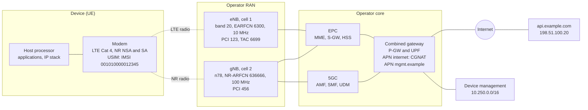

| Element | Value | Notes |
|---|---|---|
| PLMN | MCC `001`, MNC `01` | The 3GPP test network code: the role a documentation range plays for IP |
| IMSI | `001010000012345` | MCC + MNC + MSIN (section 10) |
| IMEI | `490154203237518` | Identifies the modem hardware, not the subscriber (section 10) |
| LTE cell | Band 20 (800 MHz, FDD), EARFCN 6300 = 806 MHz downlink, 10 MHz, PCI 123, TAC 6699 (0x1A2B) | The coverage layer, and the anchor in NSA mode |
| NR cell | n78 (3.5 GHz, TDD), NR-ARFCN 636666 = 3549.99 MHz, 100 MHz, 30 kHz subcarrier spacing, PCI 456 | A secondary cell in NSA (EN-DC with the LTE cell), or a standalone cell connected to the 5GC (section 4) |
| Internet session | APN/DNN `internet`, IPv4v6: `100.72.15.9`, prefix `2001:db8:c0:1::/64`, DNS `192.0.2.53`, MTU 1430 | `wwan0` in the fundamentals note. `100.72.15.9` is in the CGNAT range (RFC 6598) |
| Management session | APN/DNN `mgmt.example`, IPv4 `10.200.0.15` | A private APN that only reaches the operator's device-management servers. `wwan1` in the fundamentals note |
| Server | `api.example.com`, `198.51.100.20` | Reached through the gateway's CGNAT |

The operator runs both cores with a combined gateway (P-GW + UPF, with a combined SMF/P-GW-C), so the device keeps its sessions when it moves between LTE and 5G SA (section 14). `198.51.100.0/24` and `192.0.2.0/24` are IPv4 documentation ranges (RFC 5737), `2001:db8::/32` the IPv6 one (RFC 3849). The IMSI, IMEI, cell identities and APNs are placeholders.

---

## 3. Generations, 3GPP releases and device capabilities

**3GPP** (3rd Generation Partnership Project) writes the specifications for GSM, UMTS, LTE and 5G, in numbered **releases**. A release is a frozen set of specifications; later releases add features while keeping older devices working. Vendors implement a subset of a release's optional features, and operators enable a subset of those. Specifications are numbered by series: `TS 36.xxx` for LTE radio, `TS 38.xxx` for NR radio, `TS 23.xxx` for architecture and procedures, `TS 24.xxx` for NAS protocols, `TS 33.xxx` for security, `TS 27.xxx` and `TS 31.xxx` for the terminal and the USIM (references at the end). "4G" and "5G" are ITU and marketing names; specifications and modem logs say E-UTRA/LTE and NR.

| Generation | Technology | 3GPP release | Radio access | Peak rates (spec) | Status |
|---|---|---|---|---|---|
| 2G | GSM, GPRS, EDGE | Phase 1/2, R97, R99 | TDMA, 200 kHz carriers | A few hundred kb/s (EDGE) | Switched off in the US, Australia and several European countries; kept elsewhere for IoT and voice fallback |
| 3G | UMTS (WCDMA), HSPA, HSPA+ | R99, Rel-5 to Rel-8 | WCDMA, 5 MHz carriers | 42 Mb/s (dual-carrier HSPA+) | Mostly switched off in the US and Europe |
| 4G | LTE | Rel-8, Rel-9 | OFDMA down, SC-FDMA up, 1.4 to 20 MHz | 300 Mb/s (4 layers, 20 MHz) | The coverage layer almost everywhere |
| 4G | LTE-Advanced | Rel-10 to Rel-12 | + carrier aggregation, 8 layers down, relays, eICIC | 3 Gb/s (Cat 8, spec maximum) | Aggregation of 2 to 5 carriers is common |
| 4G | LTE-Advanced Pro | Rel-13, Rel-14 | + LTE-M, NB-IoT, LAA (unlicensed), C-V2X sidelink | | LTE-M and NB-IoT are the IoT workhorses |
| 5G | NR, phase 1 | Rel-15 (2018) | OFDM both ways, flexible numerology, up to 100 MHz (FR1) and 400 MHz (FR2) carriers | About 20 Gb/s (IMT-2020 target) | NSA first, SA since |
| 5G | NR, phase 2 | Rel-16 (2020) | + URLLC, industrial IoT and TSN, NR-U, NR sidelink, IAB, positioning | | |
| 5G | NR | Rel-17 (2022) | + RedCap, NTN, 52.6-71 GHz, multicast and broadcast, small data in RRC_INACTIVE | | |
| 5G-Advanced | NR | Rel-18 (2024), Rel-19 (2025) | + eRedCap, network energy saving, L1/L2-triggered mobility, AI/ML for the air interface, XR, ambient IoT studies, 256-bit algorithms | | Deployment starting |
| 6G | | Studies in Rel-20, first specifications expected in Rel-21 | | | Around the end of the decade |

**What each step changed for a device engineer:**
- **2G to 3G:** usable packet data; the network authenticates itself to the SIM (2G only authenticates the device, section 13).
- **3G to LTE:** all-IP with no circuit-switched domain: voice became VoIP over IMS (section 17). Attaching to LTE always creates an IP session (section 11). Latency dropped to tens of ms, and the base station took over functions of the 3G radio network controller (RNC), which no longer exists.
- **LTE to NR:** flexible numerology and wide carriers, beam-based operation, no always-on reference signals, a third RRC state (inactive), a service-based core with network slicing and finer QoS. Early 5G (NSA) still runs its control plane on LTE and the EPC (section 4).

### 5G feature map

The features most likely to show up in a device's capabilities or an operator's announcements:

| Release | Features |
|---|---|
| Rel-15 | eMBB: NSA (EN-DC) and SA, FR1 and FR2, bandwidth parts, beam management, LDPC and polar codes, 5GC with slicing and QoS flows, RRC_INACTIVE |
| Rel-16 | URLLC (mini-slots, configured grants, PDCP duplication, high-reliability MCS/CQI tables), industrial IoT and time-sensitive networking, NR-U (unlicensed), NR sidelink (V2X), integrated access and backhaul (IAB), 2-step random access, conditional handover and DAPS, UE power saving (wake-up signal on PDCCH), positioning (multi-RTT, angles), non-public networks, LTE-M/NB-IoT connected to the 5GC |
| Rel-17 | RedCap, NTN (NR and IoT), up to 71 GHz, small data transmission (SDT) in RRC_INACTIVE, multicast/broadcast services, paging early indication, coverage enhancements, sidelink relays, multi-SIM support |
| Rel-18 | eRedCap, network energy saving, L1/L2-triggered mobility (LTM), XR traffic, uplink enhancements, NTN in more bands, AI/ML studies, low-power wake-up receiver study |
| Rel-19 | AI/ML for the air interface (beam management, positioning), ambient IoT, 256-bit security algorithms, NTN and RedCap enhancements |

### Device categories and capabilities

An LTE device declares a **UE category** (TS 36.306): its peak rates, buffer sizes and number of layers. Since Rel-12, downlink and uplink categories are declared separately. NR has no categories: the UE sends a detailed **capability** report (bands, band combinations, feature sets per combination, layers, modulation, optional features), and only RedCap is a defined device type.

| Category | Downlink / uplink peak (Mb/s) | Receive antennas | Typical use |
|---|---|---|---|
| NB-IoT Cat NB1 / NB2 | About 0.026 / 0.06 (NB1), 0.13 / 0.16 (NB2) | 1 | Meters, sensors: small, rare messages, deep indoor |
| LTE-M Cat M1 / M2 | About 1 / 1 (M1), 4 / 7 (M2) | 1 | Trackers, wearables, alarms: mobility and voice possible |
| Cat 1 | 10 / 5 | 2 | Telematics, payment terminals, alarm panels |
| Cat 1bis | 10 / 5 | 1 | Same with one antenna (Rel-13): smaller devices |
| Cat 4 | 150 / 50 | 2 | Routers and gateways, the example device |
| Cat 6 | 300 / 50 | 2 | Carrier aggregation of 2 carriers |
| Cat 12 (+ uplink Cat 13) | 600 / 150 | 2 to 4 | Aggregation of 3 or more carriers, 256-QAM |
| NR RedCap (Rel-17) | About 100-200 / 50-100, depending on antennas, layers and modulation (20 MHz FR1) | 1 or 2 | Wearables, cameras, industrial sensors: the 5G successor of Cat 4 |
| NR eRedCap (Rel-18) | About 10 / 10 (5 MHz data baseband) | 1 or 2 | The 5G successor of Cat 1 |
| NR eMBB | Hundreds of Mb/s to several Gb/s | 2 to 4 | Phones, fixed wireless access, high-end routers |

Peak rates assume the best signal and an empty cell; real throughput is a fraction of them (sections 8 and 9). LTE-M and NB-IoT trade throughput for coverage, cost and battery life (section 16).

**Capability, support and configuration are different things.** A feature works only if it is (1) specified in a release, (2) implemented and declared by the UE in its capability report, (3) implemented by the network vendor, and (4) enabled by the operator for that cell, that subscription and that band combination. "The module supports 5G SA" can still mean NSA-only on a given network, or SA without the band combinations the operator uses. The UE's capability report (section 11) and the network's RRC configuration (section 18) are the evidence for (2) and (4).

### Sunsets

Operators switch off old generations to reuse their spectrum, each on its own schedule:

- **3G** is gone in the US and most of Europe. **2G** is gone in the US and Australia and in several European countries, and kept elsewhere, sometimes for years, for older IoT devices and voice fallback. Check each target operator's published plans before relying on a fallback technology.
- A device that used 2G/3G for voice (circuit-switched fallback), SMS or coverage must work on LTE alone, or on LTE-M/NB-IoT. Voice then requires IMS (VoLTE, section 17), and emergency systems built on circuit-switched calls, such as the EU's in-vehicle eCall, move to IMS-based versions.
- LTE-M and NB-IoT are expected to outlive LTE broadband: they can run inside an LTE carrier and, since Rel-16, coexist inside an NR carrier.

---

## 4. Architecture and protocol stacks: EPS, 5GS, NSA and SA

### The two systems

The **EPS** (evolved packet system) is LTE's E-UTRAN plus the **EPC** core; the **5GS** is NG-RAN plus the **5GC**. Both separate the radio network from the core and the control plane from the user plane.

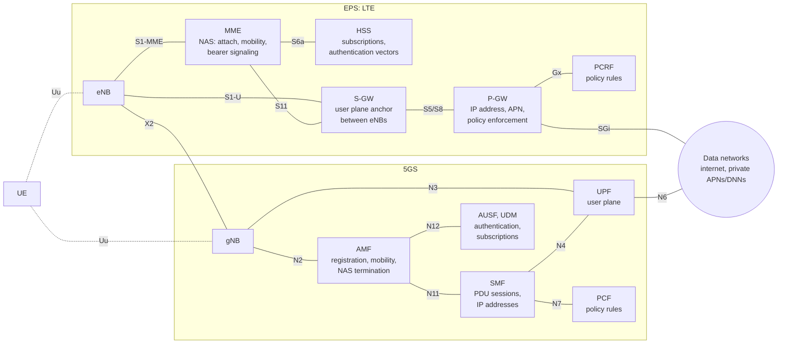

| Role | EPC (LTE) | 5GC |
|---|---|---|
| Base station | eNB | gNB; ng-eNB for LTE cells connected to the 5GC |
| NAS termination, registration, mobility, paging | MME | AMF |
| Session management (create, modify, release sessions; IP allocation) | MME (signaling) + P-GW control | SMF |
| User plane: tunnels, forwarding, the IP anchor | S-GW (mobility anchor) + P-GW (IP anchor) | UPF, possibly several in a chain (an anchor UPF and intermediate UPFs) |
| Subscriber data, authentication | HSS | UDM/UDR + AUSF |
| Policy and charging rules | PCRF | PCF |
| Exposure to applications, non-IP data | SCEF | NEF |
| Slice selection, function discovery | | NSSF, NRF |

| Interface | EPS | 5GS | Carries |
|---|---|---|---|
| Radio | Uu | Uu | RRC, user data |
| Base station to control plane | S1-MME (S1AP over SCTP) | N2 (NGAP over SCTP) | UE context setup, NAS transport, paging, handover signaling |
| Base station to user plane | S1-U (GTP-U) | N3 (GTP-U) | User data tunnels |
| Between base stations | X2 (X2AP, GTP-U) | Xn (XnAP, GTP-U) | Handover preparation, data forwarding, dual connectivity |
| Gateway to gateway | S5 (home), S8 (roaming) | N9 | User data, and GTP-C control in LTE |
| Control to user plane | S11 (GTP-C); Sx (PFCP) with CUPS | N4 (PFCP) | Tunnel and forwarding rules |
| To the data network | SGi | N6 | Plain IP |

- **5GC is service-based:** its control functions expose HTTP/2 APIs to each other (the N11, N12, N7 links above are service interactions), which makes slicing and distributed user planes easier to build. The radio side and the UE see none of it.
- **CUPS** (control and user plane separation, Rel-14) split the EPC gateways the same way, so LTE user planes can also be distributed. Most operators now run combined EPC/5GC functions (SMF+P-GW-C, UPF+P-GW-U, HSS+UDM).

### Protocol stacks

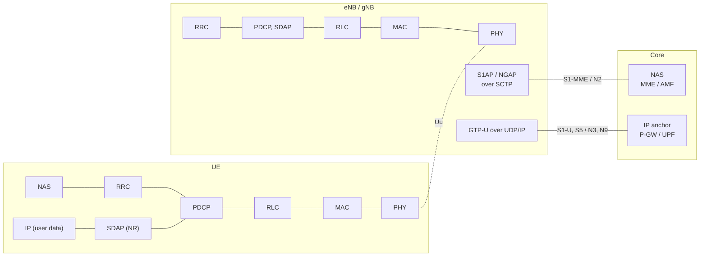

| Plane | UE | Base station | Core |
|---|---|---|---|
| Control plane | NAS / RRC / PDCP / RLC / MAC / PHY | Terminates RRC and the radio layers. Relays NAS messages, unread, inside RRC on one side and S1AP/NGAP on the other | NAS ends at the MME or AMF |
| User plane | IP / SDAP (NR) / PDCP / RLC / MAC / PHY | Terminates the radio layers; puts each packet in a GTP-U tunnel (GTP-U / UDP / IP) | GTP-U ends at the P-GW or anchor UPF, which routes the inner IP packet |

- **NAS** carries mobility management (EMM in LTE, 5GMM in 5G: attach or registration, tracking area updates, authentication, security mode) and session management (ESM / 5GSM: bearers, PDU sessions). In LTE, ESM messages travel inside EMM messages during the attach; in 5G, 5GSM messages travel in 5GMM transport messages.
- **RRC** carries system information, connection setup and release, security activation for the radio, measurement configuration and reports, handover commands, and the configuration of every lower layer. Most of what a modem log shows about the radio is RRC.
- The layers below are covered in sections 6 to 8: PDCP (ciphering, integrity, header compression, reordering), RLC (segmentation, retransmissions), MAC (multiplexing, HARQ, scheduling requests), PHY.

**Radio bearers** are the RRC-level pipes. **Signaling radio bearers** carry RRC and NAS: SRB0 (before a connection exists), SRB1 (RRC, and NAS piggybacked), SRB2 (NAS, lower priority), SRB3 (direct NR RRC in EN-DC), SRB4 (application layer measurement reports, Rel-17). **Data radio bearers** (DRB) carry user data: one per EPS bearer in LTE; in NR, the base station maps the QoS flows of a PDU session onto DRBs as it sees fit (section 12).

**Channel hierarchy:** the layers talk through three kinds of channels, which appear by name in logs:

| Level | Channels | Meaning |
|---|---|---|
| Logical (RLC to MAC): what is carried | BCCH (system information), PCCH (paging), CCCH (before a connection: SRB0), DCCH (dedicated signaling: SRB1-3), DTCH (user data) | Type of information |
| Transport (MAC to PHY): how it is carried | BCH, PCH, DL-SCH, UL-SCH, RACH | Format, coding, HARQ |
| Physical: where on the air | PBCH, PDSCH, PDCCH, PUSCH, PUCCH, PRACH (section 7) | Resources and modulation |

The MIB travels BCCH → BCH → PBCH; the SIBs, paging and all dedicated data travel on the shared channels (DL-SCH → PDSCH, UL-SCH → PUSCH).

### State machines at a glance

A UE runs several state machines at once, one per layer, and logs report them separately:

| Layer | LTE | 5G | What it means |
|---|---|---|---|
| Registration (NAS) | EMM-DEREGISTERED / EMM-REGISTERED | RM-DEREGISTERED / RM-REGISTERED | Whether the core knows the UE (section 11) |
| Signaling connection (NAS) | ECM-IDLE / ECM-CONNECTED | CM-IDLE / CM-CONNECTED | Whether a NAS signaling connection (RRC + S1/N2) exists |
| Radio (AS) | RRC_IDLE / RRC_CONNECTED | RRC_IDLE / RRC_INACTIVE / RRC_CONNECTED | Whether the base station holds a context (section 14) |
| Sessions (NAS) | PDN connections and their EPS bearers | PDU sessions and their QoS flows | Whether the UE has IP connectivity (section 12) |

In LTE, a registered UE always has at least one PDN connection, and RRC_IDLE always coincides with ECM-IDLE. In 5G, a UE can be registered without any PDU session, and RRC_INACTIVE is a **CM-CONNECTED** state: the core still considers the UE connected, while the radio connection is suspended (section 14). "Idle" in a log means nothing until you know which layer reports it.

### Where your packets actually go

```
 Device ──radio──► eNB/gNB ══GTP-U══► S-GW ══GTP-U══► P-GW  ──► CGNAT, firewall ──► internet
 100.72.15.9                (operator transport)        or UPF                           198.51.100.20
                                                      "default gateway"
```

- The **P-GW or anchor UPF is the first IP hop**. Everything before it is a tunnel from the IP point of view. A traceroute from the device shows the gateway (or nothing, if it doesn't answer) and then the operator's network.
- Each bearer or QoS-flow aggregate has its own tunnel, identified by a tunnel endpoint ID (TEID). The UE's packets travel inside with 36 bytes of outer IPv4 + UDP + GTP-U headers (56 with an IPv6 transport, plus 8 for the 5G PDU session container extension header), one reason operators advertise a device MTU below 1500 (section 12).
- The gateway allocates the device's address, applies per-APN policy (firewall, NAT, rate limits, zero-rating, content filtering) and is where a private APN connects to a customer's network (VPN or leased line).
- **Location matters:** operators run few anchor gateways, sometimes one or two per country, and roaming devices are usually home-routed to their home country (section 12). The server should be near the gateway, not near the device. 5G user planes can be placed closer to the edge (local UPFs), but only if the operator does so.
- Inbound connections usually fail: CGNAT for IPv4 and often a stateful firewall for IPv6 (see the [fundamentals note](../../networking/fundamentals/fundamentals.md#13-nat-and-address-translation)). Private APNs with routable addresses avoid both.

### NSA and SA

3GPP defined several ways to combine LTE, NR, the EPC and the 5GC ("options"). Two are deployed widely:

| | NSA, option 3x (EN-DC) | SA, option 2 |
|---|---|---|
| Core | EPC | 5GC |
| Control plane | LTE: LTE RRC on the LTE cell (master node), LTE NAS (EMM/ESM) | NR RRC, 5G NAS (5GMM/5GSM) |
| NR's role | Secondary node: adds NR carriers to an LTE connection for capacity | The only radio |
| Idle mode | Camps on LTE. The NR leg is added again at every connection, after measurements | Camps on NR |
| User data | Split bearer: PDCP in the gNB, data sent over NR, LTE or both (section 8) | NR only |
| Features | Higher downlink rates, and uplink on NR | Lower latency, RRC_INACTIVE, slicing, 5G QoS, RedCap, VoNR, 5G security (SUCI) |
| Device needs | LTE and NR bands, and the operator's EN-DC band combinations | NR bands; SA enabled in the modem and allowed for the subscription |

- **Option 4** (NR master, LTE secondary, 5GC) and **option 7** (LTE master connected to the 5GC, NR secondary) exist but are rare. **Option 5** (ng-eNB: LTE cells connected to the 5GC) is used mainly for LTE-M/NB-IoT and private networks. In multi-radio dual connectivity terms, EN-DC is LTE master + NR secondary on the EPC; NGEN-DC and NE-DC are the 5GC variants; NR-DC pairs two NR nodes (FR1 + FR2).
- A "5G" indicator on a device may only mean that NR is available nearby (`upperLayerIndication` in LTE SIB2), not that data flows over NR. The modem's serving cell report or the RRC configuration tells the truth (section 18).
- **DSS** (dynamic spectrum sharing) runs LTE and NR on the same carrier, sharing resources dynamically (NR rate-matches around LTE's reference signals). An operator's "5G on 700 MHz" may be an LTE carrier shared with NR.
- **Interworking between EPS and 5GS:** with the **N26** interface between MME and AMF and combined gateways, a UE moves between LTE and SA 5G in idle and connected mode and keeps its IP sessions (section 14).

### Circuit-switched remnants

2G and 3G had a separate circuit-switched core (MSC) for voice and SMS. LTE can still reach it for **CS fallback** (moving to 2G/3G for a call) and **SMS over SGs** (SMS relayed by the MME to the MSC over the SGs interface). Both disappear with the 2G/3G sunsets, replaced by IMS voice and SMS over IMS or NAS (section 17).

### Private networks

Enterprises run their own LTE or 5G networks on dedicated spectrum (local licenses such as 3.7-3.8 GHz in Germany, CBRS in the US) with their own core and SIMs. 5G calls them **non-public networks** (NPN): standalone (SNPN, identified by a PLMN ID plus a network identifier, NID, and possibly using credentials other than a USIM) or integrated with a public network (PNI-NPN, typically through a dedicated slice or DNN with a closed access group). For a device, they are the same protocols with different identities and credentials.

---

## 5. Spectrum: bands, duplexing and channel numbers

### Duplexing

| Mode | How | Bands |
|---|---|---|
| FDD (frequency division duplex) | Uplink and downlink on two separate frequency ranges at the same time, a fixed **duplex spacing** apart | Most bands below 2.7 GHz (B1, B3, B7, B8, B20, B28...) |
| TDD (time division duplex) | One frequency range, shared in time according to a slot pattern | 2.3, 2.6 and 3.3-4.2 GHz, mmWave (B38, B40, B41, n41, n77, n78, n257-n261) |
| SDL (supplemental downlink) | Downlink only, aggregated with another carrier | B29 (700 MHz, US), B32 / n75 (1.5 GHz, EU) |
| SUL (supplemental uplink, NR) | Uplink only, paired with an NR TDD cell to extend its uplink coverage on a lower frequency | n80 to n86 (the uplink parts of B3, B8, B20, B28...) |
| Half-duplex FDD | FDD bands, but the UE doesn't transmit and receive at the same time | LTE-M and NB-IoT devices, RedCap optionally: saves the duplexer |

All TDD cells of an area use the **same** uplink/downlink pattern, synchronized to GNSS time: a base station transmitting while its neighbor receives would jam it. The pattern fixes the uplink share (a common n78 pattern gives the uplink about a fifth of the time, section 6), which is why TDD uplink rates are much lower than downlink rates.

In most FDD bands the uplink is the lower frequency range. **Reverse duplex** bands (B13, B14, B20, B71) put the uplink above the downlink.

### Band numbers and frequency ranges

3GPP numbers LTE bands `B<n>` (TS 36.101) and NR bands `n<n>` (TS 38.101-1 for FR1, TS 38.101-2 for FR2). An NR band reusing an LTE band's range usually keeps its number (B3 → n3, B28 → n28). NR splits its spectrum in two **frequency ranges**:

- **FR1:** 410 MHz to 7.125 GHz ("sub-6 GHz", including the 3.3-4.2 GHz mid-band and, for NR-U, 5 and 6 GHz unlicensed bands).
- **FR2:** 24.25 to 71 GHz (mmWave), split since Rel-17 into FR2-1 (to 52.6 GHz) and FR2-2 (52.6 to 71 GHz).

| Band | Uplink (MHz) | Downlink (MHz) | Duplex | Where it's used |
|---|---|---|---|---|
| B1 / n1 | 1920-1980 | 2110-2170 | FDD | EU, Asia ("2100") |
| B2 / n2 | 1850-1910 | 1930-1990 | FDD | Americas (PCS "1900") |
| B3 / n3 | 1710-1785 | 1805-1880 | FDD | EU, Asia ("1800"): the main LTE capacity band in Europe |
| B4 | 1710-1755 | 2110-2155 | FDD | Americas (AWS-1) |
| B5 / n5 | 824-849 | 869-894 | FDD | Americas, Asia ("850") |
| B7 / n7 | 2500-2570 | 2620-2690 | FDD | EU, Asia ("2600") |
| B8 / n8 | 880-915 | 925-960 | FDD | EU, Asia ("900"): former GSM, widely used by LTE-M and NB-IoT |
| B12 | 699-716 | 729-746 | FDD | US (700 lower A/B/C) |
| B13 | 777-787 | 746-756 | FDD, reverse | US (700 upper C) |
| B14 | 788-798 | 758-768 | FDD, reverse | US (FirstNet public safety) |
| B20 / n20 | 832-862 | 791-821 | FDD, reverse | EU ("800"): the main coverage band in Europe |
| B25 | 1850-1915 | 1930-1995 | FDD | US (extended PCS) |
| B28 / n28 | 703-748 | 758-803 | FDD | EU (703-733 / 758-788), Asia-Pacific, Latin America ("700") |
| B66 | 1710-1780 | 2110-2200 | FDD | Americas (AWS-1 and AWS-3) |
| B71 / n71 | 663-698 | 617-652 | FDD, reverse | US ("600") |
| B38 | 2570-2620 | | TDD | EU, Asia |
| B40 | 2300-2400 | | TDD | Asia, some EU |
| B41 / n41 | 2496-2690 | | TDD | US, China, Japan |
| n77 | 3300-4200 | | TDD | US C-band (3.7-3.98 GHz), Japan |
| n78 | 3300-3800 | | TDD | EU ("3.5 GHz"): the main 5G band in Europe |
| n258 | 24250-27500 | | TDD | EU ("26 GHz"), Asia |
| n260, n261 | 37000-40000, 27500-28350 | | TDD | US mmWave |

**Low bands carry coverage, high bands carry capacity.** Below 1 GHz (B8, B12, B13, B20, B28, B71) signals travel far and enter buildings; 1.7-2.7 GHz carries most LTE traffic; 3.5 GHz gives 100 MHz carriers with less range; mmWave gives very wide carriers over a few hundred meters with line of sight. An IoT device in a basement lives on the low bands (section 9).

### Regulation and power classes

Unlike Wi-Fi, a cellular device never chooses its frequencies or power on its own: it only transmits on a carrier where a cell allowed it, at a power set by power control (section 8) and capped by the cell (`p-Max`) and by its **power class**:

| Power class | Maximum output | Typical use |
|---|---|---|
| 3 | 23 dBm | Most LTE and NR devices |
| 2 | 26 dBm | "HPUE", mainly NR and LTE TDD bands (n41, n77, n78, B41) where the uplink duty cycle is low |
| 1.5, 1 | 29 dBm, 31 dBm | Fixed wireless access and special devices, some bands only |
| 5 | 20 dBm | Many LTE-M and NB-IoT modules |
| 6 | 14 dBm | NB-IoT for very small batteries (Rel-14), later LTE-M too |

FR2 has its own power classes by device type (fixed, handheld, vehicle), specified as EIRP because the antenna is an array. Regulation applies to the device's conformity, not to user configuration:

| Region | Rules |
|---|---|
| EU | Radio Equipment Directive (RED), with harmonized standards ETSI EN 301 908-1 (common), -13 (LTE UE), -25 (NR UE) |
| US | FCC Part 22 (850 MHz), Part 24 (PCS), Part 27 (AWS, 600/700 MHz, 2.5 GHz, 3.7 GHz C-band), Part 30 (mmWave: 24, 28, 37, 39, 47 GHz), Part 90 (B14), Part 96 (CBRS, B48/n48) |

Operators also require **industry certification** (GCF in Europe, PTCRB in North America) and often their own acceptance tests before a device may use their network.

### Channel numbers: EARFCN and NR-ARFCN

Cells are configured and reported by channel number, not frequency.

**LTE EARFCN** (TS 36.101 section 5.7.3): each band has a downlink offset. F<sub>DL</sub> = F<sub>DL_low</sub> + 0.1 × (N<sub>DL</sub> - N<sub>Offs-DL</sub>) MHz; the carrier center is on a 100 kHz raster.

| Band | F<sub>DL_low</sub> (MHz) | N<sub>Offs-DL</sub> | Downlink EARFCN range | Example |
|---|---|---|---|---|
| B1 | 2110 | 0 | 0-599 | 300 = 2140 MHz |
| B3 | 1805 | 1200 | 1200-1949 | 1300 = 1815 MHz |
| B7 | 2620 | 2750 | 2750-3449 | 3100 = 2655 MHz |
| B8 | 925 | 3450 | 3450-3799 | 3600 = 940 MHz |
| B20 | 791 | 6150 | 6150-6449 | 6300 = 806 MHz (the example cell) |
| B28 | 758 | 9210 | 9210-9659 | 9410 = 778 MHz |

Uplink EARFCNs have their own ranges (B20 uplink: 24150-24449). One downlink EARFCN identifies an FDD carrier, since the duplex spacing is fixed per band.

**NR-ARFCN** (TS 38.104 section 5.4.2) is one global raster for all bands:

| Range | Step | Formula | Example |
|---|---|---|---|
| 0-3000 MHz | 5 kHz | F = 0.005 × N MHz | 158200 = 791 MHz (n20, n28) |
| 3000-24250 MHz | 15 kHz | F = 3000 + 0.015 × (N - 600000) MHz | 636666 = 3549.99 MHz (the example n78 cell) |
| 24250-100000 MHz | 60 kHz | F = 24250.08 + 0.06 × (N - 2016667) MHz | |

Each band allows only a subset of NR-ARFCNs (its channel raster, every 15 or 30 kHz in n78, for instance). NR also has a coarser **synchronization raster** (GSCN numbers) on which the SSB is placed, so the UE doesn't try every NR-ARFCN during cell search (section 7). The SSB doesn't have to be at the carrier center, unlike LTE's synchronization signals.

### Combinations and regional variants

- **Carrier aggregation** and **dual connectivity** (section 8) only work for the band combinations the UE declares and the network configured: `CA_3A-20A` is one carrier on B3 plus one on B20 (class A = one carrier of up to 20 MHz in that band); `CA_7C` is two contiguous carriers in B7; `DC_20A_n78A` is EN-DC with an LTE B20 anchor and an NR n78 secondary. The supported combinations in a module's capability report matter as much as its band list.
- **Modules come in regional variants** (a European and a North American version of the same module, for instance) because RF front ends (filters, duplexers, power amplifiers) cover a limited set of bands, and because certification is per region and per operator. A "global" module covers more bands with compromises in size, cost and sensitivity. Check every target country's and operator's bands, including low bands for coverage and the LTE-M/NB-IoT bands if the device uses them.
- **Unlicensed and shared spectrum:** LTE-LAA (B46, 5 GHz, downlink with listen-before-talk) and NR-U (n46 at 5 GHz, n96 at 6 GHz) use unlicensed spectrum alongside Wi-Fi, with listen-before-talk; CBRS (B48/n48, US) is shared spectrum managed by a spectrum access system.

---

## 6. The physical layer: OFDM, numerology, resource grid, MCS and MIMO

### OFDMA down, SC-FDMA up

Like Wi-Fi since 802.11a, LTE and NR split a carrier into many narrow **subcarriers** and send one modulated symbol per subcarrier per OFDM symbol, with a **cyclic prefix** (CP) that absorbs multipath echoes. The difference is who uses them: the base station allocates subcarriers and symbols to different UEs in the same OFDM symbols (**OFDMA**), every scheduling interval, and nobody contends.

- **Downlink:** OFDMA (CP-OFDM) in both systems.
- **LTE uplink:** **SC-FDMA** (DFT-spread OFDM): each UE's symbols are spread over its contiguous subcarriers by a DFT before the OFDM modulator, which gives a low peak-to-average power ratio. The UE's power amplifier then runs closer to its maximum with less back-off: more uplink range for the same battery.
- **NR uplink:** CP-OFDM (better for MIMO and high rates, allows non-contiguous allocations) or DFT-s-OFDM (single layer, better at the cell edge), switched by RRC configuration.

### LTE frame structure

| Parameter | LTE value |
|---|---|
| Subcarrier spacing | 15 kHz (plus 7.5 and 3.75 kHz for special cases such as MBSFN and NB-IoT uplink) |
| OFDM symbol (without CP) | 66.7 µs |
| Cyclic prefix | Normal: 5.2 µs on the first symbol of a slot, 4.7 µs on the others. Extended: 16.7 µs |
| Resource element | One subcarrier during one symbol: the unit of the resource grid |
| Resource block (RB) | 12 subcarriers = 180 kHz during one slot. The scheduler allocates pairs of RBs over a subframe |
| Slot | 0.5 ms, 7 symbols (normal CP) |
| Subframe, TTI | 1 ms, 2 slots, 14 symbols: the scheduling interval |
| Radio frame | 10 ms, 10 subframes, numbered by the system frame number (SFN, 0-1023: a 10.24 s cycle) |
| Frame types | Type 1 for FDD; type 2 for TDD (7 uplink-downlink configurations with special subframes) |

| Channel bandwidth (MHz) | 1.4 | 3 | 5 | 10 | 15 | 20 |
|---|---|---|---|---|---|---|
| Resource blocks | 6 | 15 | 25 | 50 | 75 | 100 |
| Occupied (MHz) | 1.08 | 2.7 | 4.5 | 9 | 13.5 | 18 |

The rest of the channel is guard band. The example cell (10 MHz on B20) has 50 RBs, 600 subcarriers. Each downlink subframe starts with a **control region** of 1 to 3 symbols (PDCCH, size signaled by PCFICH) followed by the data region, and LTE's cell-specific reference signals (CRS) are spread over every RB of every subframe, whether or not data is sent.

### NR numerologies

NR keeps the structure but scales it: subcarrier spacing is 15 × 2<sup>µ</sup> kHz, where µ is the **numerology**. A slot is always 14 symbols (12 with extended CP), so wider spacing means shorter slots: lower latency and more tolerance to phase noise and Doppler at high frequencies, but a shorter CP (less tolerance to delay spread, hence smaller cells).

| µ | Spacing | Slot | Slots per 1 ms subframe | Normal CP | Used for |
|---|---|---|---|---|---|
| 0 | 15 kHz | 1 ms | 1 | 4.7 µs | FR1: narrow carriers, low bands, DSS with LTE |
| 1 | 30 kHz | 0.5 ms | 2 | 2.3 µs | FR1 mid-band: the usual n77/n78 choice |
| 2 | 60 kHz | 0.25 ms | 4 | 1.2 µs (extended CP 4.2 µs possible) | FR1 (rare) or FR2 |
| 3 | 120 kHz | 0.125 ms | 8 | 0.59 µs | FR2 data and SSB |
| 4 | 240 kHz | 62.5 µs | 16 | 0.29 µs | FR2-1 SSB only |
| 5, 6 | 480, 960 kHz | 31.25, 15.6 µs | 32, 64 | | FR2-2 (52.6-71 GHz), Rel-17 |

| Maximum carrier | 15 kHz | 30 kHz | 60 kHz | 120 kHz |
|---|---|---|---|---|
| FR1 | 50 MHz (270 RBs) | 100 MHz (273 RBs) | 100 MHz (135 RBs) | |
| FR2-1 | | | 200 MHz (264 RBs) | 400 MHz (264 RBs) |

The 10 ms frame and 1 ms subframe are kept in every numerology, so timing across numerologies stays aligned.

**Where NR's structure differs from LTE's:**
- **Resource blocks** are 12 subcarriers in frequency only. An allocation is a set of RBs over a number of symbols in a slot (from 2 symbols, "mini-slots", up to the full slot), so short transmissions don't wait for a slot boundary.
- **Slot formats:** in TDD, each symbol is downlink, uplink or flexible, configured semi-statically by RRC (a common pattern for the cell plus per-UE adjustments) and possibly changed dynamically by a slot format indication.
- **No CRS.** NR transmits reference signals only where and when needed: DMRS with the data, CSI-RS for measurements, the SSB for synchronization. This "lean carrier" saves energy and interference and makes forward compatibility possible, but means the UE has fewer always-present signals to track.
- **Bandwidth parts** (BWP): a UE works in a contiguous part of the carrier with its own numerology (up to 4 configured per direction, one active). The network switches the active BWP by DCI or a timer: a narrow BWP when idle saves power, a wide one for bursts. Initial access uses the **initial BWP** defined by the cell's CORESET 0 (section 7). A RedCap device's 20 MHz BWP lives inside a 100 MHz carrier.
- **Point A and carrier offsets:** all grids are positioned relative to a common reference frequency ("point A"), so carriers of different numerologies and UEs with different BWPs share one frame of reference.

### Modulation, coding and MCS

| Modulation | Bits per symbol | LTE | NR |
|---|---|---|---|
| π/2-BPSK | 1 | | Uplink with DFT-s-OFDM (coverage) |
| QPSK | 2 | Yes | Yes |
| 16-QAM | 4 | Yes | Yes |
| 64-QAM | 6 | Yes | Yes |
| 256-QAM | 8 | Downlink Rel-12, uplink Rel-14 | Rel-15, both directions |
| 1024-QAM | 10 | Downlink, Rel-15 | Downlink FR1, Rel-17 |

| | LTE | NR |
|---|---|---|
| Data channel coding | Turbo code | LDPC (two base graphs: large blocks and high rates, small blocks and low rates) |
| Control channel coding | Tail-biting convolutional code (PDCCH, PBCH) | Polar code (DCI, PBCH, larger UCI); Reed-Muller and repetition for small UCI |

The **MCS index** sent with each grant selects a modulation and a code rate from an MCS table (several are defined: a default table, a 256-QAM table, a low-spectral-efficiency table for URLLC). With the number of allocated RBs and layers, it gives the **transport block size** (TBS): a lookup in TS 36.213 for LTE, a formula plus a table in TS 38.214 for NR. The base station picks the MCS from the UE's channel reports and its own error statistics (link adaptation, section 8). The highest code rate is about 0.93 (948/1024 in NR).

### Peak data rate

TS 38.306 gives the approximate NR peak rate per carrier:

```
rate (Mb/s) = 10^-6 × layers × Qm × f × Rmax × (N_PRB × 12) / Ts × (1 - OH)
  Qm   = bits per symbol (8 for 256-QAM)       Rmax = 948/1024
  f    = scaling factor (1, or 0.8, 0.75, 0.4 for UEs that declare less)
  Ts   = average symbol duration = 10^-3 / (14 × 2^µ) s
  OH   = overhead: 0.14 downlink FR1, 0.18 downlink FR2, 0.08 uplink FR1, 0.10 uplink FR2
```

| Carrier | Layers | Modulation | Peak |
|---|---|---|---|
| NR 100 MHz, 30 kHz (273 RBs), downlink | 4 | 256-QAM | 2337 Mb/s |
| Same, 2 layers (a typical IoT router) | 2 | 256-QAM | 1169 Mb/s |
| Same, uplink | 1 | 256-QAM | 625 Mb/s, before applying the TDD uplink share |
| NR 20 MHz, 15 kHz (106 RBs), downlink | 2 | 64-QAM | 170 Mb/s |

For an FDD carrier, the formula gives the rate per direction; for TDD it must be multiplied by the share of symbols in each direction. For LTE, a 20 MHz carrier carries 100 RBs × 12 subcarriers × 14 symbols per ms = 16.8 million resource elements per second. With 64-QAM and 2 layers that's 201.6 Mb/s raw; the control region and reference signals take about a quarter, which leaves the 150 Mb/s of Cat 4. These are peak rates for one UE with perfect signal and the whole cell to itself.

### MIMO and beamforming

- **Layers** (rank): independent data streams sent on the same resources from several antennas. The UE reports the rank it can receive (**RI**) and a preferred precoder (**PMI**) from a codebook; the base station decides. 2 layers is the norm for 2-antenna devices, 4 for phones on mid-band. Uplink MIMO (2 or 4 layers) exists but most IoT devices transmit one layer.
- **LTE transmission modes** (TM1 to TM10) select transmit diversity, open-loop or closed-loop spatial multiplexing, or beamforming with UE-specific reference signals; they are configured by RRC. NR has no transmission modes: everything is DMRS-based, and the precoding is transparent to the UE.
- **TDD reciprocity:** in TDD, uplink and downlink share a frequency, so the base station can estimate the downlink channel from the UE's uplink **sounding reference signals** (SRS) instead of relying on codebook reports. That's what makes massive MIMO efficient on n78.
- **Massive MIMO:** mid-band NR base stations commonly have 32 or 64 transmit/receive chains, forming narrow beams per UE (gain at the cell edge) and serving several UEs on the same resources (multi-user MIMO).
- **Beam management** (NR): the SSB and CSI-RS are sent in a sweep of beams; the UE measures them and reports the best (section 8). In FR2, both sides steer beams with antenna arrays, and the network tells the UE which receive beam to use through **TCI states** (transmission configuration indicators). When the serving beam fades (a hand over a mmWave module), the UE runs **beam failure recovery**: it detects the failure on reference signals and asks for a new beam through random access, without dropping the connection.

### TDD patterns and timing advance

- **TDD pattern:** a sequence of downlink (D), uplink (U) and special or flexible (S) slots, repeated. The special slot contains a **guard period** that covers the round trip to the farthest UE, which bounds the cell radius. LTE TDD has 7 fixed configurations (configuration 2 is `DSUDD DSUDD`); NR configures patterns freely: `DDDSU` (2.5 ms at 30 kHz) is common on n78 in Europe, with operator-dependent variants such as `DDDSUDDSUU`. Neighbor operators in adjacent blocks of the same band must align their patterns to avoid interference.
- **Timing advance (TA):** a UE far from the base station receives late and would transmit late. The base station measures the delay during random access and tells the UE to transmit earlier by the round trip, then keeps correcting it with TA commands, so all uplink transmissions arrive aligned within the CP. One LTE TA step is 16 T<sub>s</sub> ≈ 0.52 µs, about 78 m of distance; the maximum (0.67 ms) allows cells of about 100 km. NR uses steps scaled by the numerology.
- **Uplink synchronization is a state:** when the **time alignment timer** expires without TA commands (after a quiet period, set by RRC), the UE considers itself out of uplink sync and must do random access again before sending anything. The TA value is also a rough distance to the base station, used by positioning (section 17).

---

## 7. Physical channels, cell search, system information and random access

### Channels and signals

Physical channels carry transport channels from MAC (section 4); physical signals exist for the physical layer itself (synchronization, channel estimation, measurements).

| Direction | LTE | NR | Carries |
|---|---|---|---|
| Downlink | PSS, SSS | PSS, SSS (in the SSB) | Synchronization and physical cell identity |
| Downlink | PBCH | PBCH (in the SSB) | MIB: the minimum needed to read the rest of the cell |
| Downlink | PDCCH (+ PCFICH, PHICH) | PDCCH in CORESETs | DCI: downlink assignments, uplink grants, power control, slot formats, power saving signals |
| Downlink | PDSCH | PDSCH | User data, RRC messages, system information (SIBs), paging, random access responses |
| Downlink | CRS (always on), CSI-RS, DMRS, PRS | CSI-RS, DMRS, PT-RS, TRS, PRS | Channel estimation, measurements, phase and time tracking, positioning |
| Uplink | PRACH | PRACH | Random access preambles |
| Uplink | PUCCH | PUCCH | Uplink control information (UCI): HARQ acknowledgments, scheduling requests, channel state reports |
| Uplink | PUSCH | PUSCH | User data, RRC and NAS messages, UCI when multiplexed with data |
| Uplink | SRS, DMRS | SRS, DMRS, PT-RS | Uplink sounding, demodulation |

**PDCCH and DCI.** The PDCCH carries **downlink control information** (DCI) in formats sized for each purpose:

| Purpose | LTE DCI formats | NR DCI formats |
|---|---|---|
| Uplink grant | 0, 4 (MIMO) | 0_0 (fallback), 0_1, 0_2 (compact, URLLC) |
| Downlink assignment | 1, 1A, 1B, 1C, 1D, 2, 2A-2D | 1_0 (fallback), 1_1, 1_2 |
| Group commands | 3, 3A (power control) | 2_0 (slot format), 2_1 (pre-emption), 2_2/2_3 (power control), 2_6 (wake-up for power saving), 2_7 (paging early indication) |

In LTE the PDCCH occupies the first 1-3 symbols of every subframe across the whole carrier. In NR it lives in **CORESETs** (control resource sets: a configured block of RBs and 1-3 symbols), monitored according to **search spaces** (which CORESET, how often, which DCI formats). **CORESET 0**, defined by the MIB, is where every UE finds the scheduling of SIB1, paging and random access responses; UE-specific search spaces are configured by RRC after connection.

**RNTIs.** UEs are told apart by the RNTI (radio network temporary identifier) that scrambles the DCI's CRC. A UE blindly decodes every PDCCH candidate in its search spaces and keeps those whose CRC matches one of its RNTIs:

| RNTI | Identifies |
|---|---|
| C-RNTI | One connected UE in one cell (16 bits), assigned during random access |
| SI-RNTI, P-RNTI | System information, paging (fixed values) |
| RA-RNTI, TC-RNTI | Random access response, temporary identity during contention resolution |
| CS-RNTI (NR), SPS C-RNTI (LTE) | Configured grants and semi-persistent scheduling |
| I-RNTI (NR) | A UE in RRC_INACTIVE, for resume (not used on the PDCCH) |

**PUCCH formats** carry UCI of different sizes: LTE formats 1/1a/1b (SR, 1-2 HARQ bits), 2 (CSI) and 3-5 (many HARQ bits with carrier aggregation); NR formats 0 and 1 (up to 2 bits), 2 to 4 (more bits), short (1-2 symbols) or long (4-14 symbols, for coverage).

### Cell search and initial acquisition

A UE that powers up or loses coverage searches the bands it supports, starting with the frequencies stored from previous sessions (in the modem or in USIM files), then scanning.

**LTE:**
1. **PSS** (primary synchronization signal), every 5 ms on the central 62 subcarriers: slot timing and N<sub>ID</sub><sup>(2)</sup> (0-2).
2. **SSS** (secondary synchronization signal): frame timing, FDD or TDD, and N<sub>ID</sub><sup>(1)</sup> (0-167). The **physical cell identity** is PCI = 3 × N<sub>ID</sub><sup>(1)</sup> + N<sub>ID</sub><sup>(2)</sup>: 504 values (0-503).
3. **CRS** at positions derived from the PCI: the UE can now measure the cell (RSRP, RSRQ, section 9).
4. **MIB** on the PBCH (40 ms period, repeated every 10 ms): downlink bandwidth, PHICH configuration, SFN.
5. **SIB1** on the PDSCH (80 ms period, repeated every 20 ms): PLMN identities, tracking area code, cell identity, cell barring, minimum receive level (`q-RxLevMin`), and the schedule of the other SIBs.

**NR:**
1. The PSS, SSS and PBCH travel together in a **synchronization signal block** (SSB, 4 symbols × 240 subcarriers), placed on the synchronization raster (section 5). PCI = 3 × N<sub>ID</sub><sup>(1)</sup> + N<sub>ID</sub><sup>(2)</sup> with N<sub>ID</sub><sup>(1)</sup> 0-335: 1008 values.
2. The SSB is sent in a **burst** of up to L<sub>max</sub> beams: 4 below 3 GHz, 8 between 3 and 6 GHz, 64 in FR2. The UE assumes a 20 ms burst period during initial search, picks the strongest beam, and later uses the random access occasions associated with that beam.
3. The **MIB** gives the SFN, the subcarrier spacing of the initial access channels, the location of **CORESET 0** and its search space, and cell barring.
4. **SIB1** (scheduled through CORESET 0): PLMNs, TAC, cell identity, access control, the initial BWP and random access configuration, and the schedule of other SIBs.

In NSA, the UE never performs initial access on the NR cell: LTE RRC hands it the NR cell's configuration, and the UE only needs the SSB for timing and measurements.

**PCI vs cell identity:** the PCI is a short local label reused across the network, like a Wi-Fi channel number. The global identity is in SIB1: the **ECGI** (PLMN + 28-bit E-UTRAN cell identity: a 20-bit eNB ID and an 8-bit cell ID) in LTE, the **NCGI** (PLMN + 36-bit NR cell identity, with a 22 to 32-bit gNB ID) in NR. Two neighbors with the same PCI on the same frequency ("PCI confusion") break measurements and handovers, so operators plan PCIs. The network learns its neighbor relations by asking UEs to read and report the global identity of unknown PCIs (automatic neighbor relations).

### System information

| LTE SIB | Content | NR equivalent |
|---|---|---|
| MIB | Bandwidth, SFN | MIB (+ CORESET 0, SCS) |
| SIB1 | PLMNs, TAC, cell identity, barring, selection thresholds, SIB schedule | SIB1, which also carries the common radio configuration and access control |
| SIB2 | Common radio configuration: random access, paging cycle, uplink power control, access barring, timers (T300...), `upperLayerIndication` for NSA | Merged into SIB1 |
| SIB3 | Cell reselection common parameters, intra-frequency | SIB2 |
| SIB4, SIB5 | Intra-frequency neighbors, inter-frequency carriers | SIB3, SIB4 |
| SIB6 to SIB8 | UTRA, GERAN, CDMA2000 reselection | SIB5 (LTE neighbors) |
| SIB24 | NR carriers for reselection from LTE | |
| SIB10 to SIB12 | Public warning: ETWS, CMAS (EU-Alert, Wireless Emergency Alerts) | SIB6 to SIB8 |
| SIB16 | GPS time and UTC | SIB9 |
| SIB20 and later | Multicast, sidelink, positioning assistance, IoT-specific blocks | SIB10 and later |

- **Changes:** system information changes only at **modification period** boundaries. The network announces a coming change in paging (`systemInfoModification` in LTE, a short message on the PDCCH in NR), and idle UEs re-read it; a value tag lets a UE skip reading unchanged SIBs.
- **On-demand SI (NR):** other SIBs can be broadcast only when a UE asks, through a dedicated random access preamble or an RRC request, which saves airtime.
- LTE-M and NB-IoT have their own reduced versions (`SIB1-BR`, `SIB1-NB`, section 16).

**Cell barring and access control:** SIB1 can bar a cell (`cellBarred`) or reserve it for operator use; the network can also bar classes of access attempts for a while to protect itself from overload. LTE uses **access class barring** (ACB, in SIB2): every USIM carries an access class (0-9 at random, 11-15 for special users), and the network bars a probability of attempts per class; IoT devices can be subject to **extended access barring** (EAB). NR uses **unified access control** (UAC, in SIB1): each attempt gets an access identity (from the USIM) and an access category (from the type of attempt: emergency, signaling, data, delay-tolerant), with barring factors per category. A barred device keeps camping and retries later: in a log it looks like "registered, but nothing happens".

### Random access

The only transmission a UE makes without a dedicated grant. It is used for initial access from idle, RRC re-establishment, handover to a new cell, uplink data when out of uplink synchronization or without PUCCH resources for scheduling requests, on-demand system information, and beam failure recovery.

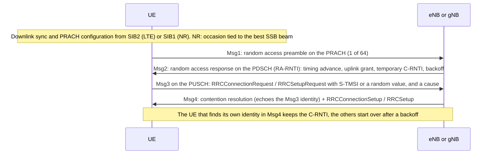

- **Contention:** two UEs can pick the same preamble in the same occasion; Msg4 resolves it. **Contention-free** random access uses a dedicated preamble assigned by the network (handover, beam failure recovery, PDCCH order) and stops after Msg2.
- **Power ramping:** each unanswered preamble is resent with more power (`powerRampingStep`), up to `preambleTransMax` attempts, after which the MAC reports a random access problem to RRC. Repeated random access failures in a log mean the base station doesn't hear the UE: uplink coverage (section 9), wrong timing, or overload (a backoff indicator in Msg2).
- **2-step random access** (NR Rel-16): MsgA carries the preamble and the Msg3 payload together, and MsgB answers both, which saves a round trip. Rel-15 LTE added **early data transmission** with user data in Msg3 for IoT devices (section 16), and Rel-17 NR **small data transmission** in RRC_INACTIVE does the same (section 14).

---

## 8. Scheduling, HARQ and layer 2

### The scheduler

Every TTI (LTE) or slot (NR), the base station's **MAC scheduler** decides which UEs transmit and receive, on which RBs, with which MCS, how many layers and with how much power. Its inputs: channel reports from each UE, buffer sizes, the QoS of each bearer or flow (section 12), pending retransmissions and fairness. The algorithm is the vendor's (proportional-fair variants are common): two networks with the same spectrum can perform very differently.

**Downlink:** a DCI on the PDCCH points at the UE's data on the PDSCH: in the same subframe in LTE; in NR, K0 slots later (K0 is often 0).

**Uplink:** the UE can't send data until it's granted resources:

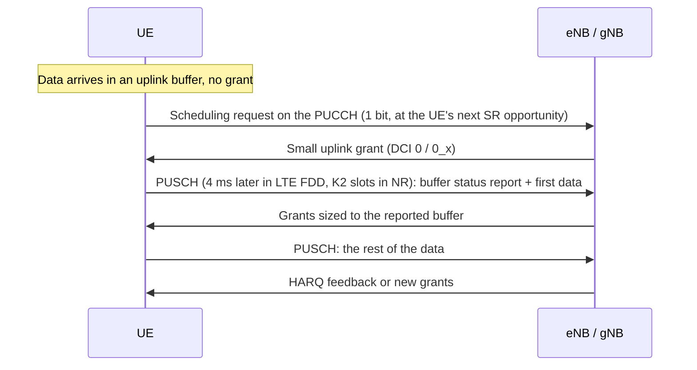

- **SR period** (configured per UE, often 5 to 20 ms in LTE) and the grant delay make up the uplink access latency: an idle uplink is slower than a busy one. A UE that sends too many SRs without getting a grant (`dsr-TransMax`) releases its PUCCH resources and falls back to random access.
- **Buffer status reports** (BSR, a MAC control element) give the amount of data per logical channel group; **power headroom reports** (PHR) give how much transmit power is left.
- **Semi-persistent scheduling** (LTE SPS, used for VoLTE) and **configured grants** (NR: type 1 entirely by RRC, type 2 activated by DCI) give periodic allocations without an SR each time: lower latency and less signaling for periodic traffic.
- **Discontinuous reception in connected mode** (C-DRX) limits when the UE monitors the PDCCH, trading latency for energy (section 15).

### Uplink power control

The UE sets each PUSCH transmission's power as (simplified, TS 36.213 / TS 38.213):

```
P = min( P_CMAX,  P0 + 10 log10(M) + α × PL + Δ_TF + f )
    P_CMAX  maximum allowed: power class, cell's p-Max, minus allowed reductions (MPR/A-MPR) for
            wide allocations and high modulation
    P0      target received power per RB, from RRC (cell and UE parts)
    M       number of allocated RBs
    α × PL  fraction (α = 0, or 0.4 to 1) of the downlink path loss, measured on reference signals
    Δ_TF    adjustment for the modulation and coding
    f       accumulated closed-loop corrections from TPC commands in DCIs
```

The open-loop part (P0, α, path loss) puts the UE roughly at the right level; the base station's TPC commands correct it. At the cell edge P reaches P_CMAX, the power headroom report goes to zero or negative, and the scheduler must give the UE **fewer RBs** to keep power per RB high enough: the uplink rate drops long before the downlink rate does. PUCCH, SRS and PRACH have their own formulas on the same principle.

### Channel reports and link adaptation

The UE reports **channel state information** (CSI), periodically on the PUCCH or on request (aperiodic, on the PUSCH):

| Report | Meaning |
|---|---|
| CQI (0-15) | The highest modulation and code rate the UE expects to decode with at most 10% block error rate (or 0.001% with the URLLC table). A summary of SINR and receiver quality, not a signal level |
| RI | Rank: how many layers the UE can receive |
| PMI | Preferred precoder from a codebook |
| CRI, SSBRI, L1-RSRP, L1-SINR | NR beam reports: best CSI-RS or SSB beams and their quality |

In NR, what the UE measures and reports is fully configured by RRC (CSI resource settings and report settings), so the report content varies between networks. The base station starts from the CQI and adjusts the MCS with its own HARQ statistics (outer loop) to target about 10% **initial block error rate**: errors are cheap because HARQ fixes them within milliseconds, and a lower target would waste capacity.

### HARQ

Each transport block is acknowledged at the physical layer:

| | LTE | NR |
|---|---|---|
| Processes | 8 (FDD), more in TDD | Up to 16 (32 for NTN) |
| Downlink | Asynchronous: any process, any time. ACK/NACK 4 ms after the data (FDD) | Asynchronous. ACK/NACK timing per transmission (K1), as short as the UE's processing time allows |
| Uplink | Synchronous: retransmission 8 ms after the original, at a fixed time (PHICH carries the ACK) | Asynchronous: retransmissions are scheduled explicitly by DCI (no PHICH) |
| Granularity | Transport block | Transport block, or code block groups (only the failed parts are resent) |

The receiver keeps a failed transmission and combines it with the retransmission (**soft combining**), usually sent with different redundancy bits (incremental redundancy): a retransmission is cheaper than starting over. A block that fails its last HARQ attempt is left to RLC.

### Layer 2: MAC, RLC, PDCP, SDAP

```
       IP packet (from the host)
            │
 SDAP       │  NR only: maps QoS flows to DRBs, marks the QFI
 PDCP       │  sequence numbers, header compression (ROHC), ciphering, integrity,
            │  reordering and duplicate removal (handover, dual connectivity), duplication
 RLC        │  segmentation and reassembly; ARQ retransmissions in AM
 MAC        │  multiplexes logical channels into transport blocks, priorities,
            │  HARQ, SR, BSR, PHR, timing advance, DRX, random access
 PHY        ▼  coding, modulation, MIMO, resource mapping
```

**MAC** maps logical channels to transport channels, chooses what goes into each uplink transport block according to logical channel priorities and prioritized bit rates (so a VoLTE packet isn't stuck behind a bulk upload), runs HARQ, random access and DRX, and exchanges **MAC control elements**: BSR, PHR, timing advance commands, DRX commands, SCell activation and deactivation, contention resolution identity, TCI state activation (NR).

| RLC mode | Behavior | Used for |
|---|---|---|
| TM (transparent) | Nothing added | Broadcast, paging, SRB0 |
| UM (unacknowledged) | Segmentation and reassembly, no retransmissions | VoLTE voice, delay-sensitive traffic |
| AM (acknowledged) | Retransmits missing segments from status reports | SRB1, SRB2, most data bearers |

**PDCP** numbers every packet (the sequence number plus a hyper frame number form the **COUNT**, an input of ciphering and integrity, section 13), compresses headers with ROHC (essential for VoLTE's 40-byte IP/UDP/RTP headers), ciphers, protects integrity, and reorders and removes duplicates when packets arrive over two paths (handover, dual connectivity). NR moved reordering from RLC to PDCP, and RLC no longer concatenates SDUs, so segments can be prepared before the grant arrives. **SDAP** (NR only) maps each QoS flow of a PDU session to a DRB and adds the QFI.

**Two levels of retransmission:** HARQ recovers most errors in milliseconds; RLC AM catches what HARQ misses, in tens of ms. TCP above sees an almost lossless link with variable delay: on cellular, IP-level loss is rare; delay variation and the time to recover from coverage gaps are what hurt. When RLC reaches its maximum number of retransmissions, the UE declares a **radio link failure** (section 14).

### Carrier aggregation and dual connectivity

- **Carrier aggregation** (CA, LTE Rel-10, NR from Rel-15): one UE uses several **component carriers** of the same base station. The **PCell** (primary cell) carries the RRC connection, NAS mobility and the PUCCH; **SCells** (secondary cells) add capacity and are activated or deactivated by MAC control elements within milliseconds as traffic demands. Downlink CA of 2 to 5 carriers is common; uplink CA is rarer because the UE's power is shared. Aggregation is a MAC function: one HARQ entity per carrier, one PDCP and RLC per bearer.
- **Dual connectivity** (DC): the UE is connected to two base stations, a **master node** (MN, with the master cell group, MCG) and a **secondary node** (SN, with the secondary cell group, SCG), each with its own MAC scheduler. Bearers are MCG bearers, SCG bearers or **split bearers**, whose PDCP sends packets over both legs. In **EN-DC** (NSA), the LTE eNB is the master node and the gNB the secondary node; the uplink of a split bearer goes over the primary path (usually NR) until the buffer exceeds a threshold. The UE shares its total power between the LTE and NR uplinks, which constrains band combinations (section 5).
- **SCG failure** (radio problems on the secondary leg) is reported to the master node, which releases or reconfigures the secondary node; the connection continues on the master cell group (section 14).

### URLLC tools

Rel-15 and Rel-16 add features for low latency and high reliability, used by industrial networks rather than public broadband ones: mini-slot scheduling, configured grants without an SR, short PUCCH, a CQI table targeting 10<sup>-5</sup> block error rate with a low-rate MCS table, **pre-emption** (an urgent transmission punctures an ongoing eMBB one, signaled by DCI 2_1), uplink cancellation, and **PDCP duplication** (the same packet sent over two carriers or two cell groups).

### Latency

Rule of thumb, connected UE, good signal, server near the operator's gateway:

| | LTE | NR SA (FR1, 30 kHz TDD) |
|---|---|---|
| Radio one-way, downlink | 2-5 ms | 1-3 ms (waiting for a downlink slot in TDD dominates) |
| Radio one-way, uplink without a grant (SR, grant, data) | 10-20 ms | 3-8 ms |
| Ping round trip to a nearby server | 25-50 ms | 10-25 ms |
| First packet from RRC_IDLE (section 14) | + 50-100 ms | + 20-50 ms; less from RRC_INACTIVE |
| LTE-M, NB-IoT | 50 ms to seconds (section 16) | |

Real values depend on the configuration (SR periods, TDD pattern, DRX), the core's location and, when roaming with home routing, the distance to the home gateway (section 12).

---

## 9. Signal measurements and link budget

### What the UE measures

| Measurement | Definition | Reported range | Depends on load? |
|---|---|---|---|
| **RSRP** | Average power of one resource element of the cell's reference signal: CRS in LTE; SSB (**SS-RSRP**) or CSI-RS in NR | -140 to -44 dBm (later releases extend the lower end) | No: it measures the cell, not the traffic |
| **RSSI** | Total power over the measurement bandwidth: serving cell, neighbors, noise | | Yes |
| **RSRQ** | N × RSRP / RSSI, with N the number of RBs measured | -19.5 to -3 dB (extended range -34 to +2.5 dB) | Yes: neighbors' traffic degrades it |
| **SINR** | Reference signal power over interference plus noise: RS-SINR in LTE (defined in Rel-13, optional reporting), **SS-SINR** and CSI-SINR in NR | About -20 to +30 dB in practice | Yes |
| **CQI** | The UE's own estimate of what it can decode (section 8) | 0-15 | Yes |

RSRP tells **how strong** the cell is (coverage); SINR, and to a lesser extent RSRQ, **how clean** it is (quality). A strong but noisy cell (high RSRP, low SINR) is an interference problem, typical at the border between two cells. A weak but clean cell (low RSRP, decent SINR) is a coverage problem, typical in basements and rural areas. Before Rel-13, LTE SINR values came only from vendor-specific measurements, which modems still report in their own formats.

### Why RSRP looks so low

RSRP is the power of **one** 15 kHz subcarrier (in NR, of one SSB subcarrier, whatever the numerology). The whole carrier is much stronger: at full load, RSSI ≈ RSRP + 10 log10(12 × N<sub>RB</sub>), which is +27.8 dB for 50 RBs (10 MHz) and +30.8 dB for 100 RBs (20 MHz). An RSRP of -91 dBm on the example cell corresponds to an RSSI of about -63 dBm when the cell is busy. Never compare an LTE RSRP with a Wi-Fi RSSI or a GSM level.

**Noise floor:** thermal noise in 15 kHz is -174 + 10 log10(15000) = -132.2 dBm; with a receiver noise figure of 5 to 9 dB, about -125 dBm per resource element. An RSRP of -110 dBm would give 15 dB of SNR in an empty network. In practice LTE and NR reuse every frequency in every cell, so **interference from neighbor cells**, not noise, limits SINR in most places; SINR above 20-25 dB is rare away from a site. LTE's always-on CRS from neighbor cells interfere even when those cells carry no traffic, which is one reason NR cells show better SINR at low load.

### Thresholds

Rule of thumb for broadband LTE on the same band; NR SS-RSRP is comparable. Read the four metrics separately, not as rows of one table, and compare with the network's own thresholds (`q-RxLevMin`, measurement events) rather than with fixed numbers:

| Quality | RSRP | RSRQ | SINR | What to expect |
|---|---|---|---|---|
| Excellent | > -80 dBm | > -10 dB | > 20 dB | Top MCS, several layers |
| Good | -80 to -90 dBm | -10 to -15 dB | 13 to 20 dB | |
| Fair | -90 to -100 dBm | -15 to -20 dB | 0 to 13 dB | Lower MCS, uplink starts to suffer |
| Poor | -100 to -110 dBm | < -20 dB | < 0 dB | Low rates, drops likely |
| Edge | -110 to -120 dBm and below | | | The edge of broadband LTE. LTE-M and NB-IoT keep working well below, with repetitions (section 16) |

**Reported values are approximate:** the standard allows an absolute accuracy of several dB, and modems average and filter differently. Compare values from the same modem type at the same place, as with Wi-Fi RSSI. How modems report these values is in section 18.

### Link budget

The **path loss** between the base station and the UE decides almost everything. Free-space path loss, FSPL (dB) = 20 log10(d in m) + 20 log10(f in MHz) - 27.55, is a lower bound; real paths add clutter, buildings and floors.

| At 2 km | B20 (806 MHz) | B3 (1815 MHz) | n78 (3500 MHz) |
|---|---|---|---|
| Free-space path loss | 96.6 dB | 103.6 dB | 109.4 dB |

The 13 dB between B20 and n78 come before walls, which also attenuate more at higher frequencies (partly compensated on n78 by beamforming gain). That's why a device indoors drops to the low bands, and why operators put coverage on 700-900 MHz.

**Downlink vs uplink:** a macro base station transmits about 46 dBm (40 W) per 20 MHz carrier, so 15.2 dBm per resource element, through 15-18 dBi antennas. A UE transmits at most 23 dBm (less after MPR) through a small antenna (0 dBi, often negative for embedded antennas). The base station compensates with better antennas and noise figure and by concentrating the UE's power on fewer RBs (section 8). The result is the same asymmetry as in Wi-Fi: at the cell edge the uplink fails first. Uplink symptoms (random access failures, low uplink rate, drops while sending) at a "reasonable" RSRP point to uplink coverage.

**Maximum coupling loss** (MCL: the total loss between the antenna connectors at which the service still works, antenna gains included) is how 3GPP compares coverage:

| Technology | MCL (3GPP study targets: TR 36.888 for LTE-M, TR 45.820 for NB-IoT) |
|---|---|
| GPRS (reference of TR 45.820) | 144 dB |
| LTE (Cat 1 and above, reference of TR 36.888) | About 140 dB |
| LTE-M (CE mode B) | 155.7 dB: LTE + 15 dB |
| NB-IoT | 164 dB: GPRS + 20 dB |

Each +10 dB reaches roughly one more wall or floor deeper indoors (rule of thumb). The extra margin of LTE-M and NB-IoT comes from repetitions: more energy per bit, paid in latency and battery (section 16).

**Example:** the device in a basement, 2 km from the site on B20: 96.6 dB of free space, plus about 20-30 dB of urban clutter, 15-20 dB to enter the building and 10-20 dB more for the basement (rule of thumb), gives 140-165 dB. Broadband LTE is marginal there; NB-IoT works.

---

## 10. Identities and the SIM

### The identifiers

| Identifier | Identifies | Format | Assigned by | Where it appears |
|---|---|---|---|---|
| **IMSI** (5G: a SUPI of type IMSI) | The subscription | MCC (3 digits) + MNC (2 or 3) + MSIN, up to 15 digits: `001 01 0000012345` | Operator | USIM. Sent in NAS only when the network asks or no temporary identity is usable |
| **SUCI** (5G) | The SUPI, concealed for the home network | Home network identifiers, routing indicator, protection scheme, key ID, ciphertext | Computed by the USIM or the modem for each use | 5G Registration Request, Identity Response |
| **GUTI** (LTE) | The UE at its MME: temporary | GUMMEI (MCC, MNC, MME group ID, MME code) + 32-bit M-TMSI | MME, reallocated regularly | Attach and TAU messages, USIM (EF_EPSLOCI) |
| **5G-GUTI** | The UE at its AMF: temporary | GUAMI (MCC, MNC, AMF region ID, AMF set ID, AMF pointer) + 32-bit 5G-TMSI | AMF | Registration, USIM (EF_5GS3GPPLOCI) |
| **S-TMSI**, **5G-S-TMSI** | A short GUTI for paging and RRC | MME code + M-TMSI; AMF set ID + AMF pointer + 5G-TMSI | Derived | Paging, RRC connection request |
| **IMEI** (5G: PEI) | The device hardware (the modem) | TAC (8 digits) + serial (6) + check digit: `49015420 323751 8` | Device manufacturer, from GSMA-allocated TACs | Requested by the network in Identity Request or in the Security Mode procedure (as IMEISV) |
| **IMEISV** | IMEI + software version | TAC + serial + SVN (2 digits) | | Same |
| **ICCID** | The SIM card itself | Up to 19-20 digits starting with `89` | SIM manufacturer, for the operator | Card only: never sent over the air |
| **MSISDN** (5G: one kind of GPSI) | The phone number | E.164 | Operator | Network. Data-only IoT SIMs may have none |
| **EID** | An eUICC chip | 32 digits | eUICC manufacturer | Remote provisioning only |
| **C-RNTI**, **I-RNTI** | The UE in one cell (connected), the UE's context in the RAN (inactive) | 16 bits; 24 or 40 bits | Base station | MAC and RRC (sections 7 and 14) |

**Permanent identities are protected by temporary ones.** After the first attach or registration, the network gives the UE a GUTI and the UE presents it instead of its IMSI, so a listener can't follow the IMSI around. The network reallocates GUTIs (at TAUs, at registrations, by explicit commands) and pages with the short S-TMSI. In LTE, the IMSI still goes in clear when the network asks for it before security is active, which IMSI catchers exploit (section 13). 5G closes that gap with the **SUCI**: the SUPI's MSIN is encrypted with the home network's public key (ECIES, profile A on Curve25519 or profile B on P-256) and only the home network's UDM can decrypt it. If the operator didn't provision a key in the USIM, the "null scheme" sends the SUPI unencrypted.

**The IMEI names the module, not the product.** A product using a certified module carries the module vendor's TAC. Operators can block IMEIs (stolen or non-compliant devices) through an equipment identity register, and IoT plans can be locked to one IMEI ("IMEI binding"): a SIM moved to another device stops working, typically with reject cause #6 (section 11).

### The USIM

The SIM card (a UICC) runs one or more applications: the **USIM** for LTE/5G access, often an **ISIM** for IMS. The USIM holds:

- **The secret key K** (and the operator constant OPc), shared only with the operator's authentication center. They never leave the card: the card computes authentication responses and session keys (Milenage or TUAK algorithms, section 13).
- **Files** the modem reads and updates:

| File | Content |
|---|---|
| EF_IMSI, EF_AD | IMSI; MNC length (2 or 3 digits) |
| EF_ICCID | Card serial |
| EF_EHPLMN, EF_HPLMNwAcT | Home and equivalent home PLMNs |
| EF_OPLMNwAcT, EF_PLMNwAcT | Operator- and user-controlled preferred PLMNs with their access technologies: the roaming preference lists (section 11) |
| EF_HPPLMN | Interval for searching higher-priority PLMNs while roaming |
| EF_FPLMN | Forbidden PLMNs, written by the modem after certain rejects (section 11) |
| EF_EPSLOCI, EF_5GS3GPPLOCI | Last GUTI, last registered tracking area, update status |
| EF_EPSNSC, EF_5GS3GPPNSC | Stored NAS security context, so a later attach can skip authentication |
| EF_ACC | Access class (section 7) |
| EF_SPN | Service provider name |
| EF_UST | USIM service table: which optional services and files the card supports |

Because registration state lives on the card, a SIM moved to another device brings its forbidden PLMN list, its last GUTI and its stored security context with it.

**PIN and PUK:** 3 wrong PINs block the card, 10 wrong PUKs make it permanently unusable. Products usually ship with the PIN disabled, or set it and store it in the device: a PIN-protected SIM in an unattended device must be unlocked by software at every boot.

**SIM toolkit (USAT):** the card can run applets that issue proactive commands to the modem: send an SMS, open a data channel, refresh files, provide local information. Operators use it with **OTA** updates (over SMS or data) to change roaming lists or profiles. A `REFRESH` command can make the modem re-read the card and register again: an unexplained detach and reattach in a log can come from the SIM.

### Form factors and eSIM

| Form factor | Size | Notes |
|---|---|---|
| 2FF (mini) | 25 × 15 mm | Older devices, industrial holders |
| 3FF (micro) | 15 × 12 mm | |
| 4FF (nano) | 12.3 × 8.8 mm | Phones |
| MFF2 | 5 × 6 mm, soldered (DFN-8) | Embedded SIM chip: vibration, temperature, tamper resistance. Industrial grades have higher write endurance and data retention |
| iSIM | Inside the modem SoC | A secure enclave in the chip runs the SIM: no separate part |

An **eUICC** ("eSIM") is a UICC whose operator **profiles** are downloaded and switched remotely, so one hardware SKU can be connected anywhere and change operator in the field. Form factor and eUICC are independent: an eUICC can be a plug-in card, an MFF2 or an iSIM.

| GSMA specification | For | How profiles are managed |
|---|---|---|
| SGP.02 ("M2M") | IoT, older | Pushed by the operator's platform (SM-DP and SM-SR) over SMS or data. Profiles from operators connected to that SM-SR |
| SGP.22 ("consumer") | Phones, tablets, laptops | A local profile assistant (LPA) in the device downloads profiles from an SM-DP+ server with an activation code (the QR code). Needs a user |
| SGP.32 ("IoT") | Headless IoT devices | Like SGP.22, driven remotely through an eSIM IoT remote manager (eIM) instead of a user. Recent: check support in modules, eUICCs and operators |

A profile download needs connectivity, usually through a bootstrap profile loaded at manufacturing.

---

## 11. Getting service: network selection, RRC connection, attach and registration

### PLMN selection

In automatic mode (the default), the modem chooses a network in this order (TS 23.122):

1. The last registered PLMN (RPLMN), or the **home PLMN** and its **equivalent home PLMNs** (EF_EHPLMN), depending on configuration.
2. PLMNs in the **user-controlled** list (EF_PLMNwAcT), then in the **operator-controlled** list (EF_OPLMNwAcT), in order, with the access technologies they name.
3. Other PLMNs with "high quality" signal (RSRP ≥ -110 dBm for E-UTRA), in random order; then the others, strongest first.

PLMNs in the **forbidden list** are skipped. While roaming, the modem periodically looks for a higher-priority PLMN (the EF_HPPLMN interval; 60 minutes by default). In **manual mode** (`AT+COPS=1,...`), it registers only on the chosen PLMN. Equivalent PLMNs received in the Attach or Registration Accept are treated as the registered PLMN for cell selection and mobility.

**Cell selection:** on the chosen PLMN, the UE camps on a cell that is not barred and passes the **S criterion** (TS 36.304, TS 38.304): Srxlev = measured RSRP - (`q-RxLevMin` + offsets) - power compensation > 0, plus a minimum RSRQ (Squal) in LTE. `q-RxLevMin` is broadcast in SIB1, often around -120 to -128 dBm. Once camped, **cell reselection** keeps the UE on the best cell while idle (section 14). A cell can be **suitable** (right PLMN, not barred, not in a forbidden tracking area) or only **acceptable** (any PLMN): on an acceptable cell the UE can only make emergency calls ("limited service").

### RRC connection

To send anything to the core, the UE first needs an RRC connection: random access (section 7), then:

| LTE message | NR message | Direction | Content |
|---|---|---|---|
| RRCConnectionRequest (Msg3) | RRCSetupRequest | UE → BS | UE identity (S-TMSI or a random value), **establishment cause**: emergency, highPriorityAccess, mt-Access (answering paging), mo-Signalling, mo-Data, mo-VoiceCall, delayTolerantAccess (IoT) |
| RRCConnectionSetup (Msg4) | RRCSetup | BS → UE | Configuration of SRB1, MAC and PHY |
| RRCConnectionSetupComplete | RRCSetupComplete | UE → BS | Selected PLMN, registered MME/AMF hint, and the first NAS message (attach or registration request, service request, TAU) |
| RRCConnectionReject | RRCReject | BS → UE | Overload or barring, with a wait time |

The base station forwards the NAS message to the right MME or AMF in an S1AP/NGAP **Initial UE Message**; from then on the core and the UE exchange NAS messages through the base station (downlink and uplink NAS transport). The core then sets up the UE's context in the base station (**Initial Context Setup**): security keys, the bearers or PDU session resources, and the UE's radio capabilities.

### UE capabilities

The radio capabilities (bands, band combinations, layers, features per combination) are large, sometimes tens of kilobytes for a 5G phone. The UE sends them once, on request:

1. If the MME/AMF has no stored capabilities for the UE, the base station sends **UECapabilityEnquiry** (filtered by RAT and bands of interest) and the UE answers with **UECapabilityInformation**.
2. The base station uploads them to the core, which stores them for the UE's next connections, so they aren't requested every time.
3. Rel-16 adds **UE radio capability IDs**: a short identifier for a known capability set, so a network only fetches the full set once per device model.

A UE whose capabilities changed (a firmware update enabling bands, SA turned on or off) signals it in its next attach, TAU or registration, so the network discards the stored copy. Missing capabilities in a log ("why doesn't the network configure CA or EN-DC?") is one of the most common explanations for lower-than-expected performance.

### LTE attach

Attaching makes the UE known to the MME and, in LTE, always creates a first PDN connection with its default bearer: an attached LTE device has an IP session.

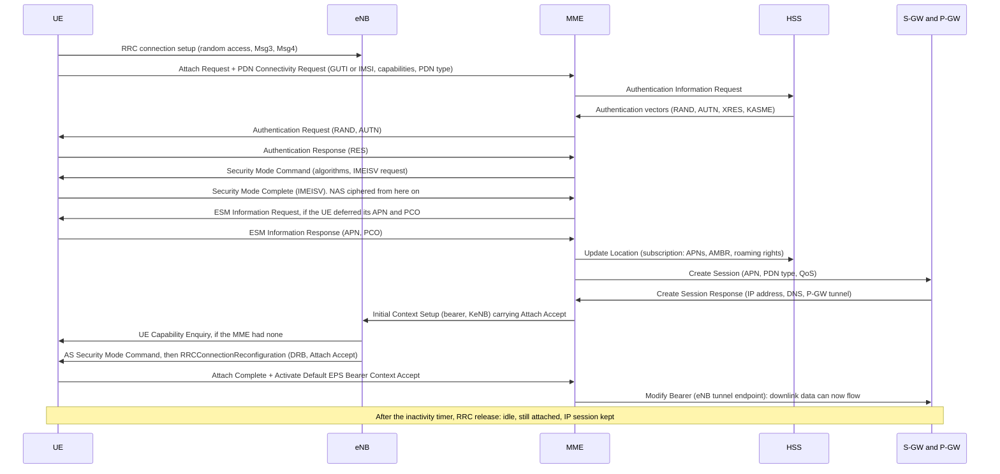

- **Attach Accept** carries the GUTI, the TAI list, timers (T3412 and, if negotiated, PSM and eDRX values, section 15), equivalent PLMNs and network feature support (IMS voice over PS, emergency bearers, CIoT optimizations). The **Activate Default EPS Bearer Context Request** inside it carries the APN, the PDN address, the QoS and the PCO (DNS, MTU).
- With a valid GUTI and a stored security context, the MME may skip authentication or fetch the context from the previous MME. The IMSI is sent only when no GUTI is usable (Identity Request).
- If the attach carries no APN, the network uses the subscription's **default APN** from the HSS.
- **Combined attach** (EPS and non-EPS) also registers the UE in the circuit-switched domain for SMS over SGs and CS fallback. An "EPS only" result with cause #18 (CS domain not available) is normal on LTE-only networks.
- **Voice-centric vs data-centric UEs** (TS 24.301 annex): a UE configured as voice-centric that gets neither IMS voice nor CS fallback on LTE is required to disable E-UTRA and look for another technology. A data-only IoT device must be data-centric, or it can leave LTE on networks without VoLTE.
- **Detach:** the UE sends a Detach Request when switching off (`AT+CFUN=0` does it cleanly; cutting power doesn't). The network can detach a UE too, with a cause, and ask it to reattach.

### 5G registration

5G separates the two steps: **registration** makes the UE known to the AMF, and a **PDU session** (section 12) is a separate procedure, requested when needed. A registered UE may have no session at all.

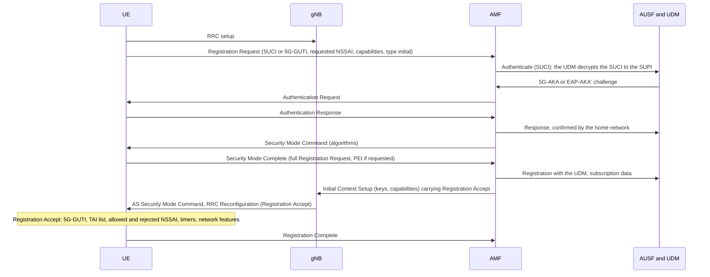

- **Registration types:** initial, mobility registration update (a new tracking area outside the list, or changed capabilities), periodic registration update (T3512), emergency.
- Before security is active, the UE sends only a minimal set of "cleartext" information elements; the full Registration Request is sent again inside the Security Mode Complete, protected.
- The Registration Accept says which **slices** (S-NSSAIs) are allowed and which are rejected, and why (section 17).
- **Service Request** (both systems) is the procedure that restores the signaling connection and user plane for a UE that is registered but idle (section 14).

### Tracking areas and periodic updates

Cells are grouped in **tracking areas** (TAC in SIB1). The network gives the UE a **TAI list**: it moves freely among those tracking areas while idle; entering one outside the list triggers a **tracking area update** (TAU) in LTE or a mobility registration update in 5G. The TAI list is where the network pages the UE (section 14). A large list means fewer updates but more paging load.

The UE also updates **periodically** (T3412 in LTE, T3512 in 5G; 54 minutes by default, much longer with PSM, section 15). If the network hears nothing for longer than its mobile reachable timer (by default 4 minutes more than the periodic timer) and then its implicit detach timer, it deregisters the UE without telling it. The UE finds out at its next attempt, through a reject (#9 "UE identity cannot be derived by the network" or #10 "implicitly detached"), and attaches again.

### Reject causes

NAS rejects carry a cause (EMM causes in TS 24.301 annex A, 5GMM causes in TS 24.501 annex A, mostly the same numbers). The cause decides what the UE does next, which matters more than the rejection itself for an unattended device:

| Cause | Meaning | What the UE does (simplified) | Usual reason |
|---|---|---|---|
| #3 Illegal UE, #6 Illegal ME | Authentication failed, or the IMEI isn't accepted | Considers the USIM **invalid** for all services until power off or SIM removal | Wrong credentials, blocked or unbound IMEI |
| #7 EPS services not allowed (5G: 5GS services not allowed) | No LTE (5G) data in the subscription | USIM invalid for that system until power off | Provisioning error, plan without LTE or 5G |
| #8 EPS and non-EPS services not allowed | No service at all | USIM invalid until power off | Suspended or deactivated SIM |
| #9, #10 | UE identity can't be derived / implicitly detached | Attaches again with a new identity | Network lost the context, missed periodic updates |
| #11 PLMN not allowed | No rights on this network | Adds the PLMN to the **forbidden list on the USIM**, selects another | Roaming not allowed with this operator |
| #12 Tracking area not allowed | Regional restriction | Forbids the tracking area until power off or a timeout (12-24 h) | Regional subscription |
| #13 Roaming not allowed in this tracking area | | Forbids the tracking area for roaming, selects another PLMN | Regional roaming limits, steering of roaming |
| #14 EPS services not allowed in this PLMN | | Adds the PLMN to a forbidden list for data (kept in the modem) | No LTE data roaming agreement |
| #15 No suitable cells in tracking area | | Forbids the tracking area for roaming, searches another tracking area of the same PLMN | E.g. a technology not allowed for this subscription (LTE-M or NB-IoT) |
| #17 Network failure | Core-side failure | Retries with back-off | Core problem, or deliberate steering of roaming |
| #19 ESM failure | The attach failed because the default bearer failed | Retries; the real cause is the ESM cause (section 12) | Wrong or missing APN |
| #22 Congestion | Overload | Waits for the back-off timer given by the network (T3346) | Network overload, often after an outage |
| #31 Redirection to 5GCN required | | Registers on 5G instead | Operator policy |
| 5GMM #27 N1 mode not allowed | 5G not allowed | Disables 5G NAS for this PLMN, uses LTE | Subscription without 5G SA |
| 5GMM #62 No network slices available | Requested slices not allowed | Waits, retries with other slices | Slice not in the subscription or not in this area |

- **Some rejects persist:** #3, #6, #7 and #8 make the modem stop trying until it's power-cycled or the SIM is reinserted, and #11 writes to the USIM's forbidden list, which survives reboots and moves with the card. An unattended device needs a recovery plan: power-cycle the modem after a long outage, clear the forbidden list (section 18) once the cause is fixed. Unauthenticated rejects from a fake base station have the same effect (section 13), which is why recent releases let the UE treat rejects received before security more cautiously.
- **Retry timers:** after a failed attach or registration the UE waits T3411 (10 s) and retries; after 5 failures it waits **T3402** (12 minutes by default, or a value sent by the network) before starting over. 5G uses T3511 and T3502 the same way. "The device takes 12 minutes to come back" is this timer.
- **Don't fight the network:** a fleet of devices that reset their modems and reattach in a loop after an outage creates a signaling storm. GSMA TS.34 (IoT device connection efficiency) asks devices to back off with randomized delays, avoid synchronized reconnections, and not reset the modem as a first resort.

---

## 12. Data sessions: APNs, bearers, PDU sessions, QoS and IP

### APN and DNN

The **APN** (LTE) or **DNN** (5G) names the packet data network a session connects to: `internet`, an operator's IMS network (`ims`), a private network (`mgmt.example`). The network completes it with an operator identifier (`mgmt.example.mnc001.mcc001.gprs`), resolves that name in its own DNS to select the gateway (P-GW or SMF/UPF), and checks it against the subscription.

| APN problem | What you see |
|---|---|
| Unknown APN, or not in the subscription | Session rejected with ESM #27 / 5GSM #27 "missing or unknown APN/DNN"; in LTE the whole attach fails with EMM #19 |
| Valid APN, wrong network (a private APN instead of the internet one) | Session up, IP address assigned, nothing reachable |
| Private APN expecting credentials | Rejected with #29 "user authentication failed" until PAP or CHAP credentials are set (sent in the PCO, checked by a RADIUS server behind the gateway) |
| Attach APN differs from the data APN | Works on some networks, rejected on others: the attach (initial bearer) APN is a separate setting in most modems |

Many networks accept an empty APN for the internet, but a product shouldn't rely on it: configure the APN the operator documents.

### PDN and PDU session types

| Type | Gives | Notes |
|---|---|---|
| IPv4 | One IPv4 address | Usually behind CGNAT (`100.64.0.0/10` or private ranges) |
| IPv6 | A /64 prefix | Common on modern mobile APNs, with NAT64/DNS64 for IPv4 destinations |
| IPv4v6 | Both in one session | The best request: the network gives what the subscription allows, and says so when it allows only one (#50 "IPv4 only allowed", #51 "IPv6 only allowed") |
| Non-IP / Unstructured | Opaque data units | CIoT (section 16): delivered through the SCEF/NEF or a tunnel to an application server |
| Ethernet | Ethernet frames | 5G only: industrial LANs, 5G LAN services |

### QoS in LTE: bearers

A **PDN connection** has one **default bearer**, created with it and kept as long as the connection exists, plus optional **dedicated bearers** created by the network for traffic that needs different QoS (VoLTE voice). Each EPS bearer maps one-to-one to a DRB on the radio and a GTP tunnel in the core, and is identified by an EPS bearer ID (5 to 15: at most 11 bearers per UE).

- **Traffic flow templates** (TFT): packet filters (addresses, ports, protocol, DSCP) that decide which bearer a packet uses. The network installs them in the UE (uplink) and the gateway (downlink); packets that match no filter use the default bearer.
- **Dedicated bearers are network-initiated** in practice: the IMS (or another application function) asks the PCRF for resources, the PCRF installs rules in the P-GW, and the P-GW triggers bearer creation towards the UE (Activate Dedicated EPS Bearer Context Request).

Each bearer has:

| Parameter | Meaning |
|---|---|
| **QCI** (QoS class identifier, TS 23.203) | Priority, packet delay budget and loss target, which the scheduler uses |
| **ARP** (allocation and retention priority) | Who wins when resources are short: priority level, whether the bearer can pre-empt others and be pre-empted. Admission control, not scheduling |
| **GBR / MBR** | Guaranteed and maximum bit rates, for GBR bearers only |
| **APN-AMBR, UE-AMBR** | Aggregate maximum bit rate of all non-GBR bearers, per APN and per UE: the "speed limit" of a data plan, enforced by the gateway and the base station |

| QCI | Type | Delay budget | Loss | Example |
|---|---|---|---|---|
| 1 | GBR | 100 ms | 10<sup>-2</sup> | VoLTE voice |
| 2 | GBR | 150 ms | 10<sup>-3</sup> | Video calls |
| 5 | Non-GBR | 100 ms | 10<sup>-6</sup> | IMS signaling (default bearer of the IMS APN) |
| 6, 8, 9 | Non-GBR | 300 ms | 10<sup>-6</sup> | TCP traffic; **9 is the usual default bearer** of internet APNs |
| 7 | Non-GBR | 100 ms | 10<sup>-3</sup> | Interactive video, gaming |
| 65, 66, 69, 70 | Mixed | | | Mission-critical push-to-talk and data |

### QoS in 5G: PDU sessions and QoS flows

A **PDU session** (identified by a PDU session ID, up to 15 per UE) connects to one DNN in one slice (S-NSSAI). QoS is finer-grained than bearers: within the session, packets are classified into **QoS flows**, each identified by a **QFI** and described by a **5QI**, an ARP and, for GBR flows, GFBR/MFBR.

| Element | Role |
|---|---|
| **QoS rules** (in the UE) | Packet filters mapping uplink packets to a QFI, sent by the SMF; one is the default rule |
| **PDRs** (in the UPF) | The same for downlink packets, installed by the SMF over N4 |
| **5QI** | Standardized values reuse the QCI numbers (1 for voice, 5 for IMS signaling, 9 for default traffic) and add **delay-critical GBR** classes (82-90) with a maximum data burst volume, for URLLC |
| **Session-AMBR, UE-AMBR** | Aggregate limits, as in LTE |
| **Reflective QoS** | The UE derives uplink rules from the QFI marked on downlink packets, so the network doesn't have to send explicit rules for each flow |

The gNB's SDAP layer maps QoS flows onto DRBs **as it chooses**: several flows can share a DRB, which decouples the core's QoS model from radio bearer management. That's the main structural difference from LTE, where bearer = DRB = tunnel.

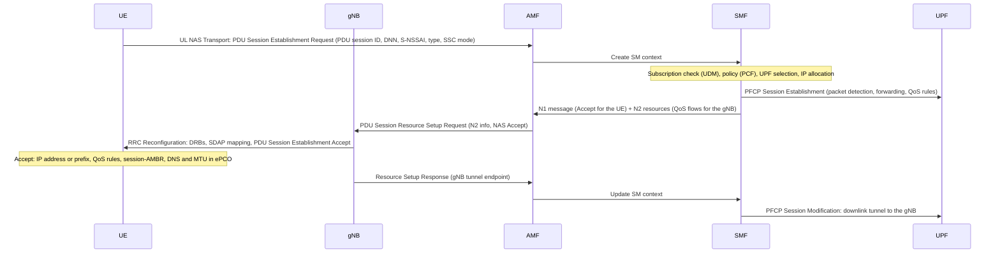

The **SSC mode** (session and service continuity) says what happens when the UE moves far from its anchor UPF: mode 1 keeps the same anchor and IP address (the usual mode, and LTE's behavior), mode 2 releases the session and creates a new one (new address), mode 3 creates the new session before releasing the old one.

### IP configuration

| Item | How it reaches the UE |
|---|---|
| IPv4 address | In the NAS session accept (PDN address / PDU address). Deferred allocation over DHCPv4 after the session exists is specified but rare |
| IPv6 | The network gives a 64-bit **interface identifier** in NAS, for the link-local address only. The UE sends a Router Solicitation over the session, and the gateway answers with a Router Advertisement carrying a **/64 prefix dedicated to this session** (RFC 6459). The UE forms its global addresses with any interface identifier (privacy addresses work) |
| DNS servers | In the **PCO** (protocol configuration options, ePCO in 5G and NB-IoT): a container in the NAS messages, filled when the UE requests the items |
| MTU | IPv4 link MTU in the PCO (since Rel-10, if the UE asks); IPv6 MTU in the Router Advertisement; non-IP MTU in the PCO |
| P-CSCF addresses | In the PCO, for IMS (section 17) |

- The whole /64 belongs to the UE: the gateway routes it over the point-to-point session, and the device can share it with hosts behind it ([fundamentals note, section 21](../../networking/fundamentals/fundamentals.md#f-ipv6-for-the-pc), RFC 7278). Prefix delegation of shorter prefixes exists (Rel-10) but few mobile networks offer it.
- **MTU:** operators commonly advertise 1500 or something between about 1400 and 1460 (operator-dependent), to leave room for GTP and transport tunnels (section 4). A host that ignores the advertised MTU sees the classic path MTU black holes (see the [fundamentals note](../../networking/fundamentals/fundamentals.md#11-icmp-mtu-and-fragmentation)).
- **IPv6-only APNs** reach IPv4 servers through NAT64/DNS64 in the network, and IPv4-only applications need a CLAT on the device (464XLAT, RFC 6877).
- The modem learns all these values from NAS; the host must apply them. That split is in the [fundamentals note](../../networking/fundamentals/fundamentals.md#control-plane-and-data-plane).

### Session lifetime

- **The session survives idle mode.** Releasing the RRC connection releases radio resources and the base station's tunnels, not the PDN connection or the IP address. The next packet triggers a **service request**, which restores the DRBs and tunnels in tens of ms (section 14).
- The network can modify a session (new QoS, new TFT) or deactivate it with a cause: #36 "regular deactivation", #39 "reactivation requested" (reconnect; a new address may follow), #8 "operator determined barring". Some operators also release sessions idle for many hours (operator-dependent).
- A gateway failure drops sessions; the UE learns it when it next uses the session or from a network-initiated detach or release.

### ESM and 5GSM causes

| Cause | Meaning | Usual reason |
|---|---|---|
| #26 Insufficient resources | | Overload; retry with back-off |
| #27 Missing or unknown APN / DNN | | Wrong APN, or not in the subscription |
| #28 Unknown PDN / PDU session type | | Type not supported by the network |
| #29 User authentication failed | | Private APN credentials wrong or missing |
| #30, #31 Request rejected by the gateway / unspecified | | Gateway policy, subscription, address pool exhausted |
| #32, #33 Service option not supported / not subscribed | | Feature or APN not in the plan |
| #50, #51 PDN type IPv4 only / IPv6 only allowed | Not an error: the session came up with one family | IPv4v6 requested, subscription allows one |
| #55 Multiple PDN connections for a given APN not allowed | | A second session on the same APN |
| 5GSM #54 PDU session does not exist | | Stale session state after a network event |
| 5GSM #69 Insufficient resources for specific slice | | Slice overload |

### Roaming

| | Home routing | Local breakout |
|---|---|---|
| Gateway | Home network's P-GW/UPF, reached over the roaming exchange (S8 / N9) | Visited network's gateway |
| IP address and geolocation | From the home network: the device "is" in its home country | From the visited network |
| Latency | Adds the round trip to the home country | Local |
| Used for | Almost all data roaming, most IoT SIMs | IMS voice, some IoT and enterprise offers |

- Global IoT SIMs are often **permanently roaming**: an IMSI from one country used everywhere, home-routed. Some countries and operators restrict permanent roaming, and LTE-M and NB-IoT roaming agreements are less complete than LTE ones: check each target market.
- **Steering of roaming:** the home network prefers some partners and can reject attaches on others (often with #17 or #13) until the device tries a preferred one. In a log it looks like a series of rejects in a new country before a successful attach. 5G standardizes steering through the UDM (a list of preferred PLMNs delivered at registration) instead.

---

## 13. Security: authentication, keys, ciphering and known attacks

### Authentication and key agreement (AKA)

Both sides share the USIM's secret key K; nothing secret crosses the air:

1. The home network (HSS/AuC in LTE, UDM/ARPF in 5G) picks a random **RAND** and computes, from K and a sequence number **SQN**: the expected response **XRES**, an authentication token **AUTN** (SQN masked by an anonymity key, a management field and a MAC), and the keys CK and IK.
2. The serving network sends RAND and AUTN. The USIM checks the MAC (the network knows K: this is **mutual authentication**, which 2G lacked) and that SQN is in the accepted range (no replay), then computes **RES**.
3. The network compares RES with XRES. Both sides now derive a key nobody else can compute: K<sub>ASME</sub> in LTE; K<sub>AUSF</sub>, then K<sub>SEAF</sub> and K<sub>AMF</sub> in 5G.

| Variant | Where | Notes |
|---|---|---|
| EPS-AKA | LTE | The serving network (MME) checks RES against XRES from the HSS |
| 5G-AKA | 5G | The **home** network (AUSF) also confirms the result, so a visited network can't claim an authentication that didn't happen |
| EAP-AKA' | 5G | The same exchange carried in EAP; also used for non-3GPP access to the core |
| EAP-TLS and other EAP methods | 5G private networks | Certificate-based access without a USIM key |

**Authentication failures** reported by the UE in an Authentication Failure message: **MAC failure** (#20: the network failed to prove it knows K: a fake or misconfigured network, or the wrong SIM profile), **synch failure** (#21: the sequence numbers drifted; the UE sends resynchronization data and the network retries, which is normal now and then), **non-EPS authentication unacceptable** (#26: the vector wasn't generated for LTE).

### NAS and AS security contexts

- A successful authentication creates a **NAS security context**, identified by a key set identifier (eKSI in LTE, ngKSI in 5G). It is reused across connections, and stored in the USIM or the modem when the UE switches off, so a later attach or registration can skip authentication.
- **NAS security** is activated by the MME/AMF with a **Security Mode Command** (chosen algorithms, the UE's own security capabilities echoed back to detect bidding-down attacks). **AS security** is activated separately by the base station with its own Security Mode Command, once per RRC connection.
- Every protected message carries a sequence number; PDCP and NAS **COUNT** values feed ciphering and integrity, and protect against replay.

### Key hierarchy

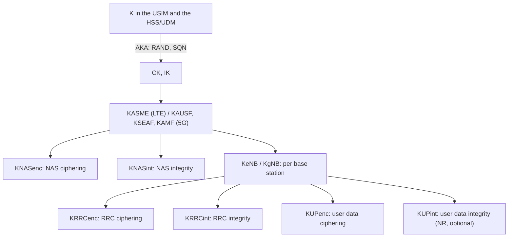

**Keys at handover:** the base station key changes at every handover. A **horizontal** derivation (from the current K<sub>eNB</sub>/K<sub>gNB</sub>) gives backward security: the target can't compute the keys used before. A **vertical** derivation from the **next hop** parameter (NH), which the core provides for later handovers, gives forward security: after two hops, the old base station can no longer compute the new keys. The NH chaining counter (NCC) in the handover command tells the UE which derivation to use.

### Algorithms

| LTE | NR | Algorithm | Notes |
|---|---|---|---|
| EEA0, EIA0 | NEA0, NIA0 | Null | No ciphering is allowed by the standard. Null integrity only for emergency calls without authentication |
| EEA1, EIA1 | NEA1, NIA1 | SNOW 3G | 128-bit |
| EEA2, EIA2 | NEA2, NIA2 | AES-128 (CTR, CMAC) | The usual choice |
| EEA3, EIA3 | NEA3, NIA3 | ZUC | Mainly China |
| | NEA4-6, NIA4-6 | SNOW 5G, AES-256, ZUC-256 | 256-bit algorithms, Rel-19; adoption will take years |

The network chooses among the algorithms the UE declares. Some networks have used **no ciphering** (EEA0); a modem log shows the selected algorithms in the Security Mode Command.

### What is protected, and where

| | Protected | Not protected |
|---|---|---|
| Broadcast: MIB, SIBs, paging | | Anyone can transmit them: not authenticated |
| Before security activation: RRC connection setup, Attach/Registration Request (in 5G, only cleartext IEs), Identity Request, Authentication messages, rejects | | Visible, and forgeable by a fake base station |
| NAS after Security Mode | Ciphered and integrity-protected | |
| RRC after AS Security Mode | Ciphered and integrity-protected | |
| User data on the radio | Ciphered (PDCP) | **LTE: no integrity protection.** NR: integrity protection specified per DRB but optional and rarely enabled; Rel-15 devices may only support it at low rates |
| User data beyond the base station | | Cellular security **ends at the eNB/gNB**. Backhaul may be IPsec (operator choice); inside the core, packets are plaintext in GTP tunnels |

### Known attacks

- **Fake base stations ("IMSI catchers"):** a transmitter that broadcasts a stronger cell of the target's PLMN. Before security, it can ask for the IMSI (LTE sends it in clear when asked), page, or send **unauthenticated rejects**. A reject with #7 or #8 makes many UEs consider their USIM invalid until reboot (section 11): an easy denial of service against unattended devices. Recent releases make UEs handle unprotected rejects more cautiously (counters and timers before acting), but deployed behavior varies.
- **2G downgrade:** GSM authenticates only the device and its A5/1 cipher is broken (A5/0 is none). A fake GSM cell plus jamming of LTE makes a device fall back and talk to the attacker. Disabling 2G (and 3G) in the modem's allowed technologies where the product doesn't need them closes it.
- **No user-plane integrity in LTE:** ciphertext can be modified in transit without detection; the aLTEr research attack (2019) used it to redirect DNS answers. NR's optional integrity protection addresses it when enabled.
- **Unauthenticated broadcasts:** public warning messages and system information can be spoofed.
- **5G improvements:** SUCI hides the permanent identity, the home network confirms authentication, user-plane integrity is possible, key separation is better. Messages before security are still unprotected, so fake base stations remain a problem.
- **Baseband vulnerabilities:** modem firmware parses complex messages from anyone in range before any authentication. Exploitable bugs have been published for every major vendor's basebands: keep modem firmware updated and treat the modem as an untrusted peripheral.

### What it means for a device

- **Encrypt end to end** (TLS, a VPN): cellular ciphering protects only the radio hop, and the operator sees everything else.
- A **private APN** reduces exposure (no internet routing, no inbound scanning), but it's still the operator's network: keep TLS.
- Disable technologies you don't need (2G, 3G), prefer SA 5G where available for SUCI, and don't let a reject leave the device unreachable forever (power-cycle recovery, section 11).
- **SIM theft:** a SIM taken out of a device works elsewhere unless a PIN is set or the plan is IMEI-bound (section 10).

---

## 14. RRC states and mobility: paging, reselection, handover, 4G-5G interworking

### RRC states

| State | Where the network knows the UE | Who decides mobility | To send data | UE context |
|---|---|---|---|---|
| **RRC_CONNECTED** | Cell (and beam, in NR) | Network: handover | Immediately, with a grant | In the RAN and the core |
| **RRC_INACTIVE** (NR; LTE connected to a 5GC) | RAN notification area (RNA): one or more cells or tracking areas | UE: reselection | After a resume: one round trip | Stored in the last serving gNB (anchor) and the UE; the core still sees CM-CONNECTED |
| **RRC_IDLE** | Tracking area list (core) | UE: reselection | After paging or a service request: new RRC connection, context restored from the core | Core only |

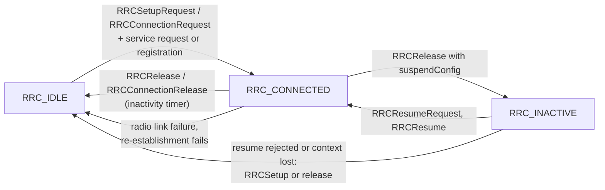

- **Inactivity timer:** after the last packet, the base station keeps the UE connected for a while (operator-dependent, often 5 to 20 s), then releases it. Every transmission after a quiet period therefore costs a connection setup (latency, section 8) and a "tail" of connected time (energy, section 15). Many small transmissions spread out cost far more than the same bytes in one burst.
- **RRC_INACTIVE** keeps the AS context (security, bearer configuration) in the UE and its anchor gNB. The release message gives the UE an **I-RNTI** and an RNA. To transmit, or when paged, the UE sends `RRCResumeRequest` with its I-RNTI, possibly to a different gNB, which fetches the context from the anchor over Xn. Leaving the RNA triggers an **RNA update** (a resume with cause `rna-Update`, usually answered by a new release). Rel-17 **small data transmission** (SDT) sends small uplink packets during the resume procedure without entering RRC_CONNECTED.
- LTE has an older relative for IoT: **RRC suspend/resume** (user plane CIoT optimization, Rel-13, section 16).
- **The IP session stays up in idle and inactive** (section 12): only radio resources come and go.

### Paging and service request

Downlink data for an idle UE waits at the gateway, which tells the core; the core pages the UE in every cell of its TAI list, and the UE reconnects:

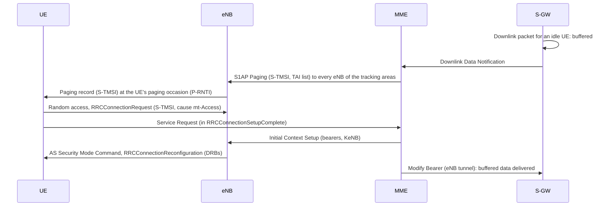

- **Paging occasions:** an idle UE listens only at its **paging frame** and **paging occasion** within each **DRX cycle** T (32, 64, 128 or 256 frames: 0.32 to 2.56 s): SFN mod T = (T div N) × (UE_ID mod N), with UE_ID = IMSI mod 1024 in LTE and 5G-S-TMSI mod 1024 in NR. The cell broadcasts a default cycle; the UE can request a shorter UE-specific one at attach or registration. The downlink latency to an idle UE is up to one cycle plus the connection setup.
- **NR paging** is beam-swept like the SSB, and in RRC_INACTIVE the gNB pages within the RNA (**RAN paging**, with the I-RNTI); the core is not involved.
- The paging message can also carry system information change and public warning notifications, so idle UEs read it even when nothing is addressed to them.
- An uplink transmission from idle is the same procedure without the paging steps (cause `mo-Data` or `mo-Signalling`). In 5G, the Service Request lists the PDU sessions to reactivate.

### Idle mobility: cell reselection

In idle and inactive, the UE moves between cells on its own, following rules broadcast in system information (TS 36.304, TS 38.304):

- **Absolute priorities** per frequency and technology (`cellReselectionPriority`): the UE always measures higher-priority layers, and moves to one when its cell is above `threshX-High`. It moves to a lower-priority layer only when its serving cell drops below `threshServingLow` and the target is above `threshX-Low`.
- **Ranking** among cells of equal priority (usually the same frequency): the best cell by RSRP with a hysteresis (`q-Hyst`) and per-neighbor offsets, held for `t-Reselection` (around 1 s).
- **Measurement rules save energy:** the UE measures other cells of its frequency only when the serving cell drops below `s-IntraSearch`, and lower-priority frequencies only below `s-NonIntraSearch`. Rel-16 adds relaxed measurements for stationary or cell-center devices.
- The network moves idle devices to the layer it wants (from 3.5 GHz to 800 MHz, from LTE to NR SA) through these priorities, and can push dedicated priorities in the release message (`idleModeMobilityControlInfo`, `cellReselectionPriorities`).

### Connected mobility: measurements and handover

**Measurement configuration** is sent in RRC reconfiguration and links three lists: **measurement objects** (the frequencies to measure, with neighbor lists or blacklists), **report configurations** (the event and its parameters) and **measurement IDs** pairing them. Filtering of the results (layer 3 filter coefficient) and the measured quantities are also configured. Measuring another frequency needs **measurement gaps** if the UE has only one receiver chain for it: typically 6 ms every 40 or 80 ms in LTE, configurable patterns in NR, during which the UE can't be scheduled.

| Event | Triggers when |
|---|---|
| A1 / A2 | Serving cell better / worse than a threshold (start or stop measuring other frequencies, release a gap) |
| A3 | A neighbor becomes better than the serving cell by an offset: the classic intra-frequency handover trigger |
| A4 / A5 | A neighbor better than a threshold / serving worse than one threshold and neighbor better than another |
| A6 | A neighbor better than an SCell by an offset (carrier aggregation) |
| B1 / B2 | Same as A4 / A5 for another technology. B1 on NR adds the NR leg in EN-DC |

Each event has a hysteresis and a **time-to-trigger**; the UE then sends a **MeasurementReport**, periodically repeated while the condition holds if configured.

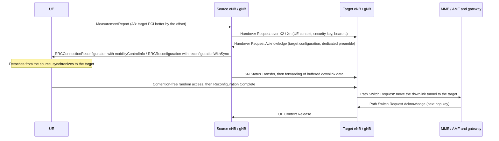

- The data interruption is typically some tens of ms in LTE (rule of thumb). The IP address doesn't change: the gateway is the anchor (section 4). Unlike Wi-Fi roaming, there is no new authentication or DHCP.
- Without X2/Xn between the two base stations, the handover goes through the core (S1/N2 handover), and between MMEs or AMFs the UE context moves with it.
- **Improvements:** conditional handover (Rel-16: the target is prepared in advance and the UE executes when a condition is met, avoiding a late command), DAPS handover (Rel-16: the UE keeps receiving from the source until the target works), L1/L2-triggered mobility (Rel-18: cell changes driven by lower-layer measurements, faster than RRC).

### Radio link failure and re-establishment

The UE declares a **radio link failure** (RLF) when:
- the downlink becomes undecodable for too long: N310 consecutive out-of-sync indications from the physical layer start timer **T310**, which expires without N311 in-sync indications;
- random access fails (`preambleTransMax` reached);
- RLC reaches its maximum number of retransmissions;
- a handover fails (timer T304 expires before the target accepts it).

It then sends `RRCConnectionReestablishmentRequest` / `RRCReestablishmentRequest` on the best cell, with a cause (`handoverFailure`, `reconfigurationFailure`, `otherFailure`). If that cell has (or can fetch) the UE's context, the connection continues after a short gap; if not, the UE goes to idle and connects again, which costs seconds. In EN-DC, radio problems on the NR leg are an **SCG failure**: the UE reports it to the LTE master node and the connection continues without NR.

### NSA mobility

In EN-DC, the LTE master node owns mobility. The NR leg is added after a B1 measurement report (**SN addition**: the eNB asks the gNB for resources, then reconfigures the UE), changed or released as the UE moves (**SN change**, **SN release**), and dropped at every LTE handover unless the target also sets it up. In idle, the UE camps on LTE only. Frequent SN additions and releases show up as throughput that jumps between LTE and NR rates.

### 4G-5G interworking

| Situation | With N26 (MME-AMF interface) | Without N26 |
|---|---|---|
| Idle, LTE to 5G SA | Registration (mobility update) with a GUTI mapped from the LTE GUTI; the AMF fetches the context from the MME | Registration; sessions transferred if the gateway is combined (IP preserved), otherwise re-established |
| Idle, 5G SA to LTE | TAU with a mapped GUTI | Attach with the "handover" request type, if the UE and network support it |
| Connected | Inter-system handover, sessions and IP kept, bearers mapped to QoS flows | Release and redirection to the other system, then the idle procedure |

**EPS fallback:** an SA network that doesn't run voice over NR moves a UE to LTE when an IMS voice call starts (handover or redirection), and the call continues as VoLTE (section 17). It adds call setup delay but lets operators launch SA before VoNR.

**Legacy technologies:** from LTE, the network can redirect or hand over to 2G/3G where they still exist (CS fallback, SRVCC for an ongoing VoLTE call). These disappear with the sunsets.

---

## 15. Power saving: DRX, eDRX and PSM

Where a cellular device's energy goes, from most to least per second: transmitting, receiving data, staying connected with nothing to send (the inactivity tail), monitoring paging in idle, and sleeping. Power saving features attack each of these, and **the network grants them**: a device requests values, and the values that count are those in the network's response.

### DRX in connected mode

**C-DRX** (connected-mode discontinuous reception, configured by RRC) lets a connected UE monitor the PDCCH only during an **on-duration** at the start of each DRX cycle. Any grant restarts a **DRX inactivity timer** that keeps it awake; when traffic stops, it moves from short cycles (tens of ms) to long cycles (up to hundreds of ms or more) until the RRC inactivity timer releases the connection. C-DRX saves a large share of the connected-mode energy at the cost of added downlink latency.

### DRX in idle and inactive

Idle and inactive UEs wake only for their paging occasions (section 14), once per DRX cycle of 0.32 to 2.56 s, and do their cell measurements around them.

### eDRX

**Extended DRX** stretches the paging cycle for devices that can wait for downlink data:

| System | eDRX cycle in idle | Notes |
|---|---|---|
| LTE (WB-S1, including LTE-M) | 5.12 s to 2621.44 s (43.7 min) | |
| NB-IoT (NB-S1) | 20.48 s to 10485.76 s (2.9 h) | |
| NR (Rel-17, mainly RedCap) | 2.56 s to 10485.76 s in idle; up to 10.24 s in RRC_INACTIVE | Longer inactive cycles were left to later releases |

- Cycles longer than one SFN cycle (10.24 s) are counted with **hyper-frames** (H-SFN), broadcast in system information.
- The UE listens during a **paging time window** (PTW) once per eDRX cycle, with normal DRX inside the window, and is unreachable in between.
- The UE requests eDRX in the attach, TAU or registration (Extended DRX parameters IE, TS 24.008 section 10.5.5.32: a 4-bit cycle code and a PTW), and the network accepts, changes or ignores it.

### PSM

The **power saving mode** lets the modem stop listening entirely between its own transmissions while staying registered, so it doesn't pay for an attach each time:

```
 ──[data]──[inactivity]──┬── idle: paging every DRX/eDRX cycle ──┬── PSM: deep sleep, unreachable ──────────┬──[TAU or data]──
                         │◄──────────── active time T3324 ──────►│◄──── until T3412 (periodic update) ─────►│
                         RRC release                                                                       wake up
```

- The UE requests an **active time** (T3324) and an extended **periodic update timer** (T3412 extended in LTE, T3512 in 5G) in the attach, TAU or registration request. After the release, it stays reachable in idle for T3324, then enters PSM: no paging monitoring, no measurements, current close to the modem's off state.
- It wakes for its own uplink data or when the periodic timer expires (to run a TAU), whichever comes first. The maximum T3412 extended value is several hundred days.
- **Downlink data for a sleeping device** waits until it wakes: the network may buffer it for a while (extended buffering, operator-dependent) or drop it. Applications must be designed for it: the device reports in and fetches pending commands.

The timers travel in NAS as GPRS Timer IEs (TS 24.008): T3324 as **GPRS Timer 2**, T3412 extended as **GPRS Timer 3**, each one byte with a 3-bit unit and a 5-bit value:

| GPRS Timer 3 unit (T3412 ext) | GPRS Timer 2 unit (T3324) |
|---|---|
| `000` 10 min, `001` 1 h, `010` 10 h, `011` 2 s, `100` 30 s, `101` 1 min, `110` 320 h, `111` deactivated | `000` 2 s, `001` 1 min, `010` 6 min, `111` deactivated |

Example: `00111000` = 24 × 1 h = 24 hours; `00100001` = 1 × 1 min = 1 minute. A modem log or an AT report (section 18) shows these bytes for both the requested and the granted values.

### NR power saving features

| Feature | Release | Effect |
|---|---|---|
| Bandwidth part switching | Rel-15 | A narrow BWP when traffic is low reduces RF and processing power |
| Wake-up signal (DCI format 2_6) | Rel-16 | Tells a C-DRX UE before each on-duration whether to wake up at all |
| SCell dormancy, cross-slot scheduling | Rel-16 | Keeps secondary carriers in a low-power state; lets the UE sleep between the PDCCH and the data |
| Relaxed RRM measurements | Rel-16 | Fewer neighbor measurements for stationary or cell-center UEs |
| Paging early indication (DCI 2_7) | Rel-17 | Tells an idle UE whether its paging occasion contains anything, so it can skip decoding it |

LTE-M and NB-IoT have their own wake-up signals and early release mechanisms (section 16).

### Energy budget

Orders of magnitude (rule of thumb; module datasheets give real values):

| State | Average current |
|---|---|
| Transmitting at full power | Hundreds of mA (peaks of 1-2 A on 2G-capable modules) |
| Connected, receiving | Tens to a hundred or more mA |
| Idle with 1.28 s DRX | 1-3 mA |
| Idle with long eDRX | Tens of µA |
| PSM | A few µA |

A device that wakes once a day for 10 s at 100 mA spends 0.28 mAh per day on it, and 5 µA of PSM floor costs 0.12 mAh per day: a few years on a pair of lithium AA cells. The same device waking every minute for a keepalive lasts weeks. Coverage matters as much as configuration: at high coverage enhancement levels, the same transmission takes many times longer (section 16).

### Keepalives behind CGNAT

A device behind the operator's CGNAT stays reachable from its server only while its NAT mapping lives. Mappings time out after an idle period (operator-dependent: often tens of seconds to a few minutes for UDP, longer for TCP), and every keepalive that refreshes one wakes the radio, pays a connection setup and the inactivity tail. On a battery device, keepalives decide battery life.

- **Lengthen the interval** to just under the measured NAT timeout, not a guess.
- **Avoid NAT:** a private APN with routable addresses, or IPv6 where the operator doesn't firewall inbound traffic; the server can then reach the device whenever it isn't in PSM.
- **Let the device call in:** PSM or eDRX with periodic reports, and commands fetched at each report.
- **Survive address changes cheaply:** UDP protocols with session resumption (CoAP/LwM2M over DTLS with connection IDs, RFC 9146) don't need a new handshake when the NAT mapping changed.
- **Wake by SMS** (section 17) where the plan includes it: SMS reaches an idle device without any IP mapping (not one in PSM, until it wakes).

TCP keepalives and NAT behavior are covered in the [fundamentals note](../../networking/fundamentals/fundamentals.md#10-tcp-and-udp).

---

## 16. Cellular IoT: LTE-M, NB-IoT and RedCap

LTE and NR were designed for phones. The cellular IoT variants remove what small devices don't need (bandwidth, MIMO, high-order modulation, full duplex) in exchange for module cost, coverage and battery life, while reusing the same core network, SIMs and procedures.

| | LTE Cat 1 / 1bis | LTE-M (Cat M1) | NB-IoT (Cat NB1/NB2) | NR RedCap |
|---|---|---|---|---|
| Release | Rel-8 / Rel-13 | Rel-13 | Rel-13 | Rel-17 |
| Bandwidth | Up to 20 MHz | 1.4 MHz (one narrowband of 6 RBs) inside an LTE carrier; 5 MHz for Cat M2 | 180 kHz (1 RB): inside an LTE carrier, in its guard band, or standalone (a former GSM carrier) | 20 MHz in FR1 (100 MHz in FR2) |
| Duplex | Full-duplex FDD, TDD | FDD (half-duplex in most modules), TDD | Half-duplex FDD (TDD from Rel-15) | FDD (half-duplex optional), TDD |
| Receive antennas | 2 / 1 | 1 | 1 | 1 or 2 |
| Peak rate (down / up) | 10 / 5 Mb/s | About 1 / 1 Mb/s; 300 / 375 kb/s half-duplex | About 26 / 60 kb/s (NB1), 127 / 159 kb/s (NB2) | About 100-200 / 50-100 Mb/s |
| Latency (rule of thumb) | Like LTE | 50-200 ms | 1-10 s | Like NR |
| Coverage (MCL) | About 140 dB | 155.7 dB | 164 dB | Like NR, minus a few dB per missing antenna |
| Mobility | Full | Handover in connected mode | Reselection only; a moving device re-establishes | Full |
| Voice | VoLTE | VoLTE possible | No | VoNR possible |
| Core | EPC | EPC; 5GC from Rel-16 | EPC; 5GC from Rel-16 | 5GC only (SA) |

### How LTE-M works

- An LTE-M device can't decode the wideband LTE control region, so it uses its own control channel, **MPDCCH**, inside a **narrowband** of 6 RBs, and is scheduled in narrowbands that can hop across the carrier for frequency diversity. Data uses the normal PDSCH and PUSCH, possibly repeated.
- It reads its own system information (`SIB1-BR` and following) and uses dedicated PRACH resources per coverage level.
- **Coverage enhancement modes:** CE mode A (no or few repetitions, up to 32; full mobility, measurements and handover) and CE mode B (up to 2048 repetitions, for deep coverage). The network configures the mode; the UE chooses its PRACH resources by coverage level from RSRP thresholds.
- Because it is "LTE with a narrow receiver", LTE-M supports connected-mode mobility, VoLTE and relatively fast firmware updates.

### How NB-IoT works

- NB-IoT is a separate, simpler radio fitted into one 180 kHz RB: its own synchronization signals (NPSS, NSSS), broadcast (NPBCH), control (NPDCCH), shared channels (NPDSCH, NPUSCH) and random access (NPRACH, single-tone with frequency hopping). The PCI space and frame timing follow LTE so in-band deployment works.
- **Deployment modes:** in-band (one RB of an LTE carrier, avoiding LTE's control region and CRS), guard-band (in the unused edge of an LTE carrier), standalone (its own 200 kHz, typically refarmed GSM). An **anchor carrier** carries synchronization and system information; additional **non-anchor carriers** add capacity for paging and data.
- **Uplink** uses single-tone (3.75 or 15 kHz subcarrier: all 23 dBm concentrated in a tiny bandwidth) or multi-tone (3, 6 or 12 subcarriers of 15 kHz) transmissions. NPUSCH format 1 carries data, format 2 carries HARQ acknowledgments.
- **Simplifications:** one HARQ process in Rel-13 (two from Rel-14), no CSI reports, no connected-mode measurements or handover: a moving device in connected mode loses the cell and re-establishes on the new one.
- **Coverage enhancement levels** 0 to 2, chosen by the UE from RSRP thresholds broadcast by the cell, with repetitions up to 2048 in the downlink and 128 in the uplink.

**The cost of coverage:** repetitions spend airtime, latency and energy. A device in a basement at the highest coverage level can spend seconds transmitting a few hundred bytes, and its battery life drops by an order of magnitude compared with the same device near a window. **Measure battery life at the coverage the device will really have**, not on a desk.

### CIoT optimizations

Rel-13 and later add procedures that avoid the overhead of a full connection for a few bytes:

| Feature | What it does |
|---|---|
| **Control plane CIoT optimization** ("data over NAS") | Small IP or non-IP packets travel inside NAS messages on the signaling path: no DRB, no AS security setup. Mandatory for NB-IoT devices |
| **User plane CIoT optimization** | RRC **suspend and resume**: the radio context (security, bearers) is kept while idle, so the next connection skips most of the setup |
| **Attach without PDN connection** | Register without an IP session (SMS-only or occasional data) |
| **Non-IP data delivery** (NIDD) | Opaque payloads delivered to an application server through the SCEF (NEF in 5G), with no IP stack on the device |
| **Release assistance indication** (RAI) | The UE tells the network "no more data" or "one downlink reply expected": the network releases the connection at once instead of waiting for the inactivity timer, removing the energy tail. Sent in NAS (Rel-13) or as a MAC control element (Rel-14) |
| **Early data transmission** (EDT, Rel-15) | Uplink data sent in Msg3 of random access: the connection never fully starts |
| **Wake-up signal** (WUS, Rel-15) | A short signal before a paging occasion: the UE decodes the paging channel only when it's present |
| **Preconfigured uplink resources** (PUR, Rel-16) | A stationary device keeps its timing advance and sends in reserved resources without random access |
| **5G CIoT** (Rel-16) | The same optimizations for LTE-M and NB-IoT connected to the 5GC |

Support varies: each feature must be implemented in the module, enabled in the network, and often allowed by the subscription. The Attach or Registration Accept tells the UE which optimizations the network accepted.

**Rate control:** networks can limit how many messages an NB-IoT device may send (serving PLMN rate control, APN rate control), and IoT plans often cap messages or bytes per day.

### How RedCap works

RedCap (reduced capability NR, Rel-17) is NR with a defined set of omissions: at most 20 MHz in FR1, 1 or 2 receive branches with at most 2 downlink layers, 1 uplink layer, optional half-duplex FDD, and optional 256-QAM. Because a cell must know it is serving such a device:

- The UE identifies itself as RedCap early, during random access (dedicated preambles or an indication in Msg3), so the network configures a suitable initial BWP.
- SIB1 tells RedCap devices whether the cell accepts them (`cellBarredRedCap` indications), and a cell can provide a separate initial BWP for them.
- RedCap supports idle and inactive eDRX (section 15) and relaxed measurements, which target wearables and sensors.
- **eRedCap** (Rel-18) reduces the data channels' baseband bandwidth to 5 MHz in FR1, for about 10 Mb/s: the NR replacement for LTE Cat 1.

RedCap needs a 5G SA network. Where only NSA exists, a RedCap device has no 5G service at all, which matters when choosing between RedCap and LTE Cat 1bis or Cat 4.

### Choosing

| Need | Choice |
|---|---|
| Static device, small rare messages, deep indoor (meters, parking sensors) | NB-IoT, if every target market has it |
| Moving device, or voice, or regular firmware updates (trackers, wearables, alarms) | LTE-M |
| Tens of Mb/s, video, routers, gateways | LTE Cat 4 or above; RedCap for new 5G designs where SA is available |
| Moderate rates on the full LTE network, roaming everywhere LTE goes | Cat 1 or Cat 1bis |
| A product that must work for 10+ years | LTE-M, NB-IoT and Cat 1bis on networks with long-term commitments; check each operator's plans |

- **Availability:** LTE-M and NB-IoT are deployed per operator, and their roaming agreements lag behind LTE broadband. Many modules support both (some also fall back to 2G): check what the target operators actually run.
- **Firmware updates** over NB-IoT are slow: a 1 MB image at an effective 10-20 kb/s takes many minutes of radio time at best, and much more at high coverage levels. Use delta updates.
- **Application protocols:** TCP and TLS handshakes cost several round trips, each up to seconds on NB-IoT. UDP-based protocols (CoAP, LwM2M over DTLS) or non-IP delivery fit better.

---

## 17. Beyond best-effort data: voice, SMS, positioning, slicing, URLLC, NTN

### Voice: IMS, VoLTE, VoNR and EPS fallback

With no circuit-switched core, voice is VoIP over the **IMS** (IP multimedia subsystem), with QoS from the cellular network:

1. The UE opens a session to the **IMS APN/DNN** (default bearer QCI 5 / 5QI 5 for SIP signaling) and learns the P-CSCF addresses from the PCO.
2. It **registers** with SIP, authenticated with IMS AKA by the ISIM, or by the USIM when there is no ISIM.
3. A call is a SIP INVITE exchange; the IMS asks the policy function for media resources, and the network creates a **dedicated bearer** (QCI 1) or **QoS flow** (5QI 1) for the RTP voice stream (AMR-WB or EVS codecs, ROHC header compression, often semi-persistent scheduling and C-DRX tuned for 20 ms packets).

| Technology | How |
|---|---|
| VoLTE | IMS over LTE |
| VoNR | IMS over NR SA |
| EPS fallback | NR SA without VoNR: the UE is moved to LTE when the call starts (section 14) and the call runs as VoLTE |
| CS fallback | LTE to 2G/3G for the call, via a combined attach and the SGs interface. Disappears with the sunsets |
| SRVCC | Handover of an ongoing VoLTE call to 2G/3G at the edge of LTE coverage. Same |

- The network advertises "IMS voice over PS supported" in the Attach/Registration Accept, per tracking area, and the UE uses that to decide its voice domain (section 11).
- IMS settings are operator-specific and live in the modem's carrier configuration, and many operators only enable VoLTE on devices they have approved. **With 2G/3G switched off, a device without working VoLTE has no voice and, depending on the country, may not complete emergency calls.**
- **Emergency calls** have their own procedures: emergency registration and bearers, allowed in limited service and in some countries without a SIM. In-vehicle systems (eCall in the EU, ERA-GLONASS in Russia) add their own requirements.

### SMS

| Path | Network | Notes |
|---|---|---|
| SMS over SGs | LTE, via the MSC of a 2G/3G core | Needs a combined attach. Disappears with the CS core |
| SMS in MME / SMS over NAS | LTE without a CS core (Rel-12), 5G (via the SMSF), NB-IoT | Carried in NAS messages |
| SMS over IMS | LTE, 5G | SIP MESSAGE over the IMS APN: needs IMS registration |

An SMS carries 140 bytes (160 GSM 7-bit characters). For devices it's useful as an out-of-band **wake-up trigger**: it reaches an idle device with no IP session or NAT mapping (but not one in PSM until it wakes). IoT plans don't always include SMS.

### Public warning

ETWS (earthquake and tsunami) and CMAS (EU-Alert, Wireless Emergency Alerts) messages are broadcast in dedicated SIBs, announced in paging so that idle UEs read them. They are not authenticated (section 13).

### Positioning

| Method | How | Accuracy (rule of thumb) |
|---|---|---|
| Cell ID | The serving cell's known location | Hundreds of m (cities) to km (rural) |
| E-CID | Cell ID + timing advance (section 6) + neighbor measurements | Hundreds of m |
| OTDOA (LTE), DL-TDOA (NR) | Time differences of positioning reference signals (PRS) from several cells | Tens of m, where the network supports it |
| UL-TDOA, multi-RTT, angles (NR Rel-16 and later) | Uplink SRS measured by several cells, round-trip times, beam angles | Down to meters in dedicated deployments |
| GNSS, assisted | Satellite positioning with assistance data (ephemeris, time, rough position) from the network | Meters, with a faster first fix |

The location server (E-SMLC in LTE, **LMF** in 5G) talks to the UE with **LPP** (LTE positioning protocol, also used in NR) and to the base stations with LPPa/NRPPa; **SUPL** carries assistance over IP instead. Network time reaches devices through SIB16 (LTE) or SIB9 (NR), and local time and time zone through **NITZ** NAS messages, which are not authenticated and not sent by every operator.

### Network slicing

A **slice** is an end-to-end logical network with its own characteristics (QoS, isolation, user plane location), identified by an **S-NSSAI**: a slice/service type (SST: 1 eMBB, 2 URLLC, 3 massive IoT, 4 V2X, 5 HMTC, 6 HDLLC) plus an optional slice differentiator (SD).

- The UE sends a **requested NSSAI** at registration; the AMF answers with the **allowed NSSAI** (and rejected S-NSSAIs with reasons), and can update a **configured NSSAI** for later. Each PDU session belongs to one S-NSSAI.
- **URSP** rules (UE route selection policy, from the PCF) tell the device which application traffic goes to which slice, DNN and session type.
- The RAN can broadcast slice-specific reselection priorities and random access resources (Rel-17), and admission control can be per slice.
- Slicing needs SA 5G, support in the modem and the device's OS, and an operator offer: commercial availability is still limited, and many "slices" sold today are dedicated DNNs with QoS.

### URLLC, industrial IoT and time-sensitive networking

Rel-16 and Rel-17 turn NR into an industrial network: the URLLC radio tools (section 8), redundant PDU sessions over separate paths, **time-sensitive networking** integration (the 5GS acts as a TSN bridge, with accurate time distributed to devices over the air), Ethernet PDU sessions, and 5G LAN groups. They are used in private networks (section 4) far more than in public ones.

### Sidelink, broadcast and others

- **Sidelink** (PC5): direct device-to-device communication without a base station in the path: LTE V2X (Rel-14), NR V2X (Rel-16), public safety, and sidelink relays (Rel-17).
- **Multicast and broadcast:** LTE eMBMS, NR MBS (Rel-17), for content and group communications.
- **IAB** (integrated access and backhaul): NR base stations backhauled over NR itself.

### Non-terrestrial networks

Rel-17 adapts NR (**NR-NTN**) and NB-IoT/LTE-M (**IoT-NTN**) to satellites. The UE pre-compensates the long and changing delay and the Doppler shift from its own GNSS position and the satellite's orbit (ephemeris broadcast in system information), and HARQ and timers are stretched for round trips of tens to hundreds of ms. A device needs GNSS and an antenna suited to the satellite bands. Operators also offer "direct to device" services that reuse ordinary LTE phones through satellites acting as base stations. Satellite access is covered in the [NTN notes](../ntn/).

---

## 18. Observing the protocol: AT commands, modem logs and captures

The operator's network is a black box: what a device engineer can see is what the modem reports. Three levels of detail are available: standard AT commands, vendor commands, and the modem's diagnostic logs. On Linux, ModemManager (`mmcli`) presents much of the same information; driving it is left to the planned embedded Linux note (meanwhile, see the [gateway note](../../networking/gateway/gateway.md#method-2-cellular-modem-quectel-ec25)).

### Standard AT commands (TS 27.007)

Commands are sent on the modem's AT port; `AT+CMEE=2` first makes errors verbose (`+CME ERROR: SIM not inserted` instead of `ERROR`).

| Command | Shows or does |
|---|---|
| `AT+CFUN?`, `AT+CFUN=1`, `AT+CFUN=4`, `AT+CFUN=0` | Functionality: full, radio off ("airplane"), minimum. `=0` and `=4` detach cleanly |
| `AT+CPIN?` | SIM state: `READY`, `SIM PIN`, `SIM PUK` |
| `AT+CIMI`, `AT+CGSN` | IMSI, IMEI |
| `AT+COPS?` | Selection mode, current operator, access technology |
| `AT+COPS=?` | Scan all networks: slow (up to minutes), interrupts service |
| `AT+COPS=1,2,"00101",7` | Manual selection of PLMN 001-01 on E-UTRAN; `AT+COPS=0` goes back to automatic |
| `AT+CEREG=<n>`, `AT+CEREG?` | LTE registration: n=2 adds location (TAC, cell ID, access technology), n=3 the reject cause, n=4 the granted PSM timers, n=5 both. `AT+C5GREG` for 5G, `AT+CGREG` for 2G/3G |
| `AT+CSQ`, `AT+CESQ` | Signal (section 8) |
| `AT+CGDCONT?`, `AT+CGDCONT=1,"IPV4V6","internet"` | PDP context definitions: context ID, PDN type, APN |
| `AT+CGAUTH=1,2,"user","pass"` | PAP (1) or CHAP (2) credentials for context 1 |
| `AT+CGATT?` | Packet domain attached |
| `AT+CGACT?`, `AT+CGACT=1,1` | Session state, activate context 1 |
| `AT+CGPADDR=1` | Addresses of context 1 |
| `AT+CGCONTRDP=1` | Dynamic parameters: APN, addresses, gateway, DNS, and MTU on recent modems |
| `AT+CEER` | Extended error report: the last failure, often with the 3GPP cause (format vendor-dependent) |
| `AT+CSCON=1` | Reports RRC connected (`+CSCON: 1`) and idle (`+CSCON: 0`) as they happen |
| `AT+CPSMS`, `AT+CEDRXS`, `AT+CEDRXRDP` | Request PSM and eDRX (section 14); read the granted eDRX values |
| `AT+CRSM` | Read and write SIM files (below) |
| `AT+CTZR=1`, `AT+CCLK?` | Time zone reports (NITZ), modem clock |

An example session on the example network:

```
AT+CEREG=5
OK
AT+CEREG?
+CEREG: 5,1,"1A2B","01A2F301",7,,,"00100001","00111000"
OK
AT+CGCONTRDP=1
+CGCONTRDP: 1,5,"internet.mnc001.mcc001.gprs","100.72.15.9.255.255.255.252","100.72.15.10","192.0.2.53","192.0.2.54"
OK
```

Reading it: registered on the home network (stat 1) in tracking area 0x1A2B (6699), cell 0x01A2F301, on E-UTRAN (7), with an active time of 1 minute and a periodic update of 24 hours granted. The session on context 1 uses EPS bearer 5. The netmask and gateway a modem reports for a point-to-point session are often synthetic. Exact fields and formats vary with the modem and its firmware.

| `stat` (registration) | Meaning |
|---|---|
| 0 | Not registered, not searching (radio off, or the modem gave up: invalid USIM) |
| 1 | Registered, home network |
| 2 | Not registered, searching |
| 3 | Registration denied: look at the reject cause |
| 4 | Unknown (out of coverage) |
| 5 | Registered, roaming |

| `AcT` | Access technology |
|---|---|
| 0 | GSM |
| 7 | E-UTRAN (LTE, LTE-M) |
| 9 | E-UTRAN NB-S1 (NB-IoT) |
| 10 | E-UTRA connected to a 5G core |
| 11 | NR connected to a 5G core (SA) |
| 13 | E-UTRA-NR dual connectivity (NSA) |

| `+CME ERROR` | Meaning |
|---|---|
| 3 | Operation not allowed (often: wrong state, such as radio off) |
| 4 | Operation not supported |
| 10 | SIM not inserted |
| 11, 12 | SIM PIN required, SIM PUK required |
| 13, 14, 15 | SIM failure, SIM busy, SIM wrong |
| 16 | Incorrect password |
| 30 | No network service |
| 50 | Incorrect parameters |

**SIM files:** `AT+CRSM` sends READ BINARY (176) or UPDATE BINARY (214) to a file by ID. The forbidden PLMN list (EF_FPLMN, 0x6F7B = 28539) holds 3 bytes per PLMN, `FFFFFF` for an empty slot:

```
AT+CRSM=176,28539,0,0,12
+CRSM: 144,0,"00F110FFFFFFFFFFFFFFFFFF"     # 144,0 = success. 00F110 = PLMN 001-01, in BCD
AT+CRSM=214,28539,0,0,12,"FFFFFFFFFFFFFFFFFFFFFFFF"
+CRSM: 144,0,""                              # list cleared: power-cycle the modem, or AT+CFUN=0 then 1
```

Read the file's real size first (it can be larger than 12 bytes), and only clear the list once the cause of the reject is fixed.

**Vendor commands** give what the standard doesn't: band, EARFCN, PCI, RSRP, RSRQ, SINR, CE level, CA state. Examples: `AT+QENG="servingcell"` (Quectel), `AT+UCGED?` (u-blox), `AT!GSTATUS?` (Sierra Wireless), `AT#RFSTS` (Telit). Check the module's AT manual: formats change between firmware versions.

### Modem diagnostic logs

The modem firmware can trace its own internal state, including **every RRC and NAS message, decoded**, SIB contents, measurements, scheduling and errors. It's the only complete view of a registration or session failure.

- **Vendor tools:** Qualcomm-based modules expose a DIAG port read by QXDM/QCAT or a module vendor's capture tool (Quectel's QLog, for example); MediaTek, Samsung, Sierra and others have their own. Access often requires an agreement with the module vendor.
- **Open source:** SCAT (Qualcomm and Samsung) and QCSuper (Qualcomm) read the diagnostic port and convert the messages to **GSMTAP**, which Wireshark decodes as LTE RRC, NAS-EPS, NR RRC and NAS-5GS.
- What to look for: the SIB1 of the serving cell (PLMN, TAC, barring), RRC Reconfiguration (measurement events, DRX, CA, timers), NAS messages with their causes, the Security Mode Command (algorithm), the Attach/Registration Accept (granted timers, TAI list) and PDN session accept (APN, address, PCO).

### Captures over the air and test networks

- **Downlink broadcast** (MIB, SIBs) can be decoded with an SDR and open-source LTE tools: useful to map cells. User data is ciphered, and capturing other people's communications is illegal in most countries; transmitting on licensed spectrum requires a license.
- **Test networks:** srsRAN, OpenAirInterface, Open5GS or commercial software, with programmable test SIMs on PLMN 001-01, in a shielded enclosure or cabled through attenuators, under a test license. They show both sides of every procedure and can reproduce rejects at will.
- **Network emulators** (from test-equipment vendors) are what certification labs use to run conformance and carrier test plans.

---

## 19. Troubleshooting by layer

### Method

Work up from the SIM, and don't move on until a step passes:

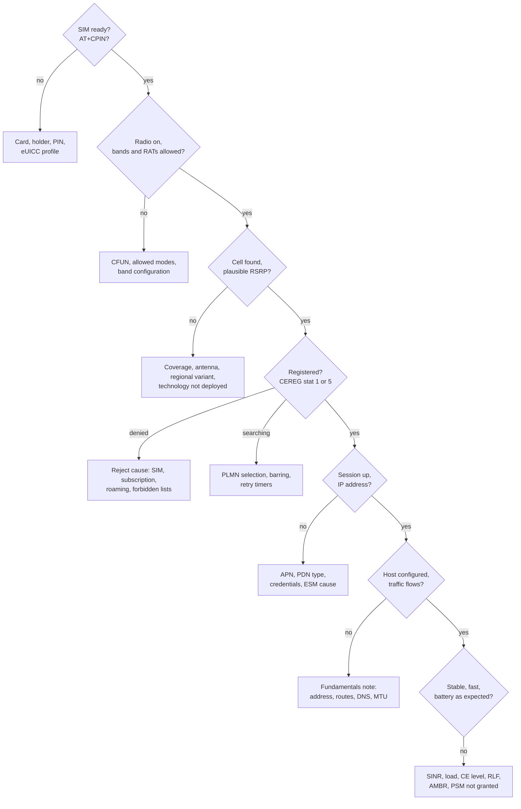

| Fault domain | Evidence | Where |
|---|---|---|
| SIM | `+CME ERROR: 10/13`, `SIM PIN` | Section 10 |
| Radio, coverage | No cell, RSRP near the edge, CE level 2, random access failures | Sections 6, 8 |
| Network selection | `stat 2` forever, forbidden PLMNs, manual mode, barring | Sections 6, 11 |
| Registration | `stat 3`, EMM/5GMM cause | Section 11 |
| Data session | Session rejected, ESM/5GSM cause, wrong APN | Section 12 |
| Host and IP | Session up, but no traffic from the host | [Fundamentals note](../../networking/fundamentals/fundamentals.md#22-troubleshooting) |
| Performance | Low SINR, cell load, uplink power limit, AMBR, no CA | Sections 7, 8 |
| Mobility | Drops while moving, RLF, SCG failures | Section 14 |
| Power | PSM or eDRX not granted, keepalives, high CE level | Sections 14, 15 |

**Compare before concluding:** the same device with another SIM, or another device with the same SIM, at the same place and time. Most "the module is broken" reports are a subscription, coverage or roaming problem, and a second device settles it in minutes.

### Symptoms

| Symptom | Where to look first |
|---|---|
| SIM not detected | Card seating, holder, SIM detect configuration, a 1.8 V-only SIM in a 3 V-only slot or the reverse, an eUICC with no enabled profile |
| Searching forever (`stat 2`) | No supported band here (wrong regional variant), antenna, LTE-M/NB-IoT not deployed or not enabled for the SIM, forbidden PLMN list, manual selection on an absent network, barred cells |
| Registration denied (`stat 3`) | The reject cause (`AT+CEREG=3`, `AT+CEER`, modem logs) and section 11's table |
| Works only after a reboot | A persistent reject (#3, #6, #7, #8: invalid USIM until power cycle), a PLMN in EF_FPLMN |
| Takes about 12 minutes to recover after failures | T3402 after 5 failed attempts (section 11), or a network back-off timer (T3346) |
| Registered, session rejected | APN, PDN type, credentials: the ESM cause (section 12) |
| Session up, nothing reachable | A private APN instead of the internet APN, DNS from the PCO not applied, MTU, an exhausted data plan (some operators keep the session and block traffic), host configuration |
| Works in one country, not in another | Bands, roaming agreements (especially LTE-M/NB-IoT), steering of roaming (a series of rejects before success), permanent roaming restrictions |
| Good RSRP, poor throughput | SINR (interference between cells), cell load (compare at night), uplink power limit, the plan's AMBR, missing CA combinations |
| "5G" but LTE speeds | NSA without the NR leg added (B1 threshold not met), SCG failures, NR not in the subscription |
| First packet slow, later ones fast | Idle to connected transition (section 14) |
| Commands to the device arrive late or never | eDRX/PSM (by design), NAT mapping expired (section 14), SMS not in the plan |
| Battery drains faster than planned | PSM or eDRX not granted (check the granted values, `AT+CEREG=4`), frequent keepalives, high CE level, repeated searching in poor coverage |
| Drops while moving | Radio link failures and handover failures in the modem logs; NB-IoT has no connected-mode handover |
| Rejected with #6 (illegal ME) | IMEI blocked or not accepted: uncertified device, IMEI-bound plan with another device |
| No voice | IMS registration (IMS APN, carrier configuration, operator approval) and no 2G/3G fallback left |

### Messages and what they mean

| Message | Meaning |
|---|---|
| `+CEREG: 2,3,...` with reject cause 15 | No suitable cells in this tracking area: often a technology (NB-IoT or LTE-M) not allowed for the subscription |
| `Attach Reject`, EMM cause #19, ESM cause #27 | Attach failed because the APN is unknown or not subscribed |
| `Authentication Failure` with cause #20 (MAC failure) | The network failed to prove it knows K: wrong network, fake cell, or a SIM profile problem |
| `Authentication Failure` with cause #21 (synch failure) | Sequence number resynchronization: occasional ones are normal |
| `Security Mode Command` with EEA0 | The network chose not to cipher |
| `RRC Connection Reject` with a wait time | Base station overloaded or access barred: the UE waits |
| `T3346` started | Network congestion back-off: no NAS attempt until it expires |
| `Radio link failure`, `RRC re-establishment request` (cause handoverFailure or otherFailure) | Coverage loss or a failed handover |
| `SCG failure` | NSA: the NR leg was lost, LTE continues |
| `Deactivate EPS Bearer Context Request` with cause #39 | The network asks for a new session: expect a new address |

### A useful bug report

The module model and firmware version, the SIM's operator (MCC-MNC) and plan type, place and time, the serving cell (RAT, band, EARFCN or NR-ARFCN, PCI, TAC, cell ID) with RSRP, RSRQ and SINR, the registration state with its reject cause, `AT+CEER`, a timestamped AT log, the modem's diagnostic log covering the failure, and the result of the same test with another SIM or device. Leave the full IMSI and IMEI out of public reports.

---

## 20. Not covered here

Topics for separate notes:

- **Cellular modems on embedded Linux:** drivers (`qmi_wwan`, `cdc_mbim`, MHI, WWAN), ModemManager, libqmi and libmbim, AT, QMI and MBIM in practice, USB compositions, power sequencing and board integration, firmware and carrier configurations, certification. The [fundamentals note](../../networking/fundamentals/fundamentals.md#20-modem-based-devices-the-ap-and-the-modem) covers the data path and connection sharing meanwhile.
- **Running a network:** RAN and core software (srsRAN, OpenAirInterface, Open5GS), radio planning, O-RAN.
- **The PHY in depth:** channel coding, channel estimation, MIMO processing ([hardware/baseband/](../../hardware/baseband/), [hardware/sdr/](../../hardware/sdr/)).
- **RF design:** antennas, coexistence, over-the-air performance tests ([hardware/rf/](../../hardware/rf/)).
- **IMS in depth:** SIP, VoLTE call flows, RCS.
- **2G and 3G protocols**, sidelink and V2X (PC5), broadcast (MBMS), mmWave beam management, 6G.
- **Satellite access** in depth ([ntn/](../ntn/)) and **Bluetooth** ([bluetooth/](../bluetooth/)).

---

## References

3GPP specifications (free at <https://www.3gpp.org/ftp/Specs/archive/>, by series; ETSI republishes them as TS 1xx xxx):

| Topic | LTE | NR / 5G |
|---|---|---|
| Vocabulary | TS 21.905 | TS 21.905 |
| Numbering: IMSI, IMEI, GUTI, APN | TS 23.003 | TS 23.003 |
| Architecture and procedures | TS 23.401 | TS 23.501, TS 23.502 |
| QoS classes | TS 23.203 | TS 23.501 |
| PLMN selection | TS 23.122 | TS 23.122 |
| NAS protocol and causes | TS 24.301 (timer coding in TS 24.008) | TS 24.501 |
| Security | TS 33.401 | TS 33.501 |
| USIM | TS 31.102 | TS 31.102 |
| AT commands | TS 27.007, TS 27.005 (SMS) | TS 27.007 |
| Radio overview | TS 36.300 | TS 38.300 |
| UE radio: bands, EARFCN | TS 36.101 | TS 38.101-1, TS 38.101-2; NR-ARFCN in TS 38.104 |
| Physical layer | TS 36.211 to TS 36.213 | TS 38.211 to TS 38.214 |
| Measurements (RSRP, RSRQ) | TS 36.214 | TS 38.215 |
| Idle mode | TS 36.304 | TS 38.304 |
| UE categories and capabilities | TS 36.306 | TS 38.306 (peak rate formula) |
| MAC, RLC, PDCP, SDAP | TS 36.321, TS 36.322, TS 36.323 | TS 38.321, TS 38.322, TS 38.323, TS 37.324 |
| RRC | TS 36.331 | TS 38.331 |
| IoT studies | TR 36.888 (LTE-M), TR 45.820 (NB-IoT) | |

GSMA documents (<https://www.gsma.com>):

- TS.34, *IoT Device Connection Efficiency Guidelines*
- SGP.02 (M2M), SGP.22 (consumer) and SGP.32 (IoT) remote SIM provisioning

IETF:

| Topic | Document |
|---|---|
| IPv6 in 3GPP networks, /64 sharing | [RFC 6459](https://www.rfc-editor.org/rfc/rfc6459), [RFC 7278](https://www.rfc-editor.org/rfc/rfc7278) |
| CGNAT address space, 464XLAT | [RFC 6598](https://www.rfc-editor.org/rfc/rfc6598), [RFC 6877](https://www.rfc-editor.org/rfc/rfc6877) |
| DTLS connection IDs | [RFC 9146](https://www.rfc-editor.org/rfc/rfc9146) |
| Documentation addresses | [RFC 5737](https://www.rfc-editor.org/rfc/rfc5737), [RFC 3849](https://www.rfc-editor.org/rfc/rfc3849) |

Regulation (check for amendments before relying on them):

- EU: Radio Equipment Directive 2014/53/EU; harmonized standards ETSI EN 301 908-1, -13 (LTE UE), -25 (NR UE)
- US: 47 CFR Parts 22, 24, 27, 90 and 96

Tools:

- SCAT: <https://github.com/fgsect/scat>
- QCSuper: <https://github.com/P1sec/QCSuper>
- Open5GS: <https://open5gs.org>
- Wireshark's LTE and NR dissectors read GSMTAP captures from the tools above

Books:

- Martin Sauter, *From GSM to LTE-Advanced Pro and 5G: An Introduction to Mobile Networks and Mobile Broadband*: the whole system, clearly explained, with practical observations.
- Erik Dahlman, Stefan Parkvall and Johan Sköld, *5G NR: The Next Generation Wireless Access Technology* and *4G, LTE-Advanced Pro and The Road to 5G*: the radio interface, by authors involved in the standard.
- Stefania Sesia, Issam Toufik and Matthew Baker (eds.), *LTE – The UMTS Long Term Evolution: From Theory to Practice*: the LTE radio in depth.
