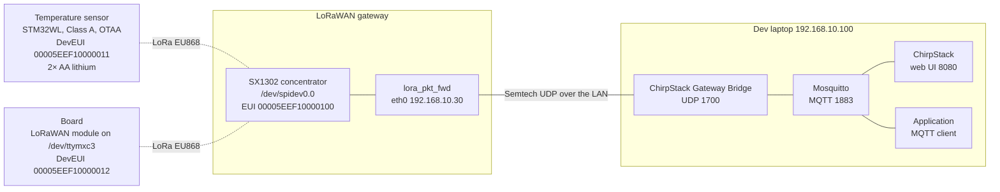
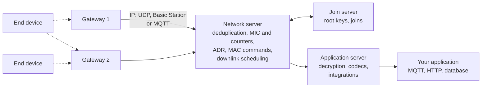
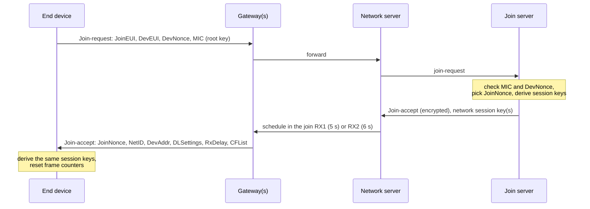

# LoRa and LoRaWAN for Embedded Linux Engineers

How LoRa works as a radio (chirps, spreading factors, time on air, link budgets), how LoRaWAN builds a network on top of it (gateways, network servers, device classes, joins, keys, adaptive data rate), how Linux takes part (as a gateway driving a concentrator, as the host of a network server, as an end device through a module), and what it takes to ship battery-powered LoRa devices and debug them when uplinks don't arrive, joins fail or batteries die early.

LoRa is for **long range, low rate, low power** links: a few bytes every few minutes over kilometers, for years on a battery. It is not a replacement for Wi-Fi, Bluetooth or cellular, and the note says where those fit better. The LAN, the dev laptop and the board are the ones of [Wi-Fi for Embedded Linux Engineers](../wifi/wifi_v1_2026-11-01.md); IP networking is in [Linux Networking Fundamentals for Embedded Engineers](../../os-and-firmware/networking/linux-networking-fundamentals/linux-networking-fundamentals_v1_2026-10-29.md). This note links to them instead of repeating them.

**Assumptions:**
- One example setup (section 2) is used throughout: a Linux LoRaWAN gateway with an SX1302 concentrator, ChirpStack on the dev laptop, a battery-powered temperature sensor and the board with a LoRaWAN module on a UART.
- The examples use the **EU868** region (the setup is in France, like the Wi-Fi note). US915 and the other regions are described in section 6.
- LoRaWAN **1.0.x** (1.0.3 and 1.0.4) is the default, because it is what most devices and networks run. LoRaWAN 1.1 differences are given where they matter.
- Linux 6.x, ChirpStack v4, Semtech's `sx1302_hal` 2.x. Commands and configuration keys that differ between versions say so.
- Identifiers, keys, addresses and frequency plans that aren't standard are placeholders.

**Conventions:**
- `$` is a shell on the dev laptop, `#` a root shell on the gateway or the board, as stated next to each block.
- **Normative** values come from the LoRaWAN specification (TS001), the LoRaWAN Regional Parameters (RP002) or a regulation.
- **Rule of thumb** marks empirical values that depend on the environment, the chips and the deployment.
- **Chip-dependent**, **stack-dependent** or **network-dependent** marks behavior that varies between radios, firmware stacks, network servers or operators.
- **Illustrative** marks a file, script or output that shows the shape of a solution and needs adapting.

**Verification status:** nothing in this note was run for it. No source was downloaded, nothing was built, no gateway, module or sensor was used. Protocol values follow the LoRaWAN specifications and Semtech's datasheets and application notes, commands and configuration follow the ChirpStack, `sx1302_hal` and module documentation, as known in November 2026. Commands, code and outputs are generic, untested examples, abridged.

**How to read it:**
- **To learn:** Part 1 (sections 1 to 11) in order.
- **To build a gateway, a network server or a device on Linux:** Part 2 (sections 12 to 17).
- **To ship a product or a deployment:** Part 3 (sections 18 to 20).
- **To debug:** section 21 first, then the section of the step that fails.

## Table of contents

**Part 1: How LoRa and LoRaWAN work**

- [1. The mental model: a modulation and a network](#1-the-mental-model-a-modulation-and-a-network)
- [2. Example setup](#2-example-setup)
- [3. LoRa, LoRaWAN, the LoRa Alliance and versions](#3-lora-lorawan-the-lora-alliance-and-versions)
- [4. The LoRa radio: chirps, spreading factor, bandwidth, coding rate](#4-the-lora-radio-chirps-spreading-factor-bandwidth-coding-rate)
- [5. Time on air, sensitivity and link budget](#5-time-on-air-sensitivity-and-link-budget)
- [6. Regional parameters: bands, duty cycle and dwell time](#6-regional-parameters-bands-duty-cycle-and-dwell-time)
- [7. LoRaWAN architecture: devices, gateways and servers](#7-lorawan-architecture-devices-gateways-and-servers)
- [8. Device classes and receive windows](#8-device-classes-and-receive-windows)
- [9. Frames, ports and MAC commands](#9-frames-ports-and-mac-commands)
- [10. Activation and security: OTAA, ABP, keys and counters](#10-activation-and-security-otaa-abp-keys-and-counters)
- [11. Adaptive data rate, confirmed messages and capacity](#11-adaptive-data-rate-confirmed-messages-and-capacity)

**Part 2: LoRa on Linux**

- [12. LoRa and Linux: three roles](#12-lora-and-linux-three-roles)
- [13. A LoRaWAN gateway on Linux](#13-a-lorawan-gateway-on-linux)
- [14. The network server: ChirpStack](#14-the-network-server-chirpstack)
- [15. End device firmware, payloads and codecs](#15-end-device-firmware-payloads-and-codecs)
- [16. A Linux board as an end device: AT-command modules](#16-a-linux-board-as-an-end-device-at-command-modules)
- [17. Applications: MQTT, downlinks and storage](#17-applications-mqtt-downlinks-and-storage)

**Part 3: Products and deployments**

- [18. Antennas, gateway placement, power and battery life](#18-antennas-gateway-placement-power-and-battery-life)
- [19. Production: keys, certification, regulation and firmware updates](#19-production-keys-certification-regulation-and-firmware-updates)
- [20. Beyond LoRaWAN basics: P2P, 2.4 GHz, LR-FHSS, satellites, geolocation, relays](#20-beyond-lorawan-basics-p2p-24-ghz-lr-fhss-satellites-geolocation-relays)

**Debugging and reference**

- [21. Troubleshooting](#21-troubleshooting)
- [22. Not covered here](#22-not-covered-here)
- [References](#references)

---

## 1. The mental model: a modulation and a network

Two names, two layers:

- **LoRa** ("long range") is a **physical layer**: a chirp spread spectrum modulation, patented and sold by Semtech in its radio chips (and licensed to a few others, such as ST in the STM32WL). It turns bytes into a radio signal that can be decoded **below the noise floor**, at the cost of a very low bit rate.
- **LoRaWAN** is a **MAC and network protocol** on top of LoRa, specified openly by the LoRa Alliance: how devices join a network, how frames are addressed, encrypted and authenticated, when devices listen for downlinks, and how the network tunes each device's data rate and power.

You can use LoRa without LoRaWAN (point to point, your own protocol, Meshtastic, section 20), but most products use LoRaWAN, because it brings interoperable gateways, network servers, security and certification.

```
 ┌────────────── Application ─────────────────┐
 │ Your payload: a few bytes, your format       │   decoded by a codec (section 15)
 ├────────────── LoRaWAN (MAC) ────────────────┤
 │ Join, addressing, AES encryption and MIC,     │
 │ frame counters, classes and receive windows,  │   TS001 (sections 7 to 11)
 │ MAC commands, ADR                             │
 ├────────────── Regional parameters ──────────┤
 │ Channels, data rates, power, duty cycle,      │   RP002 (section 6)
 │ dwell time, per region                        │
 ├────────────── LoRa PHY ─────────────────────┤
 │ Chirp spread spectrum: SF, BW, CR, preamble,  │   Semtech (sections 4 and 5)
 │ header, CRC                                   │
 └───────────────────────────────────────────────┘
```

**A LoRaWAN network is a star of stars.** End devices transmit; every gateway in range receives the frame and forwards it over IP to a network server; the network server removes duplicates, checks the frame, answers if needed through the best gateway, and passes the application payload to an application. Devices don't associate to a gateway, and gateways don't know what they relay (section 7).

**Most traffic goes up.** A typical Class A device sends an uplink and listens for two short receive windows right after it; the rest of the time its radio is off. The network can only reach the device in those windows (section 8). Design for **rare, small, unconfirmed uplinks** and treat downlinks as scarce.

**How it compares with the other low-power wide-area options** (rule of thumb):

| | LoRaWAN | Sigfox | LTE-M / NB-IoT | Bluetooth LE | Wi-Fi HaLow (802.11ah) |
|---|---|---|---|---|---|
| Spectrum | Unlicensed sub-GHz (868, 915 MHz...) | Unlicensed sub-GHz | Licensed (operator bands) | 2.4 GHz | Unlicensed sub-GHz |
| Network | Yours (private), community, or operator | Operator only (UnaBiz) | Operator | Yours, through a phone or gateway | Yours |
| Range | 2 to 5 km urban, 10 to 20 km rural, more with line of sight | Similar | Cellular coverage, with coverage enhancement | 10 to 100 m | Up to about 1 km |
| Data rate | 0.25 to 11 kb/s (EU868), up to 21.9 kb/s downlink in US915 | 100 or 600 b/s, 12-byte uplinks, few downlinks | Tens of kb/s to about 1 Mb/s | Up to 2 Mb/s | 150 kb/s to tens of Mb/s |
| Downlink | Limited, after uplinks (Class A) | Very limited | Yes, with PSM/eDRX latency | Yes | Yes |
| Battery life | Years | Years | Years with PSM, less than LoRa for frequent small messages | Months to years | Months to years |
| Cost per device | Module and no subscription on a private network | Subscription | Module, SIM and subscription | Lowest | Low, ecosystem young |
| IP | No (bytes to an application server) | No | Yes | Through a gateway | Yes |

Choose LoRaWAN when devices are far from any existing network, run on batteries for years, send small data rarely, and when owning the network (or using a free community one) matters. Choose cellular IoT ([Cellular note](../cellular/cellular_v1_2026-11-02.md)) when you need mobility over a country, IP, firmware updates of real size, or downlinks on demand.

**Vocabulary:**

| Term | Meaning |
|---|---|
| End device, node | The battery-powered thing with sensors: a LoRa radio and a microcontroller, or a module |
| Gateway | Receives LoRa on many channels at once with a **concentrator** chip and forwards frames over IP. Also called a base station |
| Network server (NS) | Deduplicates uplinks, checks integrity and counters, runs ADR, schedules downlinks |
| Join server (JS) | Holds the devices' root keys and handles joins (section 10) |
| Application server (AS) | Decrypts the application payload and hands it to your application |
| Uplink / downlink | Device to network / network to device |
| SF | Spreading factor, 5 to 12: the main LoRa trade-off between range and airtime (section 4) |
| DR | Data rate: a LoRaWAN index (DR0, DR1...) standing for an SF and bandwidth combination in a region (section 6) |
| ToA | Time on air of one frame (section 5) |
| ADR | Adaptive data rate: the network tells each device which DR and power to use (section 11) |
| OTAA / ABP | Over-the-air activation (join) / activation by personalization (keys programmed in) (section 10) |
| DevEUI, JoinEUI | 64-bit device identifier, 64-bit join server identifier (AppEUI in LoRaWAN 1.0.x) |
| DevAddr | 32-bit network address given at join, used in every frame |
| AppKey | The device's AES-128 root key in LoRaWAN 1.0.x, from which session keys are derived |
| Class A, B, C | When a device listens for downlinks (section 8) |
| RSSI, SNR | Received signal strength and signal to noise ratio, reported per frame per gateway |

---

## 2. Example setup

The LAN is the one of the [Wi-Fi note](../wifi/wifi_v1_2026-11-01.md#2-example-network). A LoRaWAN gateway is added on Ethernet, ChirpStack runs on the dev laptop, and two end devices send data:



| Device | Hardware | Identifiers | Role in the examples |
|---|---|---|---|
| Gateway | Linux single-board computer with an SX1302 concentrator (two SX1250 radios) on SPI, GPS module, outdoor 868 MHz antenna | Gateway EUI `00005EEF10000100`, `192.168.10.30` on `eth0` | Runs Semtech's packet forwarder (section 13), 8 channels of the EU868 plan |
| Dev laptop | | `192.168.10.100` | ChirpStack v4, its Gateway Bridge, Mosquitto, PostgreSQL and Redis in containers (section 14); the test application (section 17) |
| Temperature sensor | STM32WL (microcontroller and SX126x-class radio in one chip), +14 dBm, temperature and humidity sensor, two lithium AA cells | DevEUI `00005EEF10000011`, JoinEUI `0000000000000000` | LoRaWAN 1.0.4 Class A, OTAA, ADR on, one 5-byte uplink every 15 minutes on port 1 (section 15) |
| Board | The board of the Wi-Fi note, with a LoRaWAN module on UART `/dev/ttymxc3` | DevEUI `00005EEF10000012` | Sends status messages over LoRaWAN when Wi-Fi is down (section 16) |

Placeholders: the EUIs come from the EUI-64 documentation block `00-00-5E-EF-10-00-00-00` to `00-00-5E-EF-10-FF-FF-FF` (RFC 7042), written without separators as LoRaWAN tools do. A real device uses an EUI from an IEEE block its maker owns, usually programmed in the module. Root keys in the examples are written as `<AppKey>`: never put a real key in a note, a repository or a support ticket.

---

## 3. LoRa, LoRaWAN, the LoRa Alliance and versions

**Semtech** owns LoRa: the modulation, the chips (SX127x, SX126x, LR11xx for end devices; SX1301, SX1302, SX1303 concentrators for gateways) and the reference software (`sx1302_hal`, LoRa Basics Station, LoRa Basics Modem). The **LoRa Alliance** (founded 2015) writes LoRaWAN, runs device certification and maintains the NetID and vendor ID allocations. In 2021 ITU-T approved LoRaWAN as Recommendation Y.4480.

The specifications, by their LoRa Alliance document numbers:

| Document | Content |
|---|---|
| **TS001** LoRaWAN Link Layer | Frames, classes, MAC commands, join, security (LoRaWAN 1.0.x, 1.1) |
| **RP002** Regional Parameters | Channels, data rates, payload sizes, power, timings per region. Up to LoRaWAN 1.0.1 they were part of the link layer document |
| TS002 Backend Interfaces | Network, join and application servers talking to each other, roaming |
| TS003, TS004, TS005 | Application layer clock synchronization, fragmented data block transport, remote multicast setup: the building blocks of firmware updates over the air (section 19) |
| TS009 Certification Protocol | Test mode a certified device implements |
| TS011 Relay | A device relaying for devices out of gateway coverage (section 20) |
| TS013 Payload Codec API | The `decodeUplink` / `encodeDownlink` JavaScript interface (section 15) |

LoRaWAN link layer versions:

| Version | Year | What matters about it |
|---|---|---|
| 1.0, 1.0.1 | 2015, 2016 | First versions. Class A, B and C, OTAA and ABP |
| 1.0.2 | 2016 | Regional parameters moved to their own document. Very common in deployed devices |
| 1.0.3 | 2018 | Class B clarified, `DeviceTimeReq` to get network time. Common in devices from 2018 on |
| 1.1 | 2017 | Separate network and application root keys, join server, rejoin, roaming, acknowledgments bound to frame counters, per-direction counters. Deployed in few devices |
| 1.0.4 | 2020 | Brings 1.1 security fixes back to 1.0.x: **DevNonce is a counter** kept in non-volatile memory, join-accept replay protection, clearer counter rules. The recommended 1.0.x version for new devices |

**What a version means.** A device runs one link layer version and one regional parameters revision; the network server is told both in the device profile (section 14) and adapts. Servers run all versions at once. 1.0.x and 1.1 differ in key derivation, so a device declared with the wrong version never joins (section 21).

**Trademarks and certification.** "LoRa" is Semtech's trademark. "LoRaWAN Certified" requires LoRa Alliance membership and passing the certification tests at an authorized lab or with the self-certification tool, depending on the program. Some public operators require it; private networks don't. Radio regulation (CE/RED, FCC) applies whatever the certification (section 19).

---

## 4. The LoRa radio: chirps, spreading factor, bandwidth, coding rate

### Chirps

A **chirp** is a tone whose frequency sweeps linearly across the whole channel bandwidth, from the lowest to the highest frequency, during one symbol time. LoRa encodes data in **where the sweep starts**: a symbol is the basic up-chirp cyclically shifted by one of 2^SF positions, so each symbol carries SF bits.

```
 frequency          symbol "0"               symbol "k" (shifted)
 +BW/2  ┤          /|                      /|      /
        │        /  |                    /  |    /
    0   ┤      /    |                  /    |  /
        │    /      |                /      |/
 -BW/2  ┤  /        |               |       |
        └──────────────── time ──────────────────────
            T_sym = 2^SF / BW         wraps around at +BW/2
```

The receiver multiplies the signal by a down-chirp ("dechirps" it), which turns each symbol into a single tone, and an FFT finds which of the 2^SF frequencies it is. The FFT concentrates the energy of a whole symbol into one bin, which is why LoRa decodes signals **below the noise floor**: the processing gain is about 10·log10(2^SF) dB. The same structure makes LoRa robust against narrowband interference, multipath and Doppler, and tolerant of frequency offsets between cheap crystals.

### Parameters

| Parameter | Values | Effect |
|---|---|---|
| **Spreading factor (SF)** | 7 to 12 in LoRaWAN; 5 and 6 on SX126x and newer chips | Each step up doubles the symbol time and the airtime, and gains about 2.5 dB of sensitivity |
| **Bandwidth (BW)** | 125, 250, 500 kHz in LoRaWAN; down to 7.8 kHz on SX127x | Halving it doubles the symbol time and gains 3 dB, but needs a more accurate crystal |
| **Coding rate (CR)** | 4/5, 4/6, 4/7, 4/8 | Forward error correction: 4/5 in LoRaWAN. Higher CR costs airtime and helps against burst interference |
| Preamble | 8 symbols in LoRaWAN (programmable) | Lets the receiver detect and synchronize. Longer preambles let a receiver wake up late (wake-on-radio schemes) |
| Header | Explicit (length, CR, CRC flag) or implicit (both sides know them) | LoRaWAN uses explicit headers |
| CRC | 16-bit payload CRC on or off | On for LoRaWAN uplinks, off for downlinks |
| Sync word | Public LoRaWAN: `0x34` (SX127x register), `0x3444` (SX126x); private: `0x12` / `0x1424` | Separates networks: a gateway set to public ignores private frames |
| IQ polarity | Normal or inverted | LoRaWAN uplinks use normal chirps, downlinks inverted ones: devices don't hear each other's uplinks, gateways don't hear each other's downlinks |
| Low data rate optimization (LDRO) | On or off | Required when the symbol time exceeds 16 ms (SF11 and SF12 at 125 kHz): carries fewer bits per symbol to tolerate clock drift during long packets |

Spreading factors at 125 kHz, coding rate 4/5 (sensitivity computed below with a 6 dB noise figure; datasheets give similar values):

| SF | Chips per symbol | Symbol time | Bit rate (LoRaWAN tables) | Demodulation SNR limit | Sensitivity |
|---|---|---|---|---|---|
| 7 | 128 | 1.024 ms | 5470 b/s | -7.5 dB | about -124 dBm |
| 8 | 256 | 2.048 ms | 3125 b/s | -10 dB | about -127 dBm |
| 9 | 512 | 4.096 ms | 1760 b/s | -12.5 dB | about -129.5 dBm |
| 10 | 1024 | 8.192 ms | 980 b/s | -15 dB | about -132 dBm |
| 11 | 2048 | 16.384 ms | 440 b/s | -17.5 dB | about -134.5 dBm |
| 12 | 4096 | 32.768 ms | 250 b/s | -20 dB | about -137 dBm |

The bit rate is SF × BW / 2^SF × CR; SF11 and SF12 lose two bits per symbol to LDRO, hence 440 and 250 b/s instead of 537 and 293.

### The packet

```
 ┌──────────┬──────────┬────────┬─────────────────┬───────────────────┬──────────┐
 │ Preamble │ Sync word│  SFD   │ Header          │ Payload           │ CRC      │
 │ 8 up-    │ 2 symbols│ 2.25   │ (explicit mode) │ 1 to 255 bytes    │ 16 bits, │
 │ chirps   │          │ down-  │ length, CR, CRC │ (the LoRaWAN      │ optional │
 │          │          │ chirps │ flag, header CRC│  PHYPayload)      │          │
 └──────────┴──────────┴────────┴─────────────────┴───────────────────┴──────────┘
   detection and synchronization    always at CR 4/8   at the chosen SF, BW, CR
```

### Orthogonality and capture

Frames at **different spreading factors** on the same channel are quasi-orthogonal: a gateway can decode an SF7 and an SF10 frame overlapping in time, as long as one isn't much stronger than the other (rule of thumb: the wanted signal survives an interferer at another SF up to roughly 10 to 25 dB stronger, depending on the SF pair). Two frames at the **same SF** collide; the stronger survives if it is about 6 dB above the other (**capture effect**, rule of thumb), otherwise both are lost. This is why LoRaWAN capacity depends on spreading frames over channels and SFs (section 11).

---

## 5. Time on air, sensitivity and link budget

### Time on air

Every regulation and every battery calculation starts from the **time on air** (ToA) of a frame. From Semtech's datasheets (SX127x, SX126x):

```
T_sym       = 2^SF / BW
T_preamble  = (n_preamble + 4.25) × T_sym
n_payload   = 8 + max( ceil( (8·PL − 4·SF + 28 + 16·CRC − 20·IH) / (4·(SF − 2·DE)) ) × (CR + 4), 0 )
T_payload   = n_payload × T_sym
ToA         = T_preamble + T_payload
```

PL is the PHY payload length in bytes, CRC = 1 if the payload CRC is on, IH = 1 for implicit header, DE = 1 with LDRO, CR = 1 for 4/5 to 4/8 for 4. SX126x chips at SF5 and SF6 use slightly different constants: use the chip vendor's calculator for those.

**Normative overhead:** a LoRaWAN data frame without MAC commands adds **13 bytes** to the application payload (section 9). For a 10-byte application payload, PL = 23. With LoRaWAN's uplink settings (125 kHz, CR 4/5, 8-symbol preamble, explicit header, CRC on):

| SF (EU868 DR) | Payload symbols | ToA, 10-byte payload | Max frames per hour at 1 % duty cycle | Frames per day within 30 s of airtime |
|---|---|---|---|---|
| SF7 (DR5) | 48 | 61.7 ms | 583 | 486 |
| SF8 (DR4) | 43 | 113.2 ms | 318 | 265 |
| SF9 (DR3) | 38 | 205.8 ms | 174 | 145 |
| SF10 (DR2) | 33 | 370.7 ms | 97 | 80 |
| SF11 (DR1) | 38 | 823.3 ms | 43 | 36 |
| SF12 (DR0) | 33 | 1482.8 ms | 24 | 20 |

Read the table as a design rule: **SF12 costs 24 times the airtime and energy of SF7** for the same bytes. The 30-second column is The Things Network's fair use limit per device per day (section 6).

### Sensitivity

The receiver sensitivity at the decoding limit is:

```
S = −174 dBm/Hz + 10·log10(BW) + NF + SNR_limit
```

At 125 kHz with a 6 dB noise figure: −174 + 51 + 6 = −117 dBm, plus the SNR limit of the SF (−7.5 dB at SF7 to −20 dB at SF12), which gives the table of section 4. Datasheets quote about −137 dBm at SF12/125 kHz for SX127x and SX126x end-device radios; gateways are similar or slightly better (rule of thumb).

**RSSI and SNR in reports.** Every received frame comes with the gateway's **RSSI** (signal plus noise in the channel) and **SNR**. A positive SNR means the signal is above the noise floor; down to the SF's limit (−7.5 to −20 dB) the frame is still decoded. When SNR is negative, RSSI mostly measures noise: the signal's real power is about RSSI + SNR (Semtech application notes). SNR is the better indicator of link margin; ADR uses it (section 11).

### Link budget

**Maximum coupling loss** = TX power + antenna gains − cable losses − sensitivity. For the example sensor at SF12 (rule of thumb values):

| Item | Value |
|---|---|
| Device TX power | +14 dBm |
| Device antenna (small PCB antenna in a plastic case) | −2 dBi |
| Gateway antenna (outdoor collinear) | +3 dBi |
| Gateway cable and connectors | −1 dB |
| Gateway sensitivity at SF12 | −137 dBm |
| **Allowed path loss** | **151 dB** at SF12, about 138 dB at SF7 |

Free-space path loss at 868 MHz is about 91 dB at 1 km and adds 20 dB per decade (111 dB at 10 km, 131 dB at 100 km). On the ground, propagation is far worse than free space: buildings, terrain, vegetation and the ground itself cost tens of dB, and a **fade margin** of 10 to 20 dB keeps the link working through fading. Typical ranges (rule of thumb):

| Environment | Typical range |
|---|---|
| Dense urban, gateway on a roof | 1 to 3 km |
| Suburban | 3 to 8 km |
| Rural, gateway on a mast | 10 to 20 km |
| Line of sight from a mountain or tower | 50 km and more |
| Indoor devices (basements, meter pits, inside metal cabinets) | Subtract 20 to 30 dB from the outdoor budget: often SF10 to SF12 at a few km |

**Height beats power.** At sub-GHz, the first Fresnel zone is large: for a 5 km link at 868 MHz its radius at mid-path is about 21 m (17.32 × √(d / 4f), d in km, f in GHz). Obstacles inside it cost signal even with visual line of sight, so raising the gateway antenna from 3 m to 20 m above clutter often gains more than any amplifier. Antenna placement is in section 18.

---

## 6. Regional parameters: bands, duty cycle and dwell time

LoRaWAN runs in **unlicensed sub-GHz bands** whose rules differ by country. RP002 turns each set of rules into a **region**: channel plan, data rates, maximum payloads, power, receive window settings and the constraints a device must enforce. A device is built and certified for one or several regions and must be set to the one it is used in.

| Region | Band (MHz) | Main constraint | Where |
|---|---|---|---|
| **EU868** | 863 to 870 | Duty cycle per sub-band (or LBT and AFA) | EU, EEA, many other countries |
| **US915** | 902 to 928 | Dwell time 400 ms, frequency hopping across 64 + 8 uplink channels | US, Canada, parts of Latin America |
| AU915 | 915 to 928 | Like US915, shifted | Australia, parts of Latin America |
| AS923 | 915 to 928, several groups (AS923-1 to -4) | Dwell time and LBT in some countries (Japan) | Asia, Pacific |
| KR920 | 920 to 923 | LBT | South Korea |
| IN865 | 865 to 867 | | India |
| CN470 | 470 to 510 | | China |
| RU864 | 864 to 870 | | Russia |
| EU433 | 433.05 to 434.79 | Low power (10 dBm ERP) | Rarely used |

### EU868

**Default channels** (normative): every EU868 device knows 868.1, 868.3 and 868.5 MHz (125 kHz, DR0 to DR5) and uses them for joins. The network adds up to five more in the join-accept (CFList) or with `NewChannelReq`; the common plan adds 867.1, 867.3, 867.5, 867.7 and 867.9 MHz. **RX2** defaults to **869.525 MHz at DR0** (SF12); The Things Network uses DR3 (SF9) instead and tells devices at join.

| DR | Modulation | Bit rate | Max application payload (N) |
|---|---|---|---|
| 0 | SF12 / 125 kHz | 250 b/s | 51 bytes |
| 1 | SF11 / 125 kHz | 440 b/s | 51 bytes |
| 2 | SF10 / 125 kHz | 980 b/s | 51 bytes |
| 3 | SF9 / 125 kHz | 1760 b/s | 115 bytes |
| 4 | SF8 / 125 kHz | 3125 b/s | 222 bytes |
| 5 | SF7 / 125 kHz | 5470 b/s | 222 bytes |
| 6 | SF7 / 250 kHz | 11000 b/s | 222 bytes |
| 7 | FSK 50 kb/s | 50000 b/s | 222 bytes |
| 8 to 11 | LR-FHSS (RP002-1.0.3 and later) | 162 to 325 b/s | Depends on the DR: see RP002 (section 20) |

The application payload maximum shrinks by the length of any MAC commands in FOpts (section 9).

**Power:** the default maximum is **16 dBm EIRP** (25 mW ERP), and `TXPower` indexes count down from it in 2 dB steps (TXPower 0 = max EIRP, 1 = max − 2 dB...). The RX2 sub-band allows 500 mW ERP for downlinks.

**Duty cycle.** In the EU, the 863 to 870 MHz short range device band (ERC Recommendation 70-03, ETSI EN 300 220) limits how long a transmitter may be on, per sub-band, over one hour, unless it uses listen before talk with adaptive frequency agility (LBT + AFA), which LoRaWAN devices rarely do. The values below are the commonly used ones; check the current ERC 70-03 for your product:

| Sub-band (MHz) | Duty cycle | Max power | LoRaWAN use |
|---|---|---|---|
| 863.0 to 865.0 | 0.1 % | 25 mW ERP | Rarely |
| 865.0 to 868.0 | 1 % | 25 mW ERP | 867.1 to 867.9 MHz channels |
| 868.0 to 868.6 | 1 % | 25 mW ERP | Default channels 868.1, 868.3, 868.5 |
| 868.7 to 869.2 | 0.1 % | 25 mW ERP | Rarely |
| 869.4 to 869.65 | 10 % | 500 mW ERP | RX2 downlinks (869.525 MHz) |
| 869.7 to 870.0 | 1 % | 25 mW ERP (some uses 5 mW) | Rarely |

After a transmission of duration ToA in a 1 % sub-band, the device must stay silent in that sub-band for ToA × 99: 147 s after an SF12 frame of 1.48 s. Devices spread frames over sub-bands, and the stack enforces the limits (stack-dependent: some stacks have a test switch that disables them; never ship with it). **Gateways are bound by the same rules**: every downlink from a gateway in the 1 % sub-band uses its budget, which is why RX2 sits in the 10 % sub-band and why downlinks are scarce.

### US915

| Channels | Frequencies | Use |
|---|---|---|
| 0 to 63 | 902.3 to 914.9 MHz, every 200 kHz, 125 kHz wide | Uplink DR0 to DR3 (SF10 to SF7) |
| 64 to 71 | 903.0 to 914.2 MHz, every 1.6 MHz, 500 kHz wide | Uplink DR4 (SF8 / 500 kHz) |
| Downlink 0 to 7 | 923.3 to 927.5 MHz, every 600 kHz, 500 kHz wide | RX1 (mapped from the uplink channel) and RX2 (923.3 MHz, DR8) |

| DR | Modulation | Max application payload (N) |
|---|---|---|
| 0 | SF10 / 125 kHz | 11 bytes |
| 1 | SF9 / 125 kHz | 53 bytes |
| 2 | SF8 / 125 kHz | 125 bytes |
| 3 | SF7 / 125 kHz | 242 bytes |
| 4 | SF8 / 500 kHz | 242 bytes |
| 5, 6 | LR-FHSS (RP002-1.0.3 and later) | |
| 8 to 13 | SF12 to SF7 / 500 kHz | Downlink only: 53 bytes at DR8, 242 bytes from DR10 |

- **Dwell time:** FCC rules (47 CFR 15.247) limit how long a hopping device stays on one channel to 400 ms. That excludes SF11 and SF12 at 125 kHz, so US915 uplinks stop at SF10, with an **11-byte** payload limit at DR0: design payloads for it.
- **Sub-bands:** a typical gateway listens to 8 + 1 channels (one sub-band of eight 125 kHz channels plus one 500 kHz channel), not 72. Devices must be told which sub-band to use (in the join-accept or with `LinkADRReq`), and before that they try joins across all of them. The Things Network uses sub-band 2 (channels 8 to 15 and 65).
- **Power:** up to 30 dBm conducted, the maximum EIRP depending on the antenna gain and the FCC rule used; many devices use +20 dBm.

### Fair use on shared networks

Shared networks add their own limits to the regulation. The Things Network's fair use policy (network-dependent, check the current text): **30 seconds of uplink airtime per device per day** and **10 downlinks per device per day**, including acknowledgments. Commercial operators sell plans with message quotas. On a private network you set the rules, but the regulatory duty cycle and the gateways' downlink budget still apply.

---

## 7. LoRaWAN architecture: devices, gateways and servers



- **End devices** transmit when they have something to send. They aren't attached to a gateway: any gateway that hears a frame forwards it, so there is **no handover**, and mobile devices just keep sending.
- **Gateways** are transparent bridges between LoRa and IP. They receive on several channels and all spreading factors at once, timestamp each frame, add RSSI and SNR, and forward it. They can't decrypt anything and don't know which network a device belongs to: a gateway forwards every LoRaWAN frame it receives (with the right sync word) to its network server, which drops what isn't its own. Gateways are **half-duplex**: while one transmits a downlink, it receives nothing on any channel.
- The **network server** owns the network: it deduplicates the copies received by several gateways (and keeps the list for downlink routing and geolocation), checks the MIC and the frame counter, answers MAC commands, runs ADR, and picks the gateway for each downlink (usually the one with the best SNR that is free to transmit).
- The **join server** stores each device's root keys, answers join-requests, and hands the session keys to the network server and the application server. In most self-hosted setups it is part of the network server.
- The **application server** decrypts the application payload, runs the payload codec, and delivers data to integrations (MQTT, HTTP, databases).

In ChirpStack v4 and The Things Stack, the network, join and application servers are one program; they are separate roles in the specification so that operators, device makers and application owners can each hold their own keys (section 10).

**Where the network comes from:**

| Option | Who runs gateways and servers | Notes |
|---|---|---|
| Private network | You: your gateways, ChirpStack or The Things Stack on your servers | Full control, no per-message cost, you handle coverage and operations. This note's example |
| Community network | The Things Network: community gateways, The Things Stack servers | Free, best-effort coverage, fair use policy (section 6) |
| Public operators | National operators and LoRaWAN service providers | SLA and coverage maps, per-device subscriptions |
| Hybrid and roaming | Your servers plus other networks' gateways through roaming hubs (Packet Broker, operator roaming) | Coverage from others where you have no gateway |

**Identifiers:**

| Identifier | Size | Set by | Meaning |
|---|---|---|---|
| DevEUI | 64 bits | Device maker (IEEE EUI-64) | Globally unique device identity, sent in clear in join-requests |
| JoinEUI (AppEUI in 1.0.x) | 64 bits | Join server operator | Which join server handles the device. Often all zeros on private networks and TTN |
| DevAddr | 32 bits | Network server, at each join | Short address in every data frame. Its top bits come from the network's **NetID**: TTN addresses start with `26` or `27`, ChirpStack's default experimental NetID `000000` gives addresses starting with `00` or `01` |
| NetID | 24 bits | LoRa Alliance | Network operator identifier. `000000` and `000001` are for experimental and private networks |
| Gateway EUI (Gateway ID) | 64 bits | Gateway maker | Gateway identity at the network server. Often derived from the Ethernet MAC address |

---

## 8. Device classes and receive windows

### Class A: listen right after sending

Every LoRaWAN device implements Class A. After each uplink, it opens **two short receive windows** and then sleeps:

```
 uplink  ┌────────┐
         │  TX    │
 ────────┘        └──────── 1 s ────────┬────┬──── 1 s ──────┬────┬───────── sleep
                                        │RX1 │               │RX2 │
                                        └────┘               └────┘
                   RECEIVE_DELAY1 = 1 s        RECEIVE_DELAY2 = 2 s (from the end of TX)
                   (5 s / 6 s for a join-accept)
```

| Window | Frequency | Data rate | Notes |
|---|---|---|---|
| RX1 | EU868: the uplink's channel. US915: a 500 kHz downlink channel mapped from the uplink channel | Uplink DR minus `RX1DROffset` (EU868); a fixed mapping (US915: DR0 uplink → DR10 downlink) | Opens 1 s after the end of the uplink (configurable 1 to 15 s with `RXTimingSetupReq` or in the join-accept) |
| RX2 | Fixed per region: 869.525 MHz in EU868, 923.3 MHz in US915 | Fixed: DR0 (SF12) in EU868, DR8 (SF12 / 500 kHz) in US915; networks often change it (TTN EU868: DR3) | Opens 1 s after RX1. Not opened if a downlink arrived in RX1 |

- A window only needs to **detect a preamble**: the radio listens for a few symbols and goes back to sleep if nothing starts. That makes Class A cheap: a few ms at SF7, a few hundred ms at SF12.
- The device must open its windows on time: the specification gives RX1 a tolerance of ±20 µs relative to the end of the uplink, and the device widens the window to cover its own clock error. Stacks handle this; it is one reason a LoRaWAN stack is hard to run from Linux user space (section 16).
- The network can only answer in these windows: downlinks wait in a **queue** at the network server until the next uplink. A device that sends every hour gets its downlink up to an hour late. The `FPending` bit tells the device more downlinks are waiting, so it can send an empty uplink to collect them.
- The network server must get the uplink, decide and send the downlink to the gateway before RX1 opens. With a 1 s RX1 delay and a slow backhaul (cellular, satellite, overloaded servers), downlinks miss RX1, fall back to RX2 or are dropped (section 21). Networks set RX1 delay to 5 s for this reason (TTN default).

### Class B: scheduled ping slots

Class B devices also open **ping slots** at times both sides know. Gateways synchronized on GPS time send a **beacon** every 128 s; the device locks on it and opens a ping slot every 1 to 128 s (`pingNb` slots per beacon period, randomized per device). Downlink latency is bounded by the ping period, at the cost of listening to every beacon and slot. It needs GPS-synchronized gateways and is rarely deployed outside metering and street lighting.

### Class C: always listening

Class C devices keep RX2's receiver open whenever they aren't transmitting. Downlinks arrive within about a second, at a receive current of 5 to 10 mA permanently: Class C is for **mains-powered** devices (actuators, street lights, relays) and for temporary use during firmware updates over multicast (section 19).

| Class | Listens | Downlink latency | Typical average current | Typical use |
|---|---|---|---|---|
| A | Two windows after each uplink | Until the next uplink | µA | Battery sensors, meters, trackers |
| B | Plus scheduled ping slots | 1 to 128 s | Tens of µA | Battery actuators that need bounded latency |
| C | Continuously | About 1 s | mA | Mains-powered actuators, multicast sessions |

---

## 9. Frames, ports and MAC commands

### The PHY payload

The LoRa payload (section 4) of every LoRaWAN frame is a **PHYPayload**:

```
PHYPayload  = MHDR (1) | MACPayload | MIC (4)
               └─ or Join-request / Join-accept / Rejoin-request in place of MACPayload
MACPayload  = FHDR | FPort (0..1) | FRMPayload (0..N)
FHDR        = DevAddr (4) | FCtrl (1) | FCnt (2) | FOpts (0..15)
```

Multi-byte fields are sent **least significant byte first**. Tools display EUIs and DevAddr most significant byte first, and some stacks expect them in a given byte order in their configuration: the cause of many failed joins (section 21).

**MHDR** carries the message type (MType, 3 bits) and the major version:

| MType | Message | MHDR byte | Notes |
|---|---|---|---|
| 000 | Join-request | `0x00` | Clear text, MIC with the root key |
| 001 | Join-accept | `0x20` | Encrypted with the root key |
| 010 | Unconfirmed data up | `0x40` | The normal uplink |
| 011 | Unconfirmed data down | `0x60` | |
| 100 | Confirmed data up | `0x80` | The network must acknowledge (section 11) |
| 101 | Confirmed data down | `0xA0` | The device acknowledges in its next uplink |
| 110 | Rejoin-request (1.1) | `0xC0` | RFU in 1.0.x |
| 111 | Proprietary | `0xE0` | Non-standard messages |

**FCtrl** holds flags and the length of FOpts:

| Bit | Uplink | Downlink |
|---|---|---|
| 7 | ADR: the device follows the network's ADR commands | ADR: the network runs ADR for the device |
| 6 | ADRACKReq: the device asks for a downlink to check the link (section 11) | RFU |
| 5 | ACK: acknowledges the last confirmed downlink | ACK: acknowledges the last confirmed uplink |
| 4 | ClassB: the device is in Class B | FPending: more downlinks are queued |
| 3..0 | FOptsLen | FOptsLen |

**FCnt** is the low 16 bits of a 32-bit frame counter (section 10). **FOpts** carries up to 15 bytes of MAC commands piggybacked on a data frame.

**FPort** says what the payload is:

| FPort | Content |
|---|---|
| Absent | No payload: an empty frame (an acknowledgment, MAC commands in FOpts only) |
| 0 | MAC commands only, in FRMPayload, encrypted with the network session key |
| 1 to 223 | Application data. The meaning of each port is yours: use ports as message types (section 15) |
| 224 | Certification test protocol (TS009) |
| 225 to 255 | Reserved for LoRa Alliance application layer packages (clock sync, fragmentation, multicast) |

### Overhead

A data frame without MAC commands has 13 bytes of overhead: MHDR 1, DevAddr 4, FCtrl 1, FCnt 2, FPort 1, MIC 4. The example sensor's 5-byte measurement (section 15) is an 18-byte PHYPayload. Annotated (**illustrative**, payload and MIC are placeholders):

```
40             MHDR: unconfirmed data up, LoRaWAN R1
C4 B3 A2 01    DevAddr 0x01A2B3C4 (little-endian)
80             FCtrl: ADR = 1, ADRACKReq = 0, ACK = 0, FOptsLen = 0
2A 00          FCnt = 42
01             FPort 1
xx xx xx xx xx FRMPayload, 5 bytes encrypted with AppSKey
mm mm mm mm    MIC
```

### MAC commands

The network and the device manage the link with **MAC commands**, sent in FOpts or on port 0. Each has a command identifier (CID); the request comes from one side and the answer from the other:

| CID | Command | Sent by | Purpose |
|---|---|---|---|
| `0x02` | LinkCheckReq / Ans | Device asks | Margin of the best gateway (dB above the demodulation floor) and number of gateways that heard the request. A cheap link test at install time |
| `0x03` | LinkADRReq / Ans | Network asks | Data rate, TX power, channel mask, number of transmissions (NbTrans) (section 11) |
| `0x04` | DutyCycleReq / Ans | Network | Maximum aggregate duty cycle |
| `0x05` | RXParamSetupReq / Ans | Network | RX1 data rate offset, RX2 data rate and frequency |
| `0x06` | DevStatusReq / Ans | Network | Battery level (0 = external power, 1 to 254, 255 = unknown) and the SNR of the request |
| `0x07` | NewChannelReq / Ans | Network | Add or change an uplink channel |
| `0x08` | RXTimingSetupReq / Ans | Network | RX1 delay, 1 to 15 s |
| `0x09` | TxParamSetupReq / Ans | Network | Dwell time and maximum EIRP (AS923 and similar regions) |
| `0x0A` | DlChannelReq / Ans | Network | A different RX1 downlink frequency for an uplink channel |
| `0x0D` | DeviceTimeReq / Ans | Device asks | GPS time from the network (1.0.3 and later) |
| `0x10` to `0x13` | PingSlotInfoReq, PingSlotChannelReq, BeaconTimingReq, BeaconFreqReq | Both | Class B |
| `0x01`, `0x0B`, `0x0C`, `0x0E`, `0x0F` | ResetInd, RekeyInd, ADRParamSetupReq, ForceRejoinReq, RejoinParamSetupReq | Both | LoRaWAN 1.1 |

A device that doesn't answer a MAC command gets it again in the next downlink, which costs downlink airtime: a stack that ignores or mis-answers `LinkADRReq` shows up as a network sending the same command forever (section 21).

---

## 10. Activation and security: OTAA, ABP, keys and counters

### Over-the-air activation (OTAA)

The device is provisioned with its **DevEUI**, the **JoinEUI** and a **root key** (AppKey in 1.0.x; NwkKey and AppKey in 1.1), unique per device. It joins:



- The **join-request** (23 bytes) is in clear text, authenticated with a MIC computed with the root key. Anyone can see the DevEUI in it.
- The **join-accept** (17 bytes, or 33 with the CFList of extra channels) is encrypted with the root key. It gives the device its DevAddr, the RX1 data rate offset and RX2 data rate (DLSettings), the RX1 delay, and in EU868 up to five extra channels.
- Both sides derive the **session keys** from the root key and the nonces. In 1.0.x: `NwkSKey = aes128_encrypt(AppKey, 0x01 | JoinNonce | NetID | DevNonce | pad)` and `AppSKey` the same with `0x02`. In 1.1 the network key splits into FNwkSIntKey, SNwkSIntKey and NwkSEncKey (from NwkKey), and AppSKey comes from AppKey, so a network operator holding NwkKey can't read application data.
- **DevNonce** must never repeat for a given root key. Up to 1.0.3 it is random and the join server remembers the ones it has seen; from **1.0.4 and 1.1 it is a counter** starting at 0, which the device must keep in non-volatile memory, and the join server rejects any value not greater than the last one. A device that loses its DevNonce counter (reflash, factory reset, EEPROM wear) **can never join again** until its record is reset on the join server (section 21).
- **Join retries** are limited by the specification: a device that can't join must back off (TS001-1.0.4 gives aggregate limits on join-request airtime: 36 s in the first hour, 36 s over the next 10 hours, then 8.7 s per 24 hours; check the specification for your version), and should add random delays so that a fleet that lost power doesn't rejoin at the same instant.
- A session lasts until the device rejoins. Devices should rejoin after long silences, after repeated failures of `ADRACKReq` (section 11), or periodically (days to weeks) to refresh keys and DevAddr.

### Activation by personalization (ABP)

The device is programmed with a DevAddr, NwkSKey and AppSKey and sends data immediately, without joining.

- It saves the join, and works where downlinks are impossible.
- But keys never change, the DevAddr is fixed to one network, and the **frame counters must survive every reboot**: a device that restarts at FCnt 0 is rejected by the network (counter replay protection) until someone relaxes the check, and relaxing it opens the door to replays.
- Use OTAA for everything that can receive a downlink. ABP is for tests, receive-less devices, and legacy fleets.

### Encryption and integrity

- **FRMPayload** is encrypted with AES-128 in a counter mode: the keystream depends on the key, the DevAddr, the direction and the frame counter. AppSKey encrypts application ports (1 to 223), the network session key encrypts port 0. Reusing a frame counter with the same key reuses the keystream: never allow it.
- The **MIC** is an AES-CMAC over the whole frame, truncated to 4 bytes, with the network session key. It authenticates the frame for the network server; the application payload itself has no separate integrity check towards the application server in 1.0.x.
- **Frame counters** are 32 bits on both sides (FCntUp for uplinks, FCntDown or NFCntDown/AFCntDown in 1.1 for downlinks), and only the low 16 bits are sent: the server reconstructs the rest, assuming fewer than 2^16 frames were lost. The network rejects frames whose counter doesn't increase.

LoRaWAN encrypts the payload and authenticates the frame, but **the headers stay in clear**: metadata (DevEUI in joins, DevAddr, counters, ports, sizes, RSSI) is visible to anyone listening on the air or on the backhaul. Use TLS on the backhaul (Basic Station, MQTT over TLS) anyway, against spoofed gateways and injected downlinks.

### Known weaknesses and attacks

| Weakness | Affects | Mitigation |
|---|---|---|
| Shared or extracted root keys | Any version: a key read from one device's flash (debug port, firmware dump) breaks every device that shares it | **One AppKey per device**, generated randomly, never derived from the DevEUI; debug ports locked; a secure element where the threat model needs it (section 19) |
| ABP counter resets | ABP devices that restart counters, networks that relax counter checks | OTAA, counters in non-volatile memory, never disable counter validation in production |
| Join-accept and DevNonce replay | 1.0.x up to 1.0.3 with random DevNonces | LoRaWAN 1.0.4 or 1.1 |
| Unbound acknowledgments | 1.0.x: an ACK bit doesn't say which frame it acknowledges, so an attacker can replay an old ACK | 1.1 binds ACKs to the frame counter in the MIC; at the application level, don't trust ACKs for critical commands |
| Selective jamming and replay elsewhere ("wormhole") | All versions: an attacker jams a gateway, records the frame and replays it later or elsewhere | Timestamps and sequence checks in the application, multiple gateways, anomaly detection |
| Metadata tracking | All: DevEUI in clear at join, DevAddr stable during a session | Rejoins change the DevAddr; accept that LoRaWAN isn't anonymous |
| Downlink injection through a fake gateway on the UDP protocol | Servers accepting unauthenticated Semtech UDP gateways over the internet | Basic Station with TLS and per-gateway credentials, UDP only on trusted networks or VPNs (section 13) |
| Jamming | All radios | Nothing at the protocol level: detect gaps in FCnt and missing devices, design the application to tolerate outages |

---

## 11. Adaptive data rate, confirmed messages and capacity

### Adaptive data rate (ADR)

A static device that uses SF12 when SF7 would do wastes 24 times the airtime and energy (section 5). With **ADR**, the network server watches the SNR of the device's uplinks and tells it, with `LinkADRReq`, which data rate, TX power and number of transmissions to use. The device announces it follows ADR with the ADR bit in FCtrl.

The common network-side algorithm (Semtech's reference, ChirpStack's default; **stack-dependent**):

```
SNR_max   = best SNR over the last 20 uplinks (all gateways)
margin    = SNR_max − SNR_required(current DR) − installation_margin   (10 dB by default)
n_steps   = floor(margin / 3)
while n_steps > 0 and DR < DR_max:     DR += 1;  n_steps −= 1     # faster first
while n_steps > 0 and power > min:     power −= 2 dB; n_steps −= 1 # then quieter
while n_steps < 0 and power < max:     power += 2 dB; n_steps += 1 # louder if short of margin
```

The network never lowers the data rate itself: the **device** does, with its ADR backoff. If a device using ADR gets no downlink for `ADR_ACK_LIMIT` uplinks (64 by default), it sets ADRACKReq to ask for one; if it still gets nothing after `ADR_ACK_DELAY` more uplinks (32), it raises its power and then lowers its data rate step by step until the link is back, and eventually rejoins.

- ADR suits **static** devices. For devices that move, the history is meaningless: disable ADR and choose a fixed data rate, or use a network-side algorithm made for mobility.
- The installation margin trades airtime for robustness: raise it for devices whose environment changes (doors, vehicles parked next to them, seasonal vegetation).
- After a join, devices start at the data rate the stack chooses (often the slowest, for the best chance of a first reply) and converge after the first 20 or so uplinks.

### Confirmed messages and repetitions

- A **confirmed uplink** asks the network to acknowledge; if no ACK comes in RX1 or RX2, the device retransmits (with backoff, up to a limit). Every confirmation costs a downlink, and downlinks are the scarce resource: a gateway's duty cycle budget, and the time during which it can't receive anything (half-duplex). Use confirmed uplinks for **rare, important events** (an alarm), never for periodic measurements.
- **NbTrans** (set by `LinkADRReq`) makes the device send each unconfirmed uplink 1 to 15 times on different channels. It improves delivery without downlinks, at the cost of airtime; some ADR algorithms raise it when they see packet loss.
- Detect loss at the application from **gaps in FCnt** rather than with confirmations.
- Confirmed downlinks are acknowledged by the device's next uplink, which may come an hour later; command protocols with their own sequence numbers and replies are more robust.

### Capacity

LoRaWAN medium access is **ALOHA**: devices transmit when they want, without listening first (except in LBT regions). On one channel at one SF, pure ALOHA delivers at most 18 % of the channel's time as successful frames, and much less if you want low loss. An estimate (rule of thumb, ALOHA model, ignoring capture and SF orthogonality):

- For 10 % loss from collisions, the channel load must stay near 5 % (e^(−2G) = 0.9 gives G ≈ 0.053).
- With 100 ms frames, that's about 1900 frames per hour per channel, about 15 000 per hour on 8 channels.
- At one uplink per device every 15 minutes, a gateway serves a few thousand devices at 10 % loss. Faster data rates (ADR, denser gateways) and spreading over SFs raise it; long frames, confirmations and downlinks lower it.

**Design rules that follow:**

- Send **rarely, small, binary, unconfirmed**. Aggregate measurements in one uplink rather than several.
- **Add jitter**: devices that send on the hour, or that all wake up after a power cut, collide. Randomize intervals by a few percent and add random delays at startup and before joins.
- Use **ADR** for static devices, and add gateways rather than raising spreading factors: more gateways means shorter frames, which means more capacity and longer battery life.
- Keep downlinks for configuration and rare commands.
