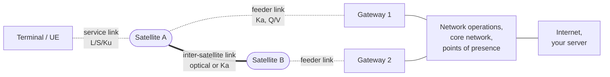

# Satellite Communications and NTN for Embedded Linux Engineers

How a satellite link works (orbits, bands, link budgets, delay, Doppler, visibility, payloads and beams), how classical satellite systems carry data (DVB-S2 and DVB-RCS2, proprietary IoT and broadband systems, IP over long and moving links), how 3GPP adapted LTE and 5G NR to satellites (**non-terrestrial networks**, NTN: NR-NTN and IoT-NTN), how Linux takes part (GNSS and time, a satellite IoT modem on a UART, an NTN cellular module, a router behind a broadband terminal, pass prediction and link emulation), and what it takes to ship a device that talks to space and debug it when messages don't get through.

Satellite is the link of last resort and of the empty places: the sea, the mountains, the desert, the air, the farm two valleys away from the nearest cell. It is **slow or expensive or both** compared with terrestrial networks, it needs **sky**, and every design decision comes back to three numbers: the link budget, the delay and how long a satellite is in view. The LAN, the dev laptop and the board are the ones of [Wi-Fi for Embedded Linux Engineers](../wifi/wifi_v1_2026-11-01.md); LTE and NR themselves are in [Cellular Protocols: LTE, 5G NR and Cellular IoT](../cellular/cellular_v1_2026-11-02.md), IP networking in [Linux Networking Fundamentals for Embedded Engineers](../../os-and-firmware/networking/linux-networking-fundamentals/linux-networking-fundamentals_v1_2026-10-29.md). This note links to them instead of repeating them.

**Assumptions:**
- One example setup (section 2) is used throughout: the board of the Wi-Fi note with a GNSS receiver, an Iridium SBD modem and an NB-IoT NTN module, a remote site behind a LEO broadband terminal, and an application server on the internet.
- NTN means the 3GPP features of **Release 17** (frozen in 2022) and the additions of Releases 18 and 19 where they matter. The reader knows the LTE and NR basics of the cellular note: RRC states, registration, PSM and eDRX, timing advance, HARQ.
- Bands and regulation are given for the EU and the US. They change, and other regions differ.
- Linux 6.x, gpsd 3.2x, chrony 4.x, systemd 25x, Python 3.11 or later. Commands and configuration keys that differ between versions say so.
- Identifiers, addresses, coordinates, IMEIs and keys are placeholders.

**Conventions:**
- `$` is a shell on the dev laptop, `#` a root shell on the board or the site router, as stated next to each block.
- **Normative** values come from a 3GPP or ETSI specification (the document number is given), an ITU-R Recommendation or a regulation.
- **Rule of thumb** marks values that depend on the satellite, the terminal, the weather and the deployment.
- **Operator-dependent** marks what a satellite operator decides (plans, message sizes, coverage, delivery interfaces); **vendor-dependent** what a module or terminal maker decides (AT commands, power, GNSS handling).
- **Illustrative** marks a file, script or output that shows the shape of a solution and needs adapting.
- The satellite landscape changes quickly: constellations launch, operators merge, rename and close services. Operator and product names are examples as of November 2026, not recommendations.

**Verification status:** nothing in this note was run for it. No source was downloaded, nothing was built, no modem, terminal or antenna was used. Orbital and link budget numbers are computed from the formulas given, with the stated assumptions. Protocol values follow the 3GPP, ETSI and ITU-R documents cited and the public documentation of the modules, as known in November 2026. Commands, code and outputs are generic, untested examples, abridged.

**How to read it:**
- **To learn:** Part 1 (sections 1 to 9) in order, then Part 2 (sections 10 to 14) for 3GPP NTN.
- **To build something on Linux:** Part 3 (sections 15 to 21).
- **To ship a product or a deployment:** Part 4 (sections 22 and 23).
- **To debug:** section 24 first, then the section of the step that fails.

## Table of contents

**Part 1: How satellite links work**

- [1. The mental model: a long, moving radio link](#1-the-mental-model-a-long-moving-radio-link)
- [2. Example setup](#2-example-setup)
- [3. Orbits and constellations: GEO, MEO, LEO, HEO](#3-orbits-and-constellations-geo-meo-leo-heo)
- [4. Frequency bands, services and regulation](#4-frequency-bands-services-and-regulation)
- [5. The link budget: path loss, EIRP, G/T, C/N0 and rain](#5-the-link-budget-path-loss-eirp-gt-cn0-and-rain)
- [6. Delay, Doppler and visibility](#6-delay-doppler-and-visibility)
- [7. System architecture: payloads, beams, gateways and inter-satellite links](#7-system-architecture-payloads-beams-gateways-and-inter-satellite-links)
- [8. Air interfaces: DVB-S2, DVB-S2X, DVB-RCS2 and proprietary systems](#8-air-interfaces-dvb-s2-dvb-s2x-dvb-rcs2-and-proprietary-systems)
- [9. IP over satellite: TCP, PEPs, QUIC and addressing](#9-ip-over-satellite-tcp-peps-quic-and-addressing)

**Part 2: 3GPP non-terrestrial networks**

- [10. NTN in 3GPP: releases, NR-NTN and IoT-NTN, bands](#10-ntn-in-3gpp-releases-nr-ntn-and-iot-ntn-bands)
- [11. Radio adaptations: timing advance, Doppler, scheduling offsets and HARQ](#11-radio-adaptations-timing-advance-doppler-scheduling-offsets-and-harq)
- [12. Getting and keeping service: system information, access, mobility and discontinuous coverage](#12-getting-and-keeping-service-system-information-access-mobility-and-discontinuous-coverage)
- [13. The core network, UE location and regulation in NTN](#13-the-core-network-ue-location-and-regulation-in-ntn)
- [14. The landscape: satellite IoT, NTN operators, direct to device and broadband](#14-the-landscape-satellite-iot-ntn-operators-direct-to-device-and-broadband)

**Part 3: Satellite on Linux**

- [15. Satellite and Linux: four roles](#15-satellite-and-linux-four-roles)
- [16. GNSS and time on Linux: gpsd, PPS and chrony](#16-gnss-and-time-on-linux-gpsd-pps-and-chrony)
- [17. An Iridium SBD modem on a UART](#17-an-iridium-sbd-modem-on-a-uart)
- [18. An NB-IoT NTN module](#18-an-nb-iot-ntn-module)
- [19. A Linux router behind a broadband terminal](#19-a-linux-router-behind-a-broadband-terminal)
- [20. Pass prediction and emulating satellite links on the bench](#20-pass-prediction-and-emulating-satellite-links-on-the-bench)
- [21. Application design for slow, expensive, intermittent links](#21-application-design-for-slow-expensive-intermittent-links)

**Part 4: Products and deployments**

- [22. Antennas, sky view, coexistence and power](#22-antennas-sky-view-coexistence-and-power)
- [23. Production: regulation, certification, operators and fleets](#23-production-regulation-certification-operators-and-fleets)

**Debugging and reference**

- [24. Troubleshooting](#24-troubleshooting)
- [25. Not covered here](#25-not-covered-here)
- [References](#references)

---

## 1. The mental model: a long, moving radio link

A satellite link is an ordinary radio link with four things pushed to extremes:

- **Distance.** 500 to 2,000 km to a low earth orbit satellite, about 36,000 km to a geostationary one, against a few kilometers to a cell tower. Free-space loss grows with the square of the distance, so the link budget (section 5) is tight and everything else (antennas, power, bandwidth, data rate) is chosen to close it.
- **Delay.** Light needs about 120 ms to reach a geostationary satellite. A request and its answer through one cross that distance four times: about half a second before any processing. TCP, TLS, chatty protocols and protocol timers all feel it (sections 6 and 9).
- **Motion.** A low earth orbit satellite crosses the sky in a few minutes at about 7.5 km/s. The distance, and so the delay, changes all the time, the carrier is shifted by tens of kHz of Doppler, and the device is handed from satellite to satellite or waits for the next one (section 6).
- **Sky.** The signal arrives from above at low power. Walls, roofs, trees, a car body or a hand in the wrong place cost 5 to 20 dB or more. Most satellite links need an antenna with a clear view of the sky, and some need it pointed (section 22).

```
                     ┌──────────────┐   inter-satellite link (some systems)
                     │  Satellite   │ ─────────────────────────────▶ other satellites
                     │ transparent  │
                     │ or regenerat.│
                     └──────────────┘
         service link   ╱        ╲   feeder link
     (user link, short ╱          ╲ (big antennas, high bands)
      antennas, L/S/Ku)╱            ╲
     ┌──────────────┐                ┌───────────────┐     ┌─────────────────┐
     │  Terminal /  │                │ Gateway /     │────▶│ Core network,   │
     │  UE / modem  │                │ ground station│     │ internet, your  │
     └──────────────┘                └───────────────┘     │ server          │
                                                           └─────────────────┘
```

**Two families of systems** share the sky:

- **Satellite systems with their own air interface:** DVB-S2/RCS2 VSATs on geostationary satellites, Iridium, Inmarsat (now Viasat), Globalstar, ORBCOMM, Starlink and the other broadband constellations. Each has its own terminals, modems and protocols; the device sees either an IP link (broadband) or a message service (satellite IoT, section 14).
- **3GPP NTN:** LTE (NB-IoT, LTE-M) and NR adapted so that a satellite can carry a cell. A device uses a cellular modem that supports the satellite bands and the NTN features, with a SIM and a subscription, and the core network is a mobile operator's core (sections 10 to 13). A third case, **direct to device** with unmodified phones, puts the adaptation in the satellite instead of the device (section 13).

**What the device sees** decides most of the design:

| What it gets | Typical systems | Data | Delay | Device side |
|---|---|---|---|---|
| **Short messages** | Iridium SBD, Globalstar simplex, ORBCOMM, Myriota, Argos/Kinéis, Astrocast | Tens to hundreds of bytes per message | Seconds to hours (passes, store and forward) | A modem with AT commands or a vendor API (section 17) |
| **Narrowband cellular over satellite** | NB-IoT NTN, LTE-M NTN | Hundreds of b/s to tens of kb/s, small IP or non-IP packets | Seconds; minutes to hours with sparse LEO | A cellular module, a SIM, AT commands (section 18) |
| **Narrowband IP** | Iridium Certus, Inmarsat/Viasat BGAN | Tens to hundreds of kb/s | 0.5 to 2 s round trip | A terminal with Ethernet or a modem |
| **Broadband IP** | Starlink, Eutelsat OneWeb, Amazon Leo, GEO and MEO VSAT | Megabits to hundreds of Mb/s | 25 to 700 ms round trip | A terminal with Ethernet (section 19) |
| **Phones and handsets** | Direct to device (T-Mobile/Starlink, AST SpaceMobile), satellite SOS (Apple/Globalstar, Skylo) | Texts, low-rate data | Seconds | The phone's own modem |

**How it compares with the terrestrial options** (rule of thumb):

| | Satellite IoT (SBD, NB-IoT NTN) | LoRaWAN | LTE-M / NB-IoT | LEO broadband |
|---|---|---|---|---|
| Coverage | Global or near global, outdoors with sky view | Where you or a community put gateways | Where an operator built cells | Global minus regulatory exclusions, with sky view |
| Data per message | 50 to a few hundred bytes | 10 to 50 bytes | Hundreds of bytes to megabytes | Unlimited for IoT purposes |
| Latency | Seconds to hours | Seconds | Under a second to seconds | 25 to 60 ms |
| Cost | Module, subscription and per-byte or per-message billing, the highest per byte | Module, no subscription on a private network | Module, SIM, subscription | Terminal of a few hundred euros, tens of watts, monthly plan |
| Power | Joules per message plus GNSS | Millijoules per message | Tens to hundreds of mJ per message with PSM | Tens of watts continuously |

Choose satellite when there is no terrestrial network where the device is, and design the data to fit. Many products carry several radios and use the satellite only when cheaper links are unavailable (section 21).

**Vocabulary:**

| Term | Meaning |
|---|---|
| GEO, MEO, LEO, HEO | Geostationary, medium, low and highly elliptical earth orbits (section 3) |
| Service link, user link | The radio link between the terminal and the satellite |
| Feeder link | The radio link between the satellite and a gateway on the ground |
| Gateway, teleport, ground station | Large ground antennas linking satellites to terrestrial networks |
| Transparent, bent pipe | A payload that only filters, frequency-shifts and amplifies the signal |
| Regenerative | A payload that demodulates and decodes the signal, and may switch, route or run a base station on board |
| ISL | Inter-satellite link, radio or optical |
| Beam, spot beam | The footprint of one satellite antenna beam on the ground; a cell in NTN terms |
| EIRP | Effective isotropic radiated power: transmit power plus antenna gain, in dBW or dBm |
| G/T | Receive antenna gain divided by system noise temperature, in dB/K: the figure of merit of a receiver |
| C/N0, Es/N0, Eb/N0 | Carrier to noise density, energy per symbol and per bit to noise density (section 5) |
| MODCOD | A modulation and coding combination, as in DVB-S2 (section 8) |
| VSAT | Very small aperture terminal: a fixed dish terminal, usually 0.6 to 2.4 m |
| ESIM | Earth station in motion: a terminal on a vehicle, ship or aircraft |
| MSS, FSS, BSS | Mobile, fixed and broadcasting satellite services, the ITU allocations (section 4) |
| NTN | Non-terrestrial network: 3GPP access through satellites or high-altitude platforms |
| NR-NTN, IoT-NTN | NR over satellite; NB-IoT and LTE-M over satellite (section 10) |
| D2D, DTC | Direct to device, direct to cell: satellites serving ordinary phones |
| Ephemeris | Data describing a satellite's orbit, from which its position at any time is computed |
| TLE, OMM | Two-line element set and Orbit Mean-Elements Message: public orbit formats (section 20) |
| Pass | The interval during which a satellite is above a minimum elevation at a site |
| Elevation, azimuth | Angle above the horizon, and compass direction, of a satellite seen from the ground |

---

## 2. Example setup

The board of the [Wi-Fi note](../wifi/wifi_v1_2026-11-01.md#2-example-network) is on the bench at home. Its field twin is installed at a remote site in the mountains (a water reservoir with a pump, no cellular coverage) where it reports levels and alarms. The site also has a router behind a LEO broadband terminal for maintenance access. An application server on the internet collects everything:


| Device | Hardware | Identifiers | Role in the examples |
|---|---|---|---|
| Board | The board of the Wi-Fi note: `192.168.10.21` on the bench, `192.168.30.21` at the site | | Runs gpsd and chrony (section 16), the Iridium sender (section 17), the NTN module (section 18) and the application's message queue (section 21) |
| GNSS receiver | Multi-constellation receiver on UART `/dev/ttymxc1` at 9600 baud, PPS on a GPIO, active antenna on the roof | | Position and time for the board, the pass predictions and the logs |
| Iridium modem | Iridium 9603-class SBD transceiver on UART `/dev/ttymxc2` at 19200 baud, power and network-available pins on GPIOs, L-band patch antenna | IMEI `<IMEI>` | Alarms when everything else is down: short burst data, 340-byte uplinks (section 17) |
| NTN module | Multimode NB-IoT module with terrestrial bands and the NTN L-band and S-band bands (B255, B256), integrated GNSS, on USB (`/dev/ttyUSB2` AT port) | IMEI `<IMEI>`, SIM with an NTN subscription, APN `ntn.example` | Periodic reports over a GEO NB-IoT NTN service (section 18) |
| Site router | Linux router (or OpenWrt, [OpenWrt note](../../os-and-firmware/networking/openwrt/openwrt_v1_2026-10-29.md)) | `eth0` `192.168.30.1/24`, `eth1` WAN: CGNAT `100.64.0.0/10` address and an IPv6 `/56` from `2001:db8:4c00::/40` | Maintenance access through WireGuard, TCP tuning, SQM (section 19) |
| Broadband terminal | LEO phased-array terminal, its router in bypass mode | | IP for the site router |
| Application server | A VM with a public address `203.0.113.10` | | Receives SBD messages over DirectIP (section 17), CoAP over UDP from the NTN module, MQTT from the site router, WireGuard endpoint |
| Dev laptop | `192.168.10.100` on the LAN of the Wi-Fi note | | Bench tests: link emulation with `tc netem` (section 20), pass predictions |

Placeholders: IPv4 addresses come from the documentation ranges (`203.0.113.0/24`, RFC 5737), the CGNAT range is the shared address space of RFC 6598, IPv6 prefixes from `2001:db8::/32` (RFC 3849). The site coordinates are round numbers in the Alps. IMEIs, SIM details and APNs are written `<IMEI>`, `ntn.example`; never put a real IMEI, SIM credential or key in a note or a repository.

---

## 3. Orbits and constellations: GEO, MEO, LEO, HEO

A satellite in a circular orbit at altitude *h* above an Earth of radius *R* ≈ 6,371 km moves at *v* = √(μ / (R + h)) and goes around in *T* = 2π √((R + h)³ / μ), with μ = 398,600 km³/s². Higher means slower, longer to go around, longer to reach, and a bigger footprint:

| Orbit | Altitude | Period | One-way delay ground to satellite, overhead to 10° elevation | Time in view at a site | Examples |
|---|---|---|---|---|---|
| **LEO** | 300 to 2,000 km | 90 to 127 min | 550 km: 1.8 to 6.1 ms; 1,200 km: 4.0 to 10.4 ms | A few minutes per pass (see below) | Starlink (shells around 340 to 570 km), Iridium (780 km), Eutelsat OneWeb (1,200 km), Globalstar (1,414 km), Amazon Leo, most IoT nanosatellites (500 to 600 km) |
| **MEO** | 2,000 to 35,786 km | 2 to 24 h | 8,062 km: 27 to 40 ms | Hours | SES O3b mPOWER (8,062 km, 4.8 h period); GNSS (GPS 20,200 km, Galileo 23,222 km, about 12 to 14 h) |
| **GEO** | 35,786 km over the equator | 23 h 56 min (one sidereal day) | 119 to 135 ms | Always, from a fixed direction | Inmarsat/Viasat, Thuraya, TV satellites, GEO VSAT and HTS, most NTN IoT services in 2026 |
| **HEO** | Elliptical: perigee a few hundred km, apogee tens of thousands | 12 h (Molniya), 24 h (Tundra) | Varies along the orbit | Hours around apogee | High-latitude coverage (Russia, polar regions), some broadband and satellite radio |

Values computed with the formulas above and the slant range of section 6. A delay through a **transparent** satellite adds the service link and the feeder link; a round trip doubles that again (section 6).

### GEO: fixed in the sky

A satellite at 35,786 km over the equator turns with the Earth and stays at a fixed azimuth and elevation, so a dish can be pointed once and left. Three satellites see almost all inhabited land; nobody sees them beyond about 81° latitude, and in practice above 70 to 75° the elevation is too low. From 45° N, a GEO at the same longitude is due south at about 38° elevation; from 60° N, at about 22°. Low elevations mean longer paths, more atmosphere, more obstacles.

What still moves: station keeping holds a satellite in a box of about ±0.05 to 0.1°, enough to matter for large dishes; old satellites run in **inclined orbit** to save fuel and wander north and south in a daily figure eight, which needs tracking antennas. Twice a year, around the equinoxes, the **sun passes behind the satellite** seen from a given site for a few minutes a day over several days, and the sun's noise drowns the signal (sun outage). The satellite also goes through **eclipses** around the equinoxes, on batteries.

### LEO: close, fast and many

A LEO satellite at 550 km goes around in about 95 minutes at 7.6 km/s. Seen from a site:

| Altitude | Footprint radius at 10° minimum elevation | Longest pass above 10° | Longest pass above 25° |
|---|---|---|---|
| 550 km | about 1,670 km | about 8 min | about 4.5 min |
| 780 km (Iridium) | about 2,080 km | about 10 min | |
| 1,200 km | about 2,670 km | about 15 min | |

Longest passes are directly overhead; most passes are lower and shorter. The Earth's rotation under the orbit is ignored (it changes the values by a few percent).

**Continuous coverage needs many satellites.** Iridium flies 66 active satellites in 6 polar planes; broadband constellations fly thousands, in several shells and inclinations. A constellation's **inclination** sets the latitudes it serves: polar orbits (Iridium 86.4°, OneWeb about 88°) cover the whole Earth and crowd over the poles; inclined shells (Starlink's 53° and 43° shells) concentrate capacity at mid-latitudes. A **sparse** constellation (a few to a few tens of IoT satellites) gives passes every few hours at a site: the device stores its messages and sends them during the next pass (**store and forward**, section 12).

LEO orbits decay through atmospheric drag: below about 600 km a dead satellite reenters within a few years, which is good for debris and means constellations are replaced continuously.

### MEO and HEO

MEO trades fewer satellites for more delay: O3b mPOWER serves maritime, cellular backhaul and enterprise links with round trips around 130 to 150 ms (rule of thumb), with tracking antennas. GNSS uses MEO because a few dozen satellites cover the Earth with several in view everywhere. HEO orbits (inclination 63.4° so that the ellipse doesn't rotate) hang for hours near apogee over high latitudes, where GEO is too low in the sky.

### Knowing where a satellite is

A satellite's orbit is described by an **ephemeris**: either a state vector (position and velocity at an epoch) or orbital elements (semi-major axis, eccentricity, inclination, right ascension of the ascending node, argument of perigee, mean anomaly at an epoch). Propagating it forward gives the position at any time.

- **Public orbits:** CelesTrak and Space-Track publish **TLEs** and **OMM** records for tracked objects, propagated with the SGP4 model. Accuracy is about a kilometer at epoch, degrading by kilometers per day: good for pass predictions and antenna pointing, not for timing advance (section 20).
- **Operator orbits:** operators know their satellites' positions to meters. In 3GPP NTN, the network broadcasts the serving satellite's ephemeris in system information for the device to compute delay and Doppler (section 12).
- **GNSS** gives the device its own position and accurate time. Both are needed to compute anything about the geometry; NTN devices need GNSS for this reason (sections 11 and 16).

---

## 4. Frequency bands, services and regulation

### Bands

Satellite bands use the old radar letters. Each band trades antenna size, rain sensitivity and available bandwidth:

| Band | Range (approximate) | Main satellite uses | Notes |
|---|---|---|---|
| VHF, UHF | 137 to 470 MHz | ORBCOMM (137 to 150 MHz), Argos/Kinéis (401 MHz), weather satellites (137 MHz), military UHF, amateur satellites | Simple antennas, little bandwidth, crowded |
| **L** | 1 to 2 GHz | GNSS (1,164 to 1,610 MHz), MSS: Inmarsat/Viasat (downlink 1,525 to 1,559, uplink 1,626.5 to 1,660.5 MHz), Iridium (1,616 to 1,626.5 MHz, both directions), Globalstar uplink (1,610 to 1,618.725 MHz), Thuraya, Ligado. NTN band n255 / B255 | Small omnidirectional or patch antennas work, little rain effect, narrow allocations: the band of handhelds and IoT |
| **S** | 2 to 4 GHz | MSS 2 GHz (uplink 1,980 to 2,010, downlink 2,170 to 2,200 MHz), Globalstar downlink (2,483.5 to 2,500 MHz), satellite radio (2.3 GHz). NTN band n256 / B256 | Similar to L-band, slightly more path loss for the same antenna gain |
| **C** | 4 to 8 GHz | FSS: downlink 3.4 to 4.2, uplink 5.85 to 6.725 GHz | Rain-robust, large dishes (1.8 to 3.7 m). Part of the downlink band was cleared for 5G (3.7 to 3.98 GHz in the US) |
| X | 8 to 12 GHz | Government and military satellite communications, Earth observation downlinks (8.025 to 8.4 GHz) | |
| **Ku** | 12 to 18 GHz | FSS and BSS: downlink 10.7 to 12.75, uplink 12.75 to 14.5 GHz. TV broadcasting, VSAT, user links of Starlink and OneWeb | Small dishes (45 to 120 cm) and flat panels, a few dB of rain fade |
| **Ka** | 26.5 to 40 GHz (satcom: downlink 17.3 to 21.2, uplink 27.5 to 31 GHz) | High-throughput satellites, gateways, ESIM, NR-NTN bands n510 to n512 | Wide bandwidth, small spot beams, strong rain fade |
| Q/V, W | 37 to 52 GHz, 75 to 110 GHz | Gateway feeder links of new constellations | Very strong rain and gas attenuation, site diversity |
| Optical | | Inter-satellite links, some feeder links | Clouds block ground links |

The **user link** of IoT and handheld systems lives in L and S because a small, unpointed antenna works there. **Broadband** lives in Ku and Ka because that is where hundreds of MHz are available, at the price of a pointed or electronically steered antenna. **Feeder links** move up to Ka, Q/V and optical, to free spectrum for users.

**Polarization:** L-band and S-band mobile systems use circular polarization, because the ionosphere rotates linear polarization (Faraday rotation) and a handheld has no fixed orientation. Ku-band broadcasting in Europe uses horizontal and vertical linear polarization, selected by the LNB (section 8). A linearly polarized device antenna receiving a circular signal loses 3 dB.

### Services

The ITU Radio Regulations allocate bands to **services**, and a system must operate in a band allocated to its service:

| Service | Meaning | Examples |
|---|---|---|
| FSS (fixed-satellite service) | Between earth stations at fixed points (and, by later decisions, ESIMs) | VSAT, broadband terminals, gateways |
| MSS (mobile-satellite service) | Mobile earth stations, handhelds, vehicles | Iridium, Inmarsat, Globalstar, Thuraya, 3GPP NTN in L and S bands |
| BSS (broadcasting-satellite service) | Direct reception by the public | Satellite TV and radio |
| RNSS | Radionavigation-satellite | GNSS |
| EESS, SRS | Earth exploration, space research | Earth observation, science |
| Amateur-satellite | Licensed amateurs, non-commercial | Amateur satellites and CubeSats in amateur bands |

### Regulation

Three layers of permission apply to a satellite link:

- **The satellite system.** An administration (the national regulator of the operator's country) files the system with the ITU, coordinates it with other systems and notifies it. Non-geostationary systems must keep their interference into GEO systems below the **EPFD** limits of the Radio Regulations. This is the operator's business, but it explains why a system can't simply change bands.
- **Market access.** An operator needs authorization ("landing rights") in each country where it provides service; coverage maps follow these authorizations as much as the orbits. Some countries restrict or forbid satellite terminals, or require their registration, and customs may hold them: check before shipping devices abroad.
- **The terminal.** A terminal transmits, so it needs a radio authorization. In the EU, CEPT ECC decisions exempt many MSS and FSS/ESIM terminals from individual licensing and allow their free circulation, and the device must comply with the Radio Equipment Directive (section 23). In the US, terminals operate under **FCC Part 25**, usually under a blanket license held by the operator. A device integrating a satellite modem inherits obligations from both the regulation and the operator's terms.

**Satellites in mobile operators' bands.** Direct-to-device services that reach ordinary phones use terrestrial mobile spectrum from space with the partner operator's agreement. The FCC adopted a framework for this, **Supplemental Coverage from Space** (SCS), in 2024; elsewhere it is authorized case by case, and the international rules for mobile-satellite use of terrestrial mobile bands are on the agenda of the World Radiocommunication Conference of 2027 (WRC-27).

**Radio astronomy and GNSS** are protected neighbors: the 1,610.6 to 1,613.8 MHz radio astronomy band sits inside the MSS L-band, and GNSS receivers listen just below the L-band MSS uplinks. A device that transmits in the L-band must not deafen its own GNSS receiver (section 22).

---

## 5. The link budget: path loss, EIRP, G/T, C/N0 and rain

### The equation

A satellite link budget is written per Hz of noise, because the noise is thermal and the bandwidth is a design choice:

```
C/N0 [dB-Hz] = EIRP [dBW] − FSPL [dB] − L_other [dB] + G/T [dB/K] − k [dBW/K/Hz]

    FSPL = 92.45 + 20·log10(d in km) + 20·log10(f in GHz)        free-space path loss
    k    = −228.6 dBW/K/Hz                                         Boltzmann's constant
    C/N  = C/N0 − 10·log10(bandwidth in Hz)
    Es/N0 = C/N0 − 10·log10(symbol rate),   Eb/N0 = C/N0 − 10·log10(bit rate)
```

- **EIRP** is what the transmitter puts out in the direction of the receiver: power in dBW (0 dBW = 1 W = 30 dBm) plus antenna gain, minus feed losses.
- **G/T** is the receiver's figure of merit: antenna gain minus 10·log10 of the system noise temperature. The noise temperature includes the sky the antenna sees (cold sky 10 to 50 K at Ku, the warm Earth 290 K seen by a satellite), losses before the first amplifier, and the amplifier's noise figure (T = 290·(10^(NF/10) − 1)).
- **L_other** collects everything else: atmospheric gases, rain, scintillation, polarization mismatch, pointing error, shadowing and body loss.
- **The margin** is what is left over the C/N0 (or Es/N0) that the modulation and coding need (section 8), and must cover what the budget didn't model.

**Antennas.** A dish of diameter *D* at wavelength λ has a gain G = η·(π·D/λ)² with efficiency η of 0.55 to 0.7, and a 3 dB beamwidth of about 70·λ/D degrees. A 1.2 m dish at 12 GHz: 41.7 dBi and a 1.5° beam. A pointing error of θ costs about 12·(θ / beamwidth)² dB: 0.3° on that dish costs 0.5 dB. The narrow beam is also what lets GEO satellites sit 2° apart without the terminal hearing (or jamming) the neighbors; small dishes and flat panels have wider beams and are limited in power to protect adjacent satellites. An L-band patch or helix has 0 to 5 dBi and needs no pointing.

### Three budgets

**A GEO Ku-band VSAT downlink** (rule of thumb):

| Item | Value | Notes |
|---|---|---|
| Satellite EIRP | 52 dBW | Spot beam, depends on the position in the beam |
| Slant range, frequency | 38,000 km, 12 GHz | Mid-latitude site |
| FSPL | 205.6 dB | |
| Gases, clouds (clear sky), pointing | 1.0 dB | |
| Terminal G/T | 20.9 dB/K | 1.2 m dish (41.7 dBi), system noise temperature 120 K |
| **C/N0 (downlink)** | **94.9 dB-Hz** | |
| Es/N0 at 30 Mbaud | 20.1 dB | 10·log10(30×10⁶) = 74.8 |
| With the uplink and interference (C/N up 20 dB, C/I 20 dB) | about 15.3 dB | 1/(C/N)total = 1/(C/N)up + 1/(C/N)down + 1/(C/I), in linear units |

15 dB carries 32APSK 4/5 (about 4 bit/s/Hz, section 8) in clear sky. Rain takes it down a few MODCODs; adaptive coding and modulation (ACM) follows the weather.

**A LEO S-band handheld uplink**, in the style of the calibration cases of 3GPP TR 38.821 (rule of thumb):

| Item | Value | Notes |
|---|---|---|
| UE EIRP | −7 dBW | 23 dBm (power class 3), 0 dBi antenna |
| Slant range, frequency | 1,075 km (600 km orbit, 30° elevation), 2 GHz | |
| FSPL | 159.1 dB | |
| Gases, scintillation, shadowing margin, polarization | 8.3 dB | 0.1 + 2.2 + 3 + 3 |
| Satellite G/T | 1.1 dB/K | A LEO satellite's receive antenna sees the warm Earth |
| **C/N0** | **55.3 dB-Hz** | |
| SNR in 360 kHz (2 resource blocks at 15 kHz) | −0.3 dB | |
| SNR in one 15 kHz subcarrier | 13.5 dB | |

The same power spread over less bandwidth gives more SNR: a handheld or IoT device can only close a satellite uplink at **low bandwidth**, so narrowband allocations, single-tone NB-IoT transmissions and repetitions are the tools (sections 10 and 11).

**A GEO L-band NB-IoT uplink** (rule of thumb):

| Item | Value | Notes |
|---|---|---|
| UE EIRP | −7 dBW | 23 dBm, 0 dBi patch |
| Slant range, frequency | 38,000 km, 1.64 GHz | |
| FSPL | 188.4 dB | 29 dB more than the LEO case |
| Scintillation, polarization, shadowing margin | 4.5 dB | Circularly polarized patch with a clear sky |
| Satellite G/T | +10 dB/K | Large deployable L-band reflector, many narrow beams |
| **C/N0** | **38.7 dB-Hz** | |
| SNR in a 3.75 kHz single tone | 3.0 dB | |
| SNR in a 15 kHz single tone | −3.1 dB | Needs repetitions |

At 38.7 dB-Hz, Shannon and good coding allow a few kb/s at most; with the overhead of NB-IoT and repetitions, expect **hundreds of b/s to about a kb/s** of useful uplink. A GEO IoT service works because the satellite's huge antenna makes up for the device's tiny one.

### Rain, gases and the ionosphere

| Effect | Bands it matters for | Size (rule of thumb) | ITU-R model |
|---|---|---|---|
| Rain attenuation | Ku and above | Ku: 1 to 4 dB, Ka: 3 to 10 dB and more, for 99.5 to 99.9 % availability in Western Europe; much more in the tropics | P.618, P.837 (rain rates) |
| Rain noise | Ku and above, downlinks | A rain fade of A dB also adds Tm·(1 − 10^(−A/10)) kelvin of noise (Tm ≈ 275 K): 3 dB of rain adds about 140 K | P.618 |
| Atmospheric gases | Above 10 GHz, strong near 22 GHz (water vapor) and 60 GHz (oxygen) | 0.1 to 1 dB at Ku/Ka at medium elevation | P.676 |
| Clouds | Ka and above | Up to a few dB | P.840 |
| Tropospheric scintillation | Ku/Ka at low elevation | Fast fluctuations of a dB or more | P.618 |
| Ionospheric scintillation | L and S bands, near the geomagnetic equator after sunset and at high latitudes | Fades of 10 dB or more during strong events, peaks with the solar cycle | P.531 |
| Shadowing and multipath | All, mostly L and S for mobile terminals | Trees 5 to 20 dB, buildings block | P.681 (land mobile satellite channel) |

The noise matters as much as the attenuation on a downlink: with the VSAT above (120 K), 3 dB of rain raises the noise to about 260 K, so the C/N0 drops by about 6.3 dB, not 3.

**Availability** is quoted as the percentage of an average year the link stays above threshold: 99.5 % allows 44 hours of outage a year, 99.9 % allows 8.8 hours, 99.99 % allows 53 minutes. Each extra nine at Ka-band costs many dB.

### Interference and the satellite's amplifier

A bent-pipe transponder amplifies everything in its band, including noise and other carriers. Its amplifier (a traveling-wave tube or solid state) is driven a few dB below saturation (**back-off**) when it carries many carriers, to limit intermodulation. Adjacent satellites, the other polarization and other beams reusing the same frequency add interference, counted as C/I. The overall link is limited by whichever of uplink C/N, downlink C/N and C/I is worst.

---

## 6. Delay, Doppler and visibility

### Geometry

The slant range from a site to a satellite at altitude *h*, seen at elevation *e*:

```
d = √((R + h)² − (R·cos e)²) − R·sin e          R ≈ 6,371 km
```

| Orbit | Overhead (90°) | 30° elevation | 10° elevation |
|---|---|---|---|
| LEO 550 km | 550 km, 1.8 ms | 993 km, 3.3 ms | 1,815 km, 6.1 ms |
| LEO 1,200 km | 1,200 km, 4.0 ms | 1,999 km, 6.7 ms | 3,131 km, 10.4 ms |
| GEO 35,786 km | 35,786 km, 119.4 ms | 38,609 km, 128.8 ms | 40,581 km, 135.4 ms |

### Delay

A message through a **transparent** satellite crosses the service link and the feeder link; through a **regenerative** satellite with the base station on board, only the service link counts for the radio protocol. The maximum round trips of 3GPP TR 38.821 (both links at 10° minimum elevation) set the design limits of NTN:

| Scenario | Max round trip, transparent | Max round trip, regenerative (UE to satellite) |
|---|---|---|
| GEO | 541.46 ms | 270.73 ms |
| LEO 1,200 km | 41.77 ms | 20.89 ms |
| LEO 600 km | 25.77 ms | 12.89 ms |

What an application measures adds scheduling, processing, ground routing to the operator's point of presence and the internet (rule of thumb):

| System | Typical application round trip |
|---|---|
| GEO VSAT, GEO NTN | 550 to 750 ms, seconds when the return link is congested or needs capacity requests |
| MEO (O3b mPOWER) | 130 to 150 ms |
| LEO broadband (Starlink-class) | 25 to 60 ms median, spikes at satellite changes |
| Iridium SBD | 10 to 30 s for a session: the time is the protocol and registration, not the propagation |
| Sparse LEO store and forward | Minutes to hours: the time until a satellite passes over the device, then over a ground station |

**The delay moves.** A LEO satellite's distance changes by up to about 7 km per second, so the one-way delay drifts by up to about 23 µs every second, and jumps when the device or the gateway changes satellite. A cellular uplink must arrive aligned to within a fraction of a symbol (a few µs at 15 kHz subcarrier spacing): NTN devices must recompute their timing advance continuously (section 11).

### Doppler

A carrier at *f* from a source approaching at radial velocity *v_r* is received at *f·(1 + v_r/c)*. For a LEO satellite at 600 km moving at 7.56 km/s, the radial velocity peaks at about ±6.8 km/s near the horizon, about ±23 ppm of the carrier:

| Carrier | Max Doppler, LEO 600 km | Max Doppler rate (overhead pass) |
|---|---|---|
| 1.6 GHz (L) | ±36 kHz | about 0.46 kHz/s |
| 2 GHz (S) | ±45 kHz | about 0.58 kHz/s |
| 12 GHz (Ku) | ±270 kHz | about 3.5 kHz/s |
| 20 GHz (Ka) | ±450 kHz | about 5.8 kHz/s |

Computed from the orbit; the Earth's rotation adds or subtracts a few percent. The rate peaks overhead, when the Doppler crosses zero: the radial acceleration there is v²·R / ((R + h)·h), about 87 m/s² at 600 km.

For comparison, an LTE subcarrier is 15 kHz wide and a terrestrial modem tracks about 1 kHz (a high-speed train). **±45 kHz is three subcarriers**: a LEO NTN device must pre-compensate its uplink frequency from the satellite's ephemeris and its own position, and track the downlink (section 11).

GEO satellites barely move: their Doppler is a few Hz to tens of Hz from station keeping and inclination. The **terminal's** motion dominates: an aircraft at 250 m/s shifts an L-band carrier by about 1.3 kHz, a car at 30 m/s by about 160 Hz.

### Visibility and handovers

```
 Elevation     ▲                     ┌──── overhead pass, LEO 550 km ────┐
      90°      │                    ╱╲
               │                  ╱    ╲
      25°  ────┼────────────────╱────────╲──────── service mask (example)
      10°  ────┼─────────────╱──────────────╲───── horizon mask
               └──────────────┬─────┬─────┬──────────▶ time
 Range           1,800 km    ...  550 km  ...  1,800 km
 Doppler (2 GHz) +45 kHz     ...   0 Hz   ...  −45 kHz
 One-way delay   6.1 ms      ...  1.8 ms  ...  6.1 ms
                  └────── about 8 min above 10° ──────┘
```

- **Masks.** Terrain, buildings and trees raise the practical horizon. A system that needs 25° of elevation in a valley gets much shorter passes than the table of section 3 promises. Measure or model the site's horizon.
- **Dense constellations** keep several satellites in view and hand the terminal from one to the next. Broadband terminals change satellites every few tens of seconds; measurement studies of Starlink report reallocations on a 15 s schedule with short latency spikes and losses at each change (rule of thumb, operator-dependent). Iridium hands a call between the 48 beams of a satellite about every minute and between satellites every several minutes.
- **NTN cells** may be fixed on the ground (the satellite steers its beams to the same area while it passes) or move with the satellite (the device changes cell every few seconds to minutes). Section 12 describes how 3GPP handles both.
- **Sparse constellations** leave gaps of minutes to hours between passes: the device waits, stores and sends at the next pass (section 12).
- **GEO** is always in view if it is in view at all; outages come from rain, obstacles, sun outages and the satellite's own events.

---

## 7. System architecture: payloads, beams, gateways and inter-satellite links

A satellite system has three segments: the **space segment** (satellites, their payloads and buses), the **ground segment** (gateways, the network operations center, satellite control with its telemetry, tracking and command links), and the **user segment** (terminals).



### Payloads: transparent or regenerative

| | Transparent (bent pipe) | Regenerative |
|---|---|---|
| What the satellite does | Filters, shifts the frequency, amplifies | Demodulates and decodes; switches, routes, or runs a base station (gNB) on board |
| Where the protocol ends | At the gateway: the satellite is part of the radio channel | On the satellite |
| Feeder link | Carries the user signals, so the satellite must see a gateway (or relay through ISLs) | Carries packets, can use a different air interface |
| Uplink and downlink noise | Add up (section 5) | Separate: each hop is decoded on its own |
| Flexibility | Any waveform, upgradeable on the ground | Fixed by the on-board processor, or software-defined |
| Examples | Most GEO TV and VSAT satellites, 3GPP Rel-17 NTN | Iridium, Starlink, many new constellations, 3GPP Rel-19 NTN with a gNB on board |

**Store and forward** is a regenerative mode for sparse constellations: the satellite receives messages while it passes over devices, stores them and delivers them when it passes over a ground station (section 12).

### Beams and frequency reuse

A satellite covers its footprint with one wide beam or many **spot beams**. Spot beams have more gain (so smaller terminals) and reuse the same spectrum in non-adjacent beams, usually with a four-color pattern (two frequency halves times two polarizations). **High-throughput satellites** (HTS) use tens to hundreds of Ka-band spot beams and reach hundreds of Gb/s; very high-throughput satellites reach about 1 Tb/s. **Beam hopping** moves capacity between beams in time to follow demand.

Beams can be formed by a reflector with many feeds or by a **phased array** that steers beams electronically. LEO satellites with phased arrays can keep a beam on a fixed area of the ground while they pass (**earth-fixed** beams), or let beams sweep the ground with the satellite (**earth-moving** beams).

### Gateways and inter-satellite links

A transparent LEO satellite must see a gateway and a user at the same time, which needs gateways every 1,000 to 2,000 km over land, and leaves the oceans uncovered. **Inter-satellite links** remove that constraint: Iridium links its satellites with Ka-band crosslinks; Starlink with lasers. Traffic then flies across the constellation to a gateway near its destination. ISLs also allow a system to land traffic in a chosen country, which matters for regulation and lawful interception.

### Terminals

| Terminal antenna | Gain | Pointing | Typical use |
|---|---|---|---|
| Patch, helix, quadrifilar helix | 0 to 5 dBi | None, needs sky view | L/S-band IoT, handhelds, NTN devices |
| Fixed dish (offset parabolic) with an LNB and a BUC | 30 to 45 dBi | Installed once (GEO) | VSAT, TV reception |
| Tracking dish | 30 to 45 dBi | Motorized: ships, inclined-orbit GEO, MEO | Maritime VSAT, MEO |
| Flat phased array | 30 to 35 dBi | Electronic, follows LEO satellites | LEO broadband (Starlink, OneWeb, Amazon Leo), ESIM |

A VSAT outdoor unit has an **LNB** (low-noise block downconverter: the receive amplifier and a downconversion to an intermediate frequency of about 950 to 2,150 MHz on the coax) and a **BUC** (block upconverter: the transmit side). The indoor unit is the modem.

---

## 8. Air interfaces: DVB-S2, DVB-S2X, DVB-RCS2 and proprietary systems

### DVB-S2 and DVB-S2X: the forward link

**DVB-S2** (ETSI EN 302 307-1) is the forward link (gateway to terminals) of almost every TV satellite and most VSAT networks. It sends a continuous carrier of **frames** each protected by LDPC and BCH codes (normal frames of 64,800 bits, short frames of 16,200), with QPSK, 8PSK, 16APSK or 32APSK modulation, roll-off 0.35, 0.25 or 0.20, and optional pilots for phase tracking. Each frame can use its own MODCOD:

- **CCM** (constant coding and modulation): one MODCOD for everyone, as in TV broadcasting.
- **VCM** (variable): a MODCOD per service.
- **ACM** (adaptive): a MODCOD per frame, chosen from the reports of each terminal, so terminals in clear sky get dense MODCODs while those in rain get robust ones.

Ideal thresholds from the standard's performance table (AWGN, normal frames, quasi error-free); real modems need 0.5 to 1 dB more:

| MODCOD | Spectral efficiency (bit/s/Hz) | Es/N0 needed |
|---|---|---|
| QPSK 1/4 | 0.49 | −2.4 dB |
| QPSK 1/2 | 0.99 | 1.0 dB |
| QPSK 3/4 | 1.49 | 4.0 dB |
| 8PSK 2/3 | 1.98 | 6.6 dB |
| 8PSK 3/4 | 2.23 | 7.9 dB |
| 16APSK 3/4 | 2.97 | 10.2 dB |
| 16APSK 5/6 | 3.30 | 11.6 dB |
| 32APSK 4/5 | 3.95 | 13.6 dB |

Throughput = symbol rate × spectral efficiency: 30 Mbaud of 32APSK 4/5 carries about 118 Mb/s.

**DVB-S2X** (EN 302 307-2) extends it: finer MODCOD steps up to 256APSK, roll-offs of 0.15, 0.10 and 0.05, **very low SNR** MODCODs down to about −10 dB Es/N0 for mobile and small terminals, channel bonding and a **superframe** structure that supports beam hopping.

IP over DVB-S2 travels either in MPEG transport streams (MPE or ULE encapsulation, inherited from TV) or, more efficiently, in **GSE** (Generic Stream Encapsulation, ETSI TS 102 606).

### DVB-RCS2: the return link

**DVB-RCS2** (ETSI EN 301 545) is the standard return link (terminals to gateway) of interactive VSAT networks: **MF-TDMA**, a set of carriers divided into time slots. A terminal logs on, is synchronized by the hub, and requests capacity: constant rate assignment (CRA) for steady traffic, rate-based (RBDC) and volume-based (VBDC) dynamic capacity for bursts, plus random access slots for small packets. Each request and grant costs a round trip, so the first packet of a burst on a GEO return link can wait a second or more: a reason for PEPs and for keeping a little CRA.

Many VSAT vendors use proprietary return links (and sometimes forward links) instead; the system works the same way.

### Proprietary systems

Most mobile, IoT and LEO broadband systems use their own air interfaces, documented only to partners:

| System | Air interface (public outline) |
|---|---|
| Iridium | L-band, TDMA/FDMA with time-division duplex in 1,616 to 1,626.5 MHz, 48 beams per satellite, Ka-band crosslinks. SBD for messages, Certus for IP up to about 700 kb/s |
| Inmarsat/Viasat L-band | GEO, BGAN shared-channel IP up to about 500 kb/s, IoT message services |
| Globalstar | CDMA, bent-pipe LEO; simplex devices only transmit (STX3-type modules) |
| Starlink | Ku-band OFDM user links with phased arrays, Ka gateways, laser ISLs; details unpublished |
| Argos/Kinéis | 401 MHz uplinks, simple low-power messages received by LEO satellites |

From a device's point of view these are black boxes behind a modem or a terminal; what matters is the service they expose (section 14).

### Receiving DVB-S2 on Linux

Linux has a DVB subsystem (`/dev/dvb/adapterN/{frontend0,demux0,dvr0,net0}`) driving PCIe and USB satellite tuners. It is used for TV, for receiving IP data broadcast over satellite, and for lab work. With a **universal LNB** (local oscillators at 9.75 and 10.6 GHz), the receiver selects the polarization by the LNB supply voltage (13 V vertical, 18 V horizontal) and the band with a 22 kHz tone, and switches between dishes or LNBs with DiSEqC commands on the coax (**Illustrative**, v4l-utils tools):

```
# dvb-fe-tool -a 0                                # frontend capabilities: delivery systems, symbol rates
# dvbv5-scan -l UNIVERSAL -o channels.conf initial-transponders.conf
# dvbv5-zap -l UNIVERSAL -c channels.conf -m "SOME CHANNEL"   # tune, show lock, signal and C/N
```

For IP data, `dvbnet` creates a `dvbN_0` network interface fed by MPE or ULE on a given PID. GSE needs user-space tools. Satellite TV reception isn't otherwise the subject of this note.

---

## 9. IP over satellite: TCP, PEPs, QUIC and addressing

### Delay and TCP

A sender can only have one window of unacknowledged data in flight per round trip, so a single TCP flow needs a window of at least the **bandwidth-delay product**:

| Link | Rate | Round trip | BDP |
|---|---|---|---|
| GEO VSAT | 50 Mb/s | 600 ms | 3.75 MB |
| GEO HTS | 200 Mb/s | 650 ms | 16 MB |
| LEO broadband | 200 Mb/s | 40 ms | 1 MB |
| NB-IoT NTN, GEO | 1 kb/s | 1 to 3 s | A few hundred bytes |

- **Windows.** Linux autotunes receive and send buffers up to `tcp_rmem` and `tcp_wmem` maximums (6 MB and 4 MB by default): enough for a LEO link, short of a fast GEO link (section 19).
- **Slow start** doubles the window every round trip from 10 segments. Reaching 3.75 MB takes about 8 round trips: 5 seconds on GEO. Short transfers never leave slow start.
- **Handshakes cost round trips:** TCP (1), TLS 1.3 (1 more), an HTTP request (1 more). Fetching one small resource over a fresh connection takes about 3 round trips, close to 2 seconds on GEO. TLS 1.2 adds another; DNS adds one per lookup.
- **Loss** is read as congestion by loss-based congestion control (CUBIC, the Linux default), which halves its window. LEO links lose packets in bursts at satellite changes; measurement studies find **BBR** keeps more throughput there (rule of thumb).

### Performance-enhancing proxies

GEO VSAT systems hide the delay with **PEPs** (RFC 3135): the terminal and the gateway terminate TCP locally, acknowledge immediately, and carry the data between them with a protocol tuned for the satellite. Web acceleration adds prefetching. PEPs only work on TCP they can see:

- **Encrypted tunnels** (IPsec, WireGuard, OpenVPN) hide TCP from the PEP: a site VPN over GEO runs at raw TCP speed unless the PEP runs inside the tunnel, or the VPN carries little traffic.
- **QUIC** (RFC 9000) is encrypted, so PEPs can't split it. QUIC saves the handshake round trips itself (one round trip, zero with resumption) but its congestion control still faces the BDP. Some VSAT networks rate-limit or block QUIC to push browsers back to TCP.

LEO broadband needs no PEP: the delay is terrestrial.

### MTU, NAT and addresses

- **MTU.** Some satellite terminals and tunnels have an MTU below 1500; path MTU discovery fails when ICMP is filtered (connections hang after the handshake). Clamp TCP MSS on the router and enable `tcp_mtu_probing` (section 19).
- **CGNAT.** Consumer satellite broadband usually gives a private IPv4 address behind carrier-grade NAT (Starlink residential: an address in `100.64.0.0/10`), so nothing can connect in over IPv4. Either use IPv6 (Starlink delegates a `/56` with DHCPv6 prefix delegation, at the time of writing), a static-IP business plan, or an outbound tunnel to a server you control (section 19).
- **NAT timeouts.** UDP mappings in CGNAT expire after tens of seconds to minutes; MQTT, WireGuard and CoAP observers need keepalives shorter than the timeout.
- **DNS.** Each lookup costs a round trip: run a caching resolver on the site router.
- **IoT over NTN** carries small IP packets (UDP, CoAP) or non-IP data; the IP and transport headers alone (28 bytes for IPv4 and UDP) can be larger than the payload (section 21).

