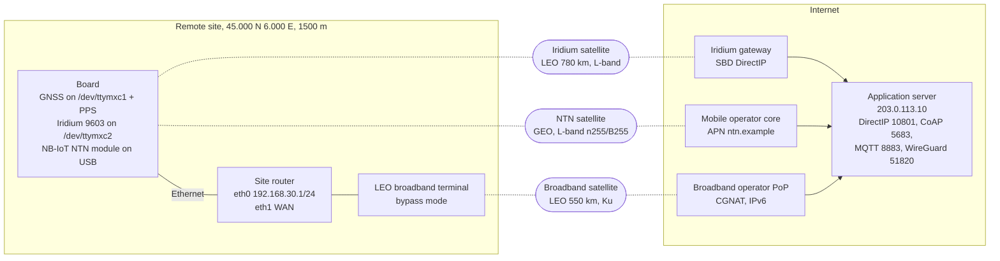

# Satellite Communications and NTN for Embedded Linux Engineers

How a satellite link works (orbits, bands, link budgets, delay, Doppler, visibility, payloads and beams), how classical satellite systems carry data (DVB-S2 and DVB-RCS2, proprietary IoT and broadband systems, IP over long and moving links), how 3GPP adapted LTE and 5G NR to satellites (**non-terrestrial networks**, NTN: NR-NTN and IoT-NTN), how Linux takes part (GNSS and time, a satellite IoT modem on a UART, an NTN cellular module, a router behind a broadband terminal, pass prediction and link emulation), and what it takes to ship a device that talks to space and debug it when messages don't get through.

Satellite is the link of last resort and of the empty places: the sea, the mountains, the desert, the air, the farm two valleys away from the nearest cell. It is **slow or expensive or both** compared with terrestrial networks, it needs **sky**, and every design decision comes back to three numbers: the link budget, the delay and how long a satellite is in view. The LAN, the dev laptop and the board are the ones of [Wi-Fi for Embedded Linux Engineers](../wifi/wifi_v1_2026-11-01.md); LTE and NR themselves are in [Cellular Protocols: LTE, 5G NR and Cellular IoT](../cellular/cellular_v1_2026-11-02.md), IP networking in [Linux Networking Fundamentals for Embedded Engineers](../../os-and-firmware/networking/linux-networking-fundamentals/linux-networking-fundamentals_v1_2026-10-29.md). This note links to them instead of repeating them.

**Assumptions:**
- One example setup (section 2) is used throughout: the board of the Wi-Fi note with a GNSS receiver, an Iridium SBD modem and an NB-IoT NTN module, a remote site behind a LEO broadband terminal, and an application server on the internet.
- NTN means the 3GPP features of **Release 17** (frozen in 2022) and the additions of Releases 18 and 19 where they matter. The reader knows the LTE and NR basics of the cellular note: RRC states, registration, PSM and eDRX, timing advance, HARQ.
- Bands and regulation are given for the EU and the US. They change, and other regions differ.
- Linux 6.x, gpsd 3.2x, chrony 4.x, systemd 25x, Python 3.11 or later. Commands and configuration keys that differ between versions say so.
- Identifiers, addresses, coordinates, IMEIs and keys are placeholders.

**Conventions:**
- `$` is a shell on the dev laptop, `#` a root shell on the board or the site router, as stated next to each block.
- **Normative** values come from a 3GPP or ETSI specification (the document number is given), an ITU-R Recommendation or a regulation.
- **Rule of thumb** marks values that depend on the satellite, the terminal, the weather and the deployment.
- **Operator-dependent** marks what a satellite operator decides (plans, message sizes, coverage, delivery interfaces); **vendor-dependent** what a module or terminal maker decides (AT commands, power, GNSS handling).
- **Illustrative** marks a file, script or output that shows the shape of a solution and needs adapting.
- The satellite landscape changes quickly: constellations launch, operators merge, rename and close services. Operator and product names are examples as of November 2026, not recommendations.

**Verification status:** nothing in this note was run for it. No source was downloaded, nothing was built, no modem, terminal or antenna was used. Orbital and link budget numbers are computed from the formulas given, with the stated assumptions. Protocol values follow the 3GPP, ETSI and ITU-R documents cited and the public documentation of the modules, as known in November 2026. Commands, code and outputs are generic, untested examples, abridged.

**How to read it:**
- **To learn:** Part 1 (sections 1 to 9) in order, then Part 2 (sections 10 to 14) for 3GPP NTN.
- **To build something on Linux:** Part 3 (sections 15 to 21).
- **To ship a product or a deployment:** Part 4 (sections 22 and 23).
- **To debug:** section 24 first, then the section of the step that fails.

## Table of contents

**Part 1: How satellite links work**

- [1. The mental model: a long, moving radio link](#1-the-mental-model-a-long-moving-radio-link)
- [2. Example setup](#2-example-setup)
- [3. Orbits and constellations: GEO, MEO, LEO, HEO](#3-orbits-and-constellations-geo-meo-leo-heo)
- [4. Frequency bands, services and regulation](#4-frequency-bands-services-and-regulation)
- [5. The link budget: path loss, EIRP, G/T, C/N0 and rain](#5-the-link-budget-path-loss-eirp-gt-cn0-and-rain)
- [6. Delay, Doppler and visibility](#6-delay-doppler-and-visibility)
- [7. System architecture: payloads, beams, gateways and inter-satellite links](#7-system-architecture-payloads-beams-gateways-and-inter-satellite-links)
- [8. Air interfaces: DVB-S2, DVB-S2X, DVB-RCS2 and proprietary systems](#8-air-interfaces-dvb-s2-dvb-s2x-dvb-rcs2-and-proprietary-systems)
- [9. IP over satellite: TCP, PEPs, QUIC and addressing](#9-ip-over-satellite-tcp-peps-quic-and-addressing)

**Part 2: 3GPP non-terrestrial networks**

- [10. NTN in 3GPP: releases, NR-NTN and IoT-NTN, bands](#10-ntn-in-3gpp-releases-nr-ntn-and-iot-ntn-bands)
- [11. Radio adaptations: timing advance, Doppler, scheduling offsets and HARQ](#11-radio-adaptations-timing-advance-doppler-scheduling-offsets-and-harq)
- [12. Getting and keeping service: system information, access, mobility and discontinuous coverage](#12-getting-and-keeping-service-system-information-access-mobility-and-discontinuous-coverage)
- [13. The core network, UE location and regulation in NTN](#13-the-core-network-ue-location-and-regulation-in-ntn)
- [14. The landscape: satellite IoT, NTN operators, direct to device and broadband](#14-the-landscape-satellite-iot-ntn-operators-direct-to-device-and-broadband)

**Part 3: Satellite on Linux**

- [15. Satellite and Linux: four roles](#15-satellite-and-linux-four-roles)
- [16. GNSS and time on Linux: gpsd, PPS and chrony](#16-gnss-and-time-on-linux-gpsd-pps-and-chrony)
- [17. An Iridium SBD modem on a UART](#17-an-iridium-sbd-modem-on-a-uart)
- [18. An NB-IoT NTN module](#18-an-nb-iot-ntn-module)
- [19. A Linux router behind a broadband terminal](#19-a-linux-router-behind-a-broadband-terminal)
- [20. Pass prediction and emulating satellite links on the bench](#20-pass-prediction-and-emulating-satellite-links-on-the-bench)
- [21. Application design for slow, expensive, intermittent links](#21-application-design-for-slow-expensive-intermittent-links)

**Part 4: Products and deployments**

- [22. Antennas, sky view, coexistence and power](#22-antennas-sky-view-coexistence-and-power)
- [23. Production: regulation, certification, operators and fleets](#23-production-regulation-certification-operators-and-fleets)

**Debugging and reference**

- [24. Troubleshooting](#24-troubleshooting)
- [25. Not covered here](#25-not-covered-here)
- [References](#references)

---

## 1. The mental model: a long, moving radio link

A satellite link is an ordinary radio link with four things pushed to extremes:

- **Distance.** 500 to 2,000 km to a low earth orbit satellite, about 36,000 km to a geostationary one, against a few kilometers to a cell tower. Free-space loss grows with the square of the distance, so the link budget (section 5) is tight and everything else (antennas, power, bandwidth, data rate) is chosen to close it.
- **Delay.** Light needs about 120 ms to reach a geostationary satellite. A request and its answer through one cross that distance four times: about half a second before any processing. TCP, TLS, chatty protocols and protocol timers all feel it (sections 6 and 9).
- **Motion.** A low earth orbit satellite crosses the sky in a few minutes at about 7.5 km/s. The distance, and so the delay, changes all the time, the carrier is shifted by tens of kHz of Doppler, and the device is handed from satellite to satellite or waits for the next one (section 6).
- **Sky.** The signal arrives from above at low power. Walls, roofs, trees, a car body or a hand in the wrong place cost 5 to 20 dB or more. Most satellite links need an antenna with a clear view of the sky, and some need it pointed (section 22).

```
                     ┌──────────────┐   inter-satellite link (some systems)
                     │  Satellite   │ ─────────────────────────────▶ other satellites
                     │ transparent  │
                     │ or regenerat.│
                     └──────────────┘
         service link   ╱        ╲   feeder link
     (user link, short ╱          ╲ (big antennas, high bands)
      antennas, L/S/Ku)╱            ╲
     ┌──────────────┐                ┌───────────────┐     ┌─────────────────┐
     │  Terminal /  │                │ Gateway /     │────▶│ Core network,   │
     │  UE / modem  │                │ ground station│     │ internet, your  │
     └──────────────┘                └───────────────┘     │ server          │
                                                           └─────────────────┘
```

**Two families of systems** share the sky:

- **Satellite systems with their own air interface:** DVB-S2/RCS2 VSATs on geostationary satellites, Iridium, Inmarsat (now Viasat), Globalstar, ORBCOMM, Starlink and the other broadband constellations. Each has its own terminals, modems and protocols; the device sees either an IP link (broadband) or a message service (satellite IoT, section 14).
- **3GPP NTN:** LTE (NB-IoT, LTE-M) and NR adapted so that a satellite can carry a cell. A device uses a cellular modem that supports the satellite bands and the NTN features, with a SIM and a subscription, and the core network is a mobile operator's core (sections 10 to 13). A third case, **direct to device** with unmodified phones, puts the adaptation in the satellite instead of the device (section 13).

**What the device sees** decides most of the design:

| What it gets | Typical systems | Data | Delay | Device side |
|---|---|---|---|---|
| **Short messages** | Iridium SBD, Globalstar simplex, ORBCOMM, Myriota, Argos/Kinéis, Astrocast | Tens to hundreds of bytes per message | Seconds to hours (passes, store and forward) | A modem with AT commands or a vendor API (section 17) |
| **Narrowband cellular over satellite** | NB-IoT NTN, LTE-M NTN | Hundreds of b/s to tens of kb/s, small IP or non-IP packets | Seconds; minutes to hours with sparse LEO | A cellular module, a SIM, AT commands (section 18) |
| **Narrowband IP** | Iridium Certus, Inmarsat/Viasat BGAN | Tens to hundreds of kb/s | 0.5 to 2 s round trip | A terminal with Ethernet or a modem |
| **Broadband IP** | Starlink, Eutelsat OneWeb, Amazon Leo, GEO and MEO VSAT | Megabits to hundreds of Mb/s | 25 to 700 ms round trip | A terminal with Ethernet (section 19) |
| **Phones and handsets** | Direct to device (T-Mobile/Starlink, AST SpaceMobile), satellite SOS (Apple/Globalstar, Skylo) | Texts, low-rate data | Seconds | The phone's own modem |

**How it compares with the terrestrial options** (rule of thumb):

| | Satellite IoT (SBD, NB-IoT NTN) | LoRaWAN | LTE-M / NB-IoT | LEO broadband |
|---|---|---|---|---|
| Coverage | Global or near global, outdoors with sky view | Where you or a community put gateways | Where an operator built cells | Global minus regulatory exclusions, with sky view |
| Data per message | 50 to a few hundred bytes | 10 to 50 bytes | Hundreds of bytes to megabytes | Unlimited for IoT purposes |
| Latency | Seconds to hours | Seconds | Under a second to seconds | 25 to 60 ms |
| Cost | Module, subscription and per-byte or per-message billing, the highest per byte | Module, no subscription on a private network | Module, SIM, subscription | Terminal of a few hundred euros, tens of watts, monthly plan |
| Power | Joules per message plus GNSS | Millijoules per message | Tens to hundreds of mJ per message with PSM | Tens of watts continuously |

Choose satellite when there is no terrestrial network where the device is, and design the data to fit. Many products carry several radios and use the satellite only when cheaper links are unavailable (section 21).

**Vocabulary:**

| Term | Meaning |
|---|---|
| GEO, MEO, LEO, HEO | Geostationary, medium, low and highly elliptical earth orbits (section 3) |
| Service link, user link | The radio link between the terminal and the satellite |
| Feeder link | The radio link between the satellite and a gateway on the ground |
| Gateway, teleport, ground station | Large ground antennas linking satellites to terrestrial networks |
| Transparent, bent pipe | A payload that only filters, frequency-shifts and amplifies the signal |
| Regenerative | A payload that demodulates and decodes the signal, and may switch, route or run a base station on board |
| ISL | Inter-satellite link, radio or optical |
| Beam, spot beam | The footprint of one satellite antenna beam on the ground; a cell in NTN terms |
| EIRP | Effective isotropic radiated power: transmit power plus antenna gain, in dBW or dBm |
| G/T | Receive antenna gain divided by system noise temperature, in dB/K: the figure of merit of a receiver |
| C/N0, Es/N0, Eb/N0 | Carrier to noise density, energy per symbol and per bit to noise density (section 5) |
| MODCOD | A modulation and coding combination, as in DVB-S2 (section 8) |
| VSAT | Very small aperture terminal: a fixed dish terminal, usually 0.6 to 2.4 m |
| ESIM | Earth station in motion: a terminal on a vehicle, ship or aircraft |
| MSS, FSS, BSS | Mobile, fixed and broadcasting satellite services, the ITU allocations (section 4) |
| NTN | Non-terrestrial network: 3GPP access through satellites or high-altitude platforms |
| NR-NTN, IoT-NTN | NR over satellite; NB-IoT and LTE-M over satellite (section 10) |
| D2D, DTC | Direct to device, direct to cell: satellites serving ordinary phones |
| Ephemeris | Data describing a satellite's orbit, from which its position at any time is computed |
| TLE, OMM | Two-line element set and Orbit Mean-Elements Message: public orbit formats (section 20) |
| Pass | The interval during which a satellite is above a minimum elevation at a site |
| Elevation, azimuth | Angle above the horizon, and compass direction, of a satellite seen from the ground |

---

## 2. Example setup

The board of the [Wi-Fi note](../wifi/wifi_v1_2026-11-01.md#2-example-network) is on the bench at home. Its field twin is installed at a remote site in the mountains (a water reservoir with a pump, no cellular coverage) where it reports levels and alarms. The site also has a router behind a LEO broadband terminal for maintenance access. An application server on the internet collects everything:



| Device | Hardware | Identifiers | Role in the examples |
|---|---|---|---|
| Board | The board of the Wi-Fi note: `192.168.10.21` on the bench, `192.168.30.21` at the site | | Runs gpsd and chrony (section 16), the Iridium sender (section 17), the NTN module (section 18) and the application's message queue (section 21) |
| GNSS receiver | Multi-constellation receiver on UART `/dev/ttymxc1` at 9600 baud, PPS on a GPIO, active antenna on the roof | | Position and time for the board, the pass predictions and the logs |
| Iridium modem | Iridium 9603-class SBD transceiver on UART `/dev/ttymxc2` at 19200 baud, power and network-available pins on GPIOs, L-band patch antenna | IMEI `<IMEI>` | Alarms when everything else is down: short burst data, 340-byte uplinks (section 17) |
| NTN module | Multimode NB-IoT module with terrestrial bands and the NTN L-band and S-band bands (B255, B256), integrated GNSS, on USB (`/dev/ttyUSB2` AT port) | IMEI `<IMEI>`, SIM with an NTN subscription, APN `ntn.example` | Periodic reports over a GEO NB-IoT NTN service (section 18) |
| Site router | Linux router (or OpenWrt, [OpenWrt note](../../os-and-firmware/networking/openwrt/openwrt_v1_2026-10-29.md)) | `eth0` `192.168.30.1/24`, `eth1` WAN: CGNAT `100.64.0.0/10` address and an IPv6 `/56` from `2001:db8:4c00::/40` | Maintenance access through WireGuard, TCP tuning, SQM (section 19) |
| Broadband terminal | LEO phased-array terminal, its router in bypass mode | | IP for the site router |
| Application server | A VM with a public address `203.0.113.10` | | Receives SBD messages over DirectIP (section 17), CoAP over UDP from the NTN module, MQTT from the site router, WireGuard endpoint |
| Dev laptop | `192.168.10.100` on the LAN of the Wi-Fi note | | Bench tests: link emulation with `tc netem` (section 20), pass predictions |

Placeholders: IPv4 addresses come from the documentation ranges (`203.0.113.0/24`, RFC 5737), the CGNAT range is the shared address space of RFC 6598, IPv6 prefixes from `2001:db8::/32` (RFC 3849). The site coordinates are round numbers in the Alps. IMEIs, SIM details and APNs are written `<IMEI>`, `ntn.example`; never put a real IMEI, SIM credential or key in a note or a repository.

