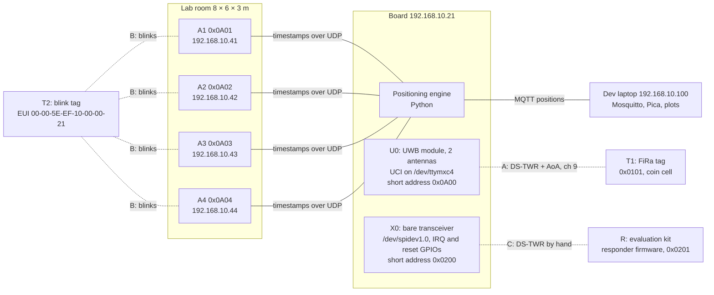

# Ultra-Wideband (UWB) for Embedded Linux Engineers

This note covers how UWB measures distance and angle with nanosecond pulses: the impulse radio, channels and power limits, frames, preambles and the scrambled timestamp sequence, time of flight, two-way ranging and its error sources, phase difference of arrival, and positioning with multilateration and TDoA. It then covers how the 802.15.4z MAC and FiRa organize ranging sessions and secure them, and how digital car keys, phone finding and indoor location systems use it. On the Linux side, it covers driving a UWB chip over the UWB Command Interface (UCI), handling a bare transceiver on SPI, and running a positioning engine. It ends with what it takes to calibrate, certify and debug a UWB product.

UWB is for **knowing where things are**: distances to about 10 cm, angles to a few degrees, at ranges of a few tens of meters. It is fast enough to resist relay attacks. UWB can carry data, but data is not why products use it. Bluetooth usually comes along to find the peer and set up the session. The LAN, the dev laptop and the board are the ones of [Wi-Fi for Embedded Linux Engineers](../wifi/wifi_v1_2026-11-01.md). Bluetooth LE (including Channel Sounding, the other way to measure distance) is in [Bluetooth for Embedded Linux Engineers](../bluetooth/bluetooth_v1_2026-11-21.md). This note links to them instead of repeating them.

**Assumptions:**
- One example setup (section 2) is used throughout: the board with a UWB module on a UART, a battery tag, four ceiling anchors for indoor positioning, and a bare UWB transceiver on SPI.
- The **HRP UWB PHY** (high rate pulse repetition frequency) of IEEE 802.15.4 and 802.15.4z is the default, because phones, cars and nearly all current chips use it. LRP (low rate pulse) is described briefly in section 5.
- **FiRa** conventions and **UCI** (the FiRa UWB Command Interface) are the default for sessions and host interfaces. UCI 1.1 and 2.0 differ in places; the note says which one it shows. CCC Digital Key and Apple Nearby Interaction are described where they differ.
- Linux 6.x, Python 3.11 or later. The examples use **channel 9** because it is allowed in nearly every market (section 20).
- Identifiers, addresses, session IDs, keys and calibration values are placeholders.

**Conventions:**
- `$` is a shell on the dev laptop, `#` a root shell on the board, as stated next to each block.
- **Normative** values come from IEEE 802.15.4/802.15.4z, a FiRa or CCC specification, or a regulation.
- **Rule of thumb** marks empirical values that depend on the environment, the chips, the antennas and the deployment.
- **Chip-dependent**, **firmware-dependent** or **profile-dependent** mark behavior that varies between UWB chips, the firmware running on them, or the ecosystem (FiRa, CCC, Apple, vendor RTLS).
- **Illustrative** marks a file, script or output that shows the shape of a solution and needs adapting.

**Verification status:** nothing in this note was run for it. No source was downloaded, nothing was built, and no UWB module, tag, anchor or phone was used. Protocol values follow IEEE 802.15.4z, the FiRa and CCC public material, and chip vendors' datasheets and application notes, as known in November 2026. FiRa and CCC specifications are member documents, and only parts of them are public, so the byte-level UCI details (section 14) follow the public UCI material and the Android open source UWB stack, and are marked to be checked against your chip's documentation. Commands, code and outputs are generic, untested examples, abridged.

**How to read it:**
- **To learn:** Part 1 (sections 1 to 12) in order.
- **To build something on Linux:** Part 2 (sections 13 to 17), with sections 7, 9 and 10 at hand.
- **To ship a product or a deployment:** Part 3 (sections 18 to 20).
- **To debug:** section 21 first, then the section of the step that fails.

## Table of contents

**Part 1: How UWB works**

- [1. The mental model: timing nanosecond pulses](#1-the-mental-model-timing-nanosecond-pulses)
- [2. Example setup](#2-example-setup)
- [3. Standards, versions and the ecosystem](#3-standards-versions-and-the-ecosystem)
- [4. The radio: impulses, channels and power limits](#4-the-radio-impulses-channels-and-power-limits)
- [5. The HRP PHY: frames, preambles, SFD and STS](#5-the-hrp-phy-frames-preambles-sfd-and-sts)
- [6. Link budget, range and propagation](#6-link-budget-range-and-propagation)
- [7. Ranging: timestamps, SS-TWR, DS-TWR and calibration](#7-ranging-timestamps-ss-twr-ds-twr-and-calibration)
- [8. Angle of arrival: phase difference and antenna arrays](#8-angle-of-arrival-phase-difference-and-antenna-arrays)
- [9. Positioning: multilateration, TDoA and capacity](#9-positioning-multilateration-tdoa-and-capacity)
- [10. The MAC and FiRa: roles, sessions, rounds and slots](#10-the-mac-and-fira-roles-sessions-rounds-and-slots)
- [11. Security: STS, keys and known attacks](#11-security-sts-keys-and-known-attacks)
- [12. Applications: keys, finding, access, RTLS and sensing](#12-applications-keys-finding-access-rtls-and-sensing)

**Part 2: UWB on Linux**

- [13. UWB and Linux: four roles](#13-uwb-and-linux-four-roles)
- [14. UCI: the UWB Command Interface](#14-uci-the-uwb-command-interface)
- [15. A UCI host on Linux: a ranging session in Python](#15-a-uci-host-on-linux-a-ranging-session-in-python)
- [16. A raw transceiver on spidev: two-way ranging by hand](#16-a-raw-transceiver-on-spidev-two-way-ranging-by-hand)
- [17. A positioning engine: solver, clock sync, filter, MQTT](#17-a-positioning-engine-solver-clock-sync-filter-mqtt)

**Part 3: Products and deployments**

- [18. Antennas, placement, calibration and coexistence](#18-antennas-placement-calibration-and-coexistence)
- [19. Power and battery life](#19-power-and-battery-life)
- [20. Regulation, certification and production](#20-regulation-certification-and-production)

**Debugging and reference**

- [21. Troubleshooting](#21-troubleshooting)
- [22. Not covered here](#22-not-covered-here)
- [References](#references)

---

## 1. The mental model: timing nanosecond pulses

Most radios use a narrow channel and measure *how much* signal arrives. UWB spreads a very short pulse over **at least 500 MHz** of spectrum and measures *when* it arrives:

- A pulse about **2 ns** wide has a sharp leading edge. A receiver can timestamp its arrival to a fraction of a nanosecond.
- Radio travels **30 cm per nanosecond**. A timestamp good to 0.3 ns gives a distance good to about 10 cm.
- Reflections arrive later than the direct path. With 500 MHz of bandwidth, paths that differ by more than about 60 cm are seen as separate peaks, so the receiver can pick the **first path** instead of the strongest one. A narrowband radio can't separate them, which is why RSSI-based distance is off by meters.

Two devices don't share a clock, so a single message can't tell its own flight time. **Two-way ranging** solves this: A sends, B replies after a known delay, and A subtracts that delay from the round trip (section 7). With a second antenna, the receiver also measures the **phase difference** between antennas, which gives the **angle of arrival** (section 8). With several fixed **anchors**, distances or arrival-time differences give a **position** (section 9).

The power is tiny, about **-41.3 dBm/MHz**, or roughly -14 dBm over a 500 MHz channel. That is about 30 dB below a Bluetooth LE radio and low enough to sit near the noise floor of other systems, which is why regulators let UWB use such wide bands without a license. The price is **range**: tens of meters indoors (section 6).

```
 ┌──────────── Application ──────────────────────┐
 │ Car key, item finder, door access, RTLS,        │   section 12
 │ point-and-control, presence sensing              │
 ├──────────── Ecosystem profile + out of band ───┤
 │ FiRa, CCC Digital Key, Apple Nearby             │   sections 10 to 12
 │ Interaction, Aliro, vendor RTLS. BLE or NFC      │
 │ finds the peer and sets up the session and keys  │
 ├──────────── MAC (802.15.4z + FiRa) ────────────┤
 │ Sessions, roles, ranging rounds and slots,       │   section 10
 │ ranging messages and reports, security           │
 ├──────────── HRP PHY (802.15.4z) ───────────────┤
 │ Pulses, channels, preamble, SFD, STS, PHR,       │   sections 4 to 6
 │ payload, timestamps, CIR                          │
 └──────────────────────────────────────────────────┘
        ▲ the host talks to the chip through UCI (section 14)
```

**How it compares with the other ways to measure distance** (rule of thumb):

| | UWB (802.15.4z HRP) | BLE RSSI | BLE Channel Sounding | Wi-Fi RTT (802.11mc/az) | GNSS |
|---|---|---|---|---|---|
| Principle | Time of flight of short pulses | Received power and a path loss model | Phase on many tones plus round-trip time | Round-trip time of Wi-Fi frames | Time of flight from satellites |
| Accuracy | About 10 cm line of sight | 1 to 5 m, strongly affected by bodies and orientation | Decimeters to a meter | 1 to 2 m (mc), better with az | Meters outdoors, nothing indoors |
| Angle | Yes, with 2 or 3 antennas | With direction finding (AoA/AoD) | Not by itself | No | No |
| Range | 10 to 50 m indoors | 10 to 100 m | Like BLE | Like Wi-Fi | Global, outdoors |
| Relay-attack resistance | Yes, with STS (section 11) | No | Designed for it (newer) | Limited | No |
| Extra hardware | A UWB chip and antennas | None beyond BLE | A Bluetooth 6.0 controller | An FTM-capable Wi-Fi chip and AP | A GNSS receiver |

Choose UWB when the use case needs decimeters or angles: hands-free car access, precision finding, door unlock when you're actually at the door, tracking assets or people in a building. Choose BLE alone when "near or far" is enough.

**Vocabulary:**

| Term | Meaning |
|---|---|
| UWBS | UWB subsystem: the UWB chip and the firmware that runs on it (MAC, ranging), as seen from the host |
| Anchor, tag | An anchor is fixed, at a known position. A tag is the device that moves and is located |
| Initiator, responder | Who sends the first ranging message in a round, and who answers |
| Controller, controlee | Who decides the session parameters and sends the control messages, and who follows them (FiRa) |
| ToF | Time of flight, one way |
| TWR | Two-way ranging. **SS-TWR** is single-sided, two messages; **DS-TWR** is double-sided, three or four messages (section 7) |
| TDoA | Time difference of arrival: anchors timestamp a tag's frame (uplink) or a tag timestamps the anchors' frames (downlink, DL-TDoA) (section 9) |
| AoA, PDoA | Angle of arrival, computed from the phase difference of arrival between antennas (section 8) |
| CIR | Channel impulse response: the receiver's view of all the paths a frame took (section 6) |
| First path | The earliest path in the CIR, the one ranging must use |
| LOS, NLOS | Line of sight; non line of sight (an obstacle on the direct path) |
| RMARKER | The point in a frame that timestamps refer to: the start of the first symbol after the SFD (section 5) |
| SFD | Start-of-frame delimiter: the end of the preamble |
| STS | Scrambled timestamp sequence: a secret pulse sequence that protects the timestamp (sections 5 and 11) |
| SP0 to SP3 | STS packet configurations: where the STS sits in the frame, if anywhere (section 5) |
| HRP, LRP | High and low rate pulse repetition frequency PHYs. **BPRF** and **HPRF** are the base and higher PRF modes of HRP in 802.15.4z |
| UCI | UWB Command Interface: FiRa's host-to-chip protocol, the "HCI of UWB" (section 14) |
| OOB | Out of band: the BLE or NFC link that finds the peer and exchanges session parameters and keys |
| RSTU | Ranging scheduling time unit: 416 chips, about 833 ns (section 10) |
| RTLS | Real-time location system: anchors, tags and a positioning engine |
| SE, SUS | Secure element; Secure UWB Service, FiRa's key management in a secure element (section 11) |

---

## 2. Example setup

The LAN is the one of the [Wi-Fi note](../wifi/wifi_v1_2026-11-01.md#2-example-network). The board gets a UWB module, a lab room gets four ceiling anchors, and three use cases run in it:

- **A, distance and direction:** the board's module ranges with a battery tag over FiRa DS-TWR and reports distance and azimuth (sections 14 and 15).
- **B, indoor positioning:** a second tag sends short blinks; the anchors timestamp them and send the timestamps to a positioning engine on the board, which computes positions and publishes them over MQTT (uplink TDoA, sections 9 and 17).
- **C, timestamps by hand:** a bare UWB transceiver on the board's SPI bus ranges with an evaluation kit, to show the arithmetic the chip firmware normally hides (section 16).



| Device | Hardware | Identifiers | Role in the examples |
|---|---|---|---|
| Board | The board of the Wi-Fi note | `192.168.10.21` on `wlan0` | Hosts U0 and X0, runs the positioning engine |
| U0 | UWB module with an 802.15.4z chip, two antennas for azimuth, an MCU running vendor UCI firmware. UART at 921600 baud with RTS/CTS, reset GPIO | `/dev/ttymxc4`, short address `0x0A00` | FiRa controller and initiator in use case A |
| T1 | Battery tag with a FiRa-capable UWB chip, CR2032 coin cell | Short address `0x0101` | Controlee and responder in use case A |
| A1 to A4 | Ceiling anchors with a UWB chip, an MCU and Ethernet with PoE | `0x0A01` to `0x0A04`, `192.168.10.41` to `.44` | Timestamp blinks and sync frames, send them over UDP. A1 is the time reference |
| T2 | TDoA blink tag, coin cell | EUI-64 `00-00-5E-EF-10-00-00-21` | Sends a blink every 200 ms in use case B |
| X0 | Bare 802.15.4z transceiver on a shield: SPI, IRQ and reset lines | `/dev/spidev1.0`, IRQ on `gpiochip2` line 5, reset on line 6, short address `0x0200` | DS-TWR initiator driven from Linux user space in use case C |
| R | Evaluation kit with the vendor's DS-TWR responder example firmware | Short address `0x0201` | Responder in use case C |
| Dev laptop | | `192.168.10.100` | Mosquitto (as in the [LoRa note](../lora/lora_v1_2026-11-22.md#2-example-setup)), the Pica UCI emulator (section 15), plotting |

Anchor positions, in meters, in the room's frame (origin in a floor corner, z up). The anchors sit at **different heights** on purpose, so the vertical coordinate can be solved (section 9):

| Anchor | x | y | z |
|---|---|---|---|
| A1 | 0.20 | 0.20 | 2.80 |
| A2 | 7.80 | 0.20 | 2.40 |
| A3 | 7.80 | 5.80 | 2.80 |
| A4 | 0.20 | 5.80 | 2.40 |

Session parameters for use case A (section 10): session ID `0x0000002A`, channel 9, preamble code 10, SFD ID 2, BPRF at 6.8 Mb/s, SP3 frames, DS-TWR in deferred mode, one-to-one, slot duration 2400 RSTU (2 ms), ranging interval 200 ms, azimuth requested, **static STS** with placeholder vendor ID and IV. Static STS is fine in a lab and wrong in a product (section 11).

Placeholders: short addresses are arbitrary 16-bit values; the blink tag's EUI-64 comes from the documentation block `00-00-5E-EF-10-00-00-00` to `00-00-5E-EF-10-FF-FF-FF` (RFC 7042). Keys and STS IVs are written as `<...>`.

---

## 3. Standards, versions and the ecosystem

"UWB" has meant two different things. The first wave (2004 to 2010) was **MB-OFDM** (WiMedia, ECMA-368), aimed at high-speed data: Wireless USB and an abandoned Bluetooth high-speed layer. It failed commercially, and Linux removed its UWB and Wireless USB code (moved to staging in 2019, then deleted). Everything in this note is the second wave: **impulse radio** for ranging, from IEEE 802.15.4.

| Year | Milestone |
|---|---|
| 2002 | The FCC allows UWB from 3.1 to 10.6 GHz at -41.3 dBm/MHz |
| 2007 | **IEEE 802.15.4a** adds the HRP UWB PHY with ranging support (and a chirp PHY nobody uses for ranging). The EU allows UWB (Decision 2007/131/EC) |
| 2011 to 2020 | 802.15.4a folds into the 802.15.4 revisions (2011, 2015, 2020) |
| 2013 to 2014 | Decawave's DW1000, the first widely available 802.15.4a ranging chip, makes UWB RTLS mainstream. Decawave became part of Qorvo in 2020 |
| 2019 | Apple's **U1** chip in the iPhone 11. The **FiRa Consortium** is founded to make UWB devices interoperate |
| 2020 | **IEEE 802.15.4z** (Enhanced Impulse Radio): the **STS** for secure timestamps, BPRF and HPRF modes, LRP enhancements, MAC support for ranging |
| 2021 | **CCC Digital Key 3.0** adds UWB (with BLE) to phone-as-car-key. AirTag. Android 12 adds a UWB API |
| 2022 | FiRa device certification starts. The Ghost Peak attack on HRP ranging is published (section 11) |
| 2023 | Apple's second-generation chip (U2) |
| 2024 to 2026 | **IEEE 802.15.4ab** (next-generation UWB) in development: narrowband-assisted UWB, sensing, better link budget and lower power. Check its status before relying on it |

**Who specifies what:**

| Body | What it specifies | Relevance |
|---|---|---|
| IEEE 802.15 | The PHY and the MAC framework: 802.15.4 (HRP and LRP UWB PHYs), 802.15.4z, 802.15.4ab | The air interface everything else builds on. Leaves many options open, so two compliant devices may not interoperate |
| **FiRa Consortium** | PHY and MAC profiles (which options, which parameters), **UCI**, the out-of-band setup over BLE, Secure UWB Service, certification | The default for interoperable devices, phones included. FiRa specifications are member documents. UCI drives most chips (section 14) |
| **CCC** (Car Connectivity Consortium) | Digital Key 3.x: BLE for discovery and the secure channel, UWB for secure ranging, NFC as a fallback | Phone-as-car-key in cars from many makers |
| **Apple** | Nearby Interaction: iPhone and Apple Watch ranging with other Apple devices and with third-party accessories (an accessory protocol over BLE) | Accessories that range with iPhones must follow it and use supported chips |
| **Google / Android** | The Android UWB stack (`android.uwb`, Jetpack `androidx.core.uwb`, and the AOSP UWB module that speaks UCI) | Android phones as FiRa devices; the open source UCI implementation is a useful reference (section 13) |
| **CSA** (Connectivity Standards Alliance) | **Aliro**: phone and wearable credentials for door access over NFC, BLE and UWB | Access control. Check the current release before building on it |
| Omlox (PROFIBUS & PROFINET International) | An interoperability standard for industrial RTLS: a UWB air interface profile and a location "hub" API | Industrial RTLS from several vendors in one site |
| ISO/IEC | ISO/IEC 24730-62: an RTLS air interface using 802.15.4a UWB blinks | Older RTLS tags and infrastructure |

**Chips and modules** (examples, not a recommendation; check current parts):

| Vendor | Parts | Notes |
|---|---|---|
| Qorvo (ex-Decawave) | DW1000 (802.15.4a), DW3000 family (DW3110, DW3120 with two antenna ports for PDoA), QM33 and QM35 series | Bare transceivers with a host-side driver, or SoCs and modules with UCI firmware. Modules such as DWM3000 and DWM3001C. Widely used in RTLS and accessories |
| NXP | Trimension SR040 (tags), SR150 (anchors, AoA with 3 antennas), SR250 (ranging and radar), NCJ29Dx (automotive) | UCI-based. In phones, cars and accessories; modules from Murata and others |
| Apple | U1, U2 | Only inside Apple devices |
| Samsung, STMicroelectronics, Infineon and others | Phone and automotive chips | Some use LRP rather than HRP |

---

## 4. The radio: impulses, channels and power limits

### Impulses and chips

An HRP transmitter sends short pulses on a carrier, at a **chip rate of 499.2 MHz** (one chip is about 2.003 ns). The pulse shape fills about 500 MHz around the carrier. Pulses come in **bursts**, and the burst position and polarity carry the data (burst position modulation combined with BPSK). The preamble uses **ternary codes** (pulses of +1, -1 or nothing) chosen for their correlation properties (section 5).

The data is not what matters here. A receiver sampling at about 1 GHz and correlating against the known preamble gets an estimate of the **channel impulse response** for free. It then timestamps the first path with a resolution far finer than the chip: Qorvo chips count time in units of 1/(128 × 499.2 MHz), about **15.65 ps**, which is 4.7 mm of light travel.

### Channels

HRP channels in 802.15.4 (**Normative**). The bandwidth is 499.2 MHz unless stated:

| Channel | Center (MHz) | Band group | Notes |
|---|---|---|---|
| 0 | 499.2 | Sub-GHz | Unused in practice |
| 1, 2, 3 | 3494.4, 3993.6, 4492.8 | Low band | Old RTLS; 3.1 to 4.8 GHz needs mitigation in the EU (section 20) |
| 4 | 3993.6 | Low band | 1331.2 MHz wide |
| **5** | **6489.6** | High band | Widely used: phones, FiRa, CCC, RTLS. Covers about 6240 to 6739 MHz |
| 6 | 6988.8 | High band | |
| 7 | 6489.6 | High band | 1081.6 MHz wide |
| 8 | 7488.0 | High band | |
| **9** | **7987.2** | High band | Widely used, and the **most broadly allowed** worldwide. Covers about 7738 to 8237 MHz. FiRa devices support it |
| 10 | 8486.4 | High band | |
| 11 | 7987.2 | High band | 1331.2 MHz wide |
| 12, 13, 14 | 8985.6, 9484.8, 9984.0 | High band | |
| 15 | 9484.8 | High band | 1354.97 MHz wide |

In practice, products use **channel 5 and channel 9**: chips, antennas, filters and certifications are built around them.

- **Channel 9** is allowed in nearly every major market (Japan doesn't allow channel 5, for example; section 20) and is clear of 6 GHz Wi-Fi. It has about 1.8 dB more free-space loss than channel 5 (section 6).
- **Channel 5** overlaps the **6 GHz Wi-Fi** band (5925 to 7125 MHz in the US, 5945 to 6425 MHz in the EU). A nearby Wi-Fi 6E or 7 transmitter, often in the same phone or gateway, can desensitize a UWB receiver on channel 5 (section 18).

Interference between UWB devices is avoided by using different channels, different **preamble codes** on the same channel (section 5), and time scheduling (section 10).

### Power limits

UWB is regulated by **power spectral density**, not by total power (**Normative**, US and EU high band; details and other markets in section 20):

- **Mean EIRP: -41.3 dBm/MHz**, averaged over **1 ms**. Over a 499.2 MHz channel that is about **-14.3 dBm** in total (-41.3 + 10 log10(499.2)).
- **Peak EIRP: 0 dBm** measured in a 50 MHz bandwidth.
- Out-of-band emission masks that are much stricter, especially around GNSS bands.

For comparison, a BLE radio transmits 0 to +10 dBm and Wi-Fi up to +20 dBm or more. UWB's link budget is low by design.

**The 1 ms average leaves room for short frames.** A 150 µs frame alone in its millisecond can be sent at a higher instantaneous power and still meet the mean limit, up to the peak limit. Chips expose this as a **TX power boost** for short frames (**chip-dependent**). Whether it's usable depends on how close together the frames are, because any 1 ms window counts. A product must be tested against the regulation with its real traffic pattern (section 20).

---

## 5. The HRP PHY: frames, preambles, SFD and STS

### Frame structure

An HRP frame starts with a synchronization header (SHR), which is a preamble (SYNC) and a start-of-frame delimiter (SFD). Then come a PHY header (PHR) and the payload. 802.15.4z adds the **STS**, and the **STS packet configuration** (SP) says where it goes (**Normative**):

```
SP0:  │ SYNC preamble │ SFD │ PHR │ PHY payload │                 no STS: timestamps not protected
SP1:  │ SYNC preamble │ SFD │ STS │ PHR │ PHY payload │           STS before the header and payload
SP2:  │ SYNC preamble │ SFD │ PHR │ PHY payload │ STS │           STS after the payload
SP3:  │ SYNC preamble │ SFD │ STS │                               no header, no payload: the shortest secure frame
                              ▲
                              RMARKER: the timestamp reference
```

- **SP0** is the 802.15.4a frame. It's fine for data and for ranging when security doesn't matter.
- **SP3** frames carry nothing but a secure timestamp. The schedule says who sends which SP3 frame when, and the results travel in separate SP0 or SP1 frames, or over BLE. CCC uses SP3 for ranging; FiRa profiles use SP1 or SP3 for secure ranging (**profile-dependent**).
- The **RMARKER** is the time the first pulse after the SFD leaves the transmitter's antenna or reaches the receiver's antenna. Every TX and RX timestamp refers to it, after antenna delay correction (section 7).

### Preamble

The SYNC field repeats one **preamble symbol** many times. Each symbol is a ternary code spread with zero chips:

- **Preamble codes** 1 to 8 are 31 long (for 16 MHz mean PRF), 9 to 24 are 127 long (64 MHz, used in BPRF), and 802.15.4z adds 91-long codes 25 to 32 for HPRF. Codes have **perfect periodic autocorrelation**: correlating the received preamble against the code gives the channel impulse response directly. This is how the chip gets the CIR it uses for first-path detection.
- Different codes on the same channel have low cross-correlation, so two networks with different codes mostly ignore each other.
- **Preamble length** (number of symbol repetitions): 64 in most BPRF profiles; 16 to 256 in HPRF; 802.15.4a allowed up to 1024 and 4096 for long range. Longer preambles mean better acquisition and first-path detection at low signal levels, but more airtime and energy.

A 127-long symbol at 64 MHz PRF lasts 1017.6 ns, so a **64-symbol preamble takes about 65 µs** on air.

### SFD

The SFD marks the end of the preamble and defines the timestamp point. 802.15.4a used an 8-symbol SFD (and a 64-symbol one for the 110 kb/s mode); 802.15.4z adds new SFDs numbered **SFD ID 0 to 4**, with better detection. FiRa BPRF profiles commonly use SFD ID 2 (8 symbols) (**profile-dependent**). Both sides must use the same SFD, or nothing is received.

### STS

The **scrambled timestamp sequence** is a block of pseudo-random pulses generated by an AES-128-based random bit generator from a **key** and a counter (the STS IV). Only devices that know the key and counter can predict the sequence (**Normative**, 802.15.4z):

- The receiver correlates the received STS against the expected one and gets a second channel estimate, for a sequence an attacker can't predict. It timestamps the first path in that estimate.
- A good receiver checks that the STS timestamp and the preamble timestamp agree, and reports an **STS quality** indicator. A frame with a bad STS is rejected for ranging.
- The counter advances every frame, so the sequence never repeats within a session.
- STS lengths are configurable. With FiRa defaults, the STS lasts about as long as the 64-symbol preamble.

Section 11 covers where the key comes from (static, dynamic, provisioned) and what the STS does and doesn't protect against.

### PHR, payload and data rates

The PHR gives the payload length and data rate. The payload is an 802.15.4 MAC frame protected by a Reed-Solomon code and a convolutional code:

| Mode | Mean PRF | Payload data rates | Where it's used |
|---|---|---|---|
| 802.15.4a | 15.6 or 62.4 MHz (nominal 16 or 64) | 110 kb/s, 850 kb/s, 6.81 Mb/s, 27.24 Mb/s | DW1000-era RTLS. 110 kb/s with a long preamble for range |
| **BPRF** (802.15.4z) | 62.4 MHz | 6.81 Mb/s, PHR at 850 kb/s or 6.81 Mb/s | FiRa, CCC, phones: the default |
| **HPRF** (802.15.4z) | 124.8 or 249.6 MHz | 6.81 to about 31 Mb/s | Better energy per bit and longer frames, less widespread |

The classic payload limit is **127 bytes**; HPRF allows longer frames (check the profile). Ranging messages are small, so a frame takes **100 to 200 µs** on air, most of it preamble and STS (rule of thumb). For example, an SP3 frame with a 64-symbol preamble, an 8-symbol SFD and a default-length STS is about 140 µs.

### What the receiver reports

Per received frame, a ranging chip can report (**chip-dependent** names and formats):

| Value | Use |
|---|---|
| RX timestamp at the RMARKER (40 bits on Qorvo chips) | Ranging (section 7) |
| First-path index and amplitude in the CIR | First-path quality, NLOS detection (section 6) |
| Total received power | Link budget, NLOS detection |
| Carrier frequency offset (clock offset between the two crystals) | Correcting SS-TWR (section 7), crystal trim (section 18) |
| STS quality, STS timestamp | Security checks (section 11) |
| PDoA between two antennas | Angle of arrival (section 8) |
| The CIR itself (read from accumulator memory) | Debugging, research, sensing |

### LRP in one paragraph

802.15.4z also enhances the **LRP** (low rate pulse) PHY: fewer, stronger pulses at a low repetition rate, received non-coherently. It allows simpler, lower-power receivers and distance bounding protocols, and some access control and automotive systems use it. It doesn't interoperate with HRP, which phones, FiRa and CCC use. The rest of this note is about HRP.

---

## 6. Link budget, range and propagation

### Link budget

The received power is the EIRP, plus the receive antenna gain, minus the path loss. In free space, the loss is FSPL = 20 log10(4πd/λ) (**Normative** physics):

| Distance | FSPL, channel 5 (6.49 GHz) | FSPL, channel 9 (7.99 GHz) | Received power at -14.3 dBm EIRP, channel 9, 0 dBi |
|---|---|---|---|
| 1 m | 48.7 dB | 50.5 dB | -64.8 dBm |
| 3 m | 58.2 dB | 60.0 dB | -74.3 dBm |
| 10 m | 68.7 dB | 70.5 dB | -84.8 dBm |
| 30 m | 78.2 dB | 80.0 dB | -94.3 dBm |
| 100 m | 88.7 dB | 90.5 dB | -104.8 dBm |

Receiver **sensitivity** is given in dBm per 500 MHz and depends on the preamble length, the data rate, the STS and the chip: about **-95 to -100 dBm** for BPRF at 6.8 Mb/s with a 64-symbol preamble, a few dB better with longer preambles and lower rates (rule of thumb; check the datasheet).

So the free-space limit on channel 9 with plain settings is around **30 to 40 m**. Real numbers (rule of thumb):

- **Indoors, line of sight, two fixed devices:** 20 to 50 m.
- **A phone or a tag on a body:** 10 to 20 m is reliable; bodies and pockets cost 10 to 20 dB or more.
- **Outdoors, line of sight, anchors mounted high, long preambles and TX boost:** 100 m and more.

Ranging fails before data does. Detecting the first path well enough for a good timestamp needs more SNR than decoding the frame. A link at the edge of sensitivity delivers frames with poor or biased timestamps.

### Multipath and the first path

Indoors, a frame arrives over many paths: direct, off walls, floors and furniture. The channel impulse response shows them:

```
 amplitude
    │               ┃  strongest path: a reflection off a wall
    │               ┃
    │     ┃         ┃    ┃
    │     ┃ first   ┃    ┃  ┃
    │_____┃_path____┃____┃__┃__┃_________ time
          ▲
          the timestamp must lock here, not on the strongest peak
```

The receiver searches back from the strongest peak for the earliest path above a noise threshold (**leading edge detection**, **chip-dependent**). Too high a threshold misses a weak direct path and measures a reflection (distance too long). Too low a threshold triggers on noise (distance too short, rarely).

### Line of sight and non line of sight

| Situation | What happens | Typical error (rule of thumb) |
|---|---|---|
| Line of sight | First path strong and clear | A few cm of spread, after calibration |
| Through a thin obstacle (drywall, glass, wood) | Direct path weaker but detected. The wave is slower in the material | Positive bias of a few cm to tens of cm. A 20 cm concrete wall (relative permittivity about 5) adds about (√5 - 1) × 0.2 m ≈ 0.25 m |
| Direct path blocked (metal, a body, thick concrete) | The receiver locks on a reflection or a diffracted path | Positive bias of 0.5 m to several meters, unstable from frame to frame |
| Body between the devices | 10 to 20 dB or more of loss at 6 to 8 GHz; the signal creeps around the body | Tens of cm of bias, dropouts |
| Large metal surfaces (racks, vehicles, machines) | Strong reflections and shadows | Any of the above, depending on position |

UWB errors indoors are **mostly positive** (too long), which helps filtering (section 17).

**Detecting NLOS** from a single frame (rule of thumb):

- Compare **total received power** with **first-path power**. Decawave's application note APS006 suggests that a difference under about 6 dB is likely line of sight, and over about 10 dB is likely NLOS.
- A fast-changing distance spread over consecutive rounds.
- FiRa range reports carry an **NLOS indicator** and a **figure of merit** per measurement, computed by the chip (**chip-dependent**).
- CIR features (rise time, peak ratios) with a classifier, if the chip exposes the CIR.

Outdoors at long range, the ground reflection can cancel the direct path at some distances (two-ray fading): mount anchors high.

---
