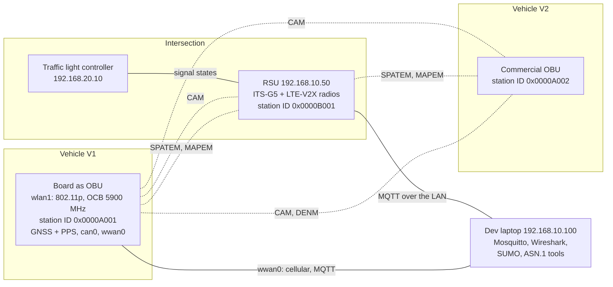

# V2X for Embedded Linux Engineers

This note covers how vehicles, roadside units and other road users exchange short safety messages directly over the 5.9 GHz ITS band and through the cellular network.

- **The radios:** ITS-G5 and DSRC (IEEE 802.11p and 802.11bd), LTE-V2X and NR V2X sidelinks, and V2X over the cellular network.
- **The layers above them:** the ITS station architecture, GeoNetworking and BTP in Europe, WAVE in the US, and the Chinese and Japanese stacks.
- **The messages:** CAM, DENM, CPM, VAM, SPaT, MAP, IVI and the BSM, all encoded in ASN.1.
- **Security:** signed messages, pseudonym certificates and the PKIs behind them.
- **On Linux:** 802.11p interfaces in OCB mode, building and sending a CAM by hand, decoding received messages, C-V2X modules, a roadside unit gateway, time and position, simulation and testing.
- **Shipping:** what it takes to deploy V2X and debug it.

V2X is for **cooperative awareness**: telling the road users around you where you are and what you see, a few times per second, within a few hundred meters, with no network needed. It is not a general data link. Wi-Fi is in [Wi-Fi for Embedded Linux Engineers](../wifi/wifi_v1_2026-11-01.md) (802.11p is a Wi-Fi variant), LTE and 5G in [Cellular Protocols: LTE, 5G NR and Cellular IoT](../cellular/cellular_v1_2026-11-02.md), and GNSS time on Linux in [Satellite Communications and NTN](../satcom-ntn/satcom-ntn_v1_2026-11-24.md#16-gnss-and-time-on-linux-gpsd-pps-and-chrony). This note links to them instead of repeating them.

**Assumptions:**
- One example setup (section 2) is used throughout: the board as an on-board unit (OBU) in a test vehicle, a second vehicle, a roadside unit (RSU) at a signalized intersection, and a back-end on the dev laptop.
- The examples use the **European** stack (ITS-G5, GeoNetworking, BTP, ETSI messages), because the setup is in France like the other notes. The US and Chinese stacks are described in section 9 and wherever they differ.
- Both radio families are covered: **802.11p-based** (ITS-G5, DSRC) and **cellular** (LTE-V2X, NR V2X). The hands-on part uses 802.11p because Linux drives it directly; C-V2X modules are covered from the host's side (section 16).
- Linux 6.x, Python 3.11 or later. ETSI messages follow EN 302 637-2 (CAM) v1.4.1 and EN 302 637-3 (DENM) v1.3.1 with the ITS-Container v2 data dictionary; newer releases rename some fields.
- Station IDs, MAC addresses, positions, certificates and keys are placeholders.

**Transmitting in the ITS band is regulated.** Only equipment that is certified for the band may transmit on it, and only where that is allowed. The examples assume a **cabled or shielded bench** (radios connected through attenuators, or inside a shielded enclosure) or a **closed test track with the necessary authorization**. Never send test messages, especially unsigned or fake warnings, on public roads.

**Conventions:**
- `$` is a shell on the dev laptop, `#` a root shell on the board or the RSU, as stated next to each block.
- **Normative** values come from an ETSI, IEEE, SAE, 3GPP or national standard, or a regulation.
- **Rule of thumb** marks empirical values that depend on the environment, the radios, the antennas and the traffic.
- **Region-dependent**, **stack-dependent** or **chip-dependent** marks behavior that varies between regions (EU, US, China), software stacks, or radio chips and their firmware.
- **Illustrative** marks a file, script or output that shows the shape of a solution and needs adapting.

**Verification status:** nothing in this note was run for it. No source was downloaded, nothing was built, and no radio, OBU, RSU or vehicle was used. Protocol values follow the ETSI, IEEE, SAE and 3GPP specifications, and regulatory values the published decisions, as known in November 2026. SAE J2735 and some national standards are paid documents, so their details here are limited to what is widely published. Commands, code and outputs are generic, untested examples, abridged.

**How to read it:**
- **To learn:** Part 1 (sections 1 to 12) in order.
- **To build an OBU, an RSU or a back-end on Linux:** Part 2 (sections 13 to 17), with sections 8, 10 and 11 at hand.
- **To ship a product or a deployment:** Part 3 (sections 18 to 20).
- **To debug:** section 21 first, then the section of the step that fails.

## Table of contents

**Part 1: How V2X works**

- [1. The mental model: road users that broadcast what they know](#1-the-mental-model-road-users-that-broadcast-what-they-know)
- [2. Example setup](#2-example-setup)
- [3. Standards, regions and history](#3-standards-regions-and-history)
- [4. Spectrum and regulation](#4-spectrum-and-regulation)
- [5. ITS-G5 and DSRC: 802.11p and 802.11bd](#5-its-g5-and-dsrc-80211p-and-80211bd)
- [6. LTE-V2X: the PC5 sidelink](#6-lte-v2x-the-pc5-sidelink)
- [7. NR V2X and V2X over the cellular network](#7-nr-v2x-and-v2x-over-the-cellular-network)
- [8. The ITS station and the European stack: GeoNetworking and BTP](#8-the-its-station-and-the-european-stack-geonetworking-and-btp)
- [9. The US, Chinese and Japanese stacks](#9-the-us-chinese-and-japanese-stacks)
- [10. Messages: CAM, DENM, CPM, VAM, SPaT, MAP, IVI and BSM](#10-messages-cam-denm-cpm-vam-spat-map-ivi-and-bsm)
- [11. Security: certificates, PKIs, pseudonyms and misbehavior](#11-security-certificates-pkis-pseudonyms-and-misbehavior)
- [12. Applications and deployments](#12-applications-and-deployments)

**Part 2: V2X on Linux**

- [13. V2X and Linux: roles, hardware and software](#13-v2x-and-linux-roles-hardware-and-software)
- [14. Time and position](#14-time-and-position)
- [15. ITS-G5 on Linux: OCB mode and a CAM by hand](#15-its-g5-on-linux-ocb-mode-and-a-cam-by-hand)
- [16. Receiving, decoding, C-V2X modules and a roadside unit](#16-receiving-decoding-c-v2x-modules-and-a-roadside-unit)
- [17. Simulation, replay and conformance testing](#17-simulation-replay-and-conformance-testing)

**Part 3: Products and deployments**

- [18. Antennas, range, latency and congestion control](#18-antennas-range-latency-and-congestion-control)
- [19. Security and privacy in practice](#19-security-and-privacy-in-practice)
- [20. Regulation, certification and deployment](#20-regulation-certification-and-deployment)

**Debugging and reference**

- [21. Troubleshooting](#21-troubleshooting)
- [22. Not covered here](#22-not-covered-here)
- [References](#references)

---

## 1. The mental model: road users that broadcast what they know

A car's own sensors (cameras, radar, lidar) see what is in their line of sight. V2X lets a car learn what others know: the car braking hard two vehicles ahead, the broken-down truck behind the curve, the traffic light turning red in 4 seconds, the pedestrian hidden behind a bus. Every participant **broadcasts** short messages about itself and what it detects; every receiver decides what is relevant.

**The links:**

| Link | Meaning | Example |
|---|---|---|
| **V2V** | Vehicle to vehicle | "I'm here, at 50 km/h, braking" |
| **V2I** / **I2V** | Vehicle to infrastructure and back | Traffic light phases and timing, the intersection's lane map, a bus requesting priority |
| **V2P** | Vehicle to pedestrians, cyclists, other vulnerable road users | A cyclist's phone or tag announcing itself |
| **V2N** | Vehicle to the network (a back-end through cellular) | Hazard warnings collected and redistributed over a region |

**Two paths:**

- **Direct** (sidelink, ad hoc): radios in the **5.9 GHz ITS band** talk to each other with no base station, no association and no subscription. Latency is milliseconds, range a few hundred meters. This is what safety applications use. Two technology families compete here: **802.11p-based** (ITS-G5 in Europe, DSRC in the US) and **cellular sidelink** (LTE-V2X, then NR V2X, called C-V2X together).
- **Network** (Uu, the normal cellular link): messages go through the mobile network and a back-end. Latency is tens of milliseconds to seconds, range is the whole network. Good for information that isn't time-critical over a wide area: road works ahead, traffic jams, weather.

**What the traffic looks like:**

- **Small messages**, about 50 to 400 bytes, encoded in compact ASN.1 (section 10).
- **Periodic status**, 1 to 10 times per second per vehicle (CAM, BSM), and **event messages** when something happens (DENM).
- **Broadcast**, no acknowledgments, no retransmissions on request: a lost message is replaced by the next one.
- **Signed, not encrypted**: everyone may read a safety message, but a receiver must be able to check that it came from a legitimate station. Certificates are **pseudonyms** that change, so vehicles can't be tracked easily (section 11).
- **Position and time** in every message: a V2X station needs good GNSS and accurate time (section 14).

```
 ┌──────────── Applications ──────────────────────────────────────┐
 │ Collision warnings, hazard warnings, traffic light information, │   section 12
 │ in-vehicle signage, priority requests, sensor sharing           │
 ├──────────── Facilities ────────────────────────────────────────┤
 │ Messages: CAM, DENM, CPM, VAM, SPATEM, MAPEM, IVIM / BSM, SPaT, │   section 10
 │ MAP, TIM; the local dynamic map; position and time               │
 ├──────────── Networking and transport ──────────────────────────┤   S
 │ GeoNetworking + BTP (EU) │ WSMP (US) │ DSMP (China) │ IPv6/UDP    │   e  sections 8, 9
 ├──────────── Access ────────────────────────────────────────────┤   c
 │ 802.11p / 802.11bd │ LTE-V2X PC5 │ NR V2X PC5 │ cellular Uu       │   u  sections 5 to 7
 └──────────────────────────────────────────────────────────────────┘   r  section 11
                                                                         ity
```

**The radio families side by side** (rule of thumb):

| | ITS-G5 / DSRC (802.11p) | LTE-V2X (Release 14/15) | NR V2X (Release 16+) | V2X over Uu |
|---|---|---|---|---|
| Basis | Wi-Fi (802.11a) at half bandwidth | LTE uplink waveform on a sidelink | 5G NR sidelink | The normal LTE or 5G link |
| Channel access | CSMA/CA: listen, then send | Sensing-based semi-persistent scheduling, or scheduled by the network | Like LTE-V2X, plus HARQ feedback | Scheduled by the base station |
| Coverage needed | None | None (GNSS for synchronization) | None | Cellular coverage |
| Latency | A few ms | Up to about 100 ms, by design of the scheduling | A few ms to tens of ms | Tens of ms or more |
| Typical range | 300 m to 1 km line of sight | Somewhat longer than 802.11p at the same power | Similar | Unlimited (network) |
| Main markets | EU (deployed since 2019), legacy US | China, US (since the FCC's 2020 decision), EU (allowed) | Advanced use cases, coming | Everywhere |
| Backward compatible | 802.11bd with 802.11p | No with 802.11p | No with LTE-V2X (they coexist) | |

**Vocabulary:**

| Term | Meaning |
|---|---|
| ITS | Intelligent transport systems. **C-ITS**: cooperative ITS, where stations exchange information |
| ITS station (ITS-S) | Any V2X participant: vehicle (V-ITS-S), roadside (R-ITS-S), central or back-end (C-ITS-S), personal (P-ITS-S) |
| OBU, RSU | On-board unit (in a vehicle), roadside unit (on a pole, at an intersection) |
| OCB | "Outside the context of a BSS": the 802.11 mode with no access point and no association (section 5) |
| PC5, Uu | The 3GPP names for the sidelink (device to device) and the device-to-network link |
| Station ID | The 32-bit identifier in ETSI messages; changes with the pseudonym |
| CAM, DENM | Cooperative awareness message (periodic status), decentralized environmental notification message (events) |
| CPM, VAM | Collective perception message (detected objects), VRU awareness message (vulnerable road users) |
| SPaT / SPATEM, MAP / MAPEM | Signal phase and timing; intersection topology. The "-EM" names are the ETSI-wrapped versions |
| IVI / IVIM | In-vehicle information: signs, speed limits |
| BSM | Basic safety message: the US equivalent of the CAM (SAE J2735) |
| GeoNetworking, BTP | The European network and transport layers: position-based addressing and ports (section 8) |
| WSMP, PSID | WAVE short message protocol and its application identifier (US, section 9) |
| ITS-AID | The application identifier used in certificates and security (same number space as the PSID) |
| AT, EC | Authorization ticket (pseudonym certificate) and enrollment credential (long-term) in the EU PKI |
| SCMS, CCMS | The US and EU security credential management systems (PKIs) |
| DCC | Decentralized congestion control: limiting how much each station sends when the channel is busy |
| CBR | Channel busy ratio: the fraction of time the channel is sensed busy |

---

## 2. Example setup

The LAN is the one of the [Wi-Fi note](../wifi/wifi_v1_2026-11-01.md#2-example-network), extended to a closed test track with one signalized intersection. Three use cases:

- **A, vehicle awareness:** the board, as an OBU in vehicle V1, broadcasts CAMs over ITS-G5 and receives CAMs and DENMs from V2 (sections 10 and 15).
- **B, intersection:** the RSU gets signal states from the traffic light controller, broadcasts SPATEM and MAPEM, and forwards what it hears to the back-end over MQTT (section 16).
- **C, cellular sidelink:** the board with a C-V2X module on USB instead of the 802.11p card, driven through the module vendor's SDK (section 16).



| Device | Hardware | Identifiers | Role in the examples |
|---|---|---|---|
| Board (OBU) | The board of the Wi-Fi note in V1, with an 802.11p-capable Wi-Fi card on mini-PCIe (`wlan1`), a roof antenna, a GNSS receiver on `/dev/ttymxc2` with PPS on `/dev/pps0`, the vehicle bus on `can0`, an LTE modem (`wwan0`) | Station ID `0x0000A001`, MAC `00:00:5E:00:53:21` | Sends CAMs, receives CAMs, DENMs, SPATEMs and MAPEMs |
| V2 | A commercial OBU | Station ID `0x0000A002` | Sends CAMs, and a DENM "stationary vehicle" when stopped on the track |
| RSU | Linux roadside unit with an ITS-G5 radio and an LTE-V2X radio, GNSS, two Ethernet ports: backhaul (`eth0`, `192.168.10.50`) and the controller (`eth1`, `192.168.20.1`) | Station ID `0x0000B001`, MAC `00:00:5E:00:53:31` | Broadcasts SPATEM and MAPEM, forwards received messages to the back-end |
| Traffic light controller | The intersection's controller | `192.168.20.10` | Reports signal states to the RSU |
| Board with a C-V2X module | The same board with a C-V2X module on USB instead of the 802.11p card | | Use case C |
| Dev laptop | | `192.168.10.100` | Mosquitto (as in the [LoRa note](../lora/lora_v1_2026-11-22.md#2-example-setup)), Wireshark, SUMO, ASN.1 tools |

**Radio settings:** ITS-G5 on the control channel **G5-CCH, 5900 MHz** (channel 180), 10 MHz wide, 6 Mb/s. LTE-V2X on band 47, a 20 MHz channel centered on 5915 MHz (section 4).

**Positions** are placeholders on a test track around latitude 48.70000°, longitude 2.20000°, written as ETSI integers in units of 0.1 microdegree: `487000000` and `22000000`.

**Placeholders:** MAC addresses use the documentation block `00:00:5E:00:53:xx` (RFC 7042). Station IDs are arbitrary; a real station takes a new random ID with each pseudonym change (section 11). Certificates and keys appear as `<...>`. On the bench, messages are sent unsigned, which real stations reject: this is only for learning the formats (section 15).

---
