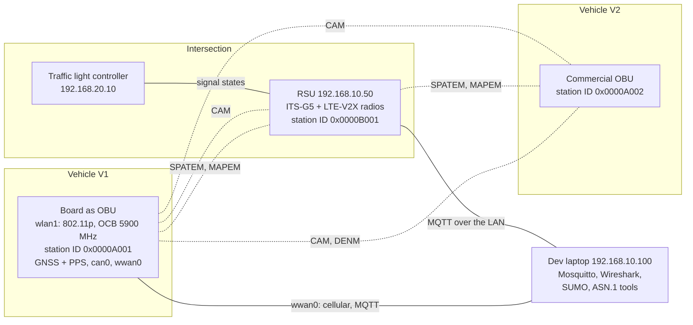

# V2X for Embedded Linux Engineers

This note covers how vehicles, roadside units and other road users exchange short safety messages directly over the 5.9 GHz ITS band and through the cellular network.

- **The radios:** ITS-G5 and DSRC (IEEE 802.11p and 802.11bd), LTE-V2X and NR V2X sidelinks, and V2X over the cellular network.
- **The layers above them:** the ITS station architecture, GeoNetworking and BTP in Europe, WAVE in the US, and the Chinese and Japanese stacks.
- **The messages:** CAM, DENM, CPM, VAM, SPaT, MAP, IVI and the BSM, all encoded in ASN.1.
- **Security:** signed messages, pseudonym certificates and the PKIs behind them.
- **On Linux:** 802.11p interfaces in OCB mode, building and sending a CAM by hand, decoding received messages, C-V2X modules, a roadside unit gateway, time and position, simulation and testing.
- **Shipping:** what it takes to deploy V2X and debug it.

V2X is for **cooperative awareness**: telling the road users around you where you are and what you see, a few times per second, within a few hundred meters, with no network needed. It is not a general data link. Wi-Fi is in [Wi-Fi for Embedded Linux Engineers](../wifi/wifi_v1_2026-11-01.md) (802.11p is a Wi-Fi variant), LTE and 5G in [Cellular Protocols: LTE, 5G NR and Cellular IoT](../cellular/cellular_v1_2026-11-02.md), and GNSS time on Linux in [Satellite Communications and NTN](../satcom-ntn/satcom-ntn_v1_2026-11-24.md#16-gnss-and-time-on-linux-gpsd-pps-and-chrony). This note links to them instead of repeating them.

**Assumptions:**
- One example setup (section 2) is used throughout: the board as an on-board unit (OBU) in a test vehicle, a second vehicle, a roadside unit (RSU) at a signalized intersection, and a back-end on the dev laptop.
- The examples use the **European** stack (ITS-G5, GeoNetworking, BTP, ETSI messages), because the setup is in France like the other notes. The US and Chinese stacks are described in section 9 and wherever they differ.
- Both radio families are covered: **802.11p-based** (ITS-G5, DSRC) and **cellular** (LTE-V2X, NR V2X). The hands-on part uses 802.11p because Linux drives it directly; C-V2X modules are covered from the host's side (section 16).
- Linux 6.x, Python 3.11 or later. ETSI messages follow EN 302 637-2 (CAM) v1.4.1 and EN 302 637-3 (DENM) v1.3.1 with the ITS-Container v2 data dictionary; newer releases rename some fields.
- Station IDs, MAC addresses, positions, certificates and keys are placeholders.

**Transmitting in the ITS band is regulated.** Only equipment that is certified for the band may transmit on it, and only where that is allowed. The examples assume a **cabled or shielded bench** (radios connected through attenuators, or inside a shielded enclosure) or a **closed test track with the necessary authorization**. Never send test messages, especially unsigned or fake warnings, on public roads.

**Conventions:**
- `$` is a shell on the dev laptop, `#` a root shell on the board or the RSU, as stated next to each block.
- **Normative** values come from an ETSI, IEEE, SAE, 3GPP or national standard, or a regulation.
- **Rule of thumb** marks empirical values that depend on the environment, the radios, the antennas and the traffic.
- **Region-dependent**, **stack-dependent** or **chip-dependent** marks behavior that varies between regions (EU, US, China), software stacks, or radio chips and their firmware.
- **Illustrative** marks a file, script or output that shows the shape of a solution and needs adapting.

**Verification status:** nothing in this note was run for it. No source was downloaded, nothing was built, and no radio, OBU, RSU or vehicle was used. Protocol values follow the ETSI, IEEE, SAE and 3GPP specifications, and regulatory values the published decisions, as known in November 2026. SAE J2735 and some national standards are paid documents, so their details here are limited to what is widely published. Commands, code and outputs are generic, untested examples, abridged.

**How to read it:**
- **To learn:** Part 1 (sections 1 to 12) in order.
- **To build an OBU, an RSU or a back-end on Linux:** Part 2 (sections 13 to 17), with sections 8, 10 and 11 at hand.
- **To ship a product or a deployment:** Part 3 (sections 18 to 20).
- **To debug:** section 21 first, then the section of the step that fails.

## Table of contents

**Part 1: How V2X works**

- [1. The mental model: road users that broadcast what they know](#1-the-mental-model-road-users-that-broadcast-what-they-know)
- [2. Example setup](#2-example-setup)
- [3. Standards, regions and history](#3-standards-regions-and-history)
- [4. Spectrum and regulation](#4-spectrum-and-regulation)
- [5. ITS-G5 and DSRC: 802.11p and 802.11bd](#5-its-g5-and-dsrc-80211p-and-80211bd)
- [6. LTE-V2X: the PC5 sidelink](#6-lte-v2x-the-pc5-sidelink)
- [7. NR V2X and V2X over the cellular network](#7-nr-v2x-and-v2x-over-the-cellular-network)
- [8. The ITS station and the European stack: GeoNetworking and BTP](#8-the-its-station-and-the-european-stack-geonetworking-and-btp)
- [9. The US, Chinese and Japanese stacks](#9-the-us-chinese-and-japanese-stacks)
- [10. Messages: CAM, DENM, CPM, VAM, SPaT, MAP, IVI and BSM](#10-messages-cam-denm-cpm-vam-spat-map-ivi-and-bsm)
- [11. Security: certificates, PKIs, pseudonyms and misbehavior](#11-security-certificates-pkis-pseudonyms-and-misbehavior)
- [12. Applications and deployments](#12-applications-and-deployments)

**Part 2: V2X on Linux**

- [13. V2X and Linux: roles, hardware and software](#13-v2x-and-linux-roles-hardware-and-software)
- [14. Time and position](#14-time-and-position)
- [15. ITS-G5 on Linux: OCB mode and a CAM by hand](#15-its-g5-on-linux-ocb-mode-and-a-cam-by-hand)
- [16. Receiving, decoding, C-V2X modules and a roadside unit](#16-receiving-decoding-c-v2x-modules-and-a-roadside-unit)
- [17. Simulation, replay and conformance testing](#17-simulation-replay-and-conformance-testing)

**Part 3: Products and deployments**

- [18. Antennas, range, latency and congestion control](#18-antennas-range-latency-and-congestion-control)
- [19. Security and privacy in practice](#19-security-and-privacy-in-practice)
- [20. Regulation, certification and deployment](#20-regulation-certification-and-deployment)

**Debugging and reference**

- [21. Troubleshooting](#21-troubleshooting)
- [22. Not covered here](#22-not-covered-here)
- [References](#references)

---

## 1. The mental model: road users that broadcast what they know

A car's own sensors (cameras, radar, lidar) see what is in their line of sight. V2X lets a car learn what others know: the car braking hard two vehicles ahead, the broken-down truck behind the curve, the traffic light turning red in 4 seconds, the pedestrian hidden behind a bus. Every participant **broadcasts** short messages about itself and what it detects; every receiver decides what is relevant.

**The links:**

| Link | Meaning | Example |
|---|---|---|
| **V2V** | Vehicle to vehicle | "I'm here, at 50 km/h, braking" |
| **V2I** / **I2V** | Vehicle to infrastructure and back | Traffic light phases and timing, the intersection's lane map, a bus requesting priority |
| **V2P** | Vehicle to pedestrians, cyclists, other vulnerable road users | A cyclist's phone or tag announcing itself |
| **V2N** | Vehicle to the network (a back-end through cellular) | Hazard warnings collected and redistributed over a region |

**Two paths:**

- **Direct** (sidelink, ad hoc): radios in the **5.9 GHz ITS band** talk to each other with no base station, no association and no subscription. Latency is milliseconds, range a few hundred meters. This is what safety applications use. Two technology families compete here: **802.11p-based** (ITS-G5 in Europe, DSRC in the US) and **cellular sidelink** (LTE-V2X, then NR V2X, called C-V2X together).
- **Network** (Uu, the normal cellular link): messages go through the mobile network and a back-end. Latency is tens of milliseconds to seconds, range is the whole network. Good for information that isn't time-critical over a wide area: road works ahead, traffic jams, weather.

**What the traffic looks like:**

- **Small messages**, about 50 to 400 bytes, encoded in compact ASN.1 (section 10).
- **Periodic status**, 1 to 10 times per second per vehicle (CAM, BSM), and **event messages** when something happens (DENM).
- **Broadcast**, no acknowledgments, no retransmissions on request: a lost message is replaced by the next one.
- **Signed, not encrypted**: everyone may read a safety message, but a receiver must be able to check that it came from a legitimate station. Certificates are **pseudonyms** that change, so vehicles can't be tracked easily (section 11).
- **Position and time** in every message: a V2X station needs good GNSS and accurate time (section 14).

```
 ┌──────────── Applications ──────────────────────────────────────┐
 │ Collision warnings, hazard warnings, traffic light information, │   section 12
 │ in-vehicle signage, priority requests, sensor sharing           │
 ├──────────── Facilities ────────────────────────────────────────┤
 │ Messages: CAM, DENM, CPM, VAM, SPATEM, MAPEM, IVIM / BSM, SPaT, │   section 10
 │ MAP, TIM; the local dynamic map; position and time               │
 ├──────────── Networking and transport ──────────────────────────┤   S
 │ GeoNetworking + BTP (EU) │ WSMP (US) │ DSMP (China) │ IPv6/UDP    │   e  sections 8, 9
 ├──────────── Access ────────────────────────────────────────────┤   c
 │ 802.11p / 802.11bd │ LTE-V2X PC5 │ NR V2X PC5 │ cellular Uu       │   u  sections 5 to 7
 └──────────────────────────────────────────────────────────────────┘   r  section 11
                                                                         ity
```

**The radio families side by side** (rule of thumb):

| | ITS-G5 / DSRC (802.11p) | LTE-V2X (Release 14/15) | NR V2X (Release 16+) | V2X over Uu |
|---|---|---|---|---|
| Basis | Wi-Fi (802.11a) at half bandwidth | LTE uplink waveform on a sidelink | 5G NR sidelink | The normal LTE or 5G link |
| Channel access | CSMA/CA: listen, then send | Sensing-based semi-persistent scheduling, or scheduled by the network | Like LTE-V2X, plus HARQ feedback | Scheduled by the base station |
| Coverage needed | None | None (GNSS for synchronization) | None | Cellular coverage |
| Latency | A few ms | Up to about 100 ms, by design of the scheduling | A few ms to tens of ms | Tens of ms or more |
| Typical range | 300 m to 1 km line of sight | Somewhat longer than 802.11p at the same power | Similar | Unlimited (network) |
| Main markets | EU (deployed since 2019), legacy US | China, US (since the FCC's 2020 decision), EU (allowed) | Advanced use cases, coming | Everywhere |
| Backward compatible | 802.11bd with 802.11p | No with 802.11p | No with LTE-V2X (they coexist) | |

**Vocabulary:**

| Term | Meaning |
|---|---|
| ITS | Intelligent transport systems. **C-ITS**: cooperative ITS, where stations exchange information |
| ITS station (ITS-S) | Any V2X participant: vehicle (V-ITS-S), roadside (R-ITS-S), central or back-end (C-ITS-S), personal (P-ITS-S) |
| OBU, RSU | On-board unit (in a vehicle), roadside unit (on a pole, at an intersection) |
| OCB | "Outside the context of a BSS": the 802.11 mode with no access point and no association (section 5) |
| PC5, Uu | The 3GPP names for the sidelink (device to device) and the device-to-network link |
| Station ID | The 32-bit identifier in ETSI messages; changes with the pseudonym |
| CAM, DENM | Cooperative awareness message (periodic status), decentralized environmental notification message (events) |
| CPM, VAM | Collective perception message (detected objects), VRU awareness message (vulnerable road users) |
| SPaT / SPATEM, MAP / MAPEM | Signal phase and timing; intersection topology. The "-EM" names are the ETSI-wrapped versions |
| IVI / IVIM | In-vehicle information: signs, speed limits |
| BSM | Basic safety message: the US equivalent of the CAM (SAE J2735) |
| GeoNetworking, BTP | The European network and transport layers: position-based addressing and ports (section 8) |
| WSMP, PSID | WAVE short message protocol and its application identifier (US, section 9) |
| ITS-AID | The application identifier used in certificates and security (same number space as the PSID) |
| AT, EC | Authorization ticket (pseudonym certificate) and enrollment credential (long-term) in the EU PKI |
| SCMS, CCMS | The US and EU security credential management systems (PKIs) |
| DCC | Decentralized congestion control: limiting how much each station sends when the channel is busy |
| CBR | Channel busy ratio: the fraction of time the channel is sensed busy |

---

## 2. Example setup

The LAN is the one of the [Wi-Fi note](../wifi/wifi_v1_2026-11-01.md#2-example-network), extended to a closed test track with one signalized intersection. Three use cases:

- **A, vehicle awareness:** the board, as an OBU in vehicle V1, broadcasts CAMs over ITS-G5 and receives CAMs and DENMs from V2 (sections 10 and 15).
- **B, intersection:** the RSU gets signal states from the traffic light controller, broadcasts SPATEM and MAPEM, and forwards what it hears to the back-end over MQTT (section 16).
- **C, cellular sidelink:** the board with a C-V2X module on USB instead of the 802.11p card, driven through the module vendor's SDK (section 16).



| Device | Hardware | Identifiers | Role in the examples |
|---|---|---|---|
| Board (OBU) | The board of the Wi-Fi note in V1, with an 802.11p-capable Wi-Fi card on mini-PCIe (`wlan1`), a roof antenna, a GNSS receiver on `/dev/ttymxc2` with PPS on `/dev/pps0`, the vehicle bus on `can0`, an LTE modem (`wwan0`) | Station ID `0x0000A001`, MAC `00:00:5E:00:53:21` | Sends CAMs, receives CAMs, DENMs, SPATEMs and MAPEMs |
| V2 | A commercial OBU | Station ID `0x0000A002` | Sends CAMs, and a DENM "stationary vehicle" when stopped on the track |
| RSU | Linux roadside unit with an ITS-G5 radio and an LTE-V2X radio, GNSS, two Ethernet ports: backhaul (`eth0`, `192.168.10.50`) and the controller (`eth1`, `192.168.20.1`) | Station ID `0x0000B001`, MAC `00:00:5E:00:53:31` | Broadcasts SPATEM and MAPEM, forwards received messages to the back-end |
| Traffic light controller | The intersection's controller | `192.168.20.10` | Reports signal states to the RSU |
| Board with a C-V2X module | The same board with a C-V2X module on USB instead of the 802.11p card | | Use case C |
| Dev laptop | | `192.168.10.100` | Mosquitto (as in the [LoRa note](../lora/lora_v1_2026-11-22.md#2-example-setup)), Wireshark, SUMO, ASN.1 tools |

**Radio settings:** ITS-G5 on the control channel **G5-CCH, 5900 MHz** (channel 180), 10 MHz wide, 6 Mb/s. LTE-V2X on band 47, a 20 MHz channel centered on 5915 MHz (section 4).

**Positions** are placeholders on a test track around latitude 48.70000°, longitude 2.20000°, written as ETSI integers in units of 0.1 microdegree: `487000000` and `22000000`.

**Placeholders:** MAC addresses use the documentation block `00:00:5E:00:53:xx` (RFC 7042). Station IDs are arbitrary; a real station takes a new random ID with each pseudonym change (section 11). Certificates and keys appear as `<...>`. On the bench, messages are sent unsigned, which real stations reject: this is only for learning the formats (section 15).

---

## 3. Standards, regions and history

V2X has a long history of standards that were finished before the market was ready, and of a technology battle between 802.11p and cellular that played out differently in each region.

| Year | Milestone |
|---|---|
| 1999 | The FCC allocates 75 MHz at 5.850 to 5.925 GHz to **DSRC** (dedicated short range communications) for road safety |
| 2004 to 2010 | IEEE **802.11p** (Wi-Fi for vehicles) is developed and published in 2010. The **IEEE 1609** (WAVE) family adds security, networking and channel management |
| 2008 | The EU allocates 5.875 to 5.905 GHz to road safety ITS (ECC Decision (08)01, Commission Decision 2008/671/EC) |
| 2009 to 2014 | EU standardization mandate M/453; ETSI and CEN publish **C-ITS Release 1**: GeoNetworking, BTP, CAM, DENM, security |
| 2012 to 2013 | The US Safety Pilot Model Deployment in Ann Arbor: about 2,800 vehicles with DSRC |
| 2016 | NHTSA proposes a DSRC mandate for new light vehicles; it is never finalized. The EU **C-Roads** platform starts harmonizing road operators' deployments |
| 2017 | 3GPP Release 14 specifies **LTE-V2X** (PC5 sidelink). The first production car with DSRC in the US |
| 2018 | China allocates 5.905 to 5.925 GHz to LTE-V2X |
| 2019 | The first European volume cars with **ITS-G5**. The EU Council rejects a delegated regulation that would have favored ITS-G5: Europe stays technology-neutral |
| 2020 | The FCC gives the lower 45 MHz of the band to unlicensed use (Wi-Fi) and the upper 30 MHz (5.895 to 5.925 GHz) to **C-V2X**. 3GPP Release 16 specifies **NR V2X**. The EU extends the ITS band (Implementing Decision (EU) 2020/1426) |
| 2022 to 2023 | IEEE **802.11bd** (next-generation V2X, interoperable with 802.11p) is published |
| 2024 | The FCC adopts final C-V2X rules and a DSRC transition. The US DOT publishes a national V2X deployment plan |
| 2025 to 2026 | Growing deployments: LTE-V2X in China, ITS-G5 and C-Roads in Europe, C-V2X roadside units in US states. 3GPP Releases 18 and 19 extend the sidelink |

### Who specifies what

| Body | What it specifies |
|---|---|
| **ETSI** TC ITS | The European stack: architecture, GeoNetworking, BTP, facilities and messages (CAM, DENM, CPM, VAM...), security profiles, congestion control, ITS-G5 and LTE-V2X access layers, conformance tests |
| **CEN** TC 278 and **ISO** TC 204 | Infrastructure messages (SPaT and MAP in ISO 19091, IVI in ISO 19321), application identifiers (ISO 17419), and much of the ITS architecture shared with ETSI |
| **IEEE** 802.11 and 1609 | 802.11p and 802.11bd; WAVE: 1609.2 (security), 1609.3 (networking, WSMP), 1609.4 (multichannel), 1609.12 (identifiers) |
| **SAE** | The US message set (J2735: BSM, SPaT, MAP, TIM...), performance requirements (J2945/x), the LTE-V2X profile for the US (J3161/1), cooperative driving automation (J3216) |
| **3GPP** | LTE-V2X and NR V2X sidelinks, V2X over Uu, V2X service authorization in the core network |
| **5GAA** | Industry association that promotes C-V2X and publishes roadmaps and test results |
| **Car 2 Car Communication Consortium** | The profile of the European standards that vehicles implement (the "basic system profile") |
| **C-Roads** | Harmonized profiles for road operators' C-ITS services in Europe, including the IP-based interface to back-ends |
| **OmniAir** | Certification of US V2X devices |
| **CCSA**, **CSAE** | The Chinese standards (network layer, message set, security) |
| **ARIB**, ITS Info-communications Forum | The Japanese standards (760 MHz ITS Connect) |
| US infrastructure bodies (ITE, AASHTO, NEMA) | NTCIP standards for traffic controllers and roadside units |

### Where each region stands

| Region | Direct V2X | Notes |
|---|---|---|
| **EU** | ITS-G5 in production cars since 2019, and in roadside units of road operators (C-Roads). LTE-V2X allowed too | Technology-neutral spectrum rules. How ITS-G5 and LTE-V2X share the band (co-channel coexistence) has been debated for years (section 4) |
| **US** | **C-V2X** (LTE-V2X, with NR V2X allowed later) after the FCC's 2020 and 2024 decisions; DSRC is being phased out | Deployments by state DOTs: roadside units at intersections, transit and work zones. The WAVE upper layers (IEEE 1609, SAE J2735) remain, carried over C-V2X |
| **China** | **LTE-V2X**, with NR V2X planned | National standards for the network layer, message set and security; large pilot zones; many production vehicles |
| **Japan** | **ITS Connect** at 760 MHz | A small deployment, mostly Toyota. 5.8 GHz "DSRC" in Japan (and Europe) means **electronic toll collection**, a different technology. 5.9 GHz V2X is being considered |
| **South Korea** | C-V2X chosen as the national technology | After years of 802.11p-based pilots |

---

## 4. Spectrum and regulation

### The 5.9 GHz ITS band

Channel numbers follow the 5 GHz Wi-Fi convention: **frequency = 5000 + 5 × channel (MHz)**. Channel 180 is 5900 MHz.

**Europe** (**Region-dependent**; ECC Decision (08)01 and Commission Decision 2008/671/EC as amended by (EU) 2020/1426; check the current texts):

| Range (MHz) | Use |
|---|---|
| 5855 to 5875 | ITS non-safety applications (ITS-G5B) |
| **5875 to 5905** | **Road safety ITS** (ITS-G5A): channels 176 (5880), 178 (5890) and **180 (5900, the control channel G5-CCH)** |
| 5905 to 5925 | Road ITS extension (channels 182 and 184), where LTE-V2X and future technologies are expected |
| 5915 to 5935 | Urban rail ITS (communications-based train control), overlapping the upper road channels |

Limits for ITS-G5 in the safety band: **33 dBm EIRP**, 23 dBm/MHz, with congestion control (section 18). ITS stations must also protect **5.8 GHz electronic tolling** (CEN DSRC at 5795 to 5815 MHz) near toll plazas, with a mitigation procedure (ETSI TS 102 792).

**United States** (FCC, 2020 and 2024 decisions; check the current rules):

| Range (MHz) | Use |
|---|---|
| 5850 to 5895 | Unlicensed (Wi-Fi U-NII-4), formerly DSRC |
| **5895 to 5925** | **C-V2X**: a 20 MHz channel at 5905 to 5925 MHz for safety, and 5895 to 5905 MHz for other ITS uses |

DSRC devices (802.11p) had to move out under a transition plan. US C-V2X devices sit next to unlicensed Wi-Fi, so out-of-band emission limits and receiver filtering matter.

**China:** 5905 to 5925 MHz for LTE-V2X. **Japan:** 755.5 to 764.5 MHz for ITS Connect. **Korea:** 5.9 GHz for C-V2X. Other countries mostly follow the EU or US model.

### Who may transmit

- Vehicles and personal devices are usually **license-exempt** (but must be certified for the band). Roadside units may need a **license or registration** (US: licensed RSUs; elsewhere, national rules).
- Equipment must meet the radio standards of the region: in the EU, **ETSI EN 302 571** for 5.9 GHz ITS equipment and **EN 303 613** for LTE-V2X; in the US, the FCC rules for the band (section 20).
- **Region-specific channel and power settings** must be applied in the field. A board with an 802.11p card is not legal equipment just because Linux can tune it (section 15).

### Coexistence in the band

- **ITS-G5 and LTE-V2X on the same channel** don't understand each other: 802.11p senses energy and backs off; LTE-V2X follows its own schedule without waiting. Without coordination they interfere. Options studied in ETSI include separate channels per technology, time-division patterns, and detecting the other technology. Check the current European arrangements before deploying.
- **NR V2X and LTE-V2X** are also not interoperable. 3GPP Release 18 adds co-channel coexistence (NR V2X leaving resources that LTE-V2X uses), and vehicles may carry both.
- **Adjacent services:** Wi-Fi below 5895 MHz (US), urban rail above 5915 MHz (EU), tolling at 5.8 GHz.

---

## 5. ITS-G5 and DSRC: 802.11p and 802.11bd

**ITS-G5** (Europe, ETSI EN 302 663) and **DSRC** (US) are profiles of the same radio: **IEEE 802.11p**, now folded into the main 802.11 standard as operation "outside the context of a BSS" (OCB). It is 802.11a with half the bandwidth and a MAC with no access point.

### The PHY: 802.11a at half speed

| | 802.11a (20 MHz) | 802.11p (10 MHz) |
|---|---|---|
| Subcarriers | 64-point FFT, 48 data + 4 pilots | Same |
| Subcarrier spacing | 312.5 kHz | **156.25 kHz** |
| Symbol | 4 µs (0.8 µs guard interval) | **8 µs** (1.6 µs guard interval) |
| Data rates | 6 to 54 Mb/s | **3, 4.5, 6, 9, 12, 18, 24, 27 Mb/s** |

Halving the bandwidth doubles the guard interval, which copes with the longer delay spread of outdoor road environments. The default rate is **6 Mb/s** (QPSK, rate 1/2): it's robust and gives the best range for a given congestion level.

**Airtime** (**Normative** arithmetic): at 6 Mb/s, each 8 µs symbol carries 48 data bits. A 300-byte message plus about 36 bytes of MAC header, LLC and FCS is about 2,700 bits, or 57 symbols, plus a 40 µs preamble and header: about **0.5 ms** on air. A hundred vehicles in range sending 10 such messages per second keep the channel about 50% busy: congestion control is not optional (section 18).

**Doppler:** 802.11p estimates the channel only from the preamble. At high relative speeds (two cars approaching at 250 km/h are about 1.4 kHz of Doppler apart at 5.9 GHz), the channel changes during a long frame, and the end of the frame decodes worse than the start. Keep messages short, and see 802.11bd below.

### The MAC: no access point, no acknowledgments

- **OCB mode:** no beacons, no authentication, no association. Every station uses the **wildcard BSSID** (`ff:ff:ff:ff:ff:ff`) and sends whenever it has data.
- **Broadcast frames are neither acknowledged nor retransmitted.** Delivery probability falls with distance, load and hidden terminals, and nothing at the MAC tells the sender. Applications are designed for that: the next message replaces a lost one.
- **Channel access** is CSMA/CA with EDCA and four access categories. The OCB defaults (**Normative**, 802.11):

| Access category | AIFSN | CWmin | CWmax | Typical use |
|---|---|---|---|---|
| AC_VO | 2 | 3 | 7 | High-priority DENMs |
| AC_VI | 3 | 7 | 15 | DENMs, CAMs in some profiles |
| AC_BE | 6 | 15 | 1023 | CAMs, most periodic messages |
| AC_BK | 9 | 15 | 1023 | Low-priority, multi-hop forwarding |

  Which message uses which category is set by the profile (**stack-dependent**); ETSI maps GeoNetworking traffic classes to access categories.
- **MAC addresses** are random and change together with the pseudonym certificate, the station ID and the GeoNetworking address, so a vehicle can't be followed by its address (section 11).
- **The upper layer** is identified by LLC/SNAP and an EtherType: **0x8947** GeoNetworking (EU), **0x88DC** WSMP (US), 0x86DD IPv6.

### Channels in practice

- **Europe:** Day 1 services run on a single channel, **G5-CCH at 5900 MHz**. ETSI defines multi-channel operation for using more channels (service channels for other messages, or a second radio).
- **US DSRC:** IEEE 1609.4 defined channel switching (alternating 50 ms on the control channel and 50 ms on a service channel), but deployments moved to continuous operation on a dedicated safety channel before DSRC was phased out.

### Range

**Rule of thumb** at 6 Mb/s and about 20 dBm, roof antennas:

| Environment | Range for most messages |
|---|---|
| Highway, line of sight | 500 m to 1 km |
| Rural road with gentle curves | 300 to 600 m |
| Urban, along a street | 200 to 400 m |
| Urban, around a corner (no line of sight) | 50 to 150 m: 5.9 GHz doesn't bend around buildings well |
| Behind a truck | Much less: large vehicles block and attenuate |

### 802.11bd: next-generation V2X

IEEE 802.11bd (NGV, next generation V2X) brings 802.11ac-era techniques to the band while staying interoperable with 802.11p:

- **LDPC** coding and **midambles** (training symbols repeated during the frame) for better decoding at high speed.
- **20 MHz** channels (two 10 MHz channels together) and higher-order modulation for more throughput.
- **Dual carrier modulation** for more range at low rates.
- **Interoperability:** an NGV station can send frames that 802.11p stations decode, and recognize both kinds. Mixed fleets keep working.

Few chips support it yet (**chip-dependent**). It matters mostly in Europe, where 802.11p is deployed.

---

## 6. LTE-V2X: the PC5 sidelink

3GPP Release 14 (2017) adds a **sidelink** to LTE: devices send to each other directly over the **PC5** interface, using the LTE uplink waveform, in the 5.9 GHz band (**LTE band 47**, 5855 to 5925 MHz). Release 15 adds enhancements. Together with NR V2X (section 7), it is called **C-V2X**.

### Two modes

| Mode | Who schedules | Needs coverage | Use |
|---|---|---|---|
| **Mode 3** | The base station assigns sidelink resources over Uu | Yes | Network-managed deployments; rarely used |
| **Mode 4** | Each device picks its own resources by **sensing** the channel | **No** | Safety messages anywhere: the mode that matters |

### Synchronization and the frame

- All devices align their **1 ms subframes** to a common time, taken from **GNSS** (UTC). Without GNSS, they synchronize to sidelink synchronization signals from other devices, or to a base station. A C-V2X device without good GNSS time can't transmit in sync (section 14).
- The waveform is SC-FDMA with 15 kHz subcarriers; a subframe has 14 symbols, **four of which carry reference signals (DMRS)**, compared with two in the normal LTE uplink, to track the fast-changing channel. The last symbol is a guard.
- The channel is 10 or 20 MHz wide, divided into **subchannels** of a few resource blocks. A transmission uses one or more subchannels in one subframe: a control part (**PSCCH**, carrying the sidelink control information, SCI) and the data (**PSSCH**).
- Turbo coding, QPSK and 16QAM in Release 14; **64QAM** in Release 15.
- An optional **blind retransmission**: the device sends each packet twice, in two different subframes. There is no HARQ feedback in LTE-V2X.

### Sensing-based semi-persistent scheduling

In mode 4, each device chooses its own resources with an algorithm that relies on the **periodic** nature of safety traffic (**Normative** in substance, 3GPP TS 36.213):

1. **Sense** continuously: decode other devices' SCIs and measure the energy on every subframe and subchannel over the last 1000 ms. Each SCI says which resource the sender has **reserved** for its next transmission.
2. When a new resource is needed, list the candidates in a **selection window** starting a few ms after the packet arrives and ending no later than its latency budget (at most 100 ms).
3. **Exclude** candidates reserved by others with a received power above a threshold. If fewer than 20% of the candidates remain, raise the threshold by 3 dB and repeat.
4. Exclude subframes where the device itself transmitted (it couldn't sense them: **half duplex**).
5. Rank what's left by measured energy, keep the quietest 20%, and pick one **at random**.
6. **Reserve** the same resource every 100 ms (or 20, 50, or up to 1000 ms) for a random number of periods (5 to 15 for 100 ms), announced in each SCI. Then keep it with a configured probability, or select again.

What this means for the messages carried:

- **Periodic, fixed-size traffic fits perfectly:** a BSM every 100 ms of similar size reuses its reservation.
- **Variable traffic fits poorly.** ETSI CAMs change rate (1 to 10 Hz, depending on dynamics) and size (some containers come only every 500 ms), and DENMs are event-driven. Each mismatch forces a reselection or an unannounced transmission, which raises collisions. Profiles for running ETSI messages over LTE-V2X deal with this.
- **Latency** is bounded by the selection window, up to 100 ms; a shorter window reduces latency but leaves fewer candidates.
- **Half duplex:** a device can't hear others in the subframes it transmits. Two devices that picked the same subframe never hear each other until one of them reselects.

### Congestion control

Each device measures the **channel busy ratio** (CBR) over the last 100 ms and limits its own **channel occupancy ratio** (CR) according to a table indexed by its packet priority and the CBR range. To stay under the limit, it drops retransmissions, raises its MCS (fewer subchannels), lowers its power or drops packets (**Normative**, the limits are configured or preconfigured).

### Layer 2 and the upper layers

- **Layer-2 IDs:** each packet carries a 24-bit **source** ID (random, changed for privacy along with the other identifiers) and a 24-bit **destination** ID that stands for a service (mapped from the PSID or ITS-AID).
- **Priority:** each packet has a ProSe per-packet priority (**PPPP**, 1 to 8, 1 highest); Release 15 adds a reliability indication (PPPR).
- **Non-IP or IP:** V2X messages normally go as **non-IP** packets, with a type field that identifies the upper protocol (WSMP, GeoNetworking...). IPv6 over PC5 is possible.
- The upper layers stay regional: **WSMP and SAE J2735** in the US (profile SAE J3161/1), **GeoNetworking, BTP and the ETSI messages** in Europe (ETSI EN 303 613 for the access layer), the **Chinese** network layer and message set in China.

### Release 15 additions

Carrier aggregation on the sidelink, 64QAM, transmit diversity, and a shorter resource selection window for lower latency. Release 14 and 15 devices interoperate.

---

## 7. NR V2X and V2X over the cellular network

### Why NR V2X

LTE-V2X is built for periodic broadcast status. 3GPP's enhanced V2X requirements (TS 22.186) target use cases that need more: **platooning** (trucks following closely), **advanced driving** (sharing intended trajectories), **extended sensors** (sharing raw or processed sensor data, up to hundreds of Mb/s), and **remote driving**. They need latencies of a few ms, reliabilities of 99.99% or more, and **unicast and groupcast**, not just broadcast.

### The NR sidelink (Release 16)

| Feature | NR V2X | LTE-V2X |
|---|---|---|
| Cast types | Broadcast, **groupcast**, **unicast** | Broadcast |
| Feedback | **HARQ feedback** on a feedback channel (PSFCH): ACK/NACK for unicast; for groupcast, NACK-only within a distance or ACK/NACK per member | Blind retransmissions only |
| Unicast links | PC5-RRC between the two devices, CSI reports, power control | None |
| Control | Two-stage SCI: the first stage on PSCCH (for sensing), the second inside the data channel | One SCI |
| Numerology | 15, 30 or 60 kHz subcarriers in FR1 (band n47 at 5.9 GHz); 60 and 120 kHz in FR2 | 15 kHz |
| Resource allocation | Mode 1 (by the gNB, dynamic or configured grants); mode 2 (autonomous sensing, with **re-evaluation** and **pre-emption** checks just before transmitting, and dynamic selection for aperiodic traffic) | Modes 3 and 4 |

**NR V2X doesn't replace LTE-V2X and can't talk to it.** The plan is for vehicles to carry both: LTE-V2X for basic safety messages (interoperable with the existing fleet), NR V2X for advanced use cases. In-device coexistence of the two radios in one band, and co-channel coexistence (Release 18), handle the overlap.

**Later releases:**
- **Release 17:** power saving for pedestrian and cyclist devices (partial sensing, random selection, sidelink DRX), inter-UE coordination (one device suggests good resources to another, against hidden terminals and half duplex), sidelink relays.
- **Release 18:** sidelink in **unlicensed spectrum** (SL-U, 5 and 6 GHz), sidelink carrier aggregation, LTE and NR co-channel coexistence, **sidelink positioning**.
- **Release 19:** further sidelink enhancements. Check the status of each feature in chips before planning on it.

### V2X over Uu

The normal cellular link carries V2X messages through the network to a back-end and back:

- **What it's good for:** information that is useful over a wide area and not needed within milliseconds: hazards, road works and traffic jams ahead, weather, in-vehicle signage, speed recommendations, probe data from vehicles, map updates.
- **Hybrid C-ITS** (Europe): road operators deliver the same ETSI messages (DENM, IVIM, SPATEM...) both through roadside units and over cellular through a back-end. C-Roads defines an IP-based interface for this, built on a message broker (AMQP), with messages tagged by geographic tiles so that each vehicle receives only those around it.
- **Latency:** tens of ms over 4G and less over 5G; **edge computing** (servers next to the radio network) cuts it further. The 3GPP QoS model has V2X-specific classes (QCI and 5QI 75 and 79, with a 50 ms packet delay budget), if the operator offers them ([Cellular note](../cellular/cellular_v1_2026-11-02.md#12-data-sessions-apns-bearers-pdu-sessions-qos-and-ip) for QoS).
- **Core network support:** the network can authorize a device for V2X and provision its PC5 parameters (allowed areas, radio parameters, the mapping from services to layer-2 IDs) through a V2X control function (EPC) or the policy control function (5GC).

| | Direct (PC5, ITS-G5) | Network (Uu) |
|---|---|---|
| Latency | Milliseconds | Tens of ms to seconds |
| Coverage needed | None | Cellular |
| Range | Hundreds of meters, line of sight helps | Any distance |
| Cost | Radio hardware, no subscription | Subscription and back-end |
| Identity | Pseudonyms, local broadcast | Account-based, through an operator |
| Best for | Collisions, intersections, emergency braking | Wide-area information, services, updates |

The two complement each other. Many vehicles get hazard information over Uu today, from carmakers' clouds, before any direct V2X.

---

## 8. The ITS station and the European stack: GeoNetworking and BTP

### The ITS station reference architecture

ETSI EN 302 665 describes every station the same way:

| Layer | Contents |
|---|---|
| **Applications** | Road safety, traffic efficiency, other applications |
| **Facilities** | Message services (cooperative awareness, decentralized environmental notification, collective perception, VRU awareness, infrastructure services); the **local dynamic map** (LDM, a database of the objects and events around the station, EN 302 895); position and time; data from the vehicle |
| **Networking and transport** | GeoNetworking and BTP; also IPv6 and TCP/UDP |
| **Access** | ITS-G5, LTE-V2X, cellular Uu, others |
| **Management** (vertical) | Station configuration, congestion control across layers, identifiers |
| **Security** (vertical) | Certificates, signing and verification, pseudonym changes |

Station types: vehicle (**V-ITS-S**), roadside (**R-ITS-S**), central (**C-ITS-S**, a back-end), personal (**P-ITS-S**, a phone or a tag). In the example, the board is a V-ITS-S and the RSU an R-ITS-S.

### GeoNetworking

**GeoNetworking** (ETSI EN 302 636-4-1) routes packets by **geography**: "every station within 500 m of this point", rather than by address.

- Every station has a 64-bit **GeoNetworking address** (a station type and its current MAC address) and keeps a **location table** of its neighbors: their addresses, positions, speeds and headings, learned from their packets and from **beacons** (sent only when a station has nothing else to send, every 3 s by default).
- Every packet carries the sender's **position vector**: address, timestamp, latitude, longitude, speed and heading.

**Packet types:**

| Type | Header type | Use |
|---|---|---|
| Beacon | 1 | Presence, when nothing else is sent |
| **SHB**, single-hop broadcast | 5 (TSB) with subtype 0 | One hop to all neighbors: **CAMs**, most periodic messages |
| TSB, topologically-scoped broadcast | 5 with subtype 1 | Several hops, all directions |
| GUC, geo-unicast | 2 | To one station at a known position |
| **GBC**, geo-broadcast | 4 | To every station inside an **area**: **DENMs**, infrastructure messages |
| GAC, geo-anycast | 3 | To any one station inside an area |
| LS, location service | 6 | Finding a station's position for GUC |

**Areas** are circles, rectangles or ellipses: a center (latitude, longitude), two distances and an angle. A station inside the area delivers the packet to its facilities and may rebroadcast it; a station outside forwards it toward the area.

**Forwarding:** **greedy** (send to the neighbor closest to the destination) or **contention-based** (CBF): every receiver starts a timer that is shorter the more progress it would make; the first to fire rebroadcasts, and the others hear it and cancel. Duplicates are detected by source and sequence number; a **lifetime** and a **remaining hop limit** bound every packet.

**Header layout** (**Normative**, big-endian, fields abridged):

```
 Basic header (4 bytes)
   version (4 bits) | next header (4): 1 = common header, 2 = secured packet
   reserved (8) | lifetime (8: 6-bit multiplier, 2-bit base) | remaining hop limit (8)

 [ Secured packet: an IEEE 1609.2 / ETSI TS 103 097 structure (C-OER) whose signed
   payload contains everything below. Section 11 ]

 Common header (8 bytes)
   next header (4): 1 = BTP-A, 2 = BTP-B, 3 = IPv6 | reserved (4)
   header type (4) | header subtype (4) | traffic class (8)
   flags (8: bit 7 = mobile) | payload length (16) | max hop limit (8) | reserved (8)

 Extended header, depending on the type
   SHB (28 bytes): source long position vector (24) + media-dependent data (4, DCC info)
   GBC (44 bytes): sequence number, reserved, source long position vector,
                   area center latitude and longitude, distances a and b, angle, reserved

 Long position vector (24 bytes)
   GN address (8): manual flag (1 bit), station type (5), reserved (10), MAC address (48)
   timestamp (32): TAI milliseconds since 2004-01-01, modulo 2^32
   latitude (32), longitude (32): signed, 0.1 microdegree
   position accuracy indicator (1 bit) + speed (15 bits, signed, 0.01 m/s)
   heading (16): 0.1 degree
```

The **traffic class** has a store-carry-forward flag, a channel offload flag, and a 6-bit ID that maps to the congestion control profile and the access category.

IPv6 over GeoNetworking exists (EN 302 636-6-1) but is rarely used.

### BTP

The **Basic Transport Protocol** (EN 302 636-5-1) adds ports, like a minimal UDP:

- **BTP-A** (interactive): source and destination ports.
- **BTP-B** (non-interactive, what broadcast messages use): destination port and "destination port info", 4 bytes.

Well-known ports (ETSI TS 103 248; check the current registry):

| Port | Message |
|---|---|
| 2001 | CAM |
| 2002 | DENM |
| 2003 | MAPEM |
| 2004 | SPATEM |
| 2005 | SAEM (service announcement) |
| 2006 | IVIM |
| 2007 | SREM (signal request) |
| 2008 | SSEM (signal request status) |
| 2009 | CPM |
| 2018 | VAM |

### A complete frame

A CAM over ITS-G5, from the antenna inward:

```
│ 802.11 QoS data header (26) │ LLC/SNAP (8), EtherType 0x8947 │ GN basic header (4) │
│ security header (1609.2: signer as a certificate digest or a full certificate) │
│ GN common header (8) │ SHB extended header (28) │ BTP-B (4) │ CAM, ASN.1 UPER │
│ signature (about 66 bytes for ECDSA P-256) │ FCS (4) │
```

A typical signed CAM is **200 to 400 bytes** on air (rule of thumb): the CAM itself is often under 100 bytes, and the headers, certificate and signature make up the rest.

---

## 9. The US, Chinese and Japanese stacks

### United States: WAVE and SAE J2735

The US stack was designed for DSRC and now runs over C-V2X:

| Layer | Standard | Notes |
|---|---|---|
| Messages | **SAE J2735** (message set), **SAE J2945/x** (requirements per application) | BSM, SPaT, MAP, TIM, PSM... (section 10). J2945/1 sets the BSM rules for V2V safety: 10 Hz, congestion control, positioning accuracy |
| Security | **IEEE 1609.2** | Signed messages, certificates from the SCMS (section 11) |
| Networking | **IEEE 1609.3**: WSMP, the WAVE short message protocol | A minimal header with the **PSID** that identifies the application; IPv6 for non-safety services, announced by WAVE service advertisements |
| Channel management | IEEE 1609.4 | Channel switching for DSRC; not used by C-V2X |
| Identifiers | IEEE 1609.12 | The PSID registry |
| Access | 802.11p (legacy) or **LTE-V2X** with the **SAE J3161/1** profile | J3161/1 fixes the C-V2X parameters for the US: channel, scheduling, power |

**WSMP** (EtherType 0x88DC over 802.11p, non-IP type over PC5) has two small headers: a network part (version, options, a transport protocol identifier) and a transport part with the **PSID** (variable length, 1 to 4 bytes) and the message length. The PSID plays the role of the BTP port and of the ITS-AID in certificates. The BSM uses **PSID 0x20**; the others are in the IEEE registry.

**Infrastructure:** traffic signal controllers follow NTCIP 1202, roadside units NTCIP 1218 (SNMP MIBs); the ITE "connected intersections" guidance defines how intersections publish SPaT and MAP consistently; ARC-IT is the US reference architecture.

### China

China specifies its own layers over LTE-V2X (**Region-dependent**; CCSA and CSAE standards):

- **Network layer:** DSMP (dedicated short message protocol), similar to WSMP, with application identifiers.
- **Messages:** a message set from CSAE (the "Day 1" set has 17 applications): BSM, MAP, SPAT, **RSI** (roadside information: events and signs) and **RSM** (roadside safety message: road users detected by roadside sensors). Later phases add sensor sharing, cooperative driving and more. ASN.1 UPER like elsewhere, but different from SAE J2735 and ETSI.
- **Security:** an IEEE 1609.2-style certificate format with the Chinese algorithms **SM2** (elliptic curve signatures) and **SM3** (hashing).

### Japan

- **ITS Connect:** a 760 MHz system (ARIB STD-T109): OFDM in a 10 MHz channel, with time slots reserved for roadside units and CSMA for vehicles. Applications include right-turn collision warnings, red light information, emergency vehicle notification and cooperative adaptive cruise control.
- **ETC 2.0:** 5.8 GHz roadside communication for tolling and traffic information.
- 5.9 GHz V2X is being studied for future use.

### Side by side

| | Europe | United States | China |
|---|---|---|---|
| Access | ITS-G5 (802.11p), LTE-V2X allowed | LTE-V2X (C-V2X), DSRC legacy | LTE-V2X, NR V2X planned |
| Network and transport | GeoNetworking + BTP | WSMP | DSMP |
| Application identifier | BTP port, ITS-AID | PSID | AID |
| Status message | CAM (1 to 10 Hz, rule-based) | BSM (10 Hz) | BSM |
| Event message | DENM | (TIM, RSA from infrastructure; BSM events) | RSI |
| Intersection | SPATEM, MAPEM (ISO 19091) | SPaT, MAP (J2735) | SPAT, MAP |
| Security | ETSI TS 103 097 (profile of IEEE 1609.2), EU CCMS | IEEE 1609.2, SCMS | 1609.2-style with SM2/SM3, national PKI |

A vehicle sold in several regions carries several stacks above a radio that may differ too.

---

## 10. Messages: CAM, DENM, CPM, VAM, SPaT, MAP, IVI and BSM

### Encoding

All V2X message sets are defined in **ASN.1** and encoded with **unaligned PER (UPER)**: no byte alignment, integers with known ranges in the minimum number of bits, a bitmap for optional fields. Messages are compact, and every receiver must use exactly the same ASN.1 definitions, or decoding fails. Extension markers (`...`) let newer versions add fields that older decoders skip. The security wrapper (IEEE 1609.2) uses a different encoding, **canonical OER (C-OER)**, which is byte-aligned so that signatures are computed over a unique encoding.

Data elements come from a common dictionary: ETSI TS 102 894-2 (the CDD, "ITS-Container") for ETSI messages; SAE J2735 defines its own.

**Units differ between ETSI and SAE** (**Normative**):

| Quantity | ETSI (CDD) | SAE J2735 |
|---|---|---|
| Latitude, longitude | 0.1 microdegree (`900000001` and `1800000001` mean unavailable) | 0.1 microdegree |
| Speed | 0.01 m/s (`16383` unavailable) | 0.02 m/s |
| Heading | 0.1° from north (`3601` unavailable) | 0.0125° |
| Altitude | 0.01 m | 0.1 m |
| Time | `TimestampIts`: TAI milliseconds since 2004-01-01 00:00:00 UTC; messages carry `generationDeltaTime` = TimestampIts mod 65536 | `DSecond`: milliseconds within the minute; `MinuteOfTheYear` |

**TAI, not UTC:** TimestampIts counts leap seconds. Five leap seconds were added between 2004 and the end of 2016 (none since), so TimestampIts runs 5 s ahead of a naive UTC count from 2004 (section 15 has the code).

### The ETSI ITS PDU header

Every ETSI message starts with the same header:

| Field | Size | Values |
|---|---|---|
| `protocolVersion` | 1 byte | 2 for CAM and DENM in the versions this note follows |
| `messageID` | 1 byte | 1 DENM, **2 CAM**, 4 SPATEM, 5 MAPEM, 6 IVIM, 9 SREM, 10 SSEM, 13 RTCMEM, 14 CPM, 16 VAM (check the current list) |
| `stationID` | 4 bytes | The sender's pseudonymous ID |

**Station types** (`StationType`): 0 unknown, 1 pedestrian, 2 cyclist, 3 moped, 4 motorcycle, **5 passenger car**, 6 bus, 7 light truck, 8 heavy truck, 9 trailer, 10 special vehicle, 11 tram, **15 roadside unit**.

### CAM: cooperative awareness

The CAM (ETSI EN 302 637-2) is the European status message: "here I am, this is my state."

**When a vehicle sends one** (**Normative**): at most every 100 ms and at least every 1000 ms, and whenever, since the last CAM:
- the heading changed by more than **4°**, or
- the position changed by more than **4 m**, or
- the speed changed by more than **0.5 m/s**.

A car at constant speed on a straight road sends 1 Hz in a traffic jam and up to 10 Hz on a highway (4 m at 40 m/s is every 100 ms). Congestion control can lower the rate.

**Containers:**

| Container | When | Contents |
|---|---|---|
| Basic | Always | Station type, reference position with its confidence ellipse and altitude |
| High frequency | Always | Heading, speed, drive direction, vehicle length and width, longitudinal acceleration, curvature, yaw rate, and optional fields (lane, steering angle, lateral acceleration...) |
| Low frequency | At most every **500 ms** | Vehicle role, exterior lights, **path history** (the recent trajectory as points) |
| Special vehicle | With the low frequency container, for vehicles with a role | Public transport, special transport, dangerous goods, road works, rescue, emergency (light bar and siren), safety car |

Before security, a CAM is typically 50 to 100 bytes. RSUs send CAMs too, with an RSU container (protected zones for tolling).

### DENM: event notifications

The DENM (EN 302 637-3) announces an **event at a location**: an accident, a stationary vehicle, road works, a slippery road, an approaching emergency vehicle.

| Container | Contents |
|---|---|
| Management | **Action ID** (originating station ID and a sequence number, which identify the event across updates), detection and reference times, termination (cancellation by the originator, or negation by another station), event position, relevance distance and direction, **validity duration** (600 s by default), transmission interval, station type |
| Situation | Information quality, **cause code** and subcause, linked causes, event history |
| Location | Event speed and heading, **traces** (paths leading to the event), road type |
| À la carte | Lane position, impact reduction, external temperature, road works details, positioning solution, stationary vehicle details |

**Cause codes** (examples, ETSI CDD): 1 traffic condition, 2 accident, 3 road works, 9 hazardous location (surface condition), 10 obstacle on the road, 12 human presence on the road, 14 **wrong-way driving**, 15 rescue and recovery work in progress, 26 slow vehicle, 27 dangerous end of queue, 91 vehicle breakdown, 92 post crash, 94 **stationary vehicle**, 95 **emergency vehicle approaching**, 97 collision risk, 99 dangerous situation (emergency electronic brake lights and others).

DENMs travel by **GeoNetworking geo-broadcast** to a relevance area (section 8). The originator **repeats** them while the event lasts and sends updates under the same action ID; other stations can relay them (keep-alive forwarding) when the originator is gone.

### CPM, VAM and newer messages

- **CPM**, collective perception (ETSI TS 103 324): what the station's **sensors** see: perceived objects (position relative to the station, speed, size, class, confidence), the sensors' fields of view, free space. It lets vehicles and RSUs share detections of road users that don't send V2X themselves. Generation rules limit which objects are included and how often.
- **VAM**, VRU awareness (ETSI TS 103 300-3): status messages from or about **vulnerable road users** (pedestrians, cyclists, motorcyclists), with VRU profiles and **clustering** (a group sends one message) to limit channel load.
- **MCM**, maneuver coordination (in development): planned trajectories, for cooperative driving.
- **IMZM**: interference management zones, such as areas around tolling stations.

### Infrastructure messages

| Message | Standard | Contents | Rate (rule of thumb) |
|---|---|---|---|
| **MAP** / MAPEM | ISO 19091, SAE J2735; wrapped by ETSI TS 103 301 | Intersection geometry: a reference point, **lanes** as lists of nodes (offsets in cm), lane types and maneuvers, **connections** from each ingress lane to egress lanes with the **signal group** that controls them | About 1 Hz |
| **SPaT** / SPATEM | Same | For each signal group: the current state (`stop-And-Remain` for red, `protected-Movement-Allowed` for a protected green, `permissive-Movement-Allowed`, clearance states) and timing: minimum, maximum and likely end times in **tenths of a second within the hour** (36001 = unknown) | About 10 Hz |
| SRM / SREM, SSM / SSEM | Same | Signal priority requests from buses and emergency vehicles, and the controller's answers | On demand |
| **IVI** / IVIM | ISO 19321 | In-vehicle signage: speed limits, warnings, lane information, with the zones where they apply | About 1 Hz |
| RTCM / RTCMEM | RTCM SC-104 inside a V2X message | GNSS corrections for lane-level positioning | About 1 Hz |

A vehicle matches its position to a MAP lane, finds the lane's signal group, and reads that group's state and timing in the SPaT. A MAP that doesn't match the real lanes, or a SPaT with poor timing predictions, makes the applications useless (section 21).

### BSM: the US status message

The BSM (SAE J2735, rules in SAE J2945/1) is sent **10 times per second**:

- **Part I (core data, every message):** message count, **temporary ID** (4 bytes, changes with the pseudonym), `secMark` (milliseconds in the minute), latitude, longitude, elevation, positional accuracy, transmission state, speed, heading, steering wheel angle, accelerations (longitudinal, lateral, vertical, yaw rate), brake system status, vehicle size.
- **Part II (optional extensions):** vehicle safety extensions (events such as hard braking, **path history**, **path prediction**, exterior lights), special vehicle data, supplemental data.

Other J2735 messages: **SPaT**, **MAP**, **TIM** (traveler information: signs and warnings), **PSM** (personal safety message, from pedestrians and cyclists), **RSA** (road side alert), **SRM/SSM** (signal requests), **RTCM** (GNSS corrections), probe data messages.

---

## 11. Security: certificates, PKIs, pseudonyms and misbehavior

### What security must achieve

- **Authenticity and integrity:** a receiver must know that a message comes from a legitimate station and wasn't changed. Every safety message is **signed**.
- **Authorization:** a car may not pretend to be an ambulance. Certificates carry **permissions** per application.
- **Privacy:** vehicles must not be trackable through their messages. Certificates are **pseudonyms** that change, along with every other identifier.
- **Not confidentiality:** broadcast safety messages are meant to be read by everyone; encryption is used only for unicast exchanges, such as certificate requests.

### Signed messages

IEEE 1609.2 defines the formats; ETSI TS 103 097 profiles them for Europe. A secured packet is an `Ieee1609Dot2Data` structure (C-OER):

```
Ieee1609Dot2Data
  protocolVersion: 3
  content: signedData
    hashId: sha256
    tbsData
      payload: the GeoNetworking common and extended headers, BTP and the message (EU),
               or the WSM payload (US)
      headerInfo: psid (the ITS-AID), generationTime (TAI microseconds since 2004),
                  optional: generation location, expiry time, inline requests for certificates
    signer: digest (HashedId8: 8 bytes of the certificate's hash) or the full certificate
    signature: ECDSA over P-256 (NIST or brainpool), about 64 bytes plus a point indicator
```

- **Digest or certificate:** sending the full certificate (about 130 to 150 bytes) with every message is wasteful. A CAM carries the **full certificate about once per second**, and the 8-byte **digest** otherwise. When a station receives a digest it doesn't know, it asks for the certificate through a field in its own next message, and the owner includes it (**Normative**, ETSI).
- **Algorithms:** ECDSA with NIST P-256 or brainpoolP256r1 (P-384 variants for higher assurance), SHA-256 or SHA-384; ECIES with AES-128-CCM for encryption. China uses SM2, SM3 and SM4.
- **Verification load:** a dense intersection can bring **over 1,000 signed messages per second**. ECDSA verification in software on an embedded CPU doesn't keep up, so OBUs use a hardware accelerator or HSM, and **verify on demand**: check the signature only when a message would trigger an action, and check every first message from a new certificate.

### Certificates and permissions

A V2X certificate contains: the issuer's digest, a validity period (start and duration), a **region** where it is valid (a circle, a rectangle, a polygon, or a list of countries), an assurance level, the public verification key (and an encryption key if needed), and the **application permissions**: a list of ITS-AIDs (PSIDs), each with **service-specific permissions** (SSP), a bit field whose meaning each application defines. Examples:

- The CAM ITS-AID is **36**, the DENM ITS-AID **37** (ETSI; the registry is ISO 17419). Others are in the registry.
- The CAM SSP says whether the station may send special vehicle containers (emergency, public transport...).
- The DENM SSP lists which **cause codes** the station may send: an ordinary car can send "stationary vehicle" but not "emergency vehicle approaching".

A receiver checks the signature, the certificate chain, the validity time and region, and that the message content is allowed by the SSP.

### PKIs

| | EU (CCMS) | US (SCMS) |
|---|---|---|
| Trust anchor | Root CAs listed in the **European Certificate Trust List** (ECTL), published by the Trust List Manager under the EU C-ITS certificate policy | The SCMS Manager's policies; root and intermediate CAs of the providers |
| Long-term identity | **Enrollment credential** (EC) from an **enrollment authority** (EA), after the station proves its identity from manufacturing | **Enrollment certificate** from a bootstrap process at manufacturing |
| Pseudonyms | **Authorization tickets** (ATs) from an **authorization authority** (AA). The AA doesn't learn the station's identity, and the EA doesn't learn which ATs it got (ETSI TS 102 941) | **Pseudonym certificates** in batches (for example 20 valid per week, provisioned for long periods), generated with **butterfly key expansion** so that no single authority can link them to a vehicle |
| Revocation | CRLs and trust lists from the root CAs | **Linkage values**: one published value revokes all of a vehicle's pseudonyms |
| Misbehavior | Misbehavior reporting (ETSI TS 103 759) to an authority that can trigger revocation | A misbehavior authority |

An OBU needs **connectivity from time to time** (cellular, Wi-Fi at home, or through an RSU) to enroll, refill its pseudonyms and download trust lists and CRLs. A station that can't reach the PKI runs out of valid certificates and becomes mute.

### Pseudonym changes

Changing the certificate alone is useless if the station ID, the MAC address, the GeoNetworking address or the layer-2 ID stay the same: **all identifiers change together**. Strategies (when to change: time, distance, number of neighbors; silent periods) are studied in ETSI TR 103 415. Constraints:

- Don't change in the middle of a safety-relevant interaction (an ongoing event, a priority request).
- Message content can still link pseudonyms: a precise path history, unusual vehicle dimensions, an exact position just before and after the change. Privacy also depends on what the messages say.

### Attacks and defenses

| Attack | Defense |
|---|---|
| Forged or modified messages from outsiders | Signatures and certificate checks |
| Insider with valid certificates sending false data (a fake traffic jam, ghost vehicles) | **Misbehavior detection**: plausibility checks (position within radio range, physically possible speed and acceleration, consistent heading, two vehicles not overlapping, sudden appearances), consistency with the vehicle's own sensors; reporting and revocation |
| Sybil attacks: one station using several pseudonyms at once to appear as many vehicles | Limits on how many ATs are valid at the same time; detection of co-located identities |
| Replay of old messages | Generation time and location checks; reject messages that are too old or too far |
| **GNSS spoofing**: genuine signatures over false positions | GNSS integrity checks, dead reckoning, comparison with neighbors (section 14) |
| Jamming | Not preventable; detect it and warn the driver that V2X is unavailable |
| Verification flooding (many signed messages to exhaust the CPU) | Verify on demand, rate limits per certificate, hardware acceleration |
| Key extraction from a device | Keys in an HSM or secure element (section 19) |

**Personal data:** in the EU, V2X messages are treated as personal data under the GDPR, because a vehicle's position can be linked to a person. Pseudonyms, data minimization and limited retention in back-ends follow from that.

---

## 12. Applications and deployments

### Applications

| Group | Examples | Main messages |
|---|---|---|
| **V2V safety** | Emergency electronic brake lights; forward collision warning; intersection movement assist; blind spot and lane change warning; do-not-pass warning; left turn assist | CAM/BSM, DENM |
| **Hazard warnings** | Hazardous location (slippery road, obstacle, animals), stationary or broken-down vehicle, end of traffic jam, wrong-way driver, weather | DENM, TIM/RSA, IVIM |
| **Road works** | Road works warning with lane closures, work zone speed limits, warnings for crews | DENM, IVIM, MAPEM for the modified lanes |
| **Emergency vehicles** | Emergency vehicle approaching, priority at traffic lights | CAM with special vehicle container, DENM, SREM/SSEM |
| **Signalized intersections** | Signal phase and time to green or red, **green light optimal speed advisory** (GLOSA), red light violation warning, signal priority for buses | SPATEM/MAPEM, SREM/SSEM |
| **In-vehicle information** | Signs and speed limits displayed in the car, dynamic limits | IVIM, TIM |
| **Vulnerable road users** | Pedestrians and cyclists warning, protection at crossings | VAM, PSM, CPM from RSUs |
| **Sensor sharing** | Seeing through other vehicles and through roadside sensors | CPM |
| **Cooperative driving** | Platooning, cooperative adaptive cruise control, cooperative lane merging, intent sharing | CAM with extensions, MCM; NR V2X unicast and groupcast |
| **Traffic management** | Probe vehicle data (speeds, events), shockwave damping | CAM, probe data, Uu |

SAE J3216 classifies **cooperative driving automation** by what is shared: status (class A), intent (B), agreement seeking (C) and prescriptive instructions (D).

### The network effect

V2V safety helps only when **both** vehicles are equipped. With a few percent of the fleet equipped, two equipped vehicles rarely meet. That's why deployments push **infrastructure** first (I2V: signals, road works, hazards from road operators) and **V2N** (warnings through the cellular network), which help from the first equipped vehicle.

### Deployments

- **Europe:** volume cars with ITS-G5 since 2019, mainly from one large group; road operators in many countries (C-Roads) with RSUs on motorways (road works trailers, hazard warnings) and in cities (intersections); hybrid delivery over cellular; truck platooning trials.
- **United States:** the connected vehicle pilots of the 2010s (Wyoming, Tampa, New York City) on DSRC; since the FCC's decisions, state DOT deployments of C-V2X RSUs at intersections, on corridors and in work zones, and the US DOT's national deployment plan with targets for the early 2030s.
- **China:** large pilot zones and city-wide roadside deployments, LTE-V2X in many production vehicles, roadside perception (cameras and radars on poles) shared through RSM.
- **Elsewhere:** Japan's ITS Connect, Korea's C-V2X roll-out, pilots in Australia and other countries.

---

## 13. V2X and Linux: roles, hardware and software

### Roles

| Role | Where | What Linux does |
|---|---|---|
| **OBU** (on-board unit) | A telematics or V2X ECU in the vehicle | Collects position, time and vehicle data; runs the facilities, network and security layers; drives the radio; feeds warnings to the driver display or to driver assistance |
| **RSU** (roadside unit) | A box on a pole or a gantry | Talks to the traffic light controller and the back-end; broadcasts SPaT, MAP, IVI and DENMs; collects and forwards what it hears; is managed remotely |
| **Back-end** (C-ITS central station) | Servers | Receives probe data and events, generates and distributes messages over RSUs and cellular, runs PKI clients, monitors the RSUs |
| **Test and monitoring station** | A laptop or a bench | Captures, decodes, replays and simulates V2X traffic |

### Hardware

- **802.11p radios:** dedicated V2X chips from automotive suppliers, with their own drivers and SDKs (**chip-dependent**). For lab work, some standard Wi-Fi chips work in OCB mode with 10 MHz channels through mac80211, historically Atheros parts with the `ath9k` driver. Check the driver's support before buying.
- **C-V2X radios:** modules built around automotive C-V2X chipsets, on USB or PCIe, with an integrated GNSS receiver or a PPS input. The module runs the whole PC5 stack.
- **GNSS:** a multi-band receiver with **dead reckoning** (an IMU and wheel speed) for tunnels and urban canyons, and a PPS output (section 14).
- **HSM:** a secure element or hardware security module with ECDSA acceleration, to keep keys safe and verify signatures fast enough (sections 11 and 19).
- **Vehicle data:** CAN or CAN FD through SocketCAN (`can0`), or automotive Ethernet: speed, yaw rate, brakes, lights, gear.
- **Antennas:** a roof module (shark fin) with 5.9 GHz, GNSS and cellular antennas (section 18).

### What the kernel provides

- **802.11p:** mac80211 and cfg80211 have an **OCB interface type** (`NL80211_IFTYPE_OCB`, since Linux 3.19), joined with `iw dev <if> ocb join <freq> <width>`, and support 5 and 10 MHz channels in some drivers. The regulatory database must allow the ITS band for the chosen country (section 15).
- **GeoNetworking, BTP and the ITS facilities are not in the kernel.** They run in user space, on packet sockets bound to EtherType 0x8947 (or 0x88DC for WSMP).
- **C-V2X:** there is no sidelink stack in the kernel. The module exposes data paths as network interfaces or sockets, configured through the vendor's SDK (section 16).
- **Around the radio:** SocketCAN, PPS and the usual networking.

### Software

| Need | Open source options | Notes |
|---|---|---|
| ETSI stack (GeoNetworking, BTP, security, DCC, CAM/DENM) | **Vanetza** (C++) | Used in research and prototypes; also inside the Artery simulator |
| Older research stacks | OpenC2X (802.11p on Linux, CAM and DENM) | Useful to read, less maintained |
| ASN.1 | **asn1c** (C; the community fork maintained for ITS messages), **asn1tools** and **pycrate** (Python) | Commercial compilers are common in products |
| ASN.1 definitions | ETSI messages and the CDD: ETSI's public forge, free. ISO 19091 and 19321 modules come with the ETSI wrappers. SAE J2735: bought from SAE | Use exactly the versions your peers use |
| Decoding captures | **Wireshark**: GeoNetworking, BTP, the ETSI messages, IEEE 1609.2, WSMP | The first tool to reach for |
| Simulation | SUMO, Veins, Artery, Eclipse MOSAIC, ns-3 | Section 17 |

Products usually run a **commercial V2X stack** from a radio or software vendor, certified for the target region, with the open source tools around it for testing.

### An OBU's software architecture

```
 GNSS ── gpsd ──┐                                   ┌── HMI / driver assistance
 IMU, CAN ──────┼──► position and vehicle data ──►  │   (warnings, speed advice)
 chrony ◄── PPS │                                   │
                ▼                                   │
        facilities: CA, DEN, CP services, LDM  ─────┘
                ▲               │
                │               ▼
        security (HSM): sign, verify, pseudonyms ◄── PKI client over cellular
                ▲               │
                │               ▼
        GeoNetworking + BTP (user space, packet socket, EtherType 0x8947)
                ▲               │
                │               ▼
        wlan1 in OCB mode (802.11p)   or   C-V2X module (vendor SDK)
```

---

## 14. Time and position

Every V2X message carries a position and a time, and receivers judge relevance and freshness from them. A station with a bad position sends warnings about the wrong lane; one with a bad clock has its messages rejected as too old or from the future.

### Time

- **What's needed:** milliseconds for message timestamps (`generationDeltaTime`, security `generationTime`), and microseconds for LTE-V2X's subframe alignment. A C-V2X module synchronizes itself from its own GNSS receiver or a PPS input; the host's clock must still be right for the messages.
- **How:** GNSS with PPS, `gpsd` and `chrony`, as in the [satellite note](../satcom-ntn/satcom-ntn_v1_2026-11-24.md#16-gnss-and-time-on-linux-gpsd-pps-and-chrony). The board's receiver is on `/dev/ttymxc2` with PPS on `/dev/pps0`.
- **TAI:** ETSI timestamps count from 2004 in TAI, 5 s ahead of a naive UTC count (section 10). Convert in one place, and test it.
- **Holdover:** in a tunnel, GNSS and PPS disappear. chrony keeps the clock running on its estimated drift: a good crystal stays within milliseconds for a long time. Monitor the time quality (`chronyc tracking`), and stop sending if it degrades past what the application tolerates.

### Position

**Accuracy needs** (rule of thumb):

| Level | Accuracy | Applications |
|---|---|---|
| Which road | About 5 m | Hazard warnings, road works, traffic information |
| **Which lane** | About **1.5 m** | Intersection applications (matching to a MAP lane), lane-specific warnings, US V2V safety (SAE J2945/1 asks for about 1.5 m) |
| Where in the lane | Below 0.5 m | Cooperative driving, automated driving |

- **Plain GNSS** gives a few meters in open sky and much worse in cities. **Multi-band** receivers, **RTK** or correction services (RTCMEM, section 10) and **dead reckoning** with an IMU and wheel speed improve it.
- **Heading** from GNSS is unreliable at low speed (below a few m/s): use the yaw rate and the last good heading.
- **The reference point:** a CAM reports the position of the **center of the front of the vehicle**, on the ground; a BSM reports the center of the vehicle. The GNSS antenna is elsewhere (on the roof, toward the back), so the position must be shifted by the **lever arm**.
- **Confidence:** ETSI messages carry a position confidence ellipse (95%), and heading and speed confidences. Fill them honestly from the receiver's error estimates: receivers use them to decide what to trust. For a circular error, the 95% radius is about 2.45 times the one-sigma horizontal error.

### Position from gpsd

A minimal reader of gpsd's JSON stream (**Illustrative**):

```python
import json, socket

def gpsd_fixes(host="127.0.0.1", port=2947):
    """Yield gpsd TPV reports with at least a 2D fix."""
    s = socket.create_connection((host, port))
    s.sendall(b'?WATCH={"enable":true,"json":true}\n')
    for line in s.makefile("r"):
        m = json.loads(line)
        if m.get("class") == "TPV" and m.get("mode", 0) >= 2:
            yield m    # lat, lon, altHAE, speed (m/s), track (degrees), epx, epy (m), time
```

And the lever arm, moving the antenna's position to the vehicle's reference point (**Illustrative**; flat-earth approximation, fine for meters):

```python
import math

EARTH_R = 6378137.0

def move(lat, lon, heading_deg, forward_m, right_m):
    """Shift a position by an offset in the vehicle frame (heading clockwise from north)."""
    h = math.radians(heading_deg)
    north = forward_m * math.cos(h) - right_m * math.sin(h)
    east = forward_m * math.sin(h) + right_m * math.cos(h)
    return (lat + math.degrees(north / EARTH_R),
            lon + math.degrees(east / (EARTH_R * math.cos(math.radians(lat)))))

# V1: antenna 2.1 m behind the front bumper, on the center line
# ref_lat, ref_lon = move(fix["lat"], fix["lon"], fix["track"], 2.1, 0.0)
```

### Vehicle data from CAN

Speed, yaw rate, brake and light states come from the vehicle bus. The CAN IDs and scaling are in the carmaker's DBC file (**Illustrative**; python-can 4.x and cantools):

```python
import can, cantools

db = cantools.database.load_file("vehicle.dbc")        # carmaker-specific
bus = can.Bus(channel="can0", interface="socketcan")
for msg in bus:
    try:
        sig = db.decode_message(msg.arbitration_id, msg.data)
    except KeyError:
        continue                                        # not in the DBC
    # for example sig.get("VehicleSpeed"), sig.get("YawRate"), sig.get("BrakeActive")
```

On a test vehicle without a DBC, an IMU and the GNSS speed are the fallback; production OBUs get the data from the vehicle's network through a gateway ECU.

---

## 15. ITS-G5 on Linux: OCB mode and a CAM by hand

This section builds a CAM from GNSS data, wraps it in BTP and GeoNetworking headers, and sends it from an OCB interface: the work a V2X stack does, made visible. The messages are **unsigned**, so real stations drop them. Use this on a cabled or shielded bench only (see the warning at the top of the note).

### The regulatory database

The kernel only lets an interface transmit where its regulatory domain allows. Standard `wireless-regdb` builds don't enable 5850 to 5925 MHz for OCB in most countries, so ITS projects ship a **modified regulatory database** (and sometimes driver patches for 10 MHz OCB). That's a legal question as much as a technical one: only do it with equipment and in a setting where transmitting in the band is allowed.

### Bringing up an OCB interface

Check that the card and driver support OCB and the channel (**Illustrative**):

```
# iw phy phy1 info | grep -A10 'Supported interface modes'
		 * managed
		 * outside context of a BSS
		 * monitor
# iw phy phy1 channels | grep -A1 '5900 MHz'
```

Then switch the interface to OCB and join the control channel (on `phy1`, with V1's placeholder address):

```
# ip link set wlan1 down
# ip link set wlan1 address 00:00:5e:00:53:21
# iw dev wlan1 set type ocb
# ip link set wlan1 up
# iw dev wlan1 ocb join 5900 10MHz
# iw dev wlan1 set txpower fixed 1000            # 10 dBm, in mBm: keep it low on a bench
# iw dev wlan1 info
Interface wlan1
	ifindex 5
	addr 00:00:5e:00:53:21
	type outside context of a BSS
	channel 180 (5900 MHz), width: 10 MHz, center1: 5900 MHz
	txpower 10.00 dBm
```

There is no association and no link state to wait for: frames go out as soon as they're sent.

### The CAM in ASN.1

Get the CAM and CDD ASN.1 modules from ETSI's forge (the versions this note follows: CAM EN 302 637-2 v1.4.1 with ITS-Container v2), and compile them with asn1tools for UPER (**Illustrative**):

```python
import asn1tools

CAM_SPEC = asn1tools.compile_files(["ITS-Container.asn", "CAM-PDU-Descriptions.asn"], "uper")

def build_cam(station_id, gdt, lat, lon, alt_m, speed_ms, heading_deg, err_m):
    """A minimal CAM: basic and high-frequency containers, no low-frequency container."""
    return {
        "header": {"protocolVersion": 2, "messageID": 2, "stationID": station_id},
        "cam": {
            "generationDeltaTime": gdt,
            "camParameters": {
                "basicContainer": {
                    "stationType": 5,                                   # passenger car
                    "referencePosition": {
                        "latitude": round(lat * 1e7),                   # 0.1 microdegree
                        "longitude": round(lon * 1e7),
                        "positionConfidenceEllipse": {
                            "semiMajorConfidence": min(4093, round(err_m * 100)),   # cm, 95 %
                            "semiMinorConfidence": min(4093, round(err_m * 100)),
                            "semiMajorOrientation": 0,
                        },
                        "altitude": {"altitudeValue": round(alt_m * 100),
                                     "altitudeConfidence": "unavailable"},
                    },
                },
                "highFrequencyContainer": ("basicVehicleContainerHighFrequency", {
                    "heading": {"headingValue": round(heading_deg * 10) % 3600,
                                "headingConfidence": 127},              # unavailable
                    "speed": {"speedValue": min(16382, round(speed_ms * 100)),
                              "speedConfidence": 127},
                    "driveDirection": "forward",
                    "vehicleLength": {"vehicleLengthValue": 45,         # 4.5 m
                                      "vehicleLengthConfidenceIndication": "noTrailerPresent"},
                    "vehicleWidth": 18,                                 # 1.8 m
                    "longitudinalAcceleration": {"longitudinalAccelerationValue": 161,
                                                 "longitudinalAccelerationConfidence": 102},
                    "curvature": {"curvatureValue": 1023, "curvatureConfidence": "unavailable"},
                    "curvatureCalculationMode": "unavailable",
                    "yawRate": {"yawRateValue": 32767, "yawRateConfidence": "unavailable"},
                }),
            },
        },
    }
```

Fields the board doesn't know are sent with their "unavailable" values, never with made-up numbers. A real OBU fills acceleration, curvature and yaw rate from the vehicle bus (section 14).

### GeoNetworking and BTP headers

The headers of section 8, for a single-hop broadcast with BTP-B (**Illustrative**; big-endian):

```python
import struct, time

ITS_EPOCH_UNIX = 1072915200        # 2004-01-01T00:00:00Z
LEAP_SINCE_2004 = 5                # TAI-UTC changes since 2004 (2005, 2008, 2012, 2015, 2016)

def timestamp_its_ms(unix_time=None):
    t = time.time() if unix_time is None else unix_time
    return int((t - ITS_EPOCH_UNIX + LEAP_SINCE_2004) * 1000)

def long_position_vector(mac, tst_ms, lat, lon, speed_ms, heading_deg, station_type=5):
    gn_addr = struct.pack("!H", station_type << 10) + mac        # M=0, ST, reserved, MID
    speed = round(speed_ms * 100) & 0x7FFF
    return gn_addr + struct.pack("!IiiHH", tst_ms & 0xFFFFFFFF,
                                 round(lat * 1e7), round(lon * 1e7),
                                 0x8000 | speed,                  # PAI set: position is accurate
                                 round(heading_deg * 10) % 3600)

def gn_shb_btp_b(lpv, dest_port, payload):
    btp = struct.pack("!HH", dest_port, 0)                        # BTP-B
    basic = bytes([0x11, 0x00, 0x05, 0x01])   # version 1, NH=common; reserved; lifetime 1 s; RHL 1
    common = bytes([0x20, 0x50, 0x02, 0x80]) + struct.pack("!H", len(btp) + len(payload)) \
        + bytes([0x01, 0x00])                 # NH=BTP-B; HT=5 (TSB), HST=0 (SHB); TC; mobile;
                                              # payload length; max hop limit 1; reserved
    shb = lpv + bytes(4)                      # media-dependent DCC data, zeroed here
    return basic + common + shb + btp + payload
```

The traffic class (`0x02` here) is a placeholder: the profile maps message types to traffic classes and congestion control settings.

### Sending

A packet socket on `wlan1`, with the Ethernet-style header that mac80211 turns into an 802.11 OCB data frame with LLC/SNAP (**Illustrative**):

```python
import socket

ETH_P_GN = 0x8947
BROADCAST = b"\xff" * 6

def open_tx(ifname="wlan1", priority=0):
    s = socket.socket(socket.AF_PACKET, socket.SOCK_RAW)
    s.bind((ifname, 0))
    # 0 and 3 map to AC_BE, 1 and 2 to AC_BK, 4 and 5 to AC_VI, 6 and 7 to AC_VO,
    # if the driver uses QoS in OCB mode
    s.setsockopt(socket.SOL_SOCKET, socket.SO_PRIORITY, priority)
    return s

def send_gn(sock, src_mac, gn_packet):
    sock.send(BROADCAST + src_mac + struct.pack("!H", ETH_P_GN) + gn_packet)
```

### A CAM sender with the generation rules

Putting it together: GNSS fixes from gpsd (section 14), the CAM rules of section 10, and the headers (**Illustrative**):

```python
import math

MAC = bytes.fromhex("00005e005321")
STATION_ID = 0x0000A001

def distance_m(a, b):
    dlat = math.radians(b["lat"] - a["lat"])
    dlon = math.radians(b["lon"] - a["lon"]) * math.cos(math.radians(a["lat"]))
    return 6371000 * math.hypot(dlat, dlon)

def heading_change(a, b):
    return abs((b - a + 180) % 360 - 180)

def run():
    sock, last = open_tx("wlan1"), None
    for fix in gpsd_fixes():
        now = time.time()
        fix.setdefault("track", 0.0)
        fix.setdefault("speed", 0.0)
        due = last is None or now - last["t"] >= 1.0 or (now - last["t"] >= 0.1 and (
            heading_change(last["track"], fix["track"]) > 4
            or distance_m(last, fix) > 4
            or abs(fix["speed"] - last["speed"]) > 0.5))
        if not due:
            continue
        ts = timestamp_its_ms(now)
        lat, lon = move(fix["lat"], fix["lon"], fix["track"], 2.1, 0.0)  # lever arm, section 14
        err = max(fix.get("epx", 10.0), fix.get("epy", 10.0))
        cam = CAM_SPEC.encode("CAM", build_cam(STATION_ID, ts % 65536, lat, lon,
                                               fix.get("altHAE", 0.0), fix["speed"],
                                               fix["track"], err))
        lpv = long_position_vector(MAC, ts, lat, lon, fix["speed"], fix["track"])
        send_gn(sock, MAC, gn_shb_btp_b(lpv, 2001, cam))
        last = {"t": now, "lat": fix["lat"], "lon": fix["lon"],
                "track": fix["track"], "speed": fix["speed"]}
```

gpsd delivers fixes at the receiver's rate (often 1 to 10 Hz), which limits how fast the rules can react: configure the receiver for 10 Hz. A real CA service also adds the low-frequency container every 500 ms, follows congestion control, and signs every message.

### Looking at it

On the RSU (or any second OCB station), capture GeoNetworking frames:

```
# tcpdump -i wlan0 -e -c 5 'ether proto 0x8947'
# tcpdump -i wlan0 -w cam.pcap 'ether proto 0x8947'
```

Open `cam.pcap` in Wireshark on the dev laptop: it decodes GeoNetworking, BTP port 2001 and the CAM fields. Check the position, the speed, the `generationDeltaTime` against the GeoNetworking timestamp (both from the same clock), and the frame rate as the vehicle speeds up and turns.

---

## 16. Receiving, decoding, C-V2X modules and a roadside unit

### A receiver and forwarder

The RSU's forwarder (use case B): receive GeoNetworking frames on its ITS-G5 interface, extract the sender's position and the BTP port, decode the message when it can, and publish to MQTT on the dev laptop (**Illustrative**; asn1tools, paho-mqtt 2.x):

```python
#!/usr/bin/env python3
"""v2x_rx.py: receive GeoNetworking frames, forward them to MQTT (Illustrative)."""
import json, socket, struct, time
import asn1tools
import paho.mqtt.client as mqtt

ETH_P_GN = 0x8947
PORTS = {2001: "cam", 2002: "denm", 2003: "mapem", 2004: "spatem",
         2006: "ivim", 2009: "cpm", 2018: "vam"}
EXT_LEN = {(1, 0): 24, (5, 0): 28, (4, 0): 44, (4, 1): 44, (4, 2): 44}  # beacon, SHB, GBC
CAM_SPEC = asn1tools.compile_files(["ITS-Container.asn", "CAM-PDU-Descriptions.asn"], "uper")
DECODERS = {"cam": (CAM_SPEC, "CAM")}          # add DENM and the others the same way
# The IEEE 1609.2 / TS 103 097 ASN.1 modules, compiled for OER, to unwrap signed packets
SEC_SPEC = None   # asn1tools.compile_files([...], "oer")


def parse_from_common(buf):
    """Parse from the common header: returns (lat, lon, port, data) or None."""
    nh, ht, hst = buf[0] >> 4, buf[1] >> 4, buf[1] & 0x0F
    pl = struct.unpack_from("!H", buf, 4)[0]
    ext = EXT_LEN.get((ht, hst))
    if ext is None:
        return None
    pv = 8 + (4 if ht == 4 else 0)              # GBC: sequence number and reserved first
    lat, lon = struct.unpack_from("!ii", buf, pv + 12)
    start = 8 + ext
    if nh != 2 or pl < 4:                        # only BTP-B here
        return lat / 1e7, lon / 1e7, None, b""
    port = struct.unpack_from("!H", buf, start)[0]
    return lat / 1e7, lon / 1e7, port, buf[start + 4:start + pl]


def unwrap_signed(buf):
    """Inner payload of a signed packet, WITHOUT verifying the signature: monitoring only."""
    if SEC_SPEC is None:
        return None
    kind, signed = SEC_SPEC.decode("Ieee1609Dot2Data", buf)["content"]
    if kind != "signedData":
        return None
    inner = signed["tbsData"]["payload"]["data"]["content"]
    return inner[1] if inner[0] == "unsecuredData" else None


def main(ifname="wlan0"):
    mq = mqtt.Client(mqtt.CallbackAPIVersion.VERSION2)
    mq.connect("192.168.10.100", 1883)
    mq.loop_start()
    s = socket.socket(socket.AF_PACKET, socket.SOCK_RAW, socket.htons(ETH_P_GN))
    s.bind((ifname, ETH_P_GN))
    while True:
        frame = s.recv(4096)
        src, gn = frame[6:12].hex(":"), frame[14:]
        nh = gn[0] & 0x0F
        body = gn[4:] if nh == 1 else unwrap_signed(gn[4:]) if nh == 2 else None
        parsed = parse_from_common(body) if body else None
        if parsed is None:
            continue
        lat, lon, port, data = parsed
        name = PORTS.get(port, f"port{port}")
        out = {"t": round(time.time(), 3), "src": src, "signed": nh == 2,
               "lat": lat, "lon": lon, "port": port, "len": len(data)}
        if name in DECODERS:
            spec, typ = DECODERS[name]
            try:
                out["msg"] = spec.decode(typ, data)
            except Exception as e:               # wrong ASN.1 version, truncated frame
                out["decode_error"] = str(e)
        mq.publish(f"v2x/rx/{name}", json.dumps(out, default=str))


if __name__ == "__main__":
    main()
```

```
$ mosquitto_sub -h 192.168.10.100 -t 'v2x/rx/#' -v
v2x/rx/cam {"t": 1764230512.118, "src": "00:00:5e:00:53:21", "signed": false, "lat": 48.7001234, ...}
```

**Never act on unverified messages.** Monitoring and logging are fine; warnings, signal priority or anything that changes behavior must go through signature and certificate verification (section 11), which is the job of the V2X stack and its HSM.

### C-V2X modules

A C-V2X module runs the PC5 stack itself; the host configures it and exchanges messages with it through the vendor's SDK (**chip-dependent**: names and mechanisms differ, the concepts don't):

| Concept | What the host does |
|---|---|
| Radio configuration | Band 47, the channel (5915 MHz, 20 MHz in the example), TX power, the region's congestion control tables, usually from a configuration file installed with the firmware |
| Synchronization status | Check that the module is synchronized to GNSS before sending; react when it loses sync |
| **SPS flows** | For periodic messages (CAM, BSM): register a flow with its interval (100 ms), expected size and priority; the module reserves resources (section 6) |
| **Event flows** | For aperiodic messages (DENM): one-shot transmissions with a priority |
| Sending | Write the message (the GeoNetworking or WSMP packet, signed) to a socket or an SDK call bound to the flow; the module maps the service to a destination layer-2 ID |
| Receiving | Read packets with metadata (source layer-2 ID, RSSI, time) from a socket or callback |
| Measurements | CBR, the module's own channel occupancy, TX status |
| Uu | The same module is often an LTE modem as well: the normal data path for back-end traffic and the PKI |

ModemManager doesn't manage PC5: the cellular (Uu) side can still be handled by ModemManager or the vendor's tools, as in the [cellular note](../cellular/cellular_v1_2026-11-02.md). The facilities, security and GeoNetworking layers above the module are the same as with ITS-G5 (the ETSI access layer for LTE-V2X is EN 303 613).

### A roadside unit

What the RSU at the intersection does (use case B):

| Duty | How |
|---|---|
| **Signal states** from the traffic light controller | Polling or notifications in the controller's protocol: NTCIP 1202 (SNMP) in the US, national or vendor protocols elsewhere. The RSU maps controller phases to MAP signal groups |
| **Timing predictions** | When will this phase end? The controller knows for fixed-time plans, not for actuated ones; the RSU or a back-end predicts, and SPaT carries minimum, maximum and likely end times |
| **SPATEM** | Built about 10 times per second, and immediately on a change |
| **MAPEM** | From a surveyed intersection description, about once per second; must match the real lanes |
| **IVIM, DENM** | From the back-end (road works, signs, hazards), within their validity |
| **Signing** | Every message, with the RSU's authorization tickets and an HSM; RSUs have broader permissions than vehicles (for example SPaT, MAP, IVI) |
| **Forwarding** | Received CAMs, DENMs and priority requests to the back-end (the receiver above), with privacy rules on what is stored |
| **Management** | Remote configuration, firmware updates, health monitoring: NTCIP 1218 (SNMP) in the US, vendor or national interfaces elsewhere; logs and time quality |

Reading signal group states from an NTCIP 1202 controller (**Illustrative**; check your controller's MIB and access settings):

```
# snmpwalk -v1 -c <community> 192.168.20.10 1.3.6.1.4.1.1206.4.2.1.1.4
```

The phase status groups (reds, yellows, greens as bit masks per group of 8 phases) give the current state; the RSU's configuration says which phase drives which signal group.

---
