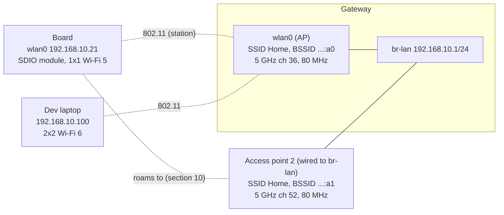

# Wi-Fi for Embedded Linux Engineers

How Wi-Fi works from the radio up to the handshake, how Linux implements it (cfg80211, mac80211, wpa_supplicant, hostapd), and what it takes to put a Wi-Fi chip on an embedded board and debug it when the link is slow, drops or never comes up.

This note covers the **wireless link**: everything below IP. What happens once the device has an address (DHCP, DNS, routing, NAT) is in [Networking Fundamentals for Embedded Linux Engineers](../../networking/fundamentals/fundamentals.md). Router-side Wi-Fi configuration is in [Building a Home Gateway on Linux](../../networking/gateway/gateway.md#10-wi-fi-access-point-hostapd) (hostapd) and [Networking on OpenWrt](../../networking/openwrt/openwrt.md#6-wi-fi-bridges-and-vlans-a-guest-network) (UCI), so this note links there instead of repeating it.

**Assumptions:**
- An example network (section 2): the gateway's access point and a board with an SDIO Wi-Fi module.
- Linux with `iw`, `wpa_supplicant` 2.10+ and `hostapd` 2.10+. BusyBox-based images are covered where they differ.
- Regulatory values are given for the EU (country `FR`) and the US. They change: check your regulator before shipping a product.

**How to read it:**
- **To learn:** Part 1 (sections 1 to 10) in order.
- **To bring up Wi-Fi on Linux:** Part 2 (sections 11 to 15).
- **To integrate a chip in a product:** Part 3 (sections 16 and 17).
- **To debug:** section 18 first, then the section of the step that fails.

## Table of contents

**Part 1: How Wi-Fi works**

- [1. The mental model: what 802.11 changes compared to Ethernet](#1-the-mental-model-what-80211-changes-compared-to-ethernet)
- [2. Example network](#2-example-network)
- [3. Generations and standards](#3-generations-and-standards)
- [4. Bands, channels and regulatory rules](#4-bands-channels-and-regulatory-rules)
- [5. The radio link: OFDM, MCS, MIMO and signal levels](#5-the-radio-link-ofdm-mcs-mimo-and-signal-levels)
- [6. Sharing the air: medium access, QoS and aggregation](#6-sharing-the-air-medium-access-qos-and-aggregation)
- [7. 802.11 frames and addressing](#7-80211-frames-and-addressing)
- [8. Joining a network: scan, authenticate, associate, handshake](#8-joining-a-network-scan-authenticate-associate-handshake)
- [9. Security: WPA2, WPA3, Enterprise and known attacks](#9-security-wpa2-wpa3-enterprise-and-known-attacks)
- [10. Power save, roaming and multi-AP networks](#10-power-save-roaming-and-multi-ap-networks)

**Part 2: How Linux implements it**

- [11. The Linux wireless stack](#11-the-linux-wireless-stack)
- [12. Tools: iw, wpa_cli, hostapd_cli and friends](#12-tools-iw-wpa_cli-hostapd_cli-and-friends)
- [13. Station mode: connecting a device](#13-station-mode-connecting-a-device)
- [14. Access point mode and provisioning](#14-access-point-mode-and-provisioning)
- [15. Monitor mode and over-the-air captures](#15-monitor-mode-and-over-the-air-captures)

**Part 3: Embedded products**

- [16. Integrating a Wi-Fi chip on a board](#16-integrating-a-wi-fi-chip-on-a-board)
- [17. Performance, power and tuning](#17-performance-power-and-tuning)

**Debugging and reference**

- [18. Troubleshooting](#18-troubleshooting)
- [19. Not covered here](#19-not-covered-here)
- [References](#references)

---

## 1. The mental model: what 802.11 changes compared to Ethernet

To IP, Wi-Fi (IEEE 802.11) looks like Ethernet: `wlan0` has a MAC address, carries Ethernet frames to and from the kernel, and can join a bridge on an AP. Underneath, almost everything is different:

| | Switched Ethernet | Wi-Fi |
|---|---|---|
| Medium | One full-duplex link per port | One shared radio channel, half-duplex: one transmitter at a time in range |
| Collisions | None on switched links | Can't be detected while transmitting, so they are **avoided** (CSMA/CA, section 6) |
| Delivery | A lost frame is rare | Every unicast frame is acknowledged and retried; loss and retries are normal |
| Rate | Fixed by the link (1 Gb/s) | Chosen per frame from the signal quality, changes all the time |
| Broadcast | Cheap | Expensive: sent at a low rate, not acknowledged (section 6) |
| Addresses per frame | 2 | 3, sometimes 4 (section 7) |
| Joining | Plug the cable | Scan, authenticate, associate, 4-way handshake (section 8) |
| Security | Physical access to the port | Authentication and encryption in the link layer (section 9) |
| Mobility | None | Clients move between access points (roaming, section 10) |

**Vocabulary:**

| Term | Meaning |
|---|---|
| STA (station) | Any 802.11 device. In practice "station" means a client |
| AP (access point) | A station that runs a network and bridges it to a wired LAN (the distribution system, DS) |
| BSS | Basic service set: one AP and its associated clients, on one channel |
| BSSID | MAC address identifying a BSS: usually the AP radio's MAC (one per SSID on multi-SSID APs) |
| SSID | Network name (0 to 32 bytes) carried in beacons. Several BSSes can share one SSID |
| ESS | Extended service set: several BSSes with the same SSID on one LAN, between which clients roam |
| IBSS, mesh | Networks without an AP: ad hoc (IBSS, obsolete) and 802.11s mesh (section 10) |
| Radio / wiphy | One physical radio (`phy0` in Linux), tuned to one channel at a time |
| Interface / vif | A logical interface on a radio (`wlan0`, `wlan0-1`): station, AP, monitor... (section 11) |
| Associated | The AP accepted the client (802.11 state) |
| Authorized | The 4-way handshake finished: keys installed, data allowed (the 802.1X "port" is open) |

**The AP is a bridge.** A client sends every frame to the AP, even when the destination is another client of the same AP: the frame crosses the air twice. The AP converts 802.11 frames to Ethernet frames and hands them to its bridge (`br-lan` in the [gateway note](../../networking/gateway/gateway.md#10-wi-fi-access-point-hostapd)), and the other way round. Seen from the wired LAN, a Wi-Fi client is just another MAC address behind the AP's port.

**Airtime is the resource.** Everyone in range on the same channel (your clients, your neighbors' networks, a baby monitor) shares one channel's time. A slow client uses more airtime per byte and slows down everyone else. Most Wi-Fi tuning is about spending less airtime per byte.

---

## 2. Example network

The examples use the trusted LAN of the [gateway note](../../networking/gateway/gateway.md#networks), with a board joining it over Wi-Fi.



| Device | Interface | MAC / BSSID | Settings |
|---|---|---|---|
| Gateway AP | `wlan0` in `br-lan` | `00:00:5e:00:53:a0` | SSID `Home`, channel 36 at 80 MHz (center 42), WPA2/WPA3 transition, country `FR` |
| Access point 2 | its own radio, wired to `br-lan` | `00:00:5e:00:53:a1` | Same SSID and passphrase, channel 52 at 80 MHz (DFS). Used for roaming examples |
| Board | `wlan0` | `00:00:5e:00:53:15` | SDIO module, 1 spatial stream, Wi-Fi 5 (802.11ac), DHCP lease `192.168.10.21` |
| Dev laptop | `wlp2s0` | `00:00:5e:00:53:64` | 2x2 Wi-Fi 6, `192.168.10.100` |

The MACs come from the documentation block `00:00:5e:00:53:xx` (RFC 7042). The SSID, passphrases and addresses are placeholders.

---

## 3. Generations and standards

The **IEEE** writes 802.11 and its amendments. The **Wi-Fi Alliance** certifies interoperability and owns the marketing names (Wi-Fi 6, WPA3, WMM, Passpoint, EasyMesh). A certification profile picks a subset of the standard and makes some optional features mandatory: for example, WPA3 support is required for Wi-Fi 6 certification. Linux and hostapd use the IEEE PHY names (HT, VHT, HE, EHT), so learn both.

| Name | IEEE | PHY name | Year | Bands (GHz) | Max width | Top modulation | Max streams (spec) | Peak PHY rate |
|---|---|---|---|---|---|---|---|---|
| - | 802.11b | DSSS/CCK | 1999 | 2.4 | 22 MHz | CCK | 1 | 11 Mb/s |
| - | 802.11a | OFDM | 1999 | 5 | 20 MHz | 64-QAM | 1 | 54 Mb/s |
| - | 802.11g | ERP-OFDM | 2003 | 2.4 | 20 MHz | 64-QAM | 1 | 54 Mb/s |
| Wi-Fi 4 | 802.11n | HT | 2009 | 2.4, 5 | 40 MHz | 64-QAM | 4 | 600 Mb/s |
| Wi-Fi 5 | 802.11ac | VHT | 2013 | 5 | 160 MHz | 256-QAM | 8 | 6.9 Gb/s |
| Wi-Fi 6 | 802.11ax | HE | 2019 | 2.4, 5 | 160 MHz | 1024-QAM | 8 | 9.6 Gb/s |
| Wi-Fi 6E | 802.11ax | HE | 2020 | + 6 | 160 MHz | 1024-QAM | 8 | 9.6 Gb/s |
| Wi-Fi 7 | 802.11be | EHT | 2024 | 2.4, 5, 6 | 320 MHz (6 GHz) | 4096-QAM | 16 | 46 Gb/s |
| Wi-Fi 8 | 802.11bn | UHR | in development | 2.4, 5, 6 | 320 MHz | 4096-QAM | | Targets reliability and latency, not peak rate |

Peak rates assume the maximum streams and width, which no real device has. A phone or laptop is typically 2x2, an embedded module 1x1 or 2x2: a 1x1 Wi-Fi 5 module at 80 MHz tops out at 433 Mb/s on the air (section 5).

**What each generation brought, in one line:**
- **Wi-Fi 4 (HT):** MIMO (several spatial streams), 40 MHz channels, frame aggregation, short guard interval.
- **Wi-Fi 5 (VHT):** 80 and 160 MHz, 256-QAM, explicit beamforming, downlink MU-MIMO. 5 GHz only.
- **Wi-Fi 6 (HE):** OFDMA, 1024-QAM, longer OFDM symbols, uplink MU-MIMO, target wake time (TWT), BSS coloring. Better with many clients, not just faster. 6E adds the 6 GHz band.
- **Wi-Fi 7 (EHT):** 320 MHz, 4096-QAM, multi-link operation (MLO: one connection over several bands), preamble puncturing, multiple resource units per client.

**Amendments you meet in configs and logs:** they are merged into periodic revisions of the base standard (802.11-2016, 802.11-2020, 802.11-2024), but everyone still uses the letters.

| Amendment | What it adds | Where you see it |
|---|---|---|
| 802.11d | Country information in beacons | hostapd `ieee80211d=1` |
| 802.11e | QoS: access categories, EDCA (certified as WMM) | `wmm_enabled=1`, section 6 |
| 802.11h | DFS and transmit power control in 5 GHz | `ieee80211h=1`, section 4 |
| 802.11i | RSN: WPA2, CCMP, 4-way handshake | `wpa=2`, section 9 |
| 802.11k | Radio measurements, neighbor reports | `rrm_neighbor_report=1`, section 10 |
| 802.11r | Fast BSS transition (fast roaming) | `mobility_domain=`, `FT-PSK`, section 10 |
| 802.11s | Mesh networking | `iw ... mesh join`, section 10 |
| 802.11u | Interworking (base of Passpoint/Hotspot 2.0) | hostapd `interworking=1` |
| 802.11v | Network management, BSS transition requests | `bss_transition=1`, section 10 |
| 802.11w | Protected management frames (PMF) | `ieee80211w=`, section 9 |
| 802.11ad, 802.11ay | 60 GHz (WiGig) | Rare outside niche devices |
| 802.11ah | Sub-1 GHz long range low power ("Wi-Fi HaLow") | Separate chips, out-of-tree drivers |

**Backward compatibility:** a Wi-Fi 6 AP still serves an 802.11g client, but the old client uses more airtime, and some legacy (802.11b) clients force protection mechanisms that cost everyone airtime (section 6).

---

## 4. Bands, channels and regulatory rules

### 2.4 GHz

2400 to 2483.5 MHz. Channel *n* is centered at 2407 + 5*n* MHz (channel 14, 2484 MHz, is 802.11b only, in Japan). Channels are 5 MHz apart but a transmission is 20 MHz wide, so only **1, 6 and 11** don't overlap.

| Channel | 1 | 6 | 11 | 13 |
|---|---|---|---|---|
| Center (MHz) | 2412 | 2437 | 2462 | 2472 |
| Allowed | Everywhere | Everywhere | Everywhere | EU and most countries, not the US |

- Use 20 MHz. A 40 MHz channel takes two-thirds of the band, and APs must fall back to 20 MHz when they detect neighbors (20/40 coexistence).
- Shared with Bluetooth, Zigbee, microwave ovens and every neighbor. Use it for range, wall penetration and 2.4 GHz-only IoT devices.

### 5 GHz

Channel *n* is centered at 5000 + 5*n* MHz. Channels are numbered every 4 (20 MHz apart) and don't overlap.

| Sub-band | 20 MHz channels | MHz | EU (ETSI) | US (FCC) |
|---|---|---|---|---|
| U-NII-1 | 36, 40, 44, 48 | 5150-5250 | Indoor only, 23 dBm (200 mW) EIRP | Indoor and outdoor, no DFS |
| U-NII-2A | 52, 56, 60, 64 | 5250-5350 | Indoor only, 23 dBm with TPC, DFS | DFS |
| U-NII-2C | 100 to 144 | 5470-5725 | 30 dBm (1 W) with TPC, DFS, up to channel 140 | DFS |
| U-NII-3 | 149 to 165 | 5725-5850 | Low power (14 dBm, 25 mW) in many countries | Up to 1 W conducted, no DFS |
| U-NII-4 | 169 to 177 | 5850-5925 | Not for Wi-Fi | Partly opened for indoor use |

Without TPC (transmit power control), EU limits are 3 dB lower. Check your country: rules have been changing in U-NII-3 and U-NII-4.

**Channel bonding:** wider channels combine adjacent 20 MHz channels. One of them is the **primary** channel: beacons, management frames and legacy clients use it. The others are secondary and only used when free. Configs refer to the block by its **center channel index**:

| Width | Channels | Center index |
|---|---|---|
| 40 MHz | 36+40, 44+48, 52+56, ... | 38, 46, 54, ... |
| 80 MHz | 36-48 / 52-64 / 100-112 / 116-128 / 132-144 / 149-161 | 42 / 58 / 106 / 122 / 138 / 155 |
| 160 MHz | 36-64 / 100-128 / 149-177 | 50 / 114 / 163 |

In the EU that leaves 19 channels of 20 MHz (36-64, 100-140), four of 80 MHz and two of 160 MHz. `HT40+` means the secondary channel is above the primary (36+40), `HT40-` below (40+36).

**DFS (dynamic frequency selection):** U-NII-2 channels are shared with radars. An AP on a DFS channel must:
1. Listen for radar for the **channel availability check** (CAC) before transmitting: 60 s, or 10 minutes on 5600-5650 MHz (channels 120-128) in the EU (weather radars).
2. Keep listening while operating. On a detection, stop transmitting within seconds, announce a channel switch (CSA) to its clients and leave the channel for 30 minutes (non-occupancy period).

Consequences: the AP needs a minute (or ten) before its SSID appears; clients may be moved or dropped on a radar hit; clients can't probe on a DFS channel until they hear the AP's beacons (passive scanning, section 8). Client devices only need to follow the AP, but an AP needs DFS support in its driver and firmware, and certification, which many client chips don't have: it's why so many Linux cards can't start an AP on most 5 GHz channels (`no IR` in `iw list`).

### 6 GHz

Channel *n* is centered at 5950 + 5*n* MHz, with 20 MHz channels at *n* = 1, 5, 9 ... 233.

| | EU | US |
|---|---|---|
| Range | 5945-6425 MHz (480 MHz) | 5925-7125 MHz (1200 MHz) |
| Channels (20/80/160/320 MHz) | 24 / 6 / 3 / 1 | 59 / 14 / 7 / 3 |
| Low power indoor (LPI) | 23 dBm EIRP, 10 dBm/MHz | 5 dBm/MHz (30 dBm at 320 MHz) |
| Very low power (VLP), portable | 14 dBm, 1 dBm/MHz | 14 dBm |
| Standard power (SP) | Not allowed | Outdoor and higher power, only under AFC (automated frequency coordination: a database lists free frequencies at the AP's location) |

Rules that differ from 2.4 and 5 GHz:
- **HE/EHT only:** no Wi-Fi 4 or 5, no legacy rates.
- **WPA3 (SAE with hash-to-element) or Enhanced Open (OWE) only**, PMF required. No WPA2, no open networks (section 9).
- **Discovery:** with so many channels, clients don't probe everywhere. They learn about 6 GHz APs from a reduced neighbor report (RNR) in the beacons of the AP's 2.4/5 GHz radios, or scan the 15 **preferred scanning channels** (PSC: 5, 21, 37, 53, ... every 16 channels up to 229). Put a 6 GHz AP's primary channel on a PSC.
- Indoor LPI power density is low: a 6 GHz AP has less range than the same AP on 5 GHz, more so through walls.

### Which band for what

| Band | Strengths | Weaknesses | Use for |
|---|---|---|---|
| 2.4 GHz | Range, walls, every device supports it | 3 usable channels, crowded, 20 MHz only in practice | IoT, far rooms, low data rates |
| 5 GHz | Many channels, 80/160 MHz | Less range, DFS complications | Default for anything that can |
| 6 GHz | Clean spectrum, wide channels, only modern devices | Shortest range, WPA3 only, new chips and drivers | High throughput, low latency in the same room |

### Regulatory domains

Each country sets which frequencies, widths and powers are allowed, and whether DFS or indoor-only rules apply. A device must operate within the rules of where it is:

- **Country setting:** the AP is configured with a country (`country_code=FR` in hostapd) and advertises it in its beacons (802.11d). Clients may adopt it.
- **On Linux:** cfg80211 enforces the active regulatory domain, from the `wireless-regdb` database, the driver, or both (section 11). The default world domain `00` is the most restrictive: no AP on most 5 GHz channels, passive scanning only on many.
- **In the chip:** many vendors also lock power tables in firmware or calibration data (section 16). A product ships with fixed regulatory data matching its certification.

```bash
iw reg get              # active rules: frequency ranges, max width, max EIRP, flags
sudo iw reg set FR      # set the country (a hint: drivers or the AP may override it)
iw list | grep -A 30 Frequencies   # what this card allows per channel: dBm, disabled, no IR, radar
```

Flags in `iw reg get` and `iw list`: `NO-IR` (no initiating radiation: no AP, no active scan), `DFS`/`radar detection`, `NO-OUTDOOR`, `AUTO-BW` (adjacent rules can be combined into a wider channel), `disabled`.

---

## 5. The radio link: OFDM, MCS, MIMO and signal levels

### OFDM

Since 802.11a/g, Wi-Fi uses **OFDM**: the channel is split into many narrow subcarriers, each carrying one modulated symbol at a time. Most subcarriers carry data, some are pilots (tracking) or left empty at the edges. Between symbols, a **guard interval** (GI) absorbs echoes from reflections (multipath).

| PHY | Subcarrier spacing | Symbol without GI | Guard interval | Data subcarriers at 20 / 40 / 80 / 160 / 320 MHz |
|---|---|---|---|---|
| 802.11a/g | 312.5 kHz | 3.2 µs | 0.8 µs | 48 / - / - / - / - |
| HT (Wi-Fi 4) | 312.5 kHz | 3.2 µs | 0.8 or 0.4 µs (short GI) | 52 / 108 / - / - / - |
| VHT (Wi-Fi 5) | 312.5 kHz | 3.2 µs | 0.8 or 0.4 µs | 52 / 108 / 234 / 468 / - |
| HE (Wi-Fi 6) | 78.125 kHz | 12.8 µs | 0.8, 1.6 or 3.2 µs | 234 / 468 / 980 / 1960 / - |
| EHT (Wi-Fi 7) | 78.125 kHz | 12.8 µs | 0.8, 1.6 or 3.2 µs | 234 / 468 / 980 / 1960 / 3920 |

Wi-Fi 6 made symbols four times longer: the fixed guard interval is a smaller share of the time, and long GIs help outdoors, where echoes are long.

### MCS: modulation and coding

The **MCS** (modulation and coding scheme) index picks how many bits each subcarrier carries per symbol (modulation) and how much of them is error correction (coding rate). Higher MCS needs a cleaner signal. VHT, HE and EHT share this table:

| MCS | Modulation | Bits per subcarrier | Coding rate | Rough SNR needed |
|---|---|---|---|---|
| 0 | BPSK | 1 | 1/2 | 5 dB |
| 1 | QPSK | 2 | 1/2 | 8 dB |
| 2 | QPSK | 2 | 3/4 | 11 dB |
| 3 | 16-QAM | 4 | 1/2 | 14 dB |
| 4 | 16-QAM | 4 | 3/4 | 17 dB |
| 5 | 64-QAM | 6 | 2/3 | 21 dB |
| 6 | 64-QAM | 6 | 3/4 | 23 dB |
| 7 | 64-QAM | 6 | 5/6 | 25 dB |
| 8 | 256-QAM | 8 | 3/4 | 29 dB |
| 9 | 256-QAM | 8 | 5/6 | 31 dB |
| 10 | 1024-QAM (Wi-Fi 6) | 10 | 3/4 | 34 dB |
| 11 | 1024-QAM (Wi-Fi 6) | 10 | 5/6 | 37 dB |
| 12 | 4096-QAM (Wi-Fi 7) | 12 | 3/4 | 40 dB |
| 13 | 4096-QAM (Wi-Fi 7) | 12 | 5/6 | 43 dB |

The SNR column is a rule of thumb: real thresholds depend on the chip (its datasheet gives receiver sensitivity per MCS) and the channel. HT (Wi-Fi 4) numbers MCS 0 to 31 and encodes the stream count in the index: MCS 15 is MCS 7 on two streams.

### PHY rate

```
rate = data subcarriers × bits per subcarrier × coding rate × spatial streams / (symbol + GI)
```

Worked example, the board's 1x1 Wi-Fi 5 module at 80 MHz, MCS 9, short GI:
234 × 8 × 5/6 × 1 / (3.2 + 0.4) µs = 1560 bits / 3.6 µs = **433.3 Mb/s**.

The same at Wi-Fi 6 MCS 11, 0.8 µs GI: 980 × 10 × 5/6 / 13.6 µs = **600.5 Mb/s** per stream.

| PHY | Width | MCS | GI | 1 stream | 2 streams |
|---|---|---|---|---|---|
| HT | 20 MHz | 7 | 0.4 µs | 72.2 | 144.4 |
| HT | 40 MHz | 7 | 0.4 µs | 150 | 300 |
| VHT | 80 MHz | 9 | 0.4 µs | 433.3 | 866.7 |
| VHT | 160 MHz | 9 | 0.4 µs | 866.7 | 1733.3 |
| HE | 20 MHz | 11 | 0.8 µs | 143.4 | 286.8 |
| HE | 80 MHz | 11 | 0.8 µs | 600.5 | 1201 |
| HE | 160 MHz | 11 | 0.8 µs | 1201 | 2402 |
| EHT | 320 MHz | 13 | 0.8 µs | 2882 | 5765 |

Rates in Mb/s. These are rates **on the air** during a frame: what an application gets is roughly half to two-thirds of it (section 6).

### MIMO, beamforming, MU-MIMO, OFDMA

- **Antennas and streams:** `2x2:2` means 2 transmit chains, 2 receive chains, 2 spatial streams. A link carries at most min(streams of the AP, streams of the client) streams.
- **Spatial multiplexing:** several streams on the same channel at the same time, separated by the receiver using multipath. Needs a good SNR; at long range, the chip uses the extra antennas for diversity instead (STBC, maximum ratio combining): fewer streams, more range.
- **Beamforming (Wi-Fi 5+):** the AP sounds the channel (null data packet, client feedback) and shapes its transmission toward the client. A few dB of gain, mostly at medium range.
- **MU-MIMO:** the AP sends different streams to different clients at once (downlink since Wi-Fi 5, uplink in Wi-Fi 6). Needs sounding overhead and clients spatially apart; the gains in real homes are usually small.
- **OFDMA (Wi-Fi 6+):** the AP splits the channel into **resource units** (RUs: 26, 52, 106, 242, 484, 996 subcarriers...) and serves several clients in one transmission, uplink too (scheduled by trigger frames). It helps with many clients sending small packets (IoT, VoIP): less contention and lower latency. It doesn't raise any single client's peak rate.

### Signal levels

Power is given in **dBm**: decibels relative to 1 mW. Adding 3 dB doubles the power, adding 10 dB multiplies it by 10.

| dBm | 30 | 20 | 14 | 10 | 0 | -30 | -60 | -90 |
|---|---|---|---|---|---|---|---|---|
| Power | 1 W | 100 mW | 25 mW | 10 mW | 1 mW | 1 µW | 1 nW | 1 pW |

**EIRP** = transmit power + antenna gain (dBi) - cable losses. Regulatory limits are on EIRP, so a higher-gain antenna means less conducted power is allowed. `iw` shows transmit power in dBm, and sets it in mBm (100 × dBm).

| Received signal (RSSI) | Quality |
|---|---|
| -30 to -50 dBm | Excellent, top MCS if the noise is low |
| -50 to -67 dBm | Good. -67 dBm is a common design target for voice and video |
| -67 to -75 dBm | Usable for data, lower MCS, more retries |
| -75 to -85 dBm | Unreliable, frequent rate drops and disconnects |
| below -85 dBm | Near the noise |

**Noise floor:** thermal noise in 20 MHz is about -101 dBm; with the receiver's own noise figure, chips report around -95 dBm. Each doubling of the channel width adds 3 dB of noise (about -89 dBm at 80 MHz). **SNR** = signal - noise, and SNR picks the MCS (table above), not RSSI alone: -60 dBm next to a busy neighbor network can be worse than -70 dBm in a quiet place.

**Free-space path loss:** FSPL (dB) = 20 log10(d in m) + 20 log10(f in MHz) - 27.55. At 1 m: 40 dB at 2.4 GHz, 47 dB at 5.5 GHz. Each doubling of distance adds 6 dB. Walls add more: roughly 3-5 dB for drywall, 6-12 dB for brick, 10-20+ dB for concrete, more for metal and coated glass, and more at 5/6 GHz than at 2.4 GHz.

**Link budget example** (the board, 10 m from the AP, 2 walls, channel 36):

| Item | Value |
|---|---|
| AP transmit power | +20 dBm |
| AP antenna gain | +3 dBi |
| Free-space path loss, 10 m at 5180 MHz | -66.7 dB |
| Two brick walls | -15 dB |
| Board antenna gain | +2 dBi |
| **Received signal** | **-56.7 dBm** |
| Noise floor at 80 MHz | about -89 dBm |
| **SNR** | **about 32 dB: MCS 9 is just possible** |

The link is **asymmetric**: the board probably transmits at 15 dBm or less, so the AP hears it 5 dB weaker than it hears the AP. Uplink problems (retries, low TX rate on the board) often come from this.

---

## 6. Sharing the air: medium access, QoS and aggregation

### CSMA/CA

A radio can't hear a collision while it transmits, so 802.11 avoids collisions instead (carrier sense multiple access with collision avoidance):

1. **Listen** (clear channel assessment): the channel is busy if the radio decodes a Wi-Fi preamble above about -82 dBm (20 MHz), or sees any energy above about -62 dBm.
2. **Wait** a fixed time once the channel is free (DIFS, or AIFS for QoS traffic).
3. **Back off** a random number of slots between 0 and CW (contention window). The countdown pauses while the channel is busy.
4. **Transmit**, then wait for the **ACK**, which the receiver sends a SIFS after the frame.
5. **No ACK:** assume a collision or corruption, double CW (up to CWmax) and retry, up to a retry limit. Then drop the frame.

| Timing (OFDM) | 2.4 GHz | 5/6 GHz |
|---|---|---|
| Slot | 9 µs (20 µs with 802.11b clients) | 9 µs |
| SIFS | 10 µs | 16 µs |
| DIFS = SIFS + 2 slots | 28 µs | 34 µs |

Every frame also carries a **duration** field: stations that hear it set their NAV (network allocation vector) and stay quiet until the exchange ends, even if they can't hear the other side.

### Hidden nodes and RTS/CTS

```
   Client A  ───────►  AP  ◄───────  Client B
        A and B can't hear each other (walls, distance)
```

A and B both sense a free channel and transmit together: the AP receives garbage. With **RTS/CTS**, a station first sends a short request-to-send; the AP answers clear-to-send, which B hears, and B's NAV keeps it quiet. It costs airtime on every frame, so it's used above a size threshold (`iw phy phy0 set rts <bytes|off>`) or automatically by rate control. **CTS-to-self** is a variant used as "protection" so that legacy (802.11b) stations, which can't decode OFDM, stay quiet.

### QoS: WMM access categories

802.11e (certified as **WMM**) gives each frame one of four access categories. Higher categories wait less and back off less, so they win the medium more often.

| Access category | 802.1D user priority | AIFSN | CWmin | CWmax | TXOP limit |
|---|---|---|---|---|---|
| AC_VO (voice) | 6, 7 | 2 | 3 | 7 | 1.504 ms |
| AC_VI (video) | 4, 5 | 2 | 7 | 15 | 3.008 ms |
| AC_BE (best effort) | 0, 3 | 3 | 15 | 1023 | one frame exchange |
| AC_BK (background) | 1, 2 | 7 | 15 | 1023 | one frame exchange |

Values are the defaults an AP advertises to its clients (hostapd `wmm_ac_*`); the AP's own parameters are a bit more aggressive (`tx_queue_data*`). AIFS = SIFS + AIFSN × slot.

**How Linux picks the category:** mac80211 asks cfg80211 (`cfg80211_classify8021d()`) to map each packet to a user priority, from the DSCP field (its top 3 bits, with RFC 8325 adjustments in recent kernels). An application can force one with `SO_PRIORITY` set to 256 + UP (256 to 263). An AP can also push a DSCP mapping to its clients (QoS Map, hostapd `qos_map_set`). Most applications send DSCP 0, so most traffic is best effort.

### Unicast vs multicast

| | Unicast | Broadcast, multicast |
|---|---|---|
| Acknowledged | Yes, retried | No: a lost frame is just lost |
| Rate | Chosen per client by rate control | The lowest basic rate (1 or 6 Mb/s) so that every client can decode it |
| Power save | Delivered when the client wakes | Buffered until the next DTIM beacon (section 10) |

A 2 Mb/s multicast video stream sent at 6 Mb/s takes a third of the channel's airtime. mDNS, SSDP and IPv6 neighbor discovery chatter costs the same way. Remedies: multicast-to-unicast conversion on the AP (hostapd `multicast_to_unicast=1`, or the bridge port option `mcast_to_unicast`), raising the basic rates (drop 802.11b rates: hostapd `basic_rates=60 120 240` and `supported_rates=60 90 120 180 240 360 480 540`, in units of 100 kb/s), and proxy ARP/ND on the AP (`proxy_arp=1`).

### Aggregation and Block Ack

Every transmission pays a fixed cost: AIFS, backoff, a preamble of tens of µs, SIFS and the acknowledgment. At high rates the payload is tiny in comparison: a 1500-byte frame lasts 10 µs at 1201 Mb/s, after about 200 µs of overhead. Aggregation sends many frames per transmission:

| | A-MSDU | A-MPDU |
|---|---|---|
| What is aggregated | Several packets inside one 802.11 frame (one header, one FCS) | Several complete 802.11 frames in one transmission (PPDU) |
| One bit error | Loses the whole A-MSDU | Loses only that MPDU |
| Acknowledgment | One ACK | Block Ack: a bitmap of received frames, only the missing ones are resent |
| Limits | 7935 B (HT), 11454 B (VHT) | 64 frames (HT/VHT), 256 (HE), 1024 (EHT) per Block Ack window; about 5.5 ms per transmission |

The two combine (A-MSDUs inside an A-MPDU). With 64 aggregated frames, the same 200 µs overhead is shared by 640 µs of payload: about 75% efficiency instead of 5%. Aggregation needs a queue of packets for the same client and TID: it works for bulk transfers, not for a single ping. A Block Ack session is set up per client and TID with ADDBA action frames.

### Rate control

The transmitter chooses MCS, streams and GI for each frame from recent success statistics: mac80211 has **Minstrel-HT** (used by drivers that leave rate control to the host), and most modern chips run their own algorithm in firmware. When retries rise, rate control drops the MCS; `tx bitrate` in `iw dev wlan0 station dump` is the rate of the last frames sent (section 17).

### Why throughput is far below the PHY rate

- Half duplex: TCP data and TCP ACKs compete for the same channel.
- Fixed per-transmission overhead, reduced but not removed by aggregation.
- Retries, and rate control backing off below the best MCS.
- Contention with every network on the channel, including neighbors.
- Airtime shared with slower clients: one distant client at MCS 0 can take most of the channel.

Rule of thumb: a single TCP flow close to the AP gets **50 to 70% of the PHY rate**, shared among all clients of the channel. Section 17 shows what to expect per configuration and how to measure.

**Latency under load (Linux):** mac80211 queues packets per client and TID with fq_codel (intermediate TX queues), and AQL (airtime queue limits, kernel 5.5) caps how much airtime is queued in the driver and firmware. With drivers that support them, latency stays low during bulk transfers. Out-of-tree and FullMAC drivers often queue deep in firmware instead (bufferbloat).

**Wi-Fi 6 additions for dense networks:** **BSS coloring** (a 6-bit color in each frame lets a station ignore a neighbor network's frames at a higher threshold and transmit anyway: spatial reuse), OFDMA (section 5) and TWT (section 10).

---

## 7. 802.11 frames and addressing

### Frame format

```
┌─────────┬──────────┬───────┬───────┬───────┬─────────┬───────┬─────────┬─────────┬─────────────┬─────┐
│ Frame   │ Duration │ Addr1 │ Addr2 │ Addr3 │ Seq     │ Addr4 │ QoS     │ HT      │ Body        │ FCS │
│ control │ / ID     │ (RA)  │ (TA)  │       │ control │ (opt) │ control │ control │             │     │
│ 2 B     │ 2 B      │ 6 B   │ 6 B   │ 6 B   │ 2 B     │ 6 B   │ 2 B     │ 4 B     │ 0-7951+ B   │ 4 B │
└─────────┴──────────┴───────┴───────┴───────┴─────────┴───────┴─────────┴─────────┴─────────────┴─────┘
```

**Frame control** bits: protocol version, type, subtype, To DS, From DS, More Fragments, **Retry** (set on retransmissions: a high share of retries in a capture means a bad link), Power Management (the sender goes to sleep after this frame), More Data, **Protected** (body encrypted), +HTC.

**Sequence control:** a 12-bit sequence number per sender (per TID for QoS data) and a fragment number. The receiver uses it to drop duplicates when an ACK was lost.

On the air, a 1500-byte IP packet becomes: QoS data header 26 B + CCMP header 8 B + LLC/SNAP 8 B + 1500 B + MIC 8 B + FCS 4 B = 1554 B, preceded by a PHY preamble.

### Frame types

| Type | Subtypes (value) | Wireshark filter |
|---|---|---|
| Management | Association request (0), response (1), reassociation request (2), response (3), probe request (4), probe response (5), beacon (8), disassociation (10), authentication (11), deauthentication (12), action (13) | `wlan.fc.type == 0`, e.g. beacons `wlan.fc.type_subtype == 0x08` |
| Control | Trigger (2), Block Ack request (8), Block Ack (9), PS-Poll (10), RTS (11), CTS (12), ACK (13) | `wlan.fc.type == 1` |
| Data | Data (0), null (4), QoS data (8), QoS null (12) | `wlan.fc.type == 2` |

Null frames carry no data: clients send them to signal power save changes, and APs to poll idle clients. **Action frames** carry most newer features: Block Ack setup, spectrum management (channel switch), radio measurements (802.11k), BSS transition (802.11v), FT (802.11r), SA Query (PMF). EAPOL handshake frames are ordinary data frames (EtherType 0x888e).

### The four address fields

The To DS / From DS bits say which way a frame goes relative to the distribution system (the wired side), and give the address fields their meaning. RA/TA are the radios at each end of this hop, DA/SA the final destination and original source.

| To DS | From DS | Case | Addr1 | Addr2 | Addr3 | Addr4 |
|---|---|---|---|---|---|---|
| 0 | 0 | Management, control, IBSS | DA | SA | BSSID | - |
| 1 | 0 | Client → AP | BSSID (RA) | SA (TA) | DA | - |
| 0 | 1 | AP → client | DA (RA) | BSSID (TA) | SA | - |
| 1 | 1 | AP ↔ AP: WDS, mesh, 4-address mode | RA | TA | DA | SA |

Example: the board pings the laptop, both on the gateway AP. Frame 1 (board → AP): Addr1 = AP BSSID `...:a0`, Addr2 = board `...:15`, Addr3 = laptop `...:64`. The AP turns it into Ethernet for `br-lan`; the bridge sends it back out of `wlan0`. Frame 2 (AP → laptop): Addr1 = laptop, Addr2 = BSSID, Addr3 = board.

**802.11 to Ethernet:** the data body starts with an LLC/SNAP header (`aa aa 03 00 00 00` + EtherType). The AP, or the driver on a client, replaces the 802.11 header and LLC/SNAP with an Ethernet header (DA, SA, EtherType). That's why `tcpdump -i wlan0` shows Ethernet frames, with no 802.11 header (section 15).

### Why a station can't be bridged

A 3-address frame from a client carries only one source address, and it must be the client's own MAC: the AP drops frames from MACs that aren't associated. So if the board puts `wlan0` (station) in a bridge with `eth0`, frames from devices behind `eth0` can't be sent with their own source MAC, and replies to them have no way back. Options:

| Approach | How | Limits |
|---|---|---|
| Route (and usually NAT) | Separate subnet behind the board, like any router | Not one LAN: discovery protocols don't cross |
| 4-address mode (WDS) | `iw dev wlan0 set 4addr on` on the client, `wds_sta=1` on a hostapd AP | Both ends must support it, usually Linux to Linux |
| Pseudo-bridge (proxy ARP, relayd) | The board answers ARP for the hosts behind it and routes | IPv4 only unless extra work, fragile with DHCP |
| MAC NAT | Rewrite source MACs to the board's (ebtables, some vendor firmware) | Breaks protocols that care about MACs |
| 802.11s mesh | Mesh interfaces use 4 addresses natively (section 10) | All nodes must run the mesh |

---

## 8. Joining a network: scan, authenticate, associate, handshake

Planned: active and passive scanning, beacons, authentication and association, the 4-way handshake, disconnection and reason codes.

---

## 9. Security: WPA2, WPA3, Enterprise and known attacks

Planned: key hierarchy, PSK and SAE, PMF, OWE, 802.1X/EAP, AKM and cipher suites, transition modes, attacks and what stops them.

---

## 10. Power save, roaming and multi-AP networks

Planned: power save mechanisms (TIM/DTIM, U-APSD, TWT), roaming (802.11k/v/r), mesh, Wi-Fi Direct, multi-link operation.

---

## 11. The Linux wireless stack

Planned: nl80211, cfg80211, mac80211, FullMAC vs SoftMAC, firmware, regulatory database, interface types, driver families.

---

## 12. Tools: iw, wpa_cli, hostapd_cli and friends

Planned: daily commands, reading `iw` output, the `iwconfig` to `iw` mapping, rfkill, debugfs.

---

## 13. Station mode: connecting a device

Planned: wpa_supplicant configurations (WPA2, WPA3, Enterprise, hidden, open/OWE), running it under systemd or BusyBox, events, iwd and NetworkManager.

---

## 14. Access point mode and provisioning

Planned: what to add to the gateway note's hostapd config (Wi-Fi 6/6E, roaming, ACS, DFS), AP+STA concurrency, onboarding a headless device.

---

## 15. Monitor mode and over-the-air captures

Planned: monitor interfaces, radiotap, Wireshark filters, decrypting a capture, what a sniffer can't see.

---

## 16. Integrating a Wi-Fi chip on a board

Planned: buses (SDIO, PCIe, USB, SPI), device tree, power sequencing, firmware and NVRAM files, kernel and build-system options, antennas, coexistence, certification.

---

## 17. Performance, power and tuning

Planned: measuring with iperf3, reading `station dump` and `survey dump`, bus and CPU limits, power save vs latency, WoWLAN.

---

## 18. Troubleshooting

Planned: layer-by-layer method, symptom table, reason and status codes, driver and firmware errors.

---

## 19. Not covered here

Planned: topics for later notes.

---

## References

Planned: standards, Linux and hostap documentation, books.
