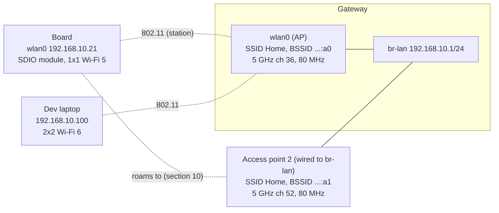
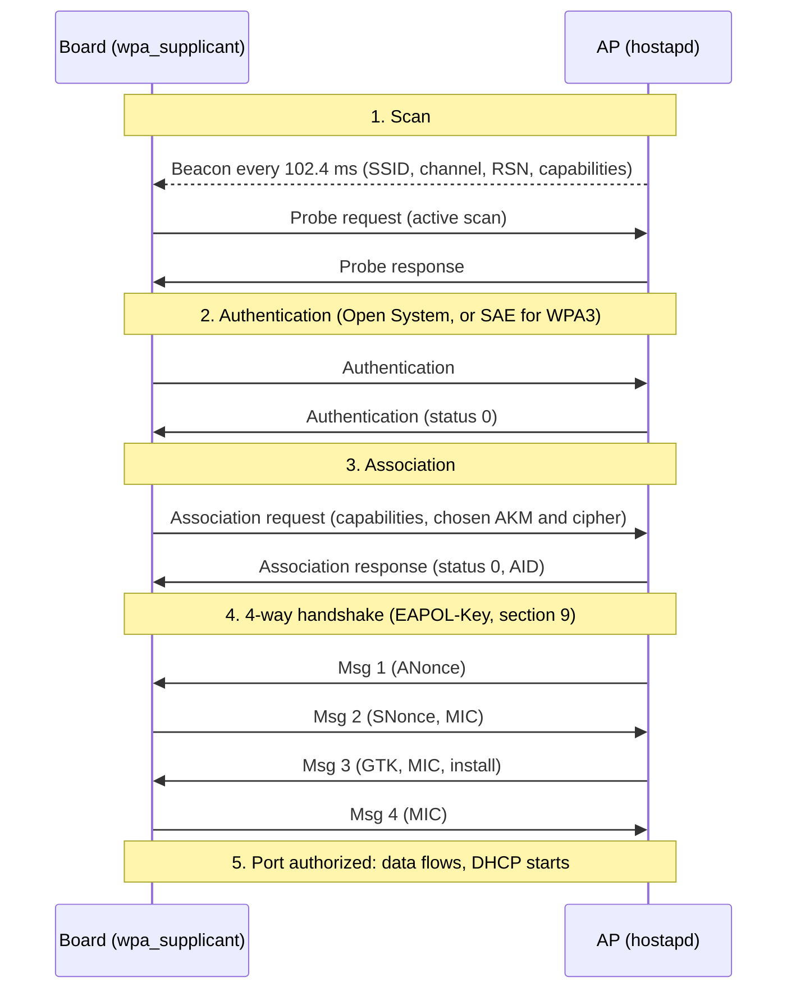

# Wi-Fi for Embedded Linux Engineers

How Wi-Fi works from the radio up to the handshake, how Linux implements it (cfg80211, mac80211, wpa_supplicant, hostapd), and what it takes to put a Wi-Fi chip on an embedded board and debug it when the link is slow, drops or never comes up.

This note covers the **wireless link**: everything below IP. What happens once the device has an address (DHCP, DNS, routing, NAT) is in [Networking Fundamentals for Embedded Linux Engineers](../../networking/fundamentals/fundamentals.md). Router-side Wi-Fi configuration is in [Building a Home Gateway on Linux](../../networking/gateway/gateway.md#10-wi-fi-access-point-hostapd) (hostapd) and [Networking on OpenWrt](../../networking/openwrt/openwrt.md#6-wi-fi-bridges-and-vlans-a-guest-network) (UCI), so this note links there instead of repeating it.

**Assumptions:**
- An example network (section 2): the gateway's access point and a board with an SDIO Wi-Fi module.
- Linux with `iw`, `wpa_supplicant` 2.10+ and `hostapd` 2.10+. BusyBox-based images are covered where they differ.
- Regulatory values are given for the EU (country `FR`) and the US. They change: check your regulator before shipping a product.

**How to read it:**
- **To learn:** Part 1 (sections 1 to 10) in order.
- **To bring up Wi-Fi on Linux:** Part 2 (sections 11 to 15).
- **To integrate a chip in a product:** Part 3 (sections 16 and 17).
- **To debug:** section 18 first, then the section of the step that fails.

## Table of contents

**Part 1: How Wi-Fi works**

- [1. The mental model: what 802.11 changes compared to Ethernet](#1-the-mental-model-what-80211-changes-compared-to-ethernet)
- [2. Example network](#2-example-network)
- [3. Generations and standards](#3-generations-and-standards)
- [4. Bands, channels and regulatory rules](#4-bands-channels-and-regulatory-rules)
- [5. The radio link: OFDM, MCS, MIMO and signal levels](#5-the-radio-link-ofdm-mcs-mimo-and-signal-levels)
- [6. Sharing the air: medium access, QoS and aggregation](#6-sharing-the-air-medium-access-qos-and-aggregation)
- [7. 802.11 frames and addressing](#7-80211-frames-and-addressing)
- [8. Joining a network: scan, authenticate, associate, handshake](#8-joining-a-network-scan-authenticate-associate-handshake)
- [9. Security: WPA2, WPA3, Enterprise and known attacks](#9-security-wpa2-wpa3-enterprise-and-known-attacks)
- [10. Power save, roaming and multi-AP networks](#10-power-save-roaming-and-multi-ap-networks)

**Part 2: How Linux implements it**

- [11. The Linux wireless stack](#11-the-linux-wireless-stack)
- [12. Tools: iw, wpa_cli, hostapd_cli and friends](#12-tools-iw-wpa_cli-hostapd_cli-and-friends)
- [13. Station mode: connecting a device](#13-station-mode-connecting-a-device)
- [14. Access point mode and provisioning](#14-access-point-mode-and-provisioning)
- [15. Monitor mode and over-the-air captures](#15-monitor-mode-and-over-the-air-captures)

**Part 3: Embedded products**

- [16. Integrating a Wi-Fi chip on a board](#16-integrating-a-wi-fi-chip-on-a-board)
- [17. Performance, power and tuning](#17-performance-power-and-tuning)

**Debugging and reference**

- [18. Troubleshooting](#18-troubleshooting)
- [19. Not covered here](#19-not-covered-here)
- [References](#references)

---

## 1. The mental model: what 802.11 changes compared to Ethernet

To IP, Wi-Fi (IEEE 802.11) looks like Ethernet: `wlan0` has a MAC address, carries Ethernet frames to and from the kernel, and can join a bridge on an AP. Underneath, almost everything is different:

| | Switched Ethernet | Wi-Fi |
|---|---|---|
| Medium | One full-duplex link per port | One shared radio channel, half-duplex: one transmitter at a time in range |
| Collisions | None on switched links | Can't be detected while transmitting, so they are **avoided** (CSMA/CA, section 6) |
| Delivery | A lost frame is rare | Every unicast frame is acknowledged and retried; loss and retries are normal |
| Rate | Fixed by the link (1 Gb/s) | Chosen per frame from the signal quality, changes all the time |
| Broadcast | Cheap | Expensive: sent at a low rate, not acknowledged (section 6) |
| Addresses per frame | 2 | 3, sometimes 4 (section 7) |
| Joining | Plug the cable | Scan, authenticate, associate, 4-way handshake (section 8) |
| Security | Physical access to the port | Authentication and encryption in the link layer (section 9) |
| Mobility | None | Clients move between access points (roaming, section 10) |

**Vocabulary:**

| Term | Meaning |
|---|---|
| STA (station) | Any 802.11 device. In practice "station" means a client |
| AP (access point) | A station that runs a network and bridges it to a wired LAN (the distribution system, DS) |
| BSS | Basic service set: one AP and its associated clients, on one channel |
| BSSID | MAC address identifying a BSS: usually the AP radio's MAC (one per SSID on multi-SSID APs) |
| SSID | Network name (0 to 32 bytes) carried in beacons. Several BSSes can share one SSID |
| ESS | Extended service set: several BSSes with the same SSID on one LAN, between which clients roam |
| IBSS, mesh | Networks without an AP: ad hoc (IBSS, obsolete) and 802.11s mesh (section 10) |
| Radio / wiphy | One physical radio (`phy0` in Linux), tuned to one channel at a time |
| Interface / vif | A logical interface on a radio (`wlan0`, `wlan0-1`): station, AP, monitor... (section 11) |
| Associated | The AP accepted the client (802.11 state) |
| Authorized | The 4-way handshake finished: keys installed, data allowed (the 802.1X "port" is open) |

**The AP is a bridge.** A client sends every frame to the AP, even when the destination is another client of the same AP: the frame crosses the air twice. The AP converts 802.11 frames to Ethernet frames and hands them to its bridge (`br-lan` in the [gateway note](../../networking/gateway/gateway.md#10-wi-fi-access-point-hostapd)), and the other way round. Seen from the wired LAN, a Wi-Fi client is just another MAC address behind the AP's port.

**Airtime is the resource.** Everyone in range on the same channel (your clients, your neighbors' networks, a baby monitor) shares one channel's time. A slow client uses more airtime per byte and slows down everyone else. Most Wi-Fi tuning is about spending less airtime per byte.

---

## 2. Example network

The examples use the trusted LAN of the [gateway note](../../networking/gateway/gateway.md#networks), with a board joining it over Wi-Fi.



| Device | Interface | MAC / BSSID | Settings |
|---|---|---|---|
| Gateway AP | `wlan0` in `br-lan` | `00:00:5e:00:53:a0` | SSID `Home`, channel 36 at 80 MHz (center 42), WPA2/WPA3 transition, country `FR` |
| Access point 2 | its own radio, wired to `br-lan` | `00:00:5e:00:53:a1` | Same SSID and passphrase, channel 52 at 80 MHz (DFS). Used for roaming examples |
| Board | `wlan0` | `00:00:5e:00:53:15` | SDIO module, 1 spatial stream, Wi-Fi 5 (802.11ac), DHCP lease `192.168.10.21` |
| Dev laptop | `wlp2s0` | `00:00:5e:00:53:64` | 2x2 Wi-Fi 6, `192.168.10.100` |

The MACs come from the documentation block `00:00:5e:00:53:xx` (RFC 7042). The SSID, passphrases and addresses are placeholders.

---

## 3. Generations and standards

The **IEEE** writes 802.11 and its amendments. The **Wi-Fi Alliance** certifies interoperability and owns the marketing names (Wi-Fi 6, WPA3, WMM, Passpoint, EasyMesh). A certification profile picks a subset of the standard and makes some optional features mandatory: for example, WPA3 support is required for Wi-Fi 6 certification. Linux and hostapd use the IEEE PHY names (HT, VHT, HE, EHT), so learn both.

| Name | IEEE | PHY name | Year | Bands (GHz) | Max width | Top modulation | Max streams (spec) | Peak PHY rate |
|---|---|---|---|---|---|---|---|---|
| - | 802.11b | DSSS/CCK | 1999 | 2.4 | 22 MHz | CCK | 1 | 11 Mb/s |
| - | 802.11a | OFDM | 1999 | 5 | 20 MHz | 64-QAM | 1 | 54 Mb/s |
| - | 802.11g | ERP-OFDM | 2003 | 2.4 | 20 MHz | 64-QAM | 1 | 54 Mb/s |
| Wi-Fi 4 | 802.11n | HT | 2009 | 2.4, 5 | 40 MHz | 64-QAM | 4 | 600 Mb/s |
| Wi-Fi 5 | 802.11ac | VHT | 2013 | 5 | 160 MHz | 256-QAM | 8 | 6.9 Gb/s |
| Wi-Fi 6 | 802.11ax | HE | 2019 | 2.4, 5 | 160 MHz | 1024-QAM | 8 | 9.6 Gb/s |
| Wi-Fi 6E | 802.11ax | HE | 2020 | + 6 | 160 MHz | 1024-QAM | 8 | 9.6 Gb/s |
| Wi-Fi 7 | 802.11be | EHT | 2024 | 2.4, 5, 6 | 320 MHz (6 GHz) | 4096-QAM | 16 | 46 Gb/s |
| Wi-Fi 8 | 802.11bn | UHR | in development | 2.4, 5, 6 | 320 MHz | 4096-QAM | | Targets reliability and latency, not peak rate |

Peak rates assume the maximum streams and width, which no real device has. A phone or laptop is typically 2x2, an embedded module 1x1 or 2x2: a 1x1 Wi-Fi 5 module at 80 MHz tops out at 433 Mb/s on the air (section 5).

**What each generation brought, in one line:**
- **Wi-Fi 4 (HT):** MIMO (several spatial streams), 40 MHz channels, frame aggregation, short guard interval.
- **Wi-Fi 5 (VHT):** 80 and 160 MHz, 256-QAM, explicit beamforming, downlink MU-MIMO. 5 GHz only.
- **Wi-Fi 6 (HE):** OFDMA, 1024-QAM, longer OFDM symbols, uplink MU-MIMO, target wake time (TWT), BSS coloring. Better with many clients, not just faster. 6E adds the 6 GHz band.
- **Wi-Fi 7 (EHT):** 320 MHz, 4096-QAM, multi-link operation (MLO: one connection over several bands), preamble puncturing, multiple resource units per client.

**Amendments you meet in configs and logs:** they are merged into periodic revisions of the base standard (802.11-2016, 802.11-2020, 802.11-2024), but everyone still uses the letters.

| Amendment | What it adds | Where you see it |
|---|---|---|
| 802.11d | Country information in beacons | hostapd `ieee80211d=1` |
| 802.11e | QoS: access categories, EDCA (certified as WMM) | `wmm_enabled=1`, section 6 |
| 802.11h | DFS and transmit power control in 5 GHz | `ieee80211h=1`, section 4 |
| 802.11i | RSN: WPA2, CCMP, 4-way handshake | `wpa=2`, section 9 |
| 802.11k | Radio measurements, neighbor reports | `rrm_neighbor_report=1`, section 10 |
| 802.11r | Fast BSS transition (fast roaming) | `mobility_domain=`, `FT-PSK`, section 10 |
| 802.11s | Mesh networking | `iw ... mesh join`, section 10 |
| 802.11u | Interworking (base of Passpoint/Hotspot 2.0) | hostapd `interworking=1` |
| 802.11v | Network management, BSS transition requests | `bss_transition=1`, section 10 |
| 802.11w | Protected management frames (PMF) | `ieee80211w=`, section 9 |
| 802.11ad, 802.11ay | 60 GHz (WiGig) | Rare outside niche devices |
| 802.11ah | Sub-1 GHz long range low power ("Wi-Fi HaLow") | Separate chips, out-of-tree drivers |

**Backward compatibility:** a Wi-Fi 6 AP still serves an 802.11g client, but the old client uses more airtime, and some legacy (802.11b) clients force protection mechanisms that cost everyone airtime (section 6).

---

## 4. Bands, channels and regulatory rules

### 2.4 GHz

2400 to 2483.5 MHz. Channel *n* is centered at 2407 + 5*n* MHz (channel 14, 2484 MHz, is 802.11b only, in Japan). Channels are 5 MHz apart but a transmission is 20 MHz wide, so only **1, 6 and 11** don't overlap.

| Channel | 1 | 6 | 11 | 13 |
|---|---|---|---|---|
| Center (MHz) | 2412 | 2437 | 2462 | 2472 |
| Allowed | Everywhere | Everywhere | Everywhere | EU and most countries, not the US |

- Use 20 MHz. A 40 MHz channel takes two-thirds of the band, and APs must fall back to 20 MHz when they detect neighbors (20/40 coexistence).
- Shared with Bluetooth, Zigbee, microwave ovens and every neighbor. Use it for range, wall penetration and 2.4 GHz-only IoT devices.

### 5 GHz

Channel *n* is centered at 5000 + 5*n* MHz. Channels are numbered every 4 (20 MHz apart) and don't overlap.

| Sub-band | 20 MHz channels | MHz | EU (ETSI) | US (FCC) |
|---|---|---|---|---|
| U-NII-1 | 36, 40, 44, 48 | 5150-5250 | Indoor only, 23 dBm (200 mW) EIRP | Indoor and outdoor, no DFS |
| U-NII-2A | 52, 56, 60, 64 | 5250-5350 | Indoor only, 23 dBm with TPC, DFS | DFS |
| U-NII-2C | 100 to 144 | 5470-5725 | 30 dBm (1 W) with TPC, DFS, up to channel 140 | DFS |
| U-NII-3 | 149 to 165 | 5725-5850 | Low power (14 dBm, 25 mW) in many countries | Up to 1 W conducted, no DFS |
| U-NII-4 | 169 to 177 | 5850-5925 | Not for Wi-Fi | Partly opened for indoor use |

Without TPC (transmit power control), EU limits are 3 dB lower. Check your country: rules have been changing in U-NII-3 and U-NII-4.

**Channel bonding:** wider channels combine adjacent 20 MHz channels. One of them is the **primary** channel: beacons, management frames and legacy clients use it. The others are secondary and only used when free. Configs refer to the block by its **center channel index**:

| Width | Channels | Center index |
|---|---|---|
| 40 MHz | 36+40, 44+48, 52+56, ... | 38, 46, 54, ... |
| 80 MHz | 36-48 / 52-64 / 100-112 / 116-128 / 132-144 / 149-161 | 42 / 58 / 106 / 122 / 138 / 155 |
| 160 MHz | 36-64 / 100-128 / 149-177 | 50 / 114 / 163 |

In the EU that leaves 19 channels of 20 MHz (36-64, 100-140), four of 80 MHz and two of 160 MHz. `HT40+` means the secondary channel is above the primary (36+40), `HT40-` below (40+36).

**DFS (dynamic frequency selection):** U-NII-2 channels are shared with radars. An AP on a DFS channel must:
1. Listen for radar for the **channel availability check** (CAC) before transmitting: 60 s, or 10 minutes on 5600-5650 MHz (channels 120-128) in the EU (weather radars).
2. Keep listening while operating. On a detection, stop transmitting within seconds, announce a channel switch (CSA) to its clients and leave the channel for 30 minutes (non-occupancy period).

Consequences: the AP needs a minute (or ten) before its SSID appears; clients may be moved or dropped on a radar hit; clients can't probe on a DFS channel until they hear the AP's beacons (passive scanning, section 8). Client devices only need to follow the AP, but an AP needs DFS support in its driver and firmware, and certification, which many client chips don't have: it's why so many Linux cards can't start an AP on most 5 GHz channels (`no IR` in `iw list`).

### 6 GHz

Channel *n* is centered at 5950 + 5*n* MHz, with 20 MHz channels at *n* = 1, 5, 9 ... 233.

| | EU | US |
|---|---|---|
| Range | 5945-6425 MHz (480 MHz) | 5925-7125 MHz (1200 MHz) |
| Channels (20/80/160/320 MHz) | 24 / 6 / 3 / 1 | 59 / 14 / 7 / 3 |
| Low power indoor (LPI) | 23 dBm EIRP, 10 dBm/MHz | 5 dBm/MHz (30 dBm at 320 MHz) |
| Very low power (VLP), portable | 14 dBm, 1 dBm/MHz | 14 dBm |
| Standard power (SP) | Not allowed | Outdoor and higher power, only under AFC (automated frequency coordination: a database lists free frequencies at the AP's location) |

Rules that differ from 2.4 and 5 GHz:
- **HE/EHT only:** no Wi-Fi 4 or 5, no legacy rates.
- **WPA3 (SAE with hash-to-element) or Enhanced Open (OWE) only**, PMF required. No WPA2, no open networks (section 9).
- **Discovery:** with so many channels, clients don't probe everywhere. They learn about 6 GHz APs from a reduced neighbor report (RNR) in the beacons of the AP's 2.4/5 GHz radios, or scan the 15 **preferred scanning channels** (PSC: 5, 21, 37, 53, ... every 16 channels up to 229). Put a 6 GHz AP's primary channel on a PSC.
- Indoor LPI power density is low: a 6 GHz AP has less range than the same AP on 5 GHz, more so through walls.

### Which band for what

| Band | Strengths | Weaknesses | Use for |
|---|---|---|---|
| 2.4 GHz | Range, walls, every device supports it | 3 usable channels, crowded, 20 MHz only in practice | IoT, far rooms, low data rates |
| 5 GHz | Many channels, 80/160 MHz | Less range, DFS complications | Default for anything that can |
| 6 GHz | Clean spectrum, wide channels, only modern devices | Shortest range, WPA3 only, new chips and drivers | High throughput, low latency in the same room |

### Regulatory domains

Each country sets which frequencies, widths and powers are allowed, and whether DFS or indoor-only rules apply. A device must operate within the rules of where it is:

- **Country setting:** the AP is configured with a country (`country_code=FR` in hostapd) and advertises it in its beacons (802.11d). Clients may adopt it.
- **On Linux:** cfg80211 enforces the active regulatory domain, from the `wireless-regdb` database, the driver, or both (section 11). The default world domain `00` is the most restrictive: no AP on most 5 GHz channels, passive scanning only on many.
- **In the chip:** many vendors also lock power tables in firmware or calibration data (section 16). A product ships with fixed regulatory data matching its certification.

```bash
iw reg get              # active rules: frequency ranges, max width, max EIRP, flags
sudo iw reg set FR      # set the country (a hint: drivers or the AP may override it)
iw list | grep -A 30 Frequencies   # what this card allows per channel: dBm, disabled, no IR, radar
```

Flags in `iw reg get` and `iw list`: `NO-IR` (no initiating radiation: no AP, no active scan), `DFS`/`radar detection`, `NO-OUTDOOR`, `AUTO-BW` (adjacent rules can be combined into a wider channel), `disabled`.

---

## 5. The radio link: OFDM, MCS, MIMO and signal levels

### OFDM

Since 802.11a/g, Wi-Fi uses **OFDM**: the channel is split into many narrow subcarriers, each carrying one modulated symbol at a time. Most subcarriers carry data, some are pilots (tracking) or left empty at the edges. Between symbols, a **guard interval** (GI) absorbs echoes from reflections (multipath).

| PHY | Subcarrier spacing | Symbol without GI | Guard interval | Data subcarriers at 20 / 40 / 80 / 160 / 320 MHz |
|---|---|---|---|---|
| 802.11a/g | 312.5 kHz | 3.2 µs | 0.8 µs | 48 / - / - / - / - |
| HT (Wi-Fi 4) | 312.5 kHz | 3.2 µs | 0.8 or 0.4 µs (short GI) | 52 / 108 / - / - / - |
| VHT (Wi-Fi 5) | 312.5 kHz | 3.2 µs | 0.8 or 0.4 µs | 52 / 108 / 234 / 468 / - |
| HE (Wi-Fi 6) | 78.125 kHz | 12.8 µs | 0.8, 1.6 or 3.2 µs | 234 / 468 / 980 / 1960 / - |
| EHT (Wi-Fi 7) | 78.125 kHz | 12.8 µs | 0.8, 1.6 or 3.2 µs | 234 / 468 / 980 / 1960 / 3920 |

Wi-Fi 6 made symbols four times longer: the fixed guard interval is a smaller share of the time, and long GIs help outdoors, where echoes are long.

### MCS: modulation and coding

The **MCS** (modulation and coding scheme) index picks how many bits each subcarrier carries per symbol (modulation) and how much of them is error correction (coding rate). Higher MCS needs a cleaner signal. VHT, HE and EHT share this table:

| MCS | Modulation | Bits per subcarrier | Coding rate | Rough SNR needed |
|---|---|---|---|---|
| 0 | BPSK | 1 | 1/2 | 5 dB |
| 1 | QPSK | 2 | 1/2 | 8 dB |
| 2 | QPSK | 2 | 3/4 | 11 dB |
| 3 | 16-QAM | 4 | 1/2 | 14 dB |
| 4 | 16-QAM | 4 | 3/4 | 17 dB |
| 5 | 64-QAM | 6 | 2/3 | 21 dB |
| 6 | 64-QAM | 6 | 3/4 | 23 dB |
| 7 | 64-QAM | 6 | 5/6 | 25 dB |
| 8 | 256-QAM | 8 | 3/4 | 29 dB |
| 9 | 256-QAM | 8 | 5/6 | 31 dB |
| 10 | 1024-QAM (Wi-Fi 6) | 10 | 3/4 | 34 dB |
| 11 | 1024-QAM (Wi-Fi 6) | 10 | 5/6 | 37 dB |
| 12 | 4096-QAM (Wi-Fi 7) | 12 | 3/4 | 40 dB |
| 13 | 4096-QAM (Wi-Fi 7) | 12 | 5/6 | 43 dB |

The SNR column is a rule of thumb: real thresholds depend on the chip (its datasheet gives receiver sensitivity per MCS) and the channel. HT (Wi-Fi 4) numbers MCS 0 to 31 and encodes the stream count in the index: MCS 15 is MCS 7 on two streams.

### PHY rate

```
rate = data subcarriers × bits per subcarrier × coding rate × spatial streams / (symbol + GI)
```

Worked example, the board's 1x1 Wi-Fi 5 module at 80 MHz, MCS 9, short GI:
234 × 8 × 5/6 × 1 / (3.2 + 0.4) µs = 1560 bits / 3.6 µs = **433.3 Mb/s**.

The same at Wi-Fi 6 MCS 11, 0.8 µs GI: 980 × 10 × 5/6 / 13.6 µs = **600.5 Mb/s** per stream.

| PHY | Width | MCS | GI | 1 stream | 2 streams |
|---|---|---|---|---|---|
| HT | 20 MHz | 7 | 0.4 µs | 72.2 | 144.4 |
| HT | 40 MHz | 7 | 0.4 µs | 150 | 300 |
| VHT | 80 MHz | 9 | 0.4 µs | 433.3 | 866.7 |
| VHT | 160 MHz | 9 | 0.4 µs | 866.7 | 1733.3 |
| HE | 20 MHz | 11 | 0.8 µs | 143.4 | 286.8 |
| HE | 80 MHz | 11 | 0.8 µs | 600.5 | 1201 |
| HE | 160 MHz | 11 | 0.8 µs | 1201 | 2402 |
| EHT | 320 MHz | 13 | 0.8 µs | 2882 | 5765 |

Rates in Mb/s. These are rates **on the air** during a frame: what an application gets is roughly half to two-thirds of it (section 6).

### MIMO, beamforming, MU-MIMO, OFDMA

- **Antennas and streams:** `2x2:2` means 2 transmit chains, 2 receive chains, 2 spatial streams. A link carries at most min(streams of the AP, streams of the client) streams.
- **Spatial multiplexing:** several streams on the same channel at the same time, separated by the receiver using multipath. Needs a good SNR; at long range, the chip uses the extra antennas for diversity instead (STBC, maximum ratio combining): fewer streams, more range.
- **Beamforming (Wi-Fi 5+):** the AP sounds the channel (null data packet, client feedback) and shapes its transmission toward the client. A few dB of gain, mostly at medium range.
- **MU-MIMO:** the AP sends different streams to different clients at once (downlink since Wi-Fi 5, uplink in Wi-Fi 6). Needs sounding overhead and clients spatially apart; the gains in real homes are usually small.
- **OFDMA (Wi-Fi 6+):** the AP splits the channel into **resource units** (RUs: 26, 52, 106, 242, 484, 996 subcarriers...) and serves several clients in one transmission, uplink too (scheduled by trigger frames). It helps with many clients sending small packets (IoT, VoIP): less contention and lower latency. It doesn't raise any single client's peak rate.

### Signal levels

Power is given in **dBm**: decibels relative to 1 mW. Adding 3 dB doubles the power, adding 10 dB multiplies it by 10.

| dBm | 30 | 20 | 14 | 10 | 0 | -30 | -60 | -90 |
|---|---|---|---|---|---|---|---|---|
| Power | 1 W | 100 mW | 25 mW | 10 mW | 1 mW | 1 µW | 1 nW | 1 pW |

**EIRP** = transmit power + antenna gain (dBi) - cable losses. Regulatory limits are on EIRP, so a higher-gain antenna means less conducted power is allowed. `iw` shows transmit power in dBm, and sets it in mBm (100 × dBm).

| Received signal (RSSI) | Quality |
|---|---|
| -30 to -50 dBm | Excellent, top MCS if the noise is low |
| -50 to -67 dBm | Good. -67 dBm is a common design target for voice and video |
| -67 to -75 dBm | Usable for data, lower MCS, more retries |
| -75 to -85 dBm | Unreliable, frequent rate drops and disconnects |
| below -85 dBm | Near the noise |

**Noise floor:** thermal noise in 20 MHz is about -101 dBm; with the receiver's own noise figure, chips report around -95 dBm. Each doubling of the channel width adds 3 dB of noise (about -89 dBm at 80 MHz). **SNR** = signal - noise, and SNR picks the MCS (table above), not RSSI alone: -60 dBm next to a busy neighbor network can be worse than -70 dBm in a quiet place.

**Free-space path loss:** FSPL (dB) = 20 log10(d in m) + 20 log10(f in MHz) - 27.55. At 1 m: 40 dB at 2.4 GHz, 47 dB at 5.5 GHz. Each doubling of distance adds 6 dB. Walls add more: roughly 3-5 dB for drywall, 6-12 dB for brick, 10-20+ dB for concrete, more for metal and coated glass, and more at 5/6 GHz than at 2.4 GHz.

**Link budget example** (the board, 10 m from the AP, 2 walls, channel 36):

| Item | Value |
|---|---|
| AP transmit power | +20 dBm |
| AP antenna gain | +3 dBi |
| Free-space path loss, 10 m at 5180 MHz | -66.7 dB |
| Two brick walls | -15 dB |
| Board antenna gain | +2 dBi |
| **Received signal** | **-56.7 dBm** |
| Noise floor at 80 MHz | about -89 dBm |
| **SNR** | **about 32 dB: MCS 9 is just possible** |

The link is **asymmetric**: the board probably transmits at 15 dBm or less, so the AP hears it 5 dB weaker than it hears the AP. Uplink problems (retries, low TX rate on the board) often come from this.

---

## 6. Sharing the air: medium access, QoS and aggregation

### CSMA/CA

A radio can't hear a collision while it transmits, so 802.11 avoids collisions instead (carrier sense multiple access with collision avoidance):

1. **Listen** (clear channel assessment): the channel is busy if the radio decodes a Wi-Fi preamble above about -82 dBm (20 MHz), or sees any energy above about -62 dBm.
2. **Wait** a fixed time once the channel is free (DIFS, or AIFS for QoS traffic).
3. **Back off** a random number of slots between 0 and CW (contention window). The countdown pauses while the channel is busy.
4. **Transmit**, then wait for the **ACK**, which the receiver sends a SIFS after the frame.
5. **No ACK:** assume a collision or corruption, double CW (up to CWmax) and retry, up to a retry limit. Then drop the frame.

| Timing (OFDM) | 2.4 GHz | 5/6 GHz |
|---|---|---|
| Slot | 9 µs (20 µs with 802.11b clients) | 9 µs |
| SIFS | 10 µs | 16 µs |
| DIFS = SIFS + 2 slots | 28 µs | 34 µs |

Every frame also carries a **duration** field: stations that hear it set their NAV (network allocation vector) and stay quiet until the exchange ends, even if they can't hear the other side.

### Hidden nodes and RTS/CTS

```
   Client A  ───────►  AP  ◄───────  Client B
        A and B can't hear each other (walls, distance)
```

A and B both sense a free channel and transmit together: the AP receives garbage. With **RTS/CTS**, a station first sends a short request-to-send; the AP answers clear-to-send, which B hears, and B's NAV keeps it quiet. It costs airtime on every frame, so it's used above a size threshold (`iw phy phy0 set rts <bytes|off>`) or automatically by rate control. **CTS-to-self** is a variant used as "protection" so that legacy (802.11b) stations, which can't decode OFDM, stay quiet.

### QoS: WMM access categories

802.11e (certified as **WMM**) gives each frame one of four access categories. Higher categories wait less and back off less, so they win the medium more often.

| Access category | 802.1D user priority | AIFSN | CWmin | CWmax | TXOP limit |
|---|---|---|---|---|---|
| AC_VO (voice) | 6, 7 | 2 | 3 | 7 | 1.504 ms |
| AC_VI (video) | 4, 5 | 2 | 7 | 15 | 3.008 ms |
| AC_BE (best effort) | 0, 3 | 3 | 15 | 1023 | one frame exchange |
| AC_BK (background) | 1, 2 | 7 | 15 | 1023 | one frame exchange |

Values are the defaults an AP advertises to its clients (hostapd `wmm_ac_*`); the AP's own parameters are a bit more aggressive (`tx_queue_data*`). AIFS = SIFS + AIFSN × slot.

**How Linux picks the category:** mac80211 asks cfg80211 (`cfg80211_classify8021d()`) to map each packet to a user priority, from the DSCP field (its top 3 bits, with RFC 8325 adjustments in recent kernels). An application can force one with `SO_PRIORITY` set to 256 + UP (256 to 263). An AP can also push a DSCP mapping to its clients (QoS Map, hostapd `qos_map_set`). Most applications send DSCP 0, so most traffic is best effort.

### Unicast vs multicast

| | Unicast | Broadcast, multicast |
|---|---|---|
| Acknowledged | Yes, retried | No: a lost frame is just lost |
| Rate | Chosen per client by rate control | The lowest basic rate (1 or 6 Mb/s) so that every client can decode it |
| Power save | Delivered when the client wakes | Buffered until the next DTIM beacon (section 10) |

A 2 Mb/s multicast video stream sent at 6 Mb/s takes a third of the channel's airtime. mDNS, SSDP and IPv6 neighbor discovery chatter costs the same way. Remedies: multicast-to-unicast conversion on the AP (hostapd `multicast_to_unicast=1`, or the bridge port option `mcast_to_unicast`), raising the basic rates (drop 802.11b rates: hostapd `basic_rates=60 120 240` and `supported_rates=60 90 120 180 240 360 480 540`, in units of 100 kb/s), and proxy ARP/ND on the AP (`proxy_arp=1`).

### Aggregation and Block Ack

Every transmission pays a fixed cost: AIFS, backoff, a preamble of tens of µs, SIFS and the acknowledgment. At high rates the payload is tiny in comparison: a 1500-byte frame lasts 10 µs at 1201 Mb/s, after about 200 µs of overhead. Aggregation sends many frames per transmission:

| | A-MSDU | A-MPDU |
|---|---|---|
| What is aggregated | Several packets inside one 802.11 frame (one header, one FCS) | Several complete 802.11 frames in one transmission (PPDU) |
| One bit error | Loses the whole A-MSDU | Loses only that MPDU |
| Acknowledgment | One ACK | Block Ack: a bitmap of received frames, only the missing ones are resent |
| Limits | 7935 B (HT), 11454 B (VHT) | 64 frames (HT/VHT), 256 (HE), 1024 (EHT) per Block Ack window; about 5.5 ms per transmission |

The two combine (A-MSDUs inside an A-MPDU). With 64 aggregated frames, the same 200 µs overhead is shared by 640 µs of payload: about 75% efficiency instead of 5%. Aggregation needs a queue of packets for the same client and TID: it works for bulk transfers, not for a single ping. A Block Ack session is set up per client and TID with ADDBA action frames.

### Rate control

The transmitter chooses MCS, streams and GI for each frame from recent success statistics: mac80211 has **Minstrel-HT** (used by drivers that leave rate control to the host), and most modern chips run their own algorithm in firmware. When retries rise, rate control drops the MCS; `tx bitrate` in `iw dev wlan0 station dump` is the rate of the last frames sent (section 17).

### Why throughput is far below the PHY rate

- Half duplex: TCP data and TCP ACKs compete for the same channel.
- Fixed per-transmission overhead, reduced but not removed by aggregation.
- Retries, and rate control backing off below the best MCS.
- Contention with every network on the channel, including neighbors.
- Airtime shared with slower clients: one distant client at MCS 0 can take most of the channel.

Rule of thumb: a single TCP flow close to the AP gets **50 to 70% of the PHY rate**, shared among all clients of the channel. Section 17 shows what to expect per configuration and how to measure.

**Latency under load (Linux):** mac80211 queues packets per client and TID with fq_codel (intermediate TX queues), and AQL (airtime queue limits, kernel 5.5) caps how much airtime is queued in the driver and firmware. With drivers that support them, latency stays low during bulk transfers. Out-of-tree and FullMAC drivers often queue deep in firmware instead (bufferbloat).

**Wi-Fi 6 additions for dense networks:** **BSS coloring** (a 6-bit color in each frame lets a station ignore a neighbor network's frames at a higher threshold and transmit anyway: spatial reuse), OFDMA (section 5) and TWT (section 10).

---

## 7. 802.11 frames and addressing

### Frame format

```
┌─────────┬──────────┬───────┬───────┬───────┬─────────┬───────┬─────────┬─────────┬─────────────┬─────┐
│ Frame   │ Duration │ Addr1 │ Addr2 │ Addr3 │ Seq     │ Addr4 │ QoS     │ HT      │ Body        │ FCS │
│ control │ / ID     │ (RA)  │ (TA)  │       │ control │ (opt) │ control │ control │             │     │
│ 2 B     │ 2 B      │ 6 B   │ 6 B   │ 6 B   │ 2 B     │ 6 B   │ 2 B     │ 4 B     │ 0-7951+ B   │ 4 B │
└─────────┴──────────┴───────┴───────┴───────┴─────────┴───────┴─────────┴─────────┴─────────────┴─────┘
```

**Frame control** bits: protocol version, type, subtype, To DS, From DS, More Fragments, **Retry** (set on retransmissions: a high share of retries in a capture means a bad link), Power Management (the sender goes to sleep after this frame), More Data, **Protected** (body encrypted), +HTC.

**Sequence control:** a 12-bit sequence number per sender (per TID for QoS data) and a fragment number. The receiver uses it to drop duplicates when an ACK was lost.

On the air, a 1500-byte IP packet becomes: QoS data header 26 B + CCMP header 8 B + LLC/SNAP 8 B + 1500 B + MIC 8 B + FCS 4 B = 1554 B, preceded by a PHY preamble.

### Frame types

| Type | Subtypes (value) | Wireshark filter |
|---|---|---|
| Management | Association request (0), response (1), reassociation request (2), response (3), probe request (4), probe response (5), beacon (8), disassociation (10), authentication (11), deauthentication (12), action (13) | `wlan.fc.type == 0`, e.g. beacons `wlan.fc.type_subtype == 0x08` |
| Control | Trigger (2), Block Ack request (8), Block Ack (9), PS-Poll (10), RTS (11), CTS (12), ACK (13) | `wlan.fc.type == 1` |
| Data | Data (0), null (4), QoS data (8), QoS null (12) | `wlan.fc.type == 2` |

Null frames carry no data: clients send them to signal power save changes, and APs to poll idle clients. **Action frames** carry most newer features: Block Ack setup, spectrum management (channel switch), radio measurements (802.11k), BSS transition (802.11v), FT (802.11r), SA Query (PMF). EAPOL handshake frames are ordinary data frames (EtherType 0x888e).

### The four address fields

The To DS / From DS bits say which way a frame goes relative to the distribution system (the wired side), and give the address fields their meaning. RA/TA are the radios at each end of this hop, DA/SA the final destination and original source.

| To DS | From DS | Case | Addr1 | Addr2 | Addr3 | Addr4 |
|---|---|---|---|---|---|---|
| 0 | 0 | Management, control, IBSS | DA | SA | BSSID | - |
| 1 | 0 | Client → AP | BSSID (RA) | SA (TA) | DA | - |
| 0 | 1 | AP → client | DA (RA) | BSSID (TA) | SA | - |
| 1 | 1 | AP ↔ AP: WDS, mesh, 4-address mode | RA | TA | DA | SA |

Example: the board pings the laptop, both on the gateway AP. Frame 1 (board → AP): Addr1 = AP BSSID `...:a0`, Addr2 = board `...:15`, Addr3 = laptop `...:64`. The AP turns it into Ethernet for `br-lan`; the bridge sends it back out of `wlan0`. Frame 2 (AP → laptop): Addr1 = laptop, Addr2 = BSSID, Addr3 = board.

**802.11 to Ethernet:** the data body starts with an LLC/SNAP header (`aa aa 03 00 00 00` + EtherType). The AP, or the driver on a client, replaces the 802.11 header and LLC/SNAP with an Ethernet header (DA, SA, EtherType). That's why `tcpdump -i wlan0` shows Ethernet frames, with no 802.11 header (section 15).

### Why a station can't be bridged

A 3-address frame from a client carries only one source address, and it must be the client's own MAC: the AP drops frames from MACs that aren't associated. So if the board puts `wlan0` (station) in a bridge with `eth0`, frames from devices behind `eth0` can't be sent with their own source MAC, and replies to them have no way back. Options:

| Approach | How | Limits |
|---|---|---|
| Route (and usually NAT) | Separate subnet behind the board, like any router | Not one LAN: discovery protocols don't cross |
| 4-address mode (WDS) | `iw dev wlan0 set 4addr on` on the client, `wds_sta=1` on a hostapd AP | Both ends must support it, usually Linux to Linux |
| Pseudo-bridge (proxy ARP, relayd) | The board answers ARP for the hosts behind it and routes | IPv4 only unless extra work, fragile with DHCP |
| MAC NAT | Rewrite source MACs to the board's (ebtables, some vendor firmware) | Breaks protocols that care about MACs |
| 802.11s mesh | Mesh interfaces use 4 addresses natively (section 10) | All nodes must run the mesh |

---

## 8. Joining a network: scan, authenticate, associate, handshake



### 1. Scanning

| | Passive | Active |
|---|---|---|
| How | Listen for beacons on each channel | Send a probe request on each channel, collect probe responses |
| Time per channel | At least one beacon interval (about 100 ms) | Tens of ms |
| Used | DFS and `no IR` channels (mandatory), 6 GHz non-PSC channels | Everywhere else |

A full scan of 2.4 and 5 GHz takes 1 to 3 seconds; with 6 GHz, more. The client is off its channel during each dwell, so background scans add latency and loss to an active connection.

- **Beacon interval:** usually 100 TU (1 TU = 1024 µs), so 102.4 ms.
- **Hidden SSID:** the beacon carries an empty SSID and the AP only answers probes that name it. The client must probe for it by name (`scan_ssid=1`), which advertises the SSID wherever the client goes. No security benefit.
- **MAC randomization:** clients often probe with random MACs, and phones use a different random MAC per network. A MAC-based DHCP reservation or filter then sees a "new" device.

**What beacons and probe responses carry** (information elements, also in association frames):

| Element (ID) | Content |
|---|---|
| SSID (0) | Network name |
| Supported rates (1), Extended supported rates (50) | Legacy rates; "basic" rates are mandatory for clients |
| DS parameter set (3) | Primary channel |
| TIM (5) | Which sleeping clients have buffered frames, DTIM counter (section 10) |
| Country (7) | Country code, allowed channels and power (802.11d) |
| RSN (48) | Security: AKMs, pairwise and group ciphers, PMF capable/required |
| HT capabilities / operation (45 / 61) | Wi-Fi 4: streams, 40 MHz, secondary channel offset |
| VHT capabilities / operation (191 / 192) | Wi-Fi 5: 80/160 MHz, center channel |
| HE capabilities / operation (255, extension 35 / 36) | Wi-Fi 6: BSS color, OFDMA, TWT |
| EHT, Multi-Link (255, extension 108, 106 / 107) | Wi-Fi 7: 320 MHz, MLO |
| Mobility domain (54) | 802.11r FT support |
| RM enabled capabilities (70), Extended capabilities (127) | 802.11k measurements, 802.11v BSS transition, and more |
| Reduced neighbor report (201) | Co-located APs, for example the 6 GHz radio |
| Vendor specific (221) | WMM parameters, WPS, Wi-Fi Direct, vendor extensions |

`iw dev wlan0 scan` decodes most of them. Wireshark shows all of them under "Tagged parameters".

**Choosing a BSS:** among BSSes with the wanted SSID and a compatible security configuration, the client prefers the best signal, with a bonus for 5/6 GHz and sometimes for lower load (BSS Load element). wpa_supplicant logs its choice at debug level.

### 2. Authentication

802.11 "authentication" is a step in the state machine, not necessarily real authentication:

| Method | Frames | Used with |
|---|---|---|
| Open System | 2, always succeeds | Open, OWE, WPA2-PSK, 802.1X (the real authentication comes later) |
| SAE | 4 (commit, commit, confirm, confirm) | WPA3-Personal: the password is checked here (section 9) |
| FT | 2, carrying key material | 802.11r roaming (section 10) |
| FILS | 2 | Fast initial link setup (rare) |
| Shared Key | 4 | WEP only. Obsolete |

### 3. Association

The client sends its capabilities (rates, HT/VHT/HE, streams, power save) and the security suite it picked from the AP's RSN element. The AP replies with a **status code** (0 = success) and an **association ID** (AID), which identifies the client in the TIM. A **reassociation** is the same when moving between APs of one ESS.

### 4. Handshake and port authorization

With WPA2/WPA3, the 802.1X "port" stays closed after association: only EAPOL frames pass. The 4-way handshake (section 9) installs keys, then the port opens (`authorized` in `iw dev wlan0 station dump`). With Enterprise, the EAP exchange through the AP to the RADIUS server comes first. Only then does the board start DHCP ([fundamentals note, section 8](../../networking/fundamentals/fundamentals.md#8-getting-an-address-dhcp-slaac-static)).

**State machine** (the AP accepts frames by class):

| State | Allowed frames |
|---|---|
| 1. Unauthenticated, unassociated | Probe, beacon, authentication (class 1) |
| 2. Authenticated, unassociated | + association (class 2) |
| 3. Associated | + data (class 3), only EAPOL while the port is closed |
| 4. Authorized | All data |

A frame from a wrong state triggers a deauthentication with reason 6 or 7 (for example a client that kept sending after the AP rebooted).

**Typical timings:** authentication and association take a few ms each, the handshake 10 to 50 ms, EAP 100 ms to seconds (RADIUS round trips), DHCP 10 ms to seconds. From a cached scan result, a WPA2-PSK client is connected in about 100 ms.

### What a successful connection looks like

wpa_supplicant (`journalctl -u wpa_supplicant@wlan0` or `wpa_supplicant -d`):

```
wlan0: SME: Trying to authenticate with 00:00:5e:00:53:a0 (SSID='Home' freq=5180 MHz)
wlan0: Trying to associate with 00:00:5e:00:53:a0 (SSID='Home' freq=5180 MHz)
wlan0: Associated with 00:00:5e:00:53:a0
wlan0: WPA: Key negotiation completed with 00:00:5e:00:53:a0 [PTK=CCMP GTK=CCMP]
wlan0: CTRL-EVENT-CONNECTED - Connection to 00:00:5e:00:53:a0 completed [id=0 id_str=]
```

The kernel (`dmesg`), for mac80211 drivers only: FullMAC drivers do this in firmware and print nothing (section 11):

```
wlan0: authenticate with 00:00:5e:00:53:a0
wlan0: send auth to 00:00:5e:00:53:a0 (try 1/3)
wlan0: authenticated
wlan0: associate with 00:00:5e:00:53:a0 (try 1/3)
wlan0: RX AssocResp from 00:00:5e:00:53:a0 (capab=0x1011 status=0 aid=2)
wlan0: associated
```

### Leaving the network

- **Deauthentication or disassociation frame** with a **reason code** (table below), sent by either side.
- **Silently:** the client misses several beacons in a row (beacon loss) and declares the link lost; the AP stops hearing a client and removes it after an inactivity timeout (hostapd `ap_max_inactivity`, 300 s by default, after polling it with null frames), or after too many unacknowledged frames (`disassoc_low_ack=1`).

wpa_supplicant reports `CTRL-EVENT-DISCONNECTED bssid=... reason=N`, with `locally_generated=1` when the client itself decided to leave.

**Common reason codes** (why a connection ended):

| Reason | Meaning | Usual cause |
|---|---|---|
| 1 | Unspecified | Anything, often AP-side policy (band steering, load) |
| 2 | Previous authentication no longer valid | AP lost the client's state, roaming issues |
| 3 | Station is leaving | Normal disconnect: `wpa_cli disconnect`, interface down, roam. With `locally_generated=1`, the client decided |
| 4 | Inactivity | AP timed out an idle or unreachable client |
| 5 | AP can't handle all associated stations | AP full |
| 6, 7 | Class 2 / class 3 frame from a nonauthenticated / nonassociated station | State mismatch, e.g. after an AP restart |
| 8 | Station is leaving the BSS | Disassociation, typically before a roam |
| 14 | MIC failure | TKIP countermeasures, faulty driver |
| 15 | 4-way handshake timeout | **Wrong passphrase**, or EAPOL frames lost |
| 16 | Group key handshake timeout | Client asleep or out of range during a GTK rekey |
| 17 | Element in the 4-way handshake differs from (re)association | Driver or firmware bug, transition mode mismatches |
| 23 | 802.1X authentication failed | Enterprise: wrong credentials or certificate |
| 34 | Too many frames not acknowledged | Poor signal, client gone |

**Common status codes** (why an authentication or association was refused):

| Status | Meaning | Usual cause |
|---|---|---|
| 1 | Unspecified failure | AP policy, MAC filtering |
| 10 | Can't support all requested capabilities | Capability mismatch, often old clients on a new AP |
| 13 | Authentication algorithm not supported | SAE requested from a WPA2-only AP, or the reverse |
| 17 | AP can't handle more stations | AP full (`max_num_sta`) |
| 30 | Rejected temporarily, try later | PMF: the AP still has a protected association with this client and runs an SA Query first |
| 31 | Robust management frame policy violation | PMF required by one side and not supported by the other |
| 40, 41, 42, 43 | Invalid element / group cipher / pairwise cipher / AKM | Security configuration mismatch |
| 53 | Invalid PMKID | Stale PMKSA cache entry, usually recovers by itself |
| 77 | Finite cyclic group not supported | SAE group mismatch (`sae_groups`) |

---

## 9. Security: WPA2, WPA3, Enterprise and known attacks

### Generations

| Mode | Authentication | Encryption | Status |
|---|---|---|---|
| Open | None | None | Only for captive portals, or use OWE |
| WEP | Shared key | RC4 | Broken since 2001, never use |
| WPA (TKIP) | PSK or 802.1X | RC4 with TKIP | Deprecated; HT/VHT rates aren't allowed with TKIP |
| WPA2 | PSK or 802.1X | AES-CCMP-128 | Still everywhere. PSK mode is open to offline guessing |
| WPA3-Personal | SAE | AES-CCMP-128 (GCMP-256 in newer modes), PMF required | Default for new deployments, mandatory on 6 GHz |
| WPA3-Enterprise | 802.1X | CCMP-128, or GCMP-256 in 192-bit mode | PMF required |
| Enhanced Open (OWE) | None, but a Diffie-Hellman exchange at association | CCMP-128 | Encrypted "open" networks |

**Personal vs Enterprise:** Personal uses one shared secret for everyone (passphrase). Enterprise authenticates each user or device separately through 802.1X/EAP against a RADIUS server, and gives each its own keys.

### Key hierarchy

| Key | Scope | Where it comes from | Used for |
|---|---|---|---|
| PMK (pairwise master key) | One client and the network | WPA2-PSK: PBKDF2-SHA1(passphrase, SSID, 4096 iterations). SAE: fresh from each SAE exchange. 802.1X: from the EAP session (MSK) | Input to the 4-way handshake. Cached as a PMKSA |
| PTK (pairwise transient key) | One client, one association | Derived from PMK, both MACs, ANonce and SNonce | Split into KCK (MIC on handshake frames), KEK (encrypts the GTK in message 3), TK (encrypts unicast data) |
| GTK (group temporal key) | All clients of a BSS | Generated by the AP, sent in message 3, rotated (group key handshake) | Broadcast and multicast data |
| IGTK | All clients | AP | Protects broadcast management frames (PMF) |
| BIGTK | All clients | AP | Beacon protection (newer WPA3 option) |

### The 4-way handshake

| Message | Direction | Content | What it achieves |
|---|---|---|---|
| 1 | AP → client | ANonce | The client now has everything to derive the PTK |
| 2 | Client → AP | SNonce, client's RSN element, MIC | AP derives the PTK; a valid MIC proves the client knows the PMK |
| 3 | AP → client | ANonce, AP's RSN element, GTK (encrypted with KEK), MIC, "install" | Proves the AP knows the PMK; the client checks the RSN element matches the beacon (downgrade protection) |
| 4 | Client → AP | MIC | Both sides install the keys, the port opens |

**Wrong passphrase:** the client derives another PMK, so the MIC of message 2 is wrong. The AP silently ignores it and resends message 1 a few times, then deauthenticates with reason 15. wpa_supplicant logs `WPA: 4-Way Handshake failed - pre-shared key may be incorrect` and `CTRL-EVENT-SSID-TEMP-DISABLED ... reason=WRONG_KEY`, then waits longer and longer before retrying.

**WPA2-PSK weaknesses:**
- **Offline guessing:** anyone who captures messages 1 and 2 of one handshake (or just the PMKID some APs put in message 1) can test passphrases offline with a GPU, at high speed. A passphrase is only as strong as its randomness: use 20+ random characters.
- **No forward secrecy:** anyone who knows the passphrase and captured a client's handshake can decrypt that client's traffic, including past captures.
- **Everyone with the passphrase can run a fake AP** with the same SSID: PSK doesn't authenticate the network.

### SAE (WPA3-Personal)

SAE (simultaneous authentication of equals, from the Dragonfly key exchange) is a password-authenticated key exchange done in the authentication frames:

- **No offline guessing:** each password guess needs a live exchange with the AP.
- **Forward secrecy:** each session gets a fresh PMK; knowing the password later doesn't decrypt old captures.
- **PMF is mandatory.**
- **Password element derivation:** the original "hunting and pecking" loop leaked timing information (the Dragonblood attacks, 2019). **Hash-to-element** (H2E) fixes it and is required on 6 GHz: hostapd and wpa_supplicant `sae_pwe=1` (H2E only) or `2` (both).
- **Groups:** elliptic curve group 19 (P-256) by default (`sae_groups`).
- SAE needs the **passphrase itself**: the 64-hex-digit PSK that `wpa_passphrase` produces works for WPA2 only.
- Anti-clogging tokens protect the AP against floods of commit messages (the computation is expensive, noticeable on small CPUs).

### PMF (802.11w)

Without PMF, deauthentication and disassociation frames aren't authenticated: anyone can disconnect any client with a forged frame (the classic "deauth attack", also used to capture WPA2 handshakes). PMF encrypts or signs these frames (unicast with the TK, broadcast with the IGTK) and adds an SA Query so that a forged association can't tear down a protected one.

| `ieee80211w` | Meaning |
|---|---|
| 0 | Disabled |
| 1 | Optional: used with clients that support it |
| 2 | Required: clients without PMF can't connect |

WPA3 requires it, and Wi-Fi 6 certification requires support for it. Beacons and probe responses stay unprotected unless beacon protection (`beacon_prot=1`) is on.

### Enhanced Open (OWE)

For networks without a password (cafés, guest networks): a Diffie-Hellman exchange in the association frames gives each client its own keys. It stops passive eavesdropping, not a fake AP. In **OWE transition mode**, the AP runs an open SSID plus a hidden OWE BSS, and OWE-capable clients switch to it.

### Enterprise: 802.1X and EAP

```
Board (supplicant)  ──EAPOL──►  AP (authenticator)  ──RADIUS──►  Authentication server (e.g. FreeRADIUS)
 wpa_supplicant                   hostapd                          checks credentials, sends the PMK to the AP
```

| EAP method | Credentials | Notes |
|---|---|---|
| EAP-TLS | Client certificate and private key | Strongest, no password. Best fit for fleets of devices: one certificate per device, provisioned at manufacturing |
| PEAP (MSCHAPv2) | Username and password inside a TLS tunnel | Common in companies. Without server certificate validation, a fake AP collects crackable password hashes |
| EAP-TTLS (PAP, MSCHAPv2) | Username and password inside a TLS tunnel | Similar to PEAP |
| EAP-SIM, EAP-AKA, EAP-AKA' | SIM card | Carrier Wi-Fi, Passpoint |
| EAP-PWD | Password, no certificates | Rare |

**Always validate the server:** set the CA certificate and the expected server name (`ca_cert` and `domain_suffix_match` in wpa_supplicant, section 13). A device that accepts any server certificate gives its credentials to anyone running an AP with the same SSID.

**WPA3-Enterprise 192-bit mode** (CNSA suite): EAP-TLS with specific cipher suites, GCMP-256, BIP-GMAC-256, for high-security environments.

**Reconnect and roam faster:** the PMK can be cached (PMKSA caching) to skip EAP on reconnection to the same AP. Opportunistic key caching (OKC) and 802.11r extend this across APs (section 10).

### Suites in config files and captures

The RSN element lists suites by number (OUI `00-0F-AC`), and Wireshark shows them that way:

| AKM | Name | hostapd / wpa_supplicant `key_mgmt` |
|---|---|---|
| 1 | 802.1X | `WPA-EAP` |
| 2 | PSK | `WPA-PSK` |
| 3 / 4 | FT over 802.1X / FT with PSK | `FT-EAP` / `FT-PSK` |
| 5 / 6 | 802.1X / PSK with SHA-256 | `WPA-EAP-SHA256` / `WPA-PSK-SHA256` |
| 8 / 9 | SAE / FT with SAE | `SAE` / `FT-SAE` |
| 12 | 802.1X Suite B 192-bit | `WPA-EAP-SUITE-B-192` |
| 18 | OWE | `OWE` |
| 24 / 25 | SAE with group-dependent hash / FT variant | `SAE-EXT-KEY` / `FT-SAE-EXT-KEY` (used with Wi-Fi 7 and GCMP-256) |

| Cipher | Name | Config value |
|---|---|---|
| 2 | TKIP | `TKIP` (avoid) |
| 4 | CCMP-128 | `CCMP` (the default) |
| 8 / 9 | GCMP-128 / GCMP-256 | `GCMP` / `GCMP-256` |
| 6 / 11 / 12 | BIP-CMAC-128 / BIP-GMAC-128 / BIP-GMAC-256 (management frames) | `group_mgmt_cipher=AES-128-CMAC` ... |

### Transition modes

| Mode | Pitfalls |
|---|---|
| WPA2/WPA3 (`WPA-PSK SAE`, PMF optional) | An attacker can push a WPA3-capable client into WPA2 with a fake AP (downgrade). WPA3 clients that support "transition disable" refuse WPA2 once they have seen WPA3 on that network (hostapd `transition_disable=0x01`). Some old clients don't connect at all to a mixed network |
| WPA2 with and without FT (`WPA-PSK FT-PSK`) | Some old clients fail when they see the FT AKM |
| Open + OWE | Fine, clients pick the best they support |

When old devices misbehave, give them a separate WPA2-only SSID (like `Home-IoT` in the [gateway note](../../networking/gateway/gateway.md#10-wi-fi-access-point-hostapd)) rather than weakening the main one.

### Known attacks

| Attack | Year | What it does | Defense |
|---|---|---|---|
| WEP key recovery (FMS, PTW) | 2001-2007 | Recovers the key from captured traffic in minutes | Don't use WEP |
| TKIP attacks (Beck-Tews) | 2008 | Decrypts and injects short packets | CCMP only |
| Deauthentication | Always | Disconnects clients, forces handshakes to capture | PMF |
| Offline dictionary on WPA2-PSK | Always | Guesses the passphrase from a handshake capture | Long random passphrase, or SAE |
| PMKID attack | 2018 | Same, without needing a client: the AP's message 1 is enough | Same |
| KRACK (key reinstallation) | 2017 | Replays handshake messages to make clients reuse nonces | Patched clients (wpa_supplicant 2.7+), keep it updated |
| Dragonblood | 2019 | Side channels and downgrades against early SAE | H2E, patched hostap, transition disable |
| FragAttacks | 2021 | Fragmentation and aggregation design flaws: inject or leak frames | Patched drivers, firmware and kernel (2021+) |
| Kr00k | 2020 | Some Broadcom/Cypress chips sent frames with an all-zero key after a disassociation | Firmware update |
| Evil twin | Always | A fake AP with the same SSID | Enterprise with server certificate validation. Not prevented by PSK or OWE |

**For a product:**
- Keep `wpa_supplicant`, `hostapd`, the kernel and the Wi-Fi firmware updatable: most of these were fixed by updates, not by configuration.
- Credentials files `0600`, owned by root. Storing the 64-hex PSK instead of the passphrase hides the passphrase, not the network: for WPA2 the PSK is all an attacker needs.
- Prefer per-device credentials: EAP-TLS, or per-device passphrases on your own APs (hostapd `wpa_psk_file`, or several `sae_password=...|mac=...` lines).

---

## 10. Power save, roaming and multi-AP networks

### Power save

A Wi-Fi radio receiving draws about as much as one transmitting (tens to hundreds of mW). Power save means turning the receiver off most of the time, with the AP buffering what arrives meanwhile.

| Mechanism | How it works |
|---|---|
| PM bit | The client sets the Power Management bit in a frame (often a null frame) to tell the AP it goes to sleep. The AP buffers its unicast frames |
| TIM | Each beacon lists, by AID, the sleeping clients with buffered frames |
| Listen interval | How many beacon intervals the client may sleep (announced at association) |
| DTIM | Every DTIM period beacons (often 1 to 3), the AP sends buffered broadcast and multicast frames. Every sleeping client must wake for it |
| PS-Poll | Legacy: the client asks for its buffered frames one by one |
| U-APSD (WMM power save) | The client's uplink frames trigger delivery of buffered downlink frames: good for VoIP |
| TWT (Wi-Fi 6) | Client and AP agree on wake times: the client can sleep for seconds or more, the AP schedules traffic. Big gains for battery IoT devices |

Linux clients use **dynamic power save**: the radio stays awake for a timeout after any traffic, and only sleeps when idle. Steady flows aren't affected; sparse traffic is. **Latency cost:** a packet arriving for a sleeping client waits for the next beacon the client listens to: up to 102.4 ms × listen interval for unicast, and up to beacon interval × DTIM period for broadcast/multicast (307 ms with DTIM 3). A board answering a ping every second shows 50-300 ms round trips; ARP requests and IPv6 neighbor solicitations wait for the DTIM too. Settings and measurements are in section 17.

### Roaming

**The client decides** when and where to roam. The AP can only help or push. Steps:

| Step | Without help | With help |
|---|---|---|
| 1. Trigger | The signal falls below a threshold, or beacons are lost | AP sends an 802.11v BSS transition request ("please move") |
| 2. Find candidates | Background scans of all channels (seconds of off-channel time) | 802.11k neighbor report: the AP lists its neighbors and their channels, the client scans only those |
| 3. Choose | Best signal, band preference | Candidate list from the 802.11v request |
| 4. Reconnect | Full authentication: SAE or 802.1X, then the 4-way handshake (100 ms to over 1 s with RADIUS) | 802.11r fast transition: keys derived from the previous association, in 2 frames + reassociation (tens of ms). PMKSA caching / OKC skip EAP |

**802.11r (FT):** APs of one **mobility domain** share key material. With PSK, each AP can derive it from the passphrase on its own; with SAE or 802.1X, the APs must exchange keys (R0KH/R1KH configuration in hostapd). `ft_over_ds=0` (over the air) is the more compatible choice. Configuration is in section 14.

**Sticky clients:** many clients hold on to a weak AP far too long. The AP can send an 802.11v request, or (crudely) deauthenticate clients below a signal threshold; the client then picks another AP. On the client side, Linux lets you set the scan threshold (section 13: `bgscan`).

**Who roams on Linux:** with mac80211 drivers, wpa_supplicant (or iwd) decides. Many FullMAC chips roam in firmware by default, invisibly to wpa_supplicant (brcmfmac: module parameter `roamoff=1` hands it back to the host).

**Band steering:** dual-band APs try to push capable clients to 5/6 GHz (delaying 2.4 GHz probe responses, 802.11v). Not standard: vendor features, or `usteer`/DAWN on OpenWrt.

### Multi-AP networks

| Topology | How APs interconnect | Notes |
|---|---|---|
| Wired backhaul | Ethernet to a common LAN (`br-lan`) | Best: no airtime spent on backhaul. Same SSID and security everywhere, non-overlapping channels |
| WDS / 4-address | An AP connects to another AP as a 4-address client and bridges | Simple, Linux to Linux (section 7) |
| 802.11s mesh | Mesh points on one channel form a self-routing mesh (HWMP), often with batman-adv on top | `iw dev wlan0 interface add mesh0 type mp`, `iw dev mesh0 mesh join <id>`, secure with SAE through wpa_supplicant |
| Wi-Fi EasyMesh | Wi-Fi Alliance standard: one controller manages agents (channels, steering, backhaul) | prplMesh is an open implementation |
| Vendor mesh systems | Proprietary controller and backhaul | Can't mix brands |

Each wireless backhaul hop on the same radio halves the throughput at best: use a separate radio (often 5 GHz high channels or 6 GHz) or cable.

### Wi-Fi Direct (P2P)

Two devices connect without an AP: one becomes **group owner** (a soft AP) after a negotiation, the other joins as a client, with WPA2 security. Used by Miracast, printers and phone-to-device setup. wpa_supplicant implements it (`p2p_find`, `p2p_connect`, `p2p_group_add`) on a dedicated P2P device interface; check `iw list` for `P2P-client` and `P2P-GO` support.

### Multi-link operation (Wi-Fi 7)

A **multi-link device** (MLD) has one MLD MAC address seen by upper layers and one link per band (2.4, 5, 6 GHz), each with its own MAC.

| Mode | Behavior |
|---|---|
| STR (simultaneous transmit and receive) | Several radios, links used at the same time: more throughput, redundancy. Mostly APs |
| EMLSR (enhanced multi-link single radio) | Listens on several links, switches the radio to whichever link has traffic. Common in phones and laptops: lower latency, no extra radio |
| NSTR | Several links, but they can't transmit and receive at the same time on close bands |

MLO helps latency and reliability (traffic goes over whichever link is free). It requires WPA3 and PMF. Linux support (mac80211 MLO, hostapd and wpa_supplicant) is recent and depends on the driver: check your kernel, hostap version and driver before counting on it.

---

## 11. The Linux wireless stack

```
 User space   wpa_supplicant   hostapd   iwd   NetworkManager / ConnMan   iw
                    │              │        │           │                  │
                    └──────────────┴────────┴─── nl80211 (generic netlink) ┘
 ─────────────────────────────────────────────────────────────────────────────────
 Kernel                          cfg80211
                    configuration API, regulatory, scan results, wiphy/wdev
                       │                                         │
                    mac80211 (SoftMAC framework)             FullMAC drivers
                    MLME, frame building, rate control,      (brcmfmac, mwifiex,
                    aggregation, crypto, power save,          wilc1000...)
                    per-station TX queues                        │
                       │                                         │
                    mac80211 drivers                             │
                    (ath9k/10k/11k/12k, mt76, iwlwifi, rtw88/89) │
 ─────────────────────────────────────────────────────────────────────────────────
 Firmware        timing-critical MAC, often more          MLME, roaming, often
                                                          handshake offload
 Hardware        radio, baseband, RF front end, antennas
```

| Layer | Role |
|---|---|
| **nl80211** | The netlink API between user space and the kernel: scan, connect, start an AP, set keys, events. `iw` is a thin client of it |
| **cfg80211** | Common configuration layer for every driver: regulatory enforcement, the scan result (BSS) list, wiphy and interface objects |
| **mac80211** | Shared 802.11 implementation for SoftMAC drivers: authentication and association state machine (MLME), frame handling, Minstrel-HT, Block Ack sessions, software crypto, AP-side power save buffering, fq_codel TX queues and AQL |
| **Driver** | Talks to the chip over its bus, loads firmware. mac80211 drivers implement `ieee80211_ops`, FullMAC drivers implement `cfg80211_ops` directly |
| **Firmware** | Runs on the chip's own CPU. Its share of the work keeps growing, even for mac80211 drivers |
| **WEXT** | The pre-2007 API used by `iwconfig`/`iwlist`. Only a compatibility layer now (`CONFIG_CFG80211_WEXT`): no 80 MHz, no WPA3. Some out-of-tree drivers still only speak WEXT (`wpa_supplicant -D wext`): avoid them |

**SoftMAC vs FullMAC:**

| | mac80211 driver | FullMAC driver |
|---|---|---|
| Authentication, association | Kernel (mac80211) | Firmware |
| Rate control | Minstrel-HT or firmware | Firmware |
| Visibility | Kernel logs, per-station debugfs, tracepoints | Mostly opaque, vendor debug tools |
| AP, mesh, monitor modes | Usually supported | Whatever the firmware implements |
| Examples | ath9k, ath10k, ath11k, ath12k, mt76, iwlwifi, rtw88, rtw89 | brcmfmac, mwifiex, wilc1000 |

FullMAC firmware can also **offload** work that wpa_supplicant normally does: the 4-way handshake, SAE (or the opposite: "external authentication", where the driver asks wpa_supplicant to run SAE), roaming, scans, GTK rekeying and ARP replies during suspend. Offloads explain many "wpa_supplicant says X, the chip does Y" puzzles.

### Objects: wiphy, wdev, netdev

- **wiphy** (`phy0`, `/sys/class/ieee80211/phy0`): one radio and its capabilities (`iw phy phy0 info`, or `iw list` for all).
- **wdev/netdev** (`wlan0`): a virtual interface on that radio, with a type. `/sys/class/net/wlan0/phy80211` links back to its wiphy. A P2P device is a wdev without a netdev.

| Interface type (`iw` name) | Use |
|---|---|
| `managed` | Station (client) |
| `AP`, `AP/VLAN` | Access point (created by hostapd), per-station VLAN interfaces |
| `monitor` | Raw 802.11 capture and injection (section 15) |
| `mesh point` (`mp`) | 802.11s mesh |
| `IBSS` | Ad hoc |
| `P2P-client`, `P2P-GO`, `P2P-device` | Wi-Fi Direct |
| `outside context of a BSS` (`ocb`) | 802.11p, vehicles |

Several interfaces on one radio share its channel (or a few channels), within the limits listed under `valid interface combinations` in `iw list` (section 14).

### Regulatory implementation

- **wireless-regdb:** `/lib/firmware/regulatory.db` and its signature `regulatory.db.p7s`, loaded by cfg80211 (since kernel 4.15; the old `crda` helper isn't needed anymore). With `CONFIG_CFG80211_REQUIRE_SIGNED_REGDB`, the kernel checks the signature against built-in keys; to ship a database you rebuilt and signed yourself, add your certificate with `CONFIG_CFG80211_EXTRA_REGDB_KEYDIR`.
- **Setting the country:** `iw reg set FR`, the `cfg80211.ieee80211_regdom=FR` module parameter, `country=FR` in wpa_supplicant, `country_code=FR` in hostapd, or a beacon's country element.
- **Drivers add their own rules**, and the most restrictive combination wins:

| Model | Examples | What you see |
|---|---|---|
| cfg80211 rules only | mt76, ath9k with an unset EEPROM | `iw reg get` shows `global` with your country |
| Country programmed in the card's EEPROM, intersected with the user setting | ath9k/ath10k cards | You can restrict, not extend |
| Self-managed: the driver or firmware owns regulatory | iwlwifi (location-aware regulatory), brcmfmac (CLM blob), some Realtek | `iw reg get` shows `phy#0 (self-managed)` with its own country |

### Firmware

Drivers load firmware from `/lib/firmware` with `request_firmware()` when they probe.

- **Error -2** (`ENOENT`) in `dmesg`: file not found. Usual cause on embedded boards: the driver is **built into the kernel** and probes before the root filesystem is mounted. Build it as a module, put the firmware in the initramfs, or embed it (`CONFIG_EXTRA_FIRMWARE`).
- File names, board data and NVRAM are per chip family (section 16).
- `ethtool -i wlan0` shows the driver and the firmware version. Keep the firmware version in your bug reports: many Wi-Fi bugs are firmware bugs.

### Driver families

| Vendor | Driver(s) | Type | Buses | Notes |
|---|---|---|---|---|
| Intel | `iwlwifi` | mac80211 + firmware | PCIe (M.2) | Laptops. Client-focused: AP mode is limited, often 2.4 GHz only |
| Qualcomm (Atheros) | `ath9k` (Wi-Fi 4), `ath10k` (5), `ath11k` (6), `ath12k` (7) | mac80211 | PCIe, AHB (on router SoCs), SDIO/USB for some | Strong AP support. Board data files (`board-2.bin`) per design |
| MediaTek | `mt76` family: `mt7601u`, `mt76x2`, `mt7615`, `mt7915`, `mt7921`, `mt7925`, `mt7996` | mac80211 | PCIe, USB, SDIO, AHB | Very good AP and monitor support, upstream-first. Common on OpenWrt devices and USB adapters |
| Realtek | `rtw88` (Wi-Fi 5), `rtw89` (6/7), `rtl8xxxu`, `rtlwifi`; many out-of-tree vendor drivers | mac80211 (in tree) | PCIe, USB, SDIO | Prefer in-tree drivers; vendor drivers are often WEXT-era and break with new kernels |
| Infineon (Cypress, Broadcom) | `brcmfmac` | FullMAC | SDIO, PCIe, USB | Raspberry Pi and many modules (CYW43455, CYW4373...). Firmware, NVRAM and CLM files per module |
| NXP (Marvell) | `mwifiex` in tree; vendor `moal`/`mlan` for newer IW4xx/IW6xx chips | FullMAC | SDIO, PCIe, USB | i.MX reference designs |
| Microchip | `wilc1000` | FullMAC | SDIO, SPI | Low-power IoT |
| TI | `wlcore` / `wl18xx` | mac80211 | SDIO | WL18xx modules, older designs |

---

## 12. Tools: iw, wpa_cli, hostapd_cli and friends

### iw

| Command | Shows or does |
|---|---|
| `iw dev` | Interfaces per radio: type, channel, width, TX power |
| `iw list`, `iw phy phy0 info` | Radio capabilities: bands, channels and their limits, interface modes and combinations, HT/VHT/HE capabilities, ciphers, supported commands |
| `iw dev wlan0 link` | Current connection: BSSID, SSID, frequency, signal, rates |
| `iw dev wlan0 station dump` | Per-peer statistics: on a client the AP, on an AP every client (section 17) |
| `sudo iw dev wlan0 scan` | Trigger a scan and print every BSS with its decoded elements. `scan dump` prints the cached results |
| `iw dev wlan0 survey dump` | Per-channel noise and busy time (section 17) |
| `iw reg get`, `sudo iw reg set FR` | Regulatory domain |
| `iw event -t -f` | Live nl80211 events with timestamps: scans, auth, assoc, disconnects with reason codes |
| `sudo iw dev wlan0 set power_save off` | Power save (section 17) |
| `sudo iw dev wlan0 set txpower fixed 1500` | TX power in mBm (15 dBm); `auto` to reset |
| `sudo iw phy phy0 interface add mon0 type monitor` | Add a monitor interface (section 15) |
| `iw phy phy0 wowlan show` | Wake-on-WLAN triggers (section 17) |

```
$ iw dev
phy#0
	Interface wlan0
		ifindex 3
		wdev 0x1
		addr 00:00:5e:00:53:15
		ssid Home
		type managed
		channel 36 (5180 MHz), width: 80 MHz, center1: 5210 MHz
		txpower 20.00 dBm

$ iw dev wlan0 link
Connected to 00:00:5e:00:53:a0 (on wlan0)
	SSID: Home
	freq: 5180.0
	RX: 18232110 bytes (21422 packets)
	TX: 2310991 bytes (9122 packets)
	signal: -57 dBm
	rx bitrate: 390.0 MBit/s VHT-MCS 8 80MHz short GI VHT-NSS 1
	tx bitrate: 292.5 MBit/s VHT-MCS 6 80MHz short GI VHT-NSS 1
	bss flags:	short-slot-time
	dtim period:	2
	beacon int:	100
```

Reading it: channel 36 with an 80 MHz block centered at 5210 MHz (channel 42), one spatial stream (`VHT-NSS 1`), the AP sends at MCS 8 while the board sends at MCS 6: the uplink is weaker (section 5). The fields shown depend on the driver; FullMAC drivers report fewer.

**From the old tools to `iw`:**

| wireless-tools (WEXT) | iw |
|---|---|
| `iwconfig` | `iw dev`, `iw dev wlan0 link` |
| `iwlist wlan0 scan` | `iw dev wlan0 scan` |
| `iwlist wlan0 freq` | `iw list` (Frequencies section) |
| `iwconfig wlan0 essid Home` | `iw dev wlan0 connect Home` (open networks only; use wpa_supplicant otherwise) |
| `iwconfig wlan0 txpower 15` | `iw dev wlan0 set txpower fixed 1500` |
| `iwconfig wlan0 power off` | `iw dev wlan0 set power_save off` |
| `iwconfig wlan0 mode monitor` | `iw dev wlan0 set type monitor` (interface down first) |
| `cat /proc/net/wireless` | `iw dev wlan0 station dump` |

### wpa_cli and hostapd_cli

Both talk to their daemon over a control socket (`ctrl_interface`, usually `/run/wpa_supplicant` and `/run/hostapd`). Without arguments they open an interactive shell that also prints events live.

| `wpa_cli -i wlan0 ...` | Does |
|---|---|
| `status` | State (`wpa_state=COMPLETED` when connected), BSSID, frequency, key management, IP |
| `scan`, then `scan_results` | Scan and list BSSes with signal and flags (`[WPA2-PSK-CCMP][SAE]...`) |
| `list_networks`, `select_network <id>`, `enable_network <id>` | Manage configured networks |
| `signal_poll` | RSSI, link speed, noise, frequency |
| `bss <bssid>` | Everything known about one BSS |
| `reassociate`, `reconnect`, `disconnect` | Force connection changes |
| `roam <bssid>` | Roam to a given BSS of the same ESS |
| `log_level debug` | Raise the log level without restarting |

| `hostapd_cli -i wlan0 ...` | Does |
|---|---|
| `status` | State, channel, width, number of stations, DFS state |
| `all_sta`, `sta <mac>` | Associated clients with flags (`[AUTH][ASSOC][AUTHORIZED][WMM][MFP][HT][VHT][HE]`), signal, rates, AKM |
| `deauthenticate <mac>`, `disassociate <mac>` | Kick a client |
| `bss_tm_req <mac> ...` | Send an 802.11v BSS transition request |
| `chan_switch <count> <freq> ...` | Move the BSS to another channel with CSA |
| `reload`, `disable`, `enable` | Apply a changed configuration |

### Higher-level managers

```bash
# NetworkManager
nmcli dev wifi list
nmcli dev wifi connect Home password 'change-me-long-passphrase'
nmcli -f GENERAL,WIFI-PROPERTIES dev show wlan0

# iwd
iwctl station wlan0 scan
iwctl station wlan0 get-networks
iwctl station wlan0 connect Home
```

### rfkill and debugfs

- **rfkill** blocks radios in software (`soft`) or from a switch or firmware (`hard`). `rfkill list`; `sudo rfkill unblock wifi`. A blocked radio refuses to come up with `Operation not possible due to RF-kill`.
- **debugfs** (`mount -t debugfs none /sys/kernel/debug`): `/sys/kernel/debug/ieee80211/phy0/` has mac80211 counters, per-station directories (`netdev:wlan0/stations/<mac>/`, with Minstrel's `rc_stats` when it is used), AQL and airtime settings, and a driver directory (`ath10k/`, `mt76/`, ...) with firmware statistics. Needs `CONFIG_MAC80211_DEBUGFS`.
- **Tracepoints:** `trace-cmd record -e cfg80211 -e mac80211` records every nl80211 call and mac80211 event, for bugs between wpa_supplicant and the driver.

---

## 13. Station mode: connecting a device

### wpa_supplicant configuration

`/etc/wpa_supplicant/wpa_supplicant-wlan0.conf` (file name used by Debian's `wpa_supplicant@wlan0.service`; other systems use `/etc/wpa_supplicant.conf`):

```ini
ctrl_interface=DIR=/run/wpa_supplicant GROUP=netdev
# Let wpa_cli save_config rewrite this file
update_config=1
country=FR
# PMF: use it when the AP supports it (per-network ieee80211w overrides)
pmf=1
# SAE: accept hash-to-element and hunting-and-pecking
sae_pwe=2

# Home network, WPA2 or WPA3 depending on the AP
network={
    ssid="Home"
    psk="change-me-long-passphrase"
    key_mgmt=WPA-PSK WPA-PSK-SHA256 SAE
    ieee80211w=1
    priority=10
    # Scan every 30 s below -70 dBm, every hour above, to find a better AP
    bgscan="simple:30:-70:3600"
}

# A WPA3-only network: PMF required
network={
    ssid="Lab"
    sae_password="another-long-passphrase"
    key_mgmt=SAE
    ieee80211w=2
    priority=5
}
```

Other common network blocks:

```ini
# Hidden SSID: probe for it by name
network={
    ssid="Hidden-Lab"
    scan_ssid=1
    psk="..."
}

# Open network, and Enhanced Open
network={
    ssid="Cafe"
    key_mgmt=NONE
}
network={
    ssid="Cafe-OWE"
    key_mgmt=OWE
    ieee80211w=2
}

# Enterprise, EAP-TLS with a device certificate
network={
    ssid="Corp"
    key_mgmt=WPA-EAP WPA-EAP-SHA256
    eap=TLS
    identity="device-0042@example.com"
    ca_cert="/etc/wifi/ca.pem"
    client_cert="/etc/wifi/device-0042.pem"
    private_key="/etc/wifi/device-0042.key"
    # Accept only this RADIUS server name (in the server certificate)
    domain_suffix_match="radius.example.com"
    ieee80211w=1
}

# Enterprise, PEAP with a password
network={
    ssid="Corp"
    key_mgmt=WPA-EAP
    eap=PEAP
    identity="jdoe"
    password="..."
    phase2="auth=MSCHAPV2"
    ca_cert="/etc/wifi/ca.pem"
    domain_suffix_match="radius.example.com"
}
```

| Option | Use |
|---|---|
| `priority=` | Higher number wins when several configured networks are in range |
| `bssid=` | Lock to one AP (testing; it disables roaming) |
| `freq_list=5180 5200` | Only scan and connect on these frequencies: faster connections |
| `bgscan="simple:<short>:<dBm>:<long>"` | Background scanning for roaming. Without it, a stationary client never looks for a better AP |
| `mac_addr=` (global) / `mac_addr=` (per network) | MAC randomization: 0 = real MAC, 1 = random per connection, 2 = random per network (persistent) |
| `psk=<64 hex digits>` | Hashed PSK from `wpa_passphrase "Home" passphrase`: hides the passphrase, works for WPA2 only (not SAE) |

### Running it

**systemd (Debian, Yocto with systemd):**

```bash
sudo chmod 600 /etc/wpa_supplicant/wpa_supplicant-wlan0.conf
sudo systemctl enable --now wpa_supplicant@wlan0
```

`/etc/systemd/network/30-wlan0.network`:

```ini
[Match]
Name=wlan0

[Network]
DHCP=yes
# Keep the addresses during the short carrier loss of a roam
IgnoreCarrierLoss=3s
```

**BusyBox init (Buildroot):** start wpa_supplicant in the background and let `wpa_cli` run a script on connection events:

```sh
wpa_supplicant -B -i wlan0 -c /etc/wpa_supplicant.conf -P /run/wpa_supplicant.wlan0.pid
wpa_cli -i wlan0 -a /etc/wifi-action.sh -B
```

`/etc/wifi-action.sh`:

```sh
#!/bin/sh
# Called by wpa_cli -a with: $1 = interface, $2 = CONNECTED or DISCONNECTED
pid=/run/udhcpc.$1.pid
case "$2" in
CONNECTED)
    if [ -f "$pid" ] && kill -0 "$(cat "$pid")" 2>/dev/null; then
        kill -USR1 "$(cat "$pid")"     # already running (reconnect, roam): renew the lease
    else
        udhcpc -i "$1" -b -p "$pid"
    fi
    ;;
DISCONNECTED)
    # Keep the address: most disconnections are short (roaming, AP reboot)
    ;;
esac
```

**By hand, for debugging:** stop every other manager first (NetworkManager, connman, a systemd unit), or they fight over the interface:

```bash
sudo wpa_supplicant -dd -t -i wlan0 -c /etc/wpa_supplicant.conf    # foreground, full debug
```

**Adding a network at runtime** (for example from a provisioning app). Note the double quoting: strings are quoted inside the shell quotes, hex values aren't.

```bash
wpa_cli -i wlan0 add_network                       # prints the new id, e.g. 1
wpa_cli -i wlan0 set_network 1 ssid '"Home"'
wpa_cli -i wlan0 set_network 1 psk '"change-me-long-passphrase"'
wpa_cli -i wlan0 set_network 1 key_mgmt 'WPA-PSK SAE'
wpa_cli -i wlan0 enable_network 1
wpa_cli -i wlan0 save_config                       # needs update_config=1
```

**Events** an application can wait for (from `wpa_cli` in interactive mode, or the control socket):

| Event | Meaning |
|---|---|
| `CTRL-EVENT-SCAN-RESULTS` | Scan finished |
| `CTRL-EVENT-NETWORK-NOT-FOUND` | No configured network in the scan results |
| `CTRL-EVENT-CONNECTED` | Associated and keys installed (the port is open) |
| `CTRL-EVENT-DISCONNECTED bssid=... reason=N [locally_generated=1]` | Disconnected, with the reason code (section 8) |
| `CTRL-EVENT-ASSOC-REJECT bssid=... status_code=N` | Association refused, with the status code |
| `CTRL-EVENT-SSID-TEMP-DISABLED id=... reason=WRONG_KEY` | Network paused after failures, here a wrong passphrase |
| `CTRL-EVENT-REGDOM-CHANGE` | Regulatory domain changed |

### Choosing a connection manager

| | wpa_supplicant | iwd | NetworkManager | ConnMan |
|---|---|---|---|---|
| Role | Supplicant only (plus AP, mesh, P2P) | Supplicant, optional DHCP | Full manager (Wi-Fi, Ethernet, cellular, VPN) | Full manager, lighter |
| Wi-Fi backend | itself | itself | wpa_supplicant or iwd | wpa_supplicant or iwd |
| Footprint | Small, configurable at build time | Small, uses kernel crypto (needs several `CONFIG_CRYPTO_USER_API_*` and keyctl options) | Large (D-Bus, GLib) | Medium |
| Good for | Everything; the default on embedded | Fast connects and roaming on desktop-like devices | Devices with a UI, many connection types | Small images with a manager API |

iwd keeps credentials in `/var/lib/iwd/<SSID>.psk`:

```ini
[Security]
Passphrase=change-me-long-passphrase
```

and does DHCP itself with `EnableNetworkConfiguration=true` in the `[General]` section of `/etc/iwd/main.conf`. NetworkManager stores connections in `/etc/NetworkManager/system-connections/*.nmconnection` (mode `0600`).

---

## 14. Access point mode and provisioning

The [gateway note](../../networking/gateway/gateway.md#10-wi-fi-access-point-hostapd) has a complete hostapd configuration (5 GHz, WPA2/WPA3, guest SSID, bridges) and how to check AP support with `iw list`. This section adds what you need beyond it.

### Wi-Fi 6 on 5 GHz

Add to the gateway's 80 MHz configuration on channel 36:

```ini
ieee80211ax=1
he_oper_chwidth=1
he_oper_centr_freq_seg0_idx=42
he_su_beamformer=1
he_bss_color=17
```

### 6 GHz

A separate radio or BSS, WPA3 only (section 4):

```ini
interface=wlan2
bridge=br-lan
driver=nl80211
country_code=FR
ieee80211d=1
hw_mode=a
# Operating class 133 = 6 GHz, 80 MHz. Channel 37 is a PSC, block 33-45, center 39
op_class=133
channel=37
ieee80211ax=1
he_oper_chwidth=1
he_oper_centr_freq_seg0_idx=39
ssid=Home
wpa=2
wpa_key_mgmt=SAE
rsn_pairwise=CCMP
sae_password=change-me-long-passphrase
sae_pwe=1
ieee80211w=2
beacon_prot=1
```

6 GHz operating classes: 131 (20 MHz), 132 (40), 133 (80), 134 (160), 137 (320). For clients to find this BSS without scanning, the 5 GHz radio of the same device should advertise it (reduced neighbor report, handled by hostapd when both BSSes run in one hostapd process).

### Roaming between the two APs

On both APs (same SSID, passphrase and `mobility_domain`), with only `nas_identifier` different:

```ini
wpa_key_mgmt=WPA-PSK FT-PSK
mobility_domain=4f57
nas_identifier=ap1.home.example
ft_over_ds=0
# FT with PSK: derive the FT keys locally, no key exchange between APs
ft_psk_generate_local=1
# 802.11k neighbor and beacon reports, 802.11v BSS transition
rrm_neighbor_report=1
rrm_beacon_report=1
bss_transition=1
```

- Keep `WPA-PSK` next to `FT-PSK` for clients without FT.
- `ft_psk_generate_local` covers PSK only. FT with SAE or 802.1X needs `r0kh`/`r1kh` entries and a shared key between the APs (see `hostapd.conf`).
- Each AP must know its neighbors for 802.11k: `hostapd_cli show_neighbor` on one AP prints its own neighbor report entry, `hostapd_cli set_neighbor <bssid> ssid=\"Home\" nr=<hex>` adds it to the other. OpenWrt's usteer and DAWN automate this.
- Check with the board: `wpa_cli status` shows `key_mgmt=FT-PSK`, and a roam (`wpa_cli roam 00:00:5e:00:53:a1`) logs an FT authentication instead of a full handshake.

### Other useful options

| Option | Effect |
|---|---|
| `channel=0` (with `acs_num_scans=5`) | Automatic channel selection from a survey. Needs survey support in the driver (`iw dev wlan0 survey dump`) |
| `ieee80211h=1` | Enable DFS (needed for channels 52-144). hostapd logs `DFS-CAC-START`, `DFS-CAC-COMPLETED`, `DFS-RADAR-DETECTED`, `DFS-NEW-CHANNEL` |
| `ap_isolate=1` | Clients of this BSS can't talk to each other directly |
| `max_num_sta=32` | Limit associations (status 17 beyond it) |
| `ap_max_inactivity=300` | Seconds before an idle client is polled and removed |
| `disassoc_low_ack=1` | Drop clients that stop acknowledging frames |
| `multicast_to_unicast=1` | Send multicast as unicast to each client (section 6) |
| `proxy_arp=1` | The AP answers ARP for its clients (needs a bridge) |
| `wpa_psk_file=/etc/hostapd/wlan0.psk` | Per-client passphrases, optionally with a VLAN per entry (`vlanid=`) |
| `dtim_period=2` | Broadcast delivery every 2 beacons: power vs multicast latency (section 10) |
| `ctrl_interface=/run/hostapd` | Enables `hostapd_cli` |

hostapd events to watch (`hostapd_cli` interactive, or `journalctl -u hostapd`): `AP-ENABLED`, `AP-STA-CONNECTED <mac>`, `EAPOL-4WAY-HS-COMPLETED <mac>`, `AP-STA-DISCONNECTED <mac>`.

### AP and station at the same time

A device that keeps its uplink while offering a setup network needs AP+STA concurrency on one radio:

```
$ iw list | grep -A 4 "valid interface combinations"
	valid interface combinations:
		 * #{ managed } <= 1, #{ AP } <= 1, #{ P2P-client, P2P-GO } <= 1,
		   total <= 3, #channels <= 1
```

`#channels <= 1`: both interfaces must use the same channel, so the AP follows whatever channel the uplink AP uses. Create the AP interface and give hostapd that channel:

```bash
sudo iw dev wlan0 interface add ap0 type __ap
iw dev wlan0 info | grep channel          # the uplink's channel
# hostapd config: interface=ap0, same channel; restart hostapd when the uplink roams to another channel
```

### Provisioning a headless device

A product without a screen needs a way to receive the Wi-Fi credentials:

| Method | How | Notes |
|---|---|---|
| SoftAP | The device starts its own AP (`Device-1A2B`), a phone joins it and sends credentials over HTTP(S) or an app | Works with any phone. Phones may leave a network "without internet" or show a captive portal: handle both. Use WPA2 with a per-device label password, not an open AP |
| Bluetooth LE | A phone app sends credentials over GATT | Common today. Needs BLE on the device and an app |
| Wi-Fi Easy Connect (DPP) | The device shows or prints a QR code (its public key). A configurator (phone, AP) scans it and sends a signed configuration | Standard, no password typing. wpa_supplicant built with `CONFIG_DPP` (`dpp_bootstrap_gen`, `dpp_listen`) |
| WPS | Push button or PIN | PIN mode is broken, push button is weak, many APs disable it. Avoid |
| Wired or local | USB, serial console, a file on a USB stick or SD card | Simple for development and industrial devices |

Whatever the method: after provisioning, stop the setup AP, store credentials with `0600` permissions, and keep a way back (factory reset button) for when the network changes.

---

## 15. Monitor mode and over-the-air captures

`tcpdump -i wlan0` on a station or AP interface shows **Ethernet** frames after decryption and conversion (section 7): no management frames, no retries, no radio information. To see the air, use a **monitor** interface, preferably on a separate adapter (an mt76 USB adapter works well), tuned to the channel and width of the network.

```bash
sudo iw phy phy1 interface add mon0 type monitor
sudo ip link set mon0 up
# Primary 5180 MHz (channel 36), 80 MHz block centered at 5210 MHz (channel 42)
sudo iw dev mon0 set freq 5180 80 5210
sudo tcpdump -i mon0 -w home-ch36.pcap
```

If NetworkManager or wpa_supplicant manage that radio, they change channels under you: `nmcli dev set wlan1 managed no`, or stop them.

**Radiotap:** the driver prepends a radiotap header to each captured frame with what the radio saw: signal strength (`radiotap.dbm_antsignal`), per antenna on some drivers, channel, rate or MCS, bandwidth, flags (short GI, bad FCS).

**Wireshark display filters:**

| Filter | Shows |
|---|---|
| `wlan.addr == 00:00:5e:00:53:15` | Everything to or from the board |
| `wlan.fc.type_subtype == 0x08` | Beacons |
| `wlan.fc.type_subtype in {0x04 0x05}` | Probe requests and responses |
| `wlan.fc.type_subtype in {0x00 0x01 0x0b}` | Association request, response, authentication |
| `wlan.fc.type_subtype in {0x0a 0x0c}` | Disassociation, deauthentication (check `wlan.fixed.reason_code`) |
| `eapol` | 4-way and group key handshakes |
| `wlan.fc.retry == 1` | Retransmissions |
| `wlan.fc.type_subtype == 0x0d` | Action frames (Block Ack setup, 802.11k/v/r, channel switch, SA Query) |
| `wlan_radio.signal_dbm < -75` | Weak frames |

**Decrypting a capture:** for WPA2-PSK, add `wpa-pwd` with `passphrase:SSID` in Wireshark (Preferences, Protocols, IEEE 802.11, Decryption keys) and capture **all four handshake messages** of the client you want to decrypt: reconnect it during the capture. For SAE and 802.1X, the passphrase isn't enough: you need the PMK or the TK (`wpa-psk` key type), which `hostapd -dd -K` or `wpa_supplicant -dd -K` print in their debug logs (lab use only).

**A sniffer only sees what it can decode:** it must support the network's width, streams and PHY (a 1x1 80 MHz sniffer misses a 2x2 160 MHz client's data frames), it won't decode frames that were too weak where it sits, and it hears differently from the AP or client (hidden nodes). Put it next to the device you debug.

**Without monitor mode:**
- `sudo tcpdump -eni wlan0 ether proto 0x888e` shows the EAPOL handshake frames on a client or AP.
- `iw event -t -f` shows authentication, association and disconnections with reason codes.
- `wpa_supplicant -dd` and `hostapd -dd` log every step of the state machines.
- `trace-cmd` with the `cfg80211` and `mac80211` events (section 12).

---

## 16. Integrating a Wi-Fi chip on a board

### Buses

| Bus | Practical Wi-Fi throughput | Pros | Cons |
|---|---|---|---|
| SDIO (3.0, 4-bit) | Typically 100-400 Mb/s, depends on the host controller | Few pins, low power, most embedded modules | Bus ceiling below Wi-Fi 6 rates, signal integrity at 100-200 MHz clocks, host controller quirks |
| PCIe | Gigabit and above | Full Wi-Fi 6/7 rates, M.2 modules | Power, needs a PCIe controller, larger modules |
| USB 2.0 / 3.x | About 250 Mb/s / gigabit | Easy (dongles), hot-plug | USB 2.0 caps throughput; more latency and power; USB 3 noise near 2.4 GHz |
| SPI | Tens of Mb/s at best | Any host | Slow, FullMAC only (wilc1000, ESP32 hosted firmware) |

Combo chips usually put Wi-Fi on SDIO or PCIe and Bluetooth on a UART (HCI) or USB.

### Signals and power sequencing

| Signal | Role |
|---|---|
| `WL_REG_ON` | Enables the Wi-Fi part (internal regulators). Held low = chip off. Controlled by a GPIO |
| `BT_REG_ON` | Same for Bluetooth on combo chips |
| `WL_HOST_WAKE` | Out-of-band interrupt from the chip (instead of SDIO in-band interrupts), and the wake source in suspend |
| 32.768 kHz LPO | Sleep clock. Some modules need it from the host (RTC or PMIC output), and fail in strange ways without it |
| VBAT, VDDIO | Main supply and I/O voltage. VDDIO must match the SDIO host's signaling (1.8 V for UHS modes, `vqmmc-supply`) |
| SDIO CLK, CMD, D0-D3 | Keep short, matched, with clean ground: most "flaky Wi-Fi" on new boards is SDIO signal integrity |

### Device tree (SDIO, brcmfmac example)

```dts
/ {
	wifi_pwrseq: wifi-pwrseq {
		compatible = "mmc-pwrseq-simple";
		reset-gpios = <&gpio2 10 GPIO_ACTIVE_LOW>;	/* WL_REG_ON, released after power-up */
		post-power-on-delay-ms = <200>;
		clocks = <&pmic_clk32k>;			/* 32.768 kHz LPO, if the module needs it */
		clock-names = "ext_clock";
	};
};

&usdhc2 {
	pinctrl-names = "default";
	pinctrl-0 = <&pinctrl_usdhc2>;
	bus-width = <4>;
	non-removable;
	keep-power-in-suspend;
	mmc-pwrseq = <&wifi_pwrseq>;
	vmmc-supply = <&reg_wifi_3v3>;
	vqmmc-supply = <&reg_1v8>;
	#address-cells = <1>;
	#size-cells = <0>;
	status = "okay";

	wifi@1 {
		compatible = "brcm,bcm43455-fmac", "brcm,bcm4329-fmac";
		reg = <1>;
		interrupt-parent = <&gpio1>;
		interrupts = <5 IRQ_TYPE_LEVEL_HIGH>;	/* WL_HOST_WAKE */
		interrupt-names = "host-wake";
	};
};
```

Controller, GPIO and regulator labels are examples (`usdhc2` is an i.MX SD controller). Useful extra properties when debugging: `max-frequency = <50000000>;` to rule out signal integrity, `cap-power-off-card` to let the host power the card off. PCIe and USB chips are discovered on their bus and usually need no Wi-Fi node, only the power and reset GPIOs (regulators, `reset-gpios` or a pwrseq on the PCIe controller).

### Bring-up order

| Step | Check | Passing looks like |
|---|---|---|
| 1. Power and clock | Measure VBAT, VDDIO, `WL_REG_ON` going high, the 32 kHz clock | Levels and timing from the module datasheet |
| 2. Bus enumeration | `dmesg | grep mmc`, `ls /sys/bus/sdio/devices/`, `lspci`, `lsusb` | `mmc1: new high speed SDIO card at address 0001`; vendor `0x02d0` (Broadcom/Infineon) |
| 3. Driver and firmware | `dmesg | grep -i -e brcmf -e firmware`, `ethtool -i wlan0` | Firmware version line, no `-2` errors |
| 4. Radio | `iw list`, `iw reg get` | Expected bands, channels, modes, the right country |
| 5. Scan | `iw dev wlan0 scan | grep -e SSID -e signal` | Neighbor networks at signal levels similar to a phone in the same place |
| 6. Connect | wpa_supplicant, DHCP | Section 13 |
| 7. Throughput, stability | iperf3 over hours, both directions (section 17) | No firmware crashes or bus errors in `dmesg` |
| 8. Suspend, resume, reboot loops | Hundreds of cycles | The chip comes back every time |

### Firmware and calibration files

| Driver | Files in `/lib/firmware` | Notes |
|---|---|---|
| brcmfmac | `brcm/brcmfmac43455-sdio.bin` (firmware), `.clm_blob` (regulatory and power tables), `.txt` (NVRAM) | NVRAM is **board-specific**: antenna, TX power, crystal, MAC. The driver first looks for a name with the DT root `compatible` (`brcmfmac43455-sdio.raspberrypi,4-model-b.txt`). Get it from the module vendor |
| ath10k, ath11k | `ath10k/QCA6174/hw3.0/firmware-6.bin`, `board-2.bin` (calibration per board ID) | Wrong board data: low power, poor range, or no probe |
| iwlwifi | `iwlwifi-<chip>-<api>.ucode`, `.pnvm` on newer chips | The driver tries API versions from newest to oldest |
| mt76 | `mediatek/WIFI_RAM_CODE_MT7961_1.bin`, `mediatek/WIFI_MT7961_patch_mcu_1_2_hdr.bin` (mt7921) | |

**MAC addresses:** from the chip's OTP, the NVRAM, or the device tree (`local-mac-address`, or an NVMEM cell in an EEPROM). Check that two units of your product have different MACs: some modules' default NVRAM contains a placeholder MAC.

### Kernel and build options

| Kernel option | For |
|---|---|
| `CONFIG_CFG80211`, `CONFIG_MAC80211` | The stack (mac80211 only for SoftMAC drivers) |
| Driver: `CONFIG_BRCMFMAC` + `CONFIG_BRCMFMAC_SDIO`, `CONFIG_ATH10K_PCI`, `CONFIG_MT7921E`... | Your chip and bus |
| `CONFIG_RFKILL` | rfkill |
| `CONFIG_CFG80211_WEXT` | Only for old tools that still use WEXT |
| `CONFIG_MAC80211_DEBUGFS`, `CONFIG_CFG80211_DEBUGFS` | Debug counters (development builds) |
| `CONFIG_CRYPTO_CCM`, `CONFIG_CRYPTO_GCM`, `CONFIG_CRYPTO_CMAC` | Software crypto for mac80211 when the hardware can't |

| Build system | Packages |
|---|---|
| Buildroot | `BR2_PACKAGE_WPA_SUPPLICANT` (with its `_WPA3`, `_AUTOSCAN`, `_CLI` options), `BR2_PACKAGE_HOSTAPD`, `BR2_PACKAGE_IW`, `BR2_PACKAGE_WIRELESS_REGDB`, `BR2_PACKAGE_LINUX_FIRMWARE` with the per-chip options |
| Yocto | `wpa-supplicant`, `hostapd`, `iw`, `wireless-regdb-static`, `linux-firmware-<chip>` (split packages such as `linux-firmware-bcm43455`), `DISTRO_FEATURES` containing `wifi` |

Package and option names change between releases: check them in your version.

### Antennas and RF

- **Types:** PCB trace or chip antennas (cheap, need a ground plane and a keep-out area, sensitive to nearby metal), external antennas on u.FL/MHF connectors (small cables lose a few dB per meter at 5 GHz).
- **Placement:** away from metal, batteries, displays, DDR and switching regulators; not inside a metal enclosure without an external antenna.
- **Two chains, two antennas:** compare per-chain signals in `iw dev wlan0 station dump` (`signal: -52 [-54, -57] dBm`). A chain much weaker than the other points to an antenna, cable or connector problem.
- **Noise from your own board:** USB 3.0, HDMI, DDR and DC-DC converters raise the noise floor. Compare `noise` in `iw dev wlan0 survey dump` with the interferer on and off.
- **Coexistence:** on combo chips, Wi-Fi on 2.4 GHz and Bluetooth share the band and often the antenna, arbitrated by the chip (PTA). Bluetooth audio plus 2.4 GHz Wi-Fi throughput suffer together: put Wi-Fi on 5 GHz when possible. A cellular modem on nearby bands (LTE bands 7, 40, 41) needs filtering and antenna separation.

### Certification and regulatory

- **Use a pre-certified module** (modular approval: FCC ID, ISED, CE RED, MIC...). The approval holds only if you follow the module's integration rules: listed antenna types and maximum gains, trace layout, labeling.
- **The end product still needs its own tests and declarations** (EU RED, FCC unintentional emitter, ...), and test labs need **test modes**: continuous transmission on a given channel, rate and power. They come from the vendor (manufacturing tools, special firmware, `nl80211` testmode): ask for them early.
- **Lock regulatory settings:** users must not choose a country or TX power outside the certified ones. Ship the matching regulatory data (CLM blob, board data, regdb) and set the country per product SKU.
- **EU RED cybersecurity:** since 1 August 2025, internet-connected radio equipment sold in the EU must meet the RED delegated act requirements (harmonized standards EN 18031-1/2/3): no universal default passwords, protected credentials, secure updates.

---

## 17. Performance, power and tuning

### Measuring throughput

Run an `iperf3` server on a wired host (the dev laptop on Ethernet, not over the same Wi-Fi), so the test measures one wireless hop:

```bash
iperf3 -s                                     # on the wired host
iperf3 -c 192.168.10.100 -t 30                # board → host (uplink)
iperf3 -c 192.168.10.100 -t 30 -R             # host → board (downlink)
iperf3 -c 192.168.10.100 -t 30 -P 4           # 4 parallel streams
iperf3 -c 192.168.10.100 -u -b 150M -t 30     # UDP at a fixed rate: loss and jitter, no TCP effects
```

Typical TCP throughput close to the AP, on a clean channel:

| Link (PHY rate) | TCP throughput |
|---|---|
| 1x1 Wi-Fi 4, 20 MHz (72 Mb/s) | 40-55 Mb/s |
| 1x1 Wi-Fi 5, 80 MHz (433 Mb/s) | 200-300 Mb/s, less if SDIO limits it |
| 2x2 Wi-Fi 5, 80 MHz (867 Mb/s) | 450-650 Mb/s |
| 2x2 Wi-Fi 6, 80 MHz (1201 Mb/s) | 650-900 Mb/s |
| 2x2 Wi-Fi 6, 160 MHz (2402 Mb/s) | 1.2-1.8 Gb/s |

### Reading `station dump` and `survey dump`

```
$ iw dev wlan0 station dump
Station 00:00:5e:00:53:a0 (on wlan0)
	inactive time:	120 ms
	rx bytes:	182331223
	rx packets:	134210
	tx bytes:	9210331
	tx packets:	61002
	tx retries:	4211
	tx failed:	12
	beacon loss:	0
	signal:  	-57 [-57] dBm
	signal avg:	-58 [-58] dBm
	tx bitrate:	292.5 MBit/s VHT-MCS 6 80MHz short GI VHT-NSS 1
	rx bitrate:	390.0 MBit/s VHT-MCS 8 80MHz short GI VHT-NSS 1
	expected throughput:	180.5Mbps
	authorized:	yes
	authenticated:	yes
	associated:	yes
	WMM/WME:	yes
	MFP:		yes
	connected time:	3600 seconds
```

| Field | What to look for |
|---|---|
| `signal`, `signal avg` (per chain in brackets) | Section 5 levels; chains within a few dB of each other |
| `tx retries` / `tx packets` | Under about 10% is healthy; above 30%, interference, weak uplink or hidden nodes |
| `tx failed` | Frames dropped after all retries: should stay near zero |
| `tx bitrate` vs `rx bitrate` | Large asymmetry: the device's uplink (TX power, antenna) is the weak side |
| `expected throughput` | mac80211's estimate from rate control: compare with iperf3 |
| `beacon loss` | Missed beacons: weak signal, interference or firmware trouble |
| `authorized`, `MFP` | The handshake completed; PMF in use |

```
$ iw dev wlan0 survey dump
Survey data from wlan0
	frequency:			5180 MHz [in use]
	noise:				-92 dBm
	channel active time:		52000 ms
	channel busy time:		14820 ms
	channel receive time:		12100 ms
	channel transmit time:		1900 ms
```

**Channel utilization** = busy / active = 28% here. Above about 50%, the channel is congested: change channel (or band) before tuning anything else. The other channels' values appear when the driver surveys during scans. The noise value is the place to spot local interference (section 16).

### What limits throughput

| Limit | How to check |
|---|---|
| Radio: signal, width, streams | `iw dev wlan0 link`: MCS, width, NSS |
| Contention, neighbors | `survey dump` busy time, `scan` for networks on the same channel |
| Bus | SDIO clock in `dmesg` or `/sys/kernel/debug/mmc1/ios`; a fixed ceiling whatever the signal |
| CPU | `mpstat -P ALL 1` or `top` during iperf3: one core at 100% in softirq or `ksoftirqd`. Software crypto when the chip doesn't do it |
| TCP | Single stream lower than `-P 4`: window or latency limited |
| The other side | Run the same test on the wired side, and from a laptop over Wi-Fi |

### Tuning checklist

- **Set the country:** the default world domain disables channels and power.
- **Pick the channel** from `survey dump` and a scan, not by default. 2.4 GHz: 1, 6 or 11 at 20 MHz. 5 GHz: 80 MHz.
- **Disable power save** where latency matters (below).
- **Avoid background scans** on stationary devices: no `bgscan`, or fewer scans from the manager (NetworkManager scans periodically while connected).
- **Don't maximize the AP's TX power:** clients hear it from far away but can't answer; it also delays roaming.
- **Drop legacy 802.11b rates** on the AP, and convert multicast to unicast (section 6).
- **Update the firmware and driver:** performance and stability fixes are frequent.

### Power save and latency

```bash
iw dev wlan0 get power_save
sudo iw dev wlan0 set power_save off       # not persistent: set it at each connection
```

| Where | Persistent setting |
|---|---|
| NetworkManager | `nmcli con modify Home 802-11-wireless.powersave 2` (2 = disable, 3 = enable) |
| systemd-networkd / wpa_supplicant | A unit or the `wpa_cli` action script running `iw ... set power_save off` after connection |
| brcmfmac | Power save is on by default; set it off as above |
| iwlwifi | `iwlmvm` module parameter `power_scheme` (1 = active, 2 = balanced, 3 = low power) |

Measure the effect: `ping -i 0.2 192.168.10.21` from the laptop with power save on and off. With it on, round trips jump to 50-300 ms when the board is idle (section 10).

**Battery-powered devices** go the other way: keep power save on, raise the AP's `dtim_period` and the client's listen interval if multicast latency is acceptable, use TWT when both sides support it, and filter useless broadcast traffic at the AP (proxy ARP, multicast-to-unicast). Datasheets give the current per state (TX, RX, power save idle, deep sleep): the radio state usually dominates the device's consumption.

### Wake on WLAN

The chip stays associated while the host suspends, and wakes it on a trigger:

```bash
iw phy phy0 wowlan show
sudo iw phy phy0 wowlan enable magic-packet disconnect
echo mem | sudo tee /sys/power/state
# From the laptop: send a magic packet to 00:00:5e:00:53:15 (wakeonlan, etherwake)
```

Triggers include `any`, `disconnect`, `magic-packet`, `patterns` (byte patterns in received packets), `gtk-rekey-failure` and `net-detect` (wake when a known network appears). Hardware requirements: `WL_HOST_WAKE` on a wake-capable GPIO, `wakeup-source` or the interrupt in the device tree, `keep-power-in-suspend` on the SDIO host. The firmware keeps the link alive meanwhile (GTK rekeys, ARP replies), if it supports those offloads.

---

## 18. Troubleshooting

Planned: layer-by-layer method, symptom table, reason and status codes, driver and firmware errors.

---

## 19. Not covered here

Planned: topics for later notes.

---

## References

Planned: standards, Linux and hostap documentation, books.
