# Wi-Fi for Embedded Linux Engineers

How Wi-Fi works from the radio up to the handshake, how Linux implements it (cfg80211, mac80211, drivers, firmware, wpa_supplicant, hostapd), and what it takes to put a Wi-Fi chip in a product and debug it when the link is slow, drops or never comes up.

This note covers the **wireless link**: everything below IP. What happens once the device has an address (DHCP, DNS, routing, NAT) is in [Networking Fundamentals for Embedded Linux Engineers](../../networking/fundamentals/fundamentals_v1_2026-10-29.md). Router-side configuration is in [Building a Home Gateway on Linux](../../networking/gateway/gateway_v1_2026-10-26.md#10-wi-fi-access-point-hostapd) (hostapd) and [Networking on OpenWrt](../../networking/openwrt/openwrt_v1_2026-10-29.md#6-wi-fi-bridges-and-vlans-a-guest-network) (UCI). This note links to them instead of repeating them.

**Assumptions:**
- One example network (section 2) is used throughout: the gateway's AP, a second AP, a board with an SDIO Wi-Fi module, a phone, and a wired dev laptop.
- Linux 6.x with `iw`, `wpa_supplicant` and `hostapd` 2.10 or later. Features that need 2.11 (preliminary Wi-Fi 7) or 2.12 (RSN overriding, AFC, more complete Wi-Fi 7) say so. BusyBox-based images are covered where they differ.
- Regulatory values are given for the EU (country `FR`) and the US, with their sources in the references. They change, and other countries differ: check the current rules before shipping a product.

**Conventions:**
- **Normative** values come from IEEE 802.11 or a regulation.
- **Rule of thumb** marks empirical values that depend on the environment, chip and application.
- **Driver-dependent** or **certification** marks behavior that isn't guaranteed by the standard: support varies between chips, drivers, firmware versions and Wi-Fi Alliance programs.

**Verification status:** options and defaults were checked against the hostap 2.12 reference configurations and ChangeLogs, regulatory values against the FCC rules (47 CFR 15.407) and EU implementing decisions, and Linux behavior against the kernel sources and documentation. Nothing here was run on the example hardware: command outputs are illustrative and abridged.

**How to read it:**
- **To learn:** Part 1 (sections 1 to 11) in order.
- **To bring up Wi-Fi on Linux:** Part 2 (sections 12 to 17).
- **To integrate a chip in a product:** Part 3 (sections 18 and 19).
- **To debug:** section 20 first, then the section of the step that fails.

## Table of contents

**Part 1: How Wi-Fi works**

- [1. The mental model: what 802.11 changes compared to Ethernet](#1-the-mental-model-what-80211-changes-compared-to-ethernet)
- [2. Example network](#2-example-network)
- [3. Generations, amendments and certifications](#3-generations-amendments-and-certifications)
- [4. Bands, channels and regulatory rules](#4-bands-channels-and-regulatory-rules)
- [5. The radio link: OFDM, MCS, MIMO, OFDMA and signal levels](#5-the-radio-link-ofdm-mcs-mimo-ofdma-and-signal-levels)
- [6. Sharing the air: medium access, QoS, aggregation and spatial reuse](#6-sharing-the-air-medium-access-qos-aggregation-and-spatial-reuse)
- [7. 802.11 frames and addressing](#7-80211-frames-and-addressing)
- [8. Joining a network: scan, authenticate, associate, handshake](#8-joining-a-network-scan-authenticate-associate-handshake)
- [9. Security: WPA2, WPA3, Enterprise and known attacks](#9-security-wpa2-wpa3-enterprise-and-known-attacks)
- [10. Power save and roaming](#10-power-save-and-roaming)
- [11. Beyond one AP and its clients: MLO, mesh, P2P, TDLS, Passpoint](#11-beyond-one-ap-and-its-clients-mlo-mesh-p2p-tdls-passpoint)

**Part 2: How Linux implements it**

- [12. The Linux wireless stack](#12-the-linux-wireless-stack)
- [13. Operating modes and interface combinations](#13-operating-modes-and-interface-combinations)
- [14. Tools: iw, wpa_cli, hostapd_cli and friends](#14-tools-iw-wpa_cli-hostapd_cli-and-friends)
- [15. Station mode: connecting a device](#15-station-mode-connecting-a-device)
- [16. Access point mode and provisioning](#16-access-point-mode-and-provisioning)
- [17. Monitor mode and over-the-air captures](#17-monitor-mode-and-over-the-air-captures)

**Part 3: Embedded products**

- [18. Integrating a Wi-Fi chip on a board](#18-integrating-a-wi-fi-chip-on-a-board)
- [19. Performance, power and tuning](#19-performance-power-and-tuning)

**Debugging and reference**

- [20. Troubleshooting](#20-troubleshooting)
- [21. Not covered here](#21-not-covered-here)
- [References](#references)

---

## 1. The mental model: what 802.11 changes compared to Ethernet

To IP, Wi-Fi (IEEE 802.11) looks like Ethernet: `wlan0` has a MAC address, exchanges Ethernet frames with the kernel, and can join a bridge on an AP. Underneath, almost everything is different:

| | Switched Ethernet | Wi-Fi |
|---|---|---|
| Medium | One full-duplex link per port | One shared radio channel, half-duplex: one transmitter at a time among everyone who hears each other |
| Collisions | None on switched links | Can't be detected while transmitting, so they are **avoided** (CSMA/CA, section 6) |
| Delivery | A lost frame is rare | Every unicast frame is acknowledged and retried; loss and retries are normal |
| Rate | Fixed by the link (1 Gb/s) | Chosen per transmission from the link quality, changes all the time |
| Broadcast | Cheap | Expensive: low rate, not acknowledged, delayed for sleeping clients (sections 6 and 10) |
| Addresses per frame | 2 | 3, sometimes 4 (section 7) |
| Joining | Plug the cable | Scan, authenticate, associate, handshake (section 8) |
| Security | Physical access to the port | Authentication and encryption in the link layer (section 9) |
| Mobility | None | Clients move between access points (roaming, section 10) |

**Vocabulary:**

| Term | Meaning |
|---|---|
| STA (station) | Any 802.11 device. "Non-AP STA" or "client" is the precise word for a client |
| AP (access point) | A station that runs a network and bridges it to the distribution system (DS), usually a wired LAN |
| BSS, BSSID | Basic service set: one AP and its associated clients on one channel. The BSSID is the MAC address identifying it (one per SSID on a multi-SSID AP) |
| SSID | Network name (0 to 32 bytes). Several BSSes can share one SSID |
| ESS | Extended service set: BSSes with the same SSID on one LAN, between which clients roam |
| Radio | Hardware that transmits and receives on one channel at a time (baseband, RF front end, antennas). A chip can have one or several (dual-band dual-concurrent chips have two) |
| wiphy (`phy0`) | The Linux object a driver registers for a wireless device. Usually one radio; a dual-radio card may register two wiphys, and recent kernels let one wiphy describe several radios (used for Wi-Fi 7 MLO) |
| Interface (`wlan0`) | A logical interface (netdev) on a wiphy, with a type: station, AP, monitor, mesh... Several can share one radio (section 13) |
| MLD | Multi-link device (Wi-Fi 7): one logical AP or client operating over several links (section 11) |
| Associated / Authorized | Associated: accepted by the AP (802.11 state). Authorized: keys installed after the 4-way handshake, data allowed |

**The AP is a bridge.** In an infrastructure network, a client sends every frame to the AP, even when the destination is another client of the same AP: the frame crosses the air twice (section 7). The AP converts between 802.11 and Ethernet frames and hands them to its bridge (`br-lan` in the [gateway note](../../networking/gateway/gateway_v1_2026-10-26.md#10-wi-fi-access-point-hostapd)). From the wired LAN, a Wi-Fi client is just another MAC address behind the AP's port.

**Airtime is the resource.** Everyone in range on the same channel (your clients, neighbors' networks, other devices on the band) shares that channel's time. A slow client uses more airtime per byte and slows down everyone else (section 6). Most Wi-Fi tuning is about spending less airtime per byte.

---

## 2. Example network

The examples use the trusted LAN of the [gateway note](../../networking/gateway/gateway_v1_2026-10-26.md#networks) and the addresses of the [fundamentals note](../../networking/fundamentals/fundamentals_v1_2026-10-29.md#2-example-networks): the dev laptop stays on Ethernet, so it can serve as the wired reference host for throughput tests.

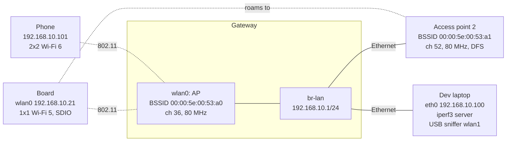

| Device | Interface | MAC / BSSID | Settings |
|---|---|---|---|
| Gateway AP | `wlan0` in `br-lan` | `00:00:5e:00:53:a0` | SSID `Home`, 5 GHz channel 36 at 80 MHz (center 42), WPA2/WPA3 transition mode, country `FR` |
| Access point 2 | its own radio, wired to `br-lan` | `00:00:5e:00:53:a1` | Same SSID and passphrase, channel 52 at 80 MHz (DFS). Used for roaming examples |
| Board | `wlan0` | `00:00:5e:00:53:15` | SDIO Wi-Fi 5 + Bluetooth combo module, 1 spatial stream, `192.168.10.21` (static DHCP lease) |
| Phone | | `00:00:5e:00:53:65` | 2x2 Wi-Fi 6 client, `192.168.10.101` |
| Dev laptop | `eth0` (wired), `wlan1` (USB adapter, `phy1`) | `00:00:5e:00:53:64` | `192.168.10.100`: iperf3 server, Wireshark, and a monitor-mode sniffer on `wlan1` (section 17) |

The MACs come from the documentation block `00:00:5e:00:53:xx` (RFC 7042). The SSID, passphrases and addresses are placeholders.

---

## 3. Generations, amendments and certifications

The **IEEE** writes 802.11 and its amendments. The **Wi-Fi Alliance** certifies interoperability, owns the marketing names, and decides which optional features a certification requires: for example, WPA3 support is required for Wi-Fi 6 certification, and PMF with beacon protection for Wi-Fi 7. A feature can therefore be **in the standard** (IEEE), **mandatory for a certification** (Wi-Fi Alliance), or **vendor-specific**. Linux and hostapd use the IEEE PHY names (HT, VHT, HE, EHT).

| Name | IEEE | PHY | Standard / first certification | Bands (GHz) | Max width | Top modulation | Max streams (spec) | Peak PHY rate |
|---|---|---|---|---|---|---|---|---|
| - | 802.11b | DSSS/CCK | 1999 | 2.4 | 22 MHz | CCK | 1 | 11 Mb/s |
| - | 802.11a | OFDM | 1999 | 5 | 20 MHz | 64-QAM | 1 | 54 Mb/s |
| - | 802.11g | ERP-OFDM | 2003 | 2.4 | 20 MHz | 64-QAM | 1 | 54 Mb/s |
| Wi-Fi 4 | 802.11n | HT | 2009 | 2.4, 5 | 40 MHz | 64-QAM | 4 | 600 Mb/s |
| Wi-Fi 5 | 802.11ac | VHT | 2013 | 5 | 160 MHz | 256-QAM | 8 | 6.9 Gb/s |
| Wi-Fi 6 | 802.11ax | HE | 802.11ax-2021 / 2019 | 2.4, 5 | 160 MHz | 1024-QAM | 8 | 9.6 Gb/s |
| Wi-Fi 6E | 802.11ax | HE | / 2020 | + 6 | 160 MHz | 1024-QAM | 8 | 9.6 Gb/s |
| Wi-Fi 7 | 802.11be | EHT | 802.11be-2024 / 2024 | 2.4, 5, 6 | 320 MHz (6 GHz only) | 4096-QAM | 16 | 46 Gb/s |
| Wi-Fi 8 | 802.11bn | UHR | in development | 2.4, 5, 6 | 320 MHz | 4096-QAM | | Targets reliability and latency, not peak rate |

Peak rates assume the maximum streams and width, which no real device has. Phones and laptops are typically 2x2, embedded modules 1x1 or 2x2, and APs 2x2 to 4x4 per band. A 1x1 Wi-Fi 5 module at 80 MHz tops out at 433 Mb/s on the air (section 5). Some Wi-Fi 5 chips also offered 1024-QAM as a **vendor extension**; it is only standard from Wi-Fi 6.

**What each generation brought:**
- **Wi-Fi 4 (HT):** MIMO (several spatial streams), 40 MHz channels, frame aggregation with Block Ack, short guard interval. HT requires QoS (WMM): without WMM, no HT rates.
- **Wi-Fi 5 (VHT):** 80 and 160 MHz, 256-QAM, explicit beamforming, downlink MU-MIMO. 5 GHz only.
- **Wi-Fi 6 (HE):** OFDMA in both directions, 1024-QAM, 4x longer OFDM symbols, uplink MU-MIMO, target wake time (TWT), BSS coloring and spatial reuse. Better with many clients, not only faster. 6E adds the 6 GHz band.
- **Wi-Fi 7 (EHT):** 320 MHz, 4096-QAM, multi-link operation (MLO), preamble puncturing, multiple resource units per client, 16 streams in the spec.

**Amendments you meet in configs and logs** (merged into periodic revisions such as 802.11-2020 and 802.11-2024, but everyone still uses the letters):

| Amendment | What it adds | Where you see it |
|---|---|---|
| 802.11d | Country information in beacons | hostapd `ieee80211d=1` |
| 802.11e | QoS: access categories, EDCA, Block Ack (certified as WMM) | `wmm_enabled=1`, section 6 |
| 802.11h | DFS and transmit power control in 5 GHz | `ieee80211h=1`, section 4 |
| 802.11i | RSN: WPA2, CCMP, 4-way handshake | `wpa=2`, section 9 |
| 802.11k | Radio measurements, neighbor reports | `rrm_neighbor_report=1`, section 10 |
| 802.11r | Fast BSS transition (FT) | `mobility_domain=`, `FT-PSK`, section 10 |
| 802.11s | Mesh networking | `iw ... mesh join`, section 11 |
| 802.11u | Interworking: GAS/ANQP pre-association queries (base of Passpoint) | `interworking=1`, section 11 |
| 802.11v | Network management: BSS transition management, WNM sleep | `bss_transition=1`, section 10 |
| 802.11w | Protected management frames (PMF) | `ieee80211w=`, section 9 |
| 802.11z | Tunneled direct link setup (TDLS) | `tdls_prohibit`, section 11 |
| 802.11ai | Fast initial link setup (FILS) | Rare outside enterprise |
| 802.11mc, 802.11az | Fine timing measurement (ranging, positioning) | Not covered here |
| 802.11ad, 802.11ay | 60 GHz | Niche |
| 802.11ah | Sub-1 GHz long range low power ("Wi-Fi HaLow") | Separate chips, mostly out-of-tree drivers |

**Wi-Fi Alliance programs** with no single IEEE letter: WMM, WPA3, Enhanced Open (OWE), Wi-Fi Easy Connect (DPP), Passpoint, Wi-Fi Direct, Wi-Fi Aware, EasyMesh, Wi-Fi Agile Multiband (MBO: steering and channel preferences). They define how standard features must be combined and tested.

**Backward compatibility:** a Wi-Fi 6 AP still serves an 802.11g client, but the old client uses more airtime, and 802.11b clients force protection mechanisms that cost everyone airtime (section 6).

---

## 4. Bands, channels and regulatory rules

Regulatory numbers below are **normative for the country cited, at the time of writing**. Rules differ per country and change: the device's regulatory database (section 12) and your certification lab are the references for a product.

### 2.4 GHz

2400 to 2483.5 MHz. Channel *n* (1 to 13) is centered at 2407 + 5*n* MHz; channel 14 (2484 MHz) is 802.11b-only, in Japan. Channels are 5 MHz apart while a transmission is about 20 MHz wide.

| Channel | 1 | 6 | 11 | 13 |
|---|---|---|---|---|
| Center (MHz) | 2412 | 2437 | 2462 | 2472 |
| Allowed | Everywhere | Everywhere | Everywhere | EU and most countries. US: 12 and 13 are legal at reduced power but rarely enabled |

- Use **1, 6, 11** at 20 MHz (1, 5, 9, 13 is also possible in the EU for OFDM-only networks). A 40 MHz channel takes most of the band, and APs must fall back to 20 MHz when they detect overlapping networks (20/40 coexistence).
- Shared with Bluetooth, Zigbee/Thread, microwave ovens and every neighbor. Use it for range, wall penetration and 2.4 GHz-only IoT devices.

### 5 GHz

Channel *n* is centered at 5000 + 5*n* MHz. Channels are numbered every 4 (20 MHz apart) and don't overlap.

| Sub-band | 20 MHz channels | MHz | EU (2005/513/EC as amended) | US (47 CFR 15.407) |
|---|---|---|---|---|
| U-NII-1 | 36-48 | 5150-5250 | Indoor, 23 dBm (200 mW) EIRP. Also allowed inside road vehicles | Indoor and outdoor, no DFS |
| U-NII-2A | 52-64 | 5250-5350 | Indoor, 23 dBm EIRP with TPC (20 dBm without), DFS. Not in road vehicles | DFS |
| U-NII-2C | 100-144 | 5470-5725 | Indoor and outdoor, 30 dBm (1 W) EIRP with TPC (27 dBm without), DFS, up to channel 140 | DFS |
| U-NII-3 | 149-165 | 5725-5850 | Not harmonized for Wi-Fi: low-power (25 mW) use allowed in many countries | No DFS, high power allowed |
| U-NII-4 | 169-177 | 5850-5925 | Intelligent transport systems (ITS), not Wi-Fi | 5850-5895 MHz: indoor access points only, 36 dBm EIRP max |

**Channel bonding:** wider channels combine adjacent 20 MHz channels. One of them is the **primary** channel: beacons, management frames and legacy clients use it, and the medium is sensed there first (section 6). The others are secondary and used only when free. Configurations name the block by its **center channel index**:

| Width | Channels | Center index |
|---|---|---|
| 40 MHz | 36+40, 44+48, 52+56, ... | 38, 46, 54, ... |
| 80 MHz | 36-48 / 52-64 / 100-112 / 116-128 / 132-144 / 149-161 | 42 / 58 / 106 / 122 / 138 / 155 |
| 160 MHz | 36-64 / 100-128 / 149-177 (US) | 50 / 114 / 163 |

In the EU that leaves 19 channels of 20 MHz (36-64, 100-140), four of 80 MHz and two of 160 MHz. `HT40+` means the secondary channel is above the primary (36+40), `HT40-` below (40+36).

**Preamble puncturing (Wi-Fi 7):** an EHT AP can leave out ("puncture") a busy 20 MHz subchannel inside an 80, 160 or 320 MHz channel instead of falling back to a narrower width. The AP advertises statically punctured subchannels in its EHT Operation element (hostapd `punct_bitmap`); EHT clients transmit around them. Wi-Fi 6 only allowed puncturing in some multi-user transmissions. Pre-EHT clients still see only the primary 20/40/80 MHz.

**DFS (dynamic frequency selection):** U-NII-2 channels are shared with radars. An AP on a DFS channel must:
1. Listen for radar during the **channel availability check** (CAC) before transmitting: 60 s, or 10 minutes on 5600-5650 MHz (channels 120-128) in the EU (weather radars).
2. Keep listening while operating. On a detection, stop transmitting within 10 s, announce a channel switch (CSA) to its clients, and stay off the channel for 30 minutes (non-occupancy period).

Consequences: the SSID appears a minute (or ten) after the AP starts; clients may be moved or dropped on a radar hit; clients can't probe on a DFS channel until they hear the AP's beacons (section 8). Some APs run the CAC on a dedicated detection chain in the background ("zero-wait DFS" or background CAC, supported by hostapd with some drivers). Clients only need to follow the AP, but an AP needs DFS support in its driver, firmware and certification, which most client chips don't have: it's why so many Linux cards can't start an AP on most 5 GHz channels (`no IR` in `iw list`).

### 6 GHz

Channel *n* is centered at 5950 + 5*n* MHz, with 20 MHz channels at *n* = 1, 5, 9 ... 233. Channel 2 (5935 MHz) is a special 20 MHz channel at the bottom edge.

| | EU (2021/1067 as amended) | US (47 CFR 15.407) |
|---|---|---|
| Range | 5945-6425 MHz. The upper part (6425-7125 MHz) isn't open to Wi-Fi; its use is still being decided | 5925-7125 MHz |
| Channels (20 / 80 / 160 / 320 MHz) | 24 / 6 / 3 / 1 | 59 / 14 / 7 / 3 |
| Low power indoor (LPI) | 23 dBm EIRP, 10 dBm/MHz. Indoors only (buildings, trains with metal-coated windows, aircraft); not in road vehicles | AP 5 dBm/MHz, 30 dBm max; client -1 dBm/MHz, 24 dBm max. Indoors only; prohibited in cars, trains, boats and aircraft (except large aircraft above 10,000 ft, lower part of the band) |
| Very low power (VLP) | 14 dBm EIRP, 1 dBm/MHz, indoor and outdoor | 14 dBm EIRP, -5 dBm/MHz, whole band, indoor and outdoor including vehicles; not on fixed outdoor infrastructure |
| Standard power (SP) | Not allowed | U-NII-5 and U-NII-7 only: 36 dBm, 23 dBm/MHz, under AFC (automated frequency coordination: a database authorizes frequencies and power at the AP's location) |

Rules that differ from 2.4 and 5 GHz:
- **HE/EHT only:** no Wi-Fi 4 or 5 clients, no 802.11b rates.
- **Security:** WPA3-Personal (SAE with hash-to-element only), WPA3-Enterprise, or Enhanced Open (OWE), always with PMF. No WPA2, no open networks (section 9).
- **Discovery:** with up to 59 channels, clients don't probe everywhere. They learn about 6 GHz APs from a **reduced neighbor report** (RNR) in the beacons of the same AP's 2.4/5 GHz radios, or scan the 15 **preferred scanning channels** (PSC: 5, 21, 37, 53, ... every 16 channels up to 229; channels 5 to 85 in the EU). Put a 6 GHz AP's primary channel on a PSC. 6 GHz APs can also send FILS discovery frames or unsolicited broadcast probe responses between beacons.
- **Client power follows the AP:** the AP advertises its power type (LPI, SP, VLP) and a Transmit Power Envelope element; clients limit their power accordingly.
- LPI power density is low: a 6 GHz AP has less range than the same AP on 5 GHz, more so through walls.

### Which band for what

| Band | Strengths | Weaknesses | Use for |
|---|---|---|---|
| 2.4 GHz | Range, walls, every device supports it | 3 usable channels, crowded, 20 MHz in practice | IoT, far rooms, low data rates |
| 5 GHz | Many channels, 80/160 MHz | Less range, DFS complications | Default for anything that can |
| 6 GHz | Clean spectrum, wide channels, only modern devices | Shortest range, WPA3/OWE only, newer chips and drivers | High throughput, low latency in the same room |

### Vehicles and other special cases

Products used in cars (head units acting as AP for phone projection, telematics units, rear-seat entertainment) meet the strictest rules, per country:

| Band | EU | US |
|---|---|---|
| 2.4 GHz | Allowed | Allowed |
| 5150-5250 MHz | Allowed inside road vehicles (2022/179) | Allowed |
| 5250-5350 MHz | Not in road vehicles (DFS band) | Allowed with DFS |
| 6 GHz | LPI not in road vehicles; VLP allowed | LPI prohibited in vehicles; VLP allowed |
| 5855-5925 MHz | ITS (V2X): a neighbor to protect, not usable for Wi-Fi | 5895-5925 MHz is C-V2X; U-NII-4 limited to indoor APs |

A vehicle AP that must start fast should avoid DFS channels (CAC delay, radar moves). Check every target country: these EU and US rules aren't universal, and they change.

### Regulatory domains

- **Country setting:** an AP is configured with a country (`country_code=FR` in hostapd) and advertises it in its beacons (802.11d). Clients may use it as a hint.
- **On Linux:** cfg80211 enforces the active regulatory domain, built from the `wireless-regdb` database, driver or firmware rules, and hints (user setting, AP country element). The default world domain `00` is the most restrictive: passive scanning only on many channels, no AP on most 5 GHz channels. Section 12 has the details.
- **In the chip:** vendors also lock power tables in firmware, calibration or board data (section 18). A product ships with fixed regulatory data matching its certification.

```bash
iw reg get              # active rules: frequency ranges, max width, max EIRP, flags (global and per wiphy)
sudo iw reg set FR      # a user hint: driver and firmware rules can still restrict it
iw list | grep -A 40 Frequencies   # per channel: max dBm, disabled, no IR, radar detection
```

Flags in `iw reg get` and `iw list`: `NO-IR` (no initiating radiation: no AP, no active scan), `DFS` / `radar detection`, `NO-OUTDOOR`, `AUTO-BW` (adjacent rules can be combined into a wider channel), `disabled`.

---

## 5. The radio link: OFDM, MCS, MIMO, OFDMA and signal levels

### OFDM

Since 802.11a/g, Wi-Fi uses **OFDM**: the channel is split into many narrow subcarriers, each carrying one modulated symbol at a time. Most subcarriers carry data, some are pilots (phase tracking), and some are left empty (DC and band edges). Between symbols, a **guard interval** (GI) absorbs echoes from reflections (multipath).

| PHY | Subcarrier spacing | Symbol without GI | Guard interval | Data subcarriers at 20 / 40 / 80 / 160 / 320 MHz |
|---|---|---|---|---|
| 802.11a/g | 312.5 kHz | 3.2 µs | 0.8 µs | 48 / - / - / - / - |
| HT (Wi-Fi 4) | 312.5 kHz | 3.2 µs | 0.8 or 0.4 µs (short GI) | 52 / 108 / - / - / - |
| VHT (Wi-Fi 5) | 312.5 kHz | 3.2 µs | 0.8 or 0.4 µs | 52 / 108 / 234 / 468 / - |
| HE (Wi-Fi 6) | 78.125 kHz | 12.8 µs | 0.8, 1.6 or 3.2 µs | 234 / 468 / 980 / 1960 / - |
| EHT (Wi-Fi 7) | 78.125 kHz | 12.8 µs | 0.8, 1.6 or 3.2 µs | 234 / 468 / 980 / 1960 / 3920 |

Wi-Fi 6 made symbols four times longer: the guard interval is a smaller share of the time, and long GIs help outdoors, where echoes are long.

### MCS: modulation and coding

The **MCS** (modulation and coding scheme) index sets how many bits each subcarrier carries per symbol (modulation) and how much of them is error correction (coding rate). Higher MCS needs a cleaner signal. VHT, HE and EHT share this table:

| MCS | Modulation | Bits per subcarrier | Coding rate | SNR needed (rule of thumb) |
|---|---|---|---|---|
| 0 | BPSK | 1 | 1/2 | 5 dB |
| 1 | QPSK | 2 | 1/2 | 8 dB |
| 2 | QPSK | 2 | 3/4 | 11 dB |
| 3 | 16-QAM | 4 | 1/2 | 14 dB |
| 4 | 16-QAM | 4 | 3/4 | 17 dB |
| 5 | 64-QAM | 6 | 2/3 | 21 dB |
| 6 | 64-QAM | 6 | 3/4 | 23 dB |
| 7 | 64-QAM | 6 | 5/6 | 25 dB |
| 8 | 256-QAM | 8 | 3/4 | 29 dB |
| 9 | 256-QAM | 8 | 5/6 | 31 dB |
| 10 | 1024-QAM (HE) | 10 | 3/4 | 34 dB |
| 11 | 1024-QAM (HE) | 10 | 5/6 | 37 dB |
| 12 | 4096-QAM (EHT) | 12 | 3/4 | 40 dB |
| 13 | 4096-QAM (EHT) | 12 | 5/6 | 43 dB |

- The SNR column is **not normative**: the standard only specifies minimum receiver sensitivities, and real thresholds depend on the chip (its datasheet gives sensitivity per MCS and width), the channel and the error rate you accept.
- **HT** (Wi-Fi 4) numbers MCS 0 to 31 and folds the stream count into the index: HT MCS 15 is MCS 7 on two streams. VHT and later give MCS and NSS (number of spatial streams) separately: `VHT-MCS 9 VHT-NSS 2`.
- VHT MCS 9 isn't valid at 20 MHz for most stream counts (the bits don't divide evenly).
- For range, HE adds dual carrier modulation (DCM, the same data on two subcarriers) and EHT adds MCS 14 and 15 (duplicated, very robust modes).

### PHY rate

```
PHY rate = data subcarriers × bits per subcarrier × coding rate × spatial streams / (symbol + GI)
```

Worked example, the board's 1x1 Wi-Fi 5 module at 80 MHz, MCS 9, short GI:
234 × 8 × 5/6 × 1 / (3.2 + 0.4) µs = 1560 bits / 3.6 µs = **433.3 Mb/s**.

The same at Wi-Fi 6 MCS 11, 0.8 µs GI: 980 × 10 × 5/6 / 13.6 µs = **600.5 Mb/s** per stream.

| PHY | Width | MCS | GI | 1 stream | 2 streams |
|---|---|---|---|---|---|
| HT | 20 MHz | 7 | 0.4 µs | 72.2 | 144.4 |
| HT | 40 MHz | 7 | 0.4 µs | 150 | 300 |
| VHT | 80 MHz | 9 | 0.4 µs | 433.3 | 866.7 |
| VHT | 160 MHz | 9 | 0.4 µs | 866.7 | 1733.3 |
| HE | 20 MHz | 11 | 0.8 µs | 143.4 | 286.8 |
| HE | 80 MHz | 11 | 0.8 µs | 600.5 | 1201 |
| HE | 160 MHz | 11 | 0.8 µs | 1201 | 2402 |
| EHT | 320 MHz | 13 | 0.8 µs | 2882 | 5765 |

Rates in Mb/s. These are **PHY rates**: the bit rate during the data part of one transmission. They exclude preambles, waiting, acknowledgments, retries and sharing. Application throughput is much lower (section 6 explains why, section 19 gives measured ranges).

### MIMO and beamforming

- **Chains and streams:** `2x2:2` means 2 transmit chains, 2 receive chains, 2 spatial streams. A link carries at most min(AP streams, client streams).
- **Spatial multiplexing:** several streams on the same channel at the same time, separated by the receiver thanks to multipath. Needs a good SNR; at long range, the chip uses the extra antennas for diversity instead (STBC, maximum ratio combining): fewer streams, more range.
- **Beamforming (Wi-Fi 5+):** the AP sounds the channel (NDP announcement, null data packet, compressed feedback from the client) and steers its transmission toward the client. A few dB of gain, mostly at medium range. Sounding costs airtime.
- **MU-MIMO:** the AP sends different streams to different clients at once (downlink since Wi-Fi 5, uplink in Wi-Fi 6). It needs fresh sounding and spatially separated clients; real-world gains are often small.

### OFDMA, resource units and trigger-based uplink

OFDMA (Wi-Fi 6+) lets the AP split one transmission into **resource units** (RUs) for different clients:

| RU size (subcarriers) | 26 | 52 | 106 | 242 | 484 | 996 | 2×996 | 4×996 |
|---|---|---|---|---|---|---|---|---|
| About | 2 MHz | 4 MHz | 8 MHz | 20 MHz | 40 MHz | 80 MHz | 160 MHz | 320 MHz (EHT) |

Up to 9 clients share a 20 MHz channel with 26-tone RUs (37 in 80 MHz). Wi-Fi 7 adds **multiple RUs** (MRU) per client, such as 484+242 tones, which pairs well with puncturing.

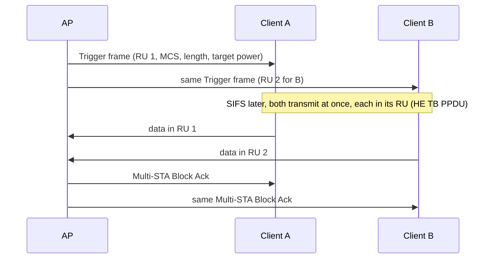

- **Downlink OFDMA** is just the AP scheduling several clients in one transmission.
- **Uplink OFDMA** is **trigger-based**: clients report their queued data (buffer status reports), the AP's **Trigger frame** assigns RUs, MCS, duration and target receive power, and clients answer simultaneously after SIFS. It needs tight timing, frequency and power control on the clients.
- **Benefits:** many small packets (IoT, VoIP, TCP ACKs) with less contention and lower latency. **Limits:** no gain for one client's peak rate; the gain depends entirely on the AP's scheduler, which is vendor firmware. Many APs enable uplink OFDMA only in some modes. On Linux, it is decided by the AP driver and firmware, not by hostapd.

### Signal levels

Power is given in **dBm**: decibels relative to 1 mW. +3 dB doubles the power, +10 dB multiplies it by 10.

| dBm | 30 | 20 | 14 | 10 | 0 | -30 | -60 | -90 |
|---|---|---|---|---|---|---|---|---|
| Power | 1 W | 100 mW | 25 mW | 10 mW | 1 mW | 1 µW | 1 nW | 1 pW |

**EIRP** = transmit power + antenna gain (dBi) - cable losses. Regulatory limits apply to EIRP (or power density), so a higher-gain antenna means less conducted power is allowed. `iw` shows transmit power in dBm and sets it in mBm (100 × dBm).

| Received signal | What to expect (rule of thumb, with a normal noise floor) |
|---|---|
| -30 to -50 dBm | Top MCS if the channel is clean |
| -50 to -67 dBm | Good. -67 dBm is a common design target in vendor guides for voice and video |
| -67 to -75 dBm | Usable for data, lower MCS, more retries |
| -75 to -85 dBm | Unreliable: frequent rate drops and disconnects |
| below -85 dBm | Near the noise |

**RSSI caveats:** reported values depend on the chip's calibration, may be per chain or combined, and are averaged differently by each driver. Compare values from the same chip, not between devices.

**Noise and SNR:** thermal noise in 20 MHz is about -101 dBm; with the receiver's noise figure, chips typically report a floor around -95 to -90 dBm. Doubling the channel width adds 3 dB of noise (about -89 dBm at 80 MHz). **SNR** = signal - noise, and interference counts as noise: -60 dBm next to a busy neighbor network can be worse than -70 dBm in a quiet place.

**Free-space path loss:** FSPL (dB) = 20 log10(d in m) + 20 log10(f in MHz) - 27.55. At 1 m: 40 dB at 2.4 GHz, 47 dB at 5.5 GHz. Each doubling of distance adds 6 dB. Walls add more: roughly 3-5 dB for drywall, 6-12 dB for brick, 10-20+ dB for concrete, more for metal and coated glass, and more at 5/6 GHz than at 2.4 GHz (rule of thumb).

**Link budget example** (the board, 10 m from the gateway AP, 2 walls, channel 36):

| Item | Value |
|---|---|
| AP transmit power | +20 dBm |
| AP antenna gain | +3 dBi |
| Free-space path loss, 10 m at 5180 MHz | -66.7 dB |
| Two brick walls (estimate) | -15 dB |
| Board antenna gain | +2 dBi |
| **Received signal at the board** | **-56.7 dBm** |
| Noise floor at 80 MHz | about -89 dBm |
| **SNR** | **about 32 dB: MCS 8-9 is plausible** |

The link is **asymmetric**: the board probably transmits at 15 dBm or less, so the AP hears it 5 dB weaker than the board hears the AP. Uplink problems (retries, low TX rate on the board) often come from this.

---

## 6. Sharing the air: medium access, QoS, aggregation and spatial reuse

### CSMA/CA

A radio can't hear a collision while it transmits, so 802.11 avoids collisions instead (carrier sense multiple access with collision avoidance):

1. **Listen** (clear channel assessment, CCA): the primary 20 MHz channel is busy if the radio detects a Wi-Fi preamble at or above -82 dBm, or any energy above about -62 dBm. Secondary channels use other thresholds.
2. **Wait** a fixed time once the channel is free (DIFS, or AIFS for QoS traffic).
3. **Back off** a random number of slots between 0 and CW (contention window). The countdown pauses while the channel is busy.
4. **Transmit**, then expect an **ACK** (or Block Ack) a SIFS after the frame.
5. **No ACK:** assume a collision or corruption, double CW (up to CWmax) and retry, usually at a lower rate chosen by rate control, up to a retry limit (dot11 defaults: 7 short, 4 long). Then drop the frame.

| Timing (OFDM) | 2.4 GHz | 5/6 GHz |
|---|---|---|
| Slot | 9 µs (20 µs with 802.11b stations) | 9 µs |
| SIFS | 10 µs | 16 µs |
| DIFS = SIFS + 2 slots | 28 µs | 34 µs |

Every frame also carries a **duration** field: stations that decode it set their **NAV** (network allocation vector) and stay quiet until the exchange ends, even if they can't hear the other side.

### Hidden nodes and RTS/CTS

```
   Client A  ───────►  AP  ◄───────  Client B
        A and B can't hear each other (walls, distance)
```

A and B both sense a free channel and transmit together: the AP receives garbage. With **RTS/CTS**, a station first sends a short request-to-send; the AP answers clear-to-send, which B hears, and B's NAV keeps it quiet. It costs airtime, so it's used above a size threshold (`iw phy phy0 set rts <bytes|off>`, driver-dependent) or automatically by rate control. **CTS-to-self** is a protection mechanism that keeps legacy (802.11b) stations, which can't decode OFDM, quiet.

### QoS: WMM access categories

802.11e (certified as **WMM**) gives each frame one of four access categories. Higher categories wait less and back off less, so they win the medium more often. QoS is mandatory for HT and later rates: an AP with `wmm_enabled=0` limits clients to legacy rates.

| Access category | 802.1D user priority | AIFSN | CWmin | CWmax | TXOP limit |
|---|---|---|---|---|---|
| AC_VO (voice) | 6, 7 | 2 | 3 | 7 | 1.504 ms |
| AC_VI (video) | 4, 5 | 2 | 7 | 15 | 3.008 ms |
| AC_BE (best effort) | 0, 3 | 3 | 15 | 1023 | one frame exchange |
| AC_BK (background) | 1, 2 | 7 | 15 | 1023 | one frame exchange |

These are the default client parameters the AP advertises (hostapd `wmm_ac_*`); the AP's own parameters are a bit more aggressive (`tx_queue_data*`). AIFS = SIFS + AIFSN × slot. Wi-Fi 6 adds **MU EDCA** parameters: clients that are being served by uplink OFDMA triggers contend less aggressively on their own.

**How Linux picks the category:** mac80211 calls `cfg80211_classify8021d()`, which maps the packet's DSCP to a user priority (mostly its top 3 bits, with RFC 8325 adjustments in recent kernels). An application can force a priority with `SO_PRIORITY` set to 256 + UP (256 to 263). An AP can push a DSCP mapping to its clients (QoS Map, hostapd `qos_map_set`). Most applications send DSCP 0, so most traffic is best effort.

### Unicast vs multicast

| | Unicast | Broadcast, multicast |
|---|---|---|
| Acknowledged | Yes, retried | No: a lost frame is just lost |
| Rate | Chosen per client by rate control | A basic rate (often 1 or 6 Mb/s) so that every client can decode it |
| Power save | Delivered when the client wakes | Held until the next DTIM beacon (section 10) |

A 2 Mb/s multicast stream sent at 6 Mb/s takes a third of the channel's airtime; mDNS, SSDP and IPv6 neighbor discovery chatter costs the same way. Remedies:
- **Multicast-to-unicast** on the AP: hostapd `multicast_to_unicast=1` converts ARP, IPv4 and IPv6 multicast into one unicast frame per client (acknowledged, at each client's rate). It can break receivers that rely on the frame being multicast, and costs airtime when there are many clients.
- **Raise the basic rates**: drop 802.11b rates with hostapd `basic_rates=60 120 240` and `supported_rates=60 90 120 180 240 360 480 540` (units of 100 kb/s).
- **Proxy ARP/ND** on the AP (`proxy_arp=1`, with a bridge): the AP answers for its clients so that broadcasts don't wake them.

### Aggregation and Block Ack

Every transmission pays a fixed cost: AIFS, backoff, a preamble of tens of µs, SIFS and the acknowledgment, about 200 µs in total for best effort (illustrative). At high rates the payload is tiny in comparison: a 1500-byte frame lasts 10 µs at 1201 Mb/s. Aggregation sends many frames per transmission:

| | A-MSDU | A-MPDU |
|---|---|---|
| What is aggregated | Several packets inside one MPDU (one 802.11 header, one FCS) | Several MPDUs in one PPDU (one PHY transmission) |
| One bit error | Loses the whole A-MSDU | Loses only that MPDU |
| Acknowledgment | One ACK (or one Block Ack bit) | Block Ack: a bitmap of received MPDUs, only the missing ones are resent |
| Limits | 3839 or 7935 B (HT); MPDU up to 11454 B (VHT/HE) | Block Ack window of 64 (HT/VHT), 256 (HE), 1024 (EHT) MPDUs; about 5.5 ms per PPDU |

The two combine (A-MSDUs inside an A-MPDU). With 64 aggregated frames, the same overhead is shared by about 640 µs of payload: roughly 75% efficiency instead of 5%. Aggregation needs a queue of packets for the same client and TID (traffic identifier): it works for bulk transfers, not for a single ping. A Block Ack agreement is set up per client and TID with ADDBA action frames.

### Rate control

The transmitter chooses MCS, streams, width and GI for each transmission from recent success statistics, often with a chain of fallback rates for the retries. mac80211 has **Minstrel-HT** for drivers that leave rate control to the host; most modern chips (iwlwifi, ath10k and later, mt76 Wi-Fi 6+ chips, all FullMAC chips) run their own algorithm in firmware. `tx bitrate` in `iw dev wlan0 station dump` is the rate the driver last reported (section 19).

### Airtime, slow clients and real throughput

The same 1 MB costs very different airtime depending on the rate (payload time only, overhead excluded):

| Rate | Airtime for 1 MB |
|---|---|
| 6.5 Mb/s (HT MCS 0, 20 MHz: a far client) | 1.23 s |
| 72.2 Mb/s (HT MCS 7, 20 MHz) | 111 ms |
| 433.3 Mb/s (VHT MCS 9, 80 MHz, 1 stream: the board) | 18.5 ms |
| 1201 Mb/s (HE MCS 11, 80 MHz, 2 streams: the phone) | 6.7 ms |

Without airtime fairness, every client gets a similar chance to transmit, so a far client at MCS 0 can take most of the channel's time. mac80211 has an **airtime fairness** scheduler for drivers that support it, and many AP firmwares have their own.

**Why application throughput is far below the PHY rate:**
- Half duplex: TCP data and TCP ACKs compete for the same channel.
- Fixed per-transmission overhead, reduced but not removed by aggregation.
- Retries, and rate control using lower MCS than the best one.
- Contention with every network on the channel, including neighbors.
- Airtime shared with slower clients.

Rule of thumb: a single TCP flow close to the AP gets **50 to 70% of the PHY rate**, shared among all clients of the channel. Section 19 has measured ranges and the method.

**Latency under load (Linux):** mac80211 queues packets per client and TID with fq_codel (intermediate TX queues), and AQL (airtime queue limits, kernel 5.5) caps how much airtime sits in the driver and firmware. With drivers that support them, latency stays low during bulk transfers. Drivers that queue deep in firmware (many FullMAC and out-of-tree drivers) show bufferbloat instead.

### Spatial reuse and BSS coloring

Dense deployments waste airtime because a station defers to any frame above -82 dBm, even from a distant neighbor network. Wi-Fi 6 adds:

- **BSS color:** a 6-bit value (1-63) in the HE preamble identifying the BSS. A station knows within microseconds whether a frame is from its own BSS (intra-BSS) or another (OBSS). The AP changes color if it detects a neighbor using the same one (hostapd `he_bss_color`).
- **OBSS_PD spatial reuse:** for an OBSS frame received between -82 dBm and a higher **OBSS_PD** threshold (up to -62 dBm), a station may ignore it and transmit anyway, but must lower its transmit power for that opportunity. The AP advertises the allowed thresholds in a Spatial Reuse Parameter Set element (hostapd `he_spr_*`).
- **Limits:** gains depend on geometry and on firmware support (driver-dependent); the reduced power also lowers the MCS of the reused transmission. It helps apartment buildings and offices, not an isolated home.

---

## 7. 802.11 frames and addressing

### Frame format

The general MAC frame format. Which fields are present depends on the frame type and flags:

```
Octets:  2         2          6       6       6       2          6       2         4        0..n     4
      ┌─────────┬──────────┬───────┬───────┬───────┬──────────┬───────┬─────────┬─────────┬────────┬─────┐
      │ Frame   │ Duration │ Addr1 │ Addr2 │ Addr3 │ Sequence │ Addr4 │ QoS     │ HT      │ Frame  │ FCS │
      │ control │ / ID     │ (RA)  │ (TA)  │       │ control  │       │ control │ control │ body   │     │
      └─────────┴──────────┴───────┴───────┴───────┴──────────┴───────┴─────────┴─────────┴────────┴─────┘
Present: always   always     always  most    mgmt,   mgmt,      WDS/    QoS data  +HTC=1    variable always
                                     frames  data    data       mesh    frames
```

| Frame | Header | Example |
|---|---|---|
| Management | Frame control, Duration, Addr1-3, Sequence control (+ HT control) = 24 B | Beacon, authentication, association |
| Data, 3 addresses | 24 B; QoS data adds QoS control = 26 B | Client ↔ AP traffic |
| Data, 4 addresses | 30 B, or 32 B with QoS | WDS, mesh, 4-address mode |
| Control | Short formats: ACK and CTS = Frame control, Duration, RA, FCS (14 B in total); RTS adds TA (20 B) | ACK, RTS/CTS, Block Ack, Trigger |

- **Frame control** bits: protocol version, type, subtype, To DS, From DS, More Fragments, **Retry** (set on retransmissions), Power Management (the sender sleeps after this frame), More Data (more buffered frames follow), **Protected** (body encrypted), +HTC (an HT/VHT/HE control field is present; HE uses it to carry buffer status, operating mode changes and more).
- **Duration/ID:** time in µs to reserve the medium (the NAV), or the AID in PS-Poll frames.
- **Sequence control:** a 12-bit sequence number (per TID for QoS data) and a fragment number, used to drop duplicates when an ACK was lost and to reorder A-MPDUs.
- **Frame body:** a single MSDU carries up to 2304 B; an MPDU carrying an A-MSDU can reach 7991 or 11454 B with VHT/HE. Encryption adds a header and a MIC inside the body.

On the air, a 1500-byte IP packet in a CCMP-protected QoS data frame becomes: header 26 B + CCMP header 8 B + LLC/SNAP 8 B + 1500 B + MIC 8 B + FCS 4 B = **1554 B**, inside a PPDU that starts with the PHY preamble. GCMP-256 has a 16 B MIC.

### Frame types

| Type | Subtypes (value) | Wireshark filter |
|---|---|---|
| Management | Association request (0), response (1), reassociation request (2), response (3), probe request (4), probe response (5), beacon (8), disassociation (10), authentication (11), deauthentication (12), action (13), action no-ack (14) | `wlan.fc.type == 0`, beacons `wlan.fc.type_subtype == 0x08` |
| Control | Trigger (2), Block Ack request (8), Block Ack (9), PS-Poll (10), RTS (11), CTS (12), ACK (13) | `wlan.fc.type == 1` |
| Data | Data (0), null (4), QoS data (8), QoS null (12) | `wlan.fc.type == 2` |

Null and QoS null frames carry no data: clients send them to signal power save changes, and APs to poll idle clients. **Action frames** carry most newer features: Block Ack setup, channel switch, radio measurements (802.11k), BSS transition (802.11v), FT (802.11r), SA Query (PMF), GAS/ANQP (Passpoint), TDLS discovery. EAPOL handshake frames are ordinary data frames (EtherType 0x888e).

### The four address fields

To DS and From DS say which way a frame goes relative to the distribution system, and give the address fields their meaning. RA and TA are the receiver and transmitter of this hop; DA and SA the final destination and original source.

| To DS | From DS | Case | Addr1 | Addr2 | Addr3 | Addr4 |
|---|---|---|---|---|---|---|
| 0 | 0 | Management, control, IBSS, TDLS | DA | SA | BSSID | - |
| 1 | 0 | Client → AP | BSSID (RA) | SA (TA) | DA | - |
| 0 | 1 | AP → client | DA (RA) | BSSID (TA) | SA | - |
| 1 | 1 | AP ↔ AP: WDS, mesh, 4-address mode | RA | TA | DA | SA |

Example: the board pings the phone, both on the gateway AP. The frame crosses the air twice, with different addresses:

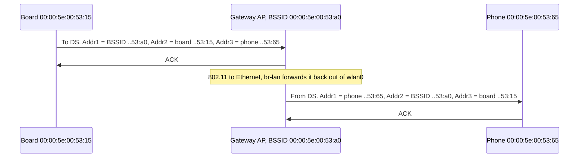

**802.11 to Ethernet:** the data body starts with an LLC/SNAP header (`aa aa 03 00 00 00` + EtherType). The AP, or the client's driver or firmware, replaces the 802.11 header and LLC/SNAP with an Ethernet header (DA, SA, EtherType). That's why `tcpdump -i wlan0` shows Ethernet frames without 802.11 headers (section 17).

### Why a station can't be bridged

A 3-address frame from a client has room for only one source address, and it must be the client's own MAC: the AP drops frames from MACs that aren't associated. So if the board bridges `eth0` and `wlan0` (station), frames from a PC behind `eth0` can't be sent with the PC's source MAC, and replies to the PC have no way back.

```
 PC 00:00:5e:00:53:77 ──eth0──► Board br0 ──wlan0 (station)──► AP
                                 3 addresses: Addr1 = BSSID, Addr2 = TA = must be the board 53:15,
                                 Addr3 = DA. No field left for SA = 53:77
```

Linux enforces it: `ip link set wlan0 master br0` on a managed interface fails with `Device does not allow enslaving to a bridge`, unless 4-address mode is on. Options:

| Approach | How | Limits |
|---|---|---|
| Route (and usually NAT) | Separate subnet behind the board, like any router ([gateway note](../../networking/gateway/gateway_v1_2026-10-26.md)) | Not one LAN: discovery protocols don't cross |
| 4-address mode (WDS) | `iw dev wlan0 set 4addr on` on the client, `wds_sta=1` on a hostapd AP | Both ends must support it; mostly Linux to Linux or one vendor |
| Pseudo-bridge (proxy ARP, relayd) | The board answers ARP for hosts behind it and routes | IPv4-centric, fragile with DHCP |
| MAC NAT | Rewrite source MACs to the board's (ebtables, vendor firmware) | Breaks protocols that care about MACs |
| 802.11s mesh | Mesh interfaces use 4 addresses natively (section 11) | All nodes must run the mesh |

---

## 8. Joining a network: scan, authenticate, associate, handshake

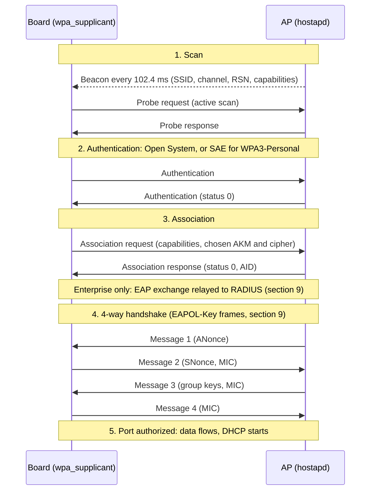

### 1. Scanning

| | Passive | Active |
|---|---|---|
| How | Listen for beacons on each channel | Send a probe request on each channel, collect probe responses |
| Time per channel | At least one beacon interval (about 100 ms) | Tens of ms |
| Used | DFS and `no IR` channels until an AP is heard there, 6 GHz channels without a known AP | Everywhere else |

A full scan of 2.4 and 5 GHz takes 1 to 3 seconds; adding 6 GHz takes longer. The client is off its channel during each dwell, so background scans add latency and loss to an active connection.

- **Beacon interval:** usually 100 TU (1 TU = 1024 µs), so 102.4 ms.
- **Hidden SSID:** the beacon carries an empty SSID and the AP only answers probes that name it. The client must probe for it by name (`scan_ssid=1`), which advertises the SSID wherever the client goes. No security benefit.
- **MAC randomization:** clients often probe with random MACs, and phones associate with a different random MAC per network. A MAC-based DHCP reservation or filter then sees a "new" device (wpa_supplicant settings in section 15).
- **Multiple BSSID (MBSSID):** an AP with several SSIDs on one radio can advertise them all in **one** beacon: the transmitted BSSID carries profiles of the others ("nontransmitted" BSSIDs, derived from it). It saves airtime and is the norm on 6 GHz. **EMA** (enhanced MBSSID advertisement) spreads the profiles over several beacons when there are many SSIDs. Clients that don't parse the Multiple BSSID element miss the nontransmitted SSIDs. hostapd: `mbssid=1` (MBSSID) or `2` (EMA), with driver support.

**What beacons and probe responses carry** (information elements, also used in association frames):

| Element (ID) | Content |
|---|---|
| SSID (0) | Network name |
| Supported rates (1), Extended supported rates (50) | Legacy rates; "basic" rates are mandatory for clients |
| DS parameter set (3) | Primary channel |
| TIM (5) | Which sleeping clients have buffered frames, DTIM counter (section 10) |
| Country (7) | Country code, channels and power (802.11d) |
| BSS Load (11) | Station count and channel utilization, if the AP advertises them |
| RSN (48), RSN Extension (244) | Security: AKMs, ciphers, PMF capable/required; RSNXE adds SAE hash-to-element and other extended capabilities |
| HT capabilities / operation (45 / 61) | Wi-Fi 4: streams, 40 MHz, secondary channel offset |
| Multiple BSSID (71) | Profiles of nontransmitted BSSIDs |
| VHT capabilities / operation (191 / 192) | Wi-Fi 5: 80/160 MHz, center channel |
| Transmit Power Envelope (195) | Maximum client transmit power (essential on 6 GHz) |
| HE capabilities / operation (255, extension 35 / 36) | Wi-Fi 6: BSS color, OFDMA, TWT; Spatial Reuse Parameter Set (extension 39), MU EDCA (extension 38) |
| EHT capabilities / operation, Multi-Link (255, extension 108 / 106 / 107) | Wi-Fi 7: 320 MHz, puncturing, MLO |
| Mobility domain (54) | 802.11r FT support |
| RM enabled capabilities (70), Extended capabilities (127) | 802.11k measurements, 802.11v BSS transition, TDLS prohibited, and more |
| Interworking (107), Advertisement protocol (108) | Passpoint/ANQP support (section 11) |
| Reduced neighbor report (201) | Co-located and neighbor APs, for example the 6 GHz radio |
| Vendor specific (221) | WMM parameters, WPS, Wi-Fi Direct, vendor extensions |

`iw dev wlan0 scan` decodes most of them; Wireshark shows all of them under "Tagged parameters".

**Choosing a BSS:** among BSSes with the wanted SSID and a compatible security configuration, the client prefers the best signal, with a bonus for 5/6 GHz and sometimes for lower load (BSS Load) or AP preferences (MBO). Each implementation weighs this differently; wpa_supplicant logs its choice at debug level.

### 2. Authentication

802.11 "authentication" is a step of the state machine, not necessarily real authentication:

| Method | Frames | Used with |
|---|---|---|
| Open System | 2, always succeeds | Open, OWE, WPA2-PSK, 802.1X (the real authentication comes later) |
| SAE | 4 (commit, commit, confirm, confirm) | WPA3-Personal: the password is verified here (section 9). Commit frames use status 126 when hash-to-element is in use |
| FT | 2, carrying key material | 802.11r roaming (section 10) |
| FILS | 2 | Fast initial link setup (rare) |
| Shared Key | 4 | WEP only, obsolete |

### 3. Association

The client sends its capabilities (rates, HT/VHT/HE/EHT, streams, power save) and the security suite it picked from the AP's RSN element (plus a Diffie-Hellman key for OWE, or a Multi-Link element for MLO). The AP replies with a **status code** (0 = success) and an **association ID** (AID), which identifies the client in the TIM. A **reassociation** is the same exchange when moving between APs of one ESS.

### 4. Handshake and port authorization

With WPA2/WPA3, the 802.1X "port" stays closed after association: only EAPOL frames pass. With Enterprise, the EAP exchange through the AP to the RADIUS server comes first. The 4-way handshake (section 9) then installs keys and the port opens (`authorized` in `iw dev wlan0 station dump`). Only then does the board start DHCP ([fundamentals note, section 8](../../networking/fundamentals/fundamentals_v1_2026-10-29.md#8-getting-an-address-dhcp-slaac-static)).

**State machine** (the AP accepts frames by class):

| State | Allowed frames |
|---|---|
| 1. Unauthenticated, unassociated | Probe, beacon, authentication (class 1) |
| 2. Authenticated, unassociated | + association (class 2) |
| 3. Associated | + data (class 3), only EAPOL while the port is closed |
| 4. Authorized | All data |

A frame from a wrong state gets a deauthentication with reason 6 or 7 (for example a client that kept sending after the AP rebooted).

**Typical timings** (rule of thumb): authentication and association take a few ms each, the 4-way handshake 10 to 50 ms, SAE more on slow CPUs, EAP 100 ms to seconds (RADIUS round trips, TLS), DHCP 10 ms to seconds. From a cached scan result, a WPA2-PSK client is usually connected in around 100 ms.

### What a successful connection looks like

wpa_supplicant (`journalctl -u wpa_supplicant@wlan0`, or `wpa_supplicant -d` in the foreground):

```
wlan0: SME: Trying to authenticate with 00:00:5e:00:53:a0 (SSID='Home' freq=5180 MHz)
wlan0: Trying to associate with 00:00:5e:00:53:a0 (SSID='Home' freq=5180 MHz)
wlan0: Associated with 00:00:5e:00:53:a0
wlan0: WPA: Key negotiation completed with 00:00:5e:00:53:a0 [PTK=CCMP GTK=CCMP]
wlan0: CTRL-EVENT-CONNECTED - Connection to 00:00:5e:00:53:a0 completed [id=0 id_str=]
```

The kernel (`dmesg`), for mac80211 drivers only (FullMAC drivers do this in firmware and print nothing, section 12):

```
wlan0: authenticate with 00:00:5e:00:53:a0
wlan0: send auth to 00:00:5e:00:53:a0 (try 1/3)
wlan0: authenticated
wlan0: associate with 00:00:5e:00:53:a0 (try 1/3)
wlan0: RX AssocResp from 00:00:5e:00:53:a0 (capab=0x1011 status=0 aid=2)
wlan0: associated
```

### Leaving the network

- **Deauthentication or disassociation frame** with a **reason code**, sent by either side.
- **Silently:** the client misses several beacons in a row (beacon loss) and declares the link lost; the AP removes a client after an inactivity timeout (hostapd `ap_max_inactivity`, 300 s by default, after polling it with null frames) or after too many unacknowledged frames (`disassoc_low_ack`, driver-dependent).

wpa_supplicant reports `CTRL-EVENT-DISCONNECTED bssid=... reason=N`, with `locally_generated=1` when the client itself decided to leave.

**Common reason codes** (why a connection ended):

| Reason | Meaning | Usual cause |
|---|---|---|
| 1 | Unspecified | Anything, often AP-side policy (band steering, load) |
| 2 | Previous authentication no longer valid | The AP lost the client's state, roaming issues |
| 3 | Station is leaving | Normal disconnect: `wpa_cli disconnect`, interface down, roam. With `locally_generated=1`, the client decided |
| 4 | Inactivity | The AP timed out an idle or unreachable client |
| 5 | AP can't handle all associated stations | AP full |
| 6, 7 | Class 2 / class 3 frame from a nonauthenticated / nonassociated station | State mismatch, e.g. after an AP restart |
| 8 | Station is leaving the BSS | Disassociation, typically before a roam |
| 14 | MIC failure | TKIP countermeasures, faulty driver |
| 15 | 4-way handshake timeout | **Wrong passphrase**, or EAPOL frames lost |
| 16 | Group key handshake timeout | Client asleep or out of range during a group rekey |
| 17 | Element in the 4-way handshake differs from (re)association | Driver/firmware bug, transition or override mismatches |
| 23 | 802.1X authentication failed | Enterprise: wrong credentials or certificate |
| 34 | Too many frames not acknowledged | Poor signal, client gone |

**Common status codes** (why an authentication or association was refused):

| Status | Meaning | Usual cause |
|---|---|---|
| 1 | Unspecified failure | AP policy, MAC filtering |
| 10 | Can't support all requested capabilities | Capability mismatch, often old clients on a new AP |
| 13 | Authentication algorithm not supported | SAE requested from a WPA2-only AP, or the reverse |
| 17 | AP can't handle more stations | AP full (`max_num_sta`) |
| 30 | Rejected temporarily, try later | PMF: the AP still has a protected association with this client and runs an SA Query first |
| 31 | Robust management frame policy violation | PMF required by one side and not supported by the other |
| 40, 41, 42, 43 | Invalid element / group cipher / pairwise cipher / AKM | Security configuration mismatch |
| 53 | Invalid PMKID | Stale PMKSA cache entry, usually recovers by itself |
| 77 | Finite cyclic group not supported | SAE group mismatch (`sae_groups`) |

---

## 9. Security: WPA2, WPA3, Enterprise and known attacks

### Modes

| Mode | Authentication | Encryption | Status |
|---|---|---|---|
| Open | None | None | Captive portals only; prefer OWE |
| WEP | Shared key | RC4 | Broken since 2001, removed from hostap's default build |
| WPA (TKIP) | PSK or 802.1X | RC4 with TKIP | Deprecated; HT and later rates aren't allowed with TKIP |
| WPA2 | PSK or 802.1X | AES-CCMP-128 | Still everywhere. PSK mode is open to offline guessing |
| WPA3-Personal | SAE | CCMP-128; GCMP-256 with SAE-EXT-KEY (Wi-Fi 7) | PMF required. Mandatory on 6 GHz |
| WPA3-Enterprise | 802.1X/EAP | CCMP-128, or GCMP-256 in 192-bit mode | PMF required |
| Enhanced Open (OWE) | None, but a Diffie-Hellman exchange at association | CCMP-128 (GCMP-256 for Wi-Fi 7) | Encrypted "open" networks |

**Personal vs Enterprise:** Personal uses one shared secret for everyone. Enterprise authenticates each user or device through 802.1X/EAP against a RADIUS server and gives each its own keys.

### Key hierarchy

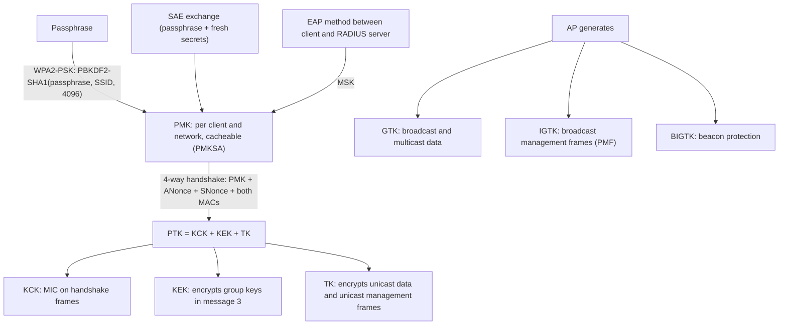

- The PMK comes from the passphrase (WPA2-PSK, same PMK forever), from a fresh SAE exchange (WPA3-Personal), or from the EAP session's MSK (Enterprise).
- Key derivation functions and key lengths depend on the AKM and cipher (SHA-1 for the original AKMs 1 and 2, SHA-256 or SHA-384 for newer ones); the structure stays the same.
- Group keys are shared by all clients of a BSS and rotated by the AP (group key handshake: 2 messages).
- 802.11r (FT) inserts two levels between PMK and PTK (PMK-R0, PMK-R1) so that each AP of a mobility domain holds its own key (section 10).

### The 4-way handshake

| Message | Direction | Content | What it achieves |
|---|---|---|---|
| 1 | AP → client | ANonce (optionally a PMKID) | The client can now derive the PTK |
| 2 | Client → AP | SNonce, the client's RSN element, MIC | The AP derives the PTK; a valid MIC proves the client knows the PMK |
| 3 | AP → client | AP's RSN element(s), GTK/IGTK/BIGTK encrypted with KEK, MIC | Proves the AP knows the PMK; the client checks the RSN element matches the beacon (downgrade protection) |
| 4 | Client → AP | MIC | Both sides install the keys, the port opens |

The handshake proves that both sides hold the same PMK. With PSK, it doesn't prove the AP is legitimate: anyone who knows the passphrase can run an AP that passes it.

**Wrong passphrase:** the client derives a different PMK, so the MIC of message 2 is wrong. The AP ignores message 2, resends message 1 a few times, then deauthenticates with reason 15. hostapd logs `AP-STA-POSSIBLE-PSK-MISMATCH <mac>`; wpa_supplicant logs `WPA: 4-Way Handshake failed - pre-shared key may be incorrect` and `CTRL-EVENT-SSID-TEMP-DISABLED ... reason=WRONG_KEY`, then waits longer and longer before retrying.

**WPA2-PSK weaknesses:**
- **Offline guessing:** anyone who captures messages 1 and 2 of one handshake (or just the PMKID some APs put in message 1) can test passphrases offline on a GPU. A passphrase is only as strong as its randomness: use 20+ random characters.
- **No forward secrecy:** anyone who knows the passphrase and captured a client's handshake can decrypt that client's traffic, including recorded traffic.

### SAE (WPA3-Personal)

SAE (simultaneous authentication of equals, from the Dragonfly key exchange) is a password-authenticated key exchange carried in the authentication frames:

- **No offline guessing:** each password guess needs a live exchange with the AP.
- **Forward secrecy:** each session gets a fresh PMK; learning the password later doesn't decrypt old captures.
- **PMF is mandatory.**
- **Password element derivation:** the original "hunting and pecking" loop leaked timing information (the Dragonblood attacks, 2019). **Hash-to-element** (H2E) fixes it and is required on 6 GHz. Set it with `sae_pwe` in hostapd and wpa_supplicant: 0 = hunting and pecking only (the default in hostap 2.12), 1 = H2E only, 2 = both. H2E is always used with SAE password identifiers.
- **Groups:** elliptic curve group 19 (P-256) by default (`sae_groups`); hostapd 2.12 also enables group 20 when SAE-EXT-KEY is used.
- **SAE-EXT-KEY** (AKM 24): SAE variant whose key length follows the group; used with GCMP-256 for Wi-Fi 7.
- SAE needs the **passphrase itself**: the 64-hex-digit PSK produced by `wpa_passphrase` only works for WPA2.
- SAE is CPU-heavy (elliptic curve operations): on small CPUs, the AP uses anti-clogging tokens to resist floods of commit messages.

### PMF (802.11w)

Without PMF, deauthentication and disassociation frames aren't authenticated: anyone can disconnect any client with a forged frame (the "deauth attack", also used to force WPA2 handshakes for capture). PMF protects these **robust management frames** (unicast with the TK, broadcast with the IGTK) and adds an SA Query so that a forged association request can't tear down a protected association.

| `ieee80211w` (hostapd and per network in wpa_supplicant) | Meaning |
|---|---|
| 0 | Disabled (the default) |
| 1 | Optional: used with peers that support it |
| 2 | Required: peers without PMF can't connect |

WPA3 and 6 GHz require it, Wi-Fi 6 certification requires support for it, and Wi-Fi 7 requires it together with beacon protection (`beacon_prot=1`, BIGTK). Without beacon protection, beacons and probe responses stay forgeable.

### Enhanced Open (OWE)

For networks without a password (cafés, guest networks): a Diffie-Hellman exchange in the association frames gives each client its own keys. It stops passive eavesdropping, not a fake AP. In **OWE transition mode**, the AP runs an open BSS and a hidden OWE BSS that point to each other (hostapd `owe_transition_ifname`); OWE-capable clients use the OWE one.

### Enterprise: 802.1X, EAP and RADIUS

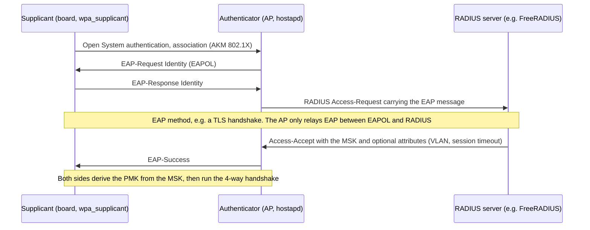

| Role | Responsible for |
|---|---|
| Supplicant (client) | Credentials, server certificate validation, running the EAP method |
| Authenticator (AP) | Relaying EAP between EAPOL and RADIUS, keeping the port closed until success, receiving the MSK from the server, running the 4-way handshake, applying authorization attributes (VLAN, session timeout). It never sees or checks the credentials |
| Authentication server (RADIUS) | Running the EAP method, checking credentials or certificates, deriving the MSK and sending it to the AP (in the MS-MPPE key attributes, protected with the RADIUS shared secret), authorization policy |

The RADIUS shared secret protects the keys between AP and server: keep it long, and use RADIUS over TLS (RadSec) or a protected network between them.

| EAP method | Credentials | Notes |
|---|---|---|
| EAP-TLS | Client certificate and private key | Strongest, no password. Best fit for fleets of devices: one certificate per device, provisioned at manufacturing |
| PEAP (MSCHAPv2) | Username and password inside a TLS tunnel | Common in companies. Without server certificate validation, a fake AP collects crackable password hashes |
| EAP-TTLS (PAP, MSCHAPv2) | Username and password inside a TLS tunnel | Similar to PEAP |
| EAP-SIM, EAP-AKA, EAP-AKA' | SIM card | Carrier Wi-Fi, Passpoint |
| EAP-PWD | Password, no certificates | Rare |

**Always validate the server:** set the CA certificate and the expected server name (`ca_cert` and `domain_suffix_match` in wpa_supplicant, section 15). A client that accepts any server certificate gives its credentials to anyone running an AP with the same SSID.

**WPA3-Enterprise 192-bit mode** (CNSA suite): EAP-TLS with specific cipher suites, GCMP-256 and BIP-GMAC-256, for high-security environments.

**Faster reconnects and roams:** the PMK is cached (PMKSA caching) to skip EAP when returning to the same AP; opportunistic key caching (OKC: hostapd `okc=1`, wpa_supplicant `proactive_key_caching=1`) reuses it across APs of one controller, and 802.11r does it in a standard way (section 10).

### Suites in config files and captures

The RSN element lists suites by number (OUI `00-0F-AC`), which is how Wireshark shows them:

| AKM | Name | hostapd `wpa_key_mgmt` / wpa_supplicant `key_mgmt` |
|---|---|---|
| 1 | 802.1X | `WPA-EAP` |
| 2 | PSK | `WPA-PSK` |
| 3 / 4 | FT over 802.1X / FT with PSK | `FT-EAP` / `FT-PSK` |
| 5 / 6 | 802.1X / PSK with SHA-256 | `WPA-EAP-SHA256` / `WPA-PSK-SHA256` |
| 8 / 9 | SAE / FT with SAE | `SAE` / `FT-SAE` |
| 12 | 802.1X Suite B 192-bit | `WPA-EAP-SUITE-B-192` |
| 18 | OWE | `OWE` |
| 24 / 25 | SAE with group-dependent hash / FT variant | `SAE-EXT-KEY` / `FT-SAE-EXT-KEY` |

| Cipher suite | Name | Config value |
|---|---|---|
| 2 | TKIP | `TKIP` (avoid) |
| 4 | CCMP-128 | `CCMP` (the default) |
| 8 / 9 | GCMP-128 / GCMP-256 | `GCMP` / `GCMP-256` |
| 6 / 11 / 12 | BIP-CMAC-128 / BIP-GMAC-128 / BIP-GMAC-256 (management frames) | `group_mgmt_cipher=AES-128-CMAC` (default) / `BIP-GMAC-128` / `BIP-GMAC-256` |

### Transition modes and per-band constraints

| Mode | How | Pitfalls |
|---|---|---|
| WPA2/WPA3 transition | `wpa_key_mgmt=WPA-PSK SAE`, `ieee80211w=1`, `sae_require_mfp=1` | A fake WPA2-only AP can downgrade WPA3 clients; clients that support **transition disable** refuse WPA2 once they have seen WPA3 on that network (hostapd `transition_disable=0x01`). Some old clients don't connect at all to a mixed RSN element |
| WPA3-Personal Compatibility Mode (RSN overriding) | The RSN element advertises WPA2-PSK for old clients; RSN Override elements, which only new clients understand, advertise SAE, PMF required and Wi-Fi 7 options (hostapd and wpa_supplicant 2.12: `rsn_override_*`) | New mechanism: needs current clients and APs |
| WPA2 with and without FT | `wpa_key_mgmt=WPA-PSK FT-PSK` | Some old clients fail when they see the FT AKM |
| Open + OWE | OWE transition mode | Fine: clients use the best they support |

| Where | What is allowed |
|---|---|
| 2.4 and 5 GHz | Any mode; WPA2/WPA3 transition for mixed client populations |
| 6 GHz | WPA3-Personal (SAE, H2E only), WPA3-Enterprise, OWE; PMF required (normative for 6 GHz operation) |
| Wi-Fi 7 (EHT) and MLO | **Certification:** PMF and beacon protection on the network; for Personal, SAE-EXT-KEY (AKM 24 or 25) with GCMP-256; OWE with GCMP-256. A network that doesn't meet them is used as Wi-Fi 6 or without MLO. Old WPA2 clients are served through compatibility mode or a separate SSID |

When old devices misbehave, give them a separate WPA2-only SSID (like `Home-IoT` in the [gateway note](../../networking/gateway/gateway_v1_2026-10-26.md#10-wi-fi-access-point-hostapd)) rather than weakening the main one.

### Known attacks

| Attack | Year | What it does | Defense |
|---|---|---|---|
| WEP key recovery | 2001-2007 | Recovers the key from captured traffic in minutes | Don't use WEP |
| TKIP attacks (Beck-Tews) | 2008 | Decrypts and injects short packets | CCMP only |
| Deauthentication | Always | Disconnects clients, forces handshakes to capture | PMF |
| Offline dictionary on WPA2-PSK, PMKID attack | Always, 2018 | Guesses the passphrase from a handshake capture, or from message 1 alone | Long random passphrase, or SAE |
| KRACK (key reinstallation) | 2017 | Replays handshake messages to make clients reuse nonces | Patched clients (fixes shipped in late 2017; wpa_supplicant 2.7+) |
| Dragonblood | 2019 | Side channels and downgrades against early SAE | H2E, patched hostap, transition disable |
| Kr00k | 2020 | Some Broadcom/Cypress chips sent frames encrypted with an all-zero key after a disassociation | Firmware update |
| FragAttacks | 2021 | Fragmentation and aggregation flaws: inject or leak frames | Patched kernels, drivers and firmware (2021+) |
| SSID confusion (CVE-2023-52424) | 2024 | Tricks a client into connecting to another network sharing credentials | Different credentials per SSID; mitigation in hostap 2.11+ (`ssid_protection`) |
| Evil twin | Always | A fake AP with the same SSID | Enterprise with server certificate validation. Not prevented by PSK or OWE |

**For a product:**
- Keep `wpa_supplicant`, `hostapd`, the kernel and the Wi-Fi firmware updatable: most of these were fixed by updates, not by configuration.
- Credential files `0600`, owned by root. Storing the 64-hex PSK instead of the passphrase hides the passphrase, not the network: for WPA2 the PSK is all an attacker needs.
- Prefer per-device credentials on networks you control: EAP-TLS, or per-device passphrases (hostapd `wpa_psk_file`, or several `sae_password=...|mac=...` entries).

---

## 10. Power save and roaming

### Power save

A mostly idle Wi-Fi client spends its energy listening: the receiver draws tens of mA, transmitting more (the datasheet gives the numbers per state). Power save turns the receiver off most of the time, while the AP buffers frames for it.

| Mechanism | How it works |
|---|---|
| PM bit | The client sets the Power Management bit in a frame (often a null frame) to tell the AP it goes to sleep. The AP buffers its unicast frames |
| TIM | Each beacon lists, by AID, the sleeping clients with buffered frames |
| Listen interval | How many beacon intervals the client may sleep, announced at association. Most clients wake for every DTIM beacon anyway |
| DTIM | Every DTIM period beacons (often 1 to 3), the AP sends the buffered broadcast and multicast frames right after the beacon. Every sleeping client must wake for it |
| PS-Poll | Legacy: the client fetches buffered frames one by one |
| U-APSD (WMM power save) | The client's uplink frames trigger delivery of buffered downlink frames: good for VoIP |
| WNM sleep (802.11v) | Long sleep, skipping DTIMs, with group key updates on wake |
| TWT (Wi-Fi 6) | Client and AP agree on wake times (individual TWT), or the AP announces schedules (broadcast TWT). Clients can sleep for seconds or more: big gains for battery IoT devices. Driver- and firmware-dependent |

```
Beacons (DTIM period 2):  B0 (DTIM)    B1          B2 (DTIM)    B3          B4 (DTIM)
Time (ms):                0            102         205          307         410
Board:                    awake ─ sleep ────────── awake ─ sleep ────────── awake
                                 │                  ▲
 ARP request (broadcast) arrives at 50 ms ─── held, sent right after B2 at 205 ms
 Unicast for the board arrives at 120 ms ──── TIM bit set in B2: board wakes, fetches it at ~205 ms
```

Linux clients usually run **dynamic power save** (in mac80211 or in firmware): the radio stays awake for a short timeout after traffic and sleeps only when idle. Steady flows aren't affected; sparse traffic is. **Latency cost:** a packet for a sleeping client waits for the next beacon the client listens to, and broadcast or multicast waits for the next DTIM: up to 205 ms in the timeline above. A board answering one ping per second shows round trips of tens to hundreds of ms; ARP requests and IPv6 neighbor solicitations wait for the DTIM too. Settings and measurements are in section 19.

### Roaming

**The client decides** when and where to roam; the network can only inform, suggest or push.

| Step | Without help | With help |
|---|---|---|
| 1. Trigger | Signal below a threshold, or beacons lost | The AP sends an 802.11v BSS transition management (BTM) request ("please move", optionally "or be disconnected") |
| 2. Find candidates | Background scans of all channels (seconds of off-channel time) | 802.11k neighbor report: the AP lists its neighbors and their channels, the client scans only those |
| 3. Choose | Best signal, band preference | Preferred candidates from the BTM request; MBO preferences |
| 4. Reconnect | Full authentication: SAE or 802.1X, then the 4-way handshake (100 ms to over 1 s with RADIUS) | 802.11r fast transition: keys derived in the authentication and reassociation frames (tens of ms). PMKSA caching / OKC skip EAP |

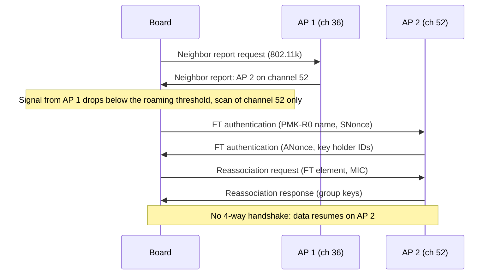

- **802.11r (FT):** APs of one **mobility domain** derive per-AP keys (PMK-R1) from the client's PMK-R0. With PSK, each AP can compute them alone; with SAE or 802.1X, the APs must exchange keys (R0KH/R1KH configuration in hostapd). Over the air (`ft_over_ds=0`) is the more compatible variant. Configuration is in section 16.
- **802.11k and 802.11v** are hints: the client may ignore them. A BTM request with "disassociation imminent" is the strongest push short of a deauthentication.
- **Sticky clients:** many clients hold on to a weak AP far too long. The AP can send a BTM request, or (crudely) deauthenticate clients below a signal threshold so they pick another AP.
- **Who roams on Linux:** with mac80211 drivers, wpa_supplicant (or iwd) decides (`bgscan`, section 15). Many FullMAC chips roam in firmware by default, invisibly to wpa_supplicant (brcmfmac: module parameter `roamoff=1` hands roaming back to the host).
- **Band steering:** dual-band APs push capable clients to 5/6 GHz (delayed 2.4 GHz probe responses, BTM requests). Not standardized: vendor features, or `usteer`/DAWN on OpenWrt.

---

## 11. Beyond one AP and its clients: MLO, mesh, P2P, TDLS, Passpoint

| Feature | What it is | Status | Linux |
|---|---|---|---|
| Multi-link operation (MLO) | One association over several bands | IEEE 802.11be, Wi-Fi 7 certification | Recent mac80211, hostap 2.11+ (preliminary) / 2.12; driver-dependent |
| Wireless backhaul: WDS, 802.11s mesh, EasyMesh | APs connected by Wi-Fi instead of cable | IEEE (WDS framing, 802.11s), Wi-Fi Alliance (EasyMesh) | `4addr`, `mesh point` interfaces; prplMesh for EasyMesh |
| Wi-Fi Direct (P2P) | Device-to-device without an AP | Wi-Fi Alliance | wpa_supplicant `p2p_*` |
| TDLS | Direct link between two clients of the same BSS | IEEE 802.11z | wpa_supplicant `tdls_*`, driver-dependent |
| Wi-Fi Aware (NAN) | Discovery and data paths in synchronized clusters, without an AP | Wi-Fi Alliance | `nan` interface type; wpa_supplicant 2.12; few drivers, mostly Android |
| Passpoint (Hotspot 2.0) | Automatic, secure login to public and carrier networks | Wi-Fi Alliance, on 802.11u | wpa_supplicant `interworking`, `cred` blocks; hostapd `hs20` |
| Easy Connect (DPP) | Onboarding with QR codes and public keys | Wi-Fi Alliance | wpa_supplicant and hostapd `dpp_*` (section 16) |

### Multi-link operation (Wi-Fi 7)

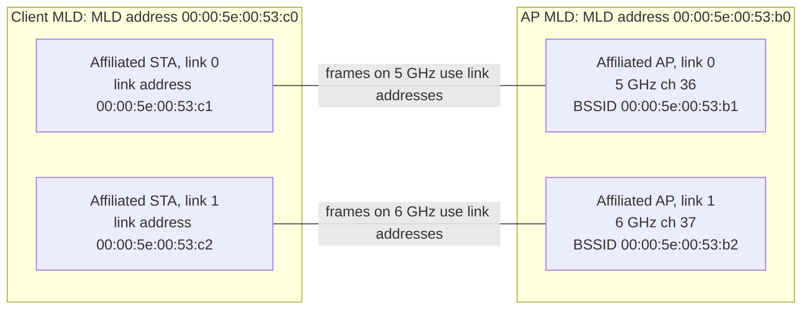

- **Organization:** an **AP MLD** is a set of affiliated APs, one per link, each a normal BSS with its own channel and BSSID (legacy clients see ordinary APs). The MLD has its own **MLD MAC address**. A **non-AP MLD** (client) has an MLD address and one affiliated STA per link, each with a link address.
- **Association:** done once, on one link, with a Multi-Link element that requests the other links ("multi-link setup"). The result is one association and one security association, bound to the MLD addresses: one PMK and PTK, with group keys (GTK, IGTK, BIGTK) per link.
- **Addressing:** frames on each link carry the link addresses in the RA/TA fields; the MLDs translate, so upper layers (the netdev, the bridge, DHCP) only see the MLD addresses. Sequence numbers and Block Ack agreements are per MLD and TID, so frames of one flow can travel over several links and be reordered at the receiver. TID-to-link mapping can restrict traffic classes to some links.
- **Modes:**

| Mode | Behavior | Typical device |
|---|---|---|
| STR (simultaneous transmit and receive) | Several radios, links used at the same time: more throughput and redundancy | APs |
| NSTR | Several links, but they can't transmit on one while receiving on another (close bands) | Constrained devices |
| EMLSR (enhanced multi-link single radio) | Listens on several links with reduced capability, switches the full radio to whichever link starts a frame exchange | Phones and laptops: lower latency, no extra radio |
| EMLMR | Like EMLSR but switching several radios | Rare |

- **Requirements:** Wi-Fi 7 security (section 9).
- **On Linux:** one netdev per MLD, with links (`iw dev` shows a link section per affiliated AP or STA), and a wiphy that may describe several radios. hostapd configures an AP MLD with `mld_ap=1` (and `mld_addr`) in the configuration of each link. Support is recent and moving: check the kernel, driver (ath12k, mt7996, iwlwifi as a client...) and hostap version before relying on it.

### Wireless backhaul: WDS, mesh, EasyMesh

| Topology | How APs interconnect | Notes |
|---|---|---|
| Wired backhaul | Ethernet to a common LAN (`br-lan`) | Best: no airtime spent on backhaul. Same SSID and security everywhere, non-overlapping channels |
| WDS / 4-address | An AP connects to another AP as a 4-address client and bridges (section 7) | Simple, Linux to Linux (hostapd `wds_sta=1`, client `4addr on`) |
| 802.11s mesh | Mesh points on one channel form a self-routing mesh (HWMP path selection); often batman-adv on top | `iw dev wlan0 interface add mesh0 type mp`, `iw dev mesh0 mesh join <mesh-id>`; secure mesh with SAE through wpa_supplicant |
| Wi-Fi EasyMesh | Wi-Fi Alliance standard: a controller manages agents (backhaul links, channels, steering) | prplMesh is an open implementation |
| Vendor mesh systems | Proprietary controller and backhaul | Can't mix brands |

Every wireless backhaul hop that shares a radio with clients at least halves their throughput: use a dedicated backhaul radio (5 GHz high channels or 6 GHz) or a cable.

### Wi-Fi Direct (P2P)

Two devices connect without an AP: after a negotiation, one becomes **group owner** (GO, a soft AP) and the other joins as a client, with WPA2 (WPA3 with newer Wi-Fi Direct releases). Used by Miracast, printers and phone-to-device transfers. wpa_supplicant implements it (`p2p_find`, `p2p_connect`, `p2p_group_add`) on a P2P device interface; `iw list` must show `P2P-client` and `P2P-GO` interface types and a combination that allows them next to the station (section 13).

### TDLS

Two clients of the same BSS set up a direct link: the setup frames go through the AP, then data flows directly at the rate their link allows (optionally on another channel). Useful for local streaming between two devices far from the AP. The AP can forbid it (hostapd `tdls_prohibit=1`). On Linux: `wpa_cli tdls_discover|tdls_setup|tdls_teardown <peer MAC>`, if the driver supports TDLS (`iw list` lists the `tdls_mgmt` and `tdls_oper` commands).

### Passpoint (Hotspot 2.0) and ANQP

Passpoint lets a device find and join a network it has never seen, using credentials it already has (SIM, certificate, username and password), securely:

1. The AP advertises an Interworking element.
2. Before associating, the client queries the AP with **ANQP** (over GAS action frames): venue, operator, NAI realms, roaming consortium identifiers, 3GPP networks.
3. If a stored credential matches, the client connects with WPA2/WPA3-Enterprise (EAP-TLS, EAP-TTLS, EAP-SIM/AKA).

Used by carriers, airports and federations such as OpenRoaming. wpa_supplicant: `interworking=1`, `hs20=1`, `cred={...}` blocks, then `wpa_cli interworking_select auto`; hostapd: `interworking=1`, `hs20=1` and the ANQP elements (see the reference configurations).

---

## 12. The Linux wireless stack

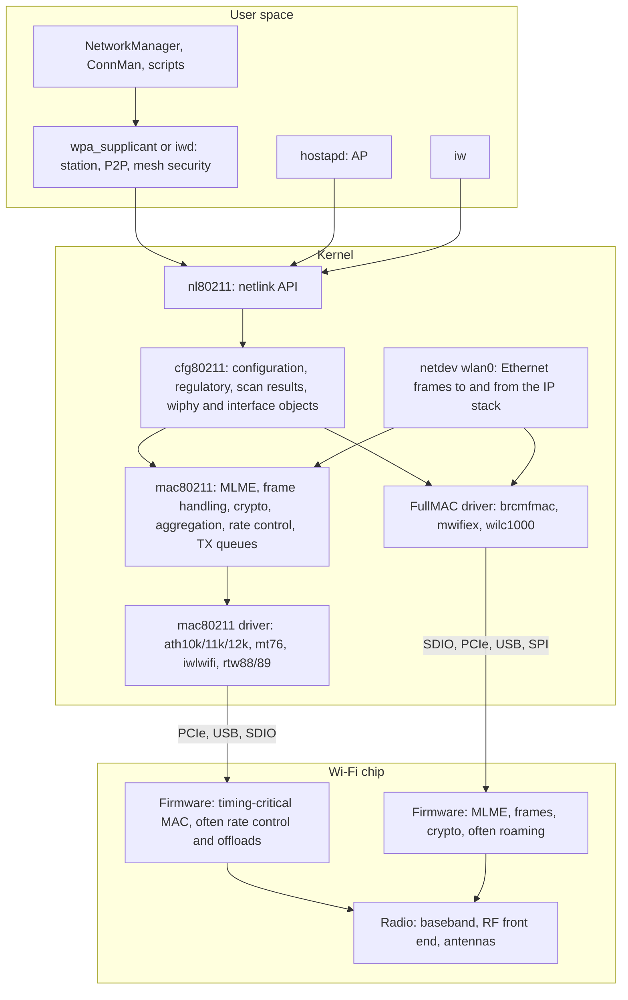

| Layer | Responsible for | Not responsible for |
|---|---|---|
| **User space** (wpa_supplicant, iwd, hostapd) | Policy and protocols above the MAC: network selection, SAE, EAP, the 4-way handshake (unless offloaded), roaming decisions (mac80211 drivers), AP configuration, WPS/DPP/P2P negotiation | Frame timing, encryption of data frames |
| **nl80211** | The netlink API: commands (scan, connect, start AP, set keys) and events | Any logic |
| **cfg80211** | Common layer for every driver: validates requests, enforces regulatory rules, keeps the scan result (BSS) list, wiphy and interface objects, interface combinations | Building frames |
| **mac80211** (SoftMAC drivers only) | Authentication and association state machine (MLME) for stations, 802.11 ↔ 802.3 conversion, software crypto, Block Ack sessions, AP power save buffering, Minstrel-HT, fq_codel TX queues, AQL, airtime fairness | Talking to the hardware |
| **Driver** | Bus access, firmware loading, translating mac80211 or cfg80211 calls into chip commands, reporting TX status and statistics | Protocol policy |
| **Firmware** | Everything timing-critical (ACKs, retries, aggregation timing, beacons on many chips), plus whatever the design moves there: rate control, MLME (FullMAC), scans, roaming, offloads | |
| **Hardware** | Radio, baseband, MAC accelerators, crypto engines | |

**Control and data paths:** configuration goes user space → nl80211 → cfg80211 → mac80211 or FullMAC driver. Data goes through the `wlan0` netdev: mac80211 converts Ethernet frames to 802.11 (or the driver offloads the conversion to firmware: "802.3 encapsulation offload", used by ath11k and mt76), and FullMAC drivers hand Ethernet frames to the firmware directly. EAPOL frames travel on the netdev as EtherType 0x888e, or over nl80211 ("control port over nl80211") with drivers and daemons that support it.

**SoftMAC vs FullMAC:**

| | mac80211 driver | FullMAC driver |
|---|---|---|
| Authentication, association | Kernel (mac80211) | Firmware |
| Rate control | Minstrel-HT or firmware | Firmware |
| Visibility | Kernel logs, per-station debugfs, tracepoints | Mostly opaque, vendor debug tools |
| AP, mesh, monitor modes | Usually supported | Whatever the firmware implements |
| Examples | ath9k, ath10k, ath11k, ath12k, mt76, iwlwifi, rtw88, rtw89 | brcmfmac, mwifiex, wilc1000 |

The split isn't clean: ath10k and later, iwlwifi and recent mt76 chips are mac80211 drivers that still run much of the MAC in firmware.

**Offloads** (driver- and firmware-dependent). They explain many "wpa_supplicant says X, the chip does Y" puzzles:

| Offload | Effect |
|---|---|
| 4-way handshake (PSK or 802.1X) | Firmware runs the handshake; wpa_supplicant only provides the PMK |
| SAE offload / external authentication | Firmware runs SAE, or asks wpa_supplicant to run it ("external auth") and does the rest |
| Firmware roaming | The chip changes AP by itself and reports it afterwards |
| Scheduled scans, scan offload | Scans while the host sleeps or without host involvement |
| GTK rekey, ARP/NS replies | Keep the link alive during host suspend (section 19) |

```bash
iw phy phy0 info | sed -n '/Supported extended features/,$p'
# e.g. [ 4WAY_HANDSHAKE_STA_PSK ], [ SAE_OFFLOAD ], [ BEACON_PROTECTION ], [ CONTROL_PORT_OVER_NL80211 ]
```

### Radio, wiphy, interface

| Object | Seen as | Notes |
|---|---|---|
| Radio | Hardware | One channel at a time. Dual-band dual-concurrent (DBDC) chips have two radios |
| wiphy | `phy0`, `/sys/class/ieee80211/phy0`, `iw phy` | What the driver registers. Usually one per radio; recent kernels let one wiphy describe several radios with their frequency ranges (MLO-capable drivers such as ath12k and mt7996) |
| wdev | `iw dev` (`wdev 0x1`) | A virtual interface. A P2P device is a wdev without a netdev |
| netdev | `wlan0`, `phy0-ap0` (OpenWrt), `wlp2s0` (udev) | What IP, bridges and firewalls see |

The phy index changes when the driver reloads (`phy0` becomes `phy1`): scripts should find it from the netdev (`cat /sys/class/net/wlan0/phy80211/name`). Interface types and combinations are in section 13.

### Regulatory implementation

- **wireless-regdb:** `/lib/firmware/regulatory.db` and its signature `regulatory.db.p7s`, loaded by cfg80211 (since kernel 4.15; the old `crda` helper isn't needed anymore). With `CONFIG_CFG80211_REQUIRE_SIGNED_REGDB`, the kernel checks the signature against built-in certificates. The database maintainer changed in 2023, and releases since 2024 are signed with a new key whose certificate was added to the kernel in December 2023: an older kernel without it (or its stable backport) rejects a recent database with `cfg80211: loaded regulatory.db is malformed or signature is missing/invalid` and falls back to the world domain. Upgrade both together, or add the certificate (`CONFIG_CFG80211_EXTRA_REGDB_KEYDIR`, also used for a database you rebuild and sign yourself).
- **Setting the country:** `iw reg set FR`, the `cfg80211.ieee80211_regdom=FR` module parameter, `country=FR` in wpa_supplicant, `country_code=FR` in hostapd. The AP's country element and **beacon hints** (cfg80211 lifts `no IR` on a channel where it hears an AP beacon) also feed into it.
- **Drivers add their own rules**, and the most restrictive combination wins:

| Model | Examples | What you see |
|---|---|---|
| cfg80211 database only | mt76, ath9k with an unset EEPROM | `iw reg get` shows `global` with your country |
| Country programmed in the card's EEPROM, intersected with the user setting | Qualcomm (ath) cards | You can restrict, not extend |
| Country passed to the firmware, which applies its own power and channel tables | brcmfmac (CLM blob) | `iw reg get` looks normal, but the firmware may allow fewer channels or not know your country |
| Self-managed: the driver or firmware owns regulatory | iwlwifi (location-aware regulatory), some vendor drivers | `iw reg get` shows `phy#0 (self-managed)` with its own country |

### Firmware

Drivers load firmware from `/lib/firmware` with `request_firmware()` when they probe (or when the interface comes up, for some).

- **Error -2** (`ENOENT`) in `dmesg`: file not found. Common embedded cause: the driver is **built into the kernel** and probes before the root filesystem is mounted. Build it as a module, put the firmware in the initramfs, or embed it (`CONFIG_EXTRA_FIRMWARE`).
- Some drivers try several names (board-specific first): a failed attempt followed by a successful one is normal.
- `ethtool -i wlan0` shows the driver and the firmware version. Put it in every bug report: many Wi-Fi bugs are firmware bugs.
- File names, board data and NVRAM are per chip family (section 18).

### Driver families

| Vendor | Driver(s) | Type | Buses | Notes |
|---|---|---|---|---|
| Intel | `iwlwifi` | mac80211 + firmware | PCIe (M.2) | Laptops. Client-focused: AP mode is limited, often 2.4 GHz only |
| Qualcomm (Atheros) | `ath9k` (Wi-Fi 4), `ath10k` (5), `ath11k` (6), `ath12k` (7) | mac80211 | PCIe, AHB (router SoCs), USB/SDIO for some | Strong AP support. Board data files per design |
| MediaTek | `mt76` family: `mt7601u`, `mt76x2`, `mt7615`, `mt7915`, `mt7921`, `mt7925`, `mt7996` | mac80211 | PCIe, USB, SDIO, AHB | Very good AP and monitor support, upstream-first. Common in OpenWrt devices and USB adapters |
| Realtek | `rtw88` (Wi-Fi 5), `rtw89` (6/7), `rtl8xxxu`, `rtlwifi`; many out-of-tree vendor drivers | mac80211 (in tree) | PCIe, USB, SDIO | Prefer in-tree drivers; vendor drivers are often WEXT-era and break with new kernels |
| Infineon (Cypress, ex-Broadcom) | `brcmfmac` | FullMAC | SDIO, PCIe, USB | Raspberry Pi and many modules. Newer chips often need the vendor's patched driver and firmware |
| NXP (Marvell) | `mwifiex` in tree; vendor `moal`/`mlan` for newer chips | FullMAC | SDIO, PCIe, USB | i.MX reference designs |
| Microchip | `wilc1000` | FullMAC | SDIO, SPI | Low-power IoT |
| TI | `wlcore` / `wl18xx` | mac80211 | SDIO | WL18xx modules, older designs |

Features vary by chip, firmware and kernel even within one driver: AP mode, DFS, monitor mode, MLO, TWT, offloads. Check `iw list` on the exact hardware and software you ship.

**WEXT:** the pre-2007 API used by `iwconfig`/`iwlist` survives only as a compatibility layer (`CONFIG_CFG80211_WEXT`): no 80 MHz, no WPA3. Out-of-tree drivers that only speak WEXT (`wpa_supplicant -D wext`) are best avoided.

---

## 13. Operating modes and interface combinations

| Mode (`iw` type) | Runs | What changes | Typical constraints |
|---|---|---|---|
| Station (`managed`) | wpa_supplicant or iwd | Scans, associates, follows the AP's channel and width | Can't be bridged without 4-address mode (section 7) |
| AP (`AP`) | hostapd | Sends beacons, manages clients, may need DFS master capability | Many client chips lack AP mode on 5/6 GHz (`no IR`), limited station count |
| AP and station at once | both | One radio serves an uplink and a local network | Same channel unless the chip has two radios (below) |
| Monitor (`monitor`) | tcpdump, Wireshark | Receives raw 802.11 frames with radiotap headers, optionally injects | Not supported by most FullMAC chips; on a busy radio, stuck on the operating channel |
| Mesh point (`mesh point`) | `iw`, wpa_supplicant for secure mesh | 4-address frames, path selection | One channel for the whole mesh |
| P2P (`P2P-client`, `P2P-GO`, `P2P-device`) | wpa_supplicant | Negotiates group owner, then behaves as AP or station | Needs a combination that allows P2P next to the station |
| IBSS, OCB | `iw` | Ad hoc, 802.11p vehicles | Rare |

### Interface combinations

`iw list` lists what the driver allows at the same time:

```
$ iw list | grep -A 6 "valid interface combinations"
	valid interface combinations:
		 * #{ managed } <= 1, #{ AP } <= 1, #{ P2P-client, P2P-GO } <= 1,
		   total <= 3, #channels <= 1, STA/AP BI must match
```

Read it as: at most one station, one AP and one P2P interface together, three in total, all on **one channel**, with matching beacon intervals. Other lines may add `radar detect widths` (DFS allowed in this combination) or several alternatives. Adding an interface outside these limits fails with `Device or resource busy`.

### Channel concurrency

| Case | How it works | Effect |
|---|---|---|
| Single-channel concurrency | All interfaces on the radio use the same channel | The local AP must follow the uplink's channel: when the uplink roams to another channel, the AP has to switch too (CSA) or restart |
| Multi-channel concurrency (`#channels <= 2`) | One radio time-slices between channels | Each side gets part of the time: throughput drops, latency and beacon timing suffer |
| Two radios (DBDC) | Each interface on its own radio | True concurrency, e.g. station on 5 GHz and AP on 2.4 GHz |

AP plus station on one radio:

```bash
sudo iw dev wlan0 interface add ap0 type __ap     # wlan0 stays the station
iw dev wlan0 info | grep channel                  # the uplink's channel
# hostapd on ap0 with that channel. hostapd doesn't follow the uplink by itself:
# restart it, or use a manager that handles it, when the uplink changes channel.
```

A DFS channel adds another constraint: an AP interface can only use it if the radio supports DFS in that combination, and some drivers allow it only while the station is connected to an AP on the same channel.

**One owner per interface:** NetworkManager, ConnMan, iwd, a systemd unit and your own scripts all try to manage `wlan*` interfaces. Exclude the interfaces you manage yourself (`nmcli dev set ap0 managed no`, or the `unmanaged-devices` setting), or they fight over it: scans that break the AP, disappearing addresses, `Device or resource busy`.

---

## 14. Tools: iw, wpa_cli, hostapd_cli and friends

### iw

| Command | Shows or does |
|---|---|
| `iw dev` | Interfaces per radio: type, channel, width, TX power (some drivers report a meaningless TX power) |
| `iw list`, `iw phy phy0 info` | Capabilities: bands, channels and their limits, interface modes and combinations, HT/VHT/HE/EHT capabilities, ciphers, commands, extended features |
| `iw dev wlan0 link` | Current connection: BSSID, SSID, frequency, signal, rates |
| `iw dev wlan0 station dump` | Per-peer statistics: on a client the AP, on an AP every client (section 19) |
| `sudo iw dev wlan0 scan` | Trigger a scan and print every BSS with its decoded elements (`Device or resource busy` while another scan runs). `scan dump` prints the cached results |
| `iw dev wlan0 survey dump` | Per-channel noise and busy time, if the driver supports it (section 19) |
| `iw reg get`, `sudo iw reg set FR` | Regulatory domain |
| `iw event -t -f` | Live nl80211 events with timestamps: scans, authentication, association, disconnects with reason codes |
| `sudo iw dev wlan0 set power_save off` | Power save (section 19) |
| `sudo iw dev wlan0 set txpower fixed 1500` | TX power in mBm (15 dBm), `auto` to reset. Ignored or clamped by some drivers |
| `sudo iw phy phy1 interface add mon0 type monitor` | Add a monitor interface (section 17) |
| `iw phy phy0 wowlan show` | Wake on WLAN triggers (section 19) |

```
$ iw dev
phy#0
	Interface wlan0
		ifindex 3
		wdev 0x1
		addr 00:00:5e:00:53:15
		ssid Home
		type managed
		channel 36 (5180 MHz), width: 80 MHz, center1: 5210 MHz
		txpower 20.00 dBm

$ iw dev wlan0 link
Connected to 00:00:5e:00:53:a0 (on wlan0)
	SSID: Home
	freq: 5180.0
	RX: 18232110 bytes (21422 packets)
	TX: 2310991 bytes (9122 packets)
	signal: -57 dBm
	rx bitrate: 390.0 MBit/s VHT-MCS 8 80MHz short GI VHT-NSS 1
	tx bitrate: 292.5 MBit/s VHT-MCS 6 80MHz short GI VHT-NSS 1
	bss flags:	short-slot-time
	dtim period:	2
	beacon int:	100
```

Reading it: channel 36 inside an 80 MHz block centered at 5210 MHz (channel 42), one spatial stream (`VHT-NSS 1`). The AP sends to the board at MCS 8 while the board sends at MCS 6: the uplink is weaker (section 5). Which fields appear depends on the driver; FullMAC drivers report fewer.

**From the old tools to `iw`:**

| wireless-tools (WEXT) | iw |
|---|---|
| `iwconfig` | `iw dev`, `iw dev wlan0 link` |
| `iwlist wlan0 scan` | `iw dev wlan0 scan` |
| `iwlist wlan0 freq` | `iw list` (Frequencies) |
| `iwconfig wlan0 essid Home` | `iw dev wlan0 connect Home` (open networks only; use wpa_supplicant otherwise) |
| `iwconfig wlan0 txpower 15` | `iw dev wlan0 set txpower fixed 1500` |
| `iwconfig wlan0 power off` | `iw dev wlan0 set power_save off` |
| `iwconfig wlan0 mode monitor` | `iw dev wlan0 set type monitor` (interface down first) |
| `cat /proc/net/wireless` | `iw dev wlan0 station dump` |

### wpa_cli and hostapd_cli

Both talk to their daemon over a control socket (`ctrl_interface`, usually `/run/wpa_supplicant` and `/run/hostapd`). Without a command, they open an interactive shell that also prints events.

| `wpa_cli -i wlan0 ...` | Does |
|---|---|
| `status` | State (`wpa_state=COMPLETED` when connected), BSSID, frequency, key management, IP |
| `scan`, then `scan_results` | Scan, list BSSes with signal and flags (`[WPA2-PSK-CCMP][SAE]...`) |
| `list_networks`, `select_network <id>`, `enable_network <id>` | Manage configured networks |
| `signal_poll` | RSSI, link speed, noise, frequency |
| `bss <bssid>` | Everything known about one BSS |
| `reassociate`, `reconnect`, `disconnect` | Force connection changes |
| `roam <bssid>` | Roam to a given BSS of the same ESS |
| `neighbor_rep_request` | Ask the AP for an 802.11k neighbor report |
| `log_level debug` | Raise the log level without restarting |

| `hostapd_cli -i wlan0 ...` | Does |
|---|---|
| `status` | State, channel, width, number of stations, DFS state |
| `all_sta`, `sta <mac>` | Associated clients with flags (`[AUTH][ASSOC][AUTHORIZED][WMM][MFP][HT][VHT][HE]`), signal, rates, AKM |
| `deauthenticate <mac>`, `disassociate <mac>` | Kick a client |
| `bss_tm_req <mac> ...` | Send an 802.11v BSS transition request |
| `chan_switch <count> <freq> ...` | Move the BSS to another channel with CSA |
| `show_neighbor`, `set_neighbor ...` | 802.11k neighbor list |
| `reload`, `disable`, `enable` | Apply a changed configuration |

### Logs, counters and other tools

```bash
journalctl -u wpa_supplicant@wlan0 -f          # or -u hostapd, -u NetworkManager
dmesg -w | grep -i -e wlan -e brcmf -e ath -e mt7 -e iwl
ip -s link show wlan0                          # netdev counters: packets, drops, errors
ethtool -i wlan0                               # driver, firmware version, bus address
ethtool -S wlan0                               # mac80211 statistics (mac80211 drivers): retries, failures, rates
rfkill list                                    # soft/hard blocks; sudo rfkill unblock wifi
```

```bash
# NetworkManager
nmcli dev wifi list
nmcli dev wifi connect Home password 'change-me-long-passphrase'
# iwd
iwctl station wlan0 scan
iwctl station wlan0 get-networks
iwctl station wlan0 connect Home
```

- **debugfs** (`mount -t debugfs none /sys/kernel/debug`, development builds only): `/sys/kernel/debug/ieee80211/phy0/` has mac80211 counters, per-station directories (`netdev:wlan0/stations/<mac>/`, with Minstrel's `rc_stats` when it is used), AQL and airtime settings, and a driver directory with firmware statistics. Needs `CONFIG_MAC80211_DEBUGFS`.
- **Tracepoints:** `trace-cmd record -e cfg80211 -e mac80211` records every nl80211 request and mac80211 event, for bugs between user space and the driver.

---

## 15. Station mode: connecting a device

### wpa_supplicant configuration

`/etc/wpa_supplicant/wpa_supplicant-wlan0.conf` (the name Debian's `wpa_supplicant@wlan0.service` reads; BusyBox images often use `/etc/wpa_supplicant.conf`):

```ini
ctrl_interface=DIR=/run/wpa_supplicant GROUP=netdev
country=FR
# PMF when the AP supports it (per-network ieee80211w overrides)
pmf=1
# SAE: accept hash-to-element and hunting-and-pecking
sae_pwe=2

# Home network: WPA2 or WPA3 depending on what the AP offers
network={
    ssid="Home"
    psk="change-me-long-passphrase"
    key_mgmt=WPA-PSK WPA-PSK-SHA256 SAE
    ieee80211w=1
    priority=10
    # Scan every 30 s below -70 dBm, every hour above it (needs CONFIG_BGSCAN_SIMPLE)
    bgscan="simple:30:-70:3600"
}

# A WPA3-only network: PMF required
network={
    ssid="Lab"
    sae_password="another-long-passphrase"
    key_mgmt=SAE
    ieee80211w=2
    priority=5
}
```

Other common network blocks:

```ini
# Hidden SSID: probe for it by name
network={
    ssid="Hidden-Lab"
    scan_ssid=1
    psk="..."
}

# Open network, and Enhanced Open
network={
    ssid="Cafe"
    key_mgmt=NONE
}
network={
    ssid="Cafe-OWE"
    key_mgmt=OWE
    ieee80211w=2
}

# Enterprise, EAP-TLS with a device certificate
network={
    ssid="Corp"
    key_mgmt=WPA-EAP WPA-EAP-SHA256
    eap=TLS
    identity="device-0042@example.com"
    ca_cert="/etc/wifi/ca.pem"
    client_cert="/etc/wifi/device-0042.pem"
    private_key="/etc/wifi/device-0042.key"
    # Accept only this RADIUS server name (in its certificate)
    domain_suffix_match="radius.example.com"
    ieee80211w=1
}

# Enterprise, PEAP with a password
network={
    ssid="Corp"
    key_mgmt=WPA-EAP
    eap=PEAP
    identity="jdoe"
    password="..."
    phase2="auth=MSCHAPV2"
    ca_cert="/etc/wifi/ca.pem"
    domain_suffix_match="radius.example.com"
}
```

| Option | Use |
|---|---|
| `priority=` | Higher number wins when several configured networks are in range |
| `bssid=` | Lock to one AP (testing; disables roaming) |
| `scan_freq=5180 5260` (network block) | Frequencies to scan when looking for this network: faster scans, the network can still be selected on other frequencies found by other scans |
| `freq_list=5180 5260` (network block) | Frequencies **allowed** for this network: BSSes elsewhere are ignored |
| `freq_list=` (global) | Limits the frequencies wpa_supplicant scans at all |
| `bgscan="simple:<short s>:<dBm>:<long s>"` | Background scanning for roaming. Without it, a stationary client never looks for a better AP |
| `mac_addr=` (global default, or per network) | 0 = permanent MAC, 1 = random MAC for each ESS connection, 2 = random but keep the OUI (locally administered bit set), 3 = a configured address (`mac_value`, per network) |
| `preassoc_mac_addr=` (global) | MAC policy for scans and ANQP: 0 = permanent, 1 = random, 2 = random keeping the OUI |
| `psk=<64 hex digits>` | Hashed PSK from `wpa_passphrase "Home" passphrase`: hides the passphrase, works for WPA2 only (not SAE) |

### Running it

**systemd (Debian, Yocto with systemd):**

```bash
sudo chmod 600 /etc/wpa_supplicant/wpa_supplicant-wlan0.conf
sudo systemctl enable --now wpa_supplicant@wlan0
```

`/etc/systemd/network/30-wlan0.network`:

```ini
[Match]
Name=wlan0

[Network]
DHCP=yes
# Keep the addresses during the short carrier loss of a roam (boolean or time span, depending on the systemd version)
IgnoreCarrierLoss=3s
```

**BusyBox init (Buildroot):** start wpa_supplicant in the background and let `wpa_cli` run a script on connection events:

```sh
wpa_supplicant -B -i wlan0 -c /etc/wpa_supplicant.conf -P /run/wpa_supplicant.wlan0.pid
wpa_cli -i wlan0 -a /etc/wifi-action.sh -B
```

`/etc/wifi-action.sh`:

```sh
#!/bin/sh
# Called by wpa_cli -a with: $1 = interface, $2 = CONNECTED or DISCONNECTED
pid=/run/udhcpc.$1.pid
case "$2" in
CONNECTED)
    if [ -f "$pid" ] && kill -0 "$(cat "$pid")" 2>/dev/null; then
        kill -USR1 "$(cat "$pid")"     # already running (reconnect, roam): renew the lease
    else
        udhcpc -i "$1" -b -p "$pid"
    fi
    ;;
DISCONNECTED)
    # Keep the address: most disconnections are short (roaming, AP reboot)
    ;;
esac
```

**By hand, for debugging:** stop every other manager first (section 13), then:

```bash
sudo wpa_supplicant -dd -t -i wlan0 -c /etc/wpa_supplicant.conf    # foreground, full debug, timestamps
```

**Adding a network at runtime** (for example from a provisioning service). Strings are quoted inside the shell quotes; hex values and keywords aren't:

```bash
wpa_cli -i wlan0 add_network                       # prints the new id, e.g. 1
wpa_cli -i wlan0 set_network 1 ssid '"Home"'
wpa_cli -i wlan0 set_network 1 psk '"change-me-long-passphrase"'
wpa_cli -i wlan0 set_network 1 key_mgmt 'WPA-PSK SAE'
wpa_cli -i wlan0 set_network 1 ieee80211w 1
wpa_cli -i wlan0 enable_network 1
wpa_cli -i wlan0 save_config                       # needs update_config=1 and a writable file
```

**Production:** `save_config` rewrites the whole file. On a read-only root filesystem, keep the configuration on a data partition and make sure a power cut during the write can't leave it empty (wpa_supplicant writes a temporary file and renames it; the partition must keep that atomic). Restrict the control socket to a group (`GROUP=`): anyone who can talk to it can read and change networks.

**Events** an application can wait for (`wpa_cli` interactive mode, or the control socket):

| Event | Meaning |
|---|---|
| `CTRL-EVENT-SCAN-RESULTS` | Scan finished |
| `CTRL-EVENT-NETWORK-NOT-FOUND` | No configured network in the scan results |
| `CTRL-EVENT-CONNECTED` | Associated and keys installed (the port is open) |
| `CTRL-EVENT-DISCONNECTED bssid=... reason=N [locally_generated=1]` | Disconnected, with the reason code (section 8) |
| `CTRL-EVENT-ASSOC-REJECT bssid=... status_code=N` | Association refused, with the status code |
| `CTRL-EVENT-SSID-TEMP-DISABLED id=... reason=WRONG_KEY` | Network paused after failures, here a wrong passphrase |
| `CTRL-EVENT-REGDOM-CHANGE` | Regulatory domain changed |

### Choosing a connection manager

| | wpa_supplicant | iwd | NetworkManager | ConnMan |
|---|---|---|---|---|
| Role | Supplicant (plus AP, mesh, P2P, DPP, Passpoint) | Supplicant, optional DHCP | Full manager (Wi-Fi, Ethernet, cellular, VPN) | Full manager, lighter |
| Wi-Fi backend | itself | itself | wpa_supplicant or iwd | wpa_supplicant or iwd |
| Footprint | Small, features chosen at build time | Small, uses kernel crypto (needs several `CONFIG_CRYPTO_USER_API_*` and keyctl options) | Large (D-Bus, GLib) | Medium |
| Good for | Everything; the default on embedded | Fast connects and roaming on desktop-like devices | Devices with a UI, many connection types | Small images with a manager API |

iwd keeps credentials in `/var/lib/iwd/<SSID>.psk`:

```ini
[Security]
Passphrase=change-me-long-passphrase
```

and runs DHCP itself with `EnableNetworkConfiguration=true` in the `[General]` section of `/etc/iwd/main.conf`. NetworkManager stores connections in `/etc/NetworkManager/system-connections/*.nmconnection` (mode `0600`).

---

## 16. Access point mode and provisioning

The [gateway note](../../networking/gateway/gateway_v1_2026-10-26.md#10-wi-fi-access-point-hostapd) has a complete hostapd configuration (5 GHz, WPA2/WPA3 transition, guest SSID, bridges) and how to check AP support with `iw list`. This section adds what lies beyond it. On the gateway, `wlan1` is the Wi-Fi uplink and `wlan2` the 2.4 GHz IoT radio, so the 6 GHz radio below is `wlan3`.

### Wi-Fi 6 on 5 GHz

Add to the gateway's 80 MHz configuration on channel 36:

```ini
ieee80211ax=1
he_oper_chwidth=1
he_oper_centr_freq_seg0_idx=42
he_su_beamformer=1
he_bss_color=17
```

### 6 GHz

A separate radio, WPA3 only (section 4). `/etc/hostapd/wlan3.conf`:

```ini
interface=wlan3
bridge=br-lan
driver=nl80211
ctrl_interface=/run/hostapd
country_code=FR
ieee80211d=1
hw_mode=a
# Operating class 133 = 6 GHz, 80 MHz: on 6 GHz the width comes from op_class.
# Channel 37 is a PSC in the 33-45 block, center channel 39
op_class=133
channel=37
ieee80211ax=1
he_oper_centr_freq_seg0_idx=39
ssid=Home
wpa=2
wpa_key_mgmt=SAE
rsn_pairwise=CCMP
sae_password=change-me-long-passphrase
sae_pwe=1
ieee80211w=2
beacon_prot=1
```

- 6 GHz operating classes: 131 (20 MHz), 132 (40), 133 (80), 134 (160), 137 (320).
- The AP needs 6 GHz AP support in the driver and firmware, and the regulatory domain must allow it (`iw list` without `no IR` on 6 GHz). The EU and US rules here are for LPI (indoor) operation.
- **Discovery:** run both radios in one hostapd process (`hostapd /etc/hostapd/hostapd.conf /etc/hostapd/wlan3.conf`) and set `rnr=1` in the 5 GHz configuration, so its beacons carry a reduced neighbor report pointing to the 6 GHz BSS.
- **One SSID, two security configurations:** clients that saved `Home` as WPA2 may not use the WPA3-only 6 GHz BSS until they have connected with WPA3.

### Wi-Fi 7

The same file gains `ieee80211be=1` and the EHT settings: `eht_oper_chwidth` and `eht_oper_centr_freq_seg0_idx` (on 6 GHz, the operating class sets the width), `punct_bitmap` for static puncturing, and `mld_ap=1` with an `mld_addr` in each link's configuration to form an AP MLD. Security must meet Wi-Fi 7 requirements (SAE-EXT-KEY, GCMP-256, PMF, beacon protection; section 9). The syntax is still evolving between hostap releases: start from the reference `hostapd.conf` of the version you ship.

### Roaming between the two APs

On both APs (same SSID, passphrase and `mobility_domain`), only `nas_identifier` differs:

```ini
# Gateway's key management plus FT for WPA2 clients
wpa_key_mgmt=WPA-PSK SAE FT-PSK
mobility_domain=4f57
nas_identifier=ap1.home.example
ft_over_ds=0
# FT with PSK: each AP derives the FT keys from the passphrase, no key exchange between APs
ft_psk_generate_local=1
# 802.11k neighbor and beacon reports, 802.11v BSS transition
rrm_neighbor_report=1
rrm_beacon_report=1
bss_transition=1
```

- `WPA-PSK` and `SAE` stay for clients without FT, which roam with a full handshake.
- `ft_psk_generate_local` covers FT-PSK only. **FT-SAE** (or FT with 802.1X) needs `r0kh`/`r1kh` entries and a shared key between the APs (see `hostapd.conf`).
- **Neighbor lists:** `hostapd_cli -i wlan0 show_neighbor` on each AP prints its own entry; add it to the other with `hostapd_cli -i wlan0 set_neighbor <bssid> ssid=\"Home\" nr=<hex>`. OpenWrt's usteer and DAWN automate this.
- **Check from the board:** after `wpa_cli roam 00:00:5e:00:53:a1`, `wpa_cli status` shows `key_mgmt=FT-PSK` (if the board used FT) and the log shows an FT authentication instead of a full 4-way handshake. The board needs `FT-PSK` in its `key_mgmt` list.

### Other useful options

| Option | Effect |
|---|---|
| `channel=0` (with `acs_num_scans=5`, `chanlist=`) | Automatic channel selection from a survey. Needs survey support in the driver (`iw dev wlan0 survey dump`) |
| `ieee80211h=1` | Enable DFS (channels 52-144). hostapd logs `DFS-CAC-START`, `DFS-CAC-COMPLETED`, `DFS-RADAR-DETECTED`, `DFS-NEW-CHANNEL` |
| `ap_isolate=1` | Clients of this BSS can't talk to each other through the AP |
| `max_num_sta=32` | Limit associations (status 17 beyond it) |
| `ap_max_inactivity=300` | Seconds before an idle client is polled and removed |
| `disassoc_low_ack=1` | Drop clients that stop acknowledging frames (driver-dependent) |
| `multicast_to_unicast=1` | Multicast as unicast to each client (section 6) |
| `proxy_arp=1` | The AP answers ARP for its clients (needs a bridge) |
| `mbssid=1` or `2` | Multiple BSSID or EMA advertisement for several SSIDs on one radio (driver-dependent) |
| `wpa_psk_file=/etc/hostapd/wlan0.psk` | Per-client passphrases, optionally with a VLAN per entry (`vlanid=`) |
| `tdls_prohibit=1` | Forbid TDLS in this BSS |
| `dtim_period=2` | Broadcast delivery every 2 beacons: power vs multicast latency (section 10) |
| `ctrl_interface=/run/hostapd` | Enables `hostapd_cli` |

Events to watch (`hostapd_cli` interactive, or `journalctl -u hostapd`): `AP-ENABLED`, `AP-STA-CONNECTED <mac>`, `EAPOL-4WAY-HS-COMPLETED <mac>`, `AP-STA-POSSIBLE-PSK-MISMATCH <mac>`, `AP-STA-DISCONNECTED <mac>`.

### Provisioning a headless device

A product without a screen needs a way to receive Wi-Fi credentials:

| Method | How | Notes |
|---|---|---|
| SoftAP | The device starts its own AP (`Device-1A2B`), a phone joins it and sends credentials over HTTPS or an app | Works with any phone. Phones may leave a network "without internet" or show a captive portal: handle both. Use WPA2/WPA3 with a per-device password printed on the label, not an open AP. Needs AP mode, and AP+STA concurrency to test the credentials while the phone stays connected (section 13) |
| Bluetooth LE | A phone app sends credentials over GATT | Common today. Needs BLE on the device and an app; secure the GATT link |
| Wi-Fi Easy Connect (DPP) | The device has a QR code with its public key. A configurator (phone, AP) scans it and sends a signed network configuration | Standard, no password typing, supports WPA3 and per-device credentials. wpa_supplicant built with `CONFIG_DPP`: `dpp_bootstrap_gen type=qrcode`, `dpp_bootstrap_get_uri`, `dpp_listen <freq>`. Configurator support on phones and APs varies |
| WPS | Push button or PIN | PIN mode is broken, push button is weak, many APs disable it. Avoid |
| Wired or local | USB, serial console, a file on removable storage | Simple for development and industrial devices |

Whatever the method: stop the setup AP once provisioned, store credentials `0600` on persistent storage, rate-limit and authenticate the provisioning interface, and keep a way back (factory reset) for when the network changes.

---

## 17. Monitor mode and over-the-air captures

`tcpdump -i wlan0` on a station or AP interface shows **Ethernet** frames after decryption and conversion (section 7): no management frames, no retries, no radio information. To see the air, use a **monitor** interface. Monitor support is driver-dependent (most FullMAC chips have none); a separate adapter with a well-supported driver (mt76 USB adapters, for example) is the usual choice. Here, on the dev laptop's USB adapter `wlan1` (`phy1`):

```bash
iw phy phy1 info | grep -A 8 "Supported interface modes"   # must list monitor
sudo nmcli dev set wlan1 managed no                          # keep NetworkManager off this radio
sudo iw phy phy1 interface add mon0 type monitor
sudo ip link set wlan1 down
sudo ip link set mon0 up
# Same primary channel and width as the network: primary 5180 MHz (channel 36), 80 MHz block centered at 5210 MHz
sudo iw dev mon0 set freq 5180 80 5210
sudo tcpdump -i mon0 -w home-ch36.pcap
```

- **Radiotap:** the driver prepends a radiotap header with what the radio saw: signal (`radiotap.dbm_antsignal`, per antenna on some drivers), channel, rate or MCS, bandwidth, flags (short GI, bad FCS). Its content depends on the driver.
- **Monitor flags:** `iw dev mon0 set monitor fcsfail control otherbss` also passes frames with a bad checksum, control frames and frames of other BSSes, if the driver honors them.

**Wireshark display filters:**

| Filter | Shows |
|---|---|
| `wlan.addr == 00:00:5e:00:53:15` | Everything to or from the board |
| `wlan.fc.type_subtype == 0x08` | Beacons |
| `wlan.fc.type_subtype in {0x04 0x05}` | Probe requests and responses |
| `wlan.fc.type_subtype in {0x00 0x01 0x0b}` | Association request, response, authentication |
| `wlan.fc.type_subtype in {0x0a 0x0c}` | Disassociation, deauthentication (see `wlan.fixed.reason_code`) |
| `eapol` | 4-way and group key handshakes |
| `wlan.fc.retry == 1` | Retransmissions |
| `wlan.fc.type_subtype == 0x0d` | Action frames (Block Ack setup, 802.11k/v/r, channel switch, SA Query, ANQP) |
| `wlan_radio.signal_dbm < -75` | Weak frames |

```bash
# The same from the command line: the board's handshakes and deauthentications
tshark -r home-ch36.pcap -Y 'wlan.addr == 00:00:5e:00:53:15 && (eapol || wlan.fc.type_subtype == 0x0c)'
```

**Decrypting a capture:** for WPA2-PSK, add a `wpa-pwd` key `passphrase:SSID` in Wireshark (Preferences, Protocols, IEEE 802.11, Decryption keys) and capture **all four handshake messages** of the client: reconnect it during the capture. For SAE and 802.1X, the passphrase isn't enough: give the PMK (`wpa-psk` key type) or, in recent Wireshark versions, the TK. `hostapd -dd -K` and `wpa_supplicant -dd -K` print keys in their debug logs: lab use only.

**A sniffer only sees what it can decode:** it must support the network's band, width, streams and PHY (a 1x1 80 MHz adapter misses a 2x2 160 MHz client's data), and it hears what reaches its own antenna, not what the AP or the client hears. Put it next to the device you debug. Missing ACKs in a capture can be the sniffer's fault.

**Without monitor mode:**
- `sudo tcpdump -eni wlan0 ether proto 0x888e` shows the EAPOL handshake frames on a client or AP.
- `iw event -t -f`, and `wpa_supplicant -dd` or `hostapd -dd` logs, show every step of the state machines.
- `trace-cmd` with the `cfg80211` and `mac80211` events (section 14).

---

## 18. Integrating a Wi-Fi chip on a board

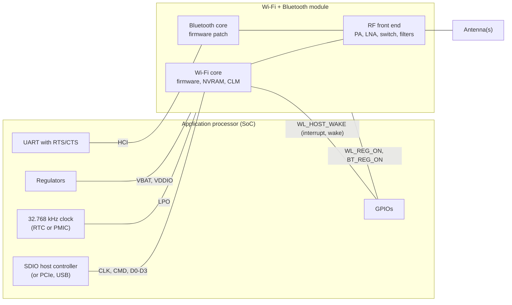

### Buses and enumeration

| Bus | Practical Wi-Fi throughput (rule of thumb) | How it enumerates | Pros | Cons |
|---|---|---|---|---|
| SDIO 3.0, 4-bit | 100-400 Mb/s, depends on host controller and clock | The MMC core detects the card once powered; functions bind the driver (`/sys/bus/sdio/devices/mmc1:0001:1/{vendor,device}`) | Few pins, low power, most embedded modules | Bus ceiling below Wi-Fi 6 rates, signal integrity at 100-200 MHz, host controller quirks |
| PCIe | Gigabit and above | Link training at boot, then `lspci -nnk` | Full Wi-Fi 6/7 rates, M.2 modules | Power, needs a PCIe controller, ASPM power-state issues |
| USB 2.0 / 3.x | About 250 Mb/s / gigabit | Hot-plug, `lsusb -t` | Easy (dongles) | USB 2.0 caps throughput; autosuspend and latency issues; USB 3 noise near 2.4 GHz |
| SPI | Tens of Mb/s at best | Device tree node, driver probe | Any host | Slow, FullMAC only (wilc1000, ESP32 hosted firmware) |

Combo chips usually put Wi-Fi on SDIO or PCIe and Bluetooth on a UART (HCI) or USB. An SDIO card that isn't powered is invisible: "no `wlan0`" on a new board starts with power and reset, not with the driver.

### Signals and power sequencing

| Signal | Role |
|---|---|
| `WL_REG_ON` | Enables the Wi-Fi part (internal regulators). Low = Wi-Fi off. A GPIO driven by the host, released after power is stable |
| `BT_REG_ON` | Same for Bluetooth on combo chips. Some chips need both sequenced in a given order |
| `WL_HOST_WAKE` | Out-of-band interrupt from the chip (instead of SDIO in-band interrupts), and the wake source in suspend |
| 32.768 kHz LPO | Sleep clock. Some modules need it from the host (RTC or PMIC output) and fail in strange ways without it |
| VBAT, VDDIO | Main supply and I/O voltage. VDDIO must match the SDIO host's signaling: 1.8 V I/O for UHS modes (`vqmmc-supply`). TX bursts draw current peaks: check supply droop |
| SDIO CLK, CMD, D0-D3 | Keep short, matched, with clean ground. Much "flaky Wi-Fi" on new boards is SDIO signal integrity |

### Device tree (SDIO, brcmfmac example)

```dts
/ {
	wifi_pwrseq: wifi-pwrseq {
		compatible = "mmc-pwrseq-simple";
		reset-gpios = <&gpio2 10 GPIO_ACTIVE_LOW>;	/* WL_REG_ON: asserted (low) until power-up */
		post-power-on-delay-ms = <200>;
		clocks = <&pmic_clk32k>;			/* 32.768 kHz LPO, if the module needs it */
		clock-names = "ext_clock";
	};
};

&usdhc2 {
	pinctrl-names = "default";
	pinctrl-0 = <&pinctrl_usdhc2>;
	bus-width = <4>;
	non-removable;
	keep-power-in-suspend;
	mmc-pwrseq = <&wifi_pwrseq>;
	vmmc-supply = <&reg_wifi_3v3>;
	vqmmc-supply = <&reg_1v8>;
	#address-cells = <1>;
	#size-cells = <0>;
	status = "okay";

	wifi@1 {
		compatible = "brcm,bcm43455-fmac", "brcm,bcm4329-fmac";
		reg = <1>;
		interrupt-parent = <&gpio1>;
		interrupts = <5 IRQ_TYPE_LEVEL_HIGH>;	/* WL_HOST_WAKE */
		interrupt-names = "host-wake";
	};
};
```

- Labels for the controller, GPIOs and regulators are examples (`usdhc2` is an i.MX SD controller); delays come from the module datasheet.
- Debug helpers: `max-frequency = <50000000>;` rules out signal integrity; `cap-power-off-card` lets the host power the card off (and changes suspend behavior).
- PCIe and USB chips are discovered on their bus and need no Wi-Fi node, only their power and reset (regulators, a reset GPIO or a pwrseq on the PCIe controller node).
- The Bluetooth half of a combo chip is a child of its UART node (serdev), with its own enable and wake GPIOs and firmware. See the [Bluetooth notes](../bluetooth/).

### Bring-up order

| Step | Check | Passing looks like |
|---|---|---|
| 1. Power and clock | Measure VBAT, VDDIO, `WL_REG_ON` going high, the 32 kHz clock | Levels and timing from the module datasheet |
| 2. Bus enumeration | `dmesg | grep mmc`, `ls /sys/bus/sdio/devices/`, `lspci -nnk`, `lsusb` | `mmc1: new high speed SDIO card at address 0001` (or `ultra high speed SDR104`); vendor `0x02d0` for Broadcom/Infineon |
| 3. Driver and firmware | `dmesg | grep -i -e brcmf -e firmware`, `ethtool -i wlan0` | A firmware version line, no unresolved `-2` errors |
| 4. Radio and regulatory | `iw list`, `iw reg get` | Expected bands, channels, modes and country |
| 5. Scan | `sudo iw dev wlan0 scan | grep -e SSID -e signal` | Neighbor networks at signal levels similar to a reference device in the same place |
| 6. Connect | wpa_supplicant, DHCP | Section 15 |
| 7. Throughput and stability | iperf3 over hours, both directions (section 19) | No firmware crashes or bus errors in `dmesg` |
| 8. Suspend, resume, reboot loops | Hundreds of cycles | The chip comes back every time |

### Firmware and calibration files

| Driver | Files in `/lib/firmware` | Notes |
|---|---|---|
| brcmfmac | `brcm/brcmfmac43455-sdio.bin` (firmware), `.clm_blob` (country and power tables), `.txt` (NVRAM) | NVRAM is **board-specific**: antenna, TX power, crystal, sometimes the MAC. The driver first tries names with the DT root `compatible` (`brcmfmac43455-sdio.raspberrypi,4-model-b.txt`). Get the files from the module vendor |
| ath10k, ath11k | `ath10k/QCA6174/hw3.0/firmware-6.bin`, `board-2.bin` (calibration per board ID) | Wrong board data: low power, poor range, or probe failure |
| iwlwifi | `iwlwifi-<chip>-<api>.ucode`, `.pnvm` on newer chips | The driver tries API versions from newest to oldest |
| mt76 | e.g. `mediatek/WIFI_RAM_CODE_MT7961_1.bin`, `mediatek/WIFI_MT7961_patch_mcu_1_2_hdr.bin` (mt7921) | |

Calibration and regulatory data (NVRAM, board files, CLM, OTP/EEPROM in the chip) are part of the **certified configuration**: changing them can change transmit power and invalidate the certification.

**MAC addresses:** from the chip's OTP, the NVRAM, or the device tree (`local-mac-address` or an NVMEM cell), depending on what the driver supports. Check that two units have different MACs: some modules' sample NVRAM files contain a placeholder MAC.

### Kernel and build options

| Kernel option | For |
|---|---|
| `CONFIG_CFG80211`, `CONFIG_MAC80211` | The stack (mac80211 only for SoftMAC drivers) |
| Driver: `CONFIG_BRCMFMAC` + `CONFIG_BRCMFMAC_SDIO`, `CONFIG_ATH10K_PCI`, `CONFIG_MT7921E`... | Your chip and bus |
| `CONFIG_CFG80211_REQUIRE_SIGNED_REGDB` and its key options | Regulatory database signature checking (section 12) |
| `CONFIG_RFKILL` | rfkill |
| `CONFIG_CFG80211_WEXT` | Only for old tools that still use WEXT |
| `CONFIG_MAC80211_DEBUGFS`, `CONFIG_CFG80211_DEBUGFS` | Debug counters (development builds) |
| `CONFIG_CRYPTO_CCM`, `CONFIG_CRYPTO_GCM`, `CONFIG_CRYPTO_CMAC` | Software crypto for mac80211 when the hardware can't |

| Build system | Packages |
|---|---|
| Buildroot | `BR2_PACKAGE_WPA_SUPPLICANT` (with its `_WPA3`, `_AUTOSCAN`, `_CLI` options), `BR2_PACKAGE_HOSTAPD`, `BR2_PACKAGE_IW`, `BR2_PACKAGE_WIRELESS_REGDB`, `BR2_PACKAGE_LINUX_FIRMWARE` with the per-chip options |
| Yocto | `wpa-supplicant`, `hostapd`, `iw`, `wireless-regdb-static`, `linux-firmware-<chip>` split packages (e.g. `linux-firmware-bcm43455`), `wifi` in `DISTRO_FEATURES` |

Package and option names change between releases: check them in your version. hostapd and wpa_supplicant features are also chosen at build time (`.config`: `CONFIG_SAE`, `CONFIG_OWE`, `CONFIG_DPP`, `CONFIG_IEEE80211BE`...): a feature missing from the build fails as an unknown configuration option.

### Antennas, RF and coexistence

- **Antennas:** PCB trace or chip antennas need a ground plane and a keep-out area and are detuned by nearby metal and plastic; external antennas on u.FL/MHF connectors lose a few dB per meter of thin cable at 5 GHz. Use only antenna types and gains covered by the module's certification. RF design itself belongs in the [RF notes](../../hardware/rf/).
- **Placement:** away from metal, batteries, displays, DDR and switching regulators; not inside a metal enclosure without an external antenna. Test in the final enclosure.
- **Two chains:** compare per-chain signals in `iw dev wlan0 station dump` (`signal: -52 [-54, -57] dBm`). One chain much weaker than the other points to an antenna, cable or connector problem.
- **Self-interference:** USB 3.0, HDMI, DDR and DC-DC converters raise the noise floor. Compare `noise` in `iw dev wlan0 survey dump` with the suspected source on and off.
- **Bluetooth coexistence:** on combo chips, 2.4 GHz Wi-Fi and Bluetooth share the band and often the antenna; the chip arbitrates between them (packet traffic arbitration, PTA), configured by firmware and NVRAM. Bluetooth audio and 2.4 GHz Wi-Fi throughput suffer together: put Wi-Fi on 5/6 GHz when possible. With separate chips, wire their coexistence signals if both support them.
- **Cellular coexistence:** an LTE/5G modem on nearby bands (7, 38, 40, 41, n41) needs filtering and antenna separation.

### Suspend and resume

- Without Wake on WLAN configured, cfg80211 disconnects from the AP when the system suspends, and the connection manager reconnects on resume.
- With WoWLAN (section 19), the chip stays powered and associated (`keep-power-in-suspend`), and wakes the host through `WL_HOST_WAKE`.
- Typical bugs: the SDIO card loses power and must re-enumerate and reload its firmware; the driver's resume path fails; the wake interrupt isn't a wake source. Test hundreds of cycles, with and without traffic.

### Development vs production configuration

| Topic | Development | Production |
|---|---|---|
| Firmware | Debug or test-mode firmware, verbose logging | The certified release firmware, NVRAM and regulatory files, versioned and updatable |
| Regulatory | `iw reg set` by hand | Country fixed per product SKU, matching certification; users can't select another |
| Debug interfaces | debugfs, monitor mode, `-dd` logs, `-K` key logging | Not mounted or not built; no key logging |
| Credentials | In a config file | `0600` on a data partition (or a secure element / encrypted storage), never in the read-only image |
| Control sockets | Open to all | Group-restricted |
| Per-unit data | Defaults | MAC address and calibration programmed and checked at the end-of-line test |
| Recovery | Reflash | Factory reset to provisioning mode, firmware updates with rollback |

### Certification and regulatory

- **Use a pre-certified module** (modular approval: FCC ID, ISED, CE RED, MIC...). The approval holds only if you follow the module's integration rules: listed antenna types and maximum gains, trace layout, labeling.
- **The product still needs its own tests and declarations** (EU RED: radio standards such as ETSI EN 300 328 for 2.4 GHz, EN 301 893 for 5 GHz, EN 303 687 for 6 GHz, plus EMC and safety; FCC Part 15). Test labs need **test modes**: continuous transmission at a fixed channel, rate and power, from vendor manufacturing tools or test firmware. Ask the module vendor early.
- **EU RED cybersecurity:** since 1 August 2025, internet-connected radio equipment sold in the EU must meet the RED delegated act requirements (harmonized standards EN 18031-1/-2/-3): no universal default passwords, protected credentials, secure updates.
- **Vehicles:** besides the band rules in section 4, automotive products need automotive-grade parts and temperature ranges, and fast AP startup (avoid DFS channels).

---

## 19. Performance, power and tuning

### Measuring throughput

Run `iperf3 -s` on the wired dev laptop (`192.168.10.100`, section 2). A test from the board then crosses one wireless hop (board ↔ gateway AP), the gateway's bridge and Ethernet, so it measures the Wi-Fi link and not two wireless hops:

```bash
iperf3 -s                                       # on the dev laptop (wired)
iperf3 -c 192.168.10.100 -t 30                  # board → laptop: board uplink
iperf3 -c 192.168.10.100 -t 30 -R               # laptop → board: board downlink
iperf3 -c 192.168.10.100 -t 30 -P 4             # 4 parallel streams
iperf3 -c 192.168.10.100 -u -b 150M -t 30       # UDP at a fixed rate: loss and jitter without TCP effects
```

Typical TCP throughput close to the AP, on a clean channel (rule of thumb):

| Link (PHY rate) | TCP throughput |
|---|---|
| 1x1 Wi-Fi 4, 20 MHz (72 Mb/s) | 40-55 Mb/s |
| 1x1 Wi-Fi 5, 80 MHz (433 Mb/s) | 200-300 Mb/s, less if the SDIO bus limits it |
| 2x2 Wi-Fi 5, 80 MHz (867 Mb/s) | 450-650 Mb/s |
| 2x2 Wi-Fi 6, 80 MHz (1201 Mb/s) | 650-900 Mb/s |
| 2x2 Wi-Fi 6, 160 MHz (2402 Mb/s) | 1.2-1.8 Gb/s |

### Reading `station dump`, counters and `survey dump`

```
$ iw dev wlan0 station dump
Station 00:00:5e:00:53:a0 (on wlan0)
	inactive time:	120 ms
	rx bytes:	182331223
	rx packets:	134210
	tx bytes:	9210331
	tx packets:	61002
	tx retries:	4211
	tx failed:	12
	beacon loss:	0
	signal:  	-57 [-57] dBm
	signal avg:	-58 [-58] dBm
	tx bitrate:	292.5 MBit/s VHT-MCS 6 80MHz short GI VHT-NSS 1
	rx bitrate:	390.0 MBit/s VHT-MCS 8 80MHz short GI VHT-NSS 1
	expected throughput:	180.5Mbps
	authorized:	yes
	authenticated:	yes
	associated:	yes
	WMM/WME:	yes
	MFP:		yes
	connected time:	3600 seconds
```

**Counters are cumulative and driver-reported:** sample them twice under the same load and compare differences, not absolute values.

| Field | Meaning | Caveats |
|---|---|---|
| `tx packets` | Frames sent to this peer | Counted by mac80211 or the driver, per MSDU |
| `tx retries` | Retransmission attempts reported by the driver: a frame sent 3 times adds 2 or 3 | Not a count of frames that needed a retry, so `retries / packets` isn't a retry rate. Drivers that report status per A-MPDU, or not at all (many FullMAC), undercount or show 0 |
| `tx failed` | Frames dropped after the last retry | Each is a lost packet that TCP must recover: should stay near zero |
| `signal`, `signal avg` | Last and averaged signal, per chain in brackets | Chip calibration differs (section 5) |
| `tx bitrate`, `rx bitrate` | The rate the driver last reported | A snapshot, not an average. A large asymmetry points to the weaker direction |
| `expected throughput` | Estimate from rate control | Only with Minstrel or drivers that compute it |
| `beacon loss` | Missed beacons | Weak signal, interference, firmware trouble |

The same counters per interface, plus netdev counters:

```bash
ethtool -S wlan0 | grep -e tx_retries -e tx_retry_failed -e rx_dropped -e signal   # mac80211 drivers
ip -s link show wlan0           # packets to/from the IP stack; TX dropped = queue drops before the driver
```

```
$ iw dev wlan0 survey dump
Survey data from wlan0
	frequency:			5180 MHz [in use]
	noise:				-92 dBm
	channel active time:		52000 ms
	channel busy time:		14820 ms
	channel receive time:		12100 ms
	channel transmit time:		1900 ms
```

- **Channel utilization** = busy / active = 28% here, **including your own traffic**. Busy - receive - transmit (about 1.6% here) approximates time taken by others and by interference the radio couldn't decode. What counts as "receive" (all frames, or only frames for this device) depends on the driver.
- Survey support, the meaning of the counters and when they reset are driver-dependent; other channels appear when the driver surveys during scans.
- High utilization with little of your own traffic means a congested channel: change channel or band before tuning anything else.

### What limits throughput

| Limit | How to check |
|---|---|
| Radio: signal, width, streams | `iw dev wlan0 link`: MCS, width, NSS |
| Contention, neighbors | `survey dump` busy time, `scan` for networks on the same channel |
| Bus | SDIO clock and mode in `/sys/kernel/debug/mmc1/ios` or `dmesg`; a fixed ceiling whatever the signal |
| CPU | `mpstat -P ALL 1` or `top` during iperf3: one core at 100% in softirq or `ksoftirqd`; software crypto if the chip doesn't do it |
| TCP | One stream much slower than `-P 4`: window or latency limited |
| The other end | Test the gateway-to-laptop path on Ethernet, and the AP with another client (the phone) |

### Tuning checklist

- **Set the country:** the default world domain disables channels and limits power.
- **Pick the channel** from `survey dump` and a scan. 2.4 GHz: 1, 6 or 11 at 20 MHz. 5 GHz: 80 MHz.
- **Disable power save** where latency matters (below).
- **Avoid background scans** on stationary devices: no `bgscan`, and fewer periodic scans from the connection manager.
- **Don't maximize the AP's TX power:** clients hear it far away but can't answer, and roam later.
- **Drop legacy 802.11b rates** and convert multicast to unicast on the AP (section 6).
- **Update firmware and driver:** performance and stability fixes are frequent.

### Power save and latency

```bash
iw dev wlan0 get power_save
sudo iw dev wlan0 set power_save off       # not persistent: set it at each connection
```

| Where | Persistent setting |
|---|---|
| NetworkManager | `nmcli con modify Home 802-11-wireless.powersave 2` (2 = disable, 3 = enable) |
| systemd-networkd / wpa_supplicant | A unit, or the `wpa_cli` action script, running `iw ... set power_save off` after connection |
| brcmfmac | Power save is on by default; set it off as above |
| iwlwifi | `iwlmvm` module parameter `power_scheme` (1 = active, 2 = balanced, 3 = low power) |

Measure the effect with `ping -i 0.2 192.168.10.21` from the laptop, power save on and off: with it on, an idle board shows round trips of tens to hundreds of ms (section 10). Whether `set power_save` reaches the firmware is driver-dependent.

**Battery-powered devices** go the other way: keep power save on, raise the AP's `dtim_period` and use a long listen interval if multicast latency is acceptable, use TWT when both sides support it, and filter useless broadcast traffic at the AP (proxy ARP, multicast-to-unicast). Datasheets give the current per state (TX, RX, power save idle, deep sleep); measure the real profile with a current probe.

### Wake on WLAN

The chip stays associated while the host suspends, and wakes it on a trigger:

```bash
iw phy phy0 wowlan show
sudo iw phy phy0 wowlan enable magic-packet disconnect
echo mem | sudo tee /sys/power/state
# From the laptop: wakeonlan 00:00:5e:00:53:15   (or etherwake)
```

Triggers include `any`, `disconnect`, `magic-packet`, `patterns` (byte patterns in received packets), `gtk-rekey-failure`, `net-detect` (wake when a known network appears) and `tcp`, depending on the driver. Requirements: `WL_HOST_WAKE` on a wake-capable GPIO, the interrupt (or `wakeup-source`) in the device tree, `keep-power-in-suspend` on the SDIO host. The firmware keeps the link alive meanwhile (GTK rekeys, ARP replies) only if it supports those offloads.

---

## 20. Troubleshooting

### Method

Work up from the hardware and don't go further until a step passes:

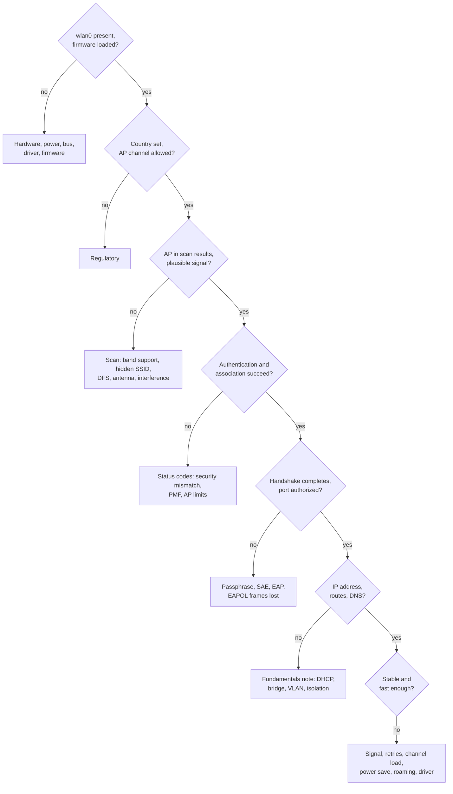

| Fault domain | Evidence | Tools |
|---|---|---|
| Hardware, power, bus | No device on the bus, SDIO/PCIe errors, resets under load | Multimeter, scope, `dmesg`, `lspci`, `/sys/bus/sdio` |
| Firmware | Load errors, crashes, restarts, wrong version | `dmesg`, `ethtool -i` |
| Regulatory | Channels disabled or `no IR`, wrong country, regdb not loaded | `iw reg get`, `iw list`, `dmesg | grep cfg80211` |
| Scan | AP missing or much weaker than on a reference device | `iw dev wlan0 scan`, `wpa_cli scan_results` |
| Authentication, association | Status codes, retries without response | `iw event -t -f`, `wpa_supplicant -dd`, hostapd log |
| Security handshake | Reason 15/23, `WRONG_KEY`, EAP failures | `tcpdump ether proto 0x888e`, hostapd and RADIUS logs |
| Power management | Latency spikes when idle, missed broadcasts, drops on group rekeys | `iw ... get power_save`, ping tests, DTIM settings |
| Roaming | Sticky client, ping-pong, drops during moves | wpa_supplicant log (bgscan, roam decisions), both APs' logs, firmware roaming settings |
| Interference, contention | High busy time, retries rising with neighbors' activity | `survey dump`, monitor capture, spectrum analyzer |
| Driver behavior | Counters stuck, features silently ignored, different results after an update | Compare driver/firmware versions, tracepoints, debugfs |
| Upper layers | Link up and authorized, but no IP or no traffic | [Fundamentals note](../../networking/fundamentals/fundamentals_v1_2026-10-29.md#22-troubleshooting) |

Look at **both ends**: the AP's log often says plainly what the client only sees as a timeout. When both ends disagree, a monitor-mode capture (section 17) settles it. Thresholds for signal, retries or utilization depend on the environment and the driver: compare with a known-good reference (another device, another AP, before and after a change) rather than with fixed numbers.

### Symptoms

| Symptom | Where to look first |
|---|---|
| No `wlan0` | Bus enumeration (`dmesg | grep mmc`, `lspci`, `lsusb`), power sequencing and LPO clock, driver loaded (`lsmod`), firmware errors (`-2`) |
| `Operation not possible due to RF-kill` | `rfkill list`: soft block → `rfkill unblock wifi`; hard block → switch, BIOS, a GPIO or platform driver |
| Scan returns nothing | Interface down, world domain `00` (passive scanning only), antenna not connected, another manager holding the interface, `Device or resource busy` from a concurrent scan |
| AP missing from the scan, a phone sees it | Channel not allowed by the regulatory domain (or the firmware's tables), AP on 6 GHz or 5 GHz and the module isn't, hidden SSID (`scan_ssid=1`), DFS channel heard only passively, MBSSID profiles the client doesn't parse |
| Much weaker signal than a reference device | Antenna, cable or connector, wrong NVRAM or board data, enclosure, one chain dead (per-chain `signal` values) |
| Authentication or association rejected | The status code (section 8): security mismatch (SAE vs PSK, PMF required, cipher, Wi-Fi 7 security requirements). Compare `wpa_cli scan_results` flags with your network block |
| `reason=15`, `WRONG_KEY` | Wrong passphrase. If it's right: a hashed PSK used for SAE, shell quoting in `wpa_cli set_network`, a PSK hashed with another SSID, EAPOL frames lost at the cell edge |
| Connects, then drops every few minutes | Reason 16 (group rekey missed while asleep), beacon loss (signal), inactivity timeout (reason 4), roaming back and forth, DFS radar events, firmware crashes in `dmesg` |
| Connected but no IP address | Port not authorized (`wpa_state` not `COMPLETED`), AP bridged to the wrong network or VLAN, DHCP ([fundamentals](../../networking/fundamentals/fundamentals_v1_2026-10-29.md#8-getting-an-address-dhcp-slaac-static)), MAC randomization vs DHCP reservations |
| Works, then stalls under load | Bus or firmware errors in `dmesg` (SDIO CRC errors, timeouts): lower the SDIO `max-frequency`, check supply droop during TX bursts, temperature |
| Slow | Section 19: radio, contention, bus, CPU, TCP, the other end |
| Ping spikes, laggy SSH | Power save, background scans, a busy channel, deep firmware queues |
| mDNS or discovery fails over Wi-Fi only | `ap_isolate`, multicast lost or delayed (DTIM, low basic rate), multicast snooping on the AP's bridge |
| hostapd won't start | `iw list`: no `AP` mode or `no IR` on the channel; options the card doesn't support (`ht_capab`, VHT/HE/EHT settings); DFS CAC still running; interface combination exceeded; another manager holding the interface |
| Clients don't roam, or stick to a far AP | No `bgscan`, firmware roaming, 802.11k/v not enabled, AP TX power too high |
| Fine on the bench, poor in the product | Antenna detuned by the enclosure, metal, cables near the antenna, board noise |
| No Wi-Fi after suspend | `keep-power-in-suspend`, wake interrupt, firmware reload on resume. Unloading and reloading the module confirms a driver resume bug |

### Messages and what they mean

| Message | Meaning |
|---|---|
| `Direct firmware load for brcm/... failed with error -2` | File not found. Harmless if a later name loads (look for the firmware version line) |
| `mmc1: error -110 whilst initialising SDIO card` | The card doesn't answer: power, `WL_REG_ON`, pwrseq delays, clock, wiring |
| `brcmf_sdio_htclk: HT Avail timeout` | The chip doesn't start its clock: LPO clock, supply, firmware or NVRAM mismatch |
| `ath10k_pci ...: failed to fetch board data` | `board-2.bin` missing or without an entry for this board |
| `iwlwifi ...: Microcode SW error detected. Restarting` | Firmware crash: update firmware and kernel, report with the dump |
| `cfg80211: loaded regulatory.db is malformed or signature is missing/invalid` | Regulatory database not trusted by this kernel (section 12): world domain in use |
| `wlan0: deauthenticated from ... (Reason: 15=4WAY_HANDSHAKE_TIMEOUT)` | mac80211 decodes reason codes in `dmesg` (section 8) |
| `nl80211: kernel reports: Match already configured` | Two programs manage the interface (two wpa_supplicants, or a manager plus yours) |
| `ctrl_iface exists and seems to be in use - cannot override it` | wpa_supplicant already runs on this interface |
| `CTRL-EVENT-SSID-TEMP-DISABLED ... reason=CONN_FAILED` | Repeated authentication or association failures: look at the status codes before it |
| `AP-STA-POSSIBLE-PSK-MISMATCH` (hostapd) | The client's message 2 MIC failed: wrong passphrase on the client |
| hostapd `Could not set channel for kernel driver` | Channel not allowed (regulatory, `no IR`) or unsupported width |
| hostapd `DFS-CAC-START` then nothing for a minute | Normal on DFS channels (section 4) |

### A useful bug report

Kernel version, driver and firmware version (`ethtool -i`), `iw list` (or at least the relevant capabilities), the country (`iw reg get`), the AP's model and settings (band, channel, width, security), a timestamped `wpa_supplicant -dd -t` log around the failure, `iw event -t` output, two `station dump` samples, and if possible a monitor capture and the AP's log for the same moment.

The [gateway note](../../networking/gateway/gateway_v1_2026-10-26.md#14-troubleshooting) covers the router side (bridges, firewall, DHCP), and the [OpenWrt note](../../networking/openwrt/openwrt_v1_2026-10-29.md#playbooks) its OpenWrt equivalents.

---

## 21. Not covered here

Topics for separate notes:

- **Wi-Fi driver development:** writing a mac80211 or cfg80211 driver, firmware interfaces, nl80211 vendor commands ([linux-kernel-device-driver-development/](../../linux-kernel-device-driver-development/)).
- **RF design and measurements:** antenna design and matching, conducted and radiated tests ([hardware/rf/](../../hardware/rf/)).
- **The PHY in depth:** OFDM signal processing, LDPC coding, channel estimation, beamforming math ([hardware/baseband/](../../hardware/baseband/), [hardware/sdr/](../../hardware/sdr/)).
- **Wi-Fi location and sensing:** fine timing measurement (802.11mc/az), CSI-based sensing.
- **802.11ah (HaLow)** and 60 GHz (802.11ad/ay).
- **Enterprise deployments:** FreeRADIUS, certificate provisioning for fleets, dynamic VLANs, Passpoint operator setup.
- **Mesh in depth:** 802.11s path selection, batman-adv, EasyMesh controllers.
- **Wi-Fi 8 (802.11bn)** once the standard settles.
- **Bluetooth** ([bluetooth/](../bluetooth/)) and **cellular** ([Cellular Protocols](../cellular/cellular_v1_2026-11-02.md)).

---

## References

Standards and specifications:

| Topic | Document |
|---|---|
| 802.11 (amendments merged) | IEEE 802.11-2020, IEEE 802.11-2024. Free to download through the IEEE GET program on <https://ieeexplore.ieee.org> |
| Wi-Fi 6, Wi-Fi 7 | IEEE 802.11ax-2021, IEEE 802.11be-2024 |
| WPA3, Enhanced Open, Easy Connect, WMM, Passpoint | Wi-Fi Alliance specifications: <https://www.wi-fi.org/discover-wi-fi/specifications> |
| EAP, EAP-TLS (TLS 1.2, 1.3) | [RFC 3748](https://www.rfc-editor.org/rfc/rfc3748), [RFC 5216](https://www.rfc-editor.org/rfc/rfc5216), [RFC 9190](https://www.rfc-editor.org/rfc/rfc9190) |
| RADIUS, RADIUS for 802.1X | [RFC 2865](https://www.rfc-editor.org/rfc/rfc2865), [RFC 3580](https://www.rfc-editor.org/rfc/rfc3580) |
| Dragonfly (SAE's ancestor), OWE | [RFC 7664](https://www.rfc-editor.org/rfc/rfc7664), [RFC 8110](https://www.rfc-editor.org/rfc/rfc8110) |
| DSCP to 802.11 user priority | [RFC 8325](https://www.rfc-editor.org/rfc/rfc8325) |
| Documentation MAC addresses | [RFC 7042](https://www.rfc-editor.org/rfc/rfc7042) |

Regulation (check for amendments before relying on values):

- US: 47 CFR 15.407 (U-NII bands, 6 GHz LPI/SP/VLP, vehicle restrictions): <https://www.ecfr.gov/current/title-47/chapter-I/subchapter-A/part-15/subpart-E/section-15.407>
- EU 5 GHz: Commission Decision 2005/513/EC as amended, and Implementing Decisions (EU) 2022/179 and 2022/2307 (in-vehicle use): <https://eur-lex.europa.eu/eli/dec_impl/2022/2307/oj/eng>
- EU 6 GHz: Implementing Decision (EU) 2021/1067, amended by (EU) 2024/3157 and (EU) 2025/913: <https://eur-lex.europa.eu/eli/dec_impl/2021/1067/oj/eng>; CEPT ECC Decision (20)01
- Harmonized standards: ETSI EN 300 328 (2.4 GHz), EN 301 893 (5 GHz), EN 303 687 (6 GHz); RED cybersecurity: EN 18031-1/-2/-3

Linux and tools:

- Linux wireless documentation: <https://wireless.docs.kernel.org>
- Kernel 802.11 driver API (cfg80211, mac80211): <https://docs.kernel.org/driver-api/80211/index.html>
- hostapd and wpa_supplicant: <https://w1.fi>. The annotated reference configurations document every option: [hostapd.conf](https://git.w1.fi/cgit/hostap/plain/hostapd/hostapd.conf), [wpa_supplicant.conf](https://git.w1.fi/cgit/hostap/plain/wpa_supplicant/wpa_supplicant.conf); release notes: [hostapd ChangeLog](https://git.w1.fi/cgit/hostap/plain/hostapd/ChangeLog), [wpa_supplicant ChangeLog](https://git.w1.fi/cgit/hostap/plain/wpa_supplicant/ChangeLog)
- iwd: <https://iwd.wiki.kernel.org>
- wireless-regdb: <https://git.kernel.org/pub/scm/linux/kernel/git/wens/wireless-regdb.git>; kernel certificates in `net/wireless/certs/`
- Device tree bindings: `Documentation/devicetree/bindings/net/wireless/brcm,bcm4329-fmac.yaml`, `Documentation/devicetree/bindings/mmc/mmc-pwrseq-simple.yaml`
- Radiotap: <https://www.radiotap.org>
- Wireshark, decrypting 802.11: <https://wiki.wireshark.org/HowToDecrypt802.11>
- `iw help`, `man wpa_supplicant`, `man wpa_supplicant.conf`, `man wpa_cli`, `man hostapd`, `man iwd`, `man nmcli`

Vendor guidance used for certification requirements (secondary source; the Wi-Fi Alliance test plans are the primary one):

- Cisco, *Migrate to Wi-Fi 7 and 6 GHz* (Wi-Fi 7 security and MLO requirements): <https://www.cisco.com/c/en/us/support/docs/wireless/catalyst-9800-series-wireless-controllers/223061-migrate-to-wi-fi-7-and-6ghz.html>

Books:

- Matthew S. Gast, *802.11 Wireless Networks: The Definitive Guide* (2nd edition) and *802.11ac: A Survival Guide*: the MAC and frames, clearly explained.
- Eldad Perahia and Robert Stacey, *Next Generation Wireless LANs* (2nd edition): the PHY of 802.11n and 802.11ac, by two of the standard's authors.
- The CWNA official study guide: vendor-neutral design, RF and troubleshooting.

---

Version 1 · 2026-11-01
